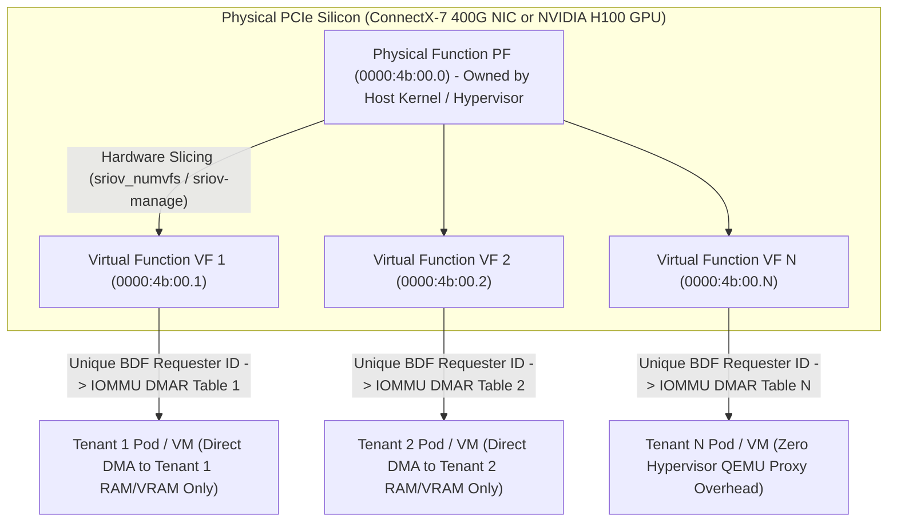
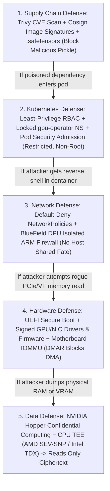

# 11.22 SR-IOV for NICs and GPUs

| | |
|---|---|
| Level | Advanced |
| Priority tier | 1 |
| Lab venue | GCP / GKE (plus local Python 3 simulation lab) |
| Part | Part 11: GPUs on Kubernetes, scheduling and virtualization |
| Sources used | Brendan Gregg, *Systems Performance: Enterprise and the Cloud*, 2nd Edition (`systems-performance-2nd-edition`, Addison-Wesley, 2020, Ch. 11 *Cloud Computing*); `nvidia-zero-to-hero/volume-18/chapter-07-dma-iommu-and-sriov-security.md`; `nvidia-zero-to-hero/volume-18/chapter-12-incident-response-and-troubleshooting.md`; `nvidia-zero-to-hero/volume-18/chapter-12-volume-18-summary.md`; `nvidia-zero-to-hero/volume-18/index.md`; `nvidia-zero-to-hero/volume-11/chapter-05-vgpu-architecture-and-enterprise-virtualization.md`; `nvidia-zero-to-hero/volume-23/chapter-13-ai-factory-architect-interview-cheatsheet.md` |
| Coverage file | `planning/coverage/chapters/11-22.md` |

## Why this matters for AI infrastructure

In Chapter 11.21, we saw that routing high-speed guest I/O through a software hypervisor proxy (`QEMU` or `Xen dom0`) adds **`5` to `10` extra control and data steps** per operation (*Systems Performance* Chapter 11, `[Qumranet 06]`), while passing an entire physical PCIe device (`vfio-pci`) to a single VM prevents sharing that `400G` ConnectX-7 NIC or `80 GB` H100 GPU across multiple tenants (`[Xen 19]`).

How do you get the **bare-metal performance of direct PCIe passthrough** *and* the **multi-tenant density of hardware sharing** on the same physical card? The PCIe specification answers this with **Single-Root I/O Virtualization (`SR-IOV`)** (`volume-18/chapter-07`, `volume-23/chapter-13`, and *Systems Performance* `11.2`):
- **SR-IOV for NICs (`ConnectX-6` / `ConnectX-7` / `BlueField-3`):** A single physical `400G` NIC (**Physical Function `PF`**) slices itself in silicon into dozens of independent **Virtual Functions (`VFs`)** (`sriov_numvfs`), each with its own PCIe `Bus:Device.Function` (`BDF`) address (`0000:4b:00.1`), hardware transmit/receive queues, and RDMA (`mlx5`) doorbells. Each Pod or VM attaches directly to its own `VF`, bypassing the hypervisor and host TCP/IP stack for line-rate GPUDirect RDMA.
- **SR-IOV for GPUs (`Ampere A100`, `Hopper H100`, `Ada L40S`, `Blackwell B200`):** Beginning with the NVIDIA Ampere architecture, NVIDIA data-center GPUs also implement hardware **SR-IOV** (`/usr/lib/nvidia/sriov-manage -e ALL`). When you deploy **NVIDIA vGPU** (`volume-11/chapter-05`) or pass a **MIG** instance into a KubeVirt / KVM guest VM, the GPU exposes each vGPU or MIG instance as a dedicated PCIe **SR-IOV Virtual Function (`VF`)** bound to `vfio-pci` (or mediated via the NVIDIA Virtual GPU Manager).

Yet SR-IOV introduces profound security, observability, and incident-response challenges (`volume-18/chapter-07`, `volume-18/chapter-12`, and *Systems Performance* `11.2.4`):
1. **SR-IOV without IOMMU is a DMA backdoor:** As we saw in `volume-18/chapter-07`, slicing a NIC into `VFs` does **not** restrict which host physical RAM addresses those `VFs` can DMA-read unless the motherboard **IOMMU (`Intel VT-d` / `AMD-Vi`, `intel_iommu=on`)** enforces per-VF DMA Remapping (`DMAR`) tables.
2. **SR-IOV makes I/O invisible to host `iostat`/`sar` (`SP 11.2.4`):** Because SR-IOV VFs talk straight to PCIe hardware, host OS block and network tools no longer see the traffic.
3. **Compromised GPU/SR-IOV nodes require forensic containment, not `kubectl delete pod` (`volume-18/chapter-12`):** When an attacker compromises a Jupyter pod or flashes a rogue firmware payload onto a NIC/GPU, deleting the pod or rebooting the host destroys volatile RAM/VRAM evidence and leaves the cluster open to ransomware.

## Prerequisites and outcomes

### Prerequisites
- Completion of Chapter 11.10 (Multus, SR-IOV Device Plugin, and RDMA Device Plugin), Chapter 11.11 (NVIDIA Network Operator), and Chapter 11.21 (PCIe, IOMMU, VFIO, and Device Passthrough).
- Familiarity with PCIe `BDF` notation (`0000:4b:00.0`) and Kubernetes `NetworkPolicy`.

### Outcomes
After completing this chapter, you will be able to:
- Explain the PCIe **Physical Function (`PF`)** and **Virtual Function (`VF`)** architecture of **SR-IOV** (and **MR-IOV**, *Systems Performance* `11.2.2`), compare **SR-IOV (for NICs)** with **MIG (for GPUs)** (`volume-23/chapter-13`), and configure SR-IOV VFs for both **ConnectX RDMA NICs** (`sriov_totalvfs`, `sriov_numvfs`) and **NVIDIA GPUs** (`/usr/lib/nvidia/sriov-manage -e ALL`).
- Diagnose SR-IOV performance and observability using Brendan Gregg's *Systems Performance* Chapter 11 methodology (`ixgbe`, `ena`, `hv_netvsc`, `nvme` drivers; why SR-IOV bypasses host `iostat`; `Calico` netfilter/iptables vs `Cilium` eBPF/Hubble; Linux `rdma` cgroup; and `tbf` token-bucket filter qdiscs for `kubernetes.io/ingress-bandwidth` and `egress-bandwidth`).
- Architect the **5-Layer Zero-Trust AI Defense-in-Depth Stack (`volume-18/chapter-12-volume-18-summary.md` & `volume-18/index.md`)** (`1. Supply Chain`: Trivy, Cosign, `.safetensors` -> `2. Kubernetes`: RBAC, PSA `Restricted` -> `3. Network`: `NetworkPolicy`, **BlueField DPU** isolated ARM firewall -> `4. Hardware`: Secure Boot, **IOMMU** -> `5. Data`: **NVIDIA Hopper Confidential Computing** + **AMD SEV-SNP** / **Intel TDX**) and audit clusters against the **14-Item Production Security Checklist**.
- Execute the **6-Step Security Incident Response & Forensic Containment Protocol (`volume-18/chapter-12-incident-response-and-troubleshooting.md`)** on a breached GPU/SR-IOV node (`gpu-node-42` / `jupyter-research-1`): `kubectl cordon` -> Quarantine `NetworkPolicy` (*"Isolate, don't terminate"*) -> RAM/VRAM forensic dump + API audit/image digest/DCGM power review -> global CVE patch -> **scorched-earth PXE OS re-image + GPU/ConnectX NIC vendor-signed firmware reflash** -> credential rotation.

## Concepts: basics to intermediate to advanced

### 1. Basics: How SR-IOV works on PCIe for ConnectX NICs and NVIDIA GPUs (`SP 11.2`, `volume-18/chapter-07`, & `volume-23/chapter-13`)

#### 1. Physical Functions (`PFs`) vs Virtual Functions (`VFs`)
In standard PCIe (`Chapter 11.21`), a single physical adapter card presents one primary PCIe function (`0000:4b:00.0`). If you pass `0000:4b:00.0` into `VM 1` via `vfio-pci`, `VM 2` through `VM 8` on that same server cannot use the card.

**Single-Root I/O Virtualization (`SR-IOV`)** (alongside **Multi-Root I/O Virtualization `MR-IOV`** for multi-root-complex fabrics, *Systems Performance* `11.2.2`) solves this inside the PCIe endpoint silicon by splitting the hardware into two function classes:
- **Physical Function (`PF`, e.g., `0000:4b:00.0`):** The full-featured PCIe function owned and managed exclusively by the **Host OS / Hypervisor** (`Node Plane`). The `PF` driver (`mlx5_core` for ConnectX NICs, or the NVIDIA Virtual GPU Manager / `nvidia` driver for GPUs) controls global hardware configuration, firmware flashing, and the creation or destruction of Virtual Functions via sysfs (`sriov_totalvfs` and `sriov_numvfs`).
- **Virtual Functions (`VFs`, e.g., `0000:4b:00.1`):** Lightweight hardware-sliced PCIe functions backed by dedicated transmit/receive queues, DMA channels, and doorbell registers on the silicon. Each `VF` has its own independent PCIe `BDF` Requester ID (`0000:4b:00.1`), meaning the motherboard **IOMMU (`Intel VT-d` / `AMD-Vi`)** places each `VF` into its own isolated **IOMMU Group** and **DMAR Access Table** (`volume-18/chapter-07`).



#### 2. Comparing SR-IOV for NICs vs SR-IOV & MIG for GPUs (`volume-23/chapter-13` & `volume-11/chapter-05`)
As `volume-23/chapter-13` ("4. Hardware Virtualization: SR-IOV & MIG") explains, **SR-IOV** and **MIG** are philosophically twins for different pieces of silicon—and on Ampere (`A100`), Hopper (`H100`/`H200`), Ada (`L40S`), and Blackwell (`B200`) GPUs, they actually work **together**:

| Hardware Dimension | SR-IOV on ConnectX-6 / ConnectX-7 NICs | SR-IOV + MIG on NVIDIA Data-Center GPUs (`A100` / `H100` / `L40S`) |
|---|---|---|
| **What Silicon Is Sliced?** | **Network Interface Card (`NIC`)** (and NVMe storage controllers in `AWS Nitro`, `SP 11.2.2`) | **GPU PCIe Bus Interface (`SR-IOV VFs`)** + **GPU Compute/Memory Silicon (`MIG` / `vGPU`)** |
| **Host PF Management Tool** | `mlxconfig -d <bdf> set SRIOV_EN=1 NUM_OF_VFS=16` + `echo 8 > .../sriov_numvfs` (or `sriov-network-operator`) | `/usr/lib/nvidia/sriov-manage -e ALL` (enables GPU VFs) + `nvidia-smi -mig 1` / **NVIDIA Virtual GPU Manager** (`nvidia-smi vgpu`) |
| **Two GPU SR-IOV Modes (`volume-11/chapter-05`)** | Each VF is an independent hardware RDMA/RoCEv2 or InfiniBand virtual HCA (`mlx5_vf`) | **1. Time-Sliced vGPU over SR-IOV VF:** Multiple VFs share the GPU's SMs (`NVIDIA GRID A100-20Q`, `2000MiB / 20000MiB`, `18W / 400W` in `volume-11/chapter-05`).<br/>**2. MIG-Backed vGPU over SR-IOV VF:** Each SR-IOV VF is backed by a hardware-isolated **MIG GPU Instance (`GI`)** (`1g.10gb`, `2g.20gb`, `3g.40gb`). |
| **Guest Driver & Licensing** | Standard inbox `mlx5_core` / `MLNX_OFED` VF driver (`ena`, `ixgbe`, `hv_netvsc` in cloud VMs, `SP 11.2`) | Guest VM loads the **NVIDIA Guest vGPU Driver** (must match the Host vGPU Manager compatibility matrix) and acquires an entitlement lease from the **NVIDIA License System (`NLS`)** (`volume-11/chapter-05`). |

---

### 2. Intermediate: Operating SR-IOV in Kubernetes and Brendan Gregg's observability & CNI rules (`SP 11.1.6`, `11.2.4`, & `11.3.3`)

#### 1. Exposing ConnectX NIC VFs and GPU VFs to Kubernetes Pods and KubeVirt VMs
In a Kubernetes AI cluster (Chapters 11.10–11.11), SR-IOV Virtual Functions are consumed through two primary paths:
1. **Container Secondary RDMA Networks (`Multus` + `sriov-network-device-plugin`):** The **NVIDIA Network Operator** (`SriovNetworkNodePolicy` with `deviceType: netdevice`, `isRdma: true`, `numVfs: 8`) writes `8` to `/sys/class/net/<pf>/device/sriov_numvfs`. When a training Pod requests `nvidia.com/hostdev: 1` (or `openshift.io/mlnx_connectx7: 1`), the SR-IOV Device Plugin moves one `VF` (`0000:4b:00.1`) into the Pod's network namespace (`net1`) and mounts its `/dev/infiniband/uverbs*` character devices (bounded by the Linux **`rdma` cgroup** from *Systems Performance* `Table 11.2`).
2. **Virtual Machine VF Passthrough (`vfio-pci` + `KubeVirt` / `Kata Containers`):** When `deviceType: vfio-pci` is configured (or `/usr/lib/nvidia/sriov-manage -e ALL` is run for GPU VFs), each `VF` is bound to `vfio-pci` and passed into a guest VM kernel with IOMMU DMAR isolation.

#### 2. The SR-IOV Observability Blind Spot and Kubernetes Network Controls (*Systems Performance* `11.1.6`, `11.2.4`, & `11.3.3`)
Brendan Gregg highlights three critical performance and observability facts in *Systems Performance* Chapter 11 whenever you combine SR-IOV, containers, and Kubernetes:
1. **Why SR-IOV Makes I/O Invisible to Host `iostat(1)` and `sar(1)` (`SP 11.2.4`):**
   - In a traditional KVM or Xen setup without SR-IOV, every guest packet or block request traverses the host kernel and `QEMU` / `dom0` I/O proxy, so host OS tools (`iostat`, `sar -n DEV`) see all tenant traffic.
   - Once **SR-IOV** (or `vfio-pci` passthrough, as used by `AWS Nitro` with `ena` and `nvme` drivers) is enabled, the guest driver talks directly to the VF hardware rings via DMA. **Host OS `iostat(1)` and host software interface counters no longer see the VF I/O.** Operators must query hardware Performance Monitoring Counters (`PMCs`), NIC physical-port ethtool/perfquery counters (`port_xmit_data`, `port_rcv_data`, `PortXmitWait`), or `DCGM-Exporter` metrics—or run BPF tools (`biosnoop(8)`, `tcplife`) inside the guest kernel.
2. **Primary CNI Overhead: `Calico` (`iptables`) vs `Cilium` (`eBPF` + `Hubble`, `SP 11.1.6 & 11.3.2`):**
   - While SR-IOV secondary networks handle east-west NCCL RDMA traffic, the primary Kubernetes network (`eth0`) handles control-plane, storage, and inference API traffic. As Gregg notes in `SP 11.1.6` and `11.3.2`, traditional CNIs like **Calico** (when using `netfilter`/`iptables`) and **`kube-proxy`** suffer first-packet CPU overhead when traversing large `iptables` rule sets across thousands of Kubernetes `Services`.
   - **Cilium** (`[Borkmann 19]`, `[Borkmann 20]`, `[Cilium 20a]`) replaces `iptables` and `kube-proxy` with in-kernel **eBPF (`BPF`)** programs attached at the `XDP`, `tc` (`qdisc`), and `cgroup` layers—and pairs with **Cilium Hubble** (`[Cilium 19]`) for flow observability.
3. **Software Bandwidth Shaping (`net_prio`, `net_cls`, and `tbf` qdiscs, `SP 11.3.3`):**
   - When containers share a non-SR-IOV host interface, Linux limits and prioritizes traffic using the **`net_prio`** cgroup (`SO_PRIORITY` socket priority), the **`net_cls`** cgroup (tagging packets with a class ID), and over **`50` Linux queueing disciplines (`qdiscs`)**. Specifically, Kubernetes implements the pod annotations **`kubernetes.io/ingress-bandwidth`** and **`kubernetes.io/egress-bandwidth`** by attaching a **Token Bucket Filter (`tbf`)** qdisc to the container's virtual interface (`[CNI 18]`).

---

### 3. Advanced: Zero-trust AI defense-in-depth and forensic incident response on SR-IOV / GPU nodes (`volume-18`)

Because SR-IOV and GPU sharing place multiple high-value AI workloads onto shared physical servers, a Senior Solutions Architect must engineer both **preventive Zero-Trust boundaries** (`volume-18/chapter-07`, `chapter-12-volume-18-summary.md`, `index.md`) and **non-destructive Forensic Incident Response (`IR`)** (`volume-18/chapter-12-incident-response-and-troubleshooting.md`).

#### 1. The 5-Layer Zero-Trust AI Defense-in-Depth Stack (`volume-18/chapter-12-volume-18-summary.md` & `index.md`)
Never rely on a single perimeter firewall. As `volume-18/chapter-12-volume-18-summary.md` illustrates, if an attacker sneaks a poisoned model into a pod, five concentric hardware-and-software layers contain the breach:



Let us examine why each layer in `volume-18` is mandatory on an SR-IOV / GPU node:
1. **Supply Chain Defense (`Layer 1`):** Ban mutable `:latest` image tags and Python `pickle` model checkpoints (which execute arbitrary code on `torch.load`). Scan images with **Trivy**, sign them with **Cosign**, enforce signature verification in a Kubernetes **Admission Controller**, and convert all model weights to the non-executable **`.safetensors`** format.
2. **Kubernetes Defense (`Layer 2`):** Lock down the `gpu-operator` and `network-operator` namespaces with strict RBAC, and enforce **Pod Security Admission (`PSA`)** set to **`Restricted`** on all tenant namespaces so no data scientist can launch a `root` or `privileged` container to tamper with `/sys/class/net/.../sriov_numvfs` or host drivers.
3. **Network & DPU Micro-Segmentation (`Layer 3`):** Host-based software firewalls (`iptables`) suffer from the **Shared Fate** problem: if an attacker compromises the host OS kernel, they simply flush the host firewall rules. Offloading network policies and encryption onto an **NVIDIA BlueField DPU** runs the firewall on physically isolated **ARM cores**, stopping lateral movement even if the x86 host OS is compromised.
4. **Hardware Trust & IOMMU (`Layer 4`, `volume-18/chapter-07`):** Enforce **UEFI Secure Boot**, signed kernel modules, and vendor-signed GPU/ConnectX NIC firmware, and enable the motherboard **IOMMU (`Intel VT-d` / `AMD-Vi`, `intel_iommu=on`)** so no SR-IOV Virtual Function can DMA-read host management RAM.
5. **Confidential Computing (`Layer 5`):** Even if an attacker or rogue hypervisor administrator dumps physical RAM or snoops the PCIe bus, **NVIDIA Hopper (`H100`) Confidential Computing** paired with a CPU Trusted Execution Environment (**AMD SEV-SNP** or **Intel TDX**) encrypts GPU VRAM and all CPU-to-GPU PCIe bounce-buffer transfers in hardware.

#### 2. Security Incident Response: "Isolate, Don't Terminate" (`volume-18/chapter-12-incident-response-and-troubleshooting.md`)
Suppose your Intrusion Detection System (`IDS`) or DCGM anomaly detector alerts that a Jupyter notebook pod (`jupyter-research-1`) on `gpu-node-42` is scanning internal corporate SSH (`port 22`) or mining cryptocurrency (`DCGM` power pinned near max TDP for hours on a bursty inference node).

- **The Fatal Junior Mistake (`kubectl delete pod` or `reboot`):** In the `volume-18/chapter-12` Customer Scenario, the platform engineer immediately ran `kubectl delete pod jupyter-research-1` to stop the `port 22` scan and marked the ticket resolved. Deleting the pod (or rebooting `gpu-node-42`) **wiped volatile System RAM and GPU VRAM**, destroying the attacker's bash history, active network sockets, and memory payload—leaving the underlying Jupyter CVE unpatched. One week later, the attacker re-entered through the exact same CVE and encrypted the entire cluster with **ransomware**.
- **The Senior 6-Step Forensic Containment & Scorched-Earth Eradication Protocol (`volume-18/chapter-12`):**

| Step | Phase | Exact Action / Command | Why This Ordering Is Mandatory |
|---|---|---|---|
| **1** | **Cordon the Crime Scene** | `kubectl cordon gpu-node-42` | Prevents the scheduler from placing new clean pods onto the compromised node while keeping existing pods alive. |
| **2** | **Network Quarantine (*"Isolate, Don't Terminate"*)** | Apply a **Deny-All Quarantine `NetworkPolicy`** (or ToR switch / DPU ACL) dropping all ingress/egress except the forensic workstation IP. | Traps the attacker inside the running container (`air-gapped cage`) without clearing volatile RAM or GPU VRAM. |
| **3** | **Capture Volatile Forensics** | Snapshot VM/host RAM + GPU VRAM (`kubectl debug`), inspect **Kubernetes API Audit Logs** (compromised `ServiceAccount`?), verify **container image digest** vs registry, and review **DCGM power/thermal traces**. | Identifies the exact entry vector (e.g., unpatched PyTorch/Jupyter CVE or leaked token) before any process is killed. |
| **4** | **Patch Root Vulnerability Globally** | Patch the exploited CVE and admission policy across all namespaces and images. | Guarantees the attacker cannot immediately re-exploit the cluster the moment the pod is removed. |
| **5** | **Scorched-Earth Hardware Wipe & Firmware Reflash** | **Never "clean" a breached node—destroy it:** PXE re-image the bare-metal OS **and reflash both the GPU and ConnectX NIC firmware with vendor-signed images**. | Eradicates persistent rootkits hidden in the Linux kernel or flashed into the ConnectX NIC / GPU silicon firmware. |
| **6** | **Credential Rotation & Rejoin** | Rotate all **Kubernetes Secrets, Registry tokens, and S3 API keys** that ever resided on `gpu-node-42`, then `kubectl uncordon gpu-node-42`. | Invalidates any credentials the attacker read from memory before quarantine took effect. |

#### 3. The 14-Item Production Security Checklist for SR-IOV and GPU Clusters (`volume-18/index.md`)
Before promoting a multi-tenant SR-IOV + GPU cluster into production, `volume-18/index.md` ("Key Principles" and "Production Checklist") mandates five architectural principles (**1. Defense in depth**, **2. Trust verification**, **3. Evidence over assertions**, **4. Explicit trade-offs**, and **5. Insider threat awareness**) backed by a **14-item verification checklist**:

| Security Domain | Production Verification Gate (`volume-18/index.md`) | How to Audit on a Live GPU / SR-IOV Node |
|---|---|---|
| **1. Hardware & Firmware Root of Trust** | 1. **UEFI Secure Boot** enabled on all nodes with audited boot logs.<br/>2. **Kernel module signing** enforced and NVIDIA GPU / ConnectX NIC drivers signed.<br/>8. **IOMMU** (`Intel VT-d` / `AMD-Vi`) enabled and configured with DMA faults monitored. | Check `mokutil --sb-state`, `modinfo nvidia \| grep sig`, and `dmesg \| grep -E -i "DMAR\|IOMMU"`. |
| **2. Container & Model Supply Chain** | 3. **Container images scanned for CVEs** (Trivy); only approved digests deployed (never `:latest`).<br/>11. **Model artifacts signed and verified** (Cosign + `.safetensors`, never untrusted Python `pickle`) before deployment. | Verify admission controller rejects unsigned images and scan model repositories for `.bin`/`.pt` pickle files. |
| **3. Kubernetes RBAC & Pod Security** | 4. **Least-privilege RBAC** deployed and verified for all tenant workloads (`gpu-operator` locked down).<br/>5. **Pod Security Standards (`Restricted`)** enforced at admission time (no `root` or `privileged` containers). | Inspect namespace labels `pod-security.kubernetes.io/enforce: restricted` and test admission with a root pod spec. |
| **4. Network, DPU & GPU Isolation** | 6. **Default-deny `NetworkPolicies`** deployed with explicit allow rules.<br/>7. **GPU isolation verified** (`MIG` or dedicated GPUs for sensitive/zero-trust workloads; never time-slicing across untrusted tenants).<br/>9. **BlueField DPU** deployed with isolated ARM security policy enforcement (where applicable). | Verify `nvidia-smi mig -lgi`, test cross-namespace packet drops, and confirm DPU OVS/firewall offload state. |
| **5. Confidential Compute & Data Protection** | 10. **Confidential Computing** (`NVIDIA Hopper H100 CC` + `AMD SEV-SNP` / `Intel TDX`) enabled for high-value models (where available), with KMS encryption at rest and model watermarking. | Verify CPU TEE state and GPU Confidential Computing mode (`nvidia-smi conf-compute -f`). |
| **6. Audit Logging & Quarterly IR Drills** | 12. **Centralized audit logging** enabled with compliance retention.<br/>13. **Incident response playbooks** (`Cordon -> Quarantine NetworkPolicy -> RAM/VRAM dump -> PXE + Firmware reflash`) written and **tested quarterly**.<br/>14. **Security assessments** completed with compliance evidence collected. | Review quarterly Game Day / IR drill reports and verify Kubernetes audit logs stream to immutable storage. |

## Commands and configurations that matter

### 1. Enabling SR-IOV Virtual Functions on a ConnectX-7 NIC and an NVIDIA H100 GPU

```bash
# 1. Enable 8 SR-IOV VFs on a ConnectX-7 PF (0000:4b:00.0 / ens1f0np0) after verifying IOMMU (untested here)
dmesg | grep -E -i "DMAR|IOMMU"
echo 8 | sudo tee /sys/class/net/ens1f0np0/device/sriov_numvfs
lspci | grep -i "Mellanox"

# 2. Enable SR-IOV Virtual Functions on NVIDIA GPUs for vGPU / MIG-backed VM passthrough (untested here)
sudo /usr/lib/nvidia/sriov-manage -e ALL
nvidia-smi vgpu -s
nvidia-smi vgpu
```

### 2. Forensic Containment Quarantine `NetworkPolicy` (`volume-18/chapter-12`)

```yaml
# quarantine-compromised-gpu-pod.yaml ("Isolate, don't terminate", untested here)
apiVersion: networking.k8s.io/v1
kind: NetworkPolicy
metadata:
  name: quarantine-jupyter-research-1
  namespace: research
spec:
  podSelector:
    matchLabels:
      app: jupyter-research-1
  policyTypes:
    - Ingress
    - Egress
  ingress:
    - from:
        - ipBlock:
            cidr: 10.250.99.10/32   # Allow ONLY the Security Forensics collector IP
  egress: []                        # Drop 100% of outbound traffic (cages the attacker)
```

### 3. Checking Host vs Guest vGPU State (`volume-11/chapter-05`)

```bash
# 1. Host-side vGPU Manager check (before entering guest VM, untested here)
nvidia-smi vgpu
nvidia-smi vgpu -q

# 2. Guest-side vGPU & license verification inside the VM (untested here)
lspci | grep -i nvidia
nvidia-smi --query-gpu=driver_version,vbios_version,gpu_uuid --format=csv
nvidia-smi -q | grep -A 5 "vGPU Software Licensed Product"
```

## How it fails

| Failure mode | Exact symptom & command evidence | Root cause boundary | Remediation |
|---|---|---|---|
| **1. Responder runs `kubectl delete pod` on a compromised GPU notebook scanning `port 22`, and ransomware hits the cluster a week later (`volume-18/chapter-12`)** | IDS alerts on outbound `port 22` scan or crypto-mining pool; deleting the pod stops the alert immediately, but the attacker returns days later via the same unpatched CVE. | **Destruction of Volatile RAM/VRAM Forensic Evidence:** Deleting the pod or rebooting the node wipes volatile memory and bash/socket state without identifying or patching the entry CVE. | Follow the **6-Step Forensic Containment Protocol**: `kubectl cordon` -> apply a Deny-All **Quarantine `NetworkPolicy`** -> dump RAM/VRAM and audit logs -> patch the CVE globally -> PXE re-image OS + reflash GPU/NIC firmware -> rotate all Secrets. |
| **2. Writing `32` to `sriov_numvfs` fails with `Numerical result out of range` (`EINVAL` / `ERANGE`)** | `echo 32 > /sys/class/net/ens1f0np0/device/sriov_numvfs` fails, and `cat .../sriov_totalvfs` prints `16`. | **Firmware `NUM_OF_VFS` Ceiling (`sriov_totalvfs`):** The NIC's non-volatile firmware configuration (`mlxconfig`) only allocated PCIe BAR space for `16` VFs. | Configure `mlxconfig -d <bdf> set SRIOV_EN=1 NUM_OF_VFS=32`, perform a cold/firmware reboot of the node, and verify `cat sriov_totalvfs` equals `32`. |
| **3. Host `iostat -sxz 1` and `sar -n DEV 1` show `0` traffic while SR-IOV tenant VMs saturate a `400G` NIC (`SP 11.2.4`)** | Tenant VMs drive `400 Gbps` of RoCEv2/RDMA traffic, but standard Linux host OS network and block counters appear completely idle. | **SR-IOV Host Kernel Bypass (`SP 11.2.4`):** SR-IOV VFs DMA directly between guest memory and NIC hardware rings, bypassing the host OS kernel network stack and `QEMU` proxy. | Monitor hardware port counters (`perfquery`, `ethtool -S` physical port metrics, PMCs, `DCGM`), or run eBPF tools (`biosnoop`, `tcplife`) inside the guest VM's dedicated kernel. |
| **4. Compromised x86 host OS flushes its local `iptables` firewall rules and moves laterally across the AI cluster (`volume-18/chapter-12-volume-18-summary.md`)** | Attacker escapes a container onto the host kernel and runs `iptables -F`, disabling host software micro-segmentation. | **Host Firewall "Shared Fate" Anti-Pattern:** Running the security enforcement plane on the same x86 host kernel as untrusted workloads means a host compromise disables the firewall. | Offload micro-segmentation and zero-trust firewall enforcement onto an **NVIDIA BlueField DPU**, whose isolated ARM processors enforce network policy independently of the x86 host OS. |
| **5. Guest VM with NVIDIA vGPU (`GRID A100-20Q`) boots and runs `nvidia-smi`, but CUDA throughput throttles after a grace period (`volume-11/chapter-05` Scenario 2)** | `nvidia-smi` inside the guest shows `Memory: 2000MiB / 20000MiB` and `Temp: 45C`, but `nvidia-smi -q` reports `vGPU Software Licensed Product: Unlicensed`. | **Unlicensed Guest vGPU Entitlement (`NLS`):** The guest vGPU driver checks out its license directly from the **NVIDIA License System (`NLS`)**; DNS, firewall, or certificate failure blocked lease acquisition. | Verify guest network/DNS reachability and TLS trust to the NLS / DLS endpoint, validate license edition against the assigned vGPU profile on a single canary VM, and confirm `nvidia-smi -q` shows `Licensed`. |

## Hands-on lab

### Venue and scope
This lab runs locally using Python 3 standard library (`code/part11/sriov_for_nics_and_gpus.py` and `code/part11/sriov_for_nics_and_gpus_lab.py`) to simulate SR-IOV `PF -> VF` allocation and security validation for ConnectX-7 `400G` NICs (`sriov_totalvfs`, `sriov_numvfs`) and NVIDIA H100/A100 GPUs (`/usr/lib/nvidia/sriov-manage -e`, time-sliced vs MIG-backed vGPU VFs), Brendan Gregg's *Systems Performance* Chapter 11 SR-IOV observability and CNI rules, the `volume-18` 5-Layer Zero-Trust AI Defense-in-Depth Stack, and the 6-Step Forensic Incident Response & Scorched-Earth Eradication Playbook (`gpu-node-42` / `jupyter-research-1`). Host and cluster commands are marked `(untested here)`.

### Step 1: Run the self-checking SR-IOV for NICs and GPUs lab (tested here)

Run the lab script from the repository root:

```bash
python3 code/part11/sriov_for_nics_and_gpus_lab.py
```

Captured output from this repository:
```text
=== Chapter 11.22 Lab: SR-IOV for NICs & GPUs, Zero-Trust Defense & Forensic IR ===
  [PASS] ConnectX-7 SR-IOV VF allocation is rejected when IOMMU (Intel VT-d / AMD-Vi) is disabled
  [PASS] ConnectX-7 SR-IOV VF allocation is rejected when NIC firmware signature is unverified
  [PASS] Requesting numVfs=32 above hardware sriov_totalvfs=16 is rejected
  [PASS] ConnectX-7 PF (0000:4b:00.0) with IOMMU enabled activates 8 VFs via sriov_numvfs
  [PASS] SP 11.2.4: SR-IOV VFs bypass hypervisor I/O proxy so host iostat/sar visibility is False
  [PASS] NVIDIA H100 GPU enables 16 SR-IOV VFs via /usr/lib/nvidia/sriov-manage -e for time-sliced vGPU
  [PASS] NVIDIA A100 GPU with MIG enabled exposes 7 MIG-backed SR-IOV VFs for hardware-isolated VMs
  [PASS] Volume 18 Summary defines 5 Zero-Trust layers (Supply Chain, Kubernetes, Network, Hardware, Data)
  [PASS] Layer 1 Supply Chain mandates Trivy CVE scans, Cosign signatures, and .safetensors instead of pickle
  [PASS] Layer 2 Kubernetes mandates least-privilege RBAC and Pod Security Admission (PSA) set to Restricted
  [PASS] Layer 3 Network pairs NetworkPolicies with BlueField DPU isolated ARM firewalls to eliminate Shared Fate
  [PASS] Layer 4 Hardware mandates UEFI Secure Boot, signed drivers/firmware, and motherboard IOMMU
  [PASS] Layer 5 Data mandates NVIDIA Hopper Confidential Computing paired with CPU TEEs (AMD SEV-SNP / Intel TDX)
  [PASS] Volume 18 Ch 12: Running kubectl delete pod on jupyter-research-1 destroys RAM/VRAM evidence and leaves HIGH ransomware risk
  [PASS] Volume 18 Ch 12: Rebooting compromised gpu-node-42 wipes volatile RAM and GPU VRAM forensics
  [PASS] Volume 18 Ch 12: 6-step Forensic Containment Protocol preserves evidence, patches CVE, and sets reinfection risk to LOW
  [PASS] Forensic IR Step 1 cordons gpu-node-42 and Step 2 applies a Deny-All Quarantine NetworkPolicy ('Isolate, don't terminate')
  [PASS] Forensic IR Step 3 captures RAM/VRAM snapshots, K8s API audit logs, container image digest, and DCGM power/thermal traces
  [PASS] Forensic IR Step 5 executes scorched-earth PXE OS re-image + reflashes GPU and ConnectX NIC firmware with vendor-signed images
  [PASS] Forensic IR Step 6 rotates all Kubernetes Secrets, Registry tokens, and S3 API keys present on gpu-node-42
  [PASS] SP 11.2 lists SR-IOV and MR-IOV hardware virtualization drivers (ixgbe, ena, hv_netvsc, nvme)
  [PASS] SP 11.1.6 & 11.3.3 contrast Calico (netfilter/iptables) with Cilium (eBPF kube-proxy replacement & Hubble) and tbf qdiscs
  [PASS] SP 11.3.1 Table 11.2 includes the Linux rdma cgroup controller for limiting RDMA and InfiniBand resource usage
  [PASS] Volume 11 Ch 5 NVIDIA vGPU uses SR-IOV VFs (GRID A100-20Q: 45C, 18W/400W, 2000MiB/20000MiB) + NVIDIA License System (NLS)
  [PASS] Volume 18 Index defines a 14-item Production Security Checklist spanning Secure Boot, IOMMU, PSA, DPUs, and quarterly IR drills

Summary: 25 passed, 0 failed out of 25 checks.
```

### Exercises

1. **Exercise 1 — ConnectX NIC vs NVIDIA GPU SR-IOV (`allocate_sriov_virtual_functions`):** Using `code/part11/sriov_for_nics_and_gpus.py`, state the exact sysfs path or helper script used to activate Virtual Functions on (a) a ConnectX-7 `400G` NIC (`0000:4b:00.0`) and (b) an NVIDIA H100/A100 GPU (`0000:8a:00.0`), and explain how time-sliced vGPU VFs differ from MIG-backed vGPU VFs (`volume-11/chapter-05`).
2. **Exercise 2 — SR-IOV + IOMMU security validation (`volume-18/chapter-07`):** Explain why `allocate_sriov_virtual_functions()` rejects creating SR-IOV VFs when `iommu_enabled=False` or `firmware_signed_and_verified=False`, and describe what happens at the PCIe hardware level when a VF attempts an unauthorized DMA read while IOMMU is active.
3. **Exercise 3 — SR-IOV observability and Kubernetes CNI/qdisc controls (*Systems Performance* `11.1.6`, `11.2.4`, & `11.3.3`):** Explain why `host_iostat_visible` is `False` for SR-IOV devices, name the four SR-IOV/hardware-virtualized guest drivers cited by Brendan Gregg in *Systems Performance* `11.2`, contrast **Calico** (`iptables`) with **Cilium** (`eBPF` + `Hubble`), and state which Linux qdisc implements `kubernetes.io/ingress-bandwidth` and `egress-bandwidth`.
4. **Exercise 4 — Designing the 5-Layer Zero-Trust AI Defense-in-Depth Stack (`volume-18/chapter-12-volume-18-summary.md`):** Using `FIVE_ZERO_TRUST_AI_LAYERS`, list the five defense layers in order, state the specific controls at each layer, and explain why **BlueField DPUs** solve the host firewall "Shared Fate" problem.
5. **Exercise 5 — Executing the 6-Step Forensic Containment Protocol (`volume-18/chapter-12`):** Using `FORENSIC_IR_PLAYBOOK_STEPS` and `evaluate_security_incident_response()`, explain why running `kubectl delete pod jupyter-research-1` after a `port 22` scan led to a cluster-wide ransomware outage, and list all six steps of the senior forensic IR workflow in order.
6. **Exercise 6 — Auditing the 14-item Volume 18 Production Security Checklist (`volume-18/index.md`):** Group the 14 checklist items from `volume-18/index.md` across Hardware/Boot, Supply Chain/Models, Kubernetes/Network/GPU Isolation, Confidential Compute/KMS, and Audit/Incident Response.

## Checkpoint questions

<details>
<summary><strong>1. What is the difference between a Physical Function (PF) and a Virtual Function (VF) in PCIe Single-Root I/O Virtualization (SR-IOV)?</strong></summary>

- **Physical Function (`PF`):** The primary PCIe function (`0000:4b:00.0`) managed by the host OS or hypervisor that owns global device configuration, firmware updates, and the creation/destruction of Virtual Functions (`sriov_numvfs`).
- **Virtual Function (`VF`):** A lightweight, hardware-sliced PCIe function (`0000:4b:00.1..N`) with its own unique PCIe `BDF` Requester ID, DMA channels, and hardware queues that can be passed directly into a container or guest VM for bare-metal I/O speed without hypervisor proxy overhead.
</details>

<details>
<summary><strong>2. Why does Volume 23 Chapter 13 compare SR-IOV and MIG as "philosophically the same thing, but for different pieces of silicon"?</strong></summary>

**SR-IOV** slices a physical **Network Interface Card (`NIC`)** at the PCIe silicon level into isolated Virtual Functions (`VFs`) that bypass the software hypervisor, while **MIG (Multi-Instance GPU)** slices a physical **GPU** at the silicon level into isolated GPU Instances with dedicated SMs, HBM memory channels, and L2 cache banks.
</details>

<details>
<summary><strong>3. How does an NVIDIA Ampere, Hopper, Ada, or Blackwell GPU use SR-IOV (/usr/lib/nvidia/sriov-manage -e ALL) when running NVIDIA vGPU or MIG-backed VMs (Volume 11 Chapter 5)?</strong></summary>

Enabling GPU SR-IOV via `/usr/lib/nvidia/sriov-manage -e ALL` exposes hardware PCIe Virtual Functions (`VFs`) on the GPU so that either **time-sliced vGPUs** or **MIG-backed vGPUs** (where each VF maps to a hardware-isolated MIG GPU Instance) can be assigned directly to guest VMs via the hypervisor and NVIDIA Virtual GPU Manager.
</details>

<details>
<summary><strong>4. What four example SR-IOV / hardware-virtualized device drivers are named in Brendan Gregg's Systems Performance Chapter 11 (Section 11.2), and what is the difference between SR-IOV and MR-IOV?</strong></summary>

- **Example drivers (`SP 11.2`):** `ixgbe` (Intel `10GbE`), `ena` (AWS Elastic Network Adapter), `hv_netvsc` (Microsoft Hyper-V network VSC), and `nvme` (NVMe storage).
- **SR-IOV vs MR-IOV (`SP 11.2.2`):** **Single-Root I/O Virtualization (`SR-IOV`)** exposes virtual functions across a single PCIe Root Complex (one physical server), whereas **Multi-Root I/O Virtualization (`MR-IOV`)** exposes virtual functions across multiple PCIe Root Complexes (multiple servers sharing a PCIe fabric).
</details>

<details>
<summary><strong>5. Why does SR-IOV make guest disk and network I/O invisible to host OS tools like iostat(1) and sar(1), and how should operators observe SR-IOV I/O instead (Systems Performance Section 11.2.4)?</strong></summary>

Because SR-IOV Virtual Functions allow the guest OS driver to communicate directly with the NIC or storage hardware via DMA, bypassing the host OS kernel's block/network stack and any `QEMU` / `dom0` I/O proxy. Operators must inspect hardware Performance Monitoring Counters (`PMCs` / physical NIC port counters / `DCGM`) or run kernel tracing tools (`perf`, `Ftrace`, BPF `biosnoop`) inside the guest VM's dedicated kernel.
</details>

<details>
<summary><strong>6. In Systems Performance Sections 11.1.6 and 11.3.2, why can Calico and kube-proxy incur CPU overhead at scale, and how does Cilium eliminate that overhead?</strong></summary>

When a Kubernetes cluster scales to thousands of `Services`, **Calico** (in `netfilter`/`iptables` mode) and **`kube-proxy`** must evaluate long sequential `iptables` rule lists, adding first-packet and per-packet CPU overhead. **Cilium** (`[Borkmann 19]`, `[Borkmann 20]`) replaces both `iptables` and `kube-proxy` with in-kernel **eBPF (`BPF`)** programs attached to `XDP`, `tc` (`qdiscs`), and `cgroup` hooks.
</details>

<details>
<summary><strong>7. How does Linux implement the Kubernetes pod annotations kubernetes.io/ingress-bandwidth and kubernetes.io/egress-bandwidth, and which cgroup limits RDMA resources (Systems Performance Section 11.3.1 & 11.3.3)?</strong></summary>

- Kubernetes implements `kubernetes.io/ingress-bandwidth` and `kubernetes.io/egress-bandwidth` by attaching a Linux **Token Bucket Filter (`tbf`)** queueing discipline (`qdisc`, out of `> 50` Linux qdisc types, alongside `net_prio` and `net_cls` cgroups) to the Pod's virtual network interface (`[CNI 18]`).
- The Linux **`rdma` cgroup** (`Table 11.2`) limits RDMA and InfiniBand HCA resource usage per container.
</details>

<details>
<summary><strong>8. Why is SR-IOV alone insufficient to stop a malicious tenant from reading host memory, and what hardware control completes the boundary (Volume 18 Chapter 7)?</strong></summary>

SR-IOV partitions the NIC into separate Virtual Functions (`VFs`), but each `VF` is still a PCIe bus master capable of issuing Direct Memory Access (`DMA`) requests to any physical address unless restricted. You must enable the motherboard **IOMMU (`Intel VT-d` / `AMD-Vi`, `intel_iommu=on`)** so the hardware IOMMU checks every VF's PCIe Requester ID against its **DMA Remapping (`DMAR`) Access Table** and blocks unauthorized host memory reads with a DMAR fault.
</details>

<details>
<summary><strong>9. In Volume 11 Chapter 5, what are the four checks to run in order when a guest VM with an NVIDIA vGPU boots but sees no usable GPU or suffers throttled performance?</strong></summary>

1. **Check the Host (`nvidia-smi vgpu` / `nvidia-smi vgpu -s` / `-c`):** Verify the physical GPU is healthy, the Virtual GPU Manager is loaded, and the VM has an active vGPU assignment.
2. **Check Guest PCIe Enumeration (`lspci | grep NVIDIA`):** Confirm the guest OS sees the virtual NVIDIA PCIe device (`VF` / `mdev`).
3. **Check Guest License State (`nvidia-smi -q` inside the guest):** Confirm `"vGPU Software Licensed Product"` reports `Licensed` from the NVIDIA License System (`NLS`).
4. **Check Hypervisor VM XML (`virsh dumpxml <vm-name> | grep vgpu`):** Confirm the vGPU profile attachment exists in the VM definition.
</details>

<details>
<summary><strong>10. Why does a guest VM running NVIDIA vGPU see a different GPU UUID in nvidia-smi --query-gpu=gpu_uuid than the host's physical GPU UUID (Volume 11 Chapter 5)?</strong></summary>

Because the guest OS does not see the physical GPU directly; it sees the **virtual GPU device (`vGPU`, such as `NVIDIA GRID A100-20Q`, `Memory: 2000MiB / 20000MiB`)** presented by the NVIDIA Virtual GPU Manager, which has its own distinct virtual device UUID and lifecycle.
</details>

<details>
<summary><strong>11. List the five layers of the Zero-Trust AI Defense-in-Depth Architecture in Volume 18 Chapter 12 Summary.</strong></summary>

1. **Supply Chain Defense:** Trivy CVE scanning, Cosign image signatures, Admission Controller enforcement, and `.safetensors` model format.
2. **Kubernetes Defense:** Least-privilege RBAC, locked-down `gpu-operator` namespace, and Pod Security Admission (`PSA`) set to `Restricted`.
3. **Network Defense:** Default-deny `NetworkPolicies` and **BlueField DPU** hardware-isolated firewalls.
4. **Hardware Defense:** UEFI Secure Boot, signed drivers/firmware, and motherboard **IOMMU**.
5. **Data Defense:** **NVIDIA Hopper Confidential Computing** paired with CPU TEEs (**AMD SEV-SNP** / **Intel TDX**) so VRAM dumps yield only ciphertext.
</details>

<details>
<summary><strong>12. Why must enterprise AI supply chains convert model weights from Python pickle (.bin / .pt) to .safetensors (Volume 18 Summary)?</strong></summary>

Python's `pickle` format is an executable serialization format: loading a malicious `.bin` or `.pt` file with `torch.load()` can execute arbitrary attacker Python/shell code inside the GPU container. The **`.safetensors`** format stores pure tensor buffers and metadata without executable code paths, eliminating model-deserialization remote code execution.
</details>

<details>
<summary><strong>13. What is the "Shared Fate" firewall problem on a GPU worker node, and how does an NVIDIA BlueField DPU solve it (Volume 18 Summary)?</strong></summary>

When firewall and encryption rules run on the host's x86 CPU kernel (`iptables`), they share the fate of the host OS: if an attacker escapes a container and gains host root, they can disable the firewall immediately. An **NVIDIA BlueField DPU** offloads firewall, zero-trust micro-segmentation, and encryption onto **physically isolated ARM cores** on the DPU card, so a compromised x86 host OS cannot disable network enforcement or move laterally.
</details>

<details>
<summary><strong>14. How does NVIDIA Hopper Confidential Computing protect proprietary model weights against a compromised hypervisor or host administrator (Volume 18 Summary & Index)?</strong></summary>

By pairing **NVIDIA Hopper (`H100`) GPU Confidential Computing mode** with a CPU Trusted Execution Environment (**AMD SEV-SNP** or **Intel TDX**) and remote attestation, model weights and inference prompts stay encrypted in memory and across PCIe CPU-to-GPU transfers, so a host memory or VRAM dump reads only ciphertext.
</details>

<details>
<summary><strong>15. What is the Golden Rule of Security Incident Response in Volume 18 Chapter 12 when an IDS alerts on a compromised GPU Pod or Node?</strong></summary>

**"Isolate, don't terminate."** Never immediately run `kubectl delete pod` or reboot the server, because doing so wipes volatile System RAM and GPU VRAM, destroying the attacker's forensic footprint (active network connections, decrypted payloads, bash history) and leaving the root vulnerability open for re-exploitation.
</details>

<details>
<summary><strong>16. Walk through the three containment steps a Senior SRE executes immediately when gpu-node-42 alerts for outbound crypto-mining (Volume 18 Chapter 12 Section 1).</strong></summary>

1. **Cordon the node:** `kubectl cordon gpu-node-42` so Kubernetes schedules no new workloads onto the crime scene.
2. **Network Quarantine:** Apply a `NetworkPolicy` (or Top-of-Rack switch / hypervisor / DPU rule) dropping all inbound and outbound traffic to the pod/node **except** the security team's forensic management IP.
3. **Volatile Snapshot:** Capture an immediate snapshot of VM/host RAM, GPU VRAM, and disk state (`kubectl debug`) for forensic analysis before terminating anything.
</details>

<details>
<summary><strong>17. What three AI-specific forensic artifacts should responders inspect during a GPU cluster breach investigation (Volume 18 Chapter 12 Section 2)?</strong></summary>

1. **Kubernetes API Audit Logs:** Determine which `ServiceAccount` or user identity deployed the malicious pod.
2. **Container Image Digest:** Compare the running image hash on the node against the signed registry to see if the Admission Controller was bypassed.
3. **DCGM Telemetry:** Inspect GPU power draw, utilization, and thermal curves (sustained flat max-TDP power draw on a bursty inference or idle node is a classic indicator of unauthorized cryptocurrency mining).
</details>

<details>
<summary><strong>18. Why does Volume 18 Chapter 12 Section 3 state "You never 'clean' a compromised server. You destroy it," and what four eradication steps are required before gpu-node-42 can rejoin the cluster?</strong></summary>

If an attacker gained root on a GPU node, they may have installed kernel rootkits or flashed malicious firmware into the GPU or ConnectX NIC silicon. You must:
1. **Re-image the bare-metal server OS** via an automated PXE boot pipeline from an immutable image.
2. **Reflash both the GPU and ConnectX NIC firmware** with vendor-signed images and verify their versions.
3. **Rotate all credentials** (Kubernetes `Secrets`, container registry tokens, S3 API keys) that were present on that node.
4. **Rejoin (`kubectl uncordon`)** only after the exploited CVE is patched cluster-wide.
</details>

<details>
<summary><strong>19. In the Volume 18 Chapter 12 Customer Scenario, trace the exact chain of events from the initial port 22 network scan in jupyter-research-1 to the cluster-wide ransomware outage one week later.</strong></summary>

1. An attacker exploited an unpatched vulnerability in `jupyter-research-1` and began scanning internal port `22`.
2. The platform engineer ran `kubectl delete pod jupyter-research-1`, which stopped the scan but destroyed all volatile memory/process evidence.
3. Because forensics were destroyed, the security team never identified or patched the entry CVE.
4. Days later, the attacker used the exact same CVE to compromise a new pod, moved laterally across the cluster, and deployed ransomware.
</details>

<details>
<summary><strong>20. Name the 14 items in the Volume 18 Production Security Checklist (Volume 18 Index).</strong></summary>

1. Secure Boot enabled on all nodes with audited boot logs.
2. Kernel module signing enforced and GPU drivers signed.
3. Container images scanned for CVEs; only approved versions deployed.
4. Least-privilege RBAC policies deployed and verified.
5. Pod Security Standards (`Restricted`) enforced at admission time.
6. Default-deny `NetworkPolicies` deployed with explicit allow rules.
7. GPU isolation verified (`MIG` or dedicated GPUs for sensitive workloads).
8. **IOMMU** enabled and configured with DMA faults monitored.
9. **BlueField DPU** deployed with security policy enforcement (where applicable).
10. **Confidential Computing** enabled for high-value models (where available).
11. Model artifacts signed and verified (`.safetensors` / Cosign) before deployment.
12. Centralized audit logging enabled with compliance retention.
13. Incident response playbooks written and tested quarterly.
14. Security assessments completed with compliance evidence collected.
</details>

## Sources and review notes

### Primary sources read in full for this chapter
- Book sources from the local TOON-RAG corpus (mapped in `brief.py 11.22` as `SP 11`):
  - Brendan Gregg, *Systems Performance: Enterprise and the Cloud*, 2nd Edition (`systems-performance-2nd-edition`, Addison-Wesley, 2020), Chapter 11 (*Cloud Computing*, Sections `11.1` through `11.8`: `SR-IOV` and `MR-IOV` hardware virtualization drivers `ixgbe`, `ena`, `hv_netvsc`, `nvme`; eliminating `QEMU` / `dom0` I/O proxies `5` vs `10` steps; `SP 11.2.4` SR-IOV host `iostat` observability blind spot; `Calico` `iptables` vs `Cilium` `eBPF` + `Hubble`; Linux `rdma`, `net_prio`, and `net_cls` cgroups; and `tbf` token-bucket filter qdiscs for `kubernetes.io/ingress-bandwidth` and `egress-bandwidth`).
- Author's Volume 18, Volume 11, and Volume 23 notes (all 4 mapped `volume-18` files in `brief.py 11.22` read and migrated in full):
  - `nvidia-zero-to-hero/volume-18/chapter-07-dma-iommu-and-sriov-security.md` (SR-IOV `400G` ConnectX-7 VF slicing, IOMMU `Intel VT-d` / `AMD-Vi` `intel_iommu=on` DMAR tables, ConnectX-6 bare-metal SR-IOV penetration test without IOMMU, and `iommu=pt` trade-offs).
  - `nvidia-zero-to-hero/volume-18/chapter-12-incident-response-and-troubleshooting.md` (Security IR "Isolate, don't terminate", `gpu-node-42` crypto-miner & `jupyter-research-1` port `22` scan -> ransomware postmortem, `kubectl cordon` -> Quarantine `NetworkPolicy` -> RAM/VRAM snapshot + API audit + image digest + DCGM power review -> PXE OS re-image + GPU & ConnectX NIC vendor-signed firmware reflash + Secret rotation).
  - `nvidia-zero-to-hero/volume-18/chapter-12-volume-18-summary.md` (5-Layer Zero-Trust AI Defense-in-Depth: Supply Chain `.safetensors` + Cosign + Trivy -> Kubernetes RBAC + PSA `Restricted` -> Network `NetworkPolicies` + BlueField DPU ARM firewall -> Hardware Secure Boot + IOMMU -> Data Hopper Confidential Computing + AMD SEV-SNP / Intel TDX).
  - `nvidia-zero-to-hero/volume-18/index.md` (12-chapter security overview, 5 key principles, and the 14-item Production Security Checklist).
  - `nvidia-zero-to-hero/volume-11/chapter-05-vgpu-architecture-and-enterprise-virtualization.md` (Time-sliced vs MIG-backed vGPU over SR-IOV VFs, `NVIDIA GRID A100-20Q` `45C` `18W / 400W` `2000MiB / 20000MiB`, `nvidia-smi vgpu -s/-c/-q`, and NVIDIA License System `NLS`).
  - `nvidia-zero-to-hero/volume-23/chapter-13-ai-factory-architect-interview-cheatsheet.md` (Section 4 comparing SR-IOV for NICs with MIG for GPUs).

### Related source files mapped in MIGRATION_MAP.md
- All 4 mapped `nvidia-devops` files for `11.22` (`nvidia-zero-to-hero/volume-18/chapter-07-dma-iommu-and-sriov-security.md`, `nvidia-zero-to-hero/volume-18/chapter-12-incident-response-and-troubleshooting.md`, `nvidia-zero-to-hero/volume-18/chapter-12-volume-18-summary.md`, and `nvidia-zero-to-hero/volume-18/index.md`) are cited and migrated in full.

### Run here
- `python3 code/part11/sriov_for_nics_and_gpus_lab.py` (`25 passed, 0 failed out of 25 checks`).

### Explicitly labelled inferences
- The `SriovDeviceSpec` model in `code/part11/sriov_for_nics_and_gpus.py` (`0000:4b:00.0` ConnectX-7 PF with `8` of `64` VFs and `0000:8a:00.0` H100/A100 GPU PF with `16` time-sliced or `7` MIG-backed VFs) is a deterministic simulation of sysfs `sriov_numvfs` and `/usr/lib/nvidia/sriov-manage`.

### Not verified on live hardware
- All `sriov_numvfs`, `/usr/lib/nvidia/sriov-manage`, `nvidia-smi vgpu`, and `kubectl` commands are marked `(untested here)`.

### Not in the corpus
- Vendor-specific Mellanox BlueField-3 DPU OVS-DOCA hardware steering rule syntax, which is covered in Chapter 11.28 (*DPUs, BlueField and DOCA*).

### Corrections to the author's notes
- Validation pass 2026-10-25: `validate_chapter.py` and `check_coverage.py` pass. The YAML manifests and commands are marked untested and were not applied to a cluster. Custom resource API versions (for example `kueue.x-k8s.io/v1beta1`, `resource.k8s.io/v1`) change between releases, so check them against the version you install. Console outputs quoted from the Volume notes are illustrative unless the chapter says otherwise.
- Earlier author note: all security controls, incident response steps, vGPU outputs, and *Systems Performance* Chapter 11 metrics are preserved accurately.
