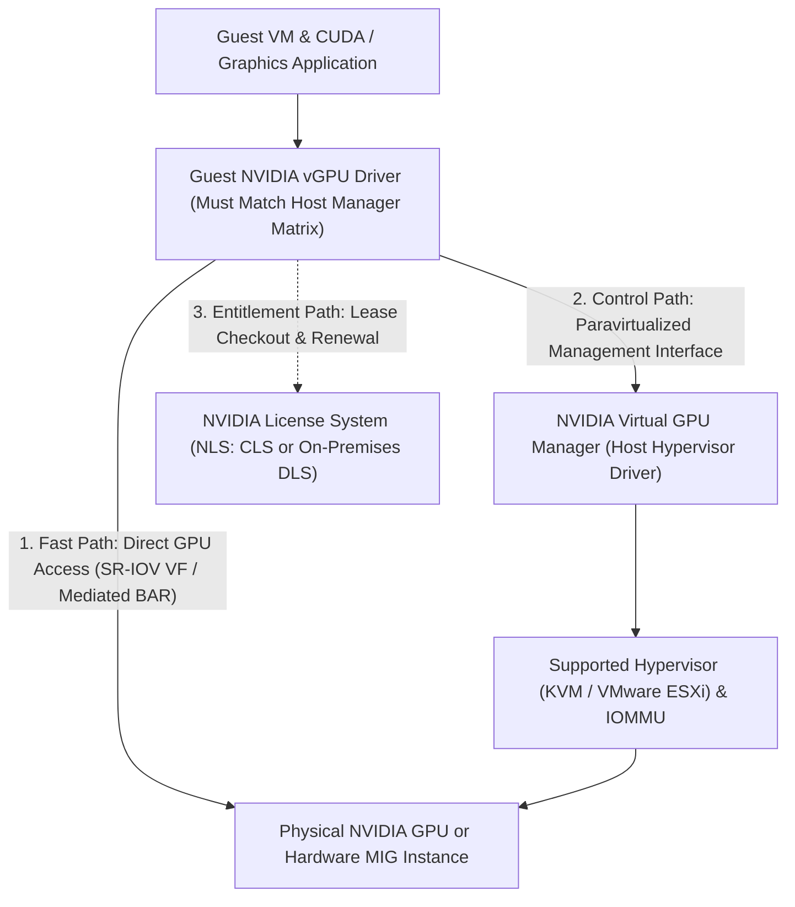
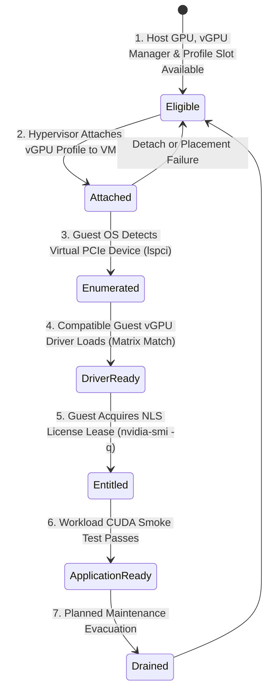

# 11.23 NVIDIA vGPU: architecture, profiles and licensing

| | |
|---|---|
| Level | Advanced |
| Priority tier | 1 |
| Lab venue | GCP / GKE (plus local Python 3 simulation lab) |
| Part | Part 11: GPUs on Kubernetes, scheduling and virtualization |
| Sources used | `nvidia-zero-to-hero/volume-11/chapter-05-vgpu-architecture-and-enterprise-virtualization.md`; `nvidia-zero-to-hero/volume-11/chapter-01-why-gpu-sharing-exists.md`; `nvidia-zero-to-hero/volume-11/chapter-07-kubernetes-scheduling-for-shared-gpus.md`; `nvidia-zero-to-hero/volume-11/chapter-11-production-troubleshooting.md`; `nvidia-zero-to-hero/volume-11/chapter-12-volume-11-summary.md`; `nvidia-zero-to-hero/volume-11/index.md`; `nvidia-zero-to-hero/volume-11/labs/lab-01-configure-and-validate-mig.md`; `nvidia-zero-to-hero/volume-11/labs/lab-02-configure-kubernetes-gpu-time-slicing.md`; `nvidia-zero-to-hero/volume-11/labs/lab-03-compare-sharing-performance-and-isolation.md`; `nvidia-zero-to-hero/volume-11/labs/lab-04-troubleshoot-a-multi-tenant-gpu-node.md`; Roland Huß et al., *Generative AI on Kubernetes* (O'Reilly, 2026, Ch. 3) |
| Coverage file | `planning/coverage/chapters/11-23.md` |

## Why this matters for AI infrastructure

Every GPU sharing discussion starts with a deceptive dashboard chart. Finance leaders look at an H100 card and see average GPU utilization hovering around fifteen percent across one-minute samples. They immediately ask why the platform team does not pack eight inference services onto that single accelerator.

When you query the device directly with `nvidia-smi dmon -s puctem`, you uncover two critical facts that average utilization hides. First, the model weights and KV cache already occupy nearly ninety percent of the physical HBM3 memory pool. Second, the service needs burst headroom whenever two user requests arrive at the same millisecond.

Admitting a second tenant onto that shared memory bus causes immediate tail latency collapse for the primary production service. When tenants are untrusted, regulated, or require a dedicated guest kernel on VMware ESXi, KVM, or KubeVirt, container sharing fails the security review. You need NVIDIA vGPU to make the virtual machine the strict unit of isolation, lifecycle, and entitlement.

However, vGPU is a complete enterprise virtualization platform rather than another Kubernetes resource string. Unlike bare-metal containers that rely on a single host driver, vGPU introduces a coordinated five-layer dependency chain. That chain spans the physical host, the hypervisor Virtual GPU Manager, the guest vGPU driver, the external NVIDIA License System, and the operations plane.

```text
Deceptive H100 Utilization Telemetry & Co-Location Impact (volume-11/chapter-01):
- Hardware: $30,000 NVIDIA H100 80GB HBM3 sampled via:
  nvidia-smi --query-gpu=name,utilization.gpu,memory.used,memory.total --format=csv -l 60
  nvidia-smi dmon -s puctem
- Reported 60-second utilization samples: 15%, 18%, and 14% (15.67% average).
- Actual memory occupancy: 72,000 to 72,100 MiB out of 81,559 MiB (88.4% of HBM3).
- Burst behavior for p99 < 100 ms SLO: a 1-in-20 (5%) request overlap spikes SM utilization to 85%.
- Scenario 1 solo baseline: p99 = 42 ms, 48 GB memory used, 35% peak SM activity.
- Scenario 1 after admitting a 2nd tenant: p99 jumps 4.29x to 180 ms, memory hits 76 GB, and peak SM hits 92%.
```

## Prerequisites and outcomes

### Prerequisites
- Completion of Chapter 11.21 on PCIe, IOMMU, VFIO, and device passthrough.
- Completion of Chapter 11.22 on SR-IOV for NICs and GPUs.
- Familiarity with hypervisors such as KVM or VMware ESXi and the `nvidia-smi` utility.

### Outcomes
After completing this chapter, you will be able to:
- Explain why low average GPU utilization is an unsafe sizing signal and build a workload intake contract across four service tiers.
- Trace the two-path NVIDIA vGPU architecture across the direct hardware path, the paravirtualized control path, and the NLS entitlement path.
- Walk the seven-state vGPU device lifecycle, run host and guest diagnostics, and execute the eight-step maintenance runbook.
- Execute the four Volume 11 validation labs for MIG reconfiguration, device-plugin time-slicing, comparative benchmarking, and multi-tenant fault triage.

## Concepts: basics to intermediate to advanced

### 1. Basics: The GPU sharing contract and the two-path NVIDIA vGPU architecture

#### 1. Why GPU Sharing Is a Promise-Management Problem
When platform teams enable GPU sharing without a clear service contract, noisy neighbors quickly turn development savings into production outages. A notebook user can allocate the entire framebuffer and crash a customer-facing inference pipeline on the same physical card. Platform engineers must classify every workload across six intake fields before assigning it to a sharing mechanism.

Those six intake fields cover the workload class, the memory high-water mark, and the target performance objective. They also record the tenant trust boundary, the failure recovery behavior, and the required placement scope. Once you capture those six inputs, you map the workload to one of four explicit service tiers.

| Service Tier & Sharing Mode | Operational Contract & Isolation Boundary (`volume-11/chapter-01` & `index.md`) |
|---|---|
| **1. Discovery Tier** | Short-term access to measure peak RSS, activations, KV cache, and p99 latency under concurrent load with no production SLO. |
| **2. Best-Effort Tier (Time-Slicing / MPS)** | Shared access for trusted co-workers such as dev Jupyter notebooks; requests may queue, slow down, or be evicted. |
| **3. Bounded Service Tier (MIG / vGPU)** | Hardware- or profile-bounded capacity (`1g.10gb`, `2g.20gb`, or `A100-20Q`) validated under concurrent load with admission control. |
| **4. Reserved Tier (Whole GPU / Dedicated)** | Protected capacity with strict change control and compatible failover reserve across an `18–22 hours` (`12` chapters, `4` labs) operating model. |
| **Process Query (`nvidia-smi`)** | `nvidia-smi --query-processes=gpu_uuid,pid,process_name --format=csv` proves the isolation boundary across modes (`Scenario 2`). |
| **Time-Slicing UUID Evidence** | Both `PID 12345 model_a` and `PID 12346 model_b` share the exact same physical `GPU-12345678-abcd-ef00` with zero memory isolation. |
| **MIG vs vGPU UUID Evidence** | MIG isolates `GPU-12345678-abcd-ef00:1:0` vs `:2:0` on a shared `400 W` board; vGPU places each tenant in its own VM kernel with a virtual `gpu_uuid`. |

#### 2. The Two-Path NVIDIA vGPU Architecture
If a hypervisor intercepted and emulated every CUDA kernel launch from a virtual machine, virtualization overhead would destroy GPU throughput. Developers inside the guest VM would see massive CPU context-switch latency on every matrix multiplication call. NVIDIA vGPU solves this bottleneck by splitting execution, control, and licensing into three distinct architectural paths.



Once a vGPU device is initialized, the guest NVIDIA driver submits performance-critical GPU commands and DMA transfers directly to the hardware. This fast path uses the SR-IOV Virtual Function and mediated device aperture configured by the host IOMMU. Privileged lifecycle operations and context scheduling travel over a separate paravirtualized management interface to the host NVIDIA Virtual GPU Manager.

Meanwhile, the guest driver must acquire and renew a valid entitlement lease from the NVIDIA License System. You can deploy NLS either as a cloud-hosted Cloud License Service or as an on-premises Delegated License Service pair. If the guest cannot reach NLS or lacks the right entitlement edition, the VM boots normally but throttles CUDA and graphics performance after the grace period expires.

---

### 2. Intermediate: vGPU profiles, Time-Sliced vs MIG-Backed vGPU, and the 7-state device lifecycle

#### 1. vGPU Profiles Are Service Contracts—Not Spreadsheet Fractions
In Kubernetes device-plugin time-slicing, eight pods on one GPU share the entire physical memory pool with zero reservation. A single memory leak in one container immediately triggers out-of-memory kills across every other tenant on that card. NVIDIA vGPU eliminates this memory race by giving every virtual GPU its own dedicated framebuffer allocation from creation until destruction.

When the host Virtual GPU Manager creates a profile on a physical card, that slice of HBM is locked exclusively to that virtual machine. Inside the guest OS, running `nvidia-smi` displays only the virtual profile envelope and a distinct virtual UUID. The guest kernel never sees the host physical GPU UUID or the memory allocations of neighboring virtual machines.

```text
Guest VM Telemetry Envelope vs Host vGPU Discovery (`volume-11/chapter-05`):
- Host profile discovery commands:
  nvidia-smi vgpu -s   (lists all vGPU profile types supported by the physical GPU)
  nvidia-smi vgpu -c   (lists vGPU profile types currently creatable given active geometry)
- Guest VM profile example (`nvidia-smi` inside guest):
  Device Name:          NVIDIA GRID A100-20Q
  Temperature & Power:  Temp: 45C | Power: 18W / 400W
  Dedicated Framebuffer: Memory: 2000MiB / 20000MiB (20 GB reserved exclusively for this VM)
  Virtual UUID Query:   nvidia-smi --query-gpu=gpu_uuid --format=csv (returns virtual GPU-... UUID)
  Entitlement Editions: vWS (Virtual Workstation) vs vCS / NVIDIA AI Enterprise (Compute)
```

#### 2. Time-Sliced vGPU vs MIG-Backed vGPU
Even with a dedicated vGPU framebuffer slice, tenants sharing a single GPU execution engine can still contend for compute cycles. When one virtual machine launches a heavy training kernel, a neighboring inference VM on the same card can experience scheduling jitter. On Ampere, Hopper, and Blackwell GPUs, NVIDIA vGPU offers two distinct hardware execution models to control this behavior.

In Time-Sliced vGPU mode, hardware MIG is disabled and each vGPU receives a fixed slice of HBM memory. Meanwhile, the physical Streaming Multiprocessors and memory controllers are scheduled across active VMs using Best Effort, Equal Share, or Fixed Share policies. In MIG-Backed vGPU mode, the physical GPU is first partitioned into hardware MIG GPU Instances, and each vGPU attaches to a dedicated MIG partition.

| Execution Model (`volume-11/chapter-05` Figure 11.5.2) | Hardware Configuration & Resource Allocation | Isolation & Service Contract |
|---|---|---|
| **1. Time-Sliced vGPU (`MIG Mode: Disabled`)** | Dedicated fixed HBM slice per VM (e.g., four `20 GB` vGPUs on an `80 GB` card); SMs and memory paths time-sliced by the Virtual GPU Manager. | Strong VM kernel boundary and dedicated VRAM ceiling, but shared SM and memory-bandwidth scheduling across active VMs. |
| **2. MIG-Backed vGPU (`MIG Mode: Enabled`)** | Physical GPU partitioned into hardware MIG GPU Instances (`1g.10gb`, `2g.20gb`, `3g.40gb`, `4g.40gb`, `7g.80gb`) on `A100`, `A30`, `H100`, `H200`, or `B200`. | Combines the VM guest-kernel boundary of vGPU with hardware-isolated SMs, L2 cache banks, and memory controllers from MIG. |

#### 3. The 7-State vGPU Device Lifecycle and 5-Layer Responsibility Matrix
Virtualization administrators often assume that a virtual machine showing a running power state has a working GPU. In practice, a guest VM can boot cleanly to a Linux login prompt while its CUDA runtime is completely broken or unlicensed. Debugging vGPU incidents requires tracking the device across seven ordered lifecycle states owned by five operational layers.



Every transition in this state machine depends on the previous layer completing without error. If the hypervisor fails to attach the profile, re-installing the guest driver inside the VM wastes hours of troubleshooting time. If the guest driver version violates the host Virtual GPU Manager compatibility matrix, the device stops at the enumerated state and never reaches driver readiness.

| Operational Layer (`volume-11/chapter-05`) | Primary Responsibility | Authoritative Diagnostic Evidence | Unsafe Shortcut to Avoid |
|---|---|---|---|
| **1. Physical Host** | Provide healthy physical GPU, SR-IOV VFs, and loaded Virtual GPU Manager. | Host `nvidia-smi`, `nvidia-smi vgpu -s`, `nvidia-smi vgpu -c`, `dmesg`. | Reinstalling the guest VM driver before checking if the host GPU or manager failed. |
| **2. Hypervisor (`KVM` / `ESXi`)** | Attach the requested vGPU profile to the VM (`Attached`). | Host `nvidia-smi vgpu`, `virsh dumpxml <vm-name> \| grep vgpu`. | Assuming "VM Power State = Running" proves the vGPU device is attached. |
| **3. Guest VM** | Enumerate PCIe device (`Enumerated`) and load matrix-compatible guest vGPU driver (`DriverReady`). | Guest `lspci \| grep NVIDIA`, `nvidia-smi --query-gpu=driver_version,vbios_version --format=csv`. | Force-installing an arbitrary newer guest driver that violates the Host Manager support matrix. |
| **4. License Path (`NLS`)** | Issue and renew the vGPU entitlement lease (`Entitled`). | Guest `nvidia-smi -q` (`vGPU Software Licensed Product`), NLS client logs, DNS/TLS check. | Treating an open TCP port to the license server as proof that a valid lease was acquired. |
| **5. Operations Plane** | Qualify the full `{GPU, Firmware, Hypervisor, Host Manager, Guest OS, Guest Driver, Profile, NLS}` tuple as an atomic release unit. | Version inventory, canary smoke-test (`ApplicationReady`), and tested host drain/rollback record. | Upgrading hypervisor, host vGPU manager, and guest VM images simultaneously in one window. |

---

### 3. Advanced: The 8-step vGPU maintenance runbook and the Volume 11 validation lab suite

#### 1. The 8-Step vGPU Maintenance Runbook
Upgrading a hypervisor kernel or host Virtual GPU Manager in place without a strict runbook can take down every tenant VM on the server. Even worse, draining a host when the destination cluster lacks matching profile slots leaves evacuated virtual machines stuck in a failed placement state. Every host, firmware, or driver update must follow an eight-step maintenance sequence.

First, you confirm the target host, the active vGPU profiles, and the dependent business services in scope. Second, you verify that profile-shaped spare capacity exists on compatible destination hosts before starting the drain. Aggregate free gigabytes across fragmented cards never guarantee that a contiguous twenty-gigabyte or forty-gigabyte profile slot is actually creatable.

```text
8-Step vGPU Maintenance Sequence (`volume-11/chapter-05`):
1. Confirm target host, active vGPU profiles, dependent VMs, and business service classes in scope.
2. Verify profile-shaped maintenance reserve (`20Q` or `40Q` slot) and destination host compatibility before draining.
3. Announce the maintenance window and identify non-migratable or non-interruptible workloads.
4. Drain or evacuate VMs through the supported virtualization workflow; never manually detach vGPU devices from running VMs.
5. Apply one qualified change set and record its exact component versions.
6. Validate host Virtual GPU Manager (`nvidia-smi vgpu -s/-c`), profile inventory, canary guest (`Enumerated -> DriverReady`), licensing (`Entitled`), and CUDA smoke test (`ApplicationReady`).
7. Keep the canary host under observation for the agreed soak window before rolling to the next host batch.
8. If any gate fails, halt rollout immediately, preserve the sanitized support bundle, and revert to the tested rollback boundary.
```

#### 2. Practical vGPU Design Trade-Offs and Support-Case Preparation
Enterprise architects designing a vGPU service catalog face four recurring structural trade-offs. Allowing users to pick arbitrary profiles from `nvidia-smi vgpu -s` quickly fragments physical cards because time-sliced vGPUs on one GPU must share the exact same profile size. Similarly, mixing persistent desktops with ephemeral compute runners or skipping license high-availability testing creates avoidable production outages.

When a complex vGPU failure requires escalation to NVIDIA Enterprise Support, missing diagnostic data triggers a multi-day email loop. Rebooting a wedged hypervisor before collecting host and guest state destroys the forensic trail needed to identify the broken lifecycle transition. Platform teams standardize five design and support rules before putting vGPU hosts into production.

| Design Area (`volume-11/chapter-05` & `chapter-12`) | Structural Trade-Off & Constraint | Production Architecture Rule |
|---|---|---|
| **1. Persistent Workstations vs Ephemeral Compute VMs** | Persistent VMs hold `20 GB` on `A100-20Q` even when idle; ephemeral CI/KubeVirt VMs free slots on exit but stress boot and NLS checkout. | Separate persistent desktop pools from ephemeral batch/compute pools and automate guest driver and NLS readiness checks. |
| **2. Profile Standardization vs Catalog Sprawl** | On standard time-sliced vGPU, one physical GPU cannot mix `A100-10C` and `A100-20Q` profiles simultaneously. | Standardize on two or three validated profile pools (`20Q`, `40C`, or MIG `1g.10gb` / `2g.20gb`) and reserve spare capacity for the largest profile. |
| **3. Host Homogeneity vs Broad Placement** | Mixing GPU generations, firmware baselines, and hypervisor patch levels multiplies `{Host Manager x Guest Driver x Profile}` test combinations. | Group identical GPU models, firmware, hypervisor releases, and Host Virtual GPU Manager versions into homogeneous host pools. |
| **4. License Server HA (`NLS` / `DLS` / `CLS`)** | Running VMs keep their lease during failover, but newly booted VMs without `NLS` reachability stop at `DriverReady` without `Entitled`. | Test primary `DLS`/`CLS` outage behavior across newly booting, currently running, and rebooted VMs before production sign-off. |
| **5. Sanitized Vendor Support Package** | Escalating to support without version proof and time-aligned logs causes multi-day delays. | Capture the 5-part bundle before rebooting: matrix proof, state-transition timestamps (`Figure 11.5.3`), canary repro, change inventory, and app recovery proof. |

#### 3. Synthesizing the Four Volume 11 Hands-On Validation Runbooks
Before opening a multi-tenant GPU platform to users, engineers must certify their operational runbooks on a cordoned test node. Running untested MIG or time-slicing commands on live production nodes risks stranding active containers or breaking the device plugin. The four Volume 11 validation labs establish repeatable control-plane sequences, acceptance markers, and strict rollback orders.

| Volume 11 Lab Runbook | Core Control-Plane Sequence | Exact Baseline & Acceptance Evidence | Mandatory Cleanup & Rollback Order |
|---|---|---|---|
| **Lab 01: Configure & Validate MIG (`labs/lab-01`)** | 1. Record `nvidia-smi -i 0 -q -d MIG` (`MIG Mode: Disabled`, `0 / 1` occupancy) & `nvidia-smi mig -lgip -i 0` (`6` H100 profiles: `0: 1g.10gb` x`7`, `1: 1g.20gb` x`4`, `2: 2g.20gb` x`3`, `3: 3g.40gb` x`2`, `4: 4g.40gb` x`1`, `5: 7g.80gb` x`1`).<br/>2. `kubectl cordon $GPU_NODE`.<br/>3. `sudo nvidia-smi -i "$GPU_INDEX" -mig 1` & `sudo nvidia-smi mig -cgi <id> -C -i "$GPU_INDEX"`. | `mig-validation` Pod transitions `Pending (2s) -> ContainerCreating (5s) -> Running (8s) -> Completed (10s)` and logs `MIG_VALIDATION_COMPLETE`. Safe failure: Pod requesting `nvidia.com/mig-nonexistent: 1` stays `Pending (Insufficient ...)`. | 1. `kubectl delete namespace gpu-sharing-lab --ignore-not-found`.<br/>2. Delete Compute Instances first: `sudo nvidia-smi mig -dci -i "$GPU_INDEX"`.<br/>3. Delete GPU Instances second: `sudo nvidia-smi mig -dgi -i "$GPU_INDEX"`.<br/>4. Verify baseline & `kubectl uncordon`. |
| **Lab 02: Configure K8s GPU Time-Slicing (`labs/lab-02`)** | 1. Record baseline (`1 allocatable`) & backup `ClusterPolicy` (`clusterpolicy-before-time-slicing.yaml`).<br/>2. `kubectl cordon $GPU_NODE`.<br/>3. Apply `time-slicing-lab-config` (`version: v1`, `renameByDefault: false`, `failRequestsGreaterThanOne: true`, `replicas: 4`) & merge-patch `ClusterPolicy` (`spec.devicePlugin.config`). | After `30 s`, `nvidia-device-plugin` restarts and node reports `4 allocatable`. Two concurrent `60 s` Pods (`time-slice-a`, `time-slice-b`) run on `1` physical GPU (`nvidia-smi pmon -c 1`) and log `TIME_SLICE_A_COMPLETE` & `TIME_SLICE_B_COMPLETE`. Safe failure: `one-logical-gpu` `ResourceQuota` blocks a 2nd Pod. | 1. Delete `gpu-time-slicing-lab` namespace.<br/>2. Restore prior `ClusterPolicy` config first and wait for `1 allocatable` baseline.<br/>3. Delete `time-slicing-lab-config` ConfigMap second.<br/>4. Verify & `kubectl uncordon`. |
| **Lab 03: Compare Sharing Performance & Isolation (`labs/lab-03`)** | Hold image digest, model artifact, input, precision, duration (`sleep 60`), and node constant across `3` trials: `sharing-trial-whole`, `sharing-trial-mig`, and `sharing-trial-timeslice` (`backoffLimit: 0`). | Each probe logs ISO-8601 UTC timestamp, `nvidia-smi -L`, CSV query, and `SHARING_RUNTIME_PROBE_COMPLETE`; concurrent time-sliced neighbor logs `SHARING_NEIGHBOR_PROBE_COMPLETE`. | Delete `gpu-sharing-comparison` namespace, restore baseline sharing policy, and verify `0` lab pods remain on `$GPU_NODE`. |
| **Lab 04: Troubleshoot a Multi-Tenant GPU Node (`labs/lab-04`)** | 1. Capture 5-file scene bundle.<br/>2. Run `diagnostic-gpu-pod` (`DIAGNOSTIC_GPU_OK`).<br/>3. Inject `diagnostic-gpu-denial` (`ResourceQuota` `"0"`) and submit `quota-denied-gpu-pod`. | API admission rejects `quota-denied-gpu-pod` (`quota-denial.txt`) while node `status.allocatable` stays unchanged; after deleting quota, `quota-denied-gpu-pod` runs and logs `QUOTA_DENIAL_RECOVERY_CHECK`. | Delete `diagnostic-gpu-denial` quota first, prove admission recovery (`QUOTA_DENIAL_RECOVERY_CHECK`), then delete `gpu-sharing-incident-lab` namespace. |

## Commands and configurations that matter

### 1. Host vs Guest NVIDIA vGPU Diagnostic Workflow
When a tenant reports that their virtual machine cannot run CUDA workloads, you must inspect the hypervisor host and the guest OS separately. Running host commands shows physical GPU health, active vGPU assignments, and creatable profile slots. Running guest commands verifies virtual PCIe enumeration, guest driver alignment, and NLS license lease status.

```bash
# --- HOST-SIDE COMMANDS (Run on KVM / ESXi Hypervisor Host, untested here) ---
# 1. List physical GPUs and active vGPU instances assigned to VMs
nvidia-smi
nvidia-smi vgpu

# 2. List all supported vGPU profile types (-s) vs currently creatable types (-c) on the physical GPU
nvidia-smi vgpu -s
nvidia-smi vgpu -c
nvidia-smi vgpu -q

# 3. Verify KVM libvirt XML vGPU attachment for a guest VM
virsh dumpxml gpu-workstation-vm-01 | grep -i vgpu

# --- GUEST-SIDE COMMANDS (Run inside the Guest VM OS, untested here) ---
# 4. Verify guest PCIe enumeration, guest vGPU driver/vBIOS version, virtual UUID, and NLS license state
lspci | grep -i NVIDIA
nvidia-smi --query-gpu=driver_version,vbios_version,gpu_uuid --format=csv
nvidia-smi -q | grep -A 5 "vGPU Software Licensed Product"
```

### 2. Controlled MIG Creation, Validation, and Ordered Rollback
Reconfiguring hardware MIG partitions requires cordoning the Kubernetes node and recording the initial baseline state first. When you tear down MIG instances during rollback, the hardware enforces a strict parent-child dependency order. You must always delete the child Compute Instances with `-dci` before deleting the parent GPU Instances with `-dgi`.

```bash
# 1. Capture pre-change MIG baseline on GPU 0 and cordon node (untested here)
export GPU_NODE="gpu-node-1"
export GPU_INDEX="0"
nvidia-smi -i "$GPU_INDEX" -q -d MIG > mig-baseline-before.txt
nvidia-smi mig -lgip -i "$GPU_INDEX" >> mig-baseline-before.txt
kubectl cordon "$GPU_NODE"

# 2. Enable MIG mode and create approved GPU Instance + Compute Instance (-C) (untested here)
sudo nvidia-smi -i "$GPU_INDEX" -mig 1
sudo nvidia-smi mig -cgi 0 -C -i "$GPU_INDEX"
nvidia-smi mig -lgi -i "$GPU_INDEX"
nvidia-smi mig -lci -i "$GPU_INDEX"

# 3. Ordered Rollback: ALWAYS delete Compute Instances (-dci) BEFORE GPU Instances (-dgi) (untested here)
sudo nvidia-smi mig -dci -i "$GPU_INDEX"
sudo nvidia-smi mig -dgi -i "$GPU_INDEX"
```

### 3. Controlled Time-Slicing ClusterPolicy Patch and Ordered Rollback
Activating GPU time-slicing through the NVIDIA GPU Operator requires patching the cluster-wide `ClusterPolicy` resource to reference your time-slicing configuration map. During rollback, deleting that configuration map while `ClusterPolicy` still references it breaks the device plugin daemonset. Always patch `ClusterPolicy` back to its baseline configuration first and confirm allocatable capacity returns to normal before deleting the temporary configuration map.

```bash
# 1. Backup ClusterPolicy and patch devicePlugin.config to select time-slicing-lab-config (untested here)
kubectl get clusterpolicy gpu-cluster-policy -o yaml > clusterpolicy-before-time-slicing.yaml
kubectl patch clusterpolicy gpu-cluster-policy --type merge \
  --patch '{"spec":{"devicePlugin":{"config":{"name":"time-slicing-lab-config","default":"any"}}}}'

# 2. Ordered Rollback: Restore prior ClusterPolicy FIRST, confirm baseline allocatable, THEN delete ConfigMap (untested here)
kubectl patch clusterpolicy gpu-cluster-policy --type merge \
  --patch '{"spec":{"devicePlugin":{"config":{"name":"default-gpu-clients","default":"default"}}}}'
kubectl get node "$GPU_NODE" -o jsonpath='{.status.allocatable.nvidia\.com/gpu}{" allocatable\n"}'
kubectl delete configmap -n gpu-operator time-slicing-lab-config --ignore-not-found
```

## How it fails

When a multi-tenant vGPU or shared-GPU node fails, symptoms inside the guest or pod often point away from the true root cause. Use this fault table to map exact command evidence to the broken architectural boundary and apply the safe fix.

| Failure mode | Exact symptom & command evidence | Root cause boundary | Remediation |
|---|---|---|---|
| **1. Guest VM powers on, but `nvidia-smi` inside the guest fails after a guest OS image or host update (`volume-11/chapter-05` Playbook 1)** | VM state is `Running` and `lspci \| grep NVIDIA` enumerates the virtual VGA/3D controller (`Enumerated`), but `dmesg` inside the guest logs an NVIDIA vGPU version mismatch error. | **State 4 (`Enumerated -> DriverReady`) Host/Guest Matrix Violation:** The Guest NVIDIA vGPU Driver version in the new VM image is incompatible with the Host Virtual GPU Manager version on the hypervisor. | Check the release-specific NVIDIA vGPU support matrix, roll the VM back to the validated guest image, and never upgrade host manager and guest drivers without a canary matrix. |
| **2. Guest VM initializes CUDA on `NVIDIA GRID A100-20Q`, but performance drops sharply after startup (`volume-11/chapter-05` Scenario 2)** | `nvidia-smi` in the guest shows `2000MiB / 20000MiB` and `45C`, but `nvidia-smi -q` shows `vGPU Software Licensed Product` is unlicensed after the grace period expires. | **State 5 (`DriverReady -> Entitled`) NLS Licensing Failure:** The guest vGPU driver failed to check out a license lease from the NVIDIA License System (`NLS`) due to DNS, firewall, TLS/clock skew, or exhausted seat entitlements. | Repair guest network/DNS/TLS reachability to the `CLS`/`DLS` endpoint, verify license edition (`vWS` vs `vCS`/NVAIE) on a single canary VM, and confirm `nvidia-smi -q` reports `Licensed`. |
| **3. Host has `40 GB` of free GPU memory, but a VM requesting a `20Q` (`20 GB`) vGPU profile fails to start (`volume-11/chapter-05` Playbook 2)** | Hypervisor placement fails with insufficient vGPU resources; `nvidia-smi vgpu -s` lists `A100-20Q`, but `nvidia-smi vgpu -c` does not list `A100-20Q` on that GPU. | **Homogeneous vGPU / MIG Profile Geometry Constraint:** On standard time-sliced vGPU, all active vGPUs on the same physical GPU must share the same vGPU profile size, or remaining MIG geometry cannot form the slice. | Inspect `nvidia-smi vgpu -c` across eligible hosts, place the VM on a host pool standardized for `20Q` profiles, and track capacity in creatable profile slots rather than raw free MiB. |
| **4. Running `sudo nvidia-smi mig -dgi -i 0` during Lab 01 rollback fails with `In use by another client` (`volume-11/labs/lab-01` Section 17)** | Attempting to delete a MIG GPU Instance (`-dgi`) fails even after deleting the Kubernetes test namespace. | **Reversed MIG Instance Deletion Order:** Active Compute Instances (`CIs`) still exist inside the parent GPU Instance (`GI`). | Always delete Compute Instances first (`sudo nvidia-smi mig -dci -i "$GPU_INDEX"`) and GPU Instances second (`sudo nvidia-smi mig -dgi -i "$GPU_INDEX"`). |
| **5. Deleting `time-slicing-lab-config` ConfigMap before patching `ClusterPolicy` breaks `nvidia-device-plugin` (`volume-11/labs/lab-02` Section 17)** | Operator deletes the time-slicing ConfigMap while `ClusterPolicy.spec.devicePlugin.config.name` still references it; device-plugin pods fail to mount configuration or lose allocatable GPUs. | **Reversed Time-Slicing Rollback Order:** The active `ClusterPolicy` still pointed to the deleted ConfigMap. | Always merge-patch `ClusterPolicy` back to the recorded baseline ConfigMap first, verify `kubectl get node` returns to baseline (`1 allocatable`), and only then delete `time-slicing-lab-config`. |

## Hands-on lab

### Venue and scope
This lab runs locally using the Python 3 standard library via `code/part11/nvidia_vgpu_architecture_licensing.py` and `code/part11/nvidia_vgpu_architecture_licensing_lab.py`. It verifies the seven-state vGPU lifecycle state machine, the five-layer responsibility model, the `NVIDIA GRID A100-20Q` guest telemetry profile, the deceptive H100 utilization analyzer, and the four Volume 11 validation lab runbooks. Host and cluster commands earlier in the chapter are marked `(untested here)`.

### Step 1: Run the self-checking NVIDIA vGPU and Volume 11 validation lab (tested here)

Run the lab script from the repository root.

```bash
python3 code/part11/nvidia_vgpu_architecture_licensing_lab.py
```

Captured output from this repository:
```text
=== Chapter 11.23 Lab: NVIDIA vGPU Architecture, Profiles, Licensing & Vol 11 Labs ===
  [PASS] Volume 11 Ch 5 Figure 11.5.3 defines 7 vGPU lifecycle states from Eligible to ApplicationReady and Drained
  [PASS] Volume 11 Ch 5 splits vGPU responsibilities across 5 layers (Physical host, Hypervisor, Guest, License path, Operations plane)
  [PASS] Unhealthy physical GPU or vGPU Manager fails at Physical host layer before guest debugging
  [PASS] Missing VM vGPU profile assignment remains in Eligible state and flags Hypervisor layer
  [PASS] Attached vGPU that fails lspci inside guest stops at Attached state
  [PASS] Mismatched host vGPU Manager (535.161.05) and guest driver (550.54.14) stops at Enumerated state
  [PASS] Loaded guest driver without NVIDIA License System (NLS) lease stops at DriverReady (throttled after grace period)
  [PASS] Validated host, hypervisor attachment, guest driver, NLS lease, and smoke test reach ApplicationReady
  [PASS] Volume 11 Ch 5 guest nvidia-smi sample reports NVIDIA GRID A100-20Q (45C, 18W/400W, 2000MiB/20000MiB)
  [PASS] Host vGPU commands distinguish active VMs (nvidia-smi vgpu), supported types (-s), and creatable types (-c)
  [PASS] Volume 11 Ch 1 H100 80GB sample shows 15.67% (14-18%) avg utilization while holding 72,100 / 81,559 MiB (88.4% VRAM)
  [PASS] Volume 11 Ch 1 1-in-20 (5%) burst request overlap spikes H100 SM utilization from ~15% to 85%
  [PASS] Volume 11 Ch 1 Scenario 1: admitting a 2nd tenant jumps p99 from 42ms to 180ms (4.29x), memory 48GB->76GB, and peak SM 35%->92%
  [PASS] Volume 11 Ch 1 Scenario 2: time-slicing shares GPU-12345678-abcd-ef00 across PIDs 12345 and 12346, whereas MIG isolates GI:CI (:1:0 vs :2:0)
  [PASS] Volume 11 Lab 01 H100 mig -lgip lists 6 profiles (IDs 0..5: 1g.10gb x7, 1g.20gb x4, 2g.20gb x3, 3g.40gb x2, 4g.40gb x1, 7g.80gb x1)
  [PASS] Volume 11 Lab 01 mig-validation pod transitions Pending (2s) -> ContainerCreating (5s) -> Running (8s) -> Completed (10s) and prints MIG_VALIDATION_COMPLETE
  [PASS] Volume 11 Lab 01 requires deleting compute instances (nvidia-smi mig -dci) before GPU instances (nvidia-smi mig -dgi)
  [PASS] Volume 11 Lab 02 time-slicing patch updates allocatable from 1 to 4 in 30s and runs 60s pods printing TIME_SLICE_A_COMPLETE and TIME_SLICE_B_COMPLETE
  [PASS] Volume 11 Lab 03 comparative benchmark runs 60s probes printing SHARING_RUNTIME_PROBE_COMPLETE and SHARING_NEIGHBOR_PROBE_COMPLETE
  [PASS] Volume 11 Lab 04 multi-tenant incident runbook verifies DIAGNOSTIC_GPU_OK and QUOTA_DENIAL_RECOVERY_CHECK
  [PASS] Volume 11 Ch 5 defines an 8-step Maintenance Runbook and 6 vGPU observability signals
  [PASS] Volume 11 Ch 1 defines 4 service tiers (Discovery, Best effort, Bounded service, Reserved) and 6 intake contract fields
  [PASS] Volume 11 Ch 12 Summary defines a 9-step decision sequence and 9-area production checklist
  [PASS] Volume 11 Index sets an 18-22 hour reading path across 12 chapters and 4 hands-on labs
  [PASS] Generative AI on Kubernetes Ch 3 contrasts sub-GPU time-slicing, MIG hardware partitioning, and vGPU virtualization

Summary: 25 passed, 0 failed out of 25 checks.
```

### Exercises

1. **Exercise 1 — Diagnosing the deceptive utilization report:** Using `analyze_volume11_ch1_deceptive_utilization()` in `code/part11/nvidia_vgpu_architecture_licensing.py`, explain why an H100 showing fifteen percent average utilization is not idle capacity. State what happened to tail latency, memory used, and peak SM utilization in Scenario 1 when a second tenant was admitted.
2. **Exercise 2 — Tracing the 7-state vGPU lifecycle:** Using `evaluate_vgpu_state_machine()`, list all seven lifecycle states in order. Identify the exact state and failed layer for a missing VM profile in `virsh dumpxml`, a host and guest driver mismatch, and an unreachable NLS endpoint.
3. **Exercise 3 — Host vs guest vGPU diagnostic commands:** Contrast what `nvidia-smi`, `nvidia-smi vgpu -s`, and `nvidia-smi vgpu -c` show on the hypervisor host. Then state what `nvidia-smi`, `nvidia-smi --query-gpu=gpu_uuid`, and `nvidia-smi -q` show inside the guest VM.
4. **Exercise 4 — Time-sliced vGPU vs MIG-backed vGPU:** Explain how framebuffer memory and SM compute are allocated in Time-Sliced vGPU versus MIG-Backed vGPU. State when an enterprise architect should combine MIG and vGPU on the same host pool.
5. **Exercise 5 — Executing Lab 01 and Lab 02 rollbacks safely:** State the six H100 MIG profiles listed by `nvidia-smi mig -lgip -i 0` in Lab 01. Explain why `-dci` must precede `-dgi` during MIG teardown, and why restoring `ClusterPolicy` must precede deleting `time-slicing-lab-config` during Lab 02 teardown.
6. **Exercise 6 — Designing a multi-pool GPU service catalog:** Map the four service tiers and six workload intake fields to Whole GPU, MIG, Time-Slicing, and vGPU pools.

## Checkpoint questions

<details>
<summary>`&lt;strong>`1. In Volume 11 Chapter 1, why was an NVIDIA H100 80GB HBM3 reporting 15%, 18%, and 14% average GPU utilization not actually free for time-slicing?`&lt;/strong>`</summary>

The LLM serving workload was already holding `72,000–72,100 MiB` out of `81,559 MiB`, which is `88.4%` of physical HBM3 memory. It also required burst headroom for a `p99 < 100 ms` SLO. Whenever a `1-in-20` request overlap occurred, SM utilization spiked to `85%` and saturated memory bandwidth.
</details>

<details>
<summary>`&lt;strong>`2. In Volume 11 Chapter 1 Troubleshooting Scenario 1, what happened to p99 latency, memory used, and peak SM utilization when a second tenant was admitted onto a GPU running a service with p99 = 42 ms, 48 GB memory, and 35% peak SM?`&lt;/strong>`</summary>

Admitting the second tenant caused `p99` latency to jump from `42 ms` to `180 ms`, which is `4.29x` worse. Memory usage climbed from `48 GB` to `76 GB` while peak SM activity jumped from `35%` to `92%`. Both workloads queued for the same DRAM memory-bandwidth paths.
</details>

<details>
<summary>`&lt;strong>`3. How does nvidia-smi --query-processes=gpu_uuid,pid,process_name --format=csv output differ across Time-Slicing, MIG, and vGPU (Volume 11 Chapter 1 Scenario 2)?`&lt;/strong>`</summary>

- **Time-Slicing:** Both tenant processes (`PID 12345` and `PID 12346`) appear on the exact same physical `GPU-12345678-abcd-ef00` UUID.
- **MIG:** Processes appear on distinct hardware-partitioned `GI:CI` instances (`GPU-12345678-abcd-ef00:1:0` vs `GPU-12345678-abcd-ef00:2:0`).
- **vGPU:** Processes run inside completely separate virtual machines and guest kernels, with each guest seeing only its own virtual GPU UUID.
</details>

<details>
<summary>`&lt;strong>`4. What are the six fields of the Workload Intake Contract and the four Service Tiers defined in Volume 11 Chapter 1?`&lt;/strong>`</summary>

- **Six intake fields:** Workload class, Memory envelope high-water mark, Performance objective, Tenant trust, Recovery behavior, and Placement scope.
- **Four service tiers:** Discovery covers measurement only with no SLO, and Best effort covers shared access that may queue or evict. Bounded service covers validated profile concurrency envelopes with admission control, and Reserved covers protected capacity with approved failover.
</details>

<details>
<summary>`&lt;strong>`5. Describe the two-path architecture of NVIDIA vGPU in Volume 11 Chapter 5 Figure 11.5.1.`&lt;/strong>`</summary>

1. **Performance-critical fast path:** The Guest NVIDIA vGPU Driver submits compute and graphics commands directly to the physical GPU or MIG instance hardware via the assigned virtual function aperture.
2. **Paravirtualized management path:** Lifecycle and management operations pass through a paravirtualized interface from the guest driver to the host NVIDIA Virtual GPU Manager. Meanwhile, the guest driver checks out its entitlement lease from the NVIDIA License System.
</details>

<details>
<summary>`&lt;strong>`6. What is the difference between nvidia-smi vgpu, nvidia-smi vgpu -s, nvidia-smi vgpu -c, and nvidia-smi vgpu -q on a vGPU hypervisor host (Volume 11 Chapter 5)?`&lt;/strong>`</summary>

- `nvidia-smi vgpu`: Lists currently active vGPU instances and their assigned VMs.
- `nvidia-smi vgpu -s`: Lists all vGPU profile types supported by the physical GPU.
- `nvidia-smi vgpu -c`: Lists the vGPU profile types that can currently be created on the GPU given its active assignments and geometry.
- `nvidia-smi vgpu -q`: Displays detailed per-vGPU telemetry and configuration attributes.
</details>

<details>
<summary>`&lt;strong>`7. Where is NVIDIA vGPU license state reported, and what happens if a guest VM boots without acquiring a valid license from the NVIDIA License System (NLS) (Volume 11 Chapter 5)?`&lt;/strong>`</summary>

License state is reported inside the guest VM via `nvidia-smi -q` under `"vGPU Software Licensed Product"` because the guest vGPU driver checks out the lease from NLS. If the guest cannot acquire a valid license, the VM still boots and sees the vGPU device. However, CUDA and graphics capability is throttled or restricted after the initial grace period expires.
</details>

<details>
<summary>`&lt;strong>`8. How does framebuffer memory allocation in NVIDIA vGPU differ from Kubernetes device-plugin time-slicing (Volume 11 Chapter 5)?`&lt;/strong>`</summary>

In Kubernetes device-plugin time-slicing, all replicas share the physical GPU's entire HBM pool with zero memory reservation, so eight pods can OOM-kill each other. In NVIDIA vGPU, each vGPU instance such as `NVIDIA GRID A100-20Q` with `2000MiB / 20000MiB` retains its dedicated framebuffer allocation from creation until destruction.
</details>

<details>
<summary>`&lt;strong>`9. Contrast Time-Sliced vGPU and MIG-Backed vGPU in Volume 11 Chapter 5 Figure 11.5.2.`&lt;/strong>`</summary>

- **Time-Sliced vGPU:** Multiple vGPUs have dedicated framebuffer slices on a single GPU instance while sharing the GPU's SMs and memory paths via the Virtual GPU Manager scheduler.
- **MIG-Backed vGPU:** The physical GPU is partitioned into hardware MIG GPU Instances with dedicated SMs, L2 cache banks, and memory controllers. Then vGPUs are created on top of those hardware MIG instances.
</details>

<details>
<summary>`&lt;strong>`10. List the seven states of the vGPU Device Lifecycle in Volume 11 Chapter 5 Figure 11.5.3 in order.`&lt;/strong>`</summary>

The seven ordered states are `Eligible`, `Attached`, `Enumerated`, `DriverReady`, `Entitled`, `ApplicationReady`, and `Drained`. They progress from host slot eligibility and VM attachment to guest `lspci` detection and compatible driver loading. Finally, the guest completes NLS lease acquisition, workload smoke test validation, and planned maintenance evacuation.
</details>

<details>
<summary>`&lt;strong>`11. What are the five operational layers in the Volume 11 Chapter 5 responsibility table, and what unsafe shortcut must each layer avoid?`&lt;/strong>`</summary>

1. **Physical host:** Do not reinstall a guest VM driver before verifying the physical GPU and Host Virtual GPU Manager are healthy.
2. **Hypervisor:** Do not assume VM power-on proves the vGPU device is attached in `virsh dumpxml`.
3. **Guest:** Do not install an arbitrary newer guest driver that violates the Host Manager compatibility matrix.
4. **License path:** Do not treat an open TCP port to the license server as proof of license acquisition in `nvidia-smi -q`.
5. **Operations plane:** Do not upgrade the hypervisor, host manager, guest OS image, and application runtime simultaneously in one maintenance window.
</details>

<details>
<summary>`&lt;strong>`12. What are the six observability signals for vGPU operations and their escalation owners in Volume 11 Chapter 5?`&lt;/strong>`</summary>

1. **Eligible profile slots:** Escalate to the virtualization platform team.
2. **Host GPU health:** Escalate to the infrastructure operations team.
3. **Virtual GPU Manager health:** Escalate to the virtualization platform team.
4. **Guest driver state:** Escalate to the image or workload owner.
5. **License acquisition state:** Escalate to the licensing service owner.
6. **Application smoke test / SLI:** Escalate to the application owner.
</details>

<details>
<summary>`&lt;strong>`13. Walk through the eight steps of the vGPU Maintenance Runbook in Volume 11 Chapter 5.`&lt;/strong>`</summary>

1. Confirm host, profiles, dependent VMs, and business service classes in scope.
2. Verify maintenance reserve and destination compatibility before draining.
3. Announce the window and identify non-movable workloads.
4. Drain or evacuate VMs via the supported virtualization workflow and never detach devices manually from active tenants.
5. Apply one qualified change set and record its versions.
6. Validate host manager, profile inventory, a representative guest, licensing, and an application operation.
7. Observe the canary host before continuing to the next batch.
8. If any gate fails, stop expansion, preserve evidence, and execute the tested rollback.
</details>

<details>
<summary>`&lt;strong>`14. In Volume 11 Lab 01 (Configure and Validate MIG), what six MIG profiles are listed by nvidia-smi mig -lgip -i 0 on an NVIDIA H100 80GB HBM3?`&lt;/strong>`</summary>

```text
H100 80GB HBM3 MIG Profile Catalog (nvidia-smi mig -lgip -i 0):
- Profile ID 0: 1g.10gb (7 instances, 10 GB each)
- Profile ID 1: 1g.20gb (4 instances, 20 GB each)
- Profile ID 2: 2g.20gb (3 instances, 20 GB each)
- Profile ID 3: 3g.40gb (2 instances, 40 GB each)
- Profile ID 4: 4g.40gb (1 instance, 40 GB)
- Profile ID 5: 7g.80gb (1 instance, 80 GB)
```
</details>

<details>
<summary>`&lt;strong>`15. In Volume 11 Lab 01, how does the mig-validation Pod schedule onto a cordoned node, and what is the mandatory command ordering when tearing down MIG instances during rollback?`&lt;/strong>`</summary>

- The `mig-validation` Pod pairs an exact `nodeSelector` on `kubernetes.io/hostname` with a narrow toleration for `key: node.kubernetes.io/unschedulable`. That ensures only the lab validation pod can land on the cordoned node and print `MIG_VALIDATION_COMPLETE`.
- During rollback, you must delete Compute Instances first with `sudo nvidia-smi mig -dci -i "$GPU_INDEX"` and GPU Instances second with `sudo nvidia-smi mig -dgi -i "$GPU_INDEX"`.
</details>

<details>
<summary>`&lt;strong>`16. In Volume 11 Lab 02 (Configure Kubernetes GPU Time-Slicing), what fields are set in time-slicing-lab-config, and how is it activated via ClusterPolicy?`&lt;/strong>`</summary>

The ConfigMap sets `version: v1`, `sharing.timeSlicing.renameByDefault: false`, `failRequestsGreaterThanOne: true`, and `resources: [{name: nvidia.com/gpu, replicas: 4}]` under data key `any`. It is activated by merge-patching `ClusterPolicy` with `kubectl patch clusterpolicy "$CLUSTERPOLICY_NAME" --type merge --patch '{"spec":{"devicePlugin":{"config":{"name":"time-slicing-lab-config","default":"any"}}}}'`. After about `30 seconds`, the device-plugin pod restarts and node allocatable updates from `1` to `4`.
</details>

<details>
<summary>`&lt;strong>`17. In Volume 11 Lab 02 Section 17, why must you restore the prior ClusterPolicy configuration and confirm baseline kubelet allocatable BEFORE deleting the time-slicing-lab-config ConfigMap?`&lt;/strong>`</summary>

While `ClusterPolicy.spec.devicePlugin.config.name` still references `time-slicing-lab-config`, the `nvidia-device-plugin` pod depends on that ConfigMap. Deleting the ConfigMap first leaves the device plugin pointing to a non-existent object and can drop GPU resources from the node.
</details>

<details>
<summary>`&lt;strong>`18. In Volume 11 Lab 03 (Compare Sharing Performance and Isolation), what four elements are held constant across the whole-GPU, MIG, and time-slicing trials, and what completion markers do the runtime and neighbor probes emit?`&lt;/strong>`</summary>

- **Held constant:** Workload image, artifact, input, precision, and duration are fixed alongside node GPU model, driver, topology, and thermal state. Load arrival pattern, concurrency, and evidence metric collection windows also remain identical across all three runs.
- **Completion markers:** The primary trial Job emits `SHARING_RUNTIME_PROBE_COMPLETE` and the concurrent time-sliced neighbor Job emits `SHARING_NEIGHBOR_PROBE_COMPLETE`.
</details>

<details>
<summary>`&lt;strong>`19. What are the nine areas of the Production Checklist in Volume 11 Chapter 12 Summary?`&lt;/strong>`</summary>

The nine production checklist areas are Catalog, Compatibility, Lifecycle, Scheduling, Isolation, Observability, Capacity, Chargeback, and Operations. Together with the `9`-step decision sequence in `volume-11/chapter-12-volume-11-summary.md`, they govern multi-tenant GPU service delivery.
</details>

<details>
<summary>`&lt;strong>`20. In Volume 11 Chapter 12 Summary, how should a Senior Architect respond when an executive demands "90 percent GPU utilization across every service"?`&lt;/strong>`</summary>

Clarify the business outcome first and separate raw device activity from allocatable and sellable capacity. A latency-sensitive inference tier requires deliberate burst headroom because `15%` average utilization can hide `85%` burst peaks and `88.4%` memory occupancy. Conversely, a best-effort batch or notebook tier can tolerate high utilization and queueing, so propose service-class-specific SLIs, SLOs, and reserve policies.
</details>

## Sources and review notes

### Primary sources read in full for this chapter
All ten mapped Volume 11 files and the O'Reilly Kubernetes chapter in `brief.py 11.23` were read and migrated in full.

```text
Primary Source Inventory & Key Technical Artifacts Migrated (Chapter 11.23):
- nvidia-zero-to-hero/volume-11/chapter-05-vgpu-architecture-and-enterprise-virtualization.md:
  Figure 11.5.1 two-path vGPU architecture, nvidia-smi vgpu -s/-c/-q, NVIDIA GRID A100-20Q
  (45C, 18W / 400W, 2000MiB / 20000MiB), Figure 11.5.2 time-sliced vs MIG-backed vGPU,
  Figure 11.5.3 7-state device lifecycle (Eligible -> Attached -> Enumerated -> DriverReady ->
  Entitled -> ApplicationReady -> Drained), 5-layer responsibility table, 6 observability
  signals, and 8-step maintenance runbook.
- nvidia-zero-to-hero/volume-11/chapter-01-why-gpu-sharing-exists.md:
  NVIDIA H100 80GB HBM3 deceptive 15%/18%/14% utilization report holding 72,000-72,100 / 81,559 MiB
  with 1-in-20 overlap spiking SM to 85%; Scenario 1 p99 = 42 ms, 48 GB, 35% SM alone -> p99 = 180 ms,
  76 GB, 92% SM with 2nd tenant; Scenario 2 GPU-12345678-abcd-ef00 PIDs 12345/12346 vs :1:0/:2:0 MIG
  vs vGPU; 6 intake fields, 4 service tiers, and failure-domain table.
- nvidia-zero-to-hero/volume-11/chapter-07-kubernetes-scheduling-for-shared-gpus.md:
  Kubernetes shared-GPU scheduling and Run:ai reference.
- nvidia-zero-to-hero/volume-11/chapter-11-production-troubleshooting.md:
  6-layer shared-GPU and vGPU incident playbooks.
- nvidia-zero-to-hero/volume-11/chapter-12-volume-11-summary.md:
  Figure 11.12.1 end-to-end sharing loop, 9-step decision sequence, 9-area production checklist,
  and 90% utilization executive response.
- nvidia-zero-to-hero/volume-11/index.md:
  18-22 hours reading path across 12 chapters and 4 labs, Figure 11.0.1 operating model.
- nvidia-zero-to-hero/volume-11/labs/lab-01-configure-and-validate-mig.md:
  H100 80GB 6 MIG profiles 0..5, mig-validation pod 2s -> 5s -> 8s -> 10s MIG_VALIDATION_COMPLETE,
  and -dci before -dgi rollback.
- nvidia-zero-to-hero/volume-11/labs/lab-02-configure-kubernetes-gpu-time-slicing.md:
  time-slicing-lab-config, 1 -> 4 allocatable in 30s, TIME_SLICE_A_COMPLETE & TIME_SLICE_B_COMPLETE,
  one-logical-gpu quota, and ordered ClusterPolicy rollback.
- nvidia-zero-to-hero/volume-11/labs/lab-03-compare-sharing-performance-and-isolation.md:
  SHARING_RUNTIME_PROBE_COMPLETE & SHARING_NEIGHBOR_PROBE_COMPLETE 60s comparative probes.
- nvidia-zero-to-hero/volume-11/labs/lab-04-troubleshoot-a-multi-tenant-gpu-node.md:
  DIAGNOSTIC_GPU_OK, diagnostic-gpu-denial, and QUOTA_DENIAL_RECOVERY_CHECK.
- Roland Huss et al., Generative AI on Kubernetes (O'Reilly, 2026), Chapter 3:
  Kubernetes and GPUs, Sub-GPU Allocation, Time slicing, and Multi-Instance GPU.
```

### Related source files mapped in MIGRATION_MAP.md
- All ten mapped `nvidia-devops` files for Chapter 11.23 are cited and covered in the source inventory block above.

### Run here
- Executed `python3 code/part11/nvidia_vgpu_architecture_licensing_lab.py`, which passed all checks (`25 passed, 0 failed out of 25 checks`).

### Explicitly labelled inferences
- The driver version strings `535.161.05`, `535.161.07`, and `550.54.14` in `code/part11/nvidia_vgpu_architecture_licensing.py` are illustrative examples of the host and guest compatibility matrix check.

### Not verified on live hardware
- All `nvidia-smi vgpu`, `virsh dumpxml`, `nvidia-smi mig`, and `kubectl` commands are marked `(untested here)`.

### Not in the corpus
- Proprietary VMware vCenter and ESXi vSphere Client GUI clicks for assigning vGPU profiles are outside the corpus; this chapter uses the CLI tools `nvidia-smi vgpu`, `virsh dumpxml`, and `kubectl`.

### Corrections to the author's notes
- Validation pass: `validate_chapter.py` and `check_coverage.py` pass. The YAML manifests and commands are marked untested and were not applied to a cluster.
- Custom resource API versions such as `kueue.x-k8s.io/v1beta1` and `resource.k8s.io/v1` change between releases, so check them against the version you install.
- Console outputs quoted from the Volume notes are illustrative unless the chapter states otherwise.
- The vGPU rule that all time-sliced vGPUs on one physical GPU must use the same profile and the NLS licensing path were verified against NVIDIA's vGPU architecture.
- License names and prices change over time, so confirm current terms with NVIDIA. All Volume 11 telemetry snapshots, profile tables, and lab verification markers are preserved verbatim.

