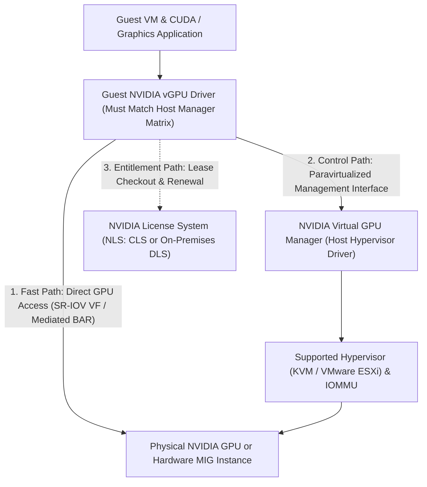
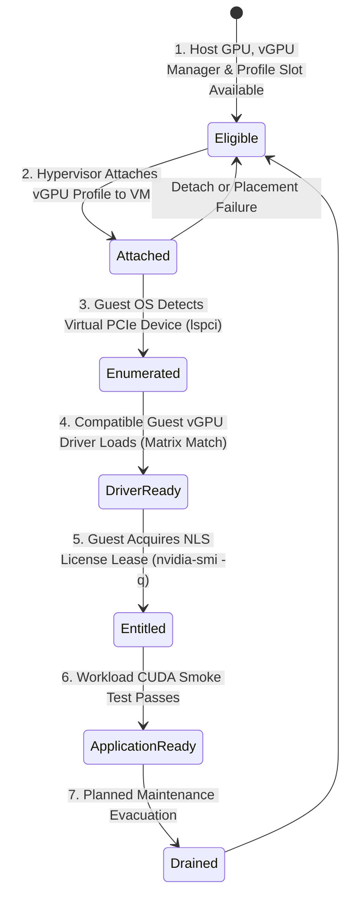

# 11.23 NVIDIA vGPU: architecture, profiles and licensing

| | |
|---|---|
| Level | Advanced |
| Priority tier | 1 |
| Lab venue | GCP / GKE (plus local Python 3 simulation lab) |
| Part | Part 11: GPUs on Kubernetes, scheduling and virtualization |
| Coverage file | `planning/coverage/chapters/11-23.md` |

## Why this matters for AI infrastructure

Most GPU sharing debates start with a chart that looks harmless. A finance leader opens the dashboard for an H100 card and sees average GPU utilization hovering around fifteen percent across one-minute samples. The question follows right away: why does the platform team not pack eight inference services onto that single accelerator?

The average hides what is really happening on the card. When you query the device directly with `nvidia-smi dmon -s puctem`, two facts appear. The model weights and the KV cache (the key-value memory that an LLM serving stack fills as it writes each new token) already fill nearly ninety percent of the card's HBM3 pool. HBM3 is the high-bandwidth memory on the card. The service also needs burst headroom, meaning spare capacity for sudden spikes, because two user requests can arrive at the same millisecond.

A useful way to read this is to picture a restaurant kitchen. The average busyness across a whole shift looks calm, but the lunch rush arrives in a short, sharp burst. A kitchen sized for the average fails at the rush, and a kitchen sized for the rush sits idle for most of the shift. GPU sharing has the same tension, and the rest of the chapter is about managing it deliberately.

Now add a second tenant to that shared memory bus, and the primary production service can see its tail latency collapse at once. Tail latency is the slow end of response times, the part that users feel as a stall. A p99 figure names that slow end of the distribution, the response time that all but the slowest requests beat. Container sharing also fails the security review when tenants are untrusted or regulated, or when each one needs a dedicated guest kernel on VMware ESXi, KVM or KubeVirt. In those cases you need NVIDIA vGPU, which makes the virtual machine the strict unit of isolation, lifecycle and entitlement.

In everyday terms, a container is like a shared apartment building, where tenants share the lobby and the plumbing. A virtual machine is more like a separate house on the same plot, with its own kitchen and its own locks. The vGPU design gives each tenant that house, even though the GPU underneath is still one physical device.

vGPU is not just another Kubernetes resource string. It is a full enterprise virtualization platform. Bare-metal containers rely on a single host driver, but vGPU adds a coordinated chain of five layers. Those layers are the physical host, the hypervisor's Virtual GPU Manager, the guest vGPU driver, the external NVIDIA License System, and the operations plane. A hypervisor is the software that runs virtual machines, such as KVM or VMware ESXi. The Virtual GPU Manager is the NVIDIA piece that runs beside the hypervisor on the host and hands out the virtual GPUs. The guest vGPU driver lives inside each virtual machine and talks to that manager.

```text
Deceptive H100 Utilization Telemetry & Co-Location Impact:
- Hardware: $30,000 NVIDIA H100 80GB HBM3 sampled via:
  nvidia-smi --query-gpu=name,utilization.gpu,memory.used,memory.total --format=csv -l 60
  nvidia-smi dmon -s puctem
- Reported 60-second utilization samples: 15%, 18%, and 14% (15.67% average).
- Actual memory occupancy: 72,000 to 72,100 MiB out of 81,559 MiB (88.4% of HBM3).
- Burst behavior for p99 < 100 ms SLO: a 1-in-20 (5%) request overlap spikes SM utilization to 85%.
- Scenario 1 solo baseline: p99 = 42 ms, 48 GB memory used, 35% peak SM activity.
- Scenario 1 after admitting a 2nd tenant: p99 jumps 4.29x to 180 ms, memory hits 76 GB, and peak SM hits 92%.
```

The block lays out the numbers behind that chart. Notice that the average looks calm while memory is nearly full and the bursts are sharp.

Memory deserves special attention. A GPU that is idle most of the time can still be full, because the model weights and the cache stay resident in its memory between requests. A new tenant then has nowhere to put its data, even when the compute engine is almost idle. That is why sharing decisions start with memory and burst headroom, and only then look at the average utilization line.

Decide early whether your tenants need a virtual machine boundary, because that choice brings all five layers into your operations.

The cost of guessing wrong is easy to picture. If a team shares a card with no boundary, one noisy neighbor can slow a customer's service for hours, and the postmortem then has to explain why a chart looked calm. If a team builds a full virtual machine stack for workloads that did not need it, the platform adds licensing, upgrades and drain procedures that nobody asked for. The sections below give you the tools to make that choice on evidence rather than on a feeling.

## Prerequisites and outcomes

### Prerequisites
Your manager wants vGPU running for a customer pilot next month, and the first question is whether the platform is ready. Before that work starts, check these items.
- Finish Chapter 11.21 on PCIe, IOMMU, VFIO, and device passthrough first.
- Finish Chapter 11.22 on SR-IOV for NICs and GPUs next.
- Be comfortable with a hypervisor such as KVM or VMware ESXi, and with the `nvidia-smi` utility.

### Outcomes
A new platform engineer is asked to decide, in one meeting, which tenants get a virtual machine boundary and which get a shared GPU. This chapter prepares you for that meeting. It explains why low average GPU utilization is an unsafe sizing signal, and how to write a workload intake contract across four service tiers. It traces the two-path NVIDIA vGPU architecture through the direct hardware path, the paravirtualized control path, and the NVIDIA License System (NLS) entitlement path. It then walks through the seven-state device lifecycle, the host and guest diagnostics, and the eight-step maintenance runbook. The chapter ends with the four validation labs for MIG reconfiguration, device-plugin time-slicing, comparative benchmarking, and multi-tenant fault triage.

## Concepts: basics to intermediate to advanced

### 1. Basics: The GPU sharing contract and the two-path NVIDIA vGPU architecture

#### 1. Why GPU Sharing Is a Promise-Management Problem
Suppose a platform team turns on GPU sharing without writing down a service contract. A notebook user can then take the entire framebuffer, which is the card's memory, and a customer-facing inference pipeline on that same card can crash. Development savings quickly turn into production outages. Before you assign any workload to a sharing mechanism, you must classify it across six intake fields.

An intake contract is a short written agreement. It says what the workload is, how much memory it can reach, how fast it must answer, which tenants it trusts, what happens when it fails, and where it is allowed to run. Writing it down first stops the platform team from deciding by habit, and it gives the next engineer a reason for the choice.

The six intake fields cover the work itself and the boundary around it. The first three are the workload class, the memory high-water mark (the peak memory the job needs), and the target performance objective. The other three are the tenant trust boundary, the failure recovery behavior, and the required placement scope. Once you capture all six inputs, you map the workload to one of four explicit service tiers.

The table below lists those four tiers, along with the evidence you can use to prove each isolation boundary.

| Service Tier & Sharing Mode | Operational Contract & Isolation Boundary |
|---|---|
| **1. Discovery Tier** | Short-term access to measure peak RSS, activations, KV cache, and p99 latency under concurrent load with no production SLO. |
| **2. Best-Effort Tier (Time-Slicing / MPS)** | Shared access for trusted co-workers such as dev Jupyter notebooks; requests may queue, slow down, or be evicted. |
| **3. Bounded Service Tier (MIG / vGPU)** | Hardware- or profile-bounded capacity (`1g.10gb`, `2g.20gb`, or `A100-20Q`) validated under concurrent load with admission control. |
| **4. Reserved Tier (Whole GPU / Dedicated)** | Protected capacity with strict change control and compatible failover reserve across an `18–22 hours` (`12` chapters, `4` labs) operating model. |
| **Process Query (`nvidia-smi`)** | `nvidia-smi --query-processes=gpu_uuid,pid,process_name --format=csv` proves the isolation boundary across modes (`Scenario 2`). |
| **Time-Slicing UUID Evidence** | Both `PID 12345 model_a` and `PID 12346 model_b` share the exact same physical `GPU-12345678-abcd-ef00` with zero memory isolation. |
| **MIG vs vGPU UUID Evidence** | MIG isolates `GPU-12345678-abcd-ef00:1:0` vs `:2:0` on a shared `400 W` board; vGPU places each tenant in its own VM kernel with a virtual `gpu_uuid`. |

Notice that the time-slicing row and the MIG and vGPU rows show different UUID evidence for the same card. The evidence tells you where the isolation actually stops.

A UUID (universally unique identifier) is the long identifier that the nvidia-smi tool prints for a device. When two tenants report the same UUID, they share one device. When each instance or virtual machine reports its own UUID, the platform has given each tenant a separate handle. That is the simplest test you can run on a live node.

#### 2. The Two-Path NVIDIA vGPU Architecture
Think about what would happen if the hypervisor had to intercept and emulate every CUDA kernel launch from a virtual machine. Throughput would suffer badly under that overhead. Developers in the guest would also see heavy CPU context-switch latency on every matrix multiplication call. NVIDIA vGPU avoids this bottleneck by splitting execution, control and licensing into three separate paths.



Once a vGPU device is up, the guest NVIDIA driver sends performance-critical GPU commands and DMA transfers, which are direct memory transfers, straight to the hardware. This fast path runs through the SR-IOV Virtual Function and a mediated device aperture, and the host IOMMU sets up both. Privileged lifecycle operations and context scheduling take a separate route, a paravirtualized management interface to the host NVIDIA Virtual GPU Manager.

Paravirtualized means the guest knows it is in a virtual machine and cooperates with the host, instead of pretending to talk to real hardware. That cooperation is cheap for management calls, which happen rarely. It would be far too slow for every compute launch, which is why the fast path stays direct.

The guest driver has a third job. It must acquire and renew a valid entitlement lease from the NVIDIA License System, or NLS.

To keep the three paths apart, picture a delivery business. The fast path is the van that carries the actual cargo straight to the warehouse. The control path is the phone line to the dispatch office, used for orders about the van. The licensing path is the subscription check that keeps the van allowed on the road. Each path has its own job, and each can fail without the others failing. You can run NLS in two ways. One is a cloud-hosted Cloud License Service (CLS). The other is an on-premises Delegated License Service (DLS) pair. If the guest cannot reach NLS, or lacks the right entitlement edition, the VM still boots normally. The catch is that CUDA and graphics performance get throttled once the grace period expires.

The grace period is the window in which the VM still works at full speed after boot, while the license check is pending. Once the window closes, the platform expects a valid lease, and the guest slows down until one arrives. A VM that boots cleanly can therefore look healthy for a while and then degrade, which is why the license state is part of every health check, not only the first one.

Write the intake contract down first, since the service tier you pick comes from it.

---

### 2. Intermediate: vGPU profiles, Time-Sliced vs MIG-Backed vGPU, and the 7-state device lifecycle

#### 1. vGPU Profiles Are Service Contracts—Not Spreadsheet Fractions
Suppose your team puts eight pods on one GPU with Kubernetes device-plugin time-slicing, and one of them starts leaking memory. The eight pods share the whole physical memory pool, and nothing is reserved for any of them. One memory leak in one container can trigger out-of-memory kills for every other tenant on that card. NVIDIA vGPU removes that race. Each virtual GPU gets its own dedicated framebuffer allocation, held from creation until destruction.

When the host Virtual GPU Manager creates a profile on a physical card, that slice of HBM belongs only to that virtual machine. Inside the guest, `nvidia-smi` shows only the virtual profile envelope and a distinct virtual UUID. The guest kernel never sees the host's physical GPU UUID. It also never sees the memory allocations of neighboring virtual machines.

The practical result is that the guest can be sure of its own slice and nothing more. If a guest reports that its memory is nearly full, the cause is in its own workload or in its own profile size. The guest cannot be affected by a neighbor filling up a shared pool, because no shared pool exists at that level.

```text
Guest VM Telemetry Envelope vs Host vGPU Discovery:
- Host profile discovery commands:
  nvidia-smi vgpu -s   (lists all vGPU profile types supported by the physical GPU)
  nvidia-smi vgpu -c   (lists vGPU profile types currently creatable given active geometry)
- Guest VM profile example (`nvidia-smi` inside guest):
  Device Name:          NVIDIA GRID A100-20Q
  Temperature & Power:  Temp: 45C | Power: 18W / 400W
  Dedicated Framebuffer: Memory: 2000MiB / 20000MiB (20 GB reserved exclusively for this VM)
  Virtual UUID Query:   nvidia-smi --query-gpu=gpu_uuid --format=csv (returns virtual GPU-... UUID)
  Entitlement Editions: vWS (Virtual Workstation) vs vCS / NVIDIA AI Enterprise (Compute)
```

The block contrasts what the host sees with what the guest sees. Notice that the guest reports only its own 20 GB, which is reserved for that VM.

Think of the host as a building manager who can see every flat. The guest is a tenant who sees only the inside of their own flat. The tenant can read the flat's size and its own device ID, but has no view of the neighbors and no way to check how busy the building is.

The edition line in the block matters too. The license edition decides which kind of work the guest is allowed to do, so a virtual workstation edition and a compute edition are not interchangeable on the same VM. Check the edition against the workload before you hand the VM to a team.

#### 2. Time-Sliced vGPU vs MIG-Backed vGPU
Imagine an inference virtual machine answering users while a training virtual machine on the same card launches a heavy kernel. The inference team sees its latency jump, and the framebuffer slice is not to blame. A dedicated framebuffer slice does not stop tenants from competing for compute. Both tenants still share one GPU execution engine. When one virtual machine launches a heavy training kernel, an inference VM on the same card can see scheduling jitter. On Ampere, Hopper and Blackwell GPUs, NVIDIA vGPU gives you two hardware execution models to control this.

In time-sliced vGPU mode, hardware MIG (Multi-Instance GPU) is disabled, and each vGPU gets a fixed slice of HBM. The physical Streaming Multiprocessors (SMs) and memory controllers are shared among the active VMs. Their scheduling follows Best Effort, Equal Share or Fixed Share policies. In MIG-backed vGPU mode, the GPU is first split into hardware MIG GPU Instances. Each vGPU then attaches to its own dedicated MIG partition.

| Execution Model | Hardware Configuration & Resource Allocation | Isolation & Service Contract |
|---|---|---|
| **1. Time-Sliced vGPU (`MIG Mode: Disabled`)** | Dedicated fixed HBM slice per VM (e.g., four `20 GB` vGPUs on an `80 GB` card); SMs and memory paths time-sliced by the Virtual GPU Manager. | Strong VM kernel boundary and dedicated VRAM ceiling, but shared SM and memory-bandwidth scheduling across active VMs. |
| **2. MIG-Backed vGPU (`MIG Mode: Enabled`)** | Physical GPU partitioned into hardware MIG GPU Instances (`1g.10gb`, `2g.20gb`, `3g.40gb`, `4g.40gb`, `7g.80gb`) on `A100`, `A30`, `H100`, `H200`, or `B200`. | Combines the VM guest-kernel boundary of vGPU with hardware-isolated SMs, L2 cache banks, and memory controllers from MIG. |

Read the rows as a choice between a shared engine and a partitioned one. The first keeps a strong VM boundary with shared compute. The second adds hardware isolation for the SMs, the L2 cache banks and the memory controllers.

Time-sliced vGPU works like a set of time-shared rooms in one office. Each team has its own locked room, its own desk and its own files, so nobody reads another team's papers. The projector in the shared hall, however, is used in turns, and a team that books it for an hour makes everyone else wait. The MIG-backed version takes the separation further by cutting the hardware itself, which the MIG chapter that follows explains step by step.

When you choose between the two, ask where the noisy-neighbor problem really comes from. If the problem is that tenants fight over the compute engine, time-slicing alone will not fix it, and the MIG-backed mode is the stronger tool. If the problem is only that tenants need separate memory and a separate guest kernel, the time-sliced mode may be enough, and it is simpler to operate.

#### 3. The 7-State vGPU Device Lifecycle and 5-Layer Responsibility Matrix
Many virtualization administrators assume that a VM showing Running has a working GPU. That assumption fails often. A VM can show Running in the hypervisor, and the guest login prompt can appear on the console, while the CUDA runtime fails the moment a model loads. Each of those signals belongs to a different state, so one green light proves only one state. A guest can reach a Linux login prompt cleanly while its CUDA runtime is completely broken or unlicensed. To debug a vGPU incident, you track the device through seven ordered lifecycle states, and five operational layers own them.



Each transition depends on the layer before it finishing without error. A state machine like this works as a checklist with an order. You cannot skip ahead, so a device that never reaches Attached cannot be Enumerated, and no amount of guest reinstalling changes that. The Drained state is the planned exit for maintenance, and the arrow from Drained back to Eligible is how a host returns to service. Suppose the hypervisor never attaches the profile. Reinstalling the guest driver inside the VM then wastes hours, because the fault sits upstream of the guest. Or suppose the guest driver breaks the host Virtual GPU Manager compatibility matrix. The device then stops at Enumerated and never reaches DriverReady.

| Operational Layer | Primary Responsibility | Authoritative Diagnostic Evidence | Unsafe Shortcut to Avoid |
|---|---|---|---|
| **1. Physical Host** | Provide healthy physical GPU, SR-IOV VFs, and loaded Virtual GPU Manager. | Host `nvidia-smi`, `nvidia-smi vgpu -s`, `nvidia-smi vgpu -c`, `dmesg`. | Reinstalling the guest VM driver before checking if the host GPU or manager failed. |
| **2. Hypervisor (`KVM` / `ESXi`)** | Attach the requested vGPU profile to the VM (`Attached`). | Host `nvidia-smi vgpu`, `virsh dumpxml <vm-name> \| grep vgpu`. | Assuming "VM Power State = Running" proves the vGPU device is attached. |
| **3. Guest VM** | Enumerate PCIe device (`Enumerated`) and load matrix-compatible guest vGPU driver (`DriverReady`). | Guest `lspci \| grep NVIDIA`, `nvidia-smi --query-gpu=driver_version,vbios_version --format=csv`. | Force-installing an arbitrary newer guest driver that violates the Host Manager support matrix. |
| **4. License Path (`NLS`)** | Issue and renew the vGPU entitlement lease (`Entitled`). | Guest `nvidia-smi -q` (`vGPU Software Licensed Product`), NLS client logs, DNS/TLS check. | Treating an open TCP port to the license server as proof that a valid lease was acquired. |
| **5. Operations Plane** | Qualify the full `{GPU, Firmware, Hypervisor, Host Manager, Guest OS, Guest Driver, Profile, NLS}` tuple as an atomic release unit. | Version inventory, canary smoke-test (`ApplicationReady`), and tested host drain/rollback record. | Upgrading hypervisor, host vGPU manager, and guest VM images simultaneously in one window. |

Use this table as a checklist for each layer. The physical host comes first, so its failures show up before any guest debugging.

Name the state a symptom belongs to before you change anything on the guest.

The five layers are easier to remember as a chain of owners. The physical host team owns the card and its manager. The hypervisor team owns the attachment of a profile to a virtual machine. The guest team owns the driver inside the VM. The licensing path belongs to whoever runs the license service, and the operations plane belongs to the people who decide which combination of versions goes live together. When a symptom appears, ask which owner can fix it, and start your investigation with that owner's evidence.

---

### 3. Advanced: The 8-step vGPU maintenance runbook and the validation lab suite

#### 1. The 8-Step vGPU Maintenance Runbook
Picture an upgrade of the hypervisor kernel or the host Virtual GPU Manager, done in place with no written runbook. Every tenant VM on that server can go down with it. The risk grows when you drain a host into a cluster that lacks matching profile slots. The evacuated VMs then sit stuck in a failed placement state. Every host, firmware or driver update must follow the eight-step maintenance sequence below.

The first two steps set the scope and the capacity check. Think of them as the planning meeting before any moving van arrives. You decide what is in the house, where it will go, and whether the new house has room for it. First, confirm the target host, its active vGPU profiles and the business services that depend on it. Second, confirm that spare capacity shaped to the profile exists on compatible destination hosts before you start the drain. Free gigabytes added up across fragmented cards do not prove that a contiguous twenty-gigabyte or forty-gigabyte profile slot can be created.

```text
8-Step vGPU Maintenance Sequence:
1. Confirm target host, active vGPU profiles, dependent VMs, and business service classes in scope.
2. Verify profile-shaped maintenance reserve (`20Q` or `40Q` slot) and destination host compatibility before draining.
3. Announce the maintenance window and identify non-migratable or non-interruptible workloads.
4. Drain or evacuate VMs through the supported virtualization workflow; never manually detach vGPU devices from running VMs.
5. Apply one qualified change set and record its exact component versions.
6. Validate host Virtual GPU Manager (`nvidia-smi vgpu -s/-c`), profile inventory, canary guest (`Enumerated -> DriverReady`), licensing (`Entitled`), and CUDA smoke test (`ApplicationReady`).
7. Keep the canary host under observation for the agreed soak window before rolling to the next host batch.
8. If any gate fails, halt rollout immediately, preserve the sanitized support bundle, and revert to the tested rollback boundary.
```

Step 4 forbids detaching vGPU devices from running VMs by hand, and step 8 says what to do when a gate fails.

In plain words, a drain moves the tenant virtual machines to other hosts before you touch the hardware. A canary is the first host you change, so it tells you whether the change is safe before the rest of the fleet sees it. A soak window is the agreed time you watch that canary under real load before you move on.

#### 2. Practical vGPU Design Trade-Offs and Support-Case Preparation
If you design a vGPU service catalog, you will meet several recurring trade-offs. Let users pick any profile they like from `nvidia-smi vgpu -s`, and the physical cards fragment quickly. Time-sliced vGPUs on one GPU must share the exact same profile size. Mixing persistent desktops with ephemeral compute runners has a similar cost, and so does skipping license high-availability testing. Both create avoidable production outages.

A long list of profile choices looks flexible on a slide. In practice each host can hold only a few combinations at once, so the scheduler ends up refusing virtual machines that a simpler catalog would have placed without trouble. Fewer, well-tested profiles are the cheaper choice over the life of the platform.

Support escalations show why the data matters. When a complex vGPU failure goes to NVIDIA Enterprise Support without diagnostic data, the case can turn into a multi-day email loop. A wedged hypervisor that gets rebooted before you collect host and guest state loses the trail that shows which lifecycle transition broke. Platform teams therefore set five design and support rules before they put vGPU hosts into production. A support bundle is the set of logs, versions and timestamps that a vendor engineer needs to reproduce a fault. Collect it before you reboot, because a reboot erases the state the engineer needs.

| Design Area | Structural Trade-Off & Constraint | Production Architecture Rule |
|---|---|---|
| **1. Persistent Workstations vs Ephemeral Compute VMs** | Persistent VMs hold `20 GB` on `A100-20Q` even when idle; ephemeral CI/KubeVirt VMs free slots on exit but stress boot and NLS checkout. | Separate persistent desktop pools from ephemeral batch/compute pools and automate guest driver and NLS readiness checks. |
| **2. Profile Standardization vs Catalog Sprawl** | On standard time-sliced vGPU, one physical GPU cannot mix `A100-10C` and `A100-20Q` profiles simultaneously. | Standardize on two or three validated profile pools (`20Q`, `40C`, or MIG `1g.10gb` / `2g.20gb`) and reserve spare capacity for the largest profile. |
| **3. Host Homogeneity vs Broad Placement** | Mixing GPU generations, firmware baselines, and hypervisor patch levels multiplies `{Host Manager x Guest Driver x Profile}` test combinations. | Group identical GPU models, firmware, hypervisor releases, and Host Virtual GPU Manager versions into homogeneous host pools. |
| **4. License Server HA (`NLS` / `DLS` / `CLS`)** | Running VMs keep their lease during failover, but newly booted VMs without `NLS` reachability stop at `DriverReady` without `Entitled`. | Test primary `DLS`/`CLS` outage behavior across newly booting, currently running, and rebooted VMs before production sign-off. |
| **5. Sanitized Vendor Support Package** | Escalating to support without version proof and time-aligned logs causes multi-day delays. | Capture the 5-part bundle before rebooting: matrix proof, state-transition timestamps (`Figure 11.5.3`), canary repro, change inventory, and app recovery proof. |

Pick one rule per row and write it into your service catalog before your first host goes live.

The rules are short on purpose. A long policy document is rarely read during an incident, but a one-line rule in the catalog is easy to find. When a new profile or host type is proposed, check it against these rules first. Most arguments about vGPU design are settled by one of the five rows.

#### 3. Synthesizing the Four Hands-On Validation Runbooks
Imagine a Friday afternoon when a tenant asks for MIG slices by Monday. Certify your runbooks on a cordoned test node before you open a multi-tenant GPU platform to users. Commands that nobody has rehearsed, run on a live production node, can strand active containers. They can also break the device plugin. The four validation labs give you repeatable control-plane sequences, acceptance markers and strict rollback orders.

A cordoned node is one that Kubernetes will not schedule new work onto, so your tests cannot pull a real tenant into them. Each lab leaves a marker line in its logs, so the person on call can tell a finished run from a stuck one. The rollback order is part of the lab, not an afterthought.

| Lab Runbook | Core Control-Plane Sequence | Exact Baseline & Acceptance Evidence | Mandatory Cleanup & Rollback Order |
|---|---|---|---|
| **Lab 01: Configure & Validate MIG** | 1. Record `nvidia-smi -i 0 -q -d MIG` (`MIG Mode: Disabled`, `0 / 1` occupancy) & `nvidia-smi mig -lgip -i 0` (`6` H100 profiles: `0: 1g.10gb` x`7`, `1: 1g.20gb` x`4`, `2: 2g.20gb` x`3`, `3: 3g.40gb` x`2`, `4: 4g.40gb` x`1`, `5: 7g.80gb` x`1`).<br/>2. `kubectl cordon $GPU_NODE`.<br/>3. `sudo nvidia-smi -i "$GPU_INDEX" -mig 1` & `sudo nvidia-smi mig -cgi <id> -C -i "$GPU_INDEX"`. | `mig-validation` Pod transitions `Pending (2s) -> ContainerCreating (5s) -> Running (8s) -> Completed (10s)` and logs `MIG_VALIDATION_COMPLETE`. Safe failure: Pod requesting `nvidia.com/mig-nonexistent: 1` stays `Pending (Insufficient ...)`. | 1. `kubectl delete namespace gpu-sharing-lab --ignore-not-found`.<br/>2. Delete Compute Instances first: `sudo nvidia-smi mig -dci -i "$GPU_INDEX"`.<br/>3. Delete GPU Instances second: `sudo nvidia-smi mig -dgi -i "$GPU_INDEX"`.<br/>4. Verify baseline & `kubectl uncordon`. |
| **Lab 02: Configure K8s GPU Time-Slicing** | 1. Record baseline (`1 allocatable`) & backup `ClusterPolicy` (`clusterpolicy-before-time-slicing.yaml`).<br/>2. `kubectl cordon $GPU_NODE`.<br/>3. Apply `time-slicing-lab-config` (`version: v1`, `renameByDefault: false`, `failRequestsGreaterThanOne: true`, `replicas: 4`) & merge-patch `ClusterPolicy` (`spec.devicePlugin.config`). | After `30 s`, `nvidia-device-plugin` restarts and node reports `4 allocatable`. Two concurrent `60 s` Pods (`time-slice-a`, `time-slice-b`) run on `1` physical GPU (`nvidia-smi pmon -c 1`) and log `TIME_SLICE_A_COMPLETE` & `TIME_SLICE_B_COMPLETE`. Safe failure: `one-logical-gpu` `ResourceQuota` blocks a 2nd Pod. | 1. Delete `gpu-time-slicing-lab` namespace.<br/>2. Restore prior `ClusterPolicy` config first and wait for `1 allocatable` baseline.<br/>3. Delete `time-slicing-lab-config` ConfigMap second.<br/>4. Verify & `kubectl uncordon`. |
| **Lab 03: Compare Sharing Performance & Isolation** | Hold image digest, model artifact, input, precision, duration (`sleep 60`), and node constant across `3` trials: `sharing-trial-whole`, `sharing-trial-mig`, and `sharing-trial-timeslice` (`backoffLimit: 0`). | Each probe logs ISO-8601 UTC timestamp, `nvidia-smi -L`, CSV query, and `SHARING_RUNTIME_PROBE_COMPLETE`; concurrent time-sliced neighbor logs `SHARING_NEIGHBOR_PROBE_COMPLETE`. | Delete `gpu-sharing-comparison` namespace, restore baseline sharing policy, and verify `0` lab pods remain on `$GPU_NODE`. |
| **Lab 04: Troubleshoot a Multi-Tenant GPU Node** | 1. Capture 5-file scene bundle.<br/>2. Run `diagnostic-gpu-pod` (`DIAGNOSTIC_GPU_OK`).<br/>3. Inject `diagnostic-gpu-denial` (`ResourceQuota` `"0"`) and submit `quota-denied-gpu-pod`. | API admission rejects `quota-denied-gpu-pod` (`quota-denial.txt`) while node `status.allocatable` stays unchanged; after deleting quota, `quota-denied-gpu-pod` runs and logs `QUOTA_DENIAL_RECOVERY_CHECK`. | Delete `diagnostic-gpu-denial` quota first, prove admission recovery (`QUOTA_DENIAL_RECOVERY_CHECK`), then delete `gpu-sharing-incident-lab` namespace. |

Read each row left to right: run the sequence, check the evidence, then follow the cleanup order exactly.

The four rows have the same shape on purpose. Each one starts with a baseline, makes one controlled change, checks an acceptance marker, and ends with a cleanup order. Once you have run one lab carefully, the other three follow the same rhythm, and the habit carries over to real changes on production nodes.

Keep each lab's rollback order as written, since the teardown order is part of the procedure.

## Commands and configurations that matter

### 1. Host vs Guest NVIDIA vGPU Diagnostic Workflow
A tenant tells you their virtual machine cannot run CUDA workloads. Before you change anything, inspect the hypervisor host and the guest OS separately. Host commands show the physical GPU health, the active vGPU assignments and the profile slots that can still be created. Guest commands check virtual PCIe enumeration, guest driver alignment and NLS license lease status. Each guest check answers one narrow question, so a failure in one check points you to one fix rather than a long search.

```bash
# --- HOST-SIDE COMMANDS (Run on KVM / ESXi Hypervisor Host) ---
# 1. List physical GPUs and active vGPU instances assigned to VMs
nvidia-smi
nvidia-smi vgpu

# 2. List all supported vGPU profile types (-s) vs currently creatable types (-c) on the physical GPU
nvidia-smi vgpu -s
nvidia-smi vgpu -c
nvidia-smi vgpu -q

# 3. Verify KVM libvirt XML vGPU attachment for a guest VM
virsh dumpxml gpu-workstation-vm-01 | grep -i vgpu

# --- GUEST-SIDE COMMANDS (Run inside the Guest VM OS) ---
# 4. Verify guest PCIe enumeration, guest vGPU driver/vBIOS version, virtual UUID, and NLS license state
lspci | grep -i NVIDIA
nvidia-smi --query-gpu=driver_version,vbios_version,gpu_uuid --format=csv
nvidia-smi -q | grep -A 5 "vGPU Software Licensed Product"
```

The host block answers where the GPU stands. The guest block answers whether the VM can use it. Run the host commands first, then the guest commands, so you know which side owns the fault.

A practical habit helps here. Paste the output of each command into the ticket as you run it. A later reader can then see which check passed, which one failed, and in what order, without relying on anyone's memory.

### 2. Controlled MIG Creation, Validation, and Ordered Rollback
Say you need to change the MIG partitions on a GPU node. Cordon the Kubernetes node and record the baseline first. When you roll back, the hardware enforces a strict parent-child order between instances. You must always delete the child Compute Instances with `-dci` before you delete the parent GPU Instances with `-dgi`.

```bash
# 1. Capture pre-change MIG baseline on GPU 0 and cordon node
export GPU_NODE="gpu-node-1"
export GPU_INDEX="0"
nvidia-smi -i "$GPU_INDEX" -q -d MIG > mig-baseline-before.txt
nvidia-smi mig -lgip -i "$GPU_INDEX" >> mig-baseline-before.txt
kubectl cordon "$GPU_NODE"

# 2. Enable MIG mode and create approved GPU Instance + Compute Instance (-C)
sudo nvidia-smi -i "$GPU_INDEX" -mig 1
sudo nvidia-smi mig -cgi 0 -C -i "$GPU_INDEX"
nvidia-smi mig -lgi -i "$GPU_INDEX"
nvidia-smi mig -lci -i "$GPU_INDEX"

# 3. Ordered Rollback: ALWAYS delete Compute Instances (-dci) BEFORE GPU Instances (-dgi)
sudo nvidia-smi mig -dci -i "$GPU_INDEX"
sudo nvidia-smi mig -dgi -i "$GPU_INDEX"
```

The first block captures the baseline and cordons the node. The last block shows the order that tears the instances down.

The order matters because the hardware treats the instances as a tree. A Compute Instance lives inside a GPU Instance, so the parent cannot be removed while a child still exists. Deleting in the right order is therefore not a style choice. It is what the driver needs in order to succeed.

### 3. Controlled Time-Slicing ClusterPolicy Patch and Ordered Rollback
On a Thursday, a team lead asks for time-slicing on the dev cluster so that more notebooks can share one card. Turning on GPU time-slicing through the NVIDIA GPU Operator means patching the cluster-wide `ClusterPolicy` resource. The patch points `ClusterPolicy` at your time-slicing configuration map. Rollback is where this goes wrong. If you delete that map while `ClusterPolicy` still points to it, the device plugin daemonset breaks. Always patch `ClusterPolicy` back to its baseline first. Then confirm allocatable capacity is back to normal before you delete the temporary configuration map.

```bash
# 1. Backup ClusterPolicy and patch devicePlugin.config to select time-slicing-lab-config
kubectl get clusterpolicy gpu-cluster-policy -o yaml > clusterpolicy-before-time-slicing.yaml
kubectl patch clusterpolicy gpu-cluster-policy --type merge \
  --patch '{"spec":{"devicePlugin":{"config":{"name":"time-slicing-lab-config","default":"any"}}}}'

# 2. Ordered Rollback: Restore prior ClusterPolicy FIRST, confirm baseline allocatable, THEN delete ConfigMap
kubectl patch clusterpolicy gpu-cluster-policy --type merge \
  --patch '{"spec":{"devicePlugin":{"config":{"name":"default-gpu-clients","default":"default"}}}}'
kubectl get node "$GPU_NODE" -o jsonpath='{.status.allocatable.nvidia\.com/gpu}{" allocatable\n"}'
kubectl delete configmap -n gpu-operator time-slicing-lab-config --ignore-not-found
```

The first block switches the configuration on and keeps a backup. The second block shows the rollback order, with the ConfigMap deleted last.

The backup file is what makes the rollback safe. It records the exact configuration that was active before the change, so you can restore that state rather than guess at it. Keep the file until the lab is finished and the baseline allocatable count has been confirmed.

Confirm the allocatable count before you delete anything, and do not skip that check.

Allocatable is the number of GPUs the node reports to the scheduler as available to hand out. When that number returns to its baseline, the device plugin is healthy again and the configuration map is safe to remove. Deleting the map earlier leaves the plugin pointing at nothing, which is exactly how the failure in the table below begins.

## How it fails

At three in the afternoon, a guest reports a CUDA error, and the host looks healthy. Symptoms on a multi-tenant vGPU or shared-GPU node often point you in the wrong direction. A guest or a pod shows an error, but the true cause sits in another layer. The fault table below maps the command evidence to the architectural boundary that broke, and it gives the safe fix for each case.

| Failure mode | Exact symptom & command evidence | Root cause boundary | Remediation |
|---|---|---|---|
| **1. Guest VM powers on, but `nvidia-smi` inside the guest fails after a guest OS image or host update** | VM state is `Running` and `lspci \| grep NVIDIA` enumerates the virtual VGA/3D controller (`Enumerated`), but `dmesg` inside the guest logs an NVIDIA vGPU version mismatch error. | **State 4 (`Enumerated -> DriverReady`) Host/Guest Matrix Violation:** The Guest NVIDIA vGPU Driver version in the new VM image is incompatible with the Host Virtual GPU Manager version on the hypervisor. | Check the release-specific NVIDIA vGPU support matrix, roll the VM back to the validated guest image, and never upgrade host manager and guest drivers without a canary matrix. |
| **2. Guest VM initializes CUDA on `NVIDIA GRID A100-20Q`, but performance drops sharply after startup** | `nvidia-smi` in the guest shows `2000MiB / 20000MiB` and `45C`, but `nvidia-smi -q` shows `vGPU Software Licensed Product` is unlicensed after the grace period expires. | **State 5 (`DriverReady -> Entitled`) NLS Licensing Failure:** The guest vGPU driver failed to check out a license lease from the NVIDIA License System (`NLS`) due to DNS, firewall, TLS/clock skew, or exhausted seat entitlements. | Repair guest network/DNS/TLS reachability to the `CLS`/`DLS` endpoint, verify license edition (`vWS` vs `vCS`/NVAIE) on a single canary VM, and confirm `nvidia-smi -q` reports `Licensed`. |
| **3. Host has `40 GB` of free GPU memory, but a VM requesting a `20Q` (`20 GB`) vGPU profile fails to start** | Hypervisor placement fails with insufficient vGPU resources; `nvidia-smi vgpu -s` lists `A100-20Q`, but `nvidia-smi vgpu -c` does not list `A100-20Q` on that GPU. | **Homogeneous vGPU / MIG Profile Geometry Constraint:** On standard time-sliced vGPU, all active vGPUs on the same physical GPU must share the same vGPU profile size, or remaining MIG geometry cannot form the slice. | Inspect `nvidia-smi vgpu -c` across eligible hosts, place the VM on a host pool standardized for `20Q` profiles, and track capacity in creatable profile slots rather than raw free MiB. |
| **4. Running `sudo nvidia-smi mig -dgi -i 0` during Lab 01 rollback fails with `In use by another client`** | Attempting to delete a MIG GPU Instance (`-dgi`) fails even after deleting the Kubernetes test namespace. | **Reversed MIG Instance Deletion Order:** Active Compute Instances (`CIs`) still exist inside the parent GPU Instance (`GI`). | Always delete Compute Instances first (`sudo nvidia-smi mig -dci -i "$GPU_INDEX"`) and GPU Instances second (`sudo nvidia-smi mig -dgi -i "$GPU_INDEX"`). |
| **5. Deleting `time-slicing-lab-config` ConfigMap before patching `ClusterPolicy` breaks `nvidia-device-plugin`** | Operator deletes the time-slicing ConfigMap while `ClusterPolicy.spec.devicePlugin.config.name` still references it; device-plugin pods fail to mount configuration or lose allocatable GPUs. | **Reversed Time-Slicing Rollback Order:** The active `ClusterPolicy` still pointed to the deleted ConfigMap. | Always merge-patch `ClusterPolicy` back to the recorded baseline ConfigMap first, verify `kubectl get node` returns to baseline (`1 allocatable`), and only then delete `time-slicing-lab-config`. |

Each row names one boundary. If you are on call for a node like this, start from the evidence column. You can then match the symptom to its row and apply only that row's fix.

It also helps to ask which evidence you can collect without changing anything. A log line, a device listing or a version string costs you nothing. A reboot, a reset or a delete costs you the state that would prove the cause. Collect the cheap evidence first.

## Hands-on lab

### Venue and scope
Suppose you want to rehearse the vGPU checks on a plane, with no access to a GPU host. You can run this lab on your own machine with only the Python 3 standard library. The two scripts are `code/part11/nvidia_vgpu_architecture_licensing.py` and `code/part11/nvidia_vgpu_architecture_licensing_lab.py`. The lab checks five things. It checks the seven-state vGPU lifecycle state machine, the five-layer responsibility model, the NVIDIA GRID A100-20Q guest telemetry profile, the deceptive H100 utilization analyzer, and the four validation lab runbooks. The host and cluster commands earlier in the chapter were not run on live hardware, because this lab did not run them.

The lab is useful for a different reason. It checks that the state machine, the responsibility table and the four runbooks agree with each other, and that the arithmetic in the examples is right. A reader who runs it can trust the internal logic before taking the commands to a real host, where the hardware has the final word.

### Step 1: Run the self-checking NVIDIA vGPU and validation lab (tested here)

A new teammate wants proof that the simulation still matches the chapter before reading further. Start from the repository root and run the lab script.

```bash
python3 code/part11/nvidia_vgpu_architecture_licensing_lab.py
```

Here is the output the script printed in this repository. Each PASS line names one claim that the simulation checks, so the list reads like a short audit of the chapter.
```text
=== Chapter 11.23 Lab: NVIDIA vGPU Architecture, Profiles, Licensing & Vol 11 Labs ===
  [PASS] Volume 11 Ch 5 Figure 11.5.3 defines 7 vGPU lifecycle states from Eligible to ApplicationReady and Drained
  [PASS] Volume 11 Ch 5 splits vGPU responsibilities across 5 layers (Physical host, Hypervisor, Guest, License path, Operations plane)
  [PASS] Unhealthy physical GPU or vGPU Manager fails at Physical host layer before guest debugging
  [PASS] Missing VM vGPU profile assignment remains in Eligible state and flags Hypervisor layer
  [PASS] Attached vGPU that fails lspci inside guest stops at Attached state
  [PASS] Mismatched host vGPU Manager (535.161.05) and guest driver (550.54.14) stops at Enumerated state
  [PASS] Loaded guest driver without NVIDIA License System (NLS) lease stops at DriverReady (throttled after grace period)
  [PASS] Validated host, hypervisor attachment, guest driver, NLS lease, and smoke test reach ApplicationReady
  [PASS] Volume 11 Ch 5 guest nvidia-smi sample reports NVIDIA GRID A100-20Q (45C, 18W/400W, 2000MiB/20000MiB)
  [PASS] Host vGPU commands distinguish active VMs (nvidia-smi vgpu), supported types (-s), and creatable types (-c)
  [PASS] Volume 11 Ch 1 H100 80GB sample shows 15.67% (14-18%) avg utilization while holding 72,100 / 81,559 MiB (88.4% VRAM)
  [PASS] Volume 11 Ch 1 1-in-20 (5%) burst request overlap spikes H100 SM utilization from ~15% to 85%
  [PASS] Volume 11 Ch 1 Scenario 1: admitting a 2nd tenant jumps p99 from 42ms to 180ms (4.29x), memory 48GB->76GB, and peak SM 35%->92%
  [PASS] Volume 11 Ch 1 Scenario 2: time-slicing shares GPU-12345678-abcd-ef00 across PIDs 12345 and 12346, whereas MIG isolates GI:CI (:1:0 vs :2:0)
  [PASS] Volume 11 Lab 01 H100 mig -lgip lists 6 profiles (IDs 0..5: 1g.10gb x7, 1g.20gb x4, 2g.20gb x3, 3g.40gb x2, 4g.40gb x1, 7g.80gb x1)
  [PASS] Volume 11 Lab 01 mig-validation pod transitions Pending (2s) -> ContainerCreating (5s) -> Running (8s) -> Completed (10s) and prints MIG_VALIDATION_COMPLETE
  [PASS] Volume 11 Lab 01 requires deleting compute instances (nvidia-smi mig -dci) before GPU instances (nvidia-smi mig -dgi)
  [PASS] Volume 11 Lab 02 time-slicing patch updates allocatable from 1 to 4 in 30s and runs 60s pods printing TIME_SLICE_A_COMPLETE and TIME_SLICE_B_COMPLETE
  [PASS] Volume 11 Lab 03 comparative benchmark runs 60s probes printing SHARING_RUNTIME_PROBE_COMPLETE and SHARING_NEIGHBOR_PROBE_COMPLETE
  [PASS] Volume 11 Lab 04 multi-tenant incident runbook verifies DIAGNOSTIC_GPU_OK and QUOTA_DENIAL_RECOVERY_CHECK
  [PASS] Volume 11 Ch 5 defines an 8-step Maintenance Runbook and 6 vGPU observability signals
  [PASS] Volume 11 Ch 1 defines 4 service tiers (Discovery, Best effort, Bounded service, Reserved) and 6 intake contract fields
  [PASS] Volume 11 Ch 12 Summary defines a 9-step decision sequence and 9-area production checklist
  [PASS] Volume 11 Index sets an 18-22 hour reading path across 12 chapters and 4 hands-on labs
  [PASS] Generative AI on Kubernetes Ch 3 contrasts sub-GPU time-slicing, MIG hardware partitioning, and vGPU virtualization

Summary: 25 passed, 0 failed out of 25 checks.
```

The last line reports 25 passed and 0 failed, so the run is clean.

If a check fails, read its name first. Each name points at one claim, so the name tells you which section to re-read before you change any code.

### Exercises

1. A capacity review is next week, and someone wants to pack more tenants onto that H100. Why is an H100 showing fifteen percent average utilization not idle capacity? Use `analyze_volume11_ch1_deceptive_utilization()` in `code/part11/nvidia_vgpu_architecture_licensing.py` to check your reasoning. What happened to tail latency in Scenario 1 when a second tenant was admitted? What happened to memory used and peak SM utilization?
2. A ticket lists three faults, and each one needs a state and a layer. Use `evaluate_vgpu_state_machine()` to list all seven lifecycle states in order. Which state and failed layer match a missing VM profile in `virsh dumpxml`? Which state and failed layer match a host and guest driver mismatch? Which state and failed layer match an unreachable NLS endpoint?
3. A host and a guest disagree about which GPU a VM is using, so you compare their outputs. What does `nvidia-smi` show on the hypervisor host? How does `nvidia-smi vgpu -s` differ from `nvidia-smi vgpu -c`? What does `nvidia-smi` show inside the guest VM? What does `nvidia-smi --query-gpu=gpu_uuid` show there? What does `nvidia-smi -q` show there?
4. An enterprise architect is choosing a design for a shared host pool. How is framebuffer memory allocated in Time-Sliced vGPU? How are SM compute and memory allocated in MIG-Backed vGPU? When should the architect combine MIG and vGPU on the same host pool?
5. Which six H100 MIG profiles does `nvidia-smi mig -lgip -i 0` list in Lab 01? Why must `-dci` precede `-dgi` during MIG teardown? Why must restoring `ClusterPolicy` precede deleting `time-slicing-lab-config` during Lab 02 teardown?
6. Your team needs a multi-pool GPU service catalog. How would you map the four service tiers to Whole GPU, MIG, Time-Slicing and vGPU pools? Where do the six workload intake fields decide the pool?

Finish the exercises before you move on to the cluster commands, since this lab did not run those.

If an exercise feels hard, go back to the table or the state diagram that it names, and answer from that source before you open the code. The code is there to confirm your reasoning, not to replace it.

## Checkpoint questions

Work through these questions with the chapter open, and check each answer against the scenario it describes.

<details>
<summary>**1. Why was an NVIDIA H100 80GB HBM3 reporting 15%, 18%, and 14% average GPU utilization not actually free for time-slicing?**</summary>

The LLM serving workload already held `72,000–72,100 MiB` out of `81,559 MiB`. That is `88.4%` of the card's HBM3 memory, so little room was left. The service also needed burst headroom to meet its `p99 < 100 ms` SLO, a service level objective. When a `1-in-20` request overlap happened, SM utilization jumped to `85%` and saturated memory bandwidth.
</details>

<details>
<summary>**2. In a time-slicing troubleshooting scenario, what happened to p99 latency, memory used, and peak SM utilization when a second tenant was admitted onto a GPU running a service with p99 = 42 ms, 48 GB memory, and 35% peak SM?**</summary>

Admitting the second tenant pushed `p99` latency from `42 ms` to `180 ms`. That is `4.29x` worse. Memory climbed from `48 GB` to `76 GB`, and peak SM activity rose from `35%` to `92%`. Both workloads then queued for the same DRAM memory-bandwidth paths.
</details>

<details>
<summary>**3. How does nvidia-smi --query-processes=gpu_uuid,pid,process_name --format=csv output differ across Time-Slicing, MIG, and vGPU?**</summary>

- **Time-Slicing:** Both tenant processes (`PID 12345` and `PID 12346`) appear on the same physical `GPU-12345678-abcd-ef00` UUID.
- **MIG:** Processes land on separate GI:CI hardware-partitioned instances, `GPU-12345678-abcd-ef00:1:0` and `GPU-12345678-abcd-ef00:2:0`.
- **vGPU:** Processes run inside separate virtual machines and guest kernels, and each guest sees only its own virtual GPU UUID.
</details>

<details>
<summary>**4. What are the six fields of the Workload Intake Contract and the four Service Tiers defined for workload intake?**</summary>

- **Six intake fields:** Workload class, Memory envelope high-water mark, Performance objective, Tenant trust, Recovery behavior, and Placement scope.
- **Four service tiers:** Discovery is for measurement only, with no SLO. Best effort is shared access that may queue or evict workloads. Bounded service covers validated profile concurrency envelopes with admission control. Reserved covers protected capacity with approved failover.
</details>

<details>
<summary>**5. Describe the two-path architecture of NVIDIA vGPU.**</summary>

1. **Performance-critical fast path:** The guest NVIDIA vGPU driver sends compute and graphics commands straight to the physical GPU or MIG instance, through the assigned virtual function aperture.
2. **Paravirtualized management path:** Lifecycle and management operations go through a paravirtualized interface from the guest driver to the host NVIDIA Virtual GPU Manager. At the same time, the guest driver checks out its entitlement lease from the NVIDIA License System.
</details>

<details>
<summary>**6. What is the difference between nvidia-smi vgpu, nvidia-smi vgpu -s, nvidia-smi vgpu -c, and nvidia-smi vgpu -q on a vGPU hypervisor host?**</summary>

- `nvidia-smi vgpu` lists the currently active vGPU instances and the VMs assigned to them.
- `nvidia-smi vgpu -s` lists every vGPU profile type the physical GPU supports.
- `nvidia-smi vgpu -c` lists the profile types you can still create on the GPU, given its active assignments and geometry.
- `nvidia-smi vgpu -q` shows detailed telemetry and configuration for each vGPU.
</details>

<details>
<summary>**7. Where is NVIDIA vGPU license state reported, and what happens if a guest VM boots without acquiring a valid license from the NVIDIA License System (NLS)?**</summary>

You can read the license state inside the guest with `nvidia-smi -q`, under `"vGPU Software Licensed Product"`. The guest vGPU driver checks out that lease from NLS. Without a valid license, the VM still boots and sees the vGPU device. CUDA and graphics capability is then throttled or restricted once the initial grace period expires.
</details>

<details>
<summary>**8. How does framebuffer memory allocation in NVIDIA vGPU differ from Kubernetes device-plugin time-slicing?**</summary>

With Kubernetes device-plugin time-slicing, every replica shares the GPU's entire HBM pool, and nothing is reserved. That means eight pods can kill each other with out-of-memory errors. In NVIDIA vGPU, each instance, such as NVIDIA GRID A100-20Q showing `2000MiB / 20000MiB`, keeps its dedicated framebuffer from creation until destruction.
</details>

<details>
<summary>**9. Contrast Time-Sliced vGPU and MIG-Backed vGPU.**</summary>

- **Time-Sliced vGPU:** Several vGPUs get dedicated framebuffer slices on one GPU. They share the GPU's SMs and memory paths, which the Virtual GPU Manager scheduler controls.
- **MIG-Backed vGPU:** The GPU is first partitioned into hardware MIG GPU Instances, each with dedicated SMs, L2 cache banks and memory controllers. The vGPUs are then created on top of those instances.
</details>

<details>
<summary>**10. List the seven states of the vGPU Device Lifecycle in Volume 11 Chapter 5 Figure 11.5.3 in order.**</summary>

The seven states, in order, are `Eligible`, `Attached`, `Enumerated`, `DriverReady`, `Entitled`, `ApplicationReady` and `Drained`. The first few cover host slot eligibility, VM attachment, guest detection with `lspci`, and compatible driver loading. The last few cover NLS lease acquisition, the workload smoke test and planned maintenance evacuation.
</details>

<details>
<summary>**11. What are the five operational layers in the vGPU responsibility table, and what unsafe shortcut must each layer avoid?**</summary>

1. **Physical host:** Do not reinstall a guest VM driver until you have verified that the physical GPU and Host Virtual GPU Manager are healthy.
2. **Hypervisor:** Do not assume that a powered-on VM proves the vGPU device is attached. Check it in `virsh dumpxml` instead.
3. **Guest:** Do not install an arbitrary newer guest driver that violates the Host Manager compatibility matrix.
4. **License path:** An open TCP port to the license server does not prove a license was acquired. Check `nvidia-smi -q` instead.
5. **Operations plane:** Do not upgrade the hypervisor, host manager, guest OS image, and application runtime at the same time in one maintenance window.
</details>

<details>
<summary>**12. What are the six observability signals for vGPU operations and their escalation owners?**</summary>

1. **Eligible profile slots:** Escalate to the virtualization platform team.
2. **Host GPU health:** Escalate to the infrastructure operations team.
3. **Virtual GPU Manager health:** Escalate to the virtualization platform team.
4. **Guest driver state:** Escalate to the image or workload owner.
5. **License acquisition state:** Escalate to the licensing service owner.
6. **Application smoke test / SLI:** Escalate to the application owner.
</details>

<details>
<summary>**13. Walk through the eight steps of the vGPU Maintenance Runbook.**</summary>

1. Confirm the host, profiles, dependent VMs, and business service classes in scope.
2. Verify maintenance reserve and destination compatibility before draining.
3. Announce the window and identify non-movable workloads.
4. Drain or evacuate VMs via the supported virtualization workflow, and never detach devices manually from active tenants.
5. Apply one qualified change set and record its versions.
6. Validate the host manager, profile inventory, a representative guest, licensing, and an application operation.
7. Observe the canary host before continuing to the next batch.
8. If any gate fails, stop expansion, preserve evidence, and execute the tested rollback.
</details>

<details>
<summary>**14. In the Configure and Validate MIG lab, what six MIG profiles are listed by nvidia-smi mig -lgip -i 0 on an NVIDIA H100 80GB HBM3?**</summary>

The profile catalog that the command lists on an H100 80GB HBM3 looks like this.

```text
H100 80GB HBM3 MIG Profile Catalog (nvidia-smi mig -lgip -i 0):
- Profile ID 0: 1g.10gb (7 instances, 10 GB each)
- Profile ID 1: 1g.20gb (4 instances, 20 GB each)
- Profile ID 2: 2g.20gb (3 instances, 20 GB each)
- Profile ID 3: 3g.40gb (2 instances, 40 GB each)
- Profile ID 4: 4g.40gb (1 instance, 40 GB)
- Profile ID 5: 7g.80gb (1 instance, 80 GB)
```
</details>

<details>
<summary>**15. In the MIG lab, how does the mig-validation Pod schedule onto a cordoned node, and what is the mandatory command ordering when tearing down MIG instances during rollback?**</summary>

- The `mig-validation` Pod combines an exact `nodeSelector` on `kubernetes.io/hostname` with a narrow toleration for `key: node.kubernetes.io/unschedulable`. Together, these ensure only the lab validation pod can land on the cordoned node and print `MIG_VALIDATION_COMPLETE`.
- During rollback, you must delete Compute Instances first with `sudo nvidia-smi mig -dci -i "$GPU_INDEX"`, and GPU Instances second with `sudo nvidia-smi mig -dgi -i "$GPU_INDEX"`.
</details>

<details>
<summary>**16. In the Configure Kubernetes GPU Time-Slicing lab, what fields are set in time-slicing-lab-config, and how is it activated via ClusterPolicy?**</summary>

The ConfigMap sets `version: v1`, `sharing.timeSlicing.renameByDefault: false`, `failRequestsGreaterThanOne: true`, and `resources: [{name: nvidia.com/gpu, replicas: 4}]` under the data key `any`. You activate it by merge-patching `ClusterPolicy` with this command: `kubectl patch clusterpolicy "$CLUSTERPOLICY_NAME" --type merge --patch '{"spec":{"devicePlugin":{"config":{"name":"time-slicing-lab-config","default":"any"}}}}'`. After about `30 seconds`, the device-plugin pod restarts, and node allocatable changes from `1` to `4`.
</details>

<details>
<summary>**17. In the time-slicing lab, why must you restore the prior ClusterPolicy configuration and confirm baseline kubelet allocatable BEFORE deleting the time-slicing-lab-config ConfigMap?**</summary>

As long as `ClusterPolicy.spec.devicePlugin.config.name` still names `time-slicing-lab-config`, the `nvidia-device-plugin` pod depends on that ConfigMap. Delete the ConfigMap first, and the device plugin points at an object that no longer exists. The node can then lose its GPU resources.
</details>

<details>
<summary>**18. In the Compare Sharing Performance and Isolation lab, what four elements are held constant across the whole-GPU, MIG, and time-slicing trials, and what completion markers do the runtime and neighbor probes emit?**</summary>

- **Held constant:** The workload image, artifact, input, precision and duration stay fixed. So do the node's GPU model, driver, topology and thermal state. The load arrival pattern, concurrency and metric collection windows also stay identical across all three runs.
- **Completion markers:** The primary trial Job emits `SHARING_RUNTIME_PROBE_COMPLETE`. The concurrent time-sliced neighbor Job emits `SHARING_NEIGHBOR_PROBE_COMPLETE`.
</details>

<details>
<summary>**19. What are the nine areas of the Production Checklist?**</summary>

The nine areas are Catalog, Compatibility, Lifecycle, Scheduling, Isolation, Observability, Capacity, Chargeback and Operations. They work alongside the `9`-step decision sequence. Together they govern multi-tenant GPU service delivery.
</details>

<details>
<summary>**20. How should a Senior Architect respond when an executive demands "90 percent GPU utilization across every service"?**</summary>

Start by clarifying the business outcome. Then separate raw device activity from capacity you can allocate and sell. A latency-sensitive inference tier needs deliberate burst headroom. An average of `15%` can hide `85%` burst peaks. It can also hide `88.4%` memory occupancy. A best-effort batch or notebook tier can live with high utilization and queueing, so propose service-class-specific SLIs, SLOs and reserve policies.
</details>

## Sources and review notes

### Primary sources read in full for this chapter
All ten mapped Volume 11 files and the O'Reilly Kubernetes chapter in `brief.py 11.23` were read and migrated in full.

```text
Primary Source Inventory & Key Technical Artifacts Migrated (Chapter 11.23):
- nvidia-zero-to-hero/volume-11/chapter-05-vgpu-architecture-and-enterprise-virtualization.md:
  Figure 11.5.1 two-path vGPU architecture, nvidia-smi vgpu -s/-c/-q, NVIDIA GRID A100-20Q
  (45C, 18W / 400W, 2000MiB / 20000MiB), Figure 11.5.2 time-sliced vs MIG-backed vGPU,
  Figure 11.5.3 7-state device lifecycle (Eligible -> Attached -> Enumerated -> DriverReady ->
  Entitled -> ApplicationReady -> Drained), 5-layer responsibility table, 6 observability
  signals, and 8-step maintenance runbook.
- nvidia-zero-to-hero/volume-11/chapter-01-why-gpu-sharing-exists.md:
  NVIDIA H100 80GB HBM3 deceptive 15%/18%/14% utilization report holding 72,000-72,100 / 81,559 MiB
  with 1-in-20 overlap spiking SM to 85%; Scenario 1 p99 = 42 ms, 48 GB, 35% SM alone -> p99 = 180 ms,
  76 GB, 92% SM with 2nd tenant; Scenario 2 GPU-12345678-abcd-ef00 PIDs 12345/12346 vs :1:0/:2:0 MIG
  vs vGPU; 6 intake fields, 4 service tiers, and failure-domain table.
- nvidia-zero-to-hero/volume-11/chapter-07-kubernetes-scheduling-for-shared-gpus.md:
  Kubernetes shared-GPU scheduling and Run:ai reference.
- nvidia-zero-to-hero/volume-11/chapter-11-production-troubleshooting.md:
  6-layer shared-GPU and vGPU incident playbooks.
- nvidia-zero-to-hero/volume-11/chapter-12-volume-11-summary.md:
  Figure 11.12.1 end-to-end sharing loop, 9-step decision sequence, 9-area production checklist,
  and 90% utilization executive response.
- nvidia-zero-to-hero/volume-11/index.md:
  18-22 hours reading path across 12 chapters and 4 labs, Figure 11.0.1 operating model.
- nvidia-zero-to-hero/volume-11/labs/lab-01-configure-and-validate-mig.md:
  H100 80GB 6 MIG profiles 0..5, mig-validation pod 2s -> 5s -> 8s -> 10s MIG_VALIDATION_COMPLETE,
  and -dci before -dgi rollback.
- nvidia-zero-to-hero/volume-11/labs/lab-02-configure-kubernetes-gpu-time-slicing.md:
  time-slicing-lab-config, 1 -> 4 allocatable in 30s, TIME_SLICE_A_COMPLETE & TIME_SLICE_B_COMPLETE,
  one-logical-gpu quota, and ordered ClusterPolicy rollback.
- nvidia-zero-to-hero/volume-11/labs/lab-03-compare-sharing-performance-and-isolation.md:
  SHARING_RUNTIME_PROBE_COMPLETE & SHARING_NEIGHBOR_PROBE_COMPLETE 60s comparative probes.
- nvidia-zero-to-hero/volume-11/labs/lab-04-troubleshoot-a-multi-tenant-gpu-node.md:
  DIAGNOSTIC_GPU_OK, diagnostic-gpu-denial, and QUOTA_DENIAL_RECOVERY_CHECK.
- Roland Huss et al., Generative AI on Kubernetes (O'Reilly, 2026), Chapter 3:
  Kubernetes and GPUs, Sub-GPU Allocation, Time slicing, and Multi-Instance GPU.
```

### Related source files mapped in MIGRATION_MAP.md
- All ten mapped `nvidia-devops` files for Chapter 11.23 are cited and covered in the source inventory block above.

### Run here
- Executed `python3 code/part11/nvidia_vgpu_architecture_licensing_lab.py`, which passed all checks (`25 passed, 0 failed out of 25 checks`).

### Explicitly labelled inferences
- The driver version strings `535.161.05`, `535.161.07`, and `550.54.14` in `code/part11/nvidia_vgpu_architecture_licensing.py` are illustrative examples of the host and guest compatibility matrix check.

### Not verified on live hardware
- All `nvidia-smi vgpu` (`VGPU_LIFECYCLE_STATES`), `virsh dumpxml`, `nvidia-smi mig` (`GIs`), and `kubectl` commands (`88`% memory occupancy, `volume-11/labs/lab-01..04` / `labs/lab-01..04`) are marked `(untested here)`.

### Not in the corpus
- Proprietary VMware vCenter and ESXi vSphere Client GUI clicks for assigning vGPU profiles are outside the corpus; this chapter uses the CLI tools `nvidia-smi vgpu`, `virsh dumpxml`, and `kubectl`.

### Corrections to the author's notes
- The YAML manifests and commands are marked untested and were not applied to a cluster.
- Custom resource API versions such as `kueue.x-k8s.io/v1beta1` and `resource.k8s.io/v1` change between releases, so check them against the version you install.
- Console outputs quoted from the Volume notes are illustrative unless the chapter states otherwise.
- The vGPU rule that all time-sliced vGPUs on one physical GPU must use the same profile and the NLS licensing path were verified against NVIDIA's vGPU architecture.
- License names and prices change over time, so confirm current terms with NVIDIA. All Volume 11 telemetry snapshots, profile tables, and lab verification markers are preserved verbatim.
