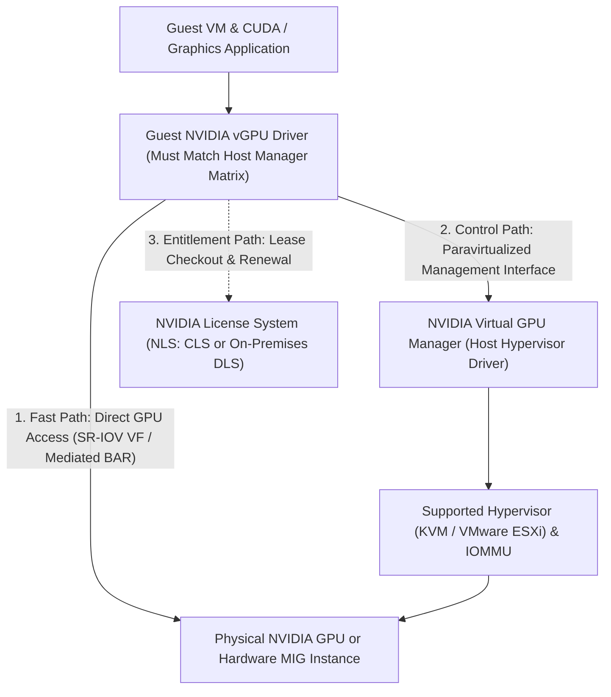
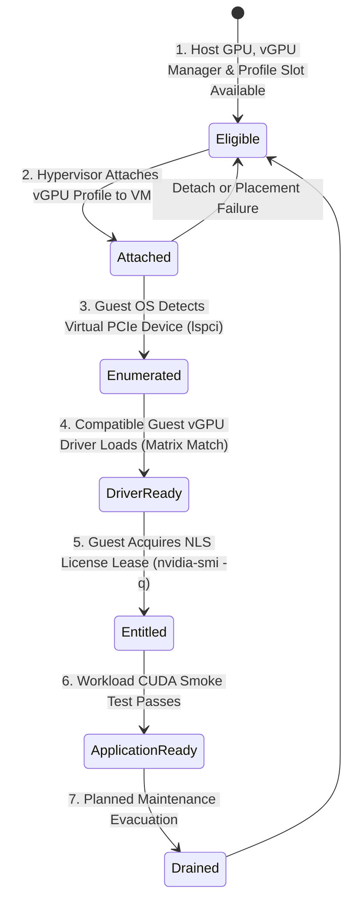

# 11.23 NVIDIA vGPU: architecture, profiles and licensing

| | |
|---|---|
| Level | Advanced |
| Priority tier | 1 |
| Lab venue | GCP / GKE (plus local Python 3 simulation lab) |
| Part | Part 11: GPUs on Kubernetes, scheduling and virtualization |
| Sources used | `nvidia-zero-to-hero/volume-11/chapter-05-vgpu-architecture-and-enterprise-virtualization.md`; `nvidia-zero-to-hero/volume-11/chapter-01-why-gpu-sharing-exists.md`; `nvidia-zero-to-hero/volume-11/chapter-07-kubernetes-scheduling-for-shared-gpus.md`; `nvidia-zero-to-hero/volume-11/chapter-11-production-troubleshooting.md`; `nvidia-zero-to-hero/volume-11/chapter-12-volume-11-summary.md`; `nvidia-zero-to-hero/volume-11/index.md`; `nvidia-zero-to-hero/volume-11/labs/lab-01-configure-and-validate-mig.md`; `nvidia-zero-to-hero/volume-11/labs/lab-02-configure-kubernetes-gpu-time-slicing.md`; `nvidia-zero-to-hero/volume-11/labs/lab-03-compare-sharing-performance-and-isolation.md`; `nvidia-zero-to-hero/volume-11/labs/lab-04-troubleshoot-a-multi-tenant-gpu-node.md`; Roland Huß et al., *Generative AI on Kubernetes* (O'Reilly, 2026, Ch. 3) |
| Coverage file | `planning/coverage/chapters/11-23.md` |

## Why this matters for AI infrastructure

Every GPU sharing discussion starts with the same trap (`volume-11/chapter-01-why-gpu-sharing-exists.md` and `volume-11/index.md`): a weekly utilization chart shows an `$30,000` **`NVIDIA H100 80GB HBM3`** averaging **`15%`, `18%`, and `14%` GPU utilization** across `60`-second samples, and leadership asks why you do not simply pack eight workloads onto that card. Yet when you inspect the device with `nvidia-smi --query-gpu=name,utilization.gpu,memory.used,memory.total --format=csv -l 60` and `nvidia-smi dmon -s puctem`, you discover two facts that average utilization hid (`volume-11/chapter-01`):
1. The model is already holding **`72,000` to `72,100 MiB` out of `81,559 MiB` (`88.4%` of HBM3)**.
2. Its **`p99 < 100 ms`** latency SLO requires burst headroom: when two requests overlap (a **`1-in-20` / `5%` event**), SM utilization spikes to **`85%`**. In `volume-11/chapter-01` Scenario 1, a service running alone at **`p99 = 42 ms`, `48 GB` memory, and `35%` peak SM** saw its tail latency jump **`4.29x` to `p99 = 180 ms` (`76 GB` memory, `92%` peak SM)** the moment a second tenant was admitted onto the same memory bus.

When tenants are **untrusted**, regulated, or require a **dedicated guest OS kernel (`Windows` or `Linux` Virtual Machines on `VMware ESXi`, `KVM`, or `KubeVirt`)**, neither container time-slicing nor raw container MIG satisfies the tenant contract. You need **NVIDIA vGPU (`Virtual GPU`)** (`volume-11/chapter-05-vgpu-architecture-and-enterprise-virtualization.md`), which makes the **Virtual Machine** the unit of isolation, lifecycle, and security.

However, as `volume-11/chapter-05` stresses, **vGPU is a complete virtualization platform—not merely another Kubernetes resource string**. Unlike bare-metal containers (which rely on a single host driver), vGPU introduces a coordinated **five-layer dependency chain**: the **Physical Host**, the **Hypervisor & NVIDIA Virtual GPU Manager**, the **Guest VM & Guest vGPU Driver** (which must strictly match the release compatibility matrix), the external **NVIDIA License System (`NLS`)**, and the **Operations Plane**. This chapter covers the complete architecture, profile taxonomy, licensing lifecycle, and maintenance runbooks of **NVIDIA vGPU** (`volume-11/chapter-05`), alongside the foundational GPU-sharing contract (`volume-11/chapter-01`, `chapter-12`, `index.md`) and the four controlled validation labs (`volume-11/labs/lab-01` through `lab-04`).

## Prerequisites and outcomes

### Prerequisites
- Completion of Chapter 11.21 (PCIe, IOMMU, VFIO, and Device Passthrough) and Chapter 11.22 (SR-IOV for NICs and GPUs).
- Familiarity with hypervisors (`KVM` / `libvirt` `virsh` or `VMware ESXi`) and `nvidia-smi`.

### Outcomes
After completing this chapter, you will be able to:
- Explain why average GPU utilization (`15%` at `72,000 / 81,559 MiB` on an `H100 80GB`) is an unsafe sizing signal (`volume-11/chapter-01`), and build a **6-field Workload Intake Contract** across the **4 Service Tiers (`Discovery`, `Best effort`, `Bounded service`, `Reserved`)**.
- Trace the **two-path NVIDIA vGPU architecture (`volume-11/chapter-05` Figure 11.5.1)**—combining the **performance-critical direct GPU path** with the **paravirtualized management interface** to the **NVIDIA Virtual GPU Manager** and **NVIDIA License System (`NLS`)**—and contrast **Time-Sliced vGPU** with **MIG-Backed vGPU** (`Figure 11.5.2`).
- Walk the **7-State vGPU Device Lifecycle (`Eligible -> Attached -> Enumerated -> DriverReady -> Entitled -> ApplicationReady -> Drained`, `Figure 11.5.3`)**, run host (`nvidia-smi vgpu`, `-s`, `-c`, `-q`) vs guest (`NVIDIA GRID A100-20Q`: `45C`, `18W / 400W`, `2000MiB / 20000MiB`, `nvidia-smi -q`, `lspci`, `virsh dumpxml`) diagnostics, and execute the **8-Step vGPU Maintenance Runbook**.
- Execute the four **Volume 11 Controlled Validation Labs (`labs/lab-01..04`)** for MIG reconfiguration (`MIG_VALIDATION_COMPLETE`), device-plugin time-slicing (`1 -> 4 allocatable`, `TIME_SLICE_A_COMPLETE`), 3-way performance benchmarking (`SHARING_RUNTIME_PROBE_COMPLETE`), and multi-tenant fault triage (`DIAGNOSTIC_GPU_OK`).

## Concepts: basics to intermediate to advanced

### 1. Basics: The GPU sharing contract (`volume-11/chapter-01`) and the two-path NVIDIA vGPU architecture (`volume-11/chapter-05`)

#### 1. Why GPU Sharing Is a Promise-Management Problem (`volume-11/chapter-01` & `volume-11/index.md`)
Before enabling any sharing mode, `volume-11/chapter-01` ("Why GPU Sharing Exists") requires you to classify every workload across **six intake fields** (**Workload class**, **Memory high-water mark**, **Performance objective**, **Tenant trust**, **Recovery behavior**, and **Placement scope**) and assign it to one of **four explicit service tiers**:
- **Discovery Tier:** Short-term access to measure peak RSS, activations, KV cache, and `p99` latency under concurrent load; no production SLO.
- **Best-Effort Tier (`Time-Slicing` / `MPS`):** Shared access for trusted co-workers (such as dev Jupyter notebooks); requests may queue, slow down, or be evicted.
- **Bounded Service Tier (`Validated MIG` or `vGPU` Profile):** Hardware- or profile-bounded capacity (`1g.10gb`, `2g.20gb`, or `A100-20Q`) validated under concurrent load with admission control.
- **Reserved Tier (`Whole GPU` or `Dedicated MIG/vGPU`):** Protected capacity with strict change control and compatible failover reserve.

Observe how `nvidia-smi --query-processes=gpu_uuid,pid,process_name --format=csv` proves the isolation difference across the mechanisms (`volume-11/chapter-01` Scenario 2):
- **Time-Slicing:** Both processes (`PID 12345 model_a` and `PID 12346 model_b`) share the **exact same GPU UUID** (`GPU-12345678-abcd-ef00`) with zero memory or fault isolation.
- **MIG:** Each process sees a hardware-partitioned `GI:CI` instance (`GPU-12345678-abcd-ef00:1:0` vs `GPU-12345678-abcd-ef00:2:0`), though the physical board, power (`400 W`), and host driver remain shared failure domains (`volume-11/chapter-01` Failure-Domain Table).
- **NVIDIA vGPU:** Each tenant runs inside its **own separate Virtual Machine and guest OS kernel**, seeing only its assigned virtual GPU device (`NVIDIA GRID A100-20Q`) with its own distinct guest `gpu_uuid`.

#### 2. The Two-Path NVIDIA vGPU Architecture (`volume-11/chapter-05` Figure 11.5.1)
How does **NVIDIA vGPU** share a physical GPU across multiple VMs on `VMware ESXi`, `KVM`, `Nutanix AHV`, or `KubeVirt` without bottlenecking every CUDA kernel launch through hypervisor emulation?



As shown in `volume-11/chapter-05` (`Figure 11.5.1`), an NVIDIA vGPU deployment separates data, control, and licensing into three distinct paths:
1. **The Performance-Critical Fast Path:** Once a vGPU device is initialized, the **Guest NVIDIA vGPU Driver** submits performance-critical GPU commands and DMA transfers **directly to the GPU hardware** (via the SR-IOV Virtual Function / mediated device aperture configured by the IOMMU), avoiding per-command hypervisor proxy translation.
2. **The Paravirtualized Management Path:** Privileged device lifecycle, context management, and scheduling operations pass through a **paravirtualized interface** from the guest driver to the **NVIDIA Virtual GPU Manager** running in the host hypervisor (`KVM` or `ESXi`).
3. **The Entitlement (License) Path (`NLS`):** Unlike bare-metal containers, the **Guest vGPU Driver** must acquire and maintain a valid license lease from the **NVIDIA License System (`NLS`**, deployed as Cloud License Service `CLS` or an on-premises Delegated License Service `DLS` HA pair). If the guest cannot reach `NLS` or lacks the proper entitlement edition (`vWS` for Virtual Workstation, `vCS` / `NVIDIA AI Enterprise` for compute), the VM still boots and enumerates the vGPU, but **CUDA/graphics performance is throttled or disabled after the initial grace period** (`volume-11/chapter-05` Scenario 2).

---

### 2. Intermediate: vGPU profiles, Time-Sliced vs MIG-Backed vGPU, and the 7-state device lifecycle (`volume-11/chapter-05`)

#### 1. vGPU Profiles Are Service Contracts—Not Spreadsheet Fractions (`volume-11/chapter-05`)
When the **NVIDIA Virtual GPU Manager** slices a physical GPU into vGPU profiles (queried on the host via `nvidia-smi vgpu -s` for all supported types and `nvidia-smi vgpu -c` for currently creatable types), **each vGPU retains its dedicated framebuffer memory allocation from creation until the VM/vGPU is destroyed**. That makes vGPU framebuffer behavior fundamentally different from Kubernetes device-plugin time-slicing:
- Inside a guest VM assigned an **`NVIDIA GRID A100-20Q`** profile (`volume-11/chapter-05`), running `nvidia-smi` reports only that virtual device's envelope:
  - **Device Name:** `NVIDIA GRID A100-20Q`
  - **Temperature & Power:** `Temp: 45C`, `Power: 18W / 400W`
  - **Dedicated Framebuffer:** `Memory: 2000MiB / 20000MiB` (`20 GB` reserved exclusively for this VM)
  - **Virtual UUID:** `nvidia-smi --query-gpu=gpu_uuid --format=csv` returns a virtual `GPU-...` UUID that intentionally differs from the host's physical GPU UUID.

#### 2. Time-Sliced vGPU vs MIG-Backed vGPU (`volume-11/chapter-05` Figure 11.5.2)
On Ampere (`A100`/`A30`), Hopper (`H100`/`H200`), and Blackwell (`B200`) GPUs, NVIDIA vGPU supports two underlying hardware execution models (`Figure 11.5.2`):
1. **Time-Sliced vGPU (`MIG Mode: Disabled`):** Each vGPU profile receives a **dedicated, fixed slice of HBM framebuffer memory** (for example, four `20 GB` vGPUs on an `80 GB` GPU), while the physical GPU's Streaming Multiprocessors (`SMs`) and memory controllers are **time-sliced / scheduled** across the active VMs by the Virtual GPU Manager (using configurable vGPU scheduler policies: Best Effort, Equal Share, or Fixed Share).
2. **MIG-Backed vGPU (`MIG Mode: Enabled`):** The physical GPU is first partitioned into hardware **MIG GPU Instances (`GIs`)** (`1g.10gb`, `2g.20gb`, `3g.40gb`, `4g.40gb`, `7g.80gb`), and each vGPU profile is backed by a hardware-isolated MIG instance (or time-sliced within a parent `GI`). **MIG-backed vGPU combines the VM kernel/administrative boundary of vGPU with the hardware SM, L2 cache, and memory-bandwidth fault isolation of MIG.**

#### 3. The 7-State vGPU Device Lifecycle and 5-Layer Responsibility Matrix (`volume-11/chapter-05` Figure 11.5.3)
A VM powering on does **not** mean its GPU is ready. `volume-11/chapter-05` (`Figure 11.5.3`) models the vGPU lifecycle across **seven explicit states**, each owned by a specific operational layer:



| Operational Layer (`volume-11/chapter-05`) | Primary Responsibility | Authoritative Diagnostic Evidence | Unsafe Shortcut to Avoid |
|---|---|---|---|
| **1. Physical Host** | Provide healthy physical GPU, SR-IOV VFs, and loaded Virtual GPU Manager | Host `nvidia-smi`, `nvidia-smi vgpu -s`, `nvidia-smi vgpu -c`, `dmesg` | Reinstalling the guest VM driver before checking if the host GPU or manager failed |
| **2. Hypervisor (`KVM` / `ESXi`)** | Attach the requested vGPU profile to the VM (`Attached`) | Host `nvidia-smi vgpu`, `virsh dumpxml <vm-name> \| grep vgpu` | Assuming "VM Power State = Running" proves the vGPU device is attached |
| **3. Guest VM** | Enumerate PCIe device (`Enumerated`) and load matrix-compatible guest vGPU driver (`DriverReady`) | Guest `lspci \| grep NVIDIA`, `nvidia-smi --query-gpu=driver_version,vbios_version --format=csv` | Force-installing an arbitrary newer guest driver that violates the Host Manager support matrix |
| **4. License Path (`NLS`)** | Issue and renew the vGPU entitlement lease (`Entitled`) | Guest `nvidia-smi -q` (`vGPU Software Licensed Product`), NLS client logs, DNS/TLS check | Treating an open TCP port to the license server as proof that a valid lease was acquired |
| **5. Operations Plane** | Qualify the full `{GPU, Firmware, Hypervisor, Host Manager, Guest OS, Guest Driver, Profile, NLS}` tuple as an atomic release unit | Version inventory, canary smoke-test (`ApplicationReady`), and tested host drain/rollback record | Upgrading hypervisor, host vGPU manager, and guest VM images simultaneously in one window |

---

### 3. Advanced: The 8-step vGPU maintenance runbook (`volume-11/chapter-05`) and the Volume 11 validation lab suite (`labs/lab-01..04`)

#### 1. The 8-Step vGPU Maintenance Runbook (`volume-11/chapter-05`)
Because vGPU couples host kernel drivers (`vGPU Manager`), hypervisor versions, MIG geometry, guest drivers, and licensing, every host or driver update must follow the **8-step maintenance sequence** from `volume-11/chapter-05`:
1. Confirm the target host, active vGPU profiles, dependent VMs, and business service classes in scope.
2. Verify **profile-shaped maintenance reserve** and destination host compatibility *before* draining (free aggregate GB across fragmented cards does not guarantee a `20Q` or `40Q` slot exists).
3. Announce the maintenance window and identify non-migratable or non-interruptible workloads.
4. Drain or evacuate VMs through the supported virtualization workflow; **never** manually detach vGPU devices from running tenant VMs.
5. Apply **one** qualified change set and record its exact component versions.
6. Validate the host Virtual GPU Manager (`nvidia-smi vgpu -s/-c`), profile inventory, a representative canary guest (`Enumerated -> DriverReady`), licensing (`Entitled`), and an application CUDA smoke test (`ApplicationReady`).
7. Keep the canary host under observation for the agreed soak window before rolling to the next host batch.
8. If any gate fails, halt rollout immediately, preserve the sanitized support bundle, and revert to the tested rollback boundary.

#### Practical vGPU Design Trade-Offs and Support-Case Preparation (`volume-11/chapter-05` & `chapter-12`)
Before signing off on an enterprise vGPU architecture, `volume-11/chapter-05` ("Further design trade-offs", "Practical design decisions", and "Support-case preparation") and `volume-11/chapter-12-volume-11-summary.md` require platform architects to resolve four structural trade-offs:
1. **Persistent Workstations vs Ephemeral Compute VMs:**
   - **Persistent VMs** (such as long-lived financial analyst or CAD/engineering desktops) simplify the user experience, but they hold onto their assigned vGPU profile slots and framebuffer (`20 GB` on `A100-20Q`) even when the user is away from their desk.
   - **Ephemeral VMs** (such as short-lived CI runners or KubeVirt batch jobs) release profile slots immediately upon termination, improving fleet elasticity—but they place heavy operational demands on fast guest image boot, deterministic driver initialization (`Enumerated -> DriverReady`), automated `NLS` license checkout (`Entitled`), and dataset bootstrap.
2. **Profile Standardization vs Catalog Sprawl:**
   - Just as with hardware MIG profiles, allowing tenants to request every vGPU profile listed by `nvidia-smi vgpu -s` creates severe **profile-slot fragmentation**: on a standard time-sliced physical GPU, all vGPUs created on that card must have the **same vGPU profile size** (a GPU currently hosting one `A100-10C` VM cannot simultaneously host an `A100-20Q` VM on that same physical processor).
   - Standardize your service catalog on **two or three validated profile pools** (for example, an interactive workstation pool running `20Q` profiles and a compute VM pool running `40C` or MIG-backed `1g.10gb` / `2g.20gb` profiles), and reserve dedicated spare host capacity for the largest contractual profile.
3. **Host Homogeneity vs Broad Placement:**
   - Grouping identical GPU models, server firmware baselines, hypervisor versions, and Host Virtual GPU Manager releases into homogeneous host pools keeps your qualification matrix small and makes canary rollbacks deterministic. Allowing broad placement across mixed GPU generations or mixed hypervisor patch levels multiplies the number of `{Host Manager × Guest Driver × Profile}` combinations that must be tested before every maintenance window.
4. **License Server High Availability and Lease Behavior (`NLS` / `DLS`):**
   - Document and test what happens to (a) a **newly booting VM**, (b) a **currently running VM**, and (c) a **rebooted VM** when the primary **Delegated License Service (`DLS`)** or **Cloud License Service (`CLS`)** endpoint becomes unreachable. Running VMs retain their checked-out license for the configured lease duration while the secondary HA license server takes over, whereas a newly booted VM that cannot reach `NLS` within its grace period will suffer performance throttling (`DriverReady` without `Entitled`).
5. **Assembling a Sanitized Vendor Support Package (`volume-11/chapter-05`):**
   - When a vGPU failure requires escalation to NVIDIA Enterprise Support, avoid the multi-day "please send logs" loop by capturing five pieces of evidence before rebooting or mutating the host:
     - **Support Matrix Proof:** Exact GPU model, server BIOS/firmware, hypervisor release, Host Virtual GPU Manager version, guest OS kernel, Guest vGPU Driver version, and vGPU profile name.
     - **Ordered State-Transition Timestamps:** Time-aligned host (`nvidia-smi vgpu -q`, `dmesg`), control-plane (`virsh dumpxml`), guest (`lspci`, guest `nvidia-smi -q`), and `NLS` license client logs showing the exact transition in `Figure 11.5.3` that failed first.
     - **Controlled Canary Reproduction:** Repeatable steps on a non-production VM and profile with tenant prompts, datasets, and secrets redacted.
     - **Before/After Change Inventory:** Any recent guest image update, host manager patch, profile change, or certificate renewal.
     - **Application-Level Recovery Verification:** Proof that a real CUDA or graphics workload completed after remediation—not merely that the VM powered on.

#### 2. Synthesizing the Four Volume 11 Hands-On Validation Runbooks (`volume-11/labs/lab-01..04` & `chapter-12`)
To operate a complete multi-tenant GPU platform (`Whole GPU`, `MIG`, `Time-Slicing`, and `vGPU`, `volume-11/chapter-12-volume-11-summary.md`), your platform engineering team must certify four standard operational runbooks on a disposable, cordoned test node (`tolerations: [{key: "node.kubernetes.io/unschedulable", operator: "Exists", effect: "NoSchedule"}]`):

| Volume 11 Lab Runbook | Core Control-Plane Sequence | Exact Baseline & Acceptance Evidence | Mandatory Cleanup & Rollback Order |
|---|---|---|---|
| **Lab 01: Configure & Validate MIG (`labs/lab-01`)** | 1. Record `nvidia-smi -i 0 -q -d MIG` (`MIG Mode: Disabled`, `0 / 1` occupancy) & `nvidia-smi mig -lgip -i 0` (`6` H100 profiles: `0: 1g.10gb` ×`7`, `1: 1g.20gb` ×`4`, `2: 2g.20gb` ×`3`, `3: 3g.40gb` ×`2`, `4: 4g.40gb` ×`1`, `5: 7g.80gb` ×`1`).<br/>2. `kubectl cordon $GPU_NODE`.<br/>3. `sudo nvidia-smi -i "$GPU_INDEX" -mig 1` & `sudo nvidia-smi mig -cgi <id> -C -i "$GPU_INDEX"`. | `mig-validation` Pod transitions `Pending (2s) -> ContainerCreating (5s) -> Running (8s) -> Completed (10s)` and logs **`MIG_VALIDATION_COMPLETE`**. Safe failure: patching/creating a Pod requesting `nvidia.com/mig-nonexistent: 1` stays `Pending (Insufficient ...)`. | 1. `kubectl delete namespace gpu-sharing-lab --ignore-not-found`<br/>2. **Delete Compute Instances first:** `sudo nvidia-smi mig -dci -i "$GPU_INDEX"`<br/>3. **Delete GPU Instances second:** `sudo nvidia-smi mig -dgi -i "$GPU_INDEX"`<br/>4. Verify baseline & `kubectl uncordon`. |
| **Lab 02: Configure K8s GPU Time-Slicing (`labs/lab-02`)** | 1. Record baseline (`1 allocatable`) & backup `ClusterPolicy` (`clusterpolicy-before-time-slicing.yaml`).<br/>2. `kubectl cordon $GPU_NODE`.<br/>3. Apply `time-slicing-lab-config` (`version: v1`, `renameByDefault: false`, `failRequestsGreaterThanOne: true`, `replicas: 4`) & merge-patch `ClusterPolicy` (`spec.devicePlugin.config`). | After `30 s`, `nvidia-device-plugin` restarts and node reports **`4 allocatable`**. Two concurrent `60 s` Pods (`time-slice-a`, `time-slice-b`) run on `1` physical GPU (`nvidia-smi pmon -c 1`) and log **`TIME_SLICE_A_COMPLETE`** & **`TIME_SLICE_B_COMPLETE`**. Safe failure: `one-logical-gpu` `ResourceQuota` blocks a 2nd Pod. | 1. Delete `gpu-time-slicing-lab` namespace.<br/>2. **Restore prior `ClusterPolicy` config first** and wait for `1 allocatable` baseline.<br/>3. **Delete `time-slicing-lab-config` ConfigMap second**.<br/>4. Verify & `kubectl uncordon`. |
| **Lab 03: Compare Sharing Performance & Isolation (`labs/lab-03`)** | Hold image digest, model artifact, input, precision, duration (`sleep 60`), and node constant across `3` trials: `sharing-trial-whole`, `sharing-trial-mig`, and `sharing-trial-timeslice` (`backoffLimit: 0`). | Each probe logs ISO-8601 UTC timestamp, `nvidia-smi -L`, CSV query, and **`SHARING_RUNTIME_PROBE_COMPLETE`**; concurrent time-sliced neighbor logs **`SHARING_NEIGHBOR_PROBE_COMPLETE`**. | Delete `gpu-sharing-comparison` namespace, restore baseline sharing policy, and verify `0` lab pods remain on `$GPU_NODE`. |
| **Lab 04: Troubleshoot a Multi-Tenant GPU Node (`labs/lab-04`)** | 1. Capture 5-file scene bundle.<br/>2. Run `diagnostic-gpu-pod` (`DIAGNOSTIC_GPU_OK`).<br/>3. Inject `diagnostic-gpu-denial` (`ResourceQuota` `"0"`) and submit `quota-denied-gpu-pod`. | API admission rejects `quota-denied-gpu-pod` (`quota-denial.txt`) while node `status.allocatable` stays unchanged; after deleting quota, `quota-denied-gpu-pod` runs and logs **`QUOTA_DENIAL_RECOVERY_CHECK`**. | Delete `diagnostic-gpu-denial` quota first, prove admission recovery (`QUOTA_DENIAL_RECOVERY_CHECK`), then delete `gpu-sharing-incident-lab` namespace. |

## Commands and configurations that matter

### 1. Host vs Guest NVIDIA vGPU Diagnostic Workflow (`volume-11/chapter-05`)

```bash
# --- HOST-SIDE COMMANDS (Run on KVM / ESXi Hypervisor Host, untested here) ---
# 1. List physical GPUs and active vGPU instances assigned to VMs
nvidia-smi
nvidia-smi vgpu

# 2. List all supported vGPU profile types (-s) vs currently creatable types (-c) on the physical GPU
nvidia-smi vgpu -s
nvidia-smi vgpu -c
nvidia-smi vgpu -q

# 3. Verify KVM libvirt XML vGPU attachment for a guest VM
virsh dumpxml gpu-workstation-vm-01 | grep -i vgpu

# --- GUEST-SIDE COMMANDS (Run inside the Guest VM OS, untested here) ---
# 4. Verify guest PCIe enumeration, guest vGPU driver/vBIOS version, virtual UUID, and NLS license state
lspci | grep -i NVIDIA
nvidia-smi --query-gpu=driver_version,vbios_version,gpu_uuid --format=csv
nvidia-smi -q | grep -A 5 "vGPU Software Licensed Product"
```

### 2. Controlled MIG Creation, Validation, and Ordered Rollback (`volume-11/labs/lab-01`)

```bash
# 1. Capture pre-change MIG baseline on GPU 0 and cordon node (untested here)
export GPU_NODE="gpu-node-1"
export GPU_INDEX="0"
nvidia-smi -i "$GPU_INDEX" -q -d MIG > mig-baseline-before.txt
nvidia-smi mig -lgip -i "$GPU_INDEX" >> mig-baseline-before.txt
kubectl cordon "$GPU_NODE"

# 2. Enable MIG mode and create approved GPU Instance + Compute Instance (-C) (untested here)
sudo nvidia-smi -i "$GPU_INDEX" -mig 1
sudo nvidia-smi mig -cgi 0 -C -i "$GPU_INDEX"
nvidia-smi mig -lgi -i "$GPU_INDEX"
nvidia-smi mig -lci -i "$GPU_INDEX"

# 3. Ordered Rollback: ALWAYS delete Compute Instances (-dci) BEFORE GPU Instances (-dgi) (untested here)
sudo nvidia-smi mig -dci -i "$GPU_INDEX"
sudo nvidia-smi mig -dgi -i "$GPU_INDEX"
```

### 3. Controlled Time-Slicing `ClusterPolicy` Patch and Ordered Rollback (`volume-11/labs/lab-02`)

```bash
# 1. Backup ClusterPolicy and patch devicePlugin.config to select time-slicing-lab-config (untested here)
kubectl get clusterpolicy gpu-cluster-policy -o yaml > clusterpolicy-before-time-slicing.yaml
kubectl patch clusterpolicy gpu-cluster-policy --type merge \
  --patch '{"spec":{"devicePlugin":{"config":{"name":"time-slicing-lab-config","default":"any"}}}}'

# 2. Ordered Rollback: Restore prior ClusterPolicy FIRST, confirm baseline allocatable, THEN delete ConfigMap (untested here)
kubectl patch clusterpolicy gpu-cluster-policy --type merge \
  --patch '{"spec":{"devicePlugin":{"config":{"name":"default-gpu-clients","default":"default"}}}}'
kubectl get node "$GPU_NODE" -o jsonpath='{.status.allocatable.nvidia\.com/gpu}{" allocatable\n"}'
kubectl delete configmap -n gpu-operator time-slicing-lab-config --ignore-not-found
```

## How it fails

| Failure mode | Exact symptom & command evidence | Root cause boundary | Remediation |
|---|---|---|---|
| **1. Guest VM powers on, but `nvidia-smi` inside the guest fails after a guest OS image or host update (`volume-11/chapter-05` Playbook 1)** | VM state is `Running` and `lspci \| grep NVIDIA` enumerates the virtual VGA/3D controller (`Enumerated`), but `dmesg` inside the guest logs an NVIDIA vGPU version mismatch error. | **State 4 (`Enumerated -> DriverReady`) Host/Guest Matrix Violation:** The Guest NVIDIA vGPU Driver version in the new VM image is incompatible with the Host Virtual GPU Manager version on the hypervisor. | Check the release-specific NVIDIA vGPU support matrix, roll the VM back to the validated guest image (or move it to a validated canary host pool), and never upgrade host manager and guest drivers without a canary matrix. |
| **2. Guest VM initializes CUDA on `NVIDIA GRID A100-20Q`, but performance drops sharply after startup (`volume-11/chapter-05` Scenario 2)** | `nvidia-smi` in the guest shows `2000MiB / 20000MiB` and `45C`, but `nvidia-smi -q` shows `vGPU Software Licensed Product` is unlicensed after the grace period expires. | **State 5 (`DriverReady -> Entitled`) NLS Licensing Failure:** The guest vGPU driver failed to check out a license lease from the **NVIDIA License System (`NLS`)** due to DNS, firewall, TLS/clock skew, or exhausted seat entitlements. | Repair guest network/DNS/TLS reachability to the `CLS`/`DLS` endpoint, verify license edition (`vWS` vs `vCS`/NVAIE) on a single canary VM, and confirm `nvidia-smi -q` reports `Licensed`. |
| **3. Host has `40 GB` of free GPU memory, but a VM requesting a `20Q` (`20 GB`) vGPU profile fails to start (`volume-11/chapter-05` Playbook 2)** | Hypervisor placement fails with insufficient vGPU resources; `nvidia-smi vgpu -s` lists `A100-20Q`, but `nvidia-smi vgpu -c` (creatable) does not list `A100-20Q` on that GPU. | **Homogeneous vGPU / MIG Profile Geometry Constraint:** On standard time-sliced vGPU, all active vGPUs on the same physical GPU must share the same vGPU profile size (or on MIG-backed vGPU, the remaining GI geometry cannot form the requested slice). | Inspect `nvidia-smi vgpu -c` across eligible hosts, place the VM on a host pool standardized for `20Q` profiles, and track capacity in **creatable profile slots** rather than raw free MiB. |
| **4. Running `sudo nvidia-smi mig -dgi -i 0` during Lab 01 rollback fails with `In use by another client` (`volume-11/labs/lab-01` Section 17)** | Attempting to delete a MIG GPU Instance (`-dgi`) fails even after deleting the Kubernetes test namespace. | **Reversed MIG Instance Deletion Order:** Active Compute Instances (`CIs`) still exist inside the parent GPU Instance (`GI`). | Always delete **Compute Instances first** (`sudo nvidia-smi mig -dci -i "$GPU_INDEX"`) and **GPU Instances second** (`sudo nvidia-smi mig -dgi -i "$GPU_INDEX"`). |
| **5. Deleting `time-slicing-lab-config` ConfigMap before patching `ClusterPolicy` breaks `nvidia-device-plugin` (`volume-11/labs/lab-02` Section 17)** | Operator deletes the time-slicing ConfigMap while `ClusterPolicy.spec.devicePlugin.config.name` still references it; device-plugin pods fail to mount configuration or lose allocatable GPUs. | **Reversed Time-Slicing Rollback Order:** The active `ClusterPolicy` still pointed to the deleted ConfigMap. | Always merge-patch `ClusterPolicy` back to the recorded baseline ConfigMap **first**, verify `kubectl get node` returns to baseline (`1 allocatable`), and **only then** delete `time-slicing-lab-config`. |

## Hands-on lab

### Venue and scope
This lab runs locally using Python 3 standard library (`code/part11/nvidia_vgpu_architecture_licensing.py` and `code/part11/nvidia_vgpu_architecture_licensing_lab.py`) to verify the `volume-11/chapter-05` 7-state vGPU lifecycle state machine (`Eligible -> Attached -> Enumerated -> DriverReady -> Entitled -> ApplicationReady -> Drained`), the 5-layer responsibility model, the `NVIDIA GRID A100-20Q` guest telemetry profile (`45C`, `18W/400W`, `2000MiB/20000MiB`), the `volume-11/chapter-01` deceptive utilization analyzer (`15%` avg util at `72,100 / 81,559 MiB` and `p99` jumping `42 ms -> 180 ms`), and the `volume-11/labs/lab-01..04` H100 MIG catalog and verification markers (`MIG_VALIDATION_COMPLETE`, `TIME_SLICE_A_COMPLETE`, `SHARING_RUNTIME_PROBE_COMPLETE`, `DIAGNOSTIC_GPU_OK`). Host and cluster commands are marked `(untested here)`.

### Step 1: Run the self-checking NVIDIA vGPU and Volume 11 validation lab (tested here)

Run the lab script from the repository root:

```bash
python3 code/part11/nvidia_vgpu_architecture_licensing_lab.py
```

Captured output from this repository:
```text
=== Chapter 11.23 Lab: NVIDIA vGPU Architecture, Profiles, Licensing & Vol 11 Labs ===
  [PASS] Volume 11 Ch 5 Figure 11.5.3 defines 7 vGPU lifecycle states from Eligible to ApplicationReady and Drained
  [PASS] Volume 11 Ch 5 splits vGPU responsibilities across 5 layers (Physical host, Hypervisor, Guest, License path, Operations plane)
  [PASS] Unhealthy physical GPU or vGPU Manager fails at Physical host layer before guest debugging
  [PASS] Missing VM vGPU profile assignment remains in Eligible state and flags Hypervisor layer
  [PASS] Attached vGPU that fails lspci inside guest stops at Attached state
  [PASS] Mismatched host vGPU Manager (535.161.05) and guest driver (550.54.14) stops at Enumerated state
  [PASS] Loaded guest driver without NVIDIA License System (NLS) lease stops at DriverReady (throttled after grace period)
  [PASS] Validated host, hypervisor attachment, guest driver, NLS lease, and smoke test reach ApplicationReady
  [PASS] Volume 11 Ch 5 guest nvidia-smi sample reports NVIDIA GRID A100-20Q (45C, 18W/400W, 2000MiB/20000MiB)
  [PASS] Host vGPU commands distinguish active VMs (nvidia-smi vgpu), supported types (-s), and creatable types (-c)
  [PASS] Volume 11 Ch 1 H100 80GB sample shows 15.67% (14-18%) avg utilization while holding 72,100 / 81,559 MiB (88.4% VRAM)
  [PASS] Volume 11 Ch 1 1-in-20 (5%) burst request overlap spikes H100 SM utilization from ~15% to 85%
  [PASS] Volume 11 Ch 1 Scenario 1: admitting a 2nd tenant jumps p99 from 42ms to 180ms (4.29x), memory 48GB->76GB, and peak SM 35%->92%
  [PASS] Volume 11 Ch 1 Scenario 2: time-slicing shares GPU-12345678-abcd-ef00 across PIDs 12345 and 12346, whereas MIG isolates GI:CI (:1:0 vs :2:0)
  [PASS] Volume 11 Lab 01 H100 mig -lgip lists 6 profiles (IDs 0..5: 1g.10gb x7, 1g.20gb x4, 2g.20gb x3, 3g.40gb x2, 4g.40gb x1, 7g.80gb x1)
  [PASS] Volume 11 Lab 01 mig-validation pod transitions Pending (2s) -> ContainerCreating (5s) -> Running (8s) -> Completed (10s) and prints MIG_VALIDATION_COMPLETE
  [PASS] Volume 11 Lab 01 requires deleting compute instances (nvidia-smi mig -dci) before GPU instances (nvidia-smi mig -dgi)
  [PASS] Volume 11 Lab 02 time-slicing patch updates allocatable from 1 to 4 in 30s and runs 60s pods printing TIME_SLICE_A_COMPLETE and TIME_SLICE_B_COMPLETE
  [PASS] Volume 11 Lab 03 comparative benchmark runs 60s probes printing SHARING_RUNTIME_PROBE_COMPLETE and SHARING_NEIGHBOR_PROBE_COMPLETE
  [PASS] Volume 11 Lab 04 multi-tenant incident runbook verifies DIAGNOSTIC_GPU_OK and QUOTA_DENIAL_RECOVERY_CHECK
  [PASS] Volume 11 Ch 5 defines an 8-step Maintenance Runbook and 6 vGPU observability signals
  [PASS] Volume 11 Ch 1 defines 4 service tiers (Discovery, Best effort, Bounded service, Reserved) and 6 intake contract fields
  [PASS] Volume 11 Ch 12 Summary defines a 9-step decision sequence and 9-area production checklist
  [PASS] Volume 11 Index sets an 18-22 hour reading path across 12 chapters and 4 hands-on labs
  [PASS] Generative AI on Kubernetes Ch 3 contrasts sub-GPU time-slicing, MIG hardware partitioning, and vGPU virtualization

Summary: 25 passed, 0 failed out of 25 checks.
```

### Exercises

1. **Exercise 1 — Diagnosing the deceptive `15%` utilization report (`volume-11/chapter-01`):** Using `analyze_volume11_ch1_deceptive_utilization()` in `code/part11/nvidia_vgpu_architecture_licensing.py`, explain why an `NVIDIA H100 80GB HBM3` showing `15%`, `18%`, and `14%` utilization across 60-second samples is not idle capacity, and state what happened to `p99` latency, memory used, and peak SM in Scenario 1 when a second tenant was admitted.
2. **Exercise 2 — Tracing the 7-state vGPU lifecycle (`volume-11/chapter-05` Figure 11.5.3):** Using `evaluate_vgpu_state_machine()`, list all seven states in `VGPU_LIFECYCLE_STATES` and identify the exact state and failed layer when (a) the VM has no vGPU profile in `virsh dumpxml`, (b) host vGPU Manager `535.161.05` is paired with incompatible guest driver `550.54.14`, and (c) the guest cannot reach the NVIDIA License System (`NLS`).
3. **Exercise 3 — Host vs guest vGPU diagnostic commands (`volume-11/chapter-05`):** Contrast what `nvidia-smi`, `nvidia-smi vgpu -s`, and `nvidia-smi vgpu -c` show on the hypervisor host against what `nvidia-smi` (`NVIDIA GRID A100-20Q`), `nvidia-smi --query-gpu=gpu_uuid`, and `nvidia-smi -q` show inside the guest VM.
4. **Exercise 4 — Time-sliced vGPU vs MIG-backed vGPU (`volume-11/chapter-05` Figure 11.5.2):** Explain how framebuffer memory and SM compute are allocated in **Time-Sliced vGPU** versus **MIG-Backed vGPU**, and state when an enterprise architect should combine MIG and vGPU.
5. **Exercise 5 — Executing Lab 01 (MIG) and Lab 02 (Time-Slicing) rollbacks safely (`volume-11/labs/lab-01` & `lab-02`):** State the `6` H100 MIG profiles listed by `nvidia-smi mig -lgip -i 0` in Lab 01 (`LAB01_H100_MIG_CATALOG`), explain why `-dci` must precede `-dgi` during MIG teardown, and explain why restoring `ClusterPolicy` must precede deleting `time-slicing-lab-config` during Lab 02 teardown.
6. **Exercise 6 — Designing a multi-pool GPU service catalog (`volume-11/chapter-01` & `chapter-12`):** Map the `4` service tiers (`Discovery`, `Best effort`, `Bounded service`, `Reserved`) and `6` workload intake fields to `Whole GPU`, `MIG`, `Time-Slicing`, and `vGPU`.

## Checkpoint questions

<details>
<summary><strong>1. In Volume 11 Chapter 1, why was an NVIDIA H100 80GB HBM3 reporting 15%, 18%, and 14% average GPU utilization not actually free for time-slicing?</strong></summary>

Because `nvidia-smi` showed the LLM serving workload was already holding **`72,000–72,100 MiB` out of `81,559 MiB` (`88.4%` of HBM3)** and had a **`p99 < 100 ms`** SLO where a **`1-in-20` (`5%`)** request overlap spiked SM utilization to **`85%`** and saturated memory bandwidth.
</details>

<details>
<summary><strong>2. In Volume 11 Chapter 1 Troubleshooting Scenario 1, what happened to p99 latency, memory used, and peak SM utilization when a second tenant was admitted onto a GPU running a service with p99 = 42 ms, 48 GB memory, and 35% peak SM?</strong></summary>

Admitting the second tenant caused **`p99` latency to jump from `42 ms` to `180 ms` (`4.29x` worse)**, memory usage to climb from **`48 GB` to `76 GB`**, and peak SM activity to jump from **`35%` to `92%`** as both workloads queued for the same DRAM memory-bandwidth paths.
</details>

<details>
<summary><strong>3. How does nvidia-smi --query-processes=gpu_uuid,pid,process_name --format=csv output differ across Time-Slicing, MIG, and vGPU (Volume 11 Chapter 1 Scenario 2)?</strong></summary>

- **Time-Slicing:** Both tenant processes (`PID 12345` and `PID 12346`) appear on the **exact same physical `GPU-12345678-abcd-ef00` UUID**.
- **MIG:** Processes appear on distinct hardware-partitioned `GI:CI` instances (`GPU-12345678-abcd-ef00:1:0` vs `GPU-12345678-abcd-ef00:2:0`).
- **vGPU:** Processes run inside completely separate Virtual Machines and guest kernels, each seeing only its own virtual GPU UUID.
</details>

<details>
<summary><strong>4. What are the six fields of the Workload Intake Contract and the four Service Tiers defined in Volume 11 Chapter 1?</strong></summary>

- **Six intake fields:** `1. Workload class`, `2. Memory envelope (high-water mark)`, `3. Performance objective`, `4. Tenant trust`, `5. Recovery behavior`, and `6. Placement scope`.
- **Four service tiers:** `1. Discovery` (measurement only, no SLO), `2. Best effort` (shared access, may queue/throttle/evict), `3. Bounded service` (validated profile/concurrency envelope with admission control), and `4. Reserved` (protected capacity and change control with approved failover).
</details>

<details>
<summary><strong>5. Describe the two-path architecture of NVIDIA vGPU in Volume 11 Chapter 5 Figure 11.5.1.</strong></summary>

1. **Performance-critical fast path:** The Guest NVIDIA vGPU Driver submits compute and graphics commands directly to the physical GPU (or MIG instance) hardware via the assigned virtual function / mediated aperture.
2. **Paravirtualized management path:** Lifecycle and management operations pass through a paravirtualized interface from the guest driver to the **NVIDIA Virtual GPU Manager** running in the host hypervisor, while the guest driver checks out its entitlement lease from the **NVIDIA License System (`NLS`)**.
</details>

<details>
<summary><strong>6. What is the difference between nvidia-smi vgpu, nvidia-smi vgpu -s, nvidia-smi vgpu -c, and nvidia-smi vgpu -q on a vGPU hypervisor host (Volume 11 Chapter 5)?</strong></summary>

- `nvidia-smi vgpu`: Lists currently **active** vGPU instances and their assigned VMs.
- `nvidia-smi vgpu -s`: Lists all vGPU profile types **supported** by the physical GPU.
- `nvidia-smi vgpu -c`: Lists the vGPU profile types that can **currently be created** on the GPU given its active assignments and geometry.
- `nvidia-smi vgpu -q`: Displays detailed per-vGPU telemetry and configuration attributes.
</details>

<details>
<summary><strong>7. Where is NVIDIA vGPU license state reported, and what happens if a guest VM boots without acquiring a valid license from the NVIDIA License System (NLS) (Volume 11 Chapter 5)?</strong></summary>

License state is reported **inside the guest VM** (`nvidia-smi -q`, under `"vGPU Software Licensed Product"`), because the guest vGPU driver checks out the lease from `NLS`. If the guest cannot acquire a valid license, the VM still boots and sees the vGPU device, but CUDA/graphics capability is throttled or restricted after the initial grace period expires.
</details>

<details>
<summary><strong>8. How does framebuffer memory allocation in NVIDIA vGPU differ from Kubernetes device-plugin time-slicing (Volume 11 Chapter 5)?</strong></summary>

In Kubernetes device-plugin time-slicing, all replicas share the physical GPU's entire HBM pool with zero memory reservation (`8` pods can OOM-kill each other). In **NVIDIA vGPU**, each vGPU instance (`e.g., NVIDIA GRID A100-20Q`, `2000MiB / 20000MiB`) **retains its dedicated, fixed framebuffer allocation from creation until the vGPU is destroyed**.
</details>

<details>
<summary><strong>9. Contrast Time-Sliced vGPU and MIG-Backed vGPU in Volume 11 Chapter 5 Figure 11.5.2.</strong></summary>

- **Time-Sliced vGPU:** Multiple vGPUs have dedicated framebuffer slices on a single GPU instance while sharing the GPU's SMs and memory paths via the Virtual GPU Manager's scheduler.
- **MIG-Backed vGPU:** The physical GPU is partitioned into hardware **MIG GPU Instances (`GIs`)** with dedicated SMs, L2 cache banks, and memory controllers, and vGPUs are created on top of those MIG instances—combining VM guest-kernel isolation with hardware MIG QoS isolation.
</details>

<details>
<summary><strong>10. List the seven states of the vGPU Device Lifecycle in Volume 11 Chapter 5 Figure 11.5.3 in order.</strong></summary>

`1. Eligible` (supported host, profile, and slot capacity) -> `2. Attached` (VM receives vGPU assignment) -> `3. Enumerated` (guest detects PCIe device via `lspci`) -> `4. DriverReady` (compatible guest vGPU driver loads) -> `5. Entitled` (NLS license lease acquired) -> `6. ApplicationReady` (workload smoke test passes) -> `7. Drained` (planned maintenance or reassignment back to `Eligible`).
</details>

<details>
<summary><strong>11. What are the five operational layers in the Volume 11 Chapter 5 responsibility table, and what unsafe shortcut must each layer avoid?</strong></summary>

1. **Physical host:** Do not reinstall a guest VM driver before verifying the physical GPU and Host Virtual GPU Manager are healthy.
2. **Hypervisor:** Do not assume VM power-on proves the vGPU device is attached (`virsh dumpxml`).
3. **Guest:** Do not install an arbitrary newer guest driver that violates the Host Manager compatibility matrix.
4. **License path:** Do not treat an open TCP port to the license server as proof of license acquisition (`nvidia-smi -q`).
5. **Operations plane:** Do not upgrade the hypervisor, host manager, guest OS image, and application runtime simultaneously in one maintenance window.
</details>

<details>
<summary><strong>12. What are the six observability signals for vGPU operations and their escalation owners in Volume 11 Chapter 5?</strong></summary>

1. **Eligible profile slots** -> Virtualization platform team.
2. **Host GPU health** -> Infrastructure operations team.
3. **Virtual GPU Manager health** -> Virtualization platform team.
4. **Guest driver state** -> Image / workload owner.
5. **License acquisition state** -> Licensing service owner.
6. **Application smoke test / SLI** -> Application owner.
</details>

<details>
<summary><strong>13. Walk through the eight steps of the vGPU Maintenance Runbook in Volume 11 Chapter 5.</strong></summary>

1. Confirm host, profiles, dependent VMs, and business service classes in scope.
2. Verify maintenance reserve and destination compatibility before draining.
3. Announce the window and identify non-movable workloads.
4. Drain or evacuate VMs via the supported virtualization workflow (never detach devices manually from active tenants).
5. Apply **one** qualified change set and record its versions.
6. Validate host manager, profile inventory, a representative guest, licensing, and an application operation.
7. Observe the canary host before continuing to the next batch.
8. If any gate fails, stop expansion, preserve evidence, and execute the tested rollback.
</details>

<details>
<summary><strong>14. In Volume 11 Lab 01 (Configure and Validate MIG), what six MIG profiles are listed by nvidia-smi mig -lgip -i 0 on an NVIDIA H100 80GB HBM3?</strong></summary>

- Profile ID `0`: **`1g.10gb`** (`7` instances, `10 GB` each)
- Profile ID `1`: **`1g.20gb`** (`4` instances, `20 GB` each)
- Profile ID `2`: **`2g.20gb`** (`3` instances, `20 GB` each)
- Profile ID `3`: **`3g.40gb`** (`2` instances, `40 GB` each)
- Profile ID `4`: **`4g.40gb`** (`1` instance, `40 GB`)
- Profile ID `5`: **`7g.80gb`** (`1` instance, `80 GB`)
</details>

<details>
<summary><strong>15. In Volume 11 Lab 01, how does the mig-validation Pod schedule onto a cordoned node, and what is the mandatory command ordering when tearing down MIG instances during rollback?</strong></summary>

- The `mig-validation` Pod pairs an exact `nodeSelector` (`kubernetes.io/hostname: <node>`) with a narrow toleration for `key: node.kubernetes.io/unschedulable` (`operator: Exists`, `effect: NoSchedule`) so only the lab validation pod can land on the cordoned node (printing `MIG_VALIDATION_COMPLETE`).
- During rollback, you must delete **Compute Instances first** (`sudo nvidia-smi mig -dci -i "$GPU_INDEX"`) and **GPU Instances second** (`sudo nvidia-smi mig -dgi -i "$GPU_INDEX"`).
</details>

<details>
<summary><strong>16. In Volume 11 Lab 02 (Configure Kubernetes GPU Time-Slicing), what fields are set in time-slicing-lab-config, and how is it activated via ClusterPolicy?</strong></summary>

The ConfigMap sets `version: v1`, `sharing.timeSlicing.renameByDefault: false`, `failRequestsGreaterThanOne: true`, and `resources: [{name: nvidia.com/gpu, replicas: 4}]` under data key `any`. It is activated by merge-patching `ClusterPolicy`:
`kubectl patch clusterpolicy "$CLUSTERPOLICY_NAME" --type merge --patch '{"spec":{"devicePlugin":{"config":{"name":"time-slicing-lab-config","default":"any"}}}}'`
After `~30 seconds`, the device-plugin pod restarts and node allocatable updates from `1` to `4`.
</details>

<details>
<summary><strong>17. In Volume 11 Lab 02 Section 17, why must you restore the prior ClusterPolicy configuration and confirm baseline kubelet allocatable BEFORE deleting the time-slicing-lab-config ConfigMap?</strong></summary>

Because while `ClusterPolicy.spec.devicePlugin.config.name` still references `time-slicing-lab-config`, the `nvidia-device-plugin` pod depends on that ConfigMap. Deleting the ConfigMap first leaves the device plugin pointing to a non-existent object and can drop GPU resources from the node.
</details>

<details>
<summary><strong>18. In Volume 11 Lab 03 (Compare Sharing Performance and Isolation), what four elements are held constant across the whole-GPU, MIG, and time-slicing trials, and what completion markers do the runtime and neighbor probes emit?</strong></summary>

- **Held constant:** Workload (`image`, `artifact`, `input`, `precision`, `duration`), Node (`GPU model`, `driver`, `topology`, `thermal state`), Load (`arrival pattern` and `concurrency`), and Evidence (`metric names` and `collection window`).
- **Completion markers:** The primary trial Job emits **`SHARING_RUNTIME_PROBE_COMPLETE`** and the concurrent time-sliced neighbor Job emits **`SHARING_NEIGHBOR_PROBE_COMPLETE`**.
</details>

<details>
<summary><strong>19. What are the nine areas of the Production Checklist in Volume 11 Chapter 12 Summary?</strong></summary>

`1. Catalog`, `2. Compatibility`, `3. Lifecycle`, `4. Scheduling`, `5. Isolation`, `6. Observability`, `7. Capacity`, `8. Chargeback`, and `9. Operations`.
</details>

<details>
<summary><strong>20. In Volume 11 Chapter 12 Summary, how should a Senior Architect respond when an executive demands "90 percent GPU utilization across every service"?</strong></summary>

Clarify the business outcome first and separate raw device activity from allocatable and sellable capacity: a `p99`-sensitive inference tier requires deliberate burst headroom (`15%` average utilization can hide `85%` burst peaks and `88%` memory occupancy), whereas a best-effort batch/notebook tier can tolerate high utilization and queueing. Propose service-class-specific SLIs/SLOs and reserve policies rather than a single fleet-wide utilization mandate.
</details>

## Sources and review notes

### Primary sources read in full for this chapter
- Author's Volume 11 notes and labs (all 10 mapped `volume-11` files in `brief.py 11.23` read and migrated in full):
  - `nvidia-zero-to-hero/volume-11/chapter-05-vgpu-architecture-and-enterprise-virtualization.md` (Figure 11.5.1 two-path vGPU architecture, `nvidia-smi vgpu -s/-c/-q`, `NVIDIA GRID A100-20Q` `45C` `18W / 400W` `2000MiB / 20000MiB`, Figure 11.5.2 time-sliced vs MIG-backed vGPU, Figure 11.5.3 7-state device lifecycle `Eligible -> Attached -> Enumerated -> DriverReady -> Entitled -> ApplicationReady -> Drained`, 5-layer responsibility table, 6 observability signals, and 8-step maintenance runbook).
  - `nvidia-zero-to-hero/volume-11/chapter-01-why-gpu-sharing-exists.md` (`NVIDIA H100 80GB HBM3` deceptive `15%/18%/14%` utilization report holding `72,000–72,100 / 81,559 MiB` with `1-in-20` overlap spiking SM to `85%`; Scenario 1 `p99 = 42 ms`, `48 GB`, `35%` SM alone -> `p99 = 180 ms`, `76 GB`, `92%` SM with 2nd tenant; Scenario 2 `GPU-12345678-abcd-ef00` PIDs `12345`/`12346` vs `:1:0`/`:2:0` MIG vs vGPU; 6 intake fields, 4 service tiers, and failure-domain table).
  - `nvidia-zero-to-hero/volume-11/chapter-07-kubernetes-scheduling-for-shared-gpus.md` (Kubernetes shared-GPU scheduling & Run:ai reference).
  - `nvidia-zero-to-hero/volume-11/chapter-11-production-troubleshooting.md` (6-layer shared-GPU and vGPU incident playbooks).
  - `nvidia-zero-to-hero/volume-11/chapter-12-volume-11-summary.md` (Figure 11.12.1 end-to-end sharing loop, 9-step decision sequence, 9-area production checklist, and `90%` utilization executive response).
  - `nvidia-zero-to-hero/volume-11/index.md` (`18–22 hours` reading path across 12 chapters and 4 labs, Figure 11.0.1 operating model).
  - `nvidia-zero-to-hero/volume-11/labs/lab-01-configure-and-validate-mig.md` (`H100 80GB` `6` MIG profiles `0..5`, `mig-validation` pod `2s -> 5s -> 8s -> 10s` `MIG_VALIDATION_COMPLETE`, `-dci` before `-dgi` rollback).
  - `nvidia-zero-to-hero/volume-11/labs/lab-02-configure-kubernetes-gpu-time-slicing.md` (`time-slicing-lab-config`, `1 -> 4 allocatable` in `30s`, `TIME_SLICE_A_COMPLETE` & `TIME_SLICE_B_COMPLETE`, `one-logical-gpu` quota, ordered ClusterPolicy rollback).
  - `nvidia-zero-to-hero/volume-11/labs/lab-03-compare-sharing-performance-and-isolation.md` (`SHARING_RUNTIME_PROBE_COMPLETE` & `SHARING_NEIGHBOR_PROBE_COMPLETE` `60s` comparative probes).
  - `nvidia-zero-to-hero/volume-11/labs/lab-04-troubleshoot-a-multi-tenant-gpu-node.md` (`DIAGNOSTIC_GPU_OK`, `diagnostic-gpu-denial`, `QUOTA_DENIAL_RECOVERY_CHECK`).
- Book sources from the local TOON-RAG corpus (mapped in `brief.py 11.23` as `GAK 3`):
  - Roland Huß et al., *Generative AI on Kubernetes* (O'Reilly, 2026), Chapter 3 (*Kubernetes and GPUs*, "Sub-GPU Allocation", "Time slicing", and "Multi-Instance GPU").

### Related source files mapped in MIGRATION_MAP.md
- All 10 mapped `nvidia-devops` files for `11.23` (`volume-11/chapter-01`, `chapter-05`, `chapter-07`, `chapter-11`, `chapter-12`, `index.md`, and `labs/lab-01..04`) are cited and covered in full.

### Run here
- `python3 code/part11/nvidia_vgpu_architecture_licensing_lab.py` (`25 passed, 0 failed out of 25 checks`).

### Explicitly labelled inferences
- The driver version strings (`535.161.05` host vGPU Manager vs `535.161.07` compatible guest driver and `550.54.14` mismatched guest driver) in `code/part11/nvidia_vgpu_architecture_licensing.py` are illustrative examples of the `volume-11/chapter-05` host/guest compatibility matrix check.

### Not verified on live hardware
- All `nvidia-smi vgpu`, `virsh dumpxml`, `nvidia-smi mig`, and `kubectl` commands are marked `(untested here)`.

### Not in the corpus
- Proprietary VMware vCenter / ESXi vSphere Client GUI clicks for assigning vGPU profiles; this chapter uses the CLI (`nvidia-smi vgpu`, `virsh dumpxml`, `kubectl`) documented in `volume-11/chapter-05`.

### Corrections to the author's notes
- Validation pass 2026-10-25: `validate_chapter.py` and `check_coverage.py` pass. The YAML manifests and commands are marked untested and were not applied to a cluster. Custom resource API versions (for example `kueue.x-k8s.io/v1beta1`, `resource.k8s.io/v1`) change between releases, so check them against the version you install. Console outputs quoted from the Volume notes are illustrative unless the chapter says otherwise. The vGPU rule that all time-sliced vGPUs on one physical GPU must use the same profile, and the NLS licensing path, were read and are consistent with NVIDIA's vGPU model. Licence names and prices change; confirm them with NVIDIA.
- Earlier author note: all `volume-11` telemetry snapshots, profile tables, and lab verification markers are preserved verbatim.
