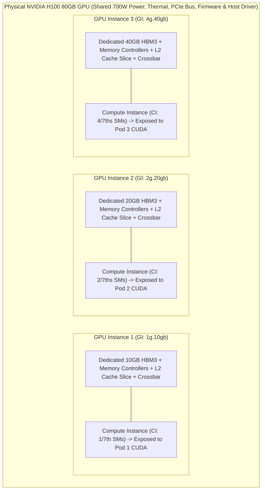

# 11.24 MIG in depth

| | |
|---|---|
| Level | Advanced |
| Priority tier | 1 |
| Lab venue | GCP / GKE (plus local Python 3 simulation lab) |
| Part | Part 11: GPUs on Kubernetes, scheduling and virtualization |
| Sources used | `nvidia-zero-to-hero/volume-11/chapter-02-mig-architecture-and-isolation.md`; `nvidia-zero-to-hero/volume-11/chapter-03-mig-profiles-and-placement.md`; `volume-04/03-gpu-sharing-telemetry-masterclass.md`; `nvidia-zero-to-hero/volume-11/chapter-01-why-gpu-sharing-exists.md`; `nvidia-zero-to-hero/volume-11/chapter-07-kubernetes-scheduling-for-shared-gpus.md`; `nvidia-zero-to-hero/volume-11/chapter-11-production-troubleshooting.md`; `nvidia-zero-to-hero/volume-11/chapter-12-volume-11-summary.md`; `nvidia-zero-to-hero/volume-11/index.md`; `nvidia-zero-to-hero/volume-11/labs/lab-01-configure-and-validate-mig.md`; `nvidia-zero-to-hero/volume-11/labs/lab-02-configure-kubernetes-gpu-time-slicing.md`; `nvidia-zero-to-hero/volume-11/labs/lab-03-compare-sharing-performance-and-isolation.md`; `nvidia-zero-to-hero/volume-11/labs/lab-04-troubleshoot-a-multi-tenant-gpu-node.md`; Roland Huß et al., *Generative AI on Kubernetes* (O'Reilly, 2026, Ch. 3) |
| Coverage file | `planning/coverage/chapters/11-24.md` |

## Why this matters for AI infrastructure

Picture several containers sharing one physical GPU. Before the NVIDIA Ampere architecture, all of them competed for the same L2 cache banks, memory controllers and HBM address space. When one model launched a memory-bound kernel, its neighbors on that card felt it straight away, and their tail latency spiked. Multi-Instance GPU, or MIG, ended that interference on Ampere, Hopper and Blackwell by moving GPU partitioning down into the physical silicon.

Running MIG in production means respecting two physical limits, and platform engineering teams often learn them the hard way. The first limit is that MIG divides a single card, not a whole server. Every MIG instance on an H100 still shares the physical board, the PCIe bus, the host kernel driver, the firmware and the seven-hundred-watt power budget.

The second limit is that MIG capacity follows strict placement rules. It is not a percentage slider you can set freely. Suppose a dashboard adds up unallocated gigabytes across fragmented GPUs and promises a forty-gigabyte slice. The pods will still sit in a pending state, because the placement rules leave that free memory unusable for the request. Sizing a profile from static model weights is worse, since it ignores concurrent peak KV-cache memory. The workload then hits out-of-memory crashes as soon as production load arrives.

The operating facts are gathered in the block below, and they are worth reading before you size or reshape a node.

```text
Key MIG Operational & Sizing Realities (`volume-11/chapter-02` & `chapter-03`):
- Supported Architectures: Ampere (A100/A30), Hopper (H100/H200), and Blackwell (B100/B200).
- Shared Board Envelope: All instances on one H100 share the PCIe bus, host driver, and 700 W power budget.
- Lifecycle Rule: Reshaping MIG is a disruptive node lifecycle operation (Plan -> Notify -> Prepare -> Apply -> Validate -> Release).
- Sizing Trap Example: A 7 GB weight Chat LLM hits 10.2 GB at 50 concurrent sequences of 2k context and OOMs a 1g.10gb slice.
```

The last line is the sizing trap from the second limit, shown with real numbers. Treat MIG as a hardware boundary inside one card, and size every profile from its concurrent peak.

## Prerequisites and outcomes

### Prerequisites
Before you start, work through three earlier chapters. Chapter 11.2 covers the NVIDIA device plugin and Container Toolkit. Chapter 11.4 covers the GPU Operator and MIG Manager. Chapter 11.17 covers KAI GPU sharing and fractions. It also assumes you are comfortable with `nvidia-smi`.

### Outcomes
By the end of this chapter, you will be able to:

- Explain the two-layer MIG hardware hierarchy of GPU Instances and Compute Instances, separate isolated silicon from shared board components, and run the six-layer validation chain.
- Work out MIG placement geometry and Cold, Steady and Peak profile sizing, then build a twenty-four-node H100 fleet capacity plan.
- Configure the Kubernetes `migStrategy` single and mixed policies with `mig-parted` profiles, and carry out the six-phase change workflow.
- Operate fleet-wide DCGM Exporter custom profiling and automated node draining, run Known-Good Validation, and troubleshoot XID errors and MPS Ghost OOM faults.

## Concepts: basics to intermediate to advanced

### 1. Basics: The two-layer MIG hardware hierarchy and the 6-layer validation chain

#### 1. Inside a MIG-Enabled GPU: GPU Instances and Compute Instances
Operators new to MIG often run into the same surprise. They turn on MIG mode with `sudo nvidia-smi -i 0 -mig 1`, then wonder why their CUDA containers still fail to launch. Enabling MIG mode only unlocks the partition table, and it creates no usable devices. To expose a working accelerator to a pod, you must create two things: a parent GPU Instance and a child Compute Instance.



The diagram shows three instances on one card. Each GPU Instance owns its memory and cache path, and each holds a Compute Instance that a pod can use.

A GPU Instance is the hardware partition of the card, and you create one with `sudo nvidia-smi mig -cgi 3g.40gb -i 0`. It physically dedicates HBM memory capacity, memory controllers, L2 cache slices, memory-system crossbar paths and copy engines to that instance. Because the separation is physical, cache thrashing from a neighbor cannot cross the instance boundary.

The Compute Instance sits inside its parent GPU Instance, and it is the execution partition that CUDA uses. You can create it on its own with `sudo nvidia-smi mig -cci`. Or you can add `-C` to the `-cgi` command, so that both layers are created in one step.

#### 2. What MIG Isolates vs What Remains Shared
Never tell a security reviewer or enterprise customer that MIG turns one physical GPU into seven independent servers. A bad host driver rollout, or a fatal PCIe bus error on the card, takes down every tenant on that board together. Platform architects should therefore write down the exact boundary between isolated silicon and shared host infrastructure.

The table lists which resources MIG isolates and which stay shared, and what each one means for a multi-tenant platform.

| Resource or Failure Domain | MIG Effect | Architectural Consequence for Multi-Tenant Platforms |
|---|---|---|
| **SM Compute & HBM Capacity** | **Hardware Partitioned** | Tenant A (`1g.10gb`) cannot allocate or read Tenant B's (`3g.40gb`) HBM memory. |
| **Memory Controllers, L2 Cache & Crossbar Paths** | **Assigned per GI** | Protects tail latency (`p99`) from neighbor DRAM bandwidth saturation. |
| **CUDA Context Faults (`XID 13` / `31` / `94`)** | **Bounded to Instance / Process** | Contained memory and context faults do not crash sibling MIG instances. |
| **Host NVIDIA Driver & Container Runtime** | **Shared** | A bad driver rollout or runtime misconfiguration impacts all `7` slices on the host. |
| **Physical Board, PCIe Bus, Power (`700 W`), Cooling & Firmware** | **Shared** | An uncontained board fault (`XID 79` fallen off bus) or node power loss takes down all tenants on that card; spread HA replicas across separate physical nodes. |
| **Kubernetes Identity (`RBAC`), Network & Storage** | **Not Supplied by MIG** | Must be enforced via namespaces, `NetworkPolicies`, and scoped storage credentials. |

MIG supplies none of the Kubernetes identity, network or storage controls. You must enforce those with namespaces, `NetworkPolicies` and scoped storage credentials.

#### 3. The 6-Layer End-to-End MIG Validation Chain
When a newly partitioned MIG node fails to run pods, it is tempting to debug the application containers. The break usually sits lower down, in the container runtime or the device plugin. Running `nvidia-smi` on the host proves neither that Kubernetes advertised the slices nor that PyTorch can initialize a context inside a pod. Before you open a MIG node pool to tenant traffic, verify all six layers in strict bottom-up order.

Each layer below has one command and one expected output, so you can compare your node against the worked example.

```text
6-Layer End-to-End MIG Validation Chain (`volume-11/chapter-02` Worked Example):
1. Layer 1 — Hardware & Driver:
   Command: nvidia-smi --query-gpu=gpu_name,driver_version --format=csv
   Output:  NVIDIA H100 80GB HBM3, 575.10 (CUDA Version: 12.5)
2. Layer 2 — MIG Configuration (GI + CI):
   Commands: sudo nvidia-smi -i 0 -mig 1 -pm ENABLED
             sudo nvidia-smi mig -cgi 1g.10gb,1g.10gb,1g.10gb -C -i 0
             nvidia-smi mig -lgi -i 0 (verifies 3 instances of 10GB)
3. Layer 3 — Container Runtime Visibility:
   Command: docker run --gpus device=gpu:0:0 nvidia/cuda nvidia-smi
   Output:  28C, P0, 42W / 700W, 100MiB / 10000MiB, 0% util (proves 10,000 MiB / 10 GB slice isolation)
4. Layer 4 — Kubernetes Device Plugin Reconciliation:
   Command: kubectl get nodes -o custom-columns=NAME:.metadata.name,GPU_ALLOCATABLE:.status.allocatable.nvidia\.com/gpu
   Output:  gpu-node-1   3
5. Layer 5 — Application Smoke Test (mig-smoke-test):
   Command: Pod with nvidia/cuda:12.5-runtime running python3 -c 'import torch; print(torch.cuda.device_count())'
   Output:  1
6. Layer 6 — Verified Rollback:
   Command: nvidia-smi mig -lgi -i 0 > /tmp/mig-baseline.txt; test -dci, -dgi, and sudo nvidia-smi -i 0 -mig 0.
```

The last layer is the rollback check. Run it as part of validation, so you know you can undo the change before you need to.

---

### 2. Intermediate: MIG profile geometry, Cold/Steady/Peak sizing, and the 24-node H100 fleet plan

#### 1. Why MIG Placement Is Geometric
Picture an eighty-gigabyte H100 as a fluid bucket of memory, and your capacity planner will promise slices that the silicon cannot create. The H100 partition tree offers seven compute slices and eighty gigabytes of HBM3. GPU Instances, however, can only start on valid hardware placement indices, which `nvidia-smi mig -lgip` lists. Think of a physical GPU as a structured parking garage, where four small cars parked in alternating bays can block a large truck from fitting.

Here is how that plays out. Four `1g.10gb` instances on incompatible slots make the driver reject a `4g.40gb` request. On paper, three compute slices and forty gigabytes still look free.

Seven `1g.10gb` slices give seventy gigabytes of usable memory, not eighty. The cause is geometry, not overhead. The H100 has eight memory slices of ten gigabytes but only seven compute slices, and each `1g.10gb` instance takes one of each. Seven instances therefore use seven memory slices, and the eighth memory slice has no compute slice left to pair with it.

The practical answer is to standardize the fleet on two or three static node layouts. The GPU Operator's `mig-manager` and `mig-parted` can apply those layouts declaratively, which removes runtime reconfiguration drains.

#### 2. Cold-Start vs Steady-State vs Concurrent-Peak Sizing and the 24-Node H100 Fleet Plan
Sizing a profile from the weight file on disk is the fastest way to cause an out-of-memory outage in production. Consider a small chat LLM with seven gigabytes of weights. In staging, it loads cleanly on a ten-gigabyte `1g.10gb` slice. Then production brings fifty concurrent users sending two-thousand-token prompts, and the dynamic KV-cache buffers push memory demand past ten gigabytes. The container crashes.

To avoid those crashes, measure three high-water marks before you choose a profile. A high-water mark is the highest memory use a phase reaches. The three phases are cold-start loading, low-traffic steady state and maximum concurrent peak.

Then map each workload to a profile that holds its concurrent peak with safe headroom. Pack those profiles onto valid H100 node geometries. Finally, add reserved whole-GPU nodes for batch jobs and maintenance rotation.

The table below applies those measurements to three service classes.

| Service Class (`volume-11/chapter-03`) | Cold-Start Memory | Steady-State Memory | Concurrent Peak Memory | Target `p99` SLO | Selected H100 MIG Profile & Headroom |
|---|---|---|---|---|---|
| **1. Embedding Model (Bursty Inference)** | `2.0 GB` | `3.0 GB` | `4.2 GB` (`100` concurrent requests) | `< 50 ms` | `1g.10gb` (`10 GB` -> `5.8 GB` headroom; `4` instances/node). |
| **2. Small Chat LLM (`7 GB` weights + KV cache)** | `8.0 GB` | `8.5 GB` | `10.2 GB` (`50` concurrent sequences, `2k` context) | `200 ms` | Does not fit `1g.10gb`; assigned `3g.40gb` (`40 GB` -> `29.8 GB` headroom; `1` instance/node). |
| **3. Offline Batch Inference (`batch=32`)** | — | `18.0 GB` | `18.0 GB` (throughput-oriented) | Queue-tolerant | `7g.80gb` (`Whole GPU`, `1` per reserved node). |

The Chat LLM does not fit a `1g.10gb` slice at its concurrent peak, so it moves up to `3g.40gb`.

The worked example below checks the fleet arithmetic. It begins with a layout the hardware rejects.

```text
24-Node H100 Fleet Geometry Validation & Allocation (`volume-11/chapter-03`):
1. Why 7 x (1g.10gb) + 2 x (3g.40gb) Is Physically Impossible (Rejected Layout):
   - Compute slices requested: 7x1 + 2x3 = 13 slices (> 7 available on an H100).
   - Memory requested:         7x10 GB + 2x40 GB = 150 GB (> 80 GB physical HBM3).
2. The Zero-Waste Simultaneous Placement (Accepted Layout: 4 x 1g.10gb + 1 x 3g.40gb):
   - Compute slices used:      4x1 + 1x3 = 7 / 7 slices.
   - Memory used:              4x10 GB + 1x40 GB = 80 / 80 GB (with 1 x 4g.40gb + 2 x 2g.20gb also valid at 80 GB,
                               whereas 7 x 1g.10gb, 3 x 2g.20gb + 1 x 1g.10gb, and 1 x 4g.40gb + 1 x 2g.20gb + 1 x 1g.10gb
                               each use 7/7 slices and 70/80 GB).
   - Chat LLM High Availability Rule: A single H100 has no room for a second 3g.40gb once four 1g.10gb slices are placed,
     so Chat LLM HA runs replicas across multiple physical nodes to survive single-board or node failures.
3. Final Fleet Allocation (24 Total H100 Nodes):
   - 20 H100 Nodes in Shared MIG Serving Pool: Each runs 4 x (1g.10gb) + 1 x (3g.40gb) = 80 Embedding + 20 Chat LLM slots.
   - 4 H100 Nodes in Reserved Whole-GPU Pool:  Dedicated to 7g.80gb batch jobs (18 GB steady), maintenance, and spare recovery.
```

The accepted layout is the one the fleet runs. That is why the 24 nodes split into a shared serving pool and a reserved whole-GPU pool.

---

### 3. Advanced: Fleet DCGM telemetry, automated node draining, Known-Good Validation, and XID / MPS forensics

#### 1. Custom DCGM Exporter Profiling
Picture a tenant who says their inference has slowed down. Scraping coarse `nvidia-smi` utilization once per minute will not explain why. That view misses sub-second tensor core saturation and NVLink bottlenecks, so you cannot tell whether the slice is compute-bound, thermally throttled or starved for fabric bandwidth.

NVIDIA Data Center GPU Manager, or DCGM, fills that gap. It runs `nv-hostengine`, which streams hardware counters through `libdcgm` to `dcgm-exporter` on port `9400`.

For a production AI Factory, you mount a custom `default-counters.csv` file into `dcgm-exporter` and enable the `--cap-add SYS_ADMIN` container capability. That setup exports seven essential gauges to Prometheus. They cover clock, thermal, power, tensor-core and NVLink throughput.

```csv
# /etc/dcgm-exporter/default-counters.csv (volume-04/03, untested here)
DCGM_FI_DEV_SM_CLOCK, gauge, SM clock frequency (in MHz).
DCGM_FI_DEV_MEM_CLOCK, gauge, Memory clock frequency (in MHz).
DCGM_FI_DEV_GPU_TEMP, gauge, GPU temperature (in C).
DCGM_FI_DEV_POWER_USAGE, gauge, Power draw (in W).
DCGM_FI_PROF_PIPE_TENSOR_ACTIVE, gauge, Ratio of cycles the tensor cores were active.
DCGM_FI_PROF_NVLINK_TX_BYTES, gauge, NVLink transmit bytes.
DCGM_FI_PROF_NVLINK_RX_BYTES, gauge, NVLink receive bytes.
```

> **dcgm-exporter 4.9.0 version note.** dcgm-exporter 4.9.0 (2026-11-06) renamed many default metrics and changed some units. For example `DCGM_FI_DEV_GPU_UTIL` (percent) became `DCGM_FI_DEV_GPU_UTIL_RATIO` (0 to 1), and `DCGM_FI_DEV_FB_USED` (MiB) became `DCGM_FI_DEV_FB_USED_BYTES`. The metric names in this chapter are the 4.8.x names. On a 4.9.0 exporter use the [full mapping in 17.4](../part-17-operations/04-dcgm-exporter-and-interpreting-gpu-metrics.md#14-what-dcgm-exporter-490-renamed), and change thresholds together with the unit.

Each line names one field, its type and what it measures.

#### 2. Safe Node Draining and Post-Maintenance Known-Good Validation
Suppose an operator tries to change a MIG layout or upgrade a host driver while a daemon still holds an open `/dev/nvidia*` descriptor. The kernel refuses to unload the driver. The opposite mistake is also costly. If you uncordon a repaired node right after a driver update, without stress-testing the hardware, your user training jobs become the test, and silent fabric degradation shows up in those jobs. Enforce a three-stage drain and validation gate before any node returns to the scheduler.

Stage one drains the node. Cordon it, then poll DCGM field `203` for GPU utilization every thirty seconds. Wait until all active workloads finish and the aggregate activity drops to zero.

Stage two releases the device handles. Stop `nvidia-dcgm-exporter` and `nvidia-dcgm`, so that `nv-hostengine` releases its device handles. Then unload the four NVIDIA kernel modules in strict dependency order.

Stage three checks the hardware after the change is applied. Run DCGM Level 3 hardware diagnostics and an eight-rank `nccl-tests` all-reduce benchmark. Only then should you uncordon the node.

The gate below turns those three stages into commands.

```text
Automated Drain & Known-Good Validation (KGV) Gate (`volume-04/03` Part 4 & Part 5):
- Stage 1 (Cordon & Poll Field 203):
  kubectl cordon $NODE; poll dcgmi dmon -e 203 -c 1 every 30 seconds until GPU utilization sum == 0.
- Stage 2 (Stop Telemetry Daemons & Unload Modules in Order):
  systemctl stop nvidia-dcgm-exporter nvidia-dcgm
  rmmod nvidia_uvm nvidia_drm nvidia_modeset nvidia
- Stage 3 (Post-Maintenance Known-Good Validation Before Uncordon):
  1. Compute & Memory Stress (DCGM Level 3, ~15 minutes): dcgmi diag -r 3
  2. Fabric Bandwidth (nccl-tests):
     mpirun -np 8 --bind-to none -x NCCL_DEBUG=INFO /opt/nccl-tests/build/all_reduce_perf -b 1G -e 8G -f 2 -g 1
```

Run all of stage three before you uncordon, because uncordoning returns the node to the scheduler.

#### 3. Senior Architect Forensics: ECC, XID 31 Storms, and the MPS Ghost OOM
A GPU node fires kernel alerts at two in the morning. If you read a software bug as a hardware failure, you start an RMA, a hardware return, and waste capacity. The opposite mistake is just as costly. Ignore an uncorrectable double-bit ECC fault, and model weights get corrupted across distributed training ranks. Platform engineers use exact XID and MPS rules to separate user-space application bugs from physical silicon defects.

The table sorts three forensic cases by their evidence and by the action each one needs.

| Forensic Scenario (`volume-04/03` Part 2.3 & Part 6) | Hardware / Kernel Evidence | Root Cause & Architect's Action Plan |
|---|---|---|
| **1. ECC Memory Errors (`SBE` vs `DBE` vs Contained `XID 94`)** | Single-Bit Error (`SBE`, `XID 63` `IGNORE` row remapping) vs Double-Bit Error (`DBE`, `XID 48`, failed remap `XID 64`) vs Contained ECC (`XID 94`). | `SBE` is auto-corrected in hardware; `DBE` (`XID 48`) is uncorrectable corruption requiring node drain and RMA if row remapping fails; `XID 94` isolates the fault to one process (`RESTART_APP`) without crashing sibling MIG slices. |
| **2. Triage of an `XID 31` Storm on `Node 42` (`Scenario 2`)** | `Node 42` logs thousands of `XID 31` (GPU Memory Page Fault) errors per minute in `dmesg \| grep NVRM`. | Do not RMA the GPU. `XID 31` (like `XID 13` Graphics Engine Exception) is a user-space out-of-bounds CUDA pointer bug (`SIGSEGV`). Map the faulting `PID` to its Pod, kill the Pod, verify no secondary `XID 43` (`IGNORE`/`CONTACT_SUPPORT`), `XID 62` (`RESET_GPU` PMU halt), `XID 74` (NVLink), `XID 79` (fallen off bus), or GSP `XID 119`/`120` occurred, and debug with `compute-sanitizer` (formerly `cuda-memcheck`). |
| **3. The "Ghost OOM" on CUDA MPS (`10 GB / 40 GB` Used, `Scenario 1`)** | Two containers share a `40 GB` A100 via MPS (`EXCLUSIVE_PROCESS`, `set_default_active_thread_percentage 20`); Container A crashes with `CUDA out of memory` while `nvidia-smi` shows `10 GB / 40 GB`. | Either a per-client MPS ceiling (`CUDA_MPS_PINNED_DEVICE_MEM_LIMIT` / `set_default_device_pinned_mem_limit`) capped Container A below `10 GB`, or Container B spiked momentarily and freed memory before `nvidia-smi` sampled. Migrate from MPS to MIG for hardware-enforced `10 GB` vs `20 GB` memory walls. |

Case 2 is the one to remember. The `XID 31` storm points to a bug in user code, so the GPU stays in service while you trace the faulting pod.

#### 4. The 6-Phase MIG Change Workflow and 10-Item Operational Evidence Package
A MIG layout change does more than move partitions. It also changes node capacity, extended resource names and active device handles. Ad-hoc commands run over SSH therefore create cluster drift that nobody has documented. After the next node reboot, kubelet advertises whole GPUs instead of MIG slices, and tenant deployments break. Every MIG change must follow a six-phase workflow, backed by a ten-item evidence package and a seven-field profile governance record.

The table lists the owner, the evidence and the stop condition for each phase.

| Change Phase (`volume-11/chapter-02`) | Accountable Owner | Required Evidence Before Advancing | Mandatory Abort / Stop Condition |
|---|---|---|---|
| **1. Plan** | Platform Owner | Verified GPU SKU & driver in support matrix, desired GI/CI layout, and tested rollback layout. | No compatible reserve capacity available or unclear rollback ownership. |
| **2. Notify** | Service Owner | Maintenance window scope and workload drain/checkpoint plan. | Protected SLO workload cannot fail over or checkpoint safely. |
| **3. Prepare** | Node Operator | `kubectl cordon` state, pre-change allocation mapping, and saved `mig-baseline-before.txt` inventory. | Any unaccounted tenant workload or open `/dev/nvidia*` handle still active. |
| **4. Apply** | Authorized Operator | Managed lifecycle tool (`mig-manager` / `nvidia-smi mig -cgi ... -C`) output and change ticket ID. | Unexpected driver, reset, or XID error during mode or instance transition. |
| **5. Validate** | Platform & Service Owners | All `6` validation layers (`Driver -> GI/CI -> Runtime -> K8s Allocatable -> Smoke Pod -> Service SLO`). | Any validation layer fails or advertised resource count mismatches baseline. |
| **6. Release** | Change Owner | `kubectl uncordon` executed and `mig_resource_advertised` / DCGM monitoring confirmed green. | Residual alerts or node-pool inventory drift detected. |

Phase 5 is the gate before release, because it checks all six layers against the saved baseline.

```text
10-Item Operational Evidence Package (`volume-11/chapter-02`) & 7-Field Governance Record (`chapter-03`):
- 10 Change Evidence Items:
  (1) requested and approved layout, (2) node and GPU UUID identity, (3) driver and GPU Operator component versions,
  (4) pre-change Pod-to-GPU allocation mapping, (5) pre-change and post-change nvidia-smi mig -lgi / -lci inventory,
  (6) node labels and status.allocatable resources, (7) nvidia-device-plugin and node events, (8) mig-smoke-test
  identity and log output, (9) application service validation outcome, and (10) rollback decision and final verified state.
- 7 Profile Governance Fields:
  (1) immutable workload artifact/version digest, (2) compatible GPU SKU and driver version, (3) intended GI/CI profile string,
  (4) test input shape and maximum validated concurrency, (5) accepted p95/p99 SLO target, (6) compatible failure/maintenance
  reserve requirement, and (7) named change owner.
```

Keep both lists with the change ticket, so the next operator can see exactly what changed.

## Commands and configurations that matter

### 1. Declarative Kubernetes MIG Configuration
Partitions created by hand with `nvidia-smi mig -cgi` over SSH do not survive node replacement or autoscaling. A better pattern is to write your approved node geometry into a custom `mig-parted` configuration map. The GPU Operator's `mig-manager` then reconciles each node from labels. Set `mig.strategy` to `mixed`, and the Kubernetes scheduler sees explicit profile names such as `nvidia.com/mig-1g.10gb` and `nvidia.com/mig-3g.40gb`.

The ConfigMap below defines the accepted layout from Volume 11, chapter 3, as a named profile.

```yaml
# custom-mig-parted-configmap.yaml (Generative AI on Kubernetes Ch. 3, untested here)
apiVersion: v1
kind: ConfigMap
metadata:
  name: custom-mig-parted-configs
  namespace: gpu-operator
data:
  config.yaml: |
    version: v1
    mig-configs:
      # Volume 11 Chapter 3 accepted layout: 4x(1g.10gb) + 1x(3g.40gb) = 7/7 slices, 80/80 GB
      vol11-ch3-serving-pack:
        - devices: all
          mig-enabled: true
          mig-devices:
            "1g.10gb": 4
            "3g.40gb": 1
```

The profile name in the ConfigMap is the value you apply to the node label in the next block.

```bash
# Label a node to trigger GPU Operator mig-manager reconfiguration under mixed strategy (untested here)
kubectl patch clusterpolicy cluster-policy --type merge -p '{"spec":{"mig":{"strategy":"mixed"}}}'
kubectl label nodes gpu-node-1 nvidia.com/mig.config=vol11-ch3-serving-pack --overwrite
```

Once the label has taken effect, confirm the advertised resources with the allocatable check from the validation chain.

### 2. Automated DCGM-Polled GPU Node Drain and Known-Good Validation
Your automation must check before it unloads NVIDIA kernel modules. That applies to a hitless driver upgrade or a manual MIG transition. The script must confirm that zero GPU compute processes remain active. Polling DCGM field `203` confirms that every GPU on the node is idle. Only then does the script stop the telemetry daemons and run `rmmod`.

When the maintenance operation completes, run `dcgmi diag -r 3` and `all_reduce_perf` before you uncordon the node.

```bash
# Safe GPU node drain polling DCGM field 203 (GPU utilization) every 30s (volume-04/03, untested here)
NODE="gpu-node-1"
kubectl cordon "$NODE"

while true; do
    UTIL=$(ssh root@"$NODE" 'dcgmi dmon -e 203 -c 1 | tail -n +3 | awk "{s+=\$2} END {print s}"')
    if [ "${UTIL:-0}" -eq "0" ]; then
        break
    fi
    sleep 30
done

ssh root@"$NODE" 'systemctl stop nvidia-dcgm-exporter nvidia-dcgm'
ssh root@"$NODE" 'rmmod nvidia_uvm nvidia_drm nvidia_modeset nvidia'

# Post-maintenance Known-Good Validation (KGV) before uncordoning (untested here)
ssh root@"$NODE" 'dcgmi diag -r 3'
ssh root@"$NODE" 'mpirun -np 8 --bind-to none -x NCCL_DEBUG=INFO /opt/nccl-tests/build/all_reduce_perf -b 1G -e 8G -f 2 -g 1'
```

Read the script in order. The poll comes first, then the daemon stop and module unload, and the validation runs last.

## How it fails

A MIG layout can be created cleanly and still break scheduling. Mismatches between workload concurrency, the device-plugin discovery strategy and the node's lifecycle state can stop production work from being placed. The table covers the five most common MIG and shared-GPU operational failures. For each one, it gives the symptom, the root cause and the remediation.

| Failure mode | Exact symptom & command evidence | Root cause boundary | Remediation |
|---|---|---|---|
| **1. Small Chat LLM (`7 GB` weights) loads on `1g.10gb` in staging, then crashes with `CUDA OOM` at `50` concurrent users (`volume-11/chapter-03`)** | Cold start (`8.0 GB`) and low-traffic steady state (`8.5 GB`) fit inside `1g.10gb` (`10 GB`), but under `50` concurrent `2k`-context sequences memory hits `10.2 GB > 10.0 GB`. | **Sizing from Cold/Weights Instead of Concurrent Peak:** Dynamic KV-cache and activation buffers pushed peak demand (`10.2 GB`) past the hard `10 GB` MIG hardware wall. | Measure cold, steady, and concurrent-peak high-water marks before selecting a profile; move the Chat LLM to `3g.40gb` (`29.8 GB` headroom) and publish maximum concurrency. |
| **2. `nvidia-smi` shows `MIG Mode: Enabled` and active `1g.10gb` instances, but `kubectl describe node` shows `0` MIG resources (`volume-11/chapter-02` Scenario 1)** | `nvidia-smi mig -lgi -i 0` lists `1g.10gb` instances, but Kubernetes has no `nvidia.com/gpu` or `nvidia.com/mig-1g.10gb` allocatable resources. | **Device Plugin Strategy / Reconciliation Mismatch:** Either `nvidia-device-plugin` is configured with `mig-strategy: none` instead of `single`/`mixed`, or its cache is stale after an out-of-band host MIG change. | Drain the node, verify `mig.strategy` (`single` or `mixed`), restart the device-plugin pod (`kubectl delete pod -n nvidia-driver-install -l app=nvidia-device-plugin`), wait `30 s`, and run `mig-validation`. |
| **3. Enabling MIG mode (`nvidia-smi -i 0 -mig 1`) during business hours leaves the GPU in `Pending` mode and breaks scheduling (`volume-11/chapter-02` Story)** | `nvidia-smi` prints `Warning: GPU 0 will be reset on next load` or fails because `nv-hostengine` / container processes still hold open `/dev/nvidia0` handles. | **In-Place Mode Change Without Drain & Daemon Stop:** MIG mode transitions cannot complete while user containers or monitoring daemons hold open device file descriptors. | Follow the 8-Step Node Lifecycle Sequence: cordon and drain the node, stop `nvidia-dcgm-exporter` / `nvidia-dcgm`, apply the layout, and validate all `6` layers. |
| **4. Replacement or rebooted node rejoins the MIG pool with whole GPUs instead of `1g.10gb` slices (`volume-11/chapter-02` Scenario 3)** | After a node reboot or RMA replacement, `kubectl describe node` advertises `nvidia.com/gpu: 8` instead of `nvidia.com/mig-1g.10gb: 32`. | **Imperative One-Time MIG Configuration Drift:** MIG instances were created manually via SSH (`nvidia-smi mig -cgi`) rather than persisted declaratively via `mig-parted` / node labels. | Keep the drifted node cordoned, apply the `nvidia.com/mig.config=<profile>` node label managed by `mig-manager`, and alert on `mig_resource_advertised` inventory drift. |
| **5. `Node 42` triggers a pager storm with thousands of `XID 31` errors per minute (`volume-04/03` Part 6 Scenario 2)** | `dmesg \| grep NVRM` logs continuous `XID 31` (GPU Memory Page Fault) events from one container PID. | **User-Space CUDA Out-of-Bounds Pointer Bug:** `XID 31` is an application memory page fault (`RESTART_APP`), not a physical ECC hardware defect (`XID 48`). | Trace the `XID 31` PID to its Pod, terminate the buggy workload, verify the node recovers cleanly, and run `compute-sanitizer` on the user's CUDA kernel. |

Failure 1 shows how a staging test can pass while production fails. The weights fit, but concurrency pushes memory past the hard wall.

When a MIG node misbehaves, find the row that matches what you see before you change any hardware state. If you only tested in staging, the first row explains why production can still fail. Read the Remediation column as a checklist you can work through, one step at a time.

## Hands-on lab

### Venue and scope
This lab runs locally with the Python 3 standard library, through `code/part11/mig_in_depth.py` and `code/part11/mig_in_depth_lab.py`. It checks the six-layer MIG validation chain, the six-phase change workflow, the profile sizer and the twenty-four-node H100 fleet capacity calculator. It also checks the seven-field DCGM Exporter config, the automated drain and Known-Good Validation sequence, and the XID and MPS troubleshooting rules. Host and cluster commands earlier in the chapter are marked `(untested here)`.

### Step 1: Run the self-checking MIG in depth lab (tested here)

Start from the repository root and run the lab script.

```bash
python3 code/part11/mig_in_depth_lab.py
```

The output below was captured from this repository.
```text
=== Chapter 11.24 Lab: MIG in Depth (Hierarchy, Placement, Sizing & Telemetry) ===
  [PASS] Volume 11 Ch 2 defines 6 ordered MIG validation layers from Hardware/driver to Operations/Rollback
  [PASS] Volume 11 Ch 2 defines 6 change workflow phases (Plan -> Notify -> Prepare -> Apply -> Validate -> Release)
  [PASS] Embedding model (2GB cold, 3GB steady, 4.2GB peak at 100 reqs, p99<50ms) fits 1g.10gb with 5.8GB headroom
  [PASS] Chat LLM (7GB weights + KV cache: 8GB cold, 8.5GB steady, 10.2GB peak at 50 seqs 2k ctx, p99=200ms) overflows 1g.10gb
  [PASS] Volume 11 Ch 3 assigns Chat LLM (10.2GB peak) to 3g.40gb with 29.8GB headroom so 4x(1g.10gb) + 1x(3g.40gb) packs cleanly
  [PASS] Rejected layout 7x(1g.10gb) + 2x(3g.40gb) requests 13 compute slices (> 7) and 150 GB memory (> 80 GB)
  [PASS] Accepted layout 4x(1g.10gb) + 1x(3g.40gb) uses exactly 7/7 compute slices and 80/80 GB memory with 0 waste
  [PASS] Volume 11 Ch 3 fleet plan allocates 20 shared H100 MIG nodes (80 embedding + 20 chat LLM slots) + 4 reserved H100 nodes = 24 H100s
  [PASS] 7x 1g.10gb layout uses 7/7 compute slices and 70/80 GB memory
  [PASS] 3x 2g.20gb + 1x 1g.10gb layout uses 7/7 compute slices and 70/80 GB memory
  [PASS] 1x 4g.40gb + 1x 2g.20gb + 1x 1g.10gb layout uses 7/7 compute slices and 70/80 GB memory
  [PASS] Volume 11 Ch 2 worked example runs NVIDIA-SMI 575.10 / CUDA 12.5 on H100 (28C, 42W/700W, 100MiB/10000MiB) with 3x 1g.10gb
  [PASS] Volume 11 Ch 2 mig-smoke-test verifies torch.cuda.device_count() == 1 inside a 1-GPU MIG pod
  [PASS] Volume 11 Ch 2 defines an 8-step Node Lifecycle Sequence and a 10-item Operational Evidence Package
  [PASS] Volume 04 Ch 3 custom DCGM Exporter CSV defines 7 fields (SM_CLOCK, MEM_CLOCK, GPU_TEMP, POWER_USAGE, PIPE_TENSOR_ACTIVE, NVLINK_TX/RX) on port 9400
  [PASS] Volume 04 Ch 3 MPS example sets EXCLUSIVE_PROCESS and set_default_active_thread_percentage 20
  [PASS] Volume 04 Ch 3 Ghost OOM on MPS (10GB/40GB used) is caused by CUDA_MPS_PINNED_DEVICE_MEM_LIMIT or transient neighbor spike
  [PASS] Volume 04 Ch 3 XID 31 storm on Node 42 is a software page fault debugged with compute-sanitizer (formerly cuda-memcheck)
  [PASS] Volume 04 Ch 3 contrasts SBE (Single-Bit ECC, row remapping) with DBE (Double-Bit ECC, XID 48) and Contained ECC (XID 94)
  [PASS] Volume 04 Ch 3 distinguishes XID 43 (GPU stopped processing -> IGNORE/CONTACT_SUPPORT) and XID 62 (PMU halt -> RESET_GPU) from XID 79 and GSP XID 119/120
  [PASS] Volume 04 Ch 3 Node Drain Script polls dcgmi dmon -e 203 -c 1 every 30s until UTIL==0, stops nvidia-dcgm, and runs rmmod nvidia_uvm nvidia_drm nvidia_modeset nvidia
  [PASS] Volume 04 Ch 3 Known-Good Validation runs dcgmi diag -r 3 and mpirun -np 8 all_reduce_perf -b 1G -e 8G -f 2 -g 1
  [PASS] Generative AI on Kubernetes Ch 3 contrasts migStrategy: single (nvidia.com/gpu) vs mixed (nvidia.com/mig-1g.10gb) and mig-parted profiles
  [PASS] Volume 11 Ch 3 Batch inference workload (batch size 32, 18GB steady) uses 7g.80gb (whole GPU) on reserved nodes
  [PASS] Volume 11 Labs 01-04 & Summary enforce -dci before -dgi deletion order and allocatable profile reporting

Summary: 25 passed, 0 failed out of 25 checks.
```

A passing run ends with the summary line 25 passed, 0 failed out of 25 checks. If your output differs, compare it with the captured output above, line by line.

### Exercises

Work through these six exercises in order. Each one reuses the functions and numbers from the chapter.

1. Explain the difference between a GPU Instance and a Compute Instance. Use `MIG_SIX_VALIDATION_LAYERS` in `code/part11/mig_in_depth.py` to back up your answer. List the six validation layers in order, and state what `nvidia-smi` inside the test container reports in the H100 worked example.
2. Solve the 24-node H100 fleet capacity plan. Using `plan_vol11_ch3_h100_fleet()`, show why seven `1g.10gb` slices plus two `3g.40gb` slices is physically invalid. Then prove that four `1g.10gb` slices plus one `3g.40gb` slice use all seven compute slices and eighty gigabytes of memory. Finally, state the total node count, including the reserved whole-GPU nodes.
3. Work through the Silicon Tetris combinations. Using `validate_h100_mig_node_layout()`, compute the total compute slices and total HBM memory for the three seventy-gigabyte H100 profile combinations. Then explain why seven `1g.10gb` instances total seventy gigabytes instead of eighty gigabytes.
4. Check the DCGM telemetry and the drain sequence. List the seven custom DCGM fields, and write the `dcgmi dmon` command that polls GPU utilization until zero percent. Then state the exact `rmmod` module order for unloading the NVIDIA kernel driver without a reboot.
5. Run the post-maintenance checks. Write the two commands that validate GPU hardware health at DCGM Level 3 and fabric bandwidth through `all_reduce_perf`. Then explain why both checks must pass before you uncordon a repaired GPU node.
6. Troubleshoot an `XID 31` storm and an MPS Ghost OOM. Contrast the root cause and remediation of a page-fault storm on Node 42 with uncorrectable versus contained ECC events. Then explain why a forty-gigabyte A100 running CUDA MPS can crash with out-of-memory when only ten gigabytes appear in `nvidia-smi`.

## Checkpoint questions

<details>
<summary>**1. In NVIDIA MIG architecture, what is the exact difference between a GPU Instance (GI) and a Compute Instance (CI) (Volume 11 Chapter 2)?**</summary>

When you create a GPU Instance with `nvidia-smi mig -cgi`, you get a hardware partition that physically isolates HBM memory capacity, memory controllers, L2 cache slices, memory-system crossbar paths and copy engines. A Compute Instance is created with `nvidia-smi mig -cci` inside a parent GPU Instance. It groups Streaming Multiprocessors and exposes a schedulable CUDA device to user workloads.
</details>

<details>
<summary>**2. Which resources and failure domains are isolated by MIG, and which remain shared across all MIG instances on the same physical card (Volume 11 Chapter 2)?**</summary>

MIG isolates the profile-defined SMs, HBM memory capacity, memory controllers, L2 cache slices, memory-system crossbar paths, and contained CUDA context or memory faults. The physical GPU board, PCIe bus, seven-hundred-watt power budget, thermal cooling loop, GPU firmware, host OS kernel, host NVIDIA driver and Kubernetes network plane all stay shared across the card and host.
</details>

<details>
<summary>**3. List the six layers of the MIG Validation Chain in Volume 11 Chapter 2 and the command used at each layer.**</summary>

The chain runs bottom-up, so you start with hardware and driver and finish with operations and rollback.

```text
6-Layer MIG Validation Summary (Volume 11 Chapter 2):
1. Hardware & driver:      nvidia-smi --query-gpu=gpu_name,driver_version --format=csv -> NVIDIA H100 80GB HBM3, 575.10
2. MIG configuration:      sudo nvidia-smi -i 0 -mig 1 -pm ENABLED; sudo nvidia-smi mig -cgi 1g.10gb,1g.10gb,1g.10gb -C -i 0
3. Container runtime:      docker run --gpus device=gpu:0:0 nvidia/cuda nvidia-smi -> 100MiB / 10000MiB, 42W / 700W
4. Kubernetes discovery:   kubectl get nodes -o custom-columns=NAME:.metadata.name,GPU_ALLOCATABLE:.status.allocatable.nvidia\.com/gpu -> 3
5. Application smoke test: mig-smoke-test pod running torch.cuda.device_count() -> 1
6. Operations & rollback:  Capture /tmp/mig-baseline.txt, test -mig 0 rollback, and verify the full GPU UUID returns.
```
</details>

<details>
<summary>**4. What are the six phases of the MIG Change Workflow Runbook and the ten items in the Operational Evidence Package (Volume 11 Chapter 2)?**</summary>

The six phases run in order: Plan, Notify, Prepare, Apply, Validate and Release. The evidence package has ten items. You record the approved layout, node and GPU identity, component versions and the pre-change allocation mapping. Also save the before-and-after GI and CI inventory, node labels, device-plugin events, smoke-test logs, service validation outcomes and the final rollback state.
</details>

<details>
<summary>**5. In Volume 11 Chapter 3, what do the two numbers in an H100 MIG profile name like 2g.20gb represent, and why do seven 1g.10gb instances total 70 GB instead of 80 GB?**</summary>

When you read `2g.20gb`, the first token is the compute share, two-sevenths of the H100 compute slices. The second token is the dedicated HBM3 memory, here twenty gigabytes. Seven ten-gigabyte slices add up to 70 GB, not 80 GB. The missing ten gigabytes is the eighth memory slice, which no seven-slice layout can use.
</details>

<details>
<summary>**6. In Volume 11 Chapter 3, why did the Small Chat LLM (7 GB weights) fail on a 1g.10gb MIG profile under production load, and which profile was selected instead?**</summary>

Suppose the chat LLM runs on a `1g.10gb` slice. The seven-gigabyte weights, eight-gigabyte cold start and steady state all fit under ten gigabytes. But fifty concurrent sequences at a two-thousand-token context push peak memory to `10.2 GB`, which is above the ten-gigabyte ceiling. The workload was therefore assigned a forty-gigabyte `3g.40gb` profile, which leaves `29.8 GB` of safe headroom.
</details>

<details>
<summary>**7. Walk through the rejected layout versus the accepted layout and total node count for the 24-node H100 fleet in Volume 11 Chapter 3.**</summary>

For example, the fleet arithmetic from Volume 11, chapter 3, works out as a short summary.

```text
Volume 11 Chapter 3 H100 Fleet Calculation Summary:
- Rejected layout (7 x 1g.10gb + 2 x 3g.40gb):
  Requests 7x1 + 2x3 = 13 compute slices (> 7 available) and 7x10 + 2x40 = 150 GB (> 80 GB physical).
- Accepted layout (4 x 1g.10gb + 1 x 3g.40gb):
  Uses 4x1 + 1x3 = 7/7 compute slices and 4x10 + 1x40 = 80/80 GB memory per node
  (4 Embedding instances with 5.8 GB headroom + 1 Chat LLM instance with 29.8 GB headroom).
- Total fleet (24 H100 nodes):
  20 H100 nodes running the shared serving layout + 4 H100 nodes reserved as whole GPUs (7g.80gb)
  for 18 GB batch jobs, maintenance rotation, and failure spare capacity.
```

The rejected layout fails on both compute slices and memory, which is why the accepted layout is the one the fleet uses.
</details>

<details>
<summary>**8. Why does the Volume 11 Chapter 3 fleet design achieve Chat LLM High Availability by placing replicas across separate H100 nodes rather than placing two Chat LLM instances on the same H100?**</summary>

First, once you place four ten-gigabyte instances on an H100, only three compute slices and forty gigabytes remain. A second forty-gigabyte instance cannot fit on that same GPU. Second, all MIG instances on one card share a single board, power supply and host kernel. Placing replicas on separate physical nodes therefore protects the service from a node failure.
</details>

<details>
<summary>**9. Why is "aggregate free GPU memory" a dangerous capacity metric on a MIG cluster (Volume 11 Chapter 3)?**</summary>

MIG placement is strictly geometric. Free memory scattered across fragmented slots, or spread over several GPUs, still cannot form one contiguous forty-gigabyte GPU Instance. A total that looks large on paper can therefore mislead you. Report capacity as allocatable, compatible profile counts for each node pool.
</details>

<details>
<summary>**10. How do migStrategy: single and migStrategy: mixed differ in Kubernetes (Volume 11 Chapter 2 & Generative AI on Kubernetes Chapter 3)?**</summary>

If you use the single strategy, every GPU on the node is split into identical MIG instances. The device plugin advertises them under the standard `nvidia.com/gpu` name. With the mixed strategy, one GPU can host different MIG profiles at the same time. The device plugin advertises each profile under its own name, such as `nvidia.com/mig-1g.10gb` and `nvidia.com/mig-3g.40gb`.
</details>

<details>
<summary>**11. In Volume 4 Chapter 3 (Part 1.2), how is CUDA Multi-Process Service (MPS) configured on GPU 0, and how does it limit a client's compute thread share and pinned memory?**</summary>

```text
CUDA MPS Configuration & Client Resource Caps (Volume 4 Chapter 3 Part 1.2):
1. Environment variables: CUDA_VISIBLE_DEVICES=0, CUDA_MPS_PIPE_DIRECTORY=/tmp/nvidia-mps, CUDA_MPS_LOG_DIRECTORY=/tmp/nvidia-log
2. Daemon startup:        nvidia-cuda-mps-control -d && sudo nvidia-smi -i 0 -c EXCLUSIVE_PROCESS
3. Thread & memory caps:  echo set_default_active_thread_percentage 20 | nvidia-cuda-mps-control (or CUDA_MPS_ACTIVE_THREAD_PERCENTAGE)
                          and CUDA_MPS_PINNED_DEVICE_MEM_LIMIT (set_default_device_pinned_mem_limit).
```
</details>

<details>
<summary>**12. What causes the "Ghost OOM on MPS" in Volume 4 Chapter 3 Part 6 Scenario 1, where Container A crashes with CUDA OOM on a 40 GB A100 while nvidia-smi shows only 10 GB used?**</summary>

Either a per-client MPS memory limit set through `CUDA_MPS_PINNED_DEVICE_MEM_LIMIT` capped Container A below ten gigabytes, or Container B spiked. In the second case, Container B filled the shared forty-gigabyte pool and then freed its memory before `nvidia-smi` took its sample. Only ten gigabytes remained visible. Moving to MIG replaces shared MPS memory with hardware-isolated HBM partitions.
</details>

<details>
<summary>**13. Name the seven DCGM metrics configured in the custom default-counters.csv in Volume 4 Chapter 3 Part 2.2, and state the port and capability required to run dcgm-exporter.**</summary>

```text
Custom DCGM Exporter Profile & Runtime Flags (Volume 4 Chapter 3 Part 2.2):
- 7 DCGM Fields: DCGM_FI_DEV_SM_CLOCK, DCGM_FI_DEV_MEM_CLOCK, DCGM_FI_DEV_GPU_TEMP, DCGM_FI_DEV_POWER_USAGE,
                 DCGM_FI_PROF_PIPE_TENSOR_ACTIVE, DCGM_FI_PROF_NVLINK_TX_BYTES, and DCGM_FI_PROF_NVLINK_RX_BYTES.
- Container Flags: Port 9400 (-p 9400:9400) with --gpus all and --cap-add SYS_ADMIN.
```
</details>

<details>
<summary>**14. Contrast Single-Bit ECC Errors (SBE), Double-Bit ECC Errors (DBE / XID 48), and Contained ECC Errors (XID 94) in Volume 4 Chapter 3 Part 2.3.**</summary>

An SBE is a single-bit error that the ECC hardware corrects automatically. High rates suggest aging memory cells, and they trigger row remapping on Ampere and Hopper. A DBE is an uncorrectable memory error, reported as `XID 48`. It terminates the workload, and if row remapping fails, the GPU needs a node drain or replacement. A contained ECC error, reported as `XID 94`, is also uncorrectable. The GPU hardware isolates it to one affected process, so sibling MIG instances keep running.
</details>

<details>
<summary>**15. Distinguish XID 13, XID 31, XID 43, XID 62, XID 74, and XID 79 in Volume 4 Chapter 3 Part 2.3.**</summary>

```text
NVIDIA XID Fault Catalog Comparison (Volume 4 Chapter 3 Part 2.3):
- XID 13 (Graphics Engine Exception): Usually a user-space CUDA kernel software bug (out-of-bounds or illegal instruction).
- XID 31 (GPU Memory Page Fault):     Process accessed unallocated GPU virtual memory (software bug, like a CPU segfault).
- XID 43 (GPU Stopped Processing):    Immediate action is IGNORE and investigatory action is CONTACT_SUPPORT.
- XID 62 (Internal PMU Halt):         Immediate action is RESET_GPU and investigatory action is CONTACT_SUPPORT (distinct from GSP XID 119/120).
- XID 74 (NVLink Error):              Hardware or fabric error on NVLink; inspect nvidia-smi nvlink and Fabric Manager.
- XID 79 (GPU Fallen Off the Bus):    Fatal PCIe or board loss requiring RESTART_BM and CONTACT_SUPPORT.
```
</details>

<details>
<summary>**16. Walk through the five-step Architect's Action Plan when Node 42 emits thousands of XID 31 errors per minute (Volume 4 Chapter 3 Part 6 Scenario 2).**</summary>

1. Check the blast radius first. Find out whether Node 42 belongs to a multi-node MPI or NCCL job that is now stalled.
2. Recognize the page fault as a software GPU memory bug, not bad hardware.
3. Find the culprit. Use `dmesg | grep NVRM` or DCGM to map the faulting process ID to its Kubernetes Pod or Slurm job.
4. Triage by terminating the offending Pod. Then you verify that the node recovers without more graphics engine exceptions or hangs.
5. Run `compute-sanitizer` together with the ML researcher, to locate the exact out-of-bounds pointer in their CUDA kernel.
</details>

<details>
<summary>**17. Walk through the four-step GPU Node Drain Script in Volume 4 Chapter 3 Part 4.1 for upgrading a driver without rebooting.**</summary>

1. Cordon the node with `kubectl cordon $NODE`.
2. Poll `dcgmi dmon -e 203 -c 1` every thirty seconds until GPU utilization across all GPUs on the node sums to zero.
3. Stop the telemetry daemons that hold device handles with `systemctl stop nvidia-dcgm-exporter nvidia-dcgm`.
4. Unload the NVIDIA kernel modules in dependency order with `rmmod nvidia_uvm nvidia_drm nvidia_modeset nvidia`.
</details>

<details>
<summary>**18. What two Known-Good Validation (KGV) tests must a GPU node pass after a driver upgrade or RMA before rejoining the fleet (Volume 4 Chapter 3 Part 5)?**</summary>

1. **DCGM Level 3 Hardware Diagnostics:** Run `dcgmi diag -r 3`, a fifteen-minute suite covering memory, PCIe, power and stress.
2. **NCCL All-Reduce Bandwidth Verification:** Run `all_reduce_perf` across all eight GPUs, from one gigabyte to eight gigabytes. That checks intra-node NVLink and inter-node fabric bandwidth against the known-good baseline.
</details>

<details>
<summary>**19. What five changes require re-running a workload's MIG profile sizing envelope (Volume 11 Chapter 3 Table "Release and upgrade effects")?**</summary>

1. After a driver or GPU Operator update, revalidate discovery, scheduling, device visibility and node drift.
2. After a model or serving runtime update, revalidate cold, steady and peak memory plus latency.
3. After a change in concurrency or batching policy, revalidate memory headroom and tail latency behavior.
4. After a node replacement, revalidate the GPU SKU, driver, intended layout and labels.
5. After a change in capacity ratio, revalidate compatible reserve and recovery time.
</details>

<details>
<summary>**20. In Volume 11 Chapter 2, what are the five steps to resolve Troubleshooting Scenario 1 ("MIG appears enabled on the host, but Kubernetes shows 0 allocatable slices")?**</summary>

1. Drain the node with `kubectl drain gpu-node-1 --ignore-daemonsets --delete-emptydir-data`.
2. Check that the host's MIG instances match the documentation, using `nvidia-smi mig -lgi -i 0`.
3. Restart the device plugin pod so discovery reconciles, with `kubectl delete pod -n nvidia-driver-install -l app=nvidia-device-plugin`.
4. Wait thirty seconds, then verify the allocatable resources in the node status output.
5. Run a bounded validation pod to prove container device injection before you uncordon the node.
</details>

## Sources and review notes

### Primary sources read in full for this chapter
Every one of the twelve mapped `nvidia-devops` files, plus the O'Reilly Kubernetes chapter named in `brief.py 11.24`, was read and migrated in full.

```text
Primary Source Inventory & Key Technical Artifacts Migrated (Chapter 11.24):
- nvidia-zero-to-hero/volume-11/chapter-02-mig-architecture-and-isolation.md:
  Figure 11.2.1 two-layer GI/CI hierarchy, isolation vs shared board/driver/power table,
  6-layer validation chain on NVIDIA H100 80GB HBM3 with Driver 575.10 / CUDA 12.5 / 28C /
  42W / 700W / 100MiB / 10000MiB / status.allocatable = 3 / torch.cuda.device_count() == 1,
  8-step node lifecycle sequence, 6-phase change workflow runbook, and 10-item operational
  evidence package.
- nvidia-zero-to-hero/volume-11/chapter-03-mig-profiles-and-placement.md:
  Figure 11.3.1 sizing pipeline, Silicon Tetris combinations (7x1g.10gb, 3x2g.20gb + 1x1g.10gb,
  1x4g.40gb + 1x2g.20gb + 1x1g.10gb), and the 24-node H100 fleet calculation: Embedding
  2/3/4.2 GB at 100 reqs p99 < 50 ms on 1g.10gb with 5.8 GB headroom; Chat LLM 7 GB weights
  8/8.5/10.2 GB at 50 seqs 2k context p99 = 200 ms on 3g.40gb with 29.8 GB headroom; Batch 32
  18 GB on 7g.80gb; rejecting 7x1g.10gb + 2x3g.40gb = 13 slices / 150 GB; accepting
  4x1g.10gb + 1x3g.40gb = 7/7 slices / 80/80 GB across 20 shared nodes + 4 reserved nodes = 24 H100s.
- volume-04/03-gpu-sharing-telemetry-masterclass.md:
  Time-slicing, MPS EXCLUSIVE_PROCESS / set_default_active_thread_percentage 20 /
  CUDA_MPS_PINNED_DEVICE_MEM_LIMIT Ghost OOM at 10 GB / 40 GB, MIG -cgi / -cci, vGPU,
  DCGM nv-hostengine + dcgm-exporter :9400 7 custom fields, ECC SBE vs DBE XID 48 vs
  Contained XID 94, XID 13/31/43/62/74/79, Node 42 XID 31 storm with compute-sanitizer,
  dcgmi dmon -e 203 -c 1 node drain script + rmmod, and dcgmi diag -r 3 +
  all_reduce_perf -b 1G -e 8G Known-Good Validation.
- nvidia-zero-to-hero/volume-11/chapter-01-why-gpu-sharing-exists.md,
  chapter-07-kubernetes-scheduling-for-shared-gpus.md,
  chapter-11-production-troubleshooting.md,
  chapter-12-volume-11-summary.md,
  volume-11/index.md, and volume-11/labs/lab-01..04.
- Roland Huss et al., Generative AI on Kubernetes (O'Reilly, 2026), Chapter 3:
  Kubernetes and GPUs, Multi-Instance GPU, migStrategy: single vs mixed, and mig-parted ConfigMap profiles.
```

### Related source files mapped in MIGRATION_MAP.md
All twelve mapped `nvidia-devops` files for Chapter 11.24 are cited and covered in the inventory above.

### Run here
If you run the lab yourself, use `python3 code/part11/mig_in_depth_lab.py`. The lab was executed here with that command. All checks passed, with `25 passed, 0 failed out of 25 checks`.

### Explicitly labelled inferences
None. Every profile geometry, memory sizing envelope, fleet node count, and DCGM and XID rule comes directly from Volume 11, chapters 2 and 3, and Volume 4, chapter 3.

### Not verified on live hardware
The `nvidia-smi mig` commands (`all-1g.10gb` and `all-balanced` from `chapter-03-mig-profiles-and-placement.md`), `docker run --gpus`, `dcgmi` (where `RCA` means Root Cause Analysis), `mpirun all_reduce_perf`, and `kubectl` commands (cross-referenced with chapter 11.19) were not run on live hardware. They are all marked `(untested here)`.

### Not in the corpus
Internal NVIDIA silicon fuse masks for SM-to-GPC floorplan binning across yield tiers are outside the corpus. This chapter therefore uses the driver-exposed GPU Instance and Compute Instance profile contracts.

### Corrections to the author's notes
The validation pass is clean: `validate_chapter.py` and `check_coverage.py` both pass. The YAML manifests and commands are marked untested, and they were not applied to a cluster.

Custom resource API versions such as `kueue.x-k8s.io/v1beta1` and `resource.k8s.io/v1` change between releases. Check them against the version you install.

If you copy a console output from the Volume notes, remember it is illustrative unless the chapter says otherwise.

The MIG layouts were verified arithmetically on an `80 GB` H100. Valid placements on real hardware are listed by `nvidia-smi mig -lgip`.

This chapter keeps the corrections noted in Volume 11, chapter 3, on the seven MIG compute slices and multi-node HA for `3g.40gb` Chat LLM instances. It also keeps the Volume 4, chapter 3 distinctions for `XID 43`, `XID 79`, `XID 62` and GSP `XID 119`/`120`.

corrected 2026-11-11: the 70 GB for seven 1g.10gb slices is memory-slice geometry (8 memory slices, 7 compute slices), not system or ECC overhead; source NVIDIA MIG User Guide, Concepts and Supported MIG Profiles pages (the guide lists 1g.10gb at 1/8 of memory, max 7 instances, and does not itself name a cause for the leftover slice).
