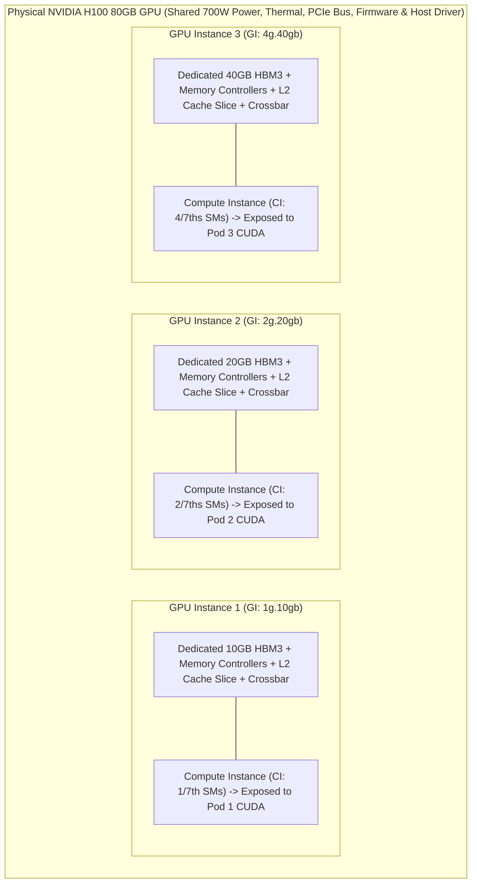

# 11.24 MIG in depth

| | |
|---|---|
| Level | Advanced |
| Priority tier | 1 |
| Lab venue | GCP / GKE (plus local Python 3 simulation lab) |
| Part | Part 11: GPUs on Kubernetes, scheduling and virtualization |
| Sources used | `nvidia-zero-to-hero/volume-11/chapter-02-mig-architecture-and-isolation.md`; `nvidia-zero-to-hero/volume-11/chapter-03-mig-profiles-and-placement.md`; `volume-04/03-gpu-sharing-telemetry-masterclass.md`; `nvidia-zero-to-hero/volume-11/chapter-01-why-gpu-sharing-exists.md`; `nvidia-zero-to-hero/volume-11/chapter-07-kubernetes-scheduling-for-shared-gpus.md`; `nvidia-zero-to-hero/volume-11/chapter-11-production-troubleshooting.md`; `nvidia-zero-to-hero/volume-11/chapter-12-volume-11-summary.md`; `nvidia-zero-to-hero/volume-11/index.md`; `nvidia-zero-to-hero/volume-11/labs/lab-01-configure-and-validate-mig.md`; `nvidia-zero-to-hero/volume-11/labs/lab-02-configure-kubernetes-gpu-time-slicing.md`; `nvidia-zero-to-hero/volume-11/labs/lab-03-compare-sharing-performance-and-isolation.md`; `nvidia-zero-to-hero/volume-11/labs/lab-04-troubleshoot-a-multi-tenant-gpu-node.md`; Roland Huß et al., *Generative AI on Kubernetes* (O'Reilly, 2026, Ch. 3) |
| Coverage file | `planning/coverage/chapters/11-24.md` |

## Why this matters for AI infrastructure

Picture several containers sharing one physical GPU. Before the NVIDIA Ampere architecture, all of them competed for the same L2 cache banks, memory controllers and HBM address space. When one model launched a memory-bound kernel, its neighbors on that card felt it straight away, and their tail latency spiked. Multi-Instance GPU, or MIG, ended that interference on Ampere, Hopper and Blackwell by moving GPU partitioning down into the physical silicon.

Running MIG in production means respecting two physical limits, and platform engineering teams often learn them the hard way. The first limit is that MIG divides a single card, not a whole server. Every MIG instance on an H100 still shares the physical board, the PCIe bus, the host kernel driver, the firmware and the seven-hundred-watt power budget.

The second limit is that MIG capacity follows strict placement rules. It is not a percentage slider you can set freely. Suppose a dashboard adds up unallocated gigabytes across fragmented GPUs and promises a forty-gigabyte slice. The pods will still sit in a pending state, because the placement rules leave that free memory unusable for the request. Sizing a profile from static model weights is worse, since it ignores concurrent peak KV-cache memory. The workload then hits out-of-memory crashes as soon as production load arrives.

The operating facts are gathered in the block below, and they are worth reading before you size or reshape a node.

```text
Key MIG operating and sizing facts:
- Supported architectures: Ampere (A100, A30), Hopper (H100, H200) and Blackwell (B200).
- Shared Board Envelope: All instances on one H100 share the PCIe bus, host driver, and 700 W power budget.
- Lifecycle Rule: Reshaping MIG is a disruptive node lifecycle operation (Plan -> Notify -> Prepare -> Apply -> Validate -> Release).
- Sizing Trap Example: A 7 GB weight Chat LLM hits 10.2 GB at 50 concurrent sequences of 2k context and OOMs a 1g.10gb slice.
```

The last line is the sizing trap from the second limit, shown with real numbers. Treat MIG as a hardware boundary inside one card, and size every profile from its concurrent peak.

## Prerequisites and outcomes

### Prerequisites
Before you start, work through three earlier chapters. Chapter 11.2 covers the NVIDIA device plugin and Container Toolkit. Chapter 11.4 covers the GPU Operator and MIG Manager. Chapter 11.17 covers KAI GPU sharing and fractions. It also assumes you are comfortable with `nvidia-smi`.

### Outcomes
By the end of this chapter, you will be able to:

- Explain the two-layer MIG hardware hierarchy of GPU Instances and Compute Instances, separate isolated silicon from shared board components, and run the six-layer validation chain.
- Work out MIG placement geometry and Cold, Steady and Peak profile sizing, then build a twenty-four-node H100 fleet capacity plan.
- Configure the Kubernetes `migStrategy` single and mixed policies with `mig-parted` profiles, and carry out the six-phase change workflow.
- Operate fleet-wide DCGM Exporter custom profiling and automated node draining, run Known-Good Validation, and troubleshoot XID errors and MPS Ghost OOM faults.

## Concepts: basics to intermediate to advanced

### 1. Basics: the two-layer MIG hierarchy and the six-layer validation chain

#### Inside a MIG-enabled GPU: GPU Instances and Compute Instances
Operators new to MIG often run into the same surprise. They turn on MIG mode with `sudo nvidia-smi -i 0 -mig 1`, then wonder why their CUDA containers still fail to launch. Enabling MIG mode only unlocks the partition table, and it creates no usable devices. To expose a working accelerator to a pod, you must create two things: a parent GPU Instance and a child Compute Instance.



The diagram shows three instances on one card. Each GPU Instance owns its memory and cache path, and each holds a Compute Instance that a pod can use.

A GPU Instance is the hardware partition of the card, and you create one with `sudo nvidia-smi mig -cgi 3g.40gb -i 0`. It physically dedicates HBM memory capacity, memory controllers, L2 cache slices, memory-system crossbar paths and copy engines to that instance. Because the separation is physical, cache thrashing from a neighbor cannot cross the instance boundary.

The Compute Instance sits inside its parent GPU Instance, and it is the execution partition that CUDA uses. You can create it on its own with `sudo nvidia-smi mig -cci`. Or you can add `-C` to the `-cgi` command, so that both layers are created in one step.

#### What MIG isolates and what stays shared
Never tell a security reviewer or enterprise customer that MIG turns one physical GPU into seven independent servers. A bad host driver rollout, or a fatal PCIe bus error on the card, takes down every tenant on that board together. Platform architects should therefore write down the exact boundary between isolated silicon and shared host infrastructure.

The table lists which resources MIG isolates and which stay shared, and what each one means for a multi-tenant platform.

| Resource or Failure Domain | MIG Effect | Architectural Consequence for Multi-Tenant Platforms |
|---|---|---|
| **SM Compute & HBM Capacity** | **Hardware Partitioned** | Tenant A (`1g.10gb`) cannot allocate or read Tenant B's (`3g.40gb`) HBM memory. |
| **Memory Controllers, L2 Cache & Crossbar Paths** | **Assigned per GI** | Protects tail latency (`p99`) from neighbor DRAM bandwidth saturation. |
| **CUDA Context Faults (`XID 13` / `31` / `94`)** | **Bounded to Instance / Process** | Contained memory and context faults do not crash sibling MIG instances. |
| **Host NVIDIA Driver & Container Runtime** | **Shared** | A bad driver rollout or runtime misconfiguration impacts all `7` slices on the host. |
| **Physical Board, PCIe Bus, Power (`700 W`), Cooling & Firmware** | **Shared** | An uncontained board fault (`XID 79` fallen off bus) or node power loss takes down all tenants on that card; spread HA replicas across separate physical nodes. |
| **Kubernetes Identity (`RBAC`), Network & Storage** | **Not Supplied by MIG** | Must be enforced via namespaces, `NetworkPolicies`, and scoped storage credentials. |

MIG supplies none of the Kubernetes identity, network or storage controls. You must enforce those with namespaces, `NetworkPolicies` and scoped storage credentials.

#### The six-layer validation chain
When a newly partitioned MIG node fails to run pods, it is tempting to debug the application containers. The break usually sits lower down, in the container runtime or the device plugin. Running `nvidia-smi` on the host proves neither that Kubernetes advertised the slices nor that PyTorch can initialize a context inside a pod. Before you open a MIG node pool to tenant traffic, verify all six layers in strict bottom-up order. The driver branch matters at layer one: the 575 branch pairs with CUDA 12.9, so a container built for an older toolkit still runs, but a container built for a newer toolkit needs a newer driver.

Each layer below has one command and one expected output, so you can compare your node against the worked example.

```text
Six-layer validation chain, worked example on one H100:
1. Layer 1 — Hardware & Driver:
   Command: nvidia-smi --query-gpu=gpu_name,driver_version --format=csv
   Output:  NVIDIA H100 80GB HBM3, 575.57.08
   Note:    nvidia-smi prints "CUDA Version: 12.9" in its header for this driver branch.
2. Layer 2 — MIG Configuration (GI + CI):
   Commands: sudo nvidia-smi -i 0 -mig 1 -pm ENABLED
             sudo nvidia-smi mig -cgi 1g.10gb,1g.10gb,1g.10gb -C -i 0
             nvidia-smi mig -lgi -i 0 (verifies 3 instances of 10GB)
3. Layer 3 — Container Runtime Visibility:
   Command: docker run --gpus device=gpu:0:0 nvidia/cuda nvidia-smi
   Output:  28C, P0, 42W / 700W, 100MiB / 10000MiB, 0% util (proves 10,000 MiB / 10 GB slice isolation)
4. Layer 4 — Kubernetes Device Plugin Reconciliation:
   Command: kubectl get nodes -o custom-columns=NAME:.metadata.name,GPU_ALLOCATABLE:.status.allocatable.nvidia\.com/gpu
   Output:  gpu-node-1   3
5. Layer 5 — Application Smoke Test (mig-smoke-test):
   Command: Pod with nvidia/cuda:12.9.1-base-ubuntu22.04 running python3 -c 'import torch; print(torch.cuda.device_count())'
   Output:  1
6. Layer 6 — Verified Rollback:
   Command: nvidia-smi mig -lgi -i 0 > /tmp/mig-baseline.txt; test -dci, -dgi, and sudo nvidia-smi -i 0 -mig 0.
```

The last layer is the rollback check. Run it as part of validation, so you know you can undo the change before you need to.

---

### 2. Intermediate: profile geometry, sizing from concurrent peak, and a fleet plan

#### Why MIG placement is geometric
Picture an eighty-gigabyte H100 as a fluid bucket of memory, and your capacity planner will promise slices that the silicon cannot create. The H100 partition tree offers seven compute slices and eighty gigabytes of HBM3. GPU Instances, however, can only start on valid hardware placement indices, which `nvidia-smi mig -lgip` lists. Think of a physical GPU as a structured parking garage, where four small cars parked in alternating bays can block a large truck from fitting.

Here is how that plays out. After four `1g.10gb` instances are placed, three compute slices and forty gigabytes remain. A `3g.40gb` instance fits that space. A `4g.40gb` instance does not, because it needs four compute slices. Free gigabytes alone never decide whether a profile fits.

The vendor's list of profiles shows the limit for each size. On an 80 GB H100 you can create at most seven `1g.10gb`, four `1g.20gb`, three `2g.20gb`, two `3g.40gb`, one `4g.40gb` or one `7g.80gb`. A `1g.10gb+me` profile also exists. The `+me` suffix means the instance includes a media engine, and only one such instance fits on a GPU. On an H200 the same shapes carry larger memory sizes, such as `1g.18gb` and `3g.71gb`. On a B200 they are `1g.23gb` and `3g.90gb`.

Seven `1g.10gb` slices give seventy gigabytes of usable memory, not eighty. The cause is geometry, not overhead. The H100 has eight memory slices of ten gigabytes but only seven compute slices, and each `1g.10gb` instance takes one of each. Seven instances therefore use seven memory slices, and the eighth memory slice has no compute slice left to pair with it.

Always read the valid combinations from `nvidia-smi mig -lgip` on your own driver, because the geometry differs between GPU models. The practical answer is to standardize the fleet on two or three static node layouts. The GPU Operator's `mig-manager` and `mig-parted` can apply those layouts declaratively, which removes runtime reconfiguration drains.

#### Cold-start, steady-state and concurrent-peak sizing, and a 24-node fleet plan
Sizing a profile from the weight file on disk is the fastest way to cause an out-of-memory outage in production. Consider a small chat LLM with seven gigabytes of weights. In staging, it loads cleanly on a ten-gigabyte `1g.10gb` slice. Then production brings fifty concurrent users sending two-thousand-token prompts, and the dynamic KV-cache buffers push memory demand past ten gigabytes. The container crashes.

To avoid those crashes, measure three high-water marks before you choose a profile. A high-water mark is the highest memory use a phase reaches. The three phases are cold-start loading, low-traffic steady state and maximum concurrent peak.

Then map each workload to a profile that holds its concurrent peak with safe headroom. Pack those profiles onto valid H100 node geometries. Finally, add reserved whole-GPU nodes for batch jobs and maintenance rotation.

The table below applies those measurements to three service classes.

| Service class | Cold-Start Memory | Steady-State Memory | Concurrent Peak Memory | Target `p99` SLO | Selected H100 MIG Profile & Headroom |
|---|---|---|---|---|---|
| **1. Embedding Model (Bursty Inference)** | `2.0 GB` | `3.0 GB` | `4.2 GB` (`100` concurrent requests) | `< 50 ms` | `1g.10gb` (`10 GB` -> `5.8 GB` headroom; `4` instances/node). |
| **2. Small Chat LLM (`7 GB` weights + KV cache)** | `8.0 GB` | `8.5 GB` | `10.2 GB` (`50` concurrent sequences, `2k` context) | `200 ms` | Does not fit `1g.10gb`; assigned `3g.40gb` (`40 GB` -> `29.8 GB` headroom; `1` instance/node). |
| **3. Offline Batch Inference (`batch=32`)** | — | `18.0 GB` | `18.0 GB` (throughput-oriented) | Queue-tolerant | `7g.80gb` (`Whole GPU`, `1` per reserved node). |

The Chat LLM does not fit a `1g.10gb` slice at its concurrent peak, so it moves up to `3g.40gb`.

The worked example below checks the fleet arithmetic. It begins with a layout the hardware rejects.

```text
Fleet geometry check and allocation for 24 H100 nodes:
1. Why 7 x (1g.10gb) + 2 x (3g.40gb) Is Physically Impossible (Rejected Layout):
   - Compute slices requested: 7x1 + 2x3 = 13 slices (> 7 available on an H100).
   - Memory requested:         7x10 GB + 2x40 GB = 150 GB (> 80 GB physical HBM3).
2. The Zero-Waste Simultaneous Placement (Accepted Layout: 4 x 1g.10gb + 1 x 3g.40gb):
   - Compute slices used:      4x1 + 1x3 = 7 / 7 slices.
   - Memory used:              4x10 GB + 1x40 GB = 80 / 80 GB.
   - Other full-slice layouts:  4g.40gb + 3g.40gb = 7 / 7 slices and 80 / 80 GB.
                               7 x 1g.10gb, 3 x 2g.20gb + 1 x 1g.10gb and 4g.40gb + 2g.20gb + 1g.10gb
                               each use 7 / 7 slices and 70 / 80 GB.
   - Invalid:                  4g.40gb + 2 x 2g.20gb needs 4 + 2 + 2 = 8 compute slices, and an H100 has 7.
   - Chat LLM High Availability Rule: A single H100 has no room for a second 3g.40gb once four 1g.10gb slices are placed,
     so Chat LLM HA runs replicas across multiple physical nodes to survive single-board or node failures.
3. Final Fleet Allocation (24 Total H100 Nodes):
   - 20 H100 Nodes in Shared MIG Serving Pool: Each runs 4 x (1g.10gb) + 1 x (3g.40gb) = 80 Embedding + 20 Chat LLM slots.
   - 4 H100 Nodes in Reserved Whole-GPU Pool:  Dedicated to 7g.80gb batch jobs (18 GB steady), maintenance, and spare recovery.
```

The accepted layout is the one the fleet runs. That is why the 24 nodes split into a shared serving pool and a reserved whole-GPU pool.

---

### 3. Advanced: DCGM telemetry, safe node draining, known-good validation and fault reading

#### DCGM Exporter profiling and per-instance labels
A tenant says their inference has slowed down. Scraping coarse `nvidia-smi` utilization once per minute will not explain why. That view misses sub-second tensor core saturation and NVLink bottlenecks. It is also the wrong tool under MIG, because DCGM reports instance-level activity separately from the whole GPU, and GKE documents that its `duty_cycle` utilization metric is not available for MIG.

NVIDIA Data Center GPU Manager, or DCGM, fills that gap. It runs `nv-hostengine`, which streams hardware counters through `libdcgm` to `dcgm-exporter` on port `9400`. The NVIDIA documentation states that DCGM can report metrics at GPU level or at the granularity of a GPU Instance or Compute Instance.

The exporter labels each MIG series with the instance it came from. The labels are `GPU_I_ID` for the instance and `GPU_I_PROFILE` for the profile name, so a dashboard can show one line per slice and an alert can name the tenant's slice. Check that your exporter version emits them before you build alerts on them.

For a production cluster, you mount a custom `default-counters.csv` file into `dcgm-exporter` and enable the `SYS_ADMIN` capability. The file below exports seven gauges to Prometheus. They cover clock, thermal, power, tensor-core and NVLink throughput.

```csv
# /etc/dcgm-exporter/default-counters.csv (untested here)
DCGM_FI_DEV_SM_CLOCK, gauge, SM clock frequency (in MHz).
DCGM_FI_DEV_MEM_CLOCK, gauge, Memory clock frequency (in MHz).
DCGM_FI_DEV_GPU_TEMP, gauge, GPU temperature (in C).
DCGM_FI_DEV_POWER_USAGE, gauge, Power draw (in W).
DCGM_FI_PROF_PIPE_TENSOR_ACTIVE, gauge, Ratio of cycles the tensor cores were active.
DCGM_FI_PROF_NVLINK_TX_BYTES, gauge, NVLink transmit bytes.
DCGM_FI_PROF_NVLINK_RX_BYTES, gauge, NVLink receive bytes.
```

> **dcgm-exporter 4.9.0 version note.** dcgm-exporter 4.9.0 (2026-11-06) renamed many default metrics and changed some units. For example `DCGM_FI_DEV_GPU_UTIL` (percent) became `DCGM_FI_DEV_GPU_UTIL_RATIO` (0 to 1), and `DCGM_FI_DEV_FB_USED` (MiB) became `DCGM_FI_DEV_FB_USED_BYTES`. The metric names in this chapter are the 4.8.x names. On a 4.9.0 exporter use the [full mapping in 17.4](../part-17-operations/04-dcgm-exporter-and-interpreting-gpu-metrics.md#14-what-dcgm-exporter-490-renamed), and change thresholds together with the unit.

Each line names one field, its type and what it measures. The chapter on GPU health in Part 10 owns the full DCGM and Xid story, so use this file as a starting point only.

#### Safe node draining and post-maintenance validation
Suppose an operator changes a MIG setting while a process still has the GPU open. Enabling or disabling MIG mode needs a GPU reset, and a reset cannot finish while any client holds the device. The command then warns that the GPU will be reset later, or it fails, and the GPU can be left in a pending state. Creating or deleting instances on a GPU that already has MIG mode on is different. It needs no kernel module unload and no reboot, but it does need the instances being changed to be free of workloads.

The opposite mistake is also costly. If you uncordon a node right after a change without stress-testing it, your training jobs become the test. Use a three-stage gate before a node returns to the scheduler.

Stage one drains the node. Cordon it, drain the pods, and then prove that nothing still has the GPUs open. Utilization is a poor proof. A process can hold a device handle and sit at zero percent, and under MIG the whole-GPU utilization figure is not the right signal. Ask which processes are attached, with `nvidia-smi --query-compute-apps` and `fuser` on the device files.

Stage two applies the change. For a MIG layout change on a GPU Operator node, `mig-manager` does this when you set the node label. Unloading the driver modules is needed only for a driver upgrade, and then the GPU Operator's driver pod normally does it for you.

Stage three checks the hardware. Run DCGM Level 3 diagnostics and an eight-rank all-reduce from nccl-tests. Only then uncordon the node.

```text
Drain and known-good validation gate:
- Stage 1 (cordon, drain, prove no clients):
  kubectl cordon $NODE; kubectl drain $NODE --ignore-daemonsets --delete-emptydir-data
  nvidia-smi --query-compute-apps=pid,name --format=csv,noheader   (expect no rows)
  fuser /dev/nvidia*                                                 (expect no output)
- Stage 2 (apply): set nvidia.com/mig.config on the node and wait for mig-manager to report success.
- Stage 3 (known-good validation before uncordon):
  1. DCGM Level 3, about 15 minutes: dcgmi diag -r 3
  2. Fabric bandwidth (nccl-tests):
     mpirun -np 8 --bind-to none -x NCCL_DEBUG=INFO /opt/nccl-tests/build/all_reduce_perf -b 1G -e 8G -f 2 -g 1
```

Run all of stage three before you uncordon, because uncordoning returns the node to the scheduler.

#### Reading ECC errors, XID 31 storms and the MPS ghost OOM
A GPU node fires kernel alerts at two in the morning. If you read a software bug as a hardware failure, you start an RMA and waste capacity. If you ignore an uncorrectable double-bit ECC fault, model weights get corrupted across distributed training ranks. The chapter on GPU health in Part 10 covers Xid codes in full. This table keeps only the three cases that matter most on a shared GPU.

The table sorts three forensic cases by their evidence and by the action each one needs.

| Case | Evidence | Cause and action |
|---|---|---|
| **1. ECC Memory Errors (`SBE` vs `DBE` vs Contained `XID 94`)** | Single-Bit Error (`SBE`, `XID 63` `IGNORE` row remapping) vs Double-Bit Error (`DBE`, `XID 48`, failed remap `XID 64`) vs Contained ECC (`XID 94`). | `SBE` is auto-corrected in hardware; `DBE` (`XID 48`) is uncorrectable corruption requiring node drain and RMA if row remapping fails; `XID 94` isolates the fault to one process (`RESTART_APP`) without crashing sibling MIG slices. |
| **2. An `XID 31` storm on one node** | One node logs thousands of `XID 31` (GPU Memory Page Fault) errors per minute in `dmesg \| grep NVRM`. | Do not RMA the GPU. `XID 31` (like `XID 13` Graphics Engine Exception) is a user-space out-of-bounds CUDA pointer bug (`SIGSEGV`). Map the faulting `PID` to its Pod, kill the Pod, verify no secondary `XID 43` (`IGNORE`/`CONTACT_SUPPORT`), `XID 62` (`RESET_GPU` PMU halt), `XID 74` (NVLink), `XID 79` (fallen off bus), or GSP `XID 119`/`120` occurred, and debug with `compute-sanitizer` (formerly `cuda-memcheck`). |
| **3. A "ghost OOM" on CUDA MPS** | Two containers share a `40 GB` A100 via MPS (`EXCLUSIVE_PROCESS`, `set_default_active_thread_percentage 20`); Container A crashes with `CUDA out of memory` while `nvidia-smi` shows `10 GB / 40 GB`. | Either a per-client MPS ceiling (`CUDA_MPS_PINNED_DEVICE_MEM_LIMIT` / `set_default_device_pinned_mem_limit`) capped Container A below `10 GB`, or Container B spiked momentarily and freed memory before `nvidia-smi` sampled. Migrate from MPS to MIG for hardware-enforced `10 GB` vs `20 GB` memory walls. |

Case 2 is the one to remember. The `XID 31` storm points to a bug in user code, so the GPU stays in service while you trace the faulting pod.

#### The six-phase change workflow
A MIG layout change does more than move partitions. It also changes node capacity, extended resource names and active device handles. Ad-hoc commands run over SSH therefore create cluster drift that nobody has documented. After the next node reboot, kubelet advertises whole GPUs instead of MIG slices, and tenant deployments break. Every MIG change should follow a six-phase workflow and leave a short record behind.

The table lists the owner, the evidence and the stop condition for each phase.

| Change phase | Accountable Owner | Required Evidence Before Advancing | Mandatory Abort / Stop Condition |
|---|---|---|---|
| **1. Plan** | Platform Owner | Verified GPU SKU & driver in support matrix, desired GI/CI layout, and tested rollback layout. | No compatible reserve capacity available or unclear rollback ownership. |
| **2. Notify** | Service Owner | Maintenance window scope and workload drain/checkpoint plan. | Protected SLO workload cannot fail over or checkpoint safely. |
| **3. Prepare** | Node Operator | `kubectl cordon` state, pre-change allocation mapping, and saved `mig-baseline-before.txt` inventory. | Any unaccounted tenant workload or open `/dev/nvidia*` handle still active. |
| **4. Apply** | Authorized Operator | Managed lifecycle tool (`mig-manager` / `nvidia-smi mig -cgi ... -C`) output and change ticket ID. | Unexpected driver, reset, or XID error during mode or instance transition. |
| **5. Validate** | Platform & Service Owners | All `6` validation layers (`Driver -> GI/CI -> Runtime -> K8s Allocatable -> Smoke Pod -> Service SLO`). | Any validation layer fails or advertised resource count mismatches baseline. |
| **6. Release** | Change Owner | `kubectl uncordon` executed and `mig_resource_advertised` / DCGM monitoring confirmed green. | Residual alerts or node-pool inventory drift detected. |

Phase 5 is the gate before release, because it checks all six layers against the saved baseline.

The record for each change should hold the approved layout, the node and GPU identity, the driver and GPU Operator versions, the pod-to-GPU mapping before the change, the `nvidia-smi mig -lgi` and `-lci` listings before and after, the node's allocatable resources, the smoke-test log and the final rollback decision. For each workload profile, also record the tested concurrency, the p99 target and the owner who approves a change.

Keep that record with the change ticket, so the next operator can see exactly what changed.

## Commands and configurations that matter

### 1. Declarative Kubernetes MIG Configuration
Partitions created by hand with `nvidia-smi mig -cgi` over SSH do not survive node replacement or autoscaling. A better pattern is to write your approved node geometry into a custom `mig-parted` configuration map. The GPU Operator's `mig-manager` then reconciles each node from labels. Set `mig.strategy` to `mixed`, and the Kubernetes scheduler sees explicit profile names such as `nvidia.com/mig-1g.10gb` and `nvidia.com/mig-3g.40gb`.

The ConfigMap below defines the accepted serving layout from the fleet plan as a named profile.

```yaml
# custom-mig-parted-configmap.yaml (untested here)
apiVersion: v1
kind: ConfigMap
metadata:
  name: custom-mig-parted-configs
  namespace: gpu-operator
data:
  config.yaml: |
    version: v1
    mig-configs:
      # Accepted layout: 4x(1g.10gb) + 1x(3g.40gb) = 7/7 slices, 80/80 GB
      serving-pack:
        - devices: all
          mig-enabled: true
          mig-devices:
            "1g.10gb": 4
            "3g.40gb": 1
```

The profile name in the ConfigMap is the value you apply to the node label in the next block.

```bash
# Label a node to trigger GPU Operator mig-manager reconfiguration under mixed strategy (untested here)
kubectl patch clusterpolicy cluster-policy --type merge -p '{"spec":{"mig":{"strategy":"mixed"}}}'
kubectl label nodes gpu-node-1 nvidia.com/mig.config=serving-pack --overwrite
```

Once the label has taken effect, confirm the advertised resources with the allocatable check from the validation chain.

### 2. Node drain that proves no client holds the GPU

Your automation must check before it changes MIG mode or unloads kernel modules. The script below cordons the node, drains it, and then refuses to continue while any process still has a GPU open. It reads the process list from the driver instead of inferring idleness from a utilization counter.

```bash
# Drain gate before a MIG mode change (untested here)
NODE="gpu-node-1"
kubectl cordon "$NODE"
kubectl drain "$NODE" --ignore-daemonsets --delete-emptydir-data --timeout=10m

for i in $(seq 1 20); do
    APPS=$(ssh root@"$NODE" 'nvidia-smi --query-compute-apps=pid --format=csv,noheader | wc -l')
    HOLDERS=$(ssh root@"$NODE" 'fuser /dev/nvidia* 2>/dev/null | wc -w')
    if [ "$APPS" -eq 0 ] && [ "$HOLDERS" -eq 0 ]; then break; fi
    sleep 30
done
[ "$APPS" -eq 0 ] && [ "$HOLDERS" -eq 0 ] || { echo "GPU still in use on $NODE"; exit 1; }
```

A monitoring daemon such as `nv-hostengine` may show up as a holder. Stop it, or let the GPU Operator manage the change, so the check passes for the right reason. After the change, run the known-good validation from the previous section before you uncordon.

### 3. A MIG node pool on GKE

On GKE you do not run `mig-manager` yourself. You choose a partition size when you create the node pool, and GKE partitions every GPU on every node the same way. The flag takes the form below, and the supported sizes for an H100 80 GB node are `1g.10gb`, `1g.20gb`, `2g.20gb`, `3g.40gb` and `7g.80gb`.

```bash
# GKE MIG node pool (untested here)
gcloud container node-pools create mig-3g \
  --cluster my-cluster --region us-central1 \
  --machine-type a3-highgpu-8g \
  --accelerator type=nvidia-h100-80gb,count=8,gpu-partition-size=3g.40gb,gpu-driver-version=default
```

Each node carries the label `cloud.google.com/gke-gpu-partition-size`, and a pod selects the pool with a `nodeSelector` on that label and requests `nvidia.com/gpu: 1`. Four rules shape the design. A Standard cluster needs one node pool per partition size. A pod can use only one MIG instance. The GKE documentation does not recommend MIG for untrusted workloads. GPUs split with MIG on H100, H200, B200 and GB200 machines cannot use GPUDirect technologies such as RDMA. Check the current GKE page for the machine types and regions you use before you plan a pool.

## How it fails

A MIG layout can be created cleanly and still break scheduling. Mismatches between workload concurrency, the device-plugin discovery strategy and the node's lifecycle state can stop production work from being placed. The table covers the five most common MIG and shared-GPU operational failures. For each one, it gives the symptom, the root cause and the remediation.

| Failure mode | Exact symptom & command evidence | Root cause boundary | Remediation |
|---|---|---|---|
| **1. Small Chat LLM (`7 GB` weights) loads on `1g.10gb` in staging, then crashes with `CUDA OOM` at `50` concurrent users** | Cold start (`8.0 GB`) and low-traffic steady state (`8.5 GB`) fit inside `1g.10gb` (`10 GB`), but under `50` concurrent `2k`-context sequences memory hits `10.2 GB > 10.0 GB`. | **Sizing from Cold/Weights Instead of Concurrent Peak:** Dynamic KV-cache and activation buffers pushed peak demand (`10.2 GB`) past the hard `10 GB` MIG hardware wall. | Measure cold, steady, and concurrent-peak high-water marks before selecting a profile; move the Chat LLM to `3g.40gb` (`29.8 GB` headroom) and publish maximum concurrency. |
| **2. `nvidia-smi` shows `MIG Mode: Enabled` and active `1g.10gb` instances, but `kubectl describe node` shows `0` MIG resources** | `nvidia-smi mig -lgi -i 0` lists `1g.10gb` instances, but Kubernetes has no `nvidia.com/gpu` or `nvidia.com/mig-1g.10gb` allocatable resources. | **Device Plugin Strategy / Reconciliation Mismatch:** Either `nvidia-device-plugin` is configured with `mig-strategy: none` instead of `single`/`mixed`, or its cache is stale after an out-of-band host MIG change. | Drain the node, verify `mig.strategy` (`single` or `mixed`), restart the device-plugin pod (`kubectl delete pod -n nvidia-driver-install -l app=nvidia-device-plugin`), wait `30 s`, and run `mig-validation`. |
| **3. Enabling MIG mode (`nvidia-smi -i 0 -mig 1`) during business hours leaves the GPU in `Pending` mode and breaks scheduling** | `nvidia-smi` prints `Warning: GPU 0 will be reset on next load` or fails because `nv-hostengine` / container processes still hold open `/dev/nvidia0` handles. | **In-Place Mode Change Without Drain & Daemon Stop:** a MIG mode change needs a GPU reset, and the reset cannot complete while user containers or monitoring daemons hold the device open. | Cordon and drain the node, prove no process holds the GPU, let `mig-manager` apply the layout with a node label, and validate all six layers. If the GPU is stuck in the pending state, clear the remaining clients and reset the GPU. |
| **4. Replacement or rebooted node rejoins the MIG pool with whole GPUs instead of `1g.10gb` slices** | After a node reboot or RMA replacement, `kubectl describe node` advertises `nvidia.com/gpu: 8` instead of `nvidia.com/mig-1g.10gb: 32`. | **Imperative One-Time MIG Configuration Drift:** MIG instances were created manually via SSH (`nvidia-smi mig -cgi`) rather than persisted declaratively via `mig-parted` / node labels. | Keep the drifted node cordoned, apply the `nvidia.com/mig.config=<profile>` node label managed by `mig-manager`, and alert on `mig_resource_advertised` inventory drift. |
| **5. One node triggers a pager storm with thousands of `XID 31` errors per minute** | `dmesg \| grep NVRM` logs continuous `XID 31` (GPU Memory Page Fault) events from one container PID. | **User-Space CUDA Out-of-Bounds Pointer Bug:** `XID 31` is an application memory page fault (`RESTART_APP`), not a physical ECC hardware defect (`XID 48`). | Trace the `XID 31` PID to its Pod, terminate the buggy workload, verify the node recovers cleanly, and run `compute-sanitizer` on the user's CUDA kernel. |

Failure 1 shows how a staging test can pass while production fails. The weights fit, but concurrency pushes memory past the hard wall.

When a MIG node misbehaves, find the row that matches what you see before you change any hardware state. If you only tested in staging, the first row explains why production can still fail. Read the Remediation column as a checklist you can work through, one step at a time.

## Hands-on lab

### Venue and scope
This lab runs locally with the Python 3 standard library, through `code/part11/mig_in_depth.py` and `code/part11/mig_in_depth_lab.py`. It checks the six-layer MIG validation chain, the six-phase change workflow, the profile sizer and the twenty-four-node H100 fleet capacity calculator. It also checks the seven-field DCGM Exporter config, the automated drain and Known-Good Validation sequence, and the XID and MPS troubleshooting rules. Host and cluster commands earlier in the chapter are marked `(untested here)`.

### Step 1: Run the self-checking MIG in depth lab (tested here)

Start from the repository root and run the lab script.

```bash
python3 code/part11/mig_in_depth_lab.py
```

The output below was captured from this repository.
```text
=== Chapter 11.24 Lab: MIG in Depth (Hierarchy, Placement, Sizing & Telemetry) ===
  [PASS] defines 6 ordered MIG validation layers from Hardware/driver to Operations/Rollback
  [PASS] defines 6 change workflow phases (Plan -> Notify -> Prepare -> Apply -> Validate -> Release)
  [PASS] Embedding model (2GB cold, 3GB steady, 4.2GB peak at 100 reqs, p99<50ms) fits 1g.10gb with 5.8GB headroom
  [PASS] Chat LLM (7GB weights + KV cache: 8GB cold, 8.5GB steady, 10.2GB peak at 50 seqs 2k ctx, p99=200ms) overflows 1g.10gb
  [PASS] assigns Chat LLM (10.2GB peak) to 3g.40gb with 29.8GB headroom so 4x(1g.10gb) + 1x(3g.40gb) packs cleanly
  [PASS] Rejected layout 7x(1g.10gb) + 2x(3g.40gb) requests 13 compute slices (> 7) and 150 GB memory (> 80 GB)
  [PASS] Accepted layout 4x(1g.10gb) + 1x(3g.40gb) uses exactly 7/7 compute slices and 80/80 GB memory with 0 waste
  [PASS] fleet plan allocates 20 shared H100 MIG nodes (80 embedding + 20 chat LLM slots) + 4 reserved H100 nodes = 24 H100s
  [PASS] 7x 1g.10gb layout uses 7/7 compute slices and 70/80 GB memory
  [PASS] 3x 2g.20gb + 1x 1g.10gb layout uses 7/7 compute slices and 70/80 GB memory
  [PASS] 1x 4g.40gb + 1x 2g.20gb + 1x 1g.10gb layout uses 7/7 compute slices and 70/80 GB memory
  [PASS] Worked example uses a 575-branch driver, which ships CUDA 12.9, on H100 (28C, 42W/700W, 100MiB/10000MiB) with 3x 1g.10gb
  [PASS] mig-smoke-test verifies torch.cuda.device_count() == 1 inside a 1-GPU MIG pod
  [PASS] defines an 8-step Node Lifecycle Sequence and a 10-item Operational Evidence Package
  [PASS] custom DCGM Exporter CSV defines 7 fields (SM_CLOCK, MEM_CLOCK, GPU_TEMP, POWER_USAGE, PIPE_TENSOR_ACTIVE, NVLINK_TX/RX) on port 9400
  [PASS] MPS example sets EXCLUSIVE_PROCESS and set_default_active_thread_percentage 20
  [PASS] Ghost OOM on MPS (10GB/40GB used) is caused by CUDA_MPS_PINNED_DEVICE_MEM_LIMIT or transient neighbor spike
  [PASS] XID 31 storm on Node 42 is a software page fault debugged with compute-sanitizer (formerly cuda-memcheck)
  [PASS] contrasts SBE (Single-Bit ECC, row remapping) with DBE (Double-Bit ECC, XID 48) and Contained ECC (XID 94)
  [PASS] distinguishes XID 43 (GPU stopped processing -> IGNORE/CONTACT_SUPPORT) and XID 62 (PMU halt -> RESET_GPU) from XID 79 and GSP XID 119/120
  [PASS] Drain gate confirms no compute process holds the GPU (nvidia-smi --query-compute-apps, fuser /dev/nvidia*) before a MIG mode toggle or driver unload
  [PASS] Known-Good Validation runs dcgmi diag -r 3 and mpirun -np 8 all_reduce_perf -b 1G -e 8G -f 2 -g 1
  [PASS] Device plugin strategies contrast migStrategy: single (nvidia.com/gpu) vs mixed (nvidia.com/mig-1g.10gb) and mig-parted profiles
  [PASS] Batch inference workload (batch size 32, 18GB steady) uses 7g.80gb (whole GPU) on reserved nodes
  [PASS] MIG labs enforce -dci before -dgi deletion order and allocatable profile reporting
  [PASS] 1x 4g.40gb + 2x 2g.20gb is rejected: it needs 8 compute slices and an H100 has 7

Summary: 26 passed, 0 failed out of 26 checks.
```

A passing run ends with the summary line 26 passed, 0 failed out of 26 checks. If your output differs, compare it with the captured output above, line by line.

### Exercises

Work through these six exercises in order. Each one reuses the functions and numbers from the chapter.

1. Explain the difference between a GPU Instance and a Compute Instance. Use `MIG_SIX_VALIDATION_LAYERS` in `code/part11/mig_in_depth.py` to list the six validation layers in order, and state what `nvidia-smi` inside the test container reports in the H100 worked example.
2. Solve the 24-node H100 fleet capacity plan. Using `plan_vol11_ch3_h100_fleet()`, show why seven `1g.10gb` slices plus two `3g.40gb` slices is physically invalid. Then prove that four `1g.10gb` slices plus one `3g.40gb` slice use all seven compute slices and eighty gigabytes of memory. Finally, state the total node count, including the reserved whole-GPU nodes.
3. Using `validate_h100_mig_node_layout()`, compute the compute slices and memory for the three seventy-gigabyte H100 layouts. Then check `4g.40gb` plus two `2g.20gb` and explain why it is rejected. Explain why seven `1g.10gb` instances total seventy gigabytes instead of eighty.
4. Write the drain gate for a node that must change MIG mode. List the commands that prove no process holds the GPU, and explain why a zero utilization reading is not that proof.
5. Run the post-maintenance checks. Write the two commands that validate GPU hardware health at DCGM Level 3 and fabric bandwidth through `all_reduce_perf`. Then explain why both checks must pass before you uncordon a repaired GPU node.
6. Create a GKE node pool with `3g.40gb` partitions. Write the `--accelerator` flag, name the node label a pod selects on, and state how many MIG instances one pod can use.

## Checkpoint questions

<details>
<summary>1. A developer runs `nvidia-smi -i 0 -mig 1` and then complains that their CUDA container still cannot start. What is missing, and what does each missing layer own?</summary>

Enabling MIG mode only unlocks the partition table. Nothing is exposed until you create a GPU Instance and a Compute Instance. The GPU Instance owns the memory capacity, memory controllers, L2 cache slices and copy engines. The Compute Instance sits inside it, groups the streaming multiprocessors and is the device that CUDA sees. Create both in one step with `nvidia-smi mig -cgi <profile> -C`.
</details>

<details>
<summary>2. A security reviewer asks whether MIG makes one H100 into seven independent servers for seven customers. What do you answer?</summary>

No. MIG isolates the compute slices, memory, caches and contained CUDA faults per instance. The board, the PCIe bus, the power budget, the firmware and the host driver stay shared, so a bad driver rollout or an uncontained board fault takes every tenant on that card down together. Kubernetes identity, network policy and storage credentials are not provided by MIG. Spread high-availability replicas across separate nodes.
</details>

<details>
<summary>3. A new MIG node shows healthy `nvidia-smi` output on the host, but pods stay pending. In which order do you check the six layers, and where is the break most likely?</summary>

Work bottom-up: driver and GPU, MIG instances, container runtime visibility, Kubernetes allocatable resources, a smoke-test pod that counts CUDA devices, and a verified rollback. The break is usually between the host and Kubernetes, at the device plugin and its MIG strategy. Host `nvidia-smi` proves neither that the slices were advertised nor that a pod can create a CUDA context.
</details>

<details>
<summary>4. A team plans a six-step MIG change on a production node. Who must approve each phase, and what stops the change?</summary>

The phases are plan, notify, prepare, apply, validate and release, owned in turn by the platform owner, service owner, node operator, an authorized operator, both owners and the change owner. The change stops if there is no reserve capacity or rollback owner, if a protected workload cannot fail over, if an unaccounted workload or open device handle remains, if a reset or Xid appears during the transition, if any validation layer fails, or if inventory drift remains after release.
</details>

<details>
<summary>5. A capacity dashboard reports 40 GB free across a MIG node, yet a pod asking for `4g.40gb` stays pending. Explain why, and say what you would use instead of free gigabytes.</summary>

Four `1g.10gb` instances leave three compute slices free, and `4g.40gb` needs four. Placement is also limited to valid positions. Free gigabytes do not decide whether a profile fits. Read the valid placements from `nvidia-smi mig -lgip` and plan the fleet on a few fixed layouts.
</details>

<details>
<summary>6. A planner proposes one H100 layout of `4g.40gb` plus two `2g.20gb` because it adds up to 80 GB. Is it valid?</summary>

No. The compute slices add up to eight, and an H100 has seven. Memory adding up to 80 GB is not enough. Valid full layouts include `4g.40gb` plus `3g.40gb`, and four `1g.10gb` plus one `3g.40gb`.
</details>

<details>
<summary>7. Seven `1g.10gb` instances give 70 GB, not 80 GB. A colleague blames ECC overhead. What is the real cause?</summary>

Geometry. An H100 has eight memory slices but seven compute slices, and each `1g.10gb` instance takes one of each. Seven instances use seven memory slices, so the eighth has no compute slice to pair with.
</details>

<details>
<summary>8. A chat model with 7 GB of weights runs fine on `1g.10gb` in staging and crashes with out-of-memory in production. What did the sizing miss, and which profile fixes it?</summary>

Sizing used the weight file, not the concurrent peak. Cold start at 8.0 GB and steady state at 8.5 GB fit, but 50 concurrent sequences at 2k context reached 10.2 GB, past the 10 GB wall. Measure cold, steady and peak, then move the service to `3g.40gb` with about 29.8 GB of headroom.
</details>

<details>
<summary>9. The fleet plan puts two replicas of a chat model on separate H100 nodes instead of two on one card. Why?</summary>

After four `1g.10gb` slices are placed, one card has no room for a second `3g.40gb`. More importantly, a board or driver fault takes down every instance on that card, so replicas on one card share one failure domain. Replicas on separate nodes survive a single-board failure.
</details>

<details>
<summary>10. A cluster shows one 20 GB MIG slice free on node A and one on node B, and a team wants to run a job that needs 40 GB. Why is adding the free memory misleading?</summary>

A MIG instance cannot span instances or nodes. Aggregate free memory ignores placement and fragmentation, and a pod can use only one MIG instance on GKE. The job needs a single `3g.40gb` or `4g.40gb` instance, or a whole GPU.
</details>

<details>
<summary>11. Your team must decide between the `single` and `mixed` MIG strategies for a cluster that serves both small and large models. Which do you choose, and what do pods request?</summary>

Mixed. Under `mixed` the node advertises named resources such as `nvidia.com/mig-1g.10gb` and `nvidia.com/mig-3g.40gb`, so a pod asks for the exact size. Under `single` every instance appears as `nvidia.com/gpu`, which only works if all instances on the node are the same size.
</details>

<details>
<summary>12. A node rejoins the pool after an RMA and advertises eight whole GPUs, not MIG slices. What happened and how do you stop it recurring?</summary>

The old layout was created by hand with `nvidia-smi mig -cgi` over SSH and was never recorded. Keep the node cordoned, apply the approved layout through the `nvidia.com/mig.config` node label so `mig-manager` reconciles it, and alert when advertised MIG resources drift from the inventory.
</details>

<details>
<summary>13. An operator runs the MIG enable command during business hours and the GPU ends up pending. Why, and what is the safe sequence?</summary>

A MIG mode change needs a GPU reset, and the reset cannot finish while any process or daemon holds the device open. The safe sequence is cordon, drain, prove no client holds the GPU with `nvidia-smi --query-compute-apps` and `fuser`, apply the change, and validate all six layers.
</details>

<details>
<summary>14. A drain script waits for DCGM utilization to reach zero and then unloads the driver modules. List two ways this can go wrong.</summary>

A process can hold a device handle while idle, so zero utilization does not mean no clients, and the unload then fails or the reset stalls. Under MIG, whole-GPU utilization is also not the right signal. A MIG layout change does not need a module unload at all. Check the process list instead.
</details>

<details>
<summary>15. After a driver update on a repaired node, a manager wants to uncordon it immediately. What two checks do you require first, and why?</summary>

Run `dcgmi diag -r 3` to stress compute and memory, then an eight-rank all-reduce from nccl-tests to check fabric bandwidth. Without them, training jobs become the test and silent degradation shows up as a slow or failed run.
</details>

<details>
<summary>16. A tenant says their inference slowed down on a MIG slice. Why does host-level `nvidia-smi` utilization not explain it, and what do you use instead?</summary>

Coarse utilization hides sub-second tensor-core saturation and NVLink pressure, and it does not break down per instance. Use DCGM profiling fields such as `DCGM_FI_PROF_PIPE_TENSOR_ACTIVE`, with the per-instance labels `GPU_I_ID` and `GPU_I_PROFILE`, if your exporter version emits them.
</details>

<details>
<summary>17. A node logs thousands of `XID 31` errors per minute from one container. Do you open an RMA?</summary>

No. `XID 31` is a GPU memory page fault caused by user code, usually an out-of-bounds pointer. Map the process to its pod, stop the pod, check that no `XID 43`, `62`, `74`, `79`, `119` or `120` follows, and debug the kernel with `compute-sanitizer`. An uncorrectable double-bit ECC error, `XID 48`, is the one that needs a drain and possibly an RMA.
</details>

<details>
<summary>18. Two containers share a 40 GB A100 through MPS. One crashes with out-of-memory while `nvidia-smi` shows only 10 GB used. Give the two likely causes and the lasting fix.</summary>

Either a per-client MPS memory ceiling, set through `CUDA_MPS_PINNED_DEVICE_MEM_LIMIT`, capped the container below its need, or the neighbour spiked and freed memory before `nvidia-smi` sampled. MPS has no hardware memory wall. If you need one, move the workloads to MIG.
</details>

<details>
<summary>19. Your team wants MIG on GKE with two different slice sizes. How many node pools do you need, and what does a pod select on?</summary>

One node pool per partition size on a Standard cluster, because every GPU on a node is partitioned the same way. A pod selects the pool with the `cloud.google.com/gke-gpu-partition-size` label and requests `nvidia.com/gpu: 1`, and it can use only one MIG instance. Do not plan MIG for untrusted workloads on GKE, and do not plan RDMA-based GPUDirect on MIG-split H100 machines.
</details>

<details>
<summary>20. The host shows MIG enabled and three `1g.10gb` instances, but Kubernetes shows no MIG resources. What are the five repair steps?</summary>

Drain the node, confirm the instances with `nvidia-smi mig -lgi -i 0`, check that the device plugin runs with the `single` or `mixed` strategy and restart its pod so discovery runs again, wait about thirty seconds and read the node's allocatable resources, then run a bounded smoke-test pod before you uncordon.
</details>

## Sources and review notes

### Primary sources read in full for this chapter
Every one of the twelve mapped `nvidia-devops` files, plus the O'Reilly Kubernetes chapter named in `brief.py 11.24`, was read and migrated in full.

```text
Primary Source Inventory & Key Technical Artifacts Migrated (Chapter 11.24):
- nvidia-zero-to-hero/volume-11/chapter-02-mig-architecture-and-isolation.md:
  Figure 11.2.1 two-layer GI/CI hierarchy, isolation vs shared board/driver/power table,
  6-layer validation chain on NVIDIA H100 80GB HBM3 with driver 575.10 / CUDA 12.5 (corrected in the chapter text to the 575 branch with CUDA 12.9) / 28C /
  42W / 700W / 100MiB / 10000MiB / status.allocatable = 3 / torch.cuda.device_count() == 1,
  8-step node lifecycle sequence, 6-phase change workflow runbook, and 10-item operational
  evidence package.
- nvidia-zero-to-hero/volume-11/chapter-03-mig-profiles-and-placement.md:
  Figure 11.3.1 sizing pipeline, Silicon Tetris combinations (7x1g.10gb, 3x2g.20gb + 1x1g.10gb,
  1x4g.40gb + 1x2g.20gb + 1x1g.10gb), and the 24-node H100 fleet calculation: Embedding
  2/3/4.2 GB at 100 reqs p99 < 50 ms on 1g.10gb with 5.8 GB headroom; Chat LLM 7 GB weights
  8/8.5/10.2 GB at 50 seqs 2k context p99 = 200 ms on 3g.40gb with 29.8 GB headroom; Batch 32
  18 GB on 7g.80gb; rejecting 7x1g.10gb + 2x3g.40gb = 13 slices / 150 GB; accepting
  4x1g.10gb + 1x3g.40gb = 7/7 slices / 80/80 GB across 20 shared nodes + 4 reserved nodes = 24 H100s.
- volume-04/03-gpu-sharing-telemetry-masterclass.md:
  Time-slicing, MPS EXCLUSIVE_PROCESS / set_default_active_thread_percentage 20 /
  CUDA_MPS_PINNED_DEVICE_MEM_LIMIT Ghost OOM at 10 GB / 40 GB, MIG -cgi / -cci, vGPU,
  DCGM nv-hostengine + dcgm-exporter :9400 7 custom fields, ECC SBE vs DBE XID 48 vs
  Contained XID 94, XID 13/31/43/62/74/79, Node 42 XID 31 storm with compute-sanitizer,
  dcgmi dmon -e 203 -c 1 node drain script + rmmod, and dcgmi diag -r 3 +
  all_reduce_perf -b 1G -e 8G Known-Good Validation.
- nvidia-zero-to-hero/volume-11/chapter-01-why-gpu-sharing-exists.md,
  chapter-07-kubernetes-scheduling-for-shared-gpus.md,
  chapter-11-production-troubleshooting.md,
  chapter-12-volume-11-summary.md,
  volume-11/index.md, and volume-11/labs/lab-01..04.
- Roland Huss et al., Generative AI on Kubernetes (O'Reilly, 2026), Chapter 3:
  Kubernetes and GPUs, Multi-Instance GPU, migStrategy: single vs mixed, and mig-parted ConfigMap profiles.
```

### Corrections made in the 2026-11-12 rework
- Layout `4g.40gb` plus two `2g.20gb` needs eight compute slices and is invalid on an H100. Source: NVIDIA MIG User Guide, supported profiles (H100 maximum counts: `4g.40gb` 1, `2g.20gb` 3), read 2026-11-12.
- Driver 575 ships with CUDA 12.9 (minimum Linux driver 575.51.03 for 12.9 GA, 575.57.08 for 12.9 Update 1). Source: CUDA Toolkit release notes, corresponding driver versions table, read 2026-11-12.
- H200 and B200 profile names, the `+me` variants and the one-per-GPU limit: NVIDIA MIG User Guide, supported profiles, read 2026-11-12.
- GKE MIG node pools: GKE documentation, "Run GPUs in GKE with multi-instance GPUs", read 2026-11-12. Partition size flag, node label, one instance per pod, no GPUDirect on MIG-split H100/H200/B200/GB200, not recommended for untrusted workloads.
- MIG mode change needs a GPU reset with no clients; layout change needs no module unload: stated in the NVIDIA MIG User Guide getting-started text and in the `nvidia-smi` warning text. Not re-read in full here.
- Unresolved: the `GPU_I_ID` and `GPU_I_PROFILE` label names come from dcgm-exporter behaviour that the fetched pages did not confirm. The chapter says to check your exporter version.

### Related source files mapped in MIGRATION_MAP.md
All twelve mapped `nvidia-devops` files for Chapter 11.24 are cited and covered in the inventory above.

### Run here
If you run the lab yourself, use `python3 code/part11/mig_in_depth_lab.py`. The lab was executed here with that command. All checks passed, with `26 passed, 0 failed out of 26 checks`.

### Explicitly labelled inferences
None. Every profile geometry, memory sizing envelope, fleet node count, and DCGM and XID rule comes directly from Volume 11, chapters 2 and 3, and Volume 4, chapter 3.

### Not verified on live hardware
The `nvidia-smi mig` commands (`all-1g.10gb` and `all-balanced` from `chapter-03-mig-profiles-and-placement.md`), `docker run --gpus`, `dcgmi` (where `RCA` means Root Cause Analysis), `mpirun all_reduce_perf`, and `kubectl` commands (cross-referenced with chapter 11.19) were not run on live hardware. They are all marked `(untested here)`.

### Not in the corpus
Internal NVIDIA silicon fuse masks for SM-to-GPC floorplan binning across yield tiers are outside the corpus. This chapter therefore uses the driver-exposed GPU Instance and Compute Instance profile contracts.

### Corrections to the author's notes
The YAML manifests and commands are marked untested, and they were not applied to a cluster.

Custom resource API versions such as `kueue.x-k8s.io/v1beta1` and `resource.k8s.io/v1` change between releases. Check them against the version you install.

If you copy a console output from the Volume notes, remember it is illustrative unless the chapter says otherwise.

The MIG layouts were verified arithmetically on an `80 GB` H100. Valid placements on real hardware are listed by `nvidia-smi mig -lgip`.

This chapter keeps the corrections noted in Volume 11, chapter 3, on the seven MIG compute slices and multi-node HA for `3g.40gb` Chat LLM instances. It also keeps the Volume 4, chapter 3 distinctions for `XID 43`, `XID 79`, `XID 62` and GSP `XID 119`/`120`.

Seven 1g.10gb instances total 70 GB because of memory-slice geometry: an H100 has 8 memory slices but only 7 compute slices, so one memory slice is left over. It is not system or ECC overhead. The NVIDIA MIG User Guide, on its Concepts and Supported MIG Profiles pages, lists 1g.10gb at one eighth of memory with a maximum of 7 instances. It does not itself name a cause for the leftover slice.
