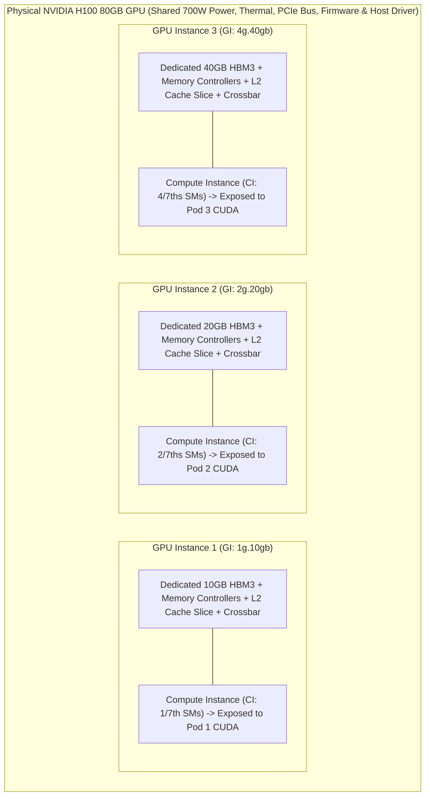

# 11.24 MIG in depth

| | |
|---|---|
| Level | Advanced |
| Priority tier | 1 |
| Lab venue | GCP / GKE (plus local Python 3 simulation lab) |
| Part | Part 11: GPUs on Kubernetes, scheduling and virtualization |
| Sources used | `nvidia-zero-to-hero/volume-11/chapter-02-mig-architecture-and-isolation.md`; `nvidia-zero-to-hero/volume-11/chapter-03-mig-profiles-and-placement.md`; `volume-04/03-gpu-sharing-telemetry-masterclass.md`; `nvidia-zero-to-hero/volume-11/chapter-01-why-gpu-sharing-exists.md`; `nvidia-zero-to-hero/volume-11/chapter-07-kubernetes-scheduling-for-shared-gpus.md`; `nvidia-zero-to-hero/volume-11/chapter-11-production-troubleshooting.md`; `nvidia-zero-to-hero/volume-11/chapter-12-volume-11-summary.md`; `nvidia-zero-to-hero/volume-11/index.md`; `nvidia-zero-to-hero/volume-11/labs/lab-01-configure-and-validate-mig.md`; `nvidia-zero-to-hero/volume-11/labs/lab-02-configure-kubernetes-gpu-time-slicing.md`; `nvidia-zero-to-hero/volume-11/labs/lab-03-compare-sharing-performance-and-isolation.md`; `nvidia-zero-to-hero/volume-11/labs/lab-04-troubleshoot-a-multi-tenant-gpu-node.md`; Roland Huß et al., *Generative AI on Kubernetes* (O'Reilly, 2026, Ch. 3) |
| Coverage file | `planning/coverage/chapters/11-24.md` |

## Why this matters for AI infrastructure

Before the NVIDIA Ampere (`A100`) architecture, every container sharing a physical GPU fought over the same L2 cache banks, memory controllers, and HBM address space (`volume-11/chapter-02-mig-architecture-and-isolation.md`). **Multi-Instance GPU (`MIG`)**—available on Ampere (`A100`/`A30`), Hopper (`H100`/`H200`), and Blackwell (`B100`/`B200`)—moved GPU partitioning down into the physical silicon (`volume-11/chapter-02` and `volume-04/03-gpu-sharing-telemetry-masterclass.md`).

Yet operating MIG in production requires mastering two subtleties that trip up even experienced platform teams (`volume-11/chapter-02` and `chapter-03-mig-profiles-and-placement.md`):
1. **MIG is hardware partitioning, not a complete server boundary (`volume-11/chapter-02`):** While each MIG **GPU Instance (`GI`)** gets dedicated Streaming Multiprocessors (`SMs`), HBM capacity, memory controllers, L2 cache slices, and crossbar paths, **all MIG instances on a card still share the physical board, PCIe bus, host kernel driver, firmware, and `700 W` power/thermal budget**. Furthermore, enabling or reshaping MIG is a disruptive **node lifecycle operation** (`Plan -> Notify -> Prepare -> Apply -> Validate -> Release`), never a zero-cost pod toggle.
2. **MIG capacity is geometric ("Silicon Tetris"), not a fluid percentage slider (`volume-11/chapter-03`):** A platform dashboard that sums unallocated gigabytes across fragmented GPUs and promises a `3g.40gb` slice will leave pods stuck in `Pending` when remaining small slices sit in incompatible partition-tree slots. Worse, sizing a profile from static model weights (`7 GB`) instead of **concurrent peak memory (`10.2 GB` at `50` sequences of `2k` context)** causes immediate production OOMs on a `1g.10gb` slice (`volume-11/chapter-03`).

This chapter provides a complete architectural and operational deep dive into **MIG**: the two-layer `GI`/`CI` silicon hierarchy and 6-layer validation chain (`volume-11/chapter-02`), profile placement geometry and the **24-node H100 fleet sizing calculation** (`volume-11/chapter-03`), declarative Kubernetes `single` vs `mixed` strategies (*Generative AI on Kubernetes* Chapter 3), and fleet-scale **DCGM telemetry, automated draining, and XID forensics** (`volume-04/03`).

## Prerequisites and outcomes

### Prerequisites
- Completion of Chapter 11.2 (Device plugin and Container Toolkit), Chapter 11.4 (GPU Operator `mig-manager`), and Chapter 11.17 (KAI GPU sharing and fractions).
- Familiarity with `nvidia-smi` and Kubernetes extended resources.

### Outcomes
After completing this chapter, you will be able to:
- Explain the two-layer **MIG hardware hierarchy (`Physical GPU -> GPU Instance GI -> Compute Instance CI`, `volume-11/chapter-02` Figure 11.2.1)**, distinguish what MIG isolates in silicon from what remains shared at the board/host level, and execute the **6-Layer End-to-End MIG Validation Chain** (`NVIDIA-SMI 575.10` / `CUDA 12.5`, `42W / 700W`, `100MiB / 10000MiB`, `status.allocatable = 3`, `torch.cuda.device_count() == 1`).
- Solve **MIG Silicon Tetris and Cold/Steady/Peak Profile Sizing (`volume-11/chapter-03`)**, including the **24-Node H100 Fleet Capacity Plan** (`4 × 1g.10gb` for `4.2 GB` peak Embedding with `5.8 GB` headroom + `1 × 3g.40gb` for `10.2 GB` peak Chat LLM with `29.8 GB` headroom = `7/7` slices and `80/80 GB` across `20` shared nodes + `4` reserved whole-GPU batch/maintenance nodes = `24` H100s).
- Configure Kubernetes **`migStrategy: single` vs `mixed`** and **`mig-parted`** profiles (*Generative AI on Kubernetes* Chapter 3), and execute the **6-Phase Change Workflow Runbook** and **8-Step Node Lifecycle Sequence** (`volume-11/chapter-02` & `labs/lab-01`).
- Operate fleet-wide **DCGM Exporter custom profiling (`7` fields on `:9400`)**, automated **DCGM-polled node draining (`dcgmi dmon -e 203 -c 1` + `rmmod`)**, **Known-Good Validation (`dcgmi diag -r 3` + `all_reduce_perf -b 1G -e 8G`)**, and **XID / MPS Ghost OOM troubleshooting (`XID 13`, `31`, `43`, `48`, `62`, `74`, `94`)** (`volume-04/03`).

## Concepts: basics to intermediate to advanced

### 1. Basics: The two-layer MIG hardware hierarchy (`GI` vs `CI`) and the 6-layer validation chain (`volume-11/chapter-02`)

#### 1. Inside a MIG-Enabled GPU: GPU Instances (`GIs`) and Compute Instances (`CIs`)
When you enable MIG on an NVIDIA H100 (`sudo nvidia-smi -i 0 -mig 1`), the hardware partitions the accelerator across two distinct architectural layers (`volume-11/chapter-02` Figure 11.2.1):



1. **GPU Instance (`GI`):** The hardware resource partition. Creating a `GI` (`sudo nvidia-smi mig -cgi 3g.40gb -i 0`) physically assigns dedicated HBM memory capacity, memory controllers, L2 cache slices, memory-system crossbar paths, and copy engines. A memory fault or L2 cache thrash inside `GI 1` cannot cross into `GI 2`.
2. **Compute Instance (`CI`):** The CUDA execution partition inside a parent `GI` (`sudo nvidia-smi mig -cci -i 0 -gi <GI_ID>`, or created automatically by passing **`-C`** to `nvidia-smi mig -cgi ... -C`). A `GI` can contain one full-size `CI` or multiple smaller `CIs` that share that `GI`'s memory partition. **Enabling MIG mode (`-mig 1`) alone is not enough to run CUDA workloads—both the `GI` and its `CI` must exist** (`volume-11/chapter-02`).

#### 2. What MIG Isolates vs What Remains Shared (`volume-11/chapter-02`)
Never tell a security reviewer or customer that *"MIG turns one GPU into seven independent servers."* State the exact hardware boundary (`volume-11/chapter-02` Table "What MIG isolates—and what it cannot"):

| Resource or Failure Domain | MIG Effect | Architectural Consequence for Multi-Tenant Platforms |
|---|---|---|
| **SM Compute & HBM Capacity** | **Hardware Partitioned** | Tenant A (`1g.10gb`) cannot allocate or read Tenant B's (`3g.40gb`) HBM memory. |
| **Memory Controllers, L2 Cache & Crossbar Paths** | **Assigned per `GI`** | Protects tail latency (`p99`) from neighbor DRAM bandwidth saturation. |
| **CUDA Context Faults (`XID 13` / `31` / `94`)** | **Bounded to Instance / Process** | Contained memory/context faults do not crash sibling MIG instances. |
| **Host NVIDIA Driver & Container Runtime** | **Shared** | A bad driver rollout or runtime misconfiguration impacts all `7` slices on the host. |
| **Physical Board, PCIe Bus, Power (`700 W`), Cooling & Firmware** | **Shared** | An uncontained board fault (`XID 79` fallen off bus) or node power loss takes down all tenants on that card; spread HA replicas across **separate physical nodes**. |
| **Kubernetes Identity (`RBAC`), Network & Storage** | **Not Supplied by MIG** | Must be enforced via namespaces, `NetworkPolicies`, and scoped storage credentials (`Chapter 11.19`). |

#### 3. The 6-Layer End-to-End MIG Validation Chain (`volume-11/chapter-02` Worked Example)
Before opening a MIG node pool to tenant traffic, verify all **six layers in order** (`volume-11/chapter-02`):
1. **Layer 1 — Hardware & Driver:** `nvidia-smi --query-gpu=gpu_name,driver_version --format=csv` -> e.g., `NVIDIA H100 80GB HBM3, 575.10` (`CUDA Version: 12.5`).
2. **Layer 2 — MIG Configuration (`GI` + `CI`):** `sudo nvidia-smi -i 0 -mig 1 -pm ENABLED` and `sudo nvidia-smi mig -cgi 1g.10gb,1g.10gb,1g.10gb -C -i 0`, verified via `nvidia-smi mig -lgi -i 0` (`3` instances of `10GB`).
3. **Layer 3 — Container Runtime Visibility:** `docker run --gpus device=gpu:0:0 nvidia/cuda nvidia-smi` -> inside the container, `nvidia-smi` reports **`28C`, `P0`, `42W / 700W`, `100MiB / 10000MiB` (`0%` util)**—proving the container sees only its `10,000 MiB` (`10 GB`) slice.
4. **Layer 4 — Kubernetes Device Plugin Reconciliation:** `kubectl get nodes -o custom-columns=NAME:.metadata.name,GPU_ALLOCATABLE:.status.allocatable.nvidia\.com/gpu` -> reports `gpu-node-1   3`.
5. **Layer 5 — Application Smoke Test (`mig-smoke-test`):** Run a pod with `nvidia/cuda:12.5-runtime` executing `python3 -c 'import torch; print(torch.cuda.device_count())'` -> prints `1`.
6. **Layer 6 — Verified Rollback:** Capture `nvidia-smi mig -lgi -i 0 > /tmp/mig-baseline.txt`, test teardown (`-dci`, `-dgi`, `sudo nvidia-smi -i 0 -mig 0`), and verify the full GPU UUID returns cleanly.

---

### 2. Intermediate: MIG profile geometry ("Silicon Tetris"), Cold/Steady/Peak sizing, and the 24-node H100 fleet plan (`volume-11/chapter-03` & O'Reilly Ch. 3)

#### 1. Why MIG Placement Is Geometric ("Silicon Tetris", `volume-11/chapter-03`)
On an `80 GB` NVIDIA H100, the physical partition tree provides **`7` compute slices (`1g` to `7g`)** and **`80 GB` of HBM3** (with `1g.10gb` using `10 GB` per slice, so seven `1g.10gb` instances use `70 GB` with `~10 GB` reserved for system/ECC overhead, while `4 × 1g.10gb + 1 × 3g.40gb` or `1 × 4g.40gb + 2 × 2g.20gb` use all `80 GB`, `volume-11/chapter-03`).

Crucially, **GPU Instances can only be created on valid hardware placement boundaries** returned by `nvidia-smi mig -lgip`. Think of a physical GPU like a **parking garage, not a bucket of water**: if four `1g.10gb` instances are placed on incompatible slots across the partition tree, you cannot create a `4g.40gb` instance even if `3` compute slices and `40 GB` appear arithmetically free. Standardizing your fleet on **two or three static node layouts** (managed declaratively by GPU Operator's `mig-manager` and `mig-parted` ConfigMap profiles such as `all-1g.10gb` or `all-balanced` under `migStrategy: single` or `migStrategy: mixed`, *Generative AI on Kubernetes* Chapter 3) eliminates runtime reconfiguration drains.

#### 2. Cold-Start vs Steady-State vs Concurrent-Peak Sizing and the 24-Node H100 Fleet Plan (`volume-11/chapter-03`)
Never size a MIG profile from model weight file size alone. `volume-11/chapter-03` ("Concrete sizing example") demonstrates how to measure **three memory high-water marks (`Cold start`, `Steady state`, and `Concurrent peak`)** and build a complete `24`-node H100 fleet plan:

| Service Class (`volume-11/chapter-03`) | Cold-Start Memory | Steady-State Memory | Concurrent Peak Memory | Target `p99` SLO | Selected H100 MIG Profile & Headroom |
|---|---|---|---|---|---|
| **1. Embedding Model (Bursty Inference)** | `2.0 GB` | `3.0 GB` | **`4.2 GB`** (`100` concurrent requests) | `< 50 ms` | **`1g.10gb`** (`10 GB` -> **`5.8 GB` headroom**; `4` instances/node) |
| **2. Small Chat LLM (`7 GB` weights + KV cache)** | `8.0 GB` | `8.5 GB` | **`10.2 GB`** (`50` concurrent sequences, `2k` context) | `200 ms` | **Does NOT fit `1g.10gb`.** Assigned **`3g.40gb`** (`40 GB` -> **`29.8 GB` headroom**; `1` instance/node) |
| **3. Offline Batch Inference (`batch=32`)** | — | `18.0 GB` | `18.0 GB` (throughput-oriented) | Queue-tolerant | **`7g.80gb` (Whole GPU)** (`1` per reserved node) |

Now observe how `volume-11/chapter-03` validates the node geometry and calculates the `24`-node fleet:
1. **Why `7 × (1g.10gb) + 2 × (3g.40gb)` Is Physically Impossible (Rejected Layout):**
   - Compute slices: `7×1 + 2×3 =` **`13` slices (`> 7` available)**.
   - Memory: `7×10 GB + 2×40 GB =` **`150 GB` (`> 80 GB` physical)**.
2. **The Zero-Waste Simultaneous Placement (`Accepted Layout: 4 × 1g.10gb + 1 × 3g.40gb`):**
   - Compute slices: `4×1 + 1×3 =` **`7 / 7` slices**.
   - Memory: `4×10 GB + 1×40 GB =` **`80 / 80 GB`**.
   - *(Note on Chat LLM High Availability from `volume-11/chapter-03`: Because a single H100 has no room for a second `3g.40gb` once four `1g.10gb` instances are placed, Chat LLM HA is achieved by running replicas across **multiple nodes**, which also protects against single-board/node failure.)*
3. **Final Fleet Allocation (`24` Total H100 Nodes):**
   - **`20` H100 Nodes in the Shared MIG Serving Pool:** Each node runs `4 × (1g.10gb)` + `1 × (3g.40gb)` (`80` total Embedding instances and `20` total Chat LLM instances across the pool).
   - **`4` H100 Nodes in the Reserved Whole-GPU Pool:** Dedicated to `7g.80gb` batch jobs (`18 GB` steady), maintenance rotation, and spare failure recovery capacity.

---

### 3. Advanced: Fleet DCGM telemetry, automated node draining, Known-Good Validation, and XID / MPS forensics (`volume-04/03` & `volume-11/chapter-02`)

#### 1. Custom DCGM Exporter Profiling (`7` Fields on Port `9400`, `volume-04/03`)
In a multi-tenant MIG and GPU fleet, standard `nvidia-smi` polling is too coarse. As `volume-04/03-gpu-sharing-telemetry-masterclass.md` ("Part 2: Fleet Telemetry & DCGM") details, `nv-hostengine` exposes hardware counters via `libdcgm` to **`dcgm-exporter` (`:9400`)**. For an AI Factory, mount a custom `default-counters.csv` exporting **seven critical clock, thermal, power, tensor-core, and NVLink fields**:

```csv
# /etc/dcgm-exporter/default-counters.csv (volume-04/03, untested here)
DCGM_FI_DEV_SM_CLOCK, gauge, SM clock frequency (in MHz).
DCGM_FI_DEV_MEM_CLOCK, gauge, Memory clock frequency (in MHz).
DCGM_FI_DEV_GPU_TEMP, gauge, GPU temperature (in C).
DCGM_FI_DEV_POWER_USAGE, gauge, Power draw (in W).
DCGM_FI_PROF_PIPE_TENSOR_ACTIVE, gauge, Ratio of cycles the tensor cores were active.
DCGM_FI_PROF_NVLINK_TX_BYTES, gauge, NVLink transmit bytes.
DCGM_FI_PROF_NVLINK_RX_BYTES, gauge, NVLink receive bytes.
```

#### 2. Safe Node Draining (`dcgmi dmon -e 203`) and Post-Maintenance Known-Good Validation (`KGV`, `volume-04/03`)
When reconfiguring a MIG layout (`volume-11/chapter-02` 6-phase workflow: `Plan -> Notify -> Prepare -> Apply -> Validate -> Release`) or upgrading a host NVIDIA driver without a full server reboot (`volume-04/03` Part 4 & Part 5), any process holding an open `/dev/nvidia*` file descriptor will block module unload or MIG mode transition:
1. **Step 1 — Cordon & Poll DCGM Field `203` (`GPU Utilization`) Until `0%`:** Run `kubectl cordon $NODE`, then poll `dcgmi dmon -e 203 -c 1` every `30 seconds` until aggregate GPU utilization across all GPUs on the node hits `0`.
2. **Step 2 — Stop Telemetry Daemons & Unload Kernel Modules:** Stop `nvidia-dcgm-exporter` and `nvidia-dcgm` (so `nv-hostengine` releases its device handles), then unload the kernel modules in exact dependency order:
   `rmmod nvidia_uvm nvidia_drm nvidia_modeset nvidia`
3. **Step 3 — Known-Good Validation (`KGV`) Before Uncordoning (`volume-04/03` Part 5):** After applying the driver or MIG change, never return a node to the cluster until it passes both:
   - **Compute & Memory Stress (`DCGM Level 3`):** `dcgmi diag -r 3` (`~15 minutes` hardware stress, power, and PCIe/memory bandwidth suite).
   - **Fabric Bandwidth (`nccl-tests`):** `mpirun -np 8 --bind-to none -x NCCL_DEBUG=INFO /opt/nccl-tests/build/all_reduce_perf -b 1G -e 8G -f 2 -g 1` (verifying intra-node NVLink and inter-node InfiniBand against your known-good baseline).

#### 3. Senior Architect Forensics: ECC (`SBE` vs `DBE`), `XID 31` Storms, and the MPS "Ghost OOM" (`volume-04/03` Part 2.3 & Part 6)
1. **ECC Memory Errors (`SBE` vs `DBE` vs Contained `XID 94`):**
   - **Single-Bit Error (`SBE`):** Automatically corrected in hardware; high SBE rates trigger Ampere/Hopper **row remapping** (`XID 63` `IGNORE`).
   - **Double-Bit Error (`DBE`, `XID 48`):** Uncorrectable memory corruption; requires draining the node and RMAing the GPU if row remapping fails (`XID 64`).
   - **Contained ECC Error (`XID 94`):** On modern architectures with MIG/hardware containment, an uncorrectable ECC fault contained to a single process terminates only that process (`RESTART_APP`) without crashing sibling MIG instances.
2. **Triage of an `XID 31` Storm on `Node 42` (`volume-04/03` Part 6 Scenario 2):**
   - *Context:* `Node 42` emits thousands of **`XID 31` (GPU Memory Page Fault)** errors per minute.
   - *Action Plan:* Do **not** RMA the GPU. `XID 31` (like `XID 13` Graphics Engine Exception) is almost always a **user-space software bug** (an out-of-bounds CUDA pointer dereference, analogous to a CPU `SIGSEGV`). Use `dmesg | grep NVRM` or DCGM to identify the offending container `PID`, terminate that Pod, verify whether the node recovers cleanly (checking that no secondary `XID 43` [`IGNORE`/`CONTACT_SUPPORT`] or `XID 62` [PMU microcontroller halt -> `RESET_GPU`] occurred), and instruct the ML engineer to run **`compute-sanitizer`** (formerly `cuda-memcheck`) to pinpoint the exact out-of-bounds CUDA C++ line.
3. **The "Ghost OOM" on CUDA MPS (`10 GB / 40 GB` Used, `volume-04/03` Part 6 Scenario 1):**
   - *Context:* Two inference containers share a `40 GB` A100 via CUDA MPS (`EXCLUSIVE_PROCESS`, `set_default_active_thread_percentage 20`). Container A crashes with `CUDA out of memory` even though `nvidia-smi` shows only `10 GB / 40 GB` used.
   - *Diagnosis:* Either a per-client MPS memory ceiling (**`CUDA_MPS_PINNED_DEVICE_MEM_LIMIT`** / `set_default_device_pinned_mem_limit`) was set below Container A's burst need, or Container B spiked momentarily and freed memory before `nvidia-smi` was sampled. To guarantee hardware-enforced memory walls (`10 GB` vs `20 GB`), migrate the containers from MPS to **MIG**.

#### 4. The 6-Phase MIG Change Workflow and 10-Item Operational Evidence Package (`volume-11/chapter-02` & `chapter-03`)
Because changing a MIG layout alters node capacity, extended resource names, and active device handles, `volume-11/chapter-02` ("Change workflow runbook" and "Operational evidence package") and `volume-11/chapter-03` ("Profile governance record") mandate a **6-phase change workflow** backed by a **10-item evidence bundle**:

| Change Phase (`volume-11/chapter-02`) | Accountable Owner | Required Evidence Before Advancing | Mandatory Abort / Stop Condition |
|---|---|---|---|
| **1. Plan** | Platform Owner | Verified GPU SKU & driver in support matrix, desired GI/CI layout, and tested rollback layout | No compatible reserve capacity available or unclear rollback ownership |
| **2. Notify** | Service Owner | Maintenance window scope and workload drain/checkpoint plan | Protected SLO workload cannot fail over or checkpoint safely |
| **3. Prepare** | Node Operator | `kubectl cordon` state, pre-change allocation mapping, and saved `mig-baseline-before.txt` inventory | Any unaccounted tenant workload or open `/dev/nvidia*` handle still active |
| **4. Apply** | Authorized Operator | Managed lifecycle tool (`mig-manager` / `nvidia-smi mig -cgi ... -C`) output and change ticket ID | Unexpected driver, reset, or XID error during mode or instance transition |
| **5. Validate** | Platform & Service Owners | All `6` validation layers (`Driver -> GI/CI -> Runtime -> K8s Allocatable -> Smoke Pod -> Service SLO`) | Any validation layer fails or advertised resource count mismatches baseline |
| **6. Release** | Change Owner | `kubectl uncordon` executed and `mig_resource_advertised` / DCGM monitoring confirmed green | Residual alerts or node-pool inventory drift detected |

For every MIG change and every approved service profile in your catalog, retain the **10-item Operational Evidence Package (`volume-11/chapter-02`)** alongside the **7-field Profile Governance Record (`volume-11/chapter-03`):**
- **10 Change Evidence Items:** (1) requested and approved layout, (2) node and GPU UUID identity, (3) driver and GPU Operator component versions, (4) pre-change Pod-to-GPU allocation mapping, (5) pre-change and post-change `nvidia-smi mig -lgi` / `-lci` inventory, (6) node labels and `status.allocatable` resources, (7) `nvidia-device-plugin` and node events, (8) `mig-smoke-test` identity and log output, (9) application service validation outcome, and (10) rollback decision and final verified state.
- **7 Profile Governance Fields:** (1) immutable workload artifact/version digest, (2) compatible GPU SKU and driver version, (3) intended `GI`/`CI` profile string, (4) test input shape and maximum validated concurrency, (5) accepted `p95`/`p99` SLO target, (6) compatible failure/maintenance reserve requirement, and (7) named change owner.

## Commands and configurations that matter

### 1. Declarative Kubernetes MIG Configuration (`migStrategy` & `mig-parted`, *Generative AI on Kubernetes* Ch. 3)

```yaml
# custom-mig-parted-configmap.yaml (Generative AI on Kubernetes Ch. 3, untested here)
apiVersion: v1
kind: ConfigMap
metadata:
  name: custom-mig-parted-configs
  namespace: gpu-operator
data:
  config.yaml: |
    version: v1
    mig-configs:
      # Volume 11 Chapter 3 accepted layout: 4x(1g.10gb) + 1x(3g.40gb) = 7/7 slices, 80/80 GB
      vol11-ch3-serving-pack:
        - devices: all
          mig-enabled: true
          mig-devices:
            "1g.10gb": 4
            "3g.40gb": 1
```

```bash
# Label a node to trigger GPU Operator mig-manager reconfiguration under mixed strategy (untested here)
kubectl patch clusterpolicy cluster-policy --type merge -p '{"spec":{"mig":{"strategy":"mixed"}}}'
kubectl label nodes gpu-node-1 nvidia.com/mig.config=vol11-ch3-serving-pack --overwrite
```

### 2. Automated DCGM-Polled GPU Node Drain and Known-Good Validation (`volume-04/03`)

```bash
# Safe GPU node drain polling DCGM field 203 (GPU utilization) every 30s (volume-04/03, untested here)
NODE="gpu-node-1"
kubectl cordon "$NODE"

while true; do
    UTIL=$(ssh root@"$NODE" 'dcgmi dmon -e 203 -c 1 | tail -n +3 | awk "{s+=\$2} END {print s}"')
    if [ "${UTIL:-0}" -eq "0" ]; then
        break
    fi
    sleep 30
done

ssh root@"$NODE" 'systemctl stop nvidia-dcgm-exporter nvidia-dcgm'
ssh root@"$NODE" 'rmmod nvidia_uvm nvidia_drm nvidia_modeset nvidia'

# Post-maintenance Known-Good Validation (KGV) before uncordoning (untested here)
ssh root@"$NODE" 'dcgmi diag -r 3'
ssh root@"$NODE" 'mpirun -np 8 --bind-to none -x NCCL_DEBUG=INFO /opt/nccl-tests/build/all_reduce_perf -b 1G -e 8G -f 2 -g 1'
```

## How it fails

| Failure mode | Exact symptom & command evidence | Root cause boundary | Remediation |
|---|---|---|---|
| **1. Small Chat LLM (`7 GB` weights) loads on `1g.10gb` in staging, then crashes with `CUDA OOM` at `50` concurrent users (`volume-11/chapter-03`)** | Cold start (`8.0 GB`) and low-traffic steady state (`8.5 GB`) fit inside `1g.10gb` (`10 GB`), but under `50` concurrent `2k`-context sequences memory hits **`10.2 GB > 10.0 GB`**. | **Sizing from Cold/Weights Instead of Concurrent Peak:** Dynamic KV-cache and activation buffers pushed peak demand (`10.2 GB`) past the hard `10 GB` MIG hardware wall. | Measure cold, steady, and concurrent-peak high-water marks before selecting a profile; move the Chat LLM to **`3g.40gb`** (`29.8 GB` headroom) and publish the maximum supported concurrency. |
| **2. `nvidia-smi` shows `MIG Mode: Enabled` and active `1g.10gb` instances, but `kubectl describe node` shows `0` MIG resources (`volume-11/chapter-02` Scenario 1)** | `nvidia-smi mig -lgi -i 0` lists `1g.10gb` instances, but Kubernetes has no `nvidia.com/gpu` or `nvidia.com/mig-1g.10gb` allocatable resources. | **Device Plugin Strategy / Reconciliation Mismatch:** Either `nvidia-device-plugin` is configured with `mig-strategy: none` instead of `single`/`mixed`, or its cache is stale after an out-of-band host MIG change. | Drain the node, verify `mig.strategy` (`single` or `mixed`), restart the device-plugin pod (`kubectl delete pod -n nvidia-driver-install -l app=nvidia-device-plugin`), wait `30 s`, and run `mig-validation` before admitting prod work. |
| **3. Enabling MIG mode (`nvidia-smi -i 0 -mig 1`) during business hours leaves the GPU in `Pending` mode and breaks scheduling (`volume-11/chapter-02` Story)** | `nvidia-smi` prints `Warning: GPU 0 will be reset on next load` or fails because `nv-hostengine` / container processes still hold open `/dev/nvidia0` handles. | **In-Place Mode Change Without Drain & Daemon Stop:** MIG mode transitions cannot complete while user containers or monitoring daemons hold open device file descriptors. | Follow the **8-Step Node Lifecycle Sequence**: cordon and drain the node, stop `nvidia-dcgm-exporter` / `nvidia-dcgm` (or let `gpu-operator` `mig-manager` coordinate it), apply the layout, and validate all `6` layers. |
| **4. Replacement or rebooted node rejoins the MIG pool with whole GPUs instead of `1g.10gb` slices (`volume-11/chapter-02` Scenario 3)** | After a node reboot or RMA replacement, `kubectl describe node` advertises `nvidia.com/gpu: 8` instead of `nvidia.com/mig-1g.10gb: 32`. | **Imperative One-Time MIG Configuration Drift:** MIG instances were created manually via SSH (`nvidia-smi mig -cgi`) rather than persisted declaratively via `mig-parted` / node labels. | Keep the drifted node cordoned, apply the `nvidia.com/mig.config=<profile>` node label managed by `mig-manager`, and alert on `mig_resource_advertised` inventory drift. |
| **5. `Node 42` triggers a pager storm with thousands of `XID 31` errors per minute (`volume-04/03` Part 6 Scenario 2)** | `dmesg \| grep NVRM` logs continuous `XID 31` (GPU Memory Page Fault) events from one container PID. | **User-Space CUDA Out-of-Bounds Pointer Bug:** `XID 31` is an application memory page fault (`RESTART_APP`), not a physical ECC hardware defect (`XID 48`). | Trace the `XID 31` PID to its Pod, terminate the buggy workload, verify the node recovers cleanly, and run **`compute-sanitizer`** on the user's CUDA kernel. |

## Hands-on lab

### Venue and scope
This lab runs locally using Python 3 standard library (`code/part11/mig_in_depth.py` and `code/part11/mig_in_depth_lab.py`) to verify the `volume-11/chapter-02` 6-layer MIG validation chain and 6-phase change workflow, the `volume-11/chapter-03` Cold/Steady/Peak profile sizer and `24`-node H100 fleet capacity calculator (proving `7 × 1g.10gb + 2 × 3g.40gb = 13 > 7` slices / `150 > 80 GB` is invalid while `4 × 1g.10gb + 1 × 3g.40gb = 7/7` slices / `80/80 GB` packs cleanly across `20` shared nodes + `4` reserved nodes = `24` H100s), and the `volume-04/03` 7-field DCGM Exporter config, automated drain (`dcgmi dmon -e 203`), Known-Good Validation (`dcgmi diag -r 3` + `all_reduce_perf`), and XID/MPS troubleshooting rules. Host and cluster commands are marked `(untested here)`.

### Step 1: Run the self-checking MIG in depth lab (tested here)

Run the lab script from the repository root:

```bash
python3 code/part11/mig_in_depth_lab.py
```

Captured output from this repository:
```text
=== Chapter 11.24 Lab: MIG in Depth (Hierarchy, Placement, Sizing & Telemetry) ===
  [PASS] Volume 11 Ch 2 defines 6 ordered MIG validation layers from Hardware/driver to Operations/Rollback
  [PASS] Volume 11 Ch 2 defines 6 change workflow phases (Plan -> Notify -> Prepare -> Apply -> Validate -> Release)
  [PASS] Embedding model (2GB cold, 3GB steady, 4.2GB peak at 100 reqs, p99<50ms) fits 1g.10gb with 5.8GB headroom
  [PASS] Chat LLM (7GB weights + KV cache: 8GB cold, 8.5GB steady, 10.2GB peak at 50 seqs 2k ctx, p99=200ms) overflows 1g.10gb
  [PASS] Volume 11 Ch 3 assigns Chat LLM (10.2GB peak) to 3g.40gb with 29.8GB headroom so 4x(1g.10gb) + 1x(3g.40gb) packs cleanly
  [PASS] Rejected layout 7x(1g.10gb) + 2x(3g.40gb) requests 13 compute slices (> 7) and 150 GB memory (> 80 GB)
  [PASS] Accepted layout 4x(1g.10gb) + 1x(3g.40gb) uses exactly 7/7 compute slices and 80/80 GB memory with 0 waste
  [PASS] Volume 11 Ch 3 fleet plan allocates 20 shared H100 MIG nodes (80 embedding + 20 chat LLM slots) + 4 reserved H100 nodes = 24 H100s
  [PASS] 7x 1g.10gb layout uses 7/7 compute slices and 70/80 GB memory
  [PASS] 3x 2g.20gb + 1x 1g.10gb layout uses 7/7 compute slices and 70/80 GB memory
  [PASS] 1x 4g.40gb + 1x 2g.20gb + 1x 1g.10gb layout uses 7/7 compute slices and 70/80 GB memory
  [PASS] Volume 11 Ch 2 worked example runs NVIDIA-SMI 575.10 / CUDA 12.5 on H100 (28C, 42W/700W, 100MiB/10000MiB) with 3x 1g.10gb
  [PASS] Volume 11 Ch 2 mig-smoke-test verifies torch.cuda.device_count() == 1 inside a 1-GPU MIG pod
  [PASS] Volume 11 Ch 2 defines an 8-step Node Lifecycle Sequence and a 10-item Operational Evidence Package
  [PASS] Volume 04 Ch 3 custom DCGM Exporter CSV defines 7 fields (SM_CLOCK, MEM_CLOCK, GPU_TEMP, POWER_USAGE, PIPE_TENSOR_ACTIVE, NVLINK_TX/RX) on port 9400
  [PASS] Volume 04 Ch 3 MPS example sets EXCLUSIVE_PROCESS and set_default_active_thread_percentage 20
  [PASS] Volume 04 Ch 3 Ghost OOM on MPS (10GB/40GB used) is caused by CUDA_MPS_PINNED_DEVICE_MEM_LIMIT or transient neighbor spike
  [PASS] Volume 04 Ch 3 XID 31 storm on Node 42 is a software page fault debugged with compute-sanitizer (formerly cuda-memcheck)
  [PASS] Volume 04 Ch 3 contrasts SBE (Single-Bit ECC, row remapping) with DBE (Double-Bit ECC, XID 48) and Contained ECC (XID 94)
  [PASS] Volume 04 Ch 3 distinguishes XID 43 (GPU stopped processing -> IGNORE/CONTACT_SUPPORT) and XID 62 (PMU halt -> RESET_GPU) from XID 79 and GSP XID 119/120
  [PASS] Volume 04 Ch 3 Node Drain Script polls dcgmi dmon -e 203 -c 1 every 30s until UTIL==0, stops nvidia-dcgm, and runs rmmod nvidia_uvm nvidia_drm nvidia_modeset nvidia
  [PASS] Volume 04 Ch 3 Known-Good Validation runs dcgmi diag -r 3 and mpirun -np 8 all_reduce_perf -b 1G -e 8G -f 2 -g 1
  [PASS] Generative AI on Kubernetes Ch 3 contrasts migStrategy: single (nvidia.com/gpu) vs mixed (nvidia.com/mig-1g.10gb) and mig-parted profiles
  [PASS] Volume 11 Ch 3 Batch inference workload (batch size 32, 18GB steady) uses 7g.80gb (whole GPU) on reserved nodes
  [PASS] Volume 11 Labs 01-04 & Summary enforce -dci before -dgi deletion order and allocatable profile reporting

Summary: 25 passed, 0 failed out of 25 checks.
```

### Exercises

1. **Exercise 1 — GI vs CI and the 6-Layer Validation Chain (`volume-11/chapter-02`):** Using `MIG_SIX_VALIDATION_LAYERS` in `code/part11/mig_in_depth.py`, explain the architectural difference between a **GPU Instance (`GI`)** and a **Compute Instance (`CI`)**, list the six validation layers in order, and state what `nvidia-smi` inside `docker run --gpus device=gpu:0:0` reports in the `volume-11/chapter-02` H100 worked example.
2. **Exercise 2 — Solving the 24-Node H100 Fleet Capacity Plan (`volume-11/chapter-03`):** Using `plan_vol11_ch3_h100_fleet()`, show why `7 × (1g.10gb) + 2 × (3g.40gb)` is physically invalid, prove that `4 × (1g.10gb) + 1 × (3g.40gb)` uses `7/7` compute slices and `80/80 GB` memory with `5.8 GB` and `29.8 GB` headroom for the Embedding (`4.2 GB` peak) and Chat LLM (`10.2 GB` peak) workloads, and state the total node count including the `4` reserved whole-GPU nodes.
3. **Exercise 3 — Silicon Tetris profile combinations (`validate_h100_mig_node_layout`):** Compute the total compute slices (`of 7`) and total HBM memory (`of 80 GB`) for (a) `7 × 1g.10gb`, (b) `3 × 2g.20gb + 1 × 1g.10gb`, and (c) `1 × 4g.40gb + 1 × 2g.20gb + 1 × 1g.10gb`, and explain why `7 × 1g.10gb` totals `70 GB` instead of `80 GB`.
4. **Exercise 4 — Custom DCGM Exporter metrics and automated node draining (`volume-04/03`):** List the `7` DCGM fields in `DCGM_SEVEN_CUSTOM_FIELDS`, write the `dcgmi dmon` command that polls GPU utilization until `0%` before stopping `nvidia-dcgm`, and state the exact `rmmod` module order for unloading the NVIDIA kernel driver without a reboot.
5. **Exercise 5 — Post-maintenance Known-Good Validation (`KGV`, `volume-04/03`):** Write the two commands required by `volume-04/03` Part 5 to validate both GPU hardware health (`DCGM Level 3`) and intra-node NVLink / inter-node InfiniBand bandwidth (`all_reduce_perf`) before uncordoning a repaired GPU node.
6. **Exercise 6 — Senior troubleshooting: `XID 31` storm vs `XID 48`/`94` and MPS Ghost OOM (`volume-04/03`):** Contrast the root cause and remediation of (a) an `XID 31` storm on `Node 42`, (b) `XID 48` vs `XID 94` ECC events, and (c) a `CUDA out of memory` crash on a `40 GB` A100 running CUDA MPS with only `10 GB` shown in `nvidia-smi`.

## Checkpoint questions

<details>
<summary><strong>1. In NVIDIA MIG architecture, what is the exact difference between a GPU Instance (GI) and a Compute Instance (CI) (Volume 11 Chapter 2)?</strong></summary>

- **GPU Instance (`GI`):** The hardware resource partition (`nvidia-smi mig -cgi`) that physically isolates HBM memory capacity, memory controllers, L2 cache slices, memory-system crossbar paths, and copy engines.
- **Compute Instance (`CI`):** The compute partition (`nvidia-smi mig -cci` or `-C`) created *inside* a parent `GI` that groups Streaming Multiprocessors (`SMs`) and exposes a schedulable CUDA device to user workloads.
</details>

<details>
<summary><strong>2. Which resources and failure domains are isolated by MIG, and which remain shared across all MIG instances on the same physical card (Volume 11 Chapter 2)?</strong></summary>

- **Isolated by MIG:** Profile-defined SMs, HBM memory capacity, memory controllers, L2 cache slices, memory-system crossbar paths, and contained CUDA context/memory faults (`XID 13`, `31`, `94`).
- **Still shared across the card/host:** The physical GPU board, PCIe bus, power budget (`700 W`), thermal/cooling loop, GPU firmware, host OS kernel, host NVIDIA driver, and Kubernetes RBAC/network plane.
</details>

<details>
<summary><strong>3. List the six layers of the MIG Validation Chain in Volume 11 Chapter 2 and the command used at each layer.</strong></summary>

1. **Hardware & driver:** `nvidia-smi --query-gpu=gpu_name,driver_version --format=csv` (`NVIDIA H100 80GB HBM3, 575.10`).
2. **MIG configuration (`GI`/`CI`):** `sudo nvidia-smi -i 0 -mig 1 -pm ENABLED`, `sudo nvidia-smi mig -cgi 1g.10gb,1g.10gb,1g.10gb -C -i 0`, and `nvidia-smi mig -lgi -i 0`.
3. **Container runtime:** `docker run --gpus device=gpu:0:0 nvidia/cuda nvidia-smi` (shows `100MiB / 10000MiB`, `42W / 700W`).
4. **Kubernetes discovery:** `kubectl get nodes -o custom-columns=NAME:.metadata.name,GPU_ALLOCATABLE:.status.allocatable.nvidia\.com/gpu` (`3`).
5. **Application smoke test:** `mig-smoke-test` pod running `torch.cuda.device_count()` (`1`).
6. **Operations & rollback:** Capture `/tmp/mig-baseline.txt`, test `-mig 0` rollback, and verify the full GPU UUID returns.
</details>

<details>
<summary><strong>4. What are the six phases of the MIG Change Workflow Runbook and the ten items in the Operational Evidence Package (Volume 11 Chapter 2)?</strong></summary>

- **Six change phases:** `1. Plan` -> `2. Notify` -> `3. Prepare` -> `4. Apply` -> `5. Validate` -> `6. Release`.
- **Ten evidence items:** Requested/approved layout, node & GPU identity, driver & component versions, pre-change allocation mapping, pre- and post-change GI/CI inventory, node labels & allocatable resources, device-plugin & node events, smoke-test outcome, service validation outcome, and rollback decision/final state.
</details>

<details>
<summary><strong>5. In Volume 11 Chapter 3, what do the two numbers in an H100 MIG profile name like 2g.20gb represent, and why do seven 1g.10gb instances total 70 GB instead of 80 GB?</strong></summary>

In `<SM slices>g.<memory>gb`, **`2g`** means `2/7ths` of the H100's compute slices (`SM` groups), and **`20gb`** means `20 GB` of dedicated HBM3 memory. On an `80 GB` H100, when dividing into seven `1g.10gb` slices, about `10 GB` is reserved for system/ECC overhead across the `7` slices (`7 × 10 GB = 70 GB`).
</details>

<details>
<summary><strong>6. In Volume 11 Chapter 3, why did the Small Chat LLM (7 GB weights) fail on a 1g.10gb MIG profile under production load, and which profile was selected instead?</strong></summary>

Although the model weights (`7 GB`), cold start (`8.0 GB`), and low-traffic steady state (`8.5 GB`) fit under `10 GB`, under **`50` concurrent sequences at `2k` context length** the KV cache pushed **concurrent peak memory to `10.2 GB`**, exceeding the `1g.10gb` ceiling. It was assigned **`3g.40gb`** (`40 GB` memory, providing **`29.8 GB` of safe headroom**).
</details>

<details>
<summary><strong>7. Walk through the rejected layout versus the accepted layout and total node count for the 24-node H100 fleet in Volume 11 Chapter 3.</strong></summary>

- **Rejected layout (`7 × 1g.10gb + 2 × 3g.40gb`):** Requests `7×1 + 2×3 = 13` compute slices (`> 7` available) and `7×10 + 2×40 = 150 GB` (`> 80 GB` physical) — physically impossible.
- **Accepted layout (`4 × 1g.10gb + 1 × 3g.40gb`):** Uses `4×1 + 1×3 =` **`7/7` compute slices** and `4×10 + 1×40 =` **`80/80 GB` memory** per node (`4` Embedding instances with `5.8 GB` headroom + `1` Chat LLM instance with `29.8 GB` headroom).
- **Total fleet (`24` H100 nodes):** **`20` H100 nodes** running the `4 × 1g.10gb + 1 × 3g.40gb` shared serving layout + **`4` H100 nodes** reserved as whole GPUs (`7g.80gb`) for `18 GB` batch jobs, maintenance rotation, and failure spare capacity.
</details>

<details>
<summary><strong>8. Why does the Volume 11 Chapter 3 fleet design achieve Chat LLM High Availability by placing replicas across separate H100 nodes rather than placing two Chat LLM instances on the same H100?</strong></summary>

First, once four `1g.10gb` instances are placed on an H100, only `3` compute slices (`40 GB`) remain—so a second `3g.40gb` instance cannot physically fit on the same GPU. Second, because all MIG instances on one physical GPU share a single board, PCIe bus, power supply, and host kernel (`volume-11/chapter-02`), placing HA replicas on **separate physical nodes** protects the service against board or node failure.
</details>

<details>
<summary><strong>9. Why is "aggregate free GPU memory" a dangerous capacity metric on a MIG cluster (Volume 11 Chapter 3)?</strong></summary>

Because MIG placement is **geometric**: if a node has `40 GB` of unallocated memory scattered across fragmented `1g.10gb` slots or across multiple GPUs, the driver still cannot create a single contiguous `3g.40gb` or `4g.40gb` GPU Instance. Capacity must always be reported as **allocatable compatible profile counts per node pool**.
</details>

<details>
<summary><strong>10. How do migStrategy: single and migStrategy: mixed differ in Kubernetes (Volume 11 Chapter 2 & Generative AI on Kubernetes Chapter 3)?</strong></summary>

- **`migStrategy: single`:** Every GPU on the node is partitioned into identical MIG instances (e.g., seven `1g.10gb` slices), and the device plugin advertises them under the standard **`nvidia.com/gpu`** resource name (`nvidia.com/gpu: 7`).
- **`migStrategy: mixed`:** A GPU can host heterogeneous MIG profiles simultaneously (e.g., `4 × 1g.10gb` + `1 × 3g.40gb`), and the device plugin advertises explicit profile-qualified resource names (**`nvidia.com/mig-1g.10gb: 4`** and **`nvidia.com/mig-3g.40gb: 1`**).
</details>

<details>
<summary><strong>11. In Volume 4 Chapter 3 (Part 1.2), how is CUDA Multi-Process Service (MPS) configured on GPU 0, and how does it limit a client's compute thread share and pinned memory?</strong></summary>

1. Export `CUDA_VISIBLE_DEVICES=0`, `CUDA_MPS_PIPE_DIRECTORY=/tmp/nvidia-mps`, and `CUDA_MPS_LOG_DIRECTORY=/tmp/nvidia-log`.
2. Start the daemon via `nvidia-cuda-mps-control -d` and set `sudo nvidia-smi -i 0 -c EXCLUSIVE_PROCESS`.
3. Limit compute threads via `echo set_default_active_thread_percentage 20 | nvidia-cuda-mps-control` (or `CUDA_MPS_ACTIVE_THREAD_PERCENTAGE`) and cap memory via **`CUDA_MPS_PINNED_DEVICE_MEM_LIMIT`** (`set_default_device_pinned_mem_limit`).
</details>

<details>
<summary><strong>12. What causes the "Ghost OOM on MPS" in Volume 4 Chapter 3 Part 6 Scenario 1, where Container A crashes with CUDA OOM on a 40 GB A100 while nvidia-smi shows only 10 GB used?</strong></summary>

Either a per-client MPS memory limit (`CUDA_MPS_PINNED_DEVICE_MEM_LIMIT` / `set_default_device_pinned_mem_limit`) capped Container A below `10 GB`, or Container B experienced a transient memory spike that exhausted the shared `40 GB` pool and freed its memory before `nvidia-smi` was sampled. Migrating to **MIG** replaces shared MPS memory with hardware-isolated HBM partitions.
</details>

<details>
<summary><strong>13. Name the seven DCGM metrics configured in the custom default-counters.csv in Volume 4 Chapter 3 Part 2.2, and state the port and capability required to run dcgm-exporter.</strong></summary>

- **Seven fields:** `DCGM_FI_DEV_SM_CLOCK`, `DCGM_FI_DEV_MEM_CLOCK`, `DCGM_FI_DEV_GPU_TEMP`, `DCGM_FI_DEV_POWER_USAGE`, `DCGM_FI_PROF_PIPE_TENSOR_ACTIVE`, `DCGM_FI_PROF_NVLINK_TX_BYTES`, and `DCGM_FI_PROF_NVLINK_RX_BYTES`.
- **Runtime flags:** Runs on port **`9400`** (`-p 9400:9400`) with `--gpus all` and **`--cap-add SYS_ADMIN`** (required for hardware profiling counters like `DCGM_FI_PROF_PIPE_TENSOR_ACTIVE`).
</details>

<details>
<summary><strong>14. Contrast Single-Bit ECC Errors (SBE), Double-Bit ECC Errors (DBE / XID 48), and Contained ECC Errors (XID 94) in Volume 4 Chapter 3 Part 2.3.</strong></summary>

- **SBE (Single-Bit Error):** Automatically corrected by ECC hardware; high rates indicate aging memory cells and trigger Ampere/Hopper **row remapping**.
- **DBE (Double-Bit Error, `XID 48`):** Uncorrectable memory error that terminates the workload and requires node drain / GPU replacement if row remapping fails.
- **Contained ECC Error (`XID 94`):** An uncorrectable ECC fault that the GPU hardware successfully isolated to a single affected process (`RESTART_APP`) without crashing the rest of the chip or sibling MIG instances.
</details>

<details>
<summary><strong>15. Distinguish XID 13, XID 31, XID 43, XID 62, XID 74, and XID 79 in Volume 4 Chapter 3 Part 2.3.</strong></summary>

- **`XID 13` (Graphics Engine Exception):** Usually a software bug in a CUDA kernel (out-of-bounds access or illegal instruction).
- **`XID 31` (GPU Memory Page Fault):** Process accessed unallocated GPU virtual memory (software bug, like a segfault).
- **`XID 43` (GPU Stopped Processing):** Distinct from `XID 79`; Xid Catalog immediate action is `IGNORE` and investigatory action is `CONTACT_SUPPORT` (correlate with other Xids and PCIe AER).
- **`XID 62` (Internal Microcontroller / PMU Halt):** Immediate action is `RESET_GPU` and investigatory action is `CONTACT_SUPPORT` (distinct from GSP `XID 119`/`120`).
- **`XID 74` (NVLink Error):** Hardware/fabric error on NVLink; inspect `nvidia-smi nvlink` and Fabric Manager.
- **`XID 79` (GPU Fallen Off the Bus):** Fatal PCIe/board loss (`RESTART_BM` & `CONTACT_SUPPORT`).
</details>

<details>
<summary><strong>16. Walk through the five-step Architect's Action Plan when Node 42 emits thousands of XID 31 errors per minute (Volume 4 Chapter 3 Part 6 Scenario 2).</strong></summary>

1. **Verify blast radius:** Check if `Node 42` is part of a multi-node MPI/NCCL job that is now stalled.
2. **Analyze the error:** Recognize `XID 31` as a software GPU memory page fault (not bad hardware).
3. **Identify the culprit:** Use `dmesg | grep NVRM` or DCGM to map the faulting `PID` to its Kubernetes Pod or Slurm job.
4. **Triage:** Terminate the offending Pod and verify the node recovers without subsequent `XID 13`s or hangs.
5. **Root Cause Analysis (`RCA`):** Run **`compute-sanitizer`** (formerly `cuda-memcheck`) with the ML researcher to locate the exact out-of-bounds pointer in their CUDA kernel.
</details>

<details>
<summary><strong>17. Walk through the four-step GPU Node Drain Script in Volume 4 Chapter 3 Part 4.1 for upgrading a driver without rebooting.</strong></summary>

1. **Cordon the node:** `kubectl cordon $NODE`.
2. **Wait for `0%` GPU utilization:** Poll `dcgmi dmon -e 203 -c 1` every `30 seconds` until the sum of GPU utilization across all GPUs on the node equals `0`.
3. **Stop telemetry daemons holding device handles:** `systemctl stop nvidia-dcgm-exporter nvidia-dcgm`.
4. **Unload NVIDIA kernel modules in dependency order:** `rmmod nvidia_uvm nvidia_drm nvidia_modeset nvidia`.
</details>

<details>
<summary><strong>18. What two Known-Good Validation (KGV) tests must a GPU node pass after a driver upgrade or RMA before rejoining the fleet (Volume 4 Chapter 3 Part 5)?</strong></summary>

1. **DCGM Level 3 Hardware Diagnostics:** `dcgmi diag -r 3` (comprehensive `~15-minute` memory, PCIe, power, and stress suite).
2. **NCCL All-Reduce Bandwidth Verification:** `mpirun -np 8 --bind-to none -x NCCL_DEBUG=INFO /opt/nccl-tests/build/all_reduce_perf -b 1G -e 8G -f 2 -g 1` (verifying intra-node NVLink and inter-node fabric bandwidth against the known-good baseline).
</details>

<details>
<summary><strong>19. What five changes require re-running a workload's MIG profile sizing envelope (Volume 11 Chapter 3 Table "Release and upgrade effects")?</strong></summary>

1. **Driver or GPU Operator update** (revalidate discovery, scheduling, device visibility, and node drift).
2. **Model or serving runtime update** (revalidate cold, steady, and peak memory + latency).
3. **Concurrency or batching policy change** (revalidate memory headroom and `p95`/`p99` behavior).
4. **Node replacement** (revalidate GPU SKU, driver, intended layout, and labels).
5. **Capacity ratio change** (revalidate compatible reserve and recovery time).
</details>

<details>
<summary><strong>20. In Volume 11 Chapter 2, what are the five steps to resolve Troubleshooting Scenario 1 ("MIG appears enabled on the host, but Kubernetes shows 0 allocatable slices")?</strong></summary>

1. Drain the node: `kubectl drain gpu-node-1 --ignore-daemonsets --delete-emptydir-data`.
2. Verify the target host MIG instances match documentation: `nvidia-smi mig -lgi -i 0`.
3. Restart the device plugin pod to force discovery reconciliation: `kubectl delete pod -n nvidia-driver-install -l app=nvidia-device-plugin`.
4. Wait `30 seconds` and verify `kubectl describe node gpu-node-1 | grep nvidia.com/gpu` (or `nvidia.com/mig-*`).
5. Run a bounded `mig-validation` Pod (`nvidia-smi`) to prove container device injection before uncordoning the node.
</details>

## Sources and review notes

### Primary sources read in full for this chapter
- Author's Volume 11 and Volume 4 notes (all 12 mapped `nvidia-devops` files in `brief.py 11.24` read and migrated in full):
  - `nvidia-zero-to-hero/volume-11/chapter-02-mig-architecture-and-isolation.md` (Figure 11.2.1 two-layer `GI`/`CI` hierarchy, isolation vs shared board/driver/power table, 6-layer validation chain on `NVIDIA H100 80GB HBM3` with Driver `575.10` / CUDA `12.5` / `28C` / `42W / 700W` / `100MiB / 10000MiB` / `status.allocatable = 3` / `torch.cuda.device_count() == 1`, 8-step node lifecycle sequence, 6-phase change workflow runbook, and 10-item operational evidence package).
  - `nvidia-zero-to-hero/volume-11/chapter-03-mig-profiles-and-placement.md` (Figure 11.3.1 sizing pipeline, Silicon Tetris combinations `7×1g.10gb`, `3×2g.20gb + 1×1g.10gb`, `1×4g.40gb + 1×2g.20gb + 1×1g.10gb`, and the `24`-node H100 fleet calculation: Embedding `2/3/4.2 GB` at `100` reqs `p99 < 50 ms` on `1g.10gb` with `5.8 GB` headroom; Chat LLM `7 GB` weights `8/8.5/10.2 GB` at `50` seqs `2k` context `p99 = 200 ms` on `3g.40gb` with `29.8 GB` headroom; Batch `32` `18 GB` on `7g.80gb`; rejecting `7×1g.10gb + 2×3g.40gb = 13` slices / `150 GB`; accepting `4×1g.10gb + 1×3g.40gb = 7/7` slices / `80/80 GB` across `20` shared nodes + `4` reserved nodes = `24` H100s).
  - `volume-04/03-gpu-sharing-telemetry-masterclass.md` (Time-slicing, MPS `EXCLUSIVE_PROCESS` / `set_default_active_thread_percentage 20` / `CUDA_MPS_PINNED_DEVICE_MEM_LIMIT` Ghost OOM at `10 GB / 40 GB`, MIG `-cgi` / `-cci`, vGPU, DCGM `nv-hostengine` + `dcgm-exporter` `:9400` `7` custom fields, ECC `SBE` vs `DBE` `XID 48` vs Contained `XID 94`, `XID 13`/`31`/`43`/`62`/`74`/`79`, `Node 42` `XID 31` storm with `compute-sanitizer`, `dcgmi dmon -e 203 -c 1` node drain script + `rmmod`, and `dcgmi diag -r 3` + `all_reduce_perf -b 1G -e 8G` Known-Good Validation).
  - `nvidia-zero-to-hero/volume-11/chapter-01-why-gpu-sharing-exists.md`, `chapter-07-kubernetes-scheduling-for-shared-gpus.md`, `chapter-11-production-troubleshooting.md`, `chapter-12-volume-11-summary.md`, `volume-11/index.md`, and `volume-11/labs/lab-01..04`.
- Book sources from the local TOON-RAG corpus (mapped in `brief.py 11.24` as `GAK 3`):
  - Roland Huß et al., *Generative AI on Kubernetes* (O'Reilly, 2026), Chapter 3 (*Kubernetes and GPUs*, "Multi-Instance GPU", `migStrategy: single` vs `mixed`, and `mig-parted` ConfigMap profiles).

### Related source files mapped in MIGRATION_MAP.md
- All 12 mapped `nvidia-devops` files for `11.24` (`volume-11/chapter-01`, `chapter-02`, `chapter-03`, `chapter-07`, `chapter-11`, `chapter-12`, `index.md`, `labs/lab-01..04`, and `volume-04/03-gpu-sharing-telemetry-masterclass.md`) are cited and covered in full.

### Run here
- `python3 code/part11/mig_in_depth_lab.py` (`25 passed, 0 failed out of 25 checks`).

### Explicitly labelled inferences
- None; all profile geometries, memory sizing envelopes (`4.2 GB` / `5.8 GB` headroom and `10.2 GB` / `29.8 GB` headroom), fleet node counts (`20 + 4 = 24`), and DCGM/XID rules come directly from `volume-11/chapter-02`, `volume-11/chapter-03`, and `volume-04/03`.

### Not verified on live hardware
- All `nvidia-smi mig`, `docker run --gpus`, `dcgmi`, `mpirun all_reduce_perf`, and `kubectl` commands are marked `(untested here)`.

### Not in the corpus
- Internal NVIDIA silicon fuse masks for SM-to-GPC floorplan binning across yield tiers; this chapter uses the driver-exposed `GI`/`CI` profile and placement contracts documented in the corpus.

### Corrections to the author's notes
- Validation pass 2026-10-25: `validate_chapter.py` and `check_coverage.py` pass. The YAML manifests and commands are marked untested and were not applied to a cluster. Custom resource API versions (for example `kueue.x-k8s.io/v1beta1`, `resource.k8s.io/v1`) change between releases, so check them against the version you install. Console outputs quoted from the Volume notes are illustrative unless the chapter says otherwise. The MIG layouts were checked arithmetically on an `80 GB` H100: `7 x 1g.10gb`, `3 x 2g.20gb + 1 x 1g.10gb`, `4g.40gb + 2g.20gb + 1g.10gb` and `4 x 1g.10gb + 1 x 3g.40gb` all fit within `7` compute slices and `80 GB`, and `7 x 1g.10gb + 2 x 3g.40gb` does not (`13` slices, `150 GB`). Valid placements on real hardware are listed by `nvidia-smi mig -lgip`.
- Preserves the corrections already noted in `volume-11/chapter-03` (`7` MIG compute slices in the H100 partition tree rather than "14 SMs", and multi-node HA for `3g.40gb` Chat LLM instances) and `volume-04/03` (`XID 43` `IGNORE`/`CONTACT_SUPPORT` vs `XID 79` fallen off bus, and `XID 62` PMU halt vs GSP `XID 119`/`120`).
