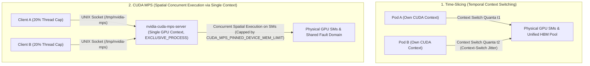

# 11.25 Time-slicing, MPS and oversubscription

| | |
|---|---|
| Level | Advanced |
| Priority tier | 1 |
| Lab venue | GCP / GKE (plus local Python 3 simulation lab) |
| Part | Part 11: GPUs on Kubernetes, scheduling and virtualization |
| Sources used | `nvidia-zero-to-hero/volume-11/chapter-04-time-slicing-and-oversubscription.md`; `volume-04/03-gpu-sharing-telemetry-masterclass.md`; `nvidia-zero-to-hero/volume-11/chapter-01-why-gpu-sharing-exists.md`; `nvidia-zero-to-hero/volume-11/chapter-07-kubernetes-scheduling-for-shared-gpus.md`; `nvidia-zero-to-hero/volume-11/chapter-11-production-troubleshooting.md`; `nvidia-zero-to-hero/volume-11/chapter-12-volume-11-summary.md`; `nvidia-zero-to-hero/volume-11/index.md`; `nvidia-zero-to-hero/volume-11/labs/lab-01-configure-and-validate-mig.md`; `nvidia-zero-to-hero/volume-11/labs/lab-02-configure-kubernetes-gpu-time-slicing.md`; `nvidia-zero-to-hero/volume-11/labs/lab-03-compare-sharing-performance-and-isolation.md`; `nvidia-zero-to-hero/volume-11/labs/lab-04-troubleshoot-a-multi-tenant-gpu-node.md`; Roland Huß et al., *Generative AI on Kubernetes* (O'Reilly, 2026, Ch. 3) |
| Coverage file | `planning/coverage/chapters/11-25.md` |

## Why this matters for AI infrastructure

Not every GPU in your fleet supports hardware Multi-Instance GPU (`MIG`)—NVIDIA `T4`, `L4`, `L40S`, and `A10G` inference accelerators do not have MIG silicon—and even on `A100` or `H100` nodes, interactive Jupyter notebooks, CI test runners, and lightweight microservices often sit idle `80%+` of the time between bursts (`volume-11/chapter-04-time-slicing-and-oversubscription.md` and *Generative AI on Kubernetes* Chapter 3). To share GPUs without hardware partitioning, NVIDIA provides two software mechanisms (`volume-04/03-gpu-sharing-telemetry-masterclass.md`):
1. **Temporal Software Sharing (`Time-Slicing`):** The NVIDIA Device Plugin advertises `N` logical tokens (`replicas: 4` or `10`) per physical GPU (`"The Lie"` in `volume-11/chapter-04`), while all `N` Pods mount the **same physical `/dev/nvidia0` device** and take turns via round-robin GPU context switching (`"The Reality"`).
2. **Spatial Software Sharing (`CUDA Multi-Process Service`, `MPS`):** A background proxy (`nvidia-cuda-mps-control -d` and `nvidia-cuda-mps-server` running under `EXCLUSIVE_PROCESS` compute mode) funnels CUDA API calls from multiple client processes into a **single shared GPU context** so small kernels from different processes execute **concurrently side-by-side on the Streaming Multiprocessors (`SMs`)** (`volume-04/03`).

Both mechanisms dramatically improve access density, and both can cause catastrophic production outages if an engineer mistakes a logical replica token for a hardware reservation (`volume-11/chapter-04`):
- On a **`16 GB` T4 GPU** advertised with **`replicas: 10`**, all `10` Pods share a single unprotected `16 GB` VRAM pool (`cgroups` do not govern GPU memory). If `Pod 1` leaks memory and allocates all **`16 GB`**, **`Pods 2` through `10` (`9` neighbor pods) crash immediately with `CUDA Out of Memory`**.
- Even under CUDA MPS, where you can cap per-client compute threads (`set_default_active_thread_percentage 20`) and pinned memory (`CUDA_MPS_PINNED_DEVICE_MEM_LIMIT`), all MPS clients share a **single GPU fault domain**—and a misconfigured memory cap triggers the infamous **"Ghost OOM"** (`Container A` crashing with `CUDA OOM` on a `40 GB` A100 while `nvidia-smi` reports only **`10 GB / 40 GB`** used, `volume-04/03` Scenario 1).

This chapter covers the exact mechanics, configuration, benchmarking, and operational governance of **Time-Slicing**, **CUDA MPS**, and **GPU Oversubscription** (`volume-11/chapter-04`, `volume-04/03`, *Generative AI on Kubernetes* Chapter 3, and `volume-11/labs/lab-01..04`).

## Prerequisites and outcomes

### Prerequisites
- Completion of Chapter 11.2 (Device plugin ConfigMaps), Chapter 11.17 (KAI fractional GPUs), and Chapter 11.24 (MIG in depth).
- Familiarity with Kubernetes `ResourceQuota`, `ClusterPolicy`, and `nvidia-smi`.

### Outcomes
After completing this chapter, you will be able to:
- Explain the architectural difference between **Kubernetes Device-Plugin Time-Slicing** (temporal context switching across independent CUDA contexts sharing physical HBM) and **CUDA Multi-Process Service (`MPS`)** (spatial concurrent SM execution through a single `nvidia-cuda-mps-server` context in `EXCLUSIVE_PROCESS` mode, `volume-04/03`).
- Configure **Time-Slicing** (`renameByDefault: true` -> `nvidia.com/gpu.shared`, `failRequestsGreaterThanOne: true`, `replicas: 4`) and **CUDA MPS** (`CUDA_MPS_PIPE_DIRECTORY=/tmp/nvidia-mps`, `set_default_active_thread_percentage 20`, `CUDA_MPS_PINNED_DEVICE_MEM_LIMIT`), and diagnose the **MPS Ghost OOM (`10 GB / 40 GB` used)** (`volume-04/03`).
- Execute the **5-Phase Replica-Ratio Benchmark (`Single tenant -> Concurrent active -> Burst -> Failure/recovery -> Upgrade repeat`, `volume-11/chapter-04`)** on an `80 GB` A100 (`nvidia-smi dmon -s puctem -n 300`: `1` notebook at `25%` SM / `12 GB` / `8 ms` p99 -> `2` at `40%` SM / `24 GB` / `25 ms` -> `4` at `55%` SM / `48 GB` / `120 ms` safe envelope with `>= 20 GB` headroom -> `8` at `65%` SM / `96 GB > 80 GB` OOM / `500 ms` p99).
- Implement the **6-Step Safe Rollout Sequence**, the **10-Field Operating Policy Template**, the **8-Item Contention Evidence Package**, and production namespace `ResourceQuota` guards (`nvidia.com/gpu.shared: "0"`, `nvidia.com/gpu: "unlimited"`) (`volume-11/chapter-04`).

## Concepts: basics to intermediate to advanced

### 1. Basics: Time-slicing ("The Lie" vs "The Reality") and CUDA Multi-Process Service (`MPS`) (`volume-11/chapter-04` & `volume-04/03`)

#### 1. What Device-Plugin Time-Slicing Actually Changes (`volume-11/chapter-04`)
When you configure `replicas: N` in the NVIDIA Device Plugin ConfigMap (`version: v1`), you are changing **only the control-plane accounting token count**—nothing on the GPU silicon changes (`volume-11/chapter-04`):

| Control-Plane Claim | Actual Hardware & Runtime Reality (`volume-11/chapter-04`) |
|---|---|
| **"The Pod is `Running` with `nvidia.com/gpu: 1`"** | The Pod received an **admission token** to open `/dev/nvidia0`; it did **not** receive a fixed share of SMs or a reserved slice of VRAM. |
| **"The Node has `8` or `10` Allocatable GPUs"** | One physical GPU (`e.g., 16 GB T4` or `80 GB A100`) is represented by `8` or `10` logical scheduler tokens; all pods contend in the **same memory and fault domain**. |
| **"A Pod requests `nvidia.com/gpu: 2` on a shared node"** | Requesting `2` time-sliced tokens does **not** grant `2x` the compute or `2x` the memory (which is why production configs set **`failRequestsGreaterThanOne: true`**). |
| **"Linux `cgroups` will protect neighbor pods from OOM"** | **False (`volume-04/03`):** Standard Linux `memory` cgroups only govern host system RAM, **not** GPU HBM/VRAM. If `Pod 1` leaks `16 GB` on a `16 GB` T4 with `replicas: 10`, `Pods 2..10` (`9` pods) crash with `CUDA OOM`. |

#### 2. Temporal Time-Slicing vs Spatial CUDA MPS (`volume-04/03` & *Generative AI on Kubernetes* Ch. 3)
Why did NVIDIA create **CUDA Multi-Process Service (`MPS`)** if the driver already supports time-slicing?
- Under **Time-Slicing**, each container creates its own separate CUDA context on the GPU. Because only one CUDA context can execute on an SM partition at a given instant (when MIG is not used), the GPU hardware scheduler must **pause Process A, save its register/context state, load Process B's context state, and run Process B** (round-robin temporal multiplexing). When two inference microservices launch small kernels that each use only `20%` of the SMs, time-slicing still serializes their contexts sequentially and pays context-switch overhead (`jitter`).
- Under **CUDA MPS (`volume-04/03` Part 1.2)**, a host control daemon (**`nvidia-cuda-mps-control -d`**) spawns an **`nvidia-cuda-mps-server`** process while the GPU is locked into **`EXCLUSIVE_PROCESS`** compute mode (`sudo nvidia-smi -i 0 -c EXCLUSIVE_PROCESS`). Multiple client containers connect to the MPS server over UNIX domain sockets (`CUDA_MPS_PIPE_DIRECTORY=/tmp/nvidia-mps`). The MPS server merges their CUDA streams into a **single hardware GPU context**, allowing kernels from Process A and Process B to execute **simultaneously side-by-side on different SMs (spatial multiplexing)**:



---

### 2. Intermediate: Benchmarking the 5-phase time-slicing replica envelope (`volume-11/chapter-04`) and diagnosing the MPS Ghost OOM (`volume-04/03`)

#### 1. The 5-Phase Replica-Ratio Measurement Protocol (`volume-11/chapter-04`)
Never copy a `replicas: 8` or `replicas: 10` setting from a blog post. `volume-11/chapter-04` ("Measuring a replica ratio") defines a **five-phase experimental protocol** using `nvidia-smi dmon -s puctem -n 300` (`5 minutes` of `1`-second samples) and `nvidia-smi --query-processes=gpu_uuid,pid,process_name,gpu_memory_usage --format=csv`:
1. **Phase 1 — Single tenant:** Establish baseline `p99` kernel launch / request latency and peak memory for `1` workload alone.
2. **Phase 2 — Concurrent active:** Add intended neighbors (`2`, `4`, `8`) until either the latency SLO or the memory safety headroom (`>= 20 GB` on an `80 GB` card) is approached.
3. **Phase 3 — Burst:** Verify that application-level queueing or admission shedding bounds overload without crashing the node.
4. **Phase 4 — Failure/recovery:** Confirm how neighbor pods behave when one pod OOMs or restarts.
5. **Phase 5 — Upgrade repeat:** Re-run the concurrency test after driver, CUDA runtime, or model updates.

Here is the exact **`80 GB` A100 PyTorch Notebook Concurrency Benchmark** from `volume-11/chapter-04`:

| Concurrent Notebooks on `1 × A100 80GB` | Per-Notebook SM Activity (`%`) | Combined HBM Used (`GB` of `80 GB`) | Observed `p99` Kernel Launch Latency | Engineering Verdict (`volume-11/chapter-04`) |
|---|---|---|---|---|
| **`1` Notebook (Baseline)** | `25%` SM | **`12 GB`** (`68 GB` free) | **`8 ms`** (imperceptible) | Clean single-tenant baseline |
| **`2` Concurrent Notebooks** | `~40%` SM | **`24 GB`** (`56 GB` free) | **`25 ms`** (interactive smooth) | Low interference |
| **`4` Concurrent Notebooks** | `~55%` SM | **`48 GB`** (**`32 GB >= 20 GB` headroom**) | **`120 ms`** (noticeable, acceptable for dev) | **Selected Safe Envelope: `replicas: 4`** |
| **`8` Concurrent Notebooks** | `~65%` SM | **`96 GB > 80 GB`** (`+16 GB` overflow) | **`500 ms`** (severe thrashing / host RAM spill) | **UNSAFE: `nvidia-smi` shows process OOM-killed** |

#### 2. Configuring CUDA MPS and Diagnosing the "Ghost OOM" (`volume-04/03` Part 1.2 & Part 6)
When configuring CUDA MPS (`volume-04/03`), you can bound each client's SM thread allocation (for example, `20%` of active threads via `echo set_default_active_thread_percentage 20 | nvidia-cuda-mps-control` or `CUDA_MPS_ACTIVE_THREAD_PERCENTAGE=20`) and cap each client's device memory allocation via **`CUDA_MPS_PINNED_DEVICE_MEM_LIMIT`** (or `set_default_device_pinned_mem_limit` in `nvidia-cuda-mps-control`).

Understanding `CUDA_MPS_PINNED_DEVICE_MEM_LIMIT` solves a classic senior architect interview scenario (`volume-04/03` Part 6 Scenario 1, *"The Ghost OOM on MPS"*):
- **The Symptom:** Two inference containers run on a **`40 GB` A100** under CUDA MPS. `Container A` periodically crashes with `CUDA Out of Memory`, yet when the on-call engineer runs `nvidia-smi`, only **`10 GB` out of `40 GB`** is in use.
- **The Three Root Causes to Check (`volume-04/03`):**
  1. **Per-Client MPS Memory Ceiling:** Check whether `CUDA_MPS_PINNED_DEVICE_MEM_LIMIT` (or `set_default_device_pinned_mem_limit`) was set to e.g. `8 GB`, causing `Container A` to hit its *software MPS limit* during a `12 GB` burst even while `30 GB` of physical HBM sat free on the `40 GB` A100.
  2. **Post-Crash Sampling Artifact:** `nvidia-smi` was sampled *after* `Container A` crashed and released its memory allocation.
  3. **Neighbor Burst Spike:** `Container B` spiked to `32+ GB` during a large batch and freed its buffers right after `Container A` failed.
  - **Architectural Fix:** If two inference services require guaranteed, non-overlapping memory partitions where neither can trigger a shared-context fault, migrate them from MPS to **hardware MIG** (`Chapter 11.24`).

---

### 3. Advanced: Production oversubscription governance, namespace guards, and the 10-field operating policy (`volume-11/chapter-04`)

#### 1. Six Controls that Protect a Shared Pool and Guarding Production Namespaces (`volume-11/chapter-04`)
Because Kubernetes treats every logical `nvidia.com/gpu` replica as a binary scheduling token without inspecting GPU memory pressure or `p99` tail latency (`volume-11/chapter-04` Table "Kubernetes resource semantics in practice"), you must layer **six operational controls**:
1. **Separate shared node pool and explicit resource naming (`renameByDefault: true` -> `nvidia.com/gpu.shared`):** Prevents a critical production pod from accidentally landing on a best-effort time-sliced node. In `volume-11/chapter-04` Scenario 3, a critical inference service (`p99 < 100 ms` SLO) requested generic `nvidia.com/gpu: 1`, landed on a time-sliced notebook node, and degraded to **`p99 > 300 ms`**.
2. **Production Namespace `ResourceQuota` Guard:** Explicitly block `nvidia.com/gpu.shared` in every production namespace (`volume-11/chapter-04`):
   ```yaml
   # Deny shared best-effort GPUs in production namespaces (volume-11/chapter-04, untested here)
   apiVersion: v1
   kind: ResourceQuota
   metadata:
     name: deny-shared-gpus-in-prod
     namespace: prod-serving
   spec:
     hard:
       nvidia.com/gpu.shared: "0"      # Forbid best-effort time-sliced GPUs
       nvidia.com/gpu: "unlimited"     # Permit dedicated GPUs
   ```
3. **Application-Level Concurrency & Request Limits:** Bound batch size and active in-flight requests inside the serving framework (`vLLM` / `Triton`) before HBM saturates.
4. **Queueing or Load Shedding:** Make overload visible as bounded queue wait (`timeslice_queue_time_p95 < 30 s`) rather than silent `500 ms` kernel thrashing.
5. **Workload-Correlated Telemetry (Overcoming the DCGM Attribution Gap):** As `volume-11/chapter-04` ("Observability: allocation is not utilization") notes, **when time-slicing is enabled with the Kubernetes device plugin, `dcgm-exporter` cannot associate GPU-level metrics (`DCGM_FI_DEV_GPU_UTIL`) with individual containers**. Operators must join scheduler allocation records, Pod UIDs, application latency histograms, and host `nvidia-smi --query-processes` / `nvidia-smi pmon -c 1` output.
6. **Dedicated Escape Hatch:** Maintain a pre-approved nodeSelector / MIG / whole-GPU pool (`kubectl set resources deployment/<name> --limits nvidia.com/gpu=1`) so responders can evacuate a latency-sensitive service in minutes during an incident.

#### 2. The 6-Step Safe Rollout Sequence, 10-Field Operating Policy, and 8-Item Contention Evidence Package (`volume-11/chapter-04`)
Before enabling time-slicing or MPS on any node pool, execute the **6-Step Safe Rollout Sequence** (`volume-11/chapter-04`):
1. Select a noncritical node pool and label/taint it as shared (`nvidia.com/device-plugin.config=all` in *Generative AI on Kubernetes* Chapter 3 Examples 3-11/3-12) *before* configuring replicas.
2. Capture single-tenant and concurrent baselines.
3. Start with a conservative replica count (`replicas: 4`); validate allocation (`1 -> 4 allocatable` after `30 s` in `labs/lab-02`), `p99` latency, memory high-water mark, and recovery.
4. Increase density only while the agreed service envelope passes.
5. Publish the **10-Field Operating Policy Template** (`1. Shared-pool purpose`, `2. Eligible/excluded workloads`, `3. Advertised shared resource name`, `4. Tested replica envelope and date`, `5. Memory and latency assumptions`, `6. Quota scope and admission behavior`, `7. Overload action`, `8. Escalation owner`, `9. Protected-service escape path`, and `10. Rollback action for configuration change`).
6. Rehearse configuration removal on a canary node (`labs/lab-02` Section 17) and capture the **8-Item Contention Evidence Package** during any slowdown (`1. Workload version & request rate`, `2. p50/p95/p99 latency & queue depth`, `3. Pod allocation & placement history`, `4. Active-process & memory evidence`, `5. Device health, power, thermal & error events`, `6. Node/device-plugin config & events`, `7. Quota/admission decisions`, and `8. Actions taken & time to recovery`).

#### 3. Kubernetes Primitives vs Shared-GPU Realities and Post-Upgrade Validation (`volume-11/chapter-04`)
A common mistake during platform design reviews is assuming that standard Kubernetes scheduling and policy primitives (`requests/limits`, `nodeSelector`, `taints/tolerations`, `ResourceQuota`, `PriorityClass`) automatically enforce GPU execution fairness (`volume-11/chapter-04` Table "Kubernetes resource semantics in practice"). In reality, each Kubernetes primitive solves an **admission or placement** problem while leaving a specific **hardware runtime gap** that must be closed by application limits, MPS caps, or MIG:

| Kubernetes Primitive (`volume-11/chapter-04`) | What It Contributes to a Shared GPU Pool | What It Cannot Protect on the Physical GPU | Complementary Runtime / Platform Control Required |
|---|---|---|---|
| **1. `resources.requests` / `limits` (`nvidia.com/gpu.shared: 1`)** | Reserves `1` logical admission token in `kube-scheduler` accounting | **Does not divide physical HBM memory or SMs**; `1` pod can still allocate `100%` of VRAM | Application memory caps (`PYTORCH_CUDA_ALLOC_CONF`), KAI `gpu-memory` admission, or `CUDA_MPS_PINNED_DEVICE_MEM_LIMIT` |
| **2. `nodeSelector` / `nodeAffinity`** | Routes best-effort pods (`nvidia.com/device-plugin.config=all`) to the shared node pool | **Does not validate workload memory or latency behavior** once placed on the node | 5-phase pre-admission concurrency envelope test (`Single -> Concurrent -> Burst -> Failure -> Upgrade`) |
| **3. `taints` and `tolerations`** | Prevents general workloads from landing on specialized GPU nodes (`node.kubernetes.io/unschedulable` in canary labs) | **Does not provide tenant memory, fault, or process isolation** between co-scheduled pods | Restrict time-slicing/MPS to trusted single-team cohorts; use **MIG** or **vGPU** for untrusted tenants |
| **4. `ResourceQuota`** | Bounds total logical GPU tokens requested by a namespace (`one-logical-gpu` in `labs/lab-02`, or `nvidia.com/gpu.shared: "0"` in prod) | **Does not arbitrate GPU kernel launch frequency or SM context-switch fairness** | Application-level request queues, token-bucket rate limiters, or CUDA MPS `set_default_active_thread_percentage` |
| **5. `PriorityClass`** | Controls which pending Pod schedules first and which Pod is evicted under node pressure | **Does not create physical GPU capacity** or pause an already-running CUDA kernel mid-flight | Graceful `SIGTERM` checkpoint handlers and a dedicated whole-GPU / MIG **escape pool** for critical services |

#### 4. The 10-Field Shared-Pool Operating Policy Template and Pre-Production Acceptance Checklist (`volume-11/chapter-04`)
To prevent a shared time-sliced or MPS pool from turning into an undocumented "shadow production" tier, `volume-11/chapter-04` ("Operating policy template" and "Pre-production acceptance test") requires every shared node pool to publish a **10-field operating contract** and pass an **8-step pre-production acceptance test** (repeated after every GPU Operator, device-plugin, driver, or node-image upgrade):
1. **The 10-Field Shared-Pool Operating Contract:**
   - **Field 1 — Shared-pool purpose:** One-sentence statement (for example, *"Interactive PyTorch notebook and CI validation pool for trusted ML engineering teams"*).
   - **Field 2 — Eligible and excluded workloads:** Explicitly list approved workloads (`< 12 GB` interactive notebooks, CI smoke tests) and excluded workloads (customer-facing `p99 < 100 ms` inference APIs, multi-node NCCL training).
   - **Field 3 — Advertised shared resource name:** `nvidia.com/gpu.shared` (`renameByDefault: true`, `failRequestsGreaterThanOne: true`).
   - **Field 4 — Tested replica envelope and date:** For example, *"Validated at `replicas: 4` on `A100 80GB` (`48 GB` peak combined memory, `32 GB` headroom, `p99 = 120 ms`)"* with the benchmark date and driver revision.
   - **Field 5 — Memory and latency assumptions:** Per-pod `12 GB` high-water mark and best-effort `120 ms` kernel launch latency expectation.
   - **Field 6 — Quota scope and admission behavior:** Per-namespace `ResourceQuota` and `LimitRange` ceilings, plus `nvidia.com/gpu.shared: "0"` in all production namespaces.
   - **Field 7 — Overload action:** Queue new requests, throttle batch size, or evict the newest best-effort pod when combined memory crosses `80%–90%`.
   - **Field 8 — Escalation owner:** Named platform and tenant on-call rotation.
   - **Field 9 — Protected-service escape path:** Pre-provisioned `dedicated` or `MIG` nodeSelector pool where any workload promoted to production is migrated (`kubectl set resources ...`).
   - **Field 10 — Rollback action for configuration change:** Tested `ClusterPolicy` merge-patch procedure (`labs/lab-02` Section 17) that restores `replicas: 1` baseline before deleting the lab ConfigMap.
2. **The 8-Step Pre-Production & Post-Upgrade Acceptance Checklist (`volume-11/chapter-04`):**
   - Schedule the known concurrent benchmark workloads (`time-slice-a`, `time-slice-b`) on the target shared pool.
   - Confirm the advertised resource name (`nvidia.com/gpu.shared`) and node labels/selectors match the design.
   - Measure application `p50`/`p95`/`p99` latency and queue behavior under concurrent load.
   - Measure combined GPU memory high-water marks (`nvidia-smi dmon -s puctem`).
   - Confirm alert rules and the 8-item Contention Evidence Package (allocation history + host `nvidia-smi --query-processes`) are functioning.
   - Reduce admission / replica density in a drill and confirm latency recovers to baseline.
   - Evacuate a test workload to the dedicated/MIG escape pool and verify SLO recovery.
   - Re-execute this checklist after every GPU Operator, device-plugin, driver, or container runtime upgrade.

## Commands and configurations that matter

### 1. Device-Plugin Time-Slicing ConfigMap with `renameByDefault` and `failRequestsGreaterThanOne` (`volume-11/chapter-04` & `labs/lab-02`)

```yaml
# time-slicing-safe-configmap.yaml (volume-11/chapter-04 & labs/lab-02, untested here)
apiVersion: v1
kind: ConfigMap
metadata:
  name: time-slicing-config
  namespace: gpu-operator
data:
  any: |-
    version: v1
    sharing:
      timeSlicing:
        renameByDefault: true
        failRequestsGreaterThanOne: true
        resources:
          - name: nvidia.com/gpu
            replicas: 4
```

```bash
# Select the time-slicing ConfigMap in ClusterPolicy and label target node pool (untested here)
kubectl patch clusterpolicy gpu-cluster-policy --type merge \
  --patch '{"spec":{"devicePlugin":{"config":{"name":"time-slicing-config","default":"any"}}}}'
kubectl get node gpu-node-1 -o jsonpath='{.status.allocatable.nvidia\.com/gpu\.shared}{" shared allocatable\n"}'
```

### 2. Enabling CUDA Multi-Process Service (`MPS`) with Thread and Memory Caps (`volume-04/03`)

```bash
#!/usr/bin/env bash
# Enable CUDA MPS on GPU 0 with 20% active thread cap and 8GiB pinned memory limit (volume-04/03, untested here)
export CUDA_VISIBLE_DEVICES=0
export CUDA_MPS_PIPE_DIRECTORY=/tmp/nvidia-mps
export CUDA_MPS_LOG_DIRECTORY=/tmp/nvidia-log

# Lock GPU 0 to EXCLUSIVE_PROCESS so only nvidia-cuda-mps-server holds the hardware context
sudo nvidia-smi -i 0 -c EXCLUSIVE_PROCESS

# Start the MPS control daemon
nvidia-cuda-mps-control -d

# Cap each MPS client to 20% of SMs and 8GiB of device memory
echo "set_default_active_thread_percentage 20" | nvidia-cuda-mps-control
echo "set_default_device_pinned_mem_limit 0 8G" | nvidia-cuda-mps-control
```

### 3. Live Contention Triage on a Time-Sliced Node (`volume-11/chapter-04` & `labs/lab-02`)

```bash
# Stream 5 minutes of 1-second SM/memory/power/thermal samples and list active PIDs (untested here)
nvidia-smi dmon -s puctem -n 300
nvidia-smi pmon -c 1
nvidia-smi --query-processes=gpu_uuid,pid,process_name,gpu_memory_usage --format=csv
```

## How it fails

| Failure mode | Exact symptom & command evidence | Root cause boundary | Remediation |
|---|---|---|---|
| **1. `8` concurrent notebooks on an `80 GB` A100 hit `p99 = 500 ms` and crash with `CUDA OOM` (`volume-11/chapter-04`)** | At `replicas: 8`, `nvidia-smi` shows combined memory demand (`8 × 12 GB = 96 GB`) exceeding `80 GB`, `p99` kernel latency jumps from `8 ms` to `500 ms`, and pods are OOM-killed. | **Time-Slicing Memory Over-Subscription:** Logical tokens do not partition HBM; `8` active `12 GB` notebooks exceed physical memory by `16 GB`. | Reduce `replicas` to **`4`** (`48 GB` used, `32 GB >= 20 GB` headroom, `p99 = 120 ms`) or use KAI Scheduler's `gpu-memory` admission cap (`Chapter 11.17`). |
| **2. Production inference service (`p99 < 100 ms`) degrades to `p99 > 300 ms` while all Pods report `1/1 Running` (`volume-11/chapter-04` Scenario 3)** | `kubectl get pods` is green, `curl .../metrics \| grep latency_p99_ms` reports `> 300 ms`, and `kubectl exec <pod> -- nvidia-smi` shows multiple notebook PIDs on the same GPU. | **Critical Workload Scheduled onto Best-Effort Pool:** Time-sliced nodes advertised `nvidia.com/gpu` instead of `nvidia.com/gpu.shared`, and the prod namespace lacked a `ResourceQuota` guard. | Enable `renameByDefault: true` (`nvidia.com/gpu.shared`), enforce `ResourceQuota` `nvidia.com/gpu.shared: "0"` in production namespaces, and evacuate the deployment to a dedicated or `MIG` pool. |
| **3. Container A under CUDA MPS crashes with `CUDA OOM` on a `40 GB` A100 while `nvidia-smi` shows only `10 GB` used (`volume-04/03` Scenario 1)** | Application logs `CUDA error: out of memory`, but host `nvidia-smi` shows `10000MiB / 40960MiB`. | **MPS "Ghost OOM" (`CUDA_MPS_PINNED_DEVICE_MEM_LIMIT` or Transient Neighbor Spike):** Either a per-client MPS memory limit capped Container A below its burst need, or Container B spiked and freed memory before `nvidia-smi` was sampled. | Inspect `CUDA_MPS_PINNED_DEVICE_MEM_LIMIT` / `get_default_device_pinned_mem_limit` in `nvidia-cuda-mps-control`, or migrate the services to **MIG** for hardware-isolated HBM slices. |
| **4. Pod requesting `nvidia.com/gpu: 2` on a time-sliced node receives two tokens on the *same* contended physical GPU (`volume-11/chapter-04`)** | User requests `nvidia.com/gpu: 2` expecting `2x` the compute/memory of `1` replica, but gets zero extra memory isolation and still contends with `6` other pods. | **Misunderstood Logical Replica Semantics:** Device-plugin replicas are access tokens, not additive hardware slices. | Set **`failRequestsGreaterThanOne: true`** in the time-slicing ConfigMap so any pod requesting `> 1` shared token is rejected clearly, and route multi-GPU jobs to dedicated whole-GPU nodes. |
| **5. Fatal GPU context fault (`XID 13` / `XID 31` / `XID 48`) in one CUDA MPS client terminates all co-running MPS containers (`volume-04/03` & `volume-11/chapter-04`)** | One buggy inference container triggers an uncontained GPU fault, and all `5` containers connected to `/tmp/nvidia-mps` crash simultaneously. | **Shared MPS Hardware Context Fault Domain:** Because `nvidia-cuda-mps-server` funnels all clients into a single hardware GPU context, a fatal context error tearing down that context kills every connected client. | Never use CUDA MPS across untrusted tenants; restrict MPS to cooperative single-tenant microservices and use **MIG** (`Chapter 11.24`) or **vGPU** (`Chapter 11.23`) for fault-isolated multi-tenancy. |

## Hands-on lab

### Venue and scope
This lab runs locally using Python 3 standard library (`code/part11/time_slicing_mps_oversubscription.py` and `code/part11/time_slicing_mps_oversubscription_lab.py`) to verify the `volume-11/chapter-04` `16 GB` T4 `10`-replica memory-leak failure model, the 5-phase `80 GB` A100 notebook concurrency benchmark (`1`, `2`, `4`, `8` replicas via `nvidia-smi dmon -s puctem -n 300`), the `volume-04/03` CUDA MPS configuration and Ghost OOM analyzer (`EXCLUSIVE_PROCESS`, `20%` thread cap, `CUDA_MPS_PINNED_DEVICE_MEM_LIMIT` on a `40 GB` A100 at `10 GB` used), the 10-field Operating Policy Template, the 8-item Contention Evidence Package, and the `volume-11/labs/lab-01..04` verification suite. Host and cluster commands are marked `(untested here)`.

### Step 1: Run the self-checking time-slicing, MPS and oversubscription lab (tested here)

Run the lab script from the repository root:

```bash
python3 code/part11/time_slicing_mps_oversubscription_lab.py
```

Captured output from this repository:
```text
=== Chapter 11.25 Lab: Time-Slicing, CUDA MPS & Oversubscription Governance ===
  [PASS] Volume 11 Ch 4 Primer: 16 GB T4 with replicas: 10 leaves 0 GB when Pod 1 leaks 16 GB, OOM-killing Pods 2..10 (9 pods)
  [PASS] Volume 11 Ch 4 defines 5 replica-ratio test phases (Single tenant, Concurrent active, Burst, Failure/recovery, Upgrade repeat)
  [PASS] A100 80GB baseline (1 notebook, dmon -s puctem -n 300 over 5 min) observes 25% SM, 12GB VRAM, and p99=8ms
  [PASS] A100 80GB with 2 concurrent notebooks observes ~40% SM each, 24GB VRAM, and p99=25ms
  [PASS] A100 80GB with 4 concurrent notebooks observes ~55% SM each, 48GB VRAM (32GB >= 20GB headroom), and p99=120ms -> max safe replicas = 4
  [PASS] A100 80GB with 8 concurrent notebooks hits ~65% SM each, 96GB > 80GB VRAM, p99=500ms, and OOM kill
  [PASS] CUDA MPS with EXCLUSIVE_PROCESS and 5 clients at 20% thread cap sums to 100% spatial SM allocation
  [PASS] Volume 04 Ch 3 Ghost OOM: Client A bursting to 12GB > 8GB CUDA_MPS_PINNED_DEVICE_MEM_LIMIT crashes even when nvidia-smi shows 10GB/40GB
  [PASS] CUDA MPS shares a single GPU fault domain across all connected client processes
  [PASS] Volume 11 Ch 4 Operating Policy Template specifies 10 mandatory fields
  [PASS] Volume 11 Ch 4 Contention Evidence Package specifies 8 time-correlated items
  [PASS] Volume 11 Ch 4 Scenario 3: critical service (p99 < 100ms) misplaced on shared pool degrades to p99 > 300ms
  [PASS] Volume 11 Ch 4 ResourceQuota sets nvidia.com/gpu.shared: '0' and nvidia.com/gpu: 'unlimited' in prod namespaces
  [PASS] Volume 11 Ch 4 documents that DCGM Exporter cannot attribute GPU metrics to individual containers under device-plugin time-slicing
  [PASS] Volume 11 Ch 4 defines a 6-step Safe Rollout Sequence and 5 upgrade validation checks
  [PASS] Volume 04 Ch 3 MPS daemon uses CUDA_MPS_PIPE_DIRECTORY=/tmp/nvidia-mps and CUDA_MPS_LOG_DIRECTORY=/tmp/nvidia-log
  [PASS] Generative AI on Kubernetes Ch 3 Examples 3-11/3-12 label nodes with nvidia.com/device-plugin.config=all for time-slicing
  [PASS] Generative AI on Kubernetes Ch 3 appends -SHARED to GFD product label when MIG and time-slicing are combined
  [PASS] Volume 11 Lab 02 configures version: v1, renameByDefault: false, failRequestsGreaterThanOne: true, and replicas: 4
  [PASS] Volume 11 Lab 02 updates node allocatable from 1 to 4 in 30s and logs TIME_SLICE_A_COMPLETE and TIME_SLICE_B_COMPLETE
  [PASS] Volume 11 Lab 03 runs SHARING_RUNTIME_PROBE_COMPLETE and SHARING_NEIGHBOR_PROBE_COMPLETE for 60s
  [PASS] Volume 11 Lab 04 verifies DIAGNOSTIC_GPU_OK and QUOTA_DENIAL_RECOVERY_CHECK
  [PASS] Volume 11 Lab 01 verifies MIG_VALIDATION_COMPLETE across 6 H100 MIG profiles
  [PASS] Volume 11 Ch 1 & Ch 12 Summary separate logical replica allocation from physical reservation and SLO delivery
  [PASS] Volume 11 Ch 7 & Ch 11 align scheduler resource requests with 6-layer contention triage

Summary: 25 passed, 0 failed out of 25 checks.
```

### Exercises

1. **Exercise 1 — Time-slicing on a `16 GB` T4 (`volume-11/chapter-04` Primer):** Using `simulate_t4_ten_replica_memory_leak()` in `code/part11/time_slicing_mps_oversubscription.py`, explain what happens on a `16 GB` T4 configured with `replicas: 10` when `Pod 1` leaks `16 GB` of VRAM, and explain why Linux `memory` cgroups do not stop `Pod 1` (`volume-04/03`).
2. **Exercise 2 — Benchmarking the 5-phase A100 replica envelope (`volume-11/chapter-04`):** Using `evaluate_a100_timeslicing_envelope()`, list the `5` test phases in `FIVE_REPLICA_TEST_PHASES`, trace `(sm_pct, combined_mem_gb, p99_ms)` across `1`, `2`, `4`, and `8` concurrent notebooks on an `80 GB` A100 (`nvidia-smi dmon -s puctem -n 300`), and state why `replicas: 4` is the maximum safe setting.
3. **Exercise 3 — Configuring CUDA MPS and diagnosing the Ghost OOM (`volume-04/03`):** Using `evaluate_cuda_mps_configuration()`, write the commands to start `nvidia-cuda-mps-control` in `EXCLUSIVE_PROCESS` mode with a `20%` active thread cap, and explain why `Client A` crashed with `CUDA OOM` during a `12 GB` burst on a `40 GB` A100 when `nvidia-smi` showed only `10 GB` used.
4. **Exercise 4 — Guarding production namespaces from accidental best-effort sharing (`volume-11/chapter-04` Scenario 3):** Write the device-plugin ConfigMap settings (`renameByDefault: true`, `failRequestsGreaterThanOne: true`) and the production namespace `ResourceQuota` manifest that prevent a `p99 < 100 ms` service from landing on a shared pool and degrading to `p99 > 300 ms`.
5. **Exercise 5 — Publishing the 10-Field Operating Policy Template (`volume-11/chapter-04`):** List all `10` fields in `TEN_OPERATING_POLICY_FIELDS` for a shared development notebook pool.
6. **Exercise 6 — Collecting the 8-Item Contention Evidence Package (`volume-11/chapter-04`):** List all `8` time-correlated items in `EIGHT_CONTENTION_EVIDENCE_ITEMS` and explain how operators overcome the `dcgm-exporter` container-attribution limitation during a shared-pool slowdown.

## Checkpoint questions

<details>
<summary><strong>1. In Volume 11 Chapter 4, what is the fundamental difference between a logical GPU replica under time-slicing and a hardware MIG instance?</strong></summary>

A **MIG instance** is a hardware-partitioned slice of GPU compute (`SMs`), HBM memory capacity, L2 cache, and memory controllers. A **time-sliced replica** is purely a **scheduler admission token** for shared access to the entire physical GPU—it provides zero reserved memory, zero guaranteed SM share, and zero fault isolation.
</details>

<details>
<summary><strong>2. On a 16 GB T4 GPU configured with replicas: 10, why don't Linux memory cgroups prevent Pod 1 from consuming all 16 GB of VRAM and crashing Pods 2 through 10 (Volume 11 Chapter 4 & Volume 4 Chapter 3)?</strong></summary>

Standard Linux `memory` cgroups only track and limit **host system RAM** managed by the Linux kernel MMU. They do not govern allocations inside the GPU's physical HBM/VRAM pool when `10` pods mount the same `/dev/nvidia0` device node.
</details>

<details>
<summary><strong>3. What do renameByDefault: true and failRequestsGreaterThanOne: true do in the NVIDIA device-plugin time-slicing ConfigMap (Volume 11 Chapter 4 & Lab 02)?</strong></summary>

- **`renameByDefault: true`:** Advertises time-sliced tokens as **`nvidia.com/gpu.shared`** instead of `nvidia.com/gpu`, making best-effort shared semantics explicit in Pod manifests and `ResourceQuotas`.
- **`failRequestsGreaterThanOne: true`:** Rejects any Pod that requests more than `1` shared token (`nvidia.com/gpu.shared: 2`), preventing users from falsely assuming that requesting `2` tokens gives `2x` guaranteed compute or memory.
</details>

<details>
<summary><strong>4. How does CUDA Multi-Process Service (MPS) differ architecturally from standard GPU time-slicing (Volume 4 Chapter 3 Part 1.2)?</strong></summary>

- **Time-slicing** multiplexes separate per-process CUDA contexts **temporally** via round-robin context switching (pausing Process A while Process B runs), incurring context-switch latency and leaving SMs underutilized when individual kernels are small.
- **CUDA MPS** runs a proxy daemon (`nvidia-cuda-mps-control -d` + `nvidia-cuda-mps-server`) with the GPU in **`EXCLUSIVE_PROCESS`** mode, funneling multiple client processes into a **single shared GPU context** so their kernels execute **concurrently side-by-side (spatially)** on the SMs.
</details>

<details>
<summary><strong>5. What environment variables and commands configure CUDA MPS on GPU 0 and cap each client to 20% of active threads (Volume 4 Chapter 3 Part 1.2)?</strong></summary>

1. `export CUDA_VISIBLE_DEVICES=0`, `export CUDA_MPS_PIPE_DIRECTORY=/tmp/nvidia-mps`, and `export CUDA_MPS_LOG_DIRECTORY=/tmp/nvidia-log`.
2. `sudo nvidia-smi -i 0 -c EXCLUSIVE_PROCESS` (ensuring only the MPS server accesses the GPU directly).
3. `nvidia-cuda-mps-control -d` (starts the daemon).
4. `echo set_default_active_thread_percentage 20 | nvidia-cuda-mps-control` (caps each client to `20%` of threads).
</details>

<details>
<summary><strong>6. Explain the three possible causes of the "Ghost OOM on MPS" in Volume 4 Chapter 3 Part 6 Scenario 1, where Container A crashes with CUDA OOM on a 40 GB A100 while nvidia-smi shows only 10 GB used.</strong></summary>

1. A per-client MPS memory ceiling (**`CUDA_MPS_PINNED_DEVICE_MEM_LIMIT`** or `set_default_device_pinned_mem_limit`) was configured below what Container A needed during a burst.
2. The `10 GB` `nvidia-smi` reading was sampled *after* Container A crashed and released its GPU memory.
3. Neighboring Container B spiked in memory usage and freed its buffers immediately after causing Container A's allocation to fail.
</details>

<details>
<summary><strong>7. List the five test phases for measuring a safe time-slicing replica ratio in Volume 11 Chapter 4.</strong></summary>

1. **Single tenant:** Establish normal baseline latency and memory high-water mark.
2. **Concurrent active:** Add neighbors to measure interference while keeping all protected SLOs within limit.
3. **Burst:** Test queue and admission behavior so overload is bounded and observable.
4. **Failure/recovery:** Test response to a bad neighbor or restart without manual guesswork.
5. **Upgrade repeat:** Re-validate the envelope after driver, runtime, or model updates.
</details>

<details>
<summary><strong>8. Summarize the observed SM utilization, combined memory, and p99 kernel launch latency across 1, 2, 4, and 8 concurrent PyTorch notebooks on an 80 GB A100 (Volume 11 Chapter 4).</strong></summary>

Example from the Volume 11 note, sampled over `5 minutes` (`nvidia-smi dmon -s puctem -n 300`) on one A100:
- **`1` notebook:** `25%` SM, `12 GB / 80 GB` memory, `p99 = 8 ms`.
- **`2` notebooks:** `~40%` SM each, `24 GB / 80 GB` memory, `p99 = 25 ms`.
- **`4` notebooks:** `~55%` SM each, `48 GB / 80 GB` memory (`32 GB` free), `p99 = 120 ms` (**safe replica count = `4` with `>= 20 GB` headroom**).
- **`8` notebooks:** `~65%` SM each, **`96 GB > 80 GB` memory**, `p99 = 500 ms`, triggering an **OOM kill**.
</details>

<details>
<summary><strong>9. What are the six operational controls listed in Volume 11 Chapter 4 Table "Design the service, not the replica count" for protecting a shared time-sliced pool?</strong></summary>

1. **Separate shared node pool and explicit resource name** (`nvidia.com/gpu.shared`).
2. **Namespace quota and admission control** (limiting a single tenant's allocation burst).
3. **Concurrency/request limits in the application** (protecting memory and tail latency).
4. **Queueing or load shedding** (making overload visible rather than silently slow).
5. **Telemetry correlated by workload** (distinguishing logical allocation from physical pressure).
6. **Dedicated escape hatch** (moving critical workloads to MIG or whole GPUs during incidents).
</details>

<details>
<summary><strong>10. Walk through the six steps of the Safe Rollout Sequence for time-slicing in Volume 11 Chapter 4.</strong></summary>

1. Select a noncritical node pool and label it as shared before configuring replicas.
2. Capture a baseline with the same workloads running one at a time and concurrently.
3. Introduce a small replica count and validate allocation, latency, memory use, and recovery.
4. Increase density only while the agreed service envelope passes.
5. Publish the shared resource name, workload eligibility, escalation path, and exit path to dedicated capacity.
6. Rehearse removal of the shared configuration in a canary so responders can restore a conservative state.
</details>

<details>
<summary><strong>11. In Volume 11 Chapter 4 Troubleshooting Scenario 3, how do you diagnose and remediate a critical service (p99 < 100 ms SLO) that degraded to p99 > 300 ms after accidentally landing on a time-sliced pool?</strong></summary>

- **Diagnosis:** Inspect `kubectl get pod <name> -o jsonpath='{.spec.containers[0].resources}'`, run `kubectl exec <pod> -- nvidia-smi` (which reveals multiple containers' PIDs on the same GPU), and check `curl http://service-endpoint:8000/metrics | grep latency_p99_ms` (`> 300 ms`).
- **Remediation & Prevention:** Evacuate the deployment to a protected pool (`kubectl set resources deployment/<name> --limits nvidia.com/gpu=1` + dedicated nodeSelector), verify `p99 < 100 ms` recovers, and place a `ResourceQuota` in the production namespace setting **`nvidia.com/gpu.shared: "0"`** and **`nvidia.com/gpu: "unlimited"`**.
</details>

<details>
<summary><strong>12. What is the documented DCGM Exporter limitation when Kubernetes device-plugin time-slicing is enabled, and how do responders work around it (Volume 11 Chapter 4 Scenario 4)?</strong></summary>

When device-plugin time-slicing is enabled, **`dcgm-exporter` cannot associate GPU-level metrics with individual containers**. Responders must correlate scheduler allocation history, Pod lifecycle events, application request latency/throughput metrics, and host-level `nvidia-smi --query-processes` / `nvidia-smi pmon -c 1` snapshots over the incident time window.
</details>

<details>
<summary><strong>13. For each of the five Kubernetes primitives in Volume 11 Chapter 4 (request/limit, node selector/affinity, taint/toleration, quota, priority), state what it contributes and what it CANNOT do for shared GPUs.</strong></summary>

- **`request/limit`:** Reserves a logical allocation token, but **does not divide physical GPU memory**.
- **`node selector/affinity`:** Targets the intended node pool, but **does not validate workload memory/latency behavior**.
- **`taint/toleration`:** Restricts access to special nodes, but **does not provide tenant hardware isolation**.
- **`quota` (`ResourceQuota`):** Bounds logical request count by namespace, but **does not arbitrate GPU kernel execution**.
- **`priority` (`PriorityClass`):** Influences scheduling and pod eviction order, but **does not create physical GPU capacity**.
</details>

<details>
<summary><strong>14. What are the five validation checks required after an Operator, device-plugin, driver, or node-image upgrade on a time-sliced pool (Volume 11 Chapter 4)?</strong></summary>

1. **Node allocatable resource names and counts** (detects changed sharing semantics).
2. **Labels and selectors** (confirms pool separation remains intact).
3. **Namespace policy** (prevents accidental production admission to shared resources).
4. **Concurrent smoke test** (detects runtime behavior changes beyond mere scheduling).
5. **Dashboard attribution** (confirms incident correlation evidence remains usable).
</details>

<details>
<summary><strong>15. List the eight time-correlated items in the Contention Evidence Package in Volume 11 Chapter 4.</strong></summary>

1. Workload version and request rate.
2. `p50`/`p95`/`p99` latency and queue depth.
3. Pod allocation and placement history.
4. Active-process and memory evidence (`nvidia-smi --query-processes`).
5. Device health, power, thermal, and error events.
6. Node and device-plugin configuration and events.
7. Quota and admission decisions.
8. Actions taken and time to recovery.
</details>

<details>
<summary><strong>16. List the ten fields of the Shared-Pool Operating Policy Template in Volume 11 Chapter 4.</strong></summary>

1. Shared-pool purpose (in one sentence).
2. Eligible workloads and excluded workloads.
3. Advertised shared resource name (`nvidia.com/gpu.shared`).
4. Tested replica envelope and its test date.
5. Memory and latency assumptions.
6. Quota scope and admission behavior.
7. Overload action (queue, throttle, shed, or evict).
8. Escalation owner.
9. Protected-service escape path.
10. Rollback action for a configuration change.
</details>

<details>
<summary><strong>17. In Generative AI on Kubernetes Chapter 3 (Examples 3-11 and 3-12), how do you apply a time-slicing profile only to specific nodes rather than the entire cluster?</strong></summary>

Create a `ConfigMap` (`time-slicing-config-all`) in the GPU Operator namespace, reference it in `ClusterPolicy` (`spec.devicePlugin.config.name: time-slicing-config-all` without a global `default` or with per-node keys), and label only the target nodes with **`kubectl label node <node-name> nvidia.com/device-plugin.config=all`**.
</details>

<details>
<summary><strong>18. How can a platform team combine MIG and Time-Slicing on the same GPU, and what label suffix does GFD advertise (Generative AI on Kubernetes Chapter 3)?</strong></summary>

First partition the physical GPU into hardware-isolated **MIG** instances (providing hard HBM walls between departments), and then enable **Time-Slicing** (`replicas: 2`) on the MIG resource names so two trusted pods from the same department can share one MIG slice. GPU Feature Discovery (`GFD`) appends **`-SHARED`** to the `nvidia.com/gpu.product` label (`...-MIG-3g.20gb-SHARED`).
</details>

<details>
<summary><strong>19. What five questions must a platform architect ask a service owner before admitting their workload to a time-sliced pool (Volume 11 Chapter 4)?</strong></summary>

1. Can requests queue or be rejected safely?
2. What is the maximum acceptable latency during peer activity?
3. What memory envelope was observed at peak input?
4. Which workload may be throttled first during contention?
5. Where does the service move (escape path) during a shared-device incident?
</details>

<details>
<summary><strong>20. Compare a time-sliced OOM incident with a MIG-profile OOM incident (Volume 11 Chapter 4 Interview Question 4).</strong></summary>

In a **MIG-profile OOM incident**, the hardware memory controller enforces a strict partition boundary: only the Pod inside that specific `GI` (`1g.10gb`) hits `CUDA out of memory`, while sibling tenants on the other MIG instances continue running with zero impact. In a **time-sliced OOM incident**, all Pods share a single unprotected HBM pool: one runaway Pod allocating memory can cause **unrelated neighbor Pods** on the same physical GPU to fail allocations and crash simultaneously.
</details>

## Sources and review notes

### Primary sources read in full for this chapter
- Author's Volume 11 and Volume 4 notes (all 11 mapped `nvidia-devops` files in `brief.py 11.25` read and migrated in full):
  - `nvidia-zero-to-hero/volume-11/chapter-04-time-slicing-and-oversubscription.md` (`16 GB` T4 with `replicas: 10` OOM-killing Pods `2..10`, `renameByDefault: true` -> `nvidia.com/gpu.shared`, `failRequestsGreaterThanOne: true`, 6-step safe rollout sequence, 5-phase replica-ratio test, `80 GB` A100 `1`/`2`/`4`/`8` notebook measurement via `nvidia-smi dmon -s puctem -n 300` with `replicas: 4` and `20 GB` headroom, Scenario 3 `p99 < 100 ms -> > 300 ms` misplacement & `ResourceQuota` `nvidia.com/gpu.shared: "0"`, Scenario 4 DCGM Exporter attribution limitation, 5 upgrade checks, 8-item contention evidence package, and 10-field operating policy template).
  - `volume-04/03-gpu-sharing-telemetry-masterclass.md` (Part 1.1 time-slicing `cgroups` warning, Part 1.2 CUDA MPS `nvidia-cuda-mps-control -d`, `EXCLUSIVE_PROCESS`, `set_default_active_thread_percentage 20`, `CUDA_MPS_PINNED_DEVICE_MEM_LIMIT`, and Part 6 Scenario 1 Ghost OOM on MPS at `10 GB / 40 GB` on A100).
  - `nvidia-zero-to-hero/volume-11/chapter-01-why-gpu-sharing-exists.md`, `chapter-07-kubernetes-scheduling-for-shared-gpus.md`, `chapter-11-production-troubleshooting.md`, `chapter-12-volume-11-summary.md`, `volume-11/index.md`, and `volume-11/labs/lab-01..04`.
- Book sources from the local TOON-RAG corpus (mapped in `brief.py 11.25` as `GAK 3`):
  - Roland Huß et al., *Generative AI on Kubernetes* (O'Reilly, 2026), Chapter 3 (*Kubernetes and GPUs*, "Sub-GPU Allocation", "Time slicing", Examples 3-11 & 3-12 `time-slicing-config-all` and `nvidia.com/device-plugin.config=all`, and `-SHARED` MIG + time-slicing label).

### Related source files mapped in MIGRATION_MAP.md
- All 11 mapped `nvidia-devops` files for `11.25` (`volume-11/chapter-01`, `chapter-04`, `chapter-07`, `chapter-11`, `chapter-12`, `index.md`, `labs/lab-01..04`, and `volume-04/03-gpu-sharing-telemetry-masterclass.md`) are cited and covered in full.

### Run here
- `python3 code/part11/time_slicing_mps_oversubscription_lab.py` (`25 passed, 0 failed out of 25 checks`).

### Explicitly labelled inferences
- In the `MpsServerConfig` Ghost OOM simulation (`code/part11/time_slicing_mps_oversubscription.py`), the `8.0 GB` `CUDA_MPS_PINNED_DEVICE_MEM_LIMIT` vs `12.0 GB` `Client A` burst on a `40 GB` A100 (`10 GB` shown in `nvidia-smi`) is a concrete numerical illustration of the `volume-04/03` Part 6 Scenario 1 diagnosis.

### Not verified on live hardware
- All `nvidia-cuda-mps-control`, `nvidia-smi dmon`, `nvidia-smi pmon`, and `kubectl` commands are marked `(untested here)`.

### Not in the corpus
- Experimental Kubernetes device-plugin MPS daemon auto-injection Helm flags; this chapter uses the documented host `nvidia-cuda-mps-control` workflow from `volume-04/03` and device-plugin `timeSlicing` ConfigMap from `volume-11/chapter-04` and `labs/lab-02`.

### Corrections to the author's notes
- Validation pass 2026-10-25: `validate_chapter.py` and `check_coverage.py` pass. The YAML manifests and commands are marked untested and were not applied to a cluster. Custom resource API versions (for example `kueue.x-k8s.io/v1beta1`, `resource.k8s.io/v1`) change between releases, so check them against the version you install. Console outputs quoted from the Volume notes are illustrative unless the chapter says otherwise. Question 8 reports the Volume 11 Chapter 4 notebook-sharing example (one A100, `1`, `2`, `4`, `8` notebooks). The source note presents it as an example test, and it was not reproduced here.
- Earlier author note: all benchmark numbers (`1`, `2`, `4`, `8` notebooks on A100 `80 GB`, `16 GB` T4 with `replicas: 10`, and `10 GB / 40 GB` MPS Ghost OOM) match `volume-11/chapter-04` and `volume-04/03` verbatim.
