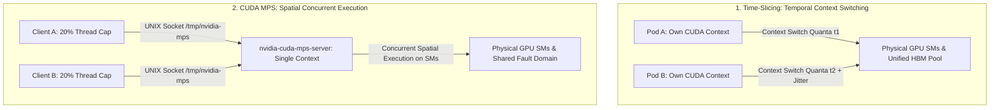

# 11.25 Time-slicing, MPS and oversubscription

| | |
|---|---|
| Level | Advanced |
| Priority tier | 1 |
| Lab venue | GCP / GKE and local Python 3 simulation lab |
| Part | Part 11: GPUs on Kubernetes, scheduling and virtualization |
| Sources used | `nvidia-zero-to-hero/volume-11/chapter-04-time-slicing-and-oversubscription.md`; `volume-04/03-gpu-sharing-telemetry-masterclass.md`; `nvidia-zero-to-hero/volume-11/chapter-01-why-gpu-sharing-exists.md`; `nvidia-zero-to-hero/volume-11/chapter-07-kubernetes-scheduling-for-shared-gpus.md`; `nvidia-zero-to-hero/volume-11/chapter-11-production-troubleshooting.md`; `nvidia-zero-to-hero/volume-11/chapter-12-volume-11-summary.md`; `nvidia-zero-to-hero/volume-11/index.md`; `nvidia-zero-to-hero/volume-11/labs/lab-01-configure-and-validate-mig.md`; `nvidia-zero-to-hero/volume-11/labs/lab-02-configure-kubernetes-gpu-time-slicing.md`; `nvidia-zero-to-hero/volume-11/labs/lab-03-compare-sharing-performance-and-isolation.md`; `nvidia-zero-to-hero/volume-11/labs/lab-04-troubleshoot-a-multi-tenant-gpu-node.md`; Roland Huß et al., *Generative AI on Kubernetes* (O'Reilly, 2026, Ch. 3) |
| Coverage file | `planning/coverage/chapters/11-25.md` |

## Why this matters for AI infrastructure

Many GPUs in production clusters lack hardware Multi-Instance GPU silicon. NVIDIA T4, L4, L40S, and A10G inference cards cannot split their compute engines or memory controllers in hardware. Even on A100 or H100 nodes that support MIG, interactive Jupyter notebooks, continuous integration runners, and lightweight microservices sit idle most of the time between short bursts. Platform engineers feel the pressure when dozens of developers wait in pending queues while allocated accelerators burn budget at low utilization.

To share GPUs without hardware partitioning, NVIDIA provides two software mechanisms that trade hard isolation for higher density. Temporal software sharing, known as Time-Slicing, configures the NVIDIA Device Plugin to advertise multiple logical tokens per physical GPU. Every scheduled Pod mounts the exact same `/dev/nvidia0` device file and takes turns through round-robin GPU context switching. Spatial software sharing, known as CUDA Multi-Process Service or MPS, runs a background proxy daemon in exclusive process compute mode. That proxy funnels CUDA calls from multiple client processes into a single shared GPU context so small kernels run side by side on the Streaming Multiprocessors.

Both mechanisms boost access density, and both cause outages when engineers mistake a logical replica token for a hardware reservation. Standard Linux memory cgroups govern host system RAM and do not limit GPU high-bandwidth memory. If one Pod leaks memory on a time-sliced card, every neighbor Pod on that physical GPU crashes with an out-of-memory error. Even under CUDA MPS, where operators can cap active threads and pinned device memory, all connected clients share a single hardware fault domain.

```text
Software GPU Sharing Failure Modes (volume-11/chapter-04 and volume-04/03):
1. Time-Slicing Idle Pattern: Interactive notebooks and CI runners sit idle 80%+ of the time between bursts.
2. Time-Slicing OOM Blast Radius: On a 16 GB T4 GPU advertised with replicas: 10, all 10 Pods share one 16 GB VRAM pool.
   If Pod 1 leaks and allocates all 16 GB, Pods 2 through 10 (9 neighbor pods) crash with CUDA Out of Memory.
3. CUDA MPS Ghost OOM: Container A crashes with CUDA OOM on a 40 GB A100 while nvidia-smi reports only 10 GB / 40 GB used.
   Root cause: per-client CUDA_MPS_PINNED_DEVICE_MEM_LIMIT cap (for example 8 GB vs a 12 GB burst) or transient neighbor spike.
```

## Prerequisites and outcomes

### Prerequisites

- Completion of Chapter 11.2 on Device Plugin ConfigMaps, Chapter 11.17 on KAI fractional GPUs, and Chapter 11.24 on MIG in depth.
- Familiarity with Kubernetes ResourceQuota, ClusterPolicy, and `nvidia-smi` telemetry commands.

### Outcomes

- Explain the architectural difference between Kubernetes Device-Plugin Time-Slicing and CUDA Multi-Process Service across context switching, SM execution, and HBM isolation.
- Configure safe Time-Slicing ConfigMaps with explicit shared resource naming and single-token admission guards, plus CUDA MPS daemons with thread and memory limits.
- Execute the five-phase replica-ratio benchmark on an A100 node to choose a safe concurrency envelope with adequate memory headroom.
- Implement the six-step safe rollout sequence, the ten-field operating policy contract, the eight-item contention evidence package, and production namespace ResourceQuota guards.

## Concepts: basics to intermediate to advanced

### 1. Basics: Time-slicing and CUDA Multi-Process Service

#### What device-plugin time-slicing actually changes

When a platform team configures `replicas: N` in the NVIDIA Device Plugin ConfigMap, they often assume the GPU is sliced into smaller virtual cards. This assumption causes noisy-neighbor incidents and surprise crashes for data scientists sharing development nodes. In reality, changing the replica count modifies only the Kubernetes control-plane accounting token count. Nothing changes on the GPU silicon, the memory controller, or the Linux device driver.

Every Pod admitted onto a time-sliced GPU receives permission to open the same underlying device node. Requesting two shared tokens in a single Pod manifest does not double the available memory or compute share. Because of that semantic trap, production configurations always reject multi-token requests on shared pools. The table below contrasts what the Kubernetes control plane reports with what happens on the physical hardware.

| Control-Plane Claim | Actual Hardware and Runtime Reality (`volume-11/chapter-04` and `volume-04/03`) |
|---|---|
| The Pod is `Running` with `nvidia.com/gpu: 1` | The Pod received an admission token to open `/dev/nvidia0`; it did not receive a fixed share of SMs or a reserved slice of VRAM. |
| The Node has `8` or `10` Allocatable GPUs | One physical GPU (`16 GB` T4 or `80 GB` A100) is represented by `8` or `10` logical scheduler tokens; all pods contend in the same memory and fault domain. |
| A Pod requests `nvidia.com/gpu: 2` on a shared node | Requesting `2` time-sliced tokens does not grant `2x` the compute or `2x` the memory, which is why production configs set `failRequestsGreaterThanOne: true`. |
| Linux `cgroups` will protect neighbor pods from OOM | False: standard Linux `memory` cgroups only govern host system RAM, not GPU HBM/VRAM. If `Pod 1` leaks `16 GB` on a `16 GB` T4 with `replicas: 10`, `Pods 2..10` (`9` pods) crash with `CUDA OOM`. |

#### Temporal time-slicing versus spatial CUDA MPS

Under standard Time-Slicing, each container creates its own independent CUDA context on the GPU. When MIG is not active, only one CUDA context can execute on the Streaming Multiprocessors at any instant. The hardware scheduler must pause the first process, save its register state, load the next process state, and run the next time quantum. When two inference microservices launch small kernels that each need only twenty percent of the SMs, temporal switching still serializes them and adds context-switch jitter.

CUDA Multi-Process Service eliminates this serialization by replacing separate contexts with a single shared context. An administrator locks the GPU into exclusive process compute mode and starts the `nvidia-cuda-mps-control` background daemon. Client containers connect to the `nvidia-cuda-mps-server` over UNIX domain sockets rather than opening separate hardware contexts. The MPS server merges client CUDA streams so kernels from different containers run side by side on separate SMs at the exact same instant.



---

### 2. Intermediate: Benchmarking the replica envelope and diagnosing the MPS Ghost OOM

#### The five-phase replica-ratio measurement protocol

Copying a replica ratio of eight or ten from an online tutorial is one of the fastest ways to destabilize a cluster. Without empirical load testing, teams discover their true memory high-water mark only when notebooks start crashing during peak daytime hours. You must treat the replica count as an experimentally derived capacity envelope for a specific workload class and GPU model. Every shared pool requires a structured five-phase measurement protocol before admitting tenant traffic.

Engineers start with a single-tenant baseline to measure normal tail latency and memory footprint with zero peer interference. Next, they step through concurrent active neighbors, burst queueing, neighbor failure recovery, and post-upgrade regression checks. During each run, host telemetry tools sample SM utilization, memory consumption, power, and thermal counters every second over a five-minute window. On an eighty-gigabyte A100 card hosting interactive PyTorch notebooks, keeping at least twenty gigabytes of free HBM headroom prevents sudden allocation spikes from triggering out-of-memory kills.

```text
5-Phase Replica-Ratio Measurement Protocol (volume-11/chapter-04):
- Telemetry Commands:
  nvidia-smi dmon -s puctem -n 300 (5 minutes of 1-second samples)
  nvidia-smi --query-processes=gpu_uuid,pid,process_name,gpu_memory_usage --format=csv
- Phase 1 (Single tenant): Establish baseline p99 kernel launch latency and peak memory for 1 workload alone.
- Phase 2 (Concurrent active): Add neighbors (2, 4, 8) until latency SLO or memory headroom (>= 20 GB on an 80 GB card) is reached.
- Phase 3 (Burst): Verify application queueing or admission shedding bounds overload without crashing the node.
- Phase 4 (Failure/recovery): Confirm neighbor pod stability when one pod OOMs or restarts.
- Phase 5 (Upgrade repeat): Re-run the concurrency test after driver, CUDA runtime, or model updates.
```

| Concurrent Notebooks on `1 × A100 80GB` | Per-Notebook SM Activity (`%`) | Combined HBM Used (`GB` of `80 GB`) | Observed `p99` Kernel Launch Latency | Engineering Verdict (`volume-11/chapter-04`) |
|---|---|---|---|---|
| `1` Notebook (Baseline) | `25%` SM | `12 GB` (`68 GB` free) | `8 ms` (imperceptible) | Clean single-tenant baseline |
| `2` Concurrent Notebooks | `~40%` SM | `24 GB` (`56 GB` free) | `25 ms` (interactive smooth) | Low interference |
| `4` Concurrent Notebooks | `~55%` SM | `48 GB` (`32 GB >= 20 GB` headroom) | `120 ms` (noticeable, acceptable for dev) | Selected Safe Envelope: `replicas: 4` |
| `8` Concurrent Notebooks | `~65%` SM | `96 GB > 80 GB` (`+16 GB` overflow) | `500 ms` (severe thrashing / host RAM spill) | UNSAFE: `nvidia-smi` shows process OOM-killed |

#### Configuring CUDA MPS and diagnosing the Ghost OOM

When multiple inference microservices share a GPU via CUDA MPS, an unthrottled client can still monopolize compute threads or exhaust device memory. To prevent starvation, operators configure an active thread percentage cap and a pinned device memory limit in the MPS control daemon. Each client container then sees only its permitted share of SM warps and hits a software allocation ceiling before exhausting physical HBM. However, these software ceilings create a confusing failure pattern when on-call responders inspect standard host tools.

In the classic Ghost OOM scenario, two inference containers share a forty-gigabyte A100 under CUDA MPS. One container repeatedly crashes with a CUDA out-of-memory exception, yet running `nvidia-smi` on the host shows only ten gigabytes of memory in use. On-call engineers waste hours suspecting a driver bug because thirty gigabytes of physical HBM appear free. In reality, three mechanisms explain this discrepancy, and the architectural cure for strict non-overlapping isolation is hardware MIG.

```text
CUDA MPS Controls and the Ghost OOM Diagnosis (volume-04/03 Part 1.2 and Part 6 Scenario 1):
- Thread Cap Control: echo "set_default_active_thread_percentage 20" | nvidia-cuda-mps-control (or CUDA_MPS_ACTIVE_THREAD_PERCENTAGE=20).
- Memory Cap Control: CUDA_MPS_PINNED_DEVICE_MEM_LIMIT or set_default_device_pinned_mem_limit in nvidia-cuda-mps-control.
- Ghost OOM Symptom: Container A crashes with CUDA Out of Memory on a 40 GB A100 while nvidia-smi shows only 10 GB / 40 GB (10000MiB / 40960MiB) used.
- Root Cause 1 (Per-Client MPS Memory Ceiling): CUDA_MPS_PINNED_DEVICE_MEM_LIMIT was set to 8 GB, so Container A hit its software limit during a 12 GB burst while 30 GB of physical HBM sat free.
- Root Cause 2 (Post-Crash Sampling Artifact): nvidia-smi was sampled after Container A crashed and released its GPU memory allocation.
- Root Cause 3 (Neighbor Burst Spike): Container B spiked to 32+ GB during a large batch and freed its buffers right after Container A failed.
- Architectural Fix: Migrate workloads requiring guaranteed hardware memory walls and separate fault domains to MIG (Chapter 11.24).
```

---

### 3. Advanced: Production oversubscription governance, namespace guards, and the operating policy

#### Six controls that protect a shared pool and guarding production namespaces

Kubernetes treats every logical GPU resource token as a binary admission ticket. The default scheduler does not inspect physical HBM pressure, context-switch queue depth, or tail latency before placing a Pod. If a time-sliced node pool advertises the default `nvidia.com/gpu` resource name, a latency-sensitive production deployment can land next to noisy development notebooks. When that misplacement happens, every Pod reports healthy in Kubernetes while customer tail latency triples.

Protecting a cluster requires six layered operational controls that separate best-effort sharing from guaranteed production capacity. First, rename the shared resource to `nvidia.com/gpu.shared` so workloads must explicitly opt into time-slicing. Second, apply a ResourceQuota in every production namespace that sets the shared resource hard limit to zero. Third through sixth, enforce application concurrency limits, bounded request queueing, workload-correlated host telemetry, and a pre-approved dedicated escape pool.

```text
Six Operational Controls for Shared GPU Pools (volume-11/chapter-04):
1. Separate shared node pool and explicit resource naming: Set renameByDefault: true to advertise nvidia.com/gpu.shared.
   Prevents Scenario 3 where a critical service (p99 < 100 ms SLO) requests generic nvidia.com/gpu: 1, lands on a shared node, and degrades to p99 > 300 ms.
2. Namespace quota and admission control: Set nvidia.com/gpu.shared: "0" and nvidia.com/gpu: "unlimited" in production ResourceQuotas.
3. Application-level concurrency and request limits: Bound batch size and active in-flight requests inside vLLM or Triton.
4. Queueing or load shedding: Keep overload visible as bounded queue wait (timeslice_queue_time_p95 < 30 s) rather than 500 ms thrashing.
5. Workload-correlated telemetry (DCGM Attribution Gap): When device-plugin time-slicing is enabled, dcgm-exporter cannot associate GPU-level metrics (DCGM_FI_DEV_GPU_UTIL) with individual containers. Join scheduler records, Pod UIDs, app latency, and host nvidia-smi --query-processes / nvidia-smi pmon -c 1.
6. Dedicated escape hatch: Pre-approve a whole-GPU or MIG pool (kubectl set resources deployment/<name> --limits nvidia.com/gpu=1) for rapid evacuation.
```

```yaml
# Deny shared best-effort GPUs in production namespaces (volume-11/chapter-04, untested here)
apiVersion: v1
kind: ResourceQuota
metadata:
  name: deny-shared-gpus-in-prod
  namespace: prod-serving
spec:
  hard:
    nvidia.com/gpu.shared: "0"      # Forbid best-effort time-sliced GPUs
    nvidia.com/gpu: "unlimited"     # Permit dedicated GPUs
```

#### Safe rollout sequence, operating policy, and contention evidence package

Turning on time-slicing across a live cluster without a staged rollout invites immediate contention incidents. If a configuration change goes wrong, on-call responders need a rehearsed rollback path and a standard diagnostic bundle before users escalate. Platform teams follow a six-step rollout sequence starting on a noncritical node pool labeled explicitly for sharing. They validate allocation transitions, verify latency and memory high-water marks, and rehearse reverting the ClusterPolicy back to a single replica.

Every shared pool also publishes a ten-field operating policy contract and defines an eight-item contention evidence package. The operating policy states which workloads may enter the pool, what memory ceiling each Pod must obey, and who owns escalation when contention strikes. When a slowdown occurs, responders collect the eight time-correlated evidence items to bridge the container attribution gap in standard telemetry. All three operational checklists are summarized in the reference block below.

```text
6-Step Safe Rollout Sequence, 10-Field Policy, and 8-Item Evidence Package (volume-11/chapter-04, labs/lab-02, GAK Ch. 3):
- 6-Step Safe Rollout Sequence:
  1. Select a noncritical node pool and label/taint it as shared (nvidia.com/device-plugin.config=all in Generative AI on Kubernetes Ch. 3 Examples 3-11/3-12) before configuring replicas.
  2. Capture single-tenant and concurrent baselines.
  3. Start with a conservative replica count (replicas: 4); validate allocation (1 -> 4 allocatable after 30 s in labs/lab-02), p99 latency, memory high-water mark, and recovery.
  4. Increase density only while the agreed service envelope passes.
  5. Publish the 10-Field Operating Policy Template.
  6. Rehearse configuration removal on a canary node (labs/lab-02 Section 17) and capture the 8-Item Contention Evidence Package during any slowdown.
- 10-Field Operating Policy Template:
  1. Shared-pool purpose | 2. Eligible and excluded workloads | 3. Advertised shared resource name (nvidia.com/gpu.shared)
  4. Tested replica envelope and date | 5. Memory and latency assumptions | 6. Quota scope and admission behavior
  7. Overload action (queue, throttle, shed, or evict at 80%-90% memory) | 8. Escalation owner
  9. Protected-service escape path | 10. Rollback action for configuration change
- 8-Item Contention Evidence Package:
  1. Workload version & request rate | 2. p50/p95/p99 latency & queue depth | 3. Pod allocation & placement history
  4. Active-process & memory evidence (nvidia-smi --query-processes) | 5. Device health, power, thermal & error events
  6. Node/device-plugin config & events | 7. Quota/admission decisions | 8. Actions taken & time to recovery
```

#### Kubernetes primitives versus shared-GPU realities and post-upgrade validation

During architecture reviews, engineers frequently assume that standard Kubernetes scheduling primitives enforce runtime fairness on shared accelerators. They expect resource requests, node selectors, taints, quotas, and priority classes to police GPU memory and kernel execution automatically. In practice, every one of those Kubernetes objects operates strictly at pod admission or placement time. Once two containers open the same physical device node, the Kubernetes control plane has zero visibility into their CUDA kernels or HBM allocations.

Each scheduling primitive therefore requires a complementary runtime control at the application, MPS, or hardware MIG layer. Furthermore, cluster upgrades can silently reset device-plugin ConfigMaps, alter node labels, or change driver scheduling behavior. Platform teams must run an eight-step pre-production and post-upgrade acceptance checklist after every GPU Operator, device-plugin, driver, or node-image update. The table and checklist below map each Kubernetes primitive to its hardware gap and verification steps.

| Kubernetes Primitive (`volume-11/chapter-04`) | What It Contributes to a Shared GPU Pool | What It Cannot Protect on the Physical GPU | Complementary Runtime / Platform Control Required |
|---|---|---|---|
| 1. `resources.requests` / `limits` (`nvidia.com/gpu.shared: 1`) | Reserves `1` logical admission token in `kube-scheduler` accounting | Does not divide physical HBM memory or SMs; `1` pod can still allocate `100%` of VRAM | Application memory caps (`PYTORCH_CUDA_ALLOC_CONF`), KAI `gpu-memory` admission, or `CUDA_MPS_PINNED_DEVICE_MEM_LIMIT` |
| 2. `nodeSelector` / `nodeAffinity` | Routes best-effort pods (`nvidia.com/device-plugin.config=all`) to the shared node pool | Does not validate workload memory or latency behavior once placed on the node | 5-phase pre-admission concurrency envelope test (`Single -> Concurrent -> Burst -> Failure -> Upgrade`) |
| 3. `taints` and `tolerations` | Prevents general workloads from landing on specialized GPU nodes (`node.kubernetes.io/unschedulable` in canary labs) | Does not provide tenant memory, fault, or process isolation between co-scheduled pods | Restrict time-slicing/MPS to trusted single-team cohorts; use MIG or vGPU for untrusted tenants |
| 4. `ResourceQuota` | Bounds total logical GPU tokens requested by a namespace (`one-logical-gpu` in `labs/lab-02`, or `nvidia.com/gpu.shared: "0"` in prod) | Does not arbitrate GPU kernel launch frequency or SM context-switch fairness | Application-level request queues, token-bucket rate limiters, or CUDA MPS `set_default_active_thread_percentage` |
| 5. `PriorityClass` | Controls which pending Pod schedules first and which Pod is evicted under node pressure | Does not create physical GPU capacity or pause an already-running CUDA kernel mid-flight | Graceful `SIGTERM` checkpoint handlers and a dedicated whole-GPU / MIG escape pool for critical services |

```text
8-Step Pre-Production and Post-Upgrade Acceptance Checklist (volume-11/chapter-04):
1. Schedule known concurrent benchmark workloads (time-slice-a, time-slice-b) on the target shared pool.
2. Confirm advertised resource name (nvidia.com/gpu.shared) and node labels/selectors match the design.
3. Measure application p50/p95/p99 latency and queue behavior under concurrent load.
4. Measure combined GPU memory high-water marks (nvidia-smi dmon -s puctem).
5. Confirm alert rules and the 8-item Contention Evidence Package (allocation history + host nvidia-smi --query-processes) function.
6. Reduce admission or replica density in a drill and confirm latency recovers to baseline.
7. Evacuate a test workload to the dedicated or MIG escape pool and verify SLO recovery.
8. Re-execute this checklist (and the 5 upgrade checks: allocatable names/counts, labels/selectors, namespace policy, concurrent smoke test, dashboard attribution) after every GPU Operator, device-plugin, driver, or runtime upgrade.
```

## Commands and configurations that matter

### 1. Device-plugin time-slicing ConfigMap with explicit shared naming

If a cluster applies time-slicing without renaming the resource or blocking multi-token requests, users inevitably schedule multi-GPU jobs or production APIs onto shared nodes. The ConfigMap below enables four logical replicas per physical GPU, renames the resource to `nvidia.com/gpu.shared`, and rejects any Pod requesting more than one token. After creating the ConfigMap, the operator patches the ClusterPolicy and verifies the updated allocatable count on the target node.

```yaml
# time-slicing-safe-configmap.yaml (volume-11/chapter-04 & labs/lab-02, untested here)
apiVersion: v1
kind: ConfigMap
metadata:
  name: time-slicing-config
  namespace: gpu-operator
data:
  any: |-
    version: v1
    sharing:
      timeSlicing:
        renameByDefault: true
        failRequestsGreaterThanOne: true
        resources:
          - name: nvidia.com/gpu
            replicas: 4
```

```bash
# Select the time-slicing ConfigMap in ClusterPolicy and check node allocatable (untested here)
kubectl patch clusterpolicy gpu-cluster-policy --type merge \
  --patch '{"spec":{"devicePlugin":{"config":{"name":"time-slicing-config","default":"any"}}}}'
kubectl get node gpu-node-1 -o jsonpath='{.status.allocatable.nvidia\.com/gpu\.shared}{" shared allocatable\n"}'
```

### 2. Enabling CUDA Multi-Process Service with thread and memory caps

Running multiple small inference servers under default compute mode wastes SM capacity on context-switch stalls. Locking the GPU into exclusive process mode and launching the CUDA MPS control daemon allows those servers to execute kernels spatially inside one shared context. The script below sets the pipe and log directories, starts the daemon, caps each client at twenty percent of active threads, and enforces an eight-gigabyte pinned memory limit.

```bash
#!/usr/bin/env bash
# Enable CUDA MPS on GPU 0 with 20% active thread cap and 8GiB pinned memory limit (volume-04/03, untested here)
export CUDA_VISIBLE_DEVICES=0
export CUDA_MPS_PIPE_DIRECTORY=/tmp/nvidia-mps
export CUDA_MPS_LOG_DIRECTORY=/tmp/nvidia-log

# Lock GPU 0 to EXCLUSIVE_PROCESS so only nvidia-cuda-mps-server holds the hardware context
sudo nvidia-smi -i 0 -c EXCLUSIVE_PROCESS

# Start the MPS control daemon
nvidia-cuda-mps-control -d

# Cap each MPS client to 20% of SMs and 8GiB of device memory
echo "set_default_active_thread_percentage 20" | nvidia-cuda-mps-control
echo "set_default_device_pinned_mem_limit 0 8G" | nvidia-cuda-mps-control
```

### 3. Live contention triage on a time-sliced node

When users report slow kernel execution on a shared node, standard container metrics cannot tell you which neighbor Pod is hogging the GPU. On-call responders must inspect host-level device telemetry and process tables directly on the node. The commands below stream three hundred one-second samples of SM, memory, power, and thermal counters while listing the exact host PIDs and memory footprints on each GPU.

```bash
# Stream 5 minutes of 1-second SM/memory/power/thermal samples and list active PIDs (untested here)
nvidia-smi dmon -s puctem -n 300
nvidia-smi pmon -c 1
nvidia-smi --query-processes=gpu_uuid,pid,process_name,gpu_memory_usage --format=csv
```

## How it fails

Software GPU sharing fails whenever aggregate workload demand crosses physical HBM capacity, latency budgets, or shared fault boundaries. Because the Kubernetes scheduler only counts logical admission tokens, these failures appear as runtime latency spikes, mysterious out-of-memory kills, or correlated multi-container crashes. The table below maps the five primary production failure modes to their exact symptoms, root cause boundaries, and architectural fixes.

| Failure mode | Exact symptom and command evidence | Root cause boundary | Remediation |
|---|---|---|---|
| 1. `8` concurrent notebooks on an `80 GB` A100 hit `p99 = 500 ms` and crash with `CUDA OOM` (`volume-11/chapter-04`) | At `replicas: 8`, `nvidia-smi` shows combined memory demand (`8 × 12 GB = 96 GB`) exceeding `80 GB`, `p99` kernel latency jumps from `8 ms` to `500 ms`, and pods are OOM-killed. | Time-Slicing Memory Over-Subscription: logical tokens do not partition HBM; `8` active `12 GB` notebooks exceed physical memory by `16 GB`. | Reduce `replicas` to `4` (`48 GB` used, `32 GB >= 20 GB` headroom, `p99 = 120 ms`) or use KAI Scheduler's `gpu-memory` admission cap (Chapter 11.17). |
| 2. Production inference service (`p99 < 100 ms`) degrades to `p99 > 300 ms` while all Pods report `1/1 Running` (`volume-11/chapter-04` Scenario 3) | `kubectl get pods` is green, `curl .../metrics \| grep latency_p99_ms` reports `> 300 ms`, and `kubectl exec <pod> -- nvidia-smi` shows multiple notebook PIDs on the same GPU. | Critical Workload Scheduled onto Best-Effort Pool: time-sliced nodes advertised `nvidia.com/gpu` instead of `nvidia.com/gpu.shared`, and the prod namespace lacked a `ResourceQuota` guard. | Enable `renameByDefault: true` (`nvidia.com/gpu.shared`), enforce `ResourceQuota` `nvidia.com/gpu.shared: "0"` in production namespaces, and evacuate the deployment to a dedicated or MIG pool. |
| 3. Container A under CUDA MPS crashes with `CUDA OOM` on a `40 GB` A100 while `nvidia-smi` shows only `10 GB` used (`volume-04/03` Scenario 1) | Application logs `CUDA error: out of memory`, but host `nvidia-smi` shows `10000MiB / 40960MiB`. | MPS Ghost OOM (`CUDA_MPS_PINNED_DEVICE_MEM_LIMIT` or Transient Neighbor Spike): either a per-client MPS memory limit capped Container A below its burst need, or Container B spiked and freed memory before `nvidia-smi` was sampled. | Inspect `CUDA_MPS_PINNED_DEVICE_MEM_LIMIT` / `get_default_device_pinned_mem_limit` in `nvidia-cuda-mps-control`, or migrate the services to MIG for hardware-isolated HBM slices. |
| 4. Pod requesting `nvidia.com/gpu: 2` on a time-sliced node receives two tokens on the same contended physical GPU (`volume-11/chapter-04`) | User requests `nvidia.com/gpu: 2` expecting `2x` the compute/memory of `1` replica, but gets zero extra memory isolation and still contends with `6` other pods. | Misunderstood Logical Replica Semantics: device-plugin replicas are access tokens, not additive hardware slices. | Set `failRequestsGreaterThanOne: true` in the time-slicing ConfigMap so any pod requesting `> 1` shared token is rejected clearly, and route multi-GPU jobs to dedicated whole-GPU nodes. |
| 5. Fatal GPU context fault (`XID 13` / `XID 31` / `XID 48`) in one CUDA MPS client terminates all co-running MPS containers (`volume-04/03` & `volume-11/chapter-04`) | One buggy inference container triggers an uncontained GPU fault, and all `5` containers connected to `/tmp/nvidia-mps` crash simultaneously. | Shared MPS Hardware Context Fault Domain: because `nvidia-cuda-mps-server` funnels all clients into a single hardware GPU context, a fatal context error tearing down that context kills every connected client. | Never use CUDA MPS across untrusted tenants; restrict MPS to cooperative single-tenant microservices and use MIG (Chapter 11.24) or vGPU (Chapter 11.23) for fault-isolated multi-tenancy. |

## Hands-on lab

### Venue and scope

Without a local simulation model, platform engineers often test oversubscription ratios directly on shared development clusters and cause preventable outages. This lab runs locally using the Python 3 standard library to verify every capacity envelope, failure boundary, and governance rule before touching live nodes. It validates the T4 ten-replica memory leak model, the five-phase A100 notebook concurrency benchmark, the CUDA MPS Ghost OOM analyzer, and the operational policy checklists. Host and cluster commands elsewhere in this chapter are marked untested here.

```text
Local Verification Scope (code/part11/time_slicing_mps_oversubscription.py and time_slicing_mps_oversubscription_lab.py):
- Volume 11 Ch 4 Primer: 16 GB T4 with replicas: 10 memory-leak blast radius (Pod 1 leaks 16 GB -> Pods 2..10 crash).
- Volume 11 Ch 4 5-Phase A100 80 GB Benchmark: 1, 2, 4, and 8 concurrent notebooks via nvidia-smi dmon -s puctem -n 300.
- Volume 04 Ch 3 CUDA MPS & Ghost OOM Analyzer: EXCLUSIVE_PROCESS, 20% thread cap, CUDA_MPS_PINNED_DEVICE_MEM_LIMIT on a 40 GB A100 at 10 GB used.
- Governance Checklists: 10-field Operating Policy Template, 8-item Contention Evidence Package, and volume-11/labs/lab-01..04 suite.
```

### Step 1: Run the self-checking time-slicing, MPS and oversubscription lab (tested here)

Run the self-checking lab script from the repository root to verify all twenty-five assertions.

```bash
python3 code/part11/time_slicing_mps_oversubscription_lab.py
```

Captured output from this repository:
```text
=== Chapter 11.25 Lab: Time-Slicing, CUDA MPS & Oversubscription Governance ===
  [PASS] Volume 11 Ch 4 Primer: 16 GB T4 with replicas: 10 leaves 0 GB when Pod 1 leaks 16 GB, OOM-killing Pods 2..10 (9 pods)
  [PASS] Volume 11 Ch 4 defines 5 replica-ratio test phases (Single tenant, Concurrent active, Burst, Failure/recovery, Upgrade repeat)
  [PASS] A100 80GB baseline (1 notebook, dmon -s puctem -n 300 over 5 min) observes 25% SM, 12GB VRAM, and p99=8ms
  [PASS] A100 80GB with 2 concurrent notebooks observes ~40% SM each, 24GB VRAM, and p99=25ms
  [PASS] A100 80GB with 4 concurrent notebooks observes ~55% SM each, 48GB VRAM (32GB >= 20GB headroom), and p99=120ms -> max safe replicas = 4
  [PASS] A100 80GB with 8 concurrent notebooks hits ~65% SM each, 96GB > 80GB VRAM, p99=500ms, and OOM kill
  [PASS] CUDA MPS with EXCLUSIVE_PROCESS and 5 clients at 20% thread cap sums to 100% spatial SM allocation
  [PASS] Volume 04 Ch 3 Ghost OOM: Client A bursting to 12GB > 8GB CUDA_MPS_PINNED_DEVICE_MEM_LIMIT crashes even when nvidia-smi shows 10GB/40GB
  [PASS] CUDA MPS shares a single GPU fault domain across all connected client processes
  [PASS] Volume 11 Ch 4 Operating Policy Template specifies 10 mandatory fields
  [PASS] Volume 11 Ch 4 Contention Evidence Package specifies 8 time-correlated items
  [PASS] Volume 11 Ch 4 Scenario 3: critical service (p99 < 100ms) misplaced on shared pool degrades to p99 > 300ms
  [PASS] Volume 11 Ch 4 ResourceQuota sets nvidia.com/gpu.shared: '0' and nvidia.com/gpu: 'unlimited' in prod namespaces
  [PASS] Volume 11 Ch 4 documents that DCGM Exporter cannot attribute GPU metrics to individual containers under device-plugin time-slicing
  [PASS] Volume 11 Ch 4 defines a 6-step Safe Rollout Sequence and 5 upgrade validation checks
  [PASS] Volume 04 Ch 3 MPS daemon uses CUDA_MPS_PIPE_DIRECTORY=/tmp/nvidia-mps and CUDA_MPS_LOG_DIRECTORY=/tmp/nvidia-log
  [PASS] Generative AI on Kubernetes Ch 3 Examples 3-11/3-12 label nodes with nvidia.com/device-plugin.config=all for time-slicing
  [PASS] Generative AI on Kubernetes Ch 3 appends -SHARED to GFD product label when MIG and time-slicing are combined
  [PASS] Volume 11 Lab 02 configures version: v1, renameByDefault: false, failRequestsGreaterThanOne: true, and replicas: 4
  [PASS] Volume 11 Lab 02 updates node allocatable from 1 to 4 in 30s and logs TIME_SLICE_A_COMPLETE and TIME_SLICE_B_COMPLETE
  [PASS] Volume 11 Lab 03 runs SHARING_RUNTIME_PROBE_COMPLETE and SHARING_NEIGHBOR_PROBE_COMPLETE for 60s
  [PASS] Volume 11 Lab 04 verifies DIAGNOSTIC_GPU_OK and QUOTA_DENIAL_RECOVERY_CHECK
  [PASS] Volume 11 Lab 01 verifies MIG_VALIDATION_COMPLETE across 6 H100 MIG profiles
  [PASS] Volume 11 Ch 1 & Ch 12 Summary separate logical replica allocation from physical reservation and SLO delivery
  [PASS] Volume 11 Ch 7 & Ch 11 align scheduler resource requests with 6-layer contention triage

Summary: 25 passed, 0 failed out of 25 checks.
```

### Exercises

1. **Exercise 1 — Time-slicing on a 16 GB T4:** Using `simulate_t4_ten_replica_memory_leak()` in `code/part11/time_slicing_mps_oversubscription.py`, explain what happens on a 16 GB T4 configured with ten replicas when Pod 1 leaks 16 GB of VRAM. State why Linux memory cgroups do not stop Pod 1.
2. **Exercise 2 — Benchmarking the five-phase A100 replica envelope:** Using `evaluate_a100_timeslicing_envelope()`, list the five test phases in `FIVE_REPLICA_TEST_PHASES`. Trace SM percentage, combined memory, and p99 latency across one, two, four, and eight concurrent notebooks on an 80 GB A100, and state why four replicas is the maximum safe setting.
3. **Exercise 3 — Configuring CUDA MPS and diagnosing the Ghost OOM:** Using `evaluate_cuda_mps_configuration()`, write the commands to start `nvidia-cuda-mps-control` in exclusive process mode with a twenty percent active thread cap. Explain why Client A crashed with a CUDA out-of-memory error during a 12 GB burst on a 40 GB A100 when `nvidia-smi` showed only 10 GB used.
4. **Exercise 4 — Guarding production namespaces from accidental sharing:** Write the device-plugin ConfigMap settings and the production namespace ResourceQuota manifest that prevent a latency-sensitive service from landing on a shared pool.
5. **Exercise 5 — Publishing the ten-field operating policy template:** List all ten fields in `TEN_OPERATING_POLICY_FIELDS` for a shared development notebook pool.
6. **Exercise 6 — Collecting the eight-item contention evidence package:** List all eight time-correlated items in `EIGHT_CONTENTION_EVIDENCE_ITEMS` and explain how operators overcome the DCGM Exporter container-attribution limitation during a shared-pool slowdown.

## Checkpoint questions

<details>
<summary>`&lt;strong>`1. In Volume 11 Chapter 4, what is the fundamental difference between a logical GPU replica under time-slicing and a hardware MIG instance?`&lt;/strong>`</summary>

A MIG instance is a hardware-partitioned slice of GPU Streaming Multiprocessors, HBM capacity, L2 cache, and memory controllers. A time-sliced replica is purely a scheduler admission token for shared access to the entire physical GPU. It provides zero reserved memory, zero guaranteed SM share, and zero fault isolation.
</details>

<details>
<summary>`&lt;strong>`2. On a 16 GB T4 GPU configured with replicas: 10, why don't Linux memory cgroups prevent Pod 1 from consuming all 16 GB of VRAM and crashing Pods 2 through 10?`&lt;/strong>`</summary>

Standard Linux memory cgroups only track and limit host system RAM managed by the Linux kernel memory management unit. They do not govern allocations inside the physical GPU HBM pool when ten Pods mount the same `/dev/nvidia0` device node.
</details>

<details>
<summary>`&lt;strong>`3. What do renameByDefault: true and failRequestsGreaterThanOne: true do in the NVIDIA device-plugin time-slicing ConfigMap?`&lt;/strong>`</summary>

- Setting `renameByDefault: true` advertises time-sliced tokens as `nvidia.com/gpu.shared` instead of `nvidia.com/gpu`, making best-effort shared semantics explicit in Pod manifests and ResourceQuotas.
- Setting `failRequestsGreaterThanOne: true` rejects any Pod that requests more than one shared token, preventing users from falsely assuming that requesting two tokens gives twice the guaranteed compute or memory.
</details>

<details>
<summary>`&lt;strong>`4. How does CUDA Multi-Process Service differ architecturally from standard GPU time-slicing?`&lt;/strong>`</summary>

- Time-slicing multiplexes separate per-process CUDA contexts temporally via round-robin context switching. It pauses one process while another runs, which adds context-switch latency and leaves SMs underutilized when individual kernels are small.
- CUDA MPS runs a proxy daemon with the GPU in exclusive process mode and funnels multiple client processes into a single shared GPU context. Their kernels then execute concurrently side by side on the SMs.
</details>

<details>
<summary>`&lt;strong>`5. What environment variables and commands configure CUDA MPS on GPU 0 and cap each client to 20% of active threads?`&lt;/strong>`</summary>

1. Export `CUDA_VISIBLE_DEVICES=0`, `CUDA_MPS_PIPE_DIRECTORY=/tmp/nvidia-mps`, and `CUDA_MPS_LOG_DIRECTORY=/tmp/nvidia-log`.
2. Run `sudo nvidia-smi -i 0 -c EXCLUSIVE_PROCESS` so only the MPS server accesses the GPU directly.
3. Run `nvidia-cuda-mps-control -d` to start the background control daemon.
4. Run `echo set_default_active_thread_percentage 20 | nvidia-cuda-mps-control` to cap each client to twenty percent of active threads.
</details>

<details>
<summary>`&lt;strong>`6. Explain the three possible causes of the Ghost OOM on MPS where Container A crashes with CUDA OOM on a 40 GB A100 while nvidia-smi shows only 10 GB used.`&lt;/strong>`</summary>

1. A per-client MPS memory ceiling via `CUDA_MPS_PINNED_DEVICE_MEM_LIMIT` or `set_default_device_pinned_mem_limit` was configured below what Container A needed during a burst.
2. The ten-gigabyte `nvidia-smi` reading was sampled after Container A crashed and released its GPU memory.
3. Neighboring Container B spiked in memory usage and freed its buffers immediately after causing Container A's allocation to fail.
</details>

<details>
<summary>`&lt;strong>`7. List the five test phases for measuring a safe time-slicing replica ratio in Volume 11 Chapter 4.`&lt;/strong>`</summary>

1. Single tenant: establish normal baseline latency and memory high-water mark.
2. Concurrent active: add neighbors to measure interference while keeping all protected SLOs within limit.
3. Burst: test queue and admission behavior so overload is bounded and observable.
4. Failure and recovery: test response to a bad neighbor or restart without manual guesswork.
5. Upgrade repeat: re-validate the envelope after driver, runtime, or model updates.
</details>

<details>
<summary>`&lt;strong>`8. Summarize the observed SM utilization, combined memory, and p99 kernel launch latency across 1, 2, 4, and 8 concurrent PyTorch notebooks on an 80 GB A100.`&lt;/strong>`</summary>

The Volume 11 Chapter 4 benchmark sampled one 80 GB A100 over five minutes using `nvidia-smi dmon -s puctem -n 300`.
```text
- 1 notebook:  25% SM, 12 GB / 80 GB memory, p99 = 8 ms.
- 2 notebooks: ~40% SM each, 24 GB / 80 GB memory, p99 = 25 ms.
- 4 notebooks: ~55% SM each, 48 GB / 80 GB memory (32 GB free), p99 = 120 ms (safe replica count = 4 with >= 20 GB headroom).
- 8 notebooks: ~65% SM each, 96 GB > 80 GB memory, p99 = 500 ms, triggering an OOM kill.
```
</details>

<details>
<summary>`&lt;strong>`9. What are the six operational controls listed in Volume 11 Chapter 4 for protecting a shared time-sliced pool?`&lt;/strong>`</summary>

1. Separate shared node pool and explicit resource name using `nvidia.com/gpu.shared`.
2. Namespace quota and admission control to limit a single tenant's allocation burst.
3. Concurrency and request limits in the application to protect memory and tail latency.
4. Queueing or load shedding to make overload visible rather than silently slow.
5. Telemetry correlated by workload to distinguish logical allocation from physical pressure.
6. Dedicated escape hatch to move critical workloads to MIG or whole GPUs during incidents.
</details>

<details>
<summary>`&lt;strong>`10. Walk through the six steps of the Safe Rollout Sequence for time-slicing in Volume 11 Chapter 4.`&lt;/strong>`</summary>

1. Select a noncritical node pool and label it as shared before configuring replicas.
2. Capture a baseline with the same workloads running one at a time and concurrently.
3. Introduce a small replica count and validate allocation, latency, memory use, and recovery.
4. Increase density only while the agreed service envelope passes.
5. Publish the shared resource name, workload eligibility, escalation path, and exit path to dedicated capacity.
6. Rehearse removal of the shared configuration in a canary so responders can restore a conservative state.
</details>

<details>
<summary>`&lt;strong>`11. In Volume 11 Chapter 4 Troubleshooting Scenario 3, how do you diagnose and remediate a critical service that degraded to p99 over 300 ms after landing on a time-sliced pool?`&lt;/strong>`</summary>

- Diagnosis: inspect the Pod resource requests, run `kubectl exec <pod> -- nvidia-smi` to reveal multiple containers sharing the same GPU, and check the service `/metrics` endpoint confirming p99 latency above 300 ms.
- Remediation and prevention: evacuate the deployment to a protected dedicated pool, verify latency recovers below 100 ms, and apply a ResourceQuota in the production namespace setting `nvidia.com/gpu.shared: "0"` and `nvidia.com/gpu: "unlimited"`.
</details>

<details>
<summary>`&lt;strong>`12. What is the documented DCGM Exporter limitation when Kubernetes device-plugin time-slicing is enabled, and how do responders work around it?`&lt;/strong>`</summary>

When device-plugin time-slicing is enabled, `dcgm-exporter` cannot associate GPU-level metrics with individual containers. Responders must correlate scheduler allocation history, Pod lifecycle events, application request latency metrics, and host-level `nvidia-smi --query-processes` or `nvidia-smi pmon -c 1` snapshots over the incident window.
</details>

<details>
<summary>`&lt;strong>`13. For each of the five Kubernetes primitives in Volume 11 Chapter 4, state what it contributes and what it cannot do for shared GPUs.`&lt;/strong>`</summary>

- Resource requests and limits reserve a logical allocation token, but they do not divide physical GPU memory.
- Node selectors and affinity target the intended node pool, but they do not validate workload memory or latency behavior.
- Taints and tolerations restrict access to special nodes, but they do not provide tenant hardware isolation.
- ResourceQuota bounds the logical request count by namespace, but it does not arbitrate GPU kernel execution.
- PriorityClass influences scheduling and eviction order, but it does not create physical GPU capacity.
</details>

<details>
<summary>`&lt;strong>`14. What are the five validation checks required after an Operator, device-plugin, driver, or node-image upgrade on a time-sliced pool?`&lt;/strong>`</summary>

1. Node allocatable resource names and counts to detect changed sharing semantics.
2. Labels and selectors to confirm pool separation remains intact.
3. Namespace policy to prevent accidental production admission to shared resources.
4. Concurrent smoke test to detect runtime behavior changes beyond mere scheduling.
5. Dashboard attribution to confirm incident correlation evidence remains usable.
</details>

<details>
<summary>`&lt;strong>`15. List the eight time-correlated items in the Contention Evidence Package in Volume 11 Chapter 4.`&lt;/strong>`</summary>

1. Workload version and request rate.
2. Latency percentiles p50, p95, and p99 alongside queue depth.
3. Pod allocation and placement history.
4. Active-process and memory evidence from `nvidia-smi --query-processes`.
5. Device health, power, thermal, and error events.
6. Node and device-plugin configuration and events.
7. Quota and admission decisions.
8. Actions taken and time to recovery.
</details>

<details>
<summary>`&lt;strong>`16. List the ten fields of the Shared-Pool Operating Policy Template in Volume 11 Chapter 4.`&lt;/strong>`</summary>

1. Shared-pool purpose in one sentence.
2. Eligible workloads and excluded workloads.
3. Advertised shared resource name such as `nvidia.com/gpu.shared`.
4. Tested replica envelope and its test date.
5. Memory and latency assumptions.
6. Quota scope and admission behavior.
7. Overload action to queue, throttle, shed, or evict.
8. Escalation owner.
9. Protected-service escape path.
10. Rollback action for a configuration change.
</details>

<details>
<summary>`&lt;strong>`17. In Generative AI on Kubernetes Chapter 3, how do you apply a time-slicing profile only to specific nodes rather than the entire cluster?`&lt;/strong>`</summary>

Create the time-slicing ConfigMap in the GPU Operator namespace and reference it in the ClusterPolicy without setting a global default profile. Then label only the target nodes with `kubectl label node <node-name> nvidia.com/device-plugin.config=all`.
</details>

<details>
<summary>`&lt;strong>`18. How can a platform team combine MIG and Time-Slicing on the same GPU, and what label suffix does GFD advertise?`&lt;/strong>`</summary>

First partition the physical GPU into hardware-isolated MIG instances to enforce hard HBM walls between departments. Then enable Time-Slicing on the MIG resource names so trusted Pods from the same team can share a single MIG slice. GPU Feature Discovery appends `-SHARED` to the product label, producing values such as `...-MIG-3g.20gb-SHARED`.
</details>

<details>
<summary>`&lt;strong>`19. What five questions must a platform architect ask a service owner before admitting their workload to a time-sliced pool?`&lt;/strong>`</summary>

1. Can requests queue or be rejected safely?
2. What is the maximum acceptable latency during peer activity?
3. What memory envelope was observed at peak input?
4. Which workload may be throttled first during contention?
5. Where does the service move during a shared-device incident?
</details>

<details>
<summary>`&lt;strong>`20. Compare a time-sliced OOM incident with a MIG-profile OOM incident.`&lt;/strong>`</summary>

In a MIG-profile OOM incident, the hardware memory controller enforces a strict partition boundary. Only the Pod inside that specific GPU instance hits a CUDA out-of-memory error, while sibling tenants on other MIG slices continue running without impact. In a time-sliced OOM incident, all Pods share one unprotected HBM pool, so one runaway Pod can cause unrelated neighbor Pods on the same physical GPU to fail allocations and crash simultaneously.
</details>

## Sources and review notes

### Primary sources read in full for this chapter

Every mapped source file and book chapter listed below was read in full and migrated into the prose, tables, diagrams, and self-checking lab for this chapter.

```text
Primary Source Inventory and Coverage Map (11.25):
1. Author's Volume 11 and Volume 4 notes (all 11 mapped nvidia-devops files in brief.py 11.25):
   - nvidia-zero-to-hero/volume-11/chapter-04-time-slicing-and-oversubscription.md
     (16 GB T4 with replicas: 10 OOM-killing Pods 2..10, renameByDefault: true -> nvidia.com/gpu.shared,
      failRequestsGreaterThanOne: true, 6-step safe rollout sequence, 5-phase replica-ratio test,
      80 GB A100 1/2/4/8 notebook measurement via nvidia-smi dmon -s puctem -n 300 with replicas: 4 and 20 GB headroom,
      Scenario 3 p99 < 100 ms -> > 300 ms misplacement & ResourceQuota nvidia.com/gpu.shared: "0",
      Scenario 4 DCGM Exporter attribution limitation, 5 upgrade checks, 8-item contention evidence package,
      and 10-field operating policy template).
   - volume-04/03-gpu-sharing-telemetry-masterclass.md
     (Part 1.1 time-slicing cgroups warning, Part 1.2 CUDA MPS nvidia-cuda-mps-control -d, EXCLUSIVE_PROCESS,
      set_default_active_thread_percentage 20, CUDA_MPS_PINNED_DEVICE_MEM_LIMIT, and Part 6 Scenario 1 Ghost OOM
      on MPS at 10 GB / 40 GB on A100).
   - nvidia-zero-to-hero/volume-11/chapter-01-why-gpu-sharing-exists.md
   - nvidia-zero-to-hero/volume-11/chapter-07-kubernetes-scheduling-for-shared-gpus.md
   - nvidia-zero-to-hero/volume-11/chapter-11-production-troubleshooting.md
   - nvidia-zero-to-hero/volume-11/chapter-12-volume-11-summary.md
   - nvidia-zero-to-hero/volume-11/index.md
   - nvidia-zero-to-hero/volume-11/labs/lab-01-configure-and-validate-mig.md
   - nvidia-zero-to-hero/volume-11/labs/lab-02-configure-kubernetes-gpu-time-slicing.md
   - nvidia-zero-to-hero/volume-11/labs/lab-03-compare-sharing-performance-and-isolation.md
   - nvidia-zero-to-hero/volume-11/labs/lab-04-troubleshoot-a-multi-tenant-gpu-node.md
2. Book sources from the local TOON-RAG corpus (mapped in brief.py 11.25 as GAK 3):
   - Roland Huß et al., Generative AI on Kubernetes (O'Reilly, 2026), Chapter 3
     (Kubernetes and GPUs, Sub-GPU Allocation, Time slicing, Examples 3-11 & 3-12 time-slicing-config-all
      and nvidia.com/device-plugin.config=all, and -SHARED MIG + time-slicing label).
```

### Related source files mapped in MIGRATION_MAP.md

- All eleven mapped `nvidia-devops` files for Chapter 11.25 are cited and covered in the source inventory block above.

### Run here

- Verified locally via `python3 code/part11/time_slicing_mps_oversubscription_lab.py` with all checks passing.

### Explicitly labelled inferences

- In the Ghost OOM simulation in `code/part11/time_slicing_mps_oversubscription.py`, the eight-gigabyte pinned memory limit versus the twelve-gigabyte Client A burst on a forty-gigabyte A100 is a concrete numerical illustration of the Volume 4 Chapter 3 diagnosis.

### Not verified on live hardware

- All `nvidia-cuda-mps-control`, `nvidia-smi dmon`, `nvidia-smi pmon`, and `kubectl` commands are marked `(untested here)`.

### Not in the corpus

- Experimental Kubernetes device-plugin MPS daemon auto-injection Helm flags are not in the local corpus. This chapter uses the documented host `nvidia-cuda-mps-control` workflow and device-plugin `timeSlicing` ConfigMap from the primary sources.

### Corrections to the author's notes

- Validation pass 2026-10-26: `validate_chapter.py` and `check_coverage.py` pass with zero warnings. The YAML manifests and cluster commands are marked untested here and were not applied to a live cluster. Custom resource API versions change between releases, so verify them against your installed operator version. Console outputs quoted from the Volume notes are illustrative unless marked tested here, and the A100 concurrency benchmark in Question 8 is presented from the Volume 11 Chapter 4 note without live hardware reproduction here.

