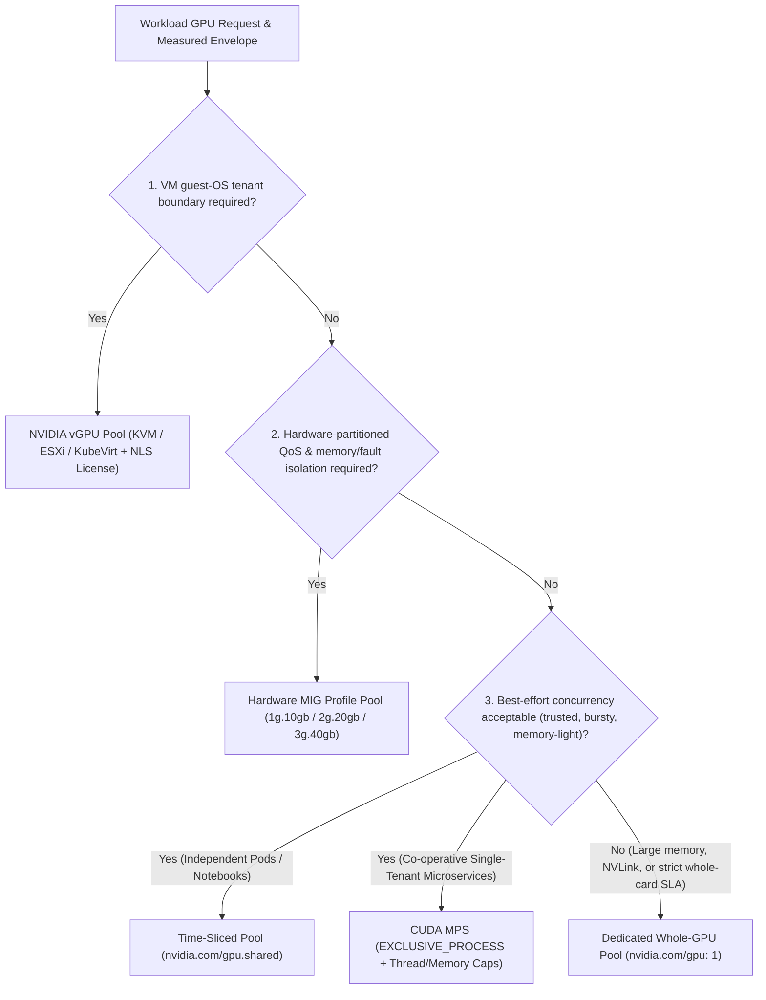
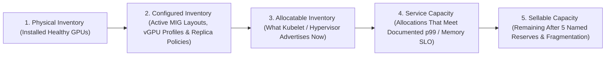

# 11.26 Choosing a GPU sharing model

| | |
|---|---|
| Level | Intermediate |
| Priority tier | 1 |
| Lab venue | GCP / GKE (plus local Python 3 simulation lab) |
| Part | Part 11: GPUs on Kubernetes, scheduling and virtualization |
| Sources used | `nvidia-zero-to-hero/volume-11/chapter-06-comparing-mig-time-slicing-and-vgpu.md`; `nvidia-zero-to-hero/volume-11/chapter-09-capacity-planning-and-chargeback.md`; `volume-04/03-gpu-sharing-telemetry-masterclass.md`; `nvidia-zero-to-hero/volume-11/chapter-01-why-gpu-sharing-exists.md`; `nvidia-zero-to-hero/volume-11/chapter-07-kubernetes-scheduling-for-shared-gpus.md`; `nvidia-zero-to-hero/volume-11/chapter-11-production-troubleshooting.md`; `nvidia-zero-to-hero/volume-11/chapter-12-volume-11-summary.md`; `nvidia-zero-to-hero/volume-11/index.md`; `nvidia-zero-to-hero/volume-11/labs/lab-01-configure-and-validate-mig.md`; `nvidia-zero-to-hero/volume-11/labs/lab-02-configure-kubernetes-gpu-time-slicing.md`; `nvidia-zero-to-hero/volume-11/labs/lab-03-compare-sharing-performance-and-isolation.md`; `nvidia-zero-to-hero/volume-11/labs/lab-04-troubleshoot-a-multi-tenant-gpu-node.md` |
| Coverage file | `planning/coverage/chapters/11-26.md` |

## Why this matters for AI infrastructure

GPU sharing projects fail when an infrastructure team starts from a product flag—*"our H100s have MIG,"* *"the device plugin can advertise `10` replicas,"* or *"our VMware team already bought vGPU"*—instead of starting from the **workload's service contract** (`volume-11/chapter-06-comparing-mig-time-slicing-and-vgpu.md`). Worse, a shared GPU platform fails commercially before it fails technically when its capacity and chargeback model counts `10` time-sliced replicas, `3` MIG slices, and `1` whole GPU as interchangeable units (`volume-11/chapter-09-capacity-planning-and-chargeback.md`):
- In the `volume-11/chapter-09` planning incident, a platform team reported **`48%` fleet utilization** and deferred a hardware purchase—only to have a new inference tenant stuck `Pending` two weeks later because that `48%` average blended incompatible MIG layouts, counted nodes undergoing maintenance drains, and ignored the spare capacity reserved for `p99` tail-latency SLOs.
- Packing `10` inference pods onto a single GPU via time-slicing produces **`100%` Allocation Efficiency** on a Kubernetes dashboard while destroying **Delivered Efficiency** as context-switch jitter pushes `p99` past the client timeout (`volume-11/chapter-06`).

This chapter synthesizes Chapters 11.23 (`vGPU`), 11.24 (`MIG`), and 11.25 (`Time-Slicing & MPS`) into a complete **GPU Sharing Decision Framework (`volume-11/chapter-06`)** and **Capacity Planning & Chargeback Model (`volume-11/chapter-09` and `volume-04/03`)**: how to select the right sharing mechanism per workload class, how to identify which mechanism is active on a live node during an incident, how to size node pools with the conservative capacity equation **`N = ceil((D + F) / (A × (1 - H)))`**, and how to bill tenants honestly using **Allocation Contracts**.

## Prerequisites and outcomes

### Prerequisites
- Completion of Chapter 11.23 (NVIDIA vGPU), Chapter 11.24 (MIG in depth), and Chapter 11.25 (Time-slicing, MPS, and oversubscription).
- Familiarity with Kubernetes extended resources and `ResourceQuota`.

### Outcomes
After completing this chapter, you will be able to:
- Walk the **GPU Sharing Decision Tree (`volume-11/chapter-06` Figure 11.6.1 & `volume-04/03`)** across **Dedicated Whole GPU**, **Hardware MIG**, **NVIDIA vGPU**, **Time-Slicing**, and **CUDA MPS**, comparing their resource boundaries, operational costs, and hidden lifecycle traps.
- Run the **3-Step Incident Mechanism Diagnostic Playbook (`volume-11/chapter-06`)** (`nvidia-smi mig -lgi`, `nvidia-smi vgpu`, `nvidia-smi --query-processes`, `kubectl get nodes`, and `NVIDIA_VISIBLE_DEVICES` / `uuid` cross-referencing) to determine immediately which sharing mode a node and pod are using.
- Apply the **5-Layer Capacity Chain (`Physical -> Configured -> Allocatable -> Service -> Sellable`, `volume-11/chapter-09` Figure 11.9.1)**, size node pools using **`N = ceil((D + F) / (A × (1 - H)))`** across the **5 Named Reserves**, and design an **Allocation-Contract Showback/Chargeback Rate Card** (`MIG 3g.40gb ≈ 50%` GPU rate, `1-of-10` time-slice replica `= 10%` rate).
- Conduct the **Cross-Functional Operational Decision Workshop (`4` owners, `Figure 11.6.2`)**, package the platform into the **4-Service Catalog (`Interactive sandbox`, `Protected inference`, `Large job`, `Regulated VM`)**, and execute **Lab 03 Comparative Benchmarking (`SHARING_RUNTIME_PROBE_COMPLETE`)**.

## Concepts: basics to intermediate to advanced

### 1. Basics: The 5-way GPU sharing decision tree and active-mechanism diagnostics (`volume-11/chapter-06` & `volume-04/03`)

#### 1. Starting from the Workload Contract (`Figure 11.6.1`)
As `volume-11/chapter-06` emphasizes, **Dedicated Whole-GPU allocation remains a first-class choice**: for a `175B`-parameter synchronous distributed training run across `8`-GPU HGX H100 nodes (`4 to 8` ConnectX-7 `400G` NDR NICs in a `1:1` rail-optimized topology where a single GPU failure halts the entire multi-node job, `volume-04/03` Part 3), sharing adds zero value and massive blast-radius risk. When a workload *is* a candidate for sharing, follow the four primary branches in `volume-11/chapter-06` (`Figure 11.6.1`, extended with `CUDA MPS` from `volume-04/03`):



#### 2. Comparing Resource Boundaries and Operational Costs (`volume-11/chapter-06` Tables 1 & 2)

| Dimension (`volume-11/chapter-06`) | Dedicated Whole GPU | Hardware MIG | Time-Slicing (and `CUDA MPS`) | NVIDIA vGPU |
|---|---|---|---|---|
| **Primary Resource Boundary** | Physical GPU device (`100%` SMs & HBM) | Supported hardware GPU Instance (`GI`/`CI` partition of SMs, HBM, L2, memory controllers) | Software-advertised logical replica (`Time-Slicing`) or shared context (`MPS`) | Virtual GPU device assigned to a guest VM (`Time-Sliced` or `MIG-Backed`) |
| **Capacity Unit** | Whole device (`nvidia.com/gpu: 1`) | Supported MIG profile (`nvidia.com/mig-1g.10gb`) | Logical replica (`nvidia.com/gpu.shared`) + physical GPU headroom | Supported virtual profile (`e.g., GRID A100-20Q`) |
| **Reconfiguration Cost** | Drain / reassign pod | Drain node, change `GI`/`CI` geometry, and reconcile device plugin | Adjust replica policy ConfigMap (`ClusterPolicy`) and validate contention | VM evacuation, profile assignment, and host manager lifecycle |
| **Fragmentation & Saturation Risk** | Low for homogeneous whole-GPU jobs | **Geometric fragmentation:** free slices may not form the next requested profile shape | **Hidden saturation:** physical memory/SM exhaustion hides behind green replica counts | Profile-slot homogeneity (`vgpu -c`) and VM host placement constraints |
| **Primary Observability** | Clean per-GPU and per-Pod DCGM metrics | Per-MIG-instance (`GI`/`CI`) + physical device telemetry | Physical device + host process (`nvidia-smi --query-processes`) + app latency | 4-tier: Host GPU + vGPU Manager + Guest OS driver + `NLS` license state |
| **Suitable Default Workload** | Distributed training (`175B` LLM), large models, or unprofiled sensitive jobs | Repeatable model-serving shapes (`Embedding`, `Chat LLM`) needing predictable `p99` | Interactive dev Jupyter notebooks, CI runners, bursty best-effort tasks | Regulated VMs, virtual desktops (`VDI`), and VM-centric enterprise estates |

#### 3. Quick Incident Diagnostic: Which Sharing Mechanism Is Active on This Node? (`volume-11/chapter-06`)
When an on-call engineer is paged into an unfamiliar cluster during a latency or OOM incident, run the **3-step diagnostic playbook** from `volume-11/chapter-06` before touching any pod:
1. **Step 1 — Inspect the Host GPU (`SSH` to worker node):**
   - `nvidia-smi -i 0 --query-gpu=mig.mode.current` prints `Enabled` and `nvidia-smi mig -lgi` lists active `GI`s -> **MIG is active**.
   - `nvidia-smi vgpu` lists active virtual GPUs attached to VMs -> **vGPU is active**.
   - `nvidia-smi` shows `1` physical GPU (`MIG Mode: Disabled`), `kubectl get nodes` shows `4` or `8` allocatable GPUs per card, and `nvidia-smi --query-processes=pid,process_name --format=csv` lists multiple container processes on the same GPU -> **Time-Slicing is active**.
2. **Step 2 — Inspect Inside the Affected Pod:**
   - Run `kubectl exec <pod> -- nvidia-smi` and `echo $NVIDIA_VISIBLE_DEVICES`.
3. **Step 3 — Cross-Reference Host vs Pod UUID:**
   - Run `kubectl exec <pod> -- nvidia-smi --query-gpu=uuid --format=csv`. If multiple pods report the **exact same full physical `GPU-...` UUID**, they are **time-slicing** that card; if each pod reports a distinct `MIG-...` UUID (or distinct virtual vGPU UUID), it is **MIG** (or **vGPU**).

---

### 2. Intermediate: The 5-layer capacity chain, the node sizing formula, and allocation-contract chargeback (`volume-11/chapter-09`)

#### 1. Why `48%` Utilization Can Mean `0` Available Capacity: The 5 Capacity Layers (`volume-11/chapter-09` Figure 11.9.1)
To prevent the `volume-11/chapter-09` planning failure—where a `48%` average utilization chart hid `0` placeable MIG profiles—never collapse inventory into a single number. Track all **five capacity layers** separately:



#### 2. The Conservative Node Sizing Formula and the 5 Named Reserves (`volume-11/chapter-09`)
When sizing a standardized node pool for a specific service class, `volume-11/chapter-09` ("A simple, auditable capacity model") defines five variables:
- **`D`** = required concurrent allocations (or measured demand-equivalent in the service unit),
- **`F`** = expected allocation loss from MIG/vGPU **profile geometry fragmentation** or placement constraints,
- **`A`** = usable allocations provided by **one standardized node** after its approved layout is applied (for example, `A = 5` slots per H100 node in the `4 × 1g.10gb + 1 × 3g.40gb` layout from Chapter 11.24),
- **`H`** = planned non-sellable **headroom fraction** (`0 <= H < 1`), and
- **`N`** = required physical nodes:
  `N = ceil((D + F) / (A × (1 - H)))`

*(Worked verification from `code/part11/choosing_gpu_sharing_model.py`: if committed demand is `D = 70` allocations, expected geometry fragmentation is `F = 6` allocations, each node provides `A = 5` usable slots, and total reserve headroom is `H = 0.20` [`20%`], then each node provides `5 × (1 - 0.20) = 4.0` sellable slots, requiring `N = ceil((70 + 6) / 4.0) = ceil(76 / 4.0) =` **`19` nodes**.)*

Never lump `H` into a mysterious spreadsheet buffer; break `H` down into the **Five Named Reserves (`volume-11/chapter-09`)** so finance and leadership understand what each reserve protects:
1. **Node-failure reserve:** Protects committed SLO workloads when one node (`8` GPUs) or rack leaf switch (`volume-04/03`) fails.
2. **Maintenance reserve:** Allows draining a node pool for host OS, driver, or MIG layout work without violating protected commitments.
3. **Rollout reserve:** Preserves a healthy comparison canary pool during staged upgrades.
4. **Demand-variance reserve:** Absorbs forecast error, burst windows, and seasonal traffic spikes.
5. **Fragmentation reserve:** Accounts for physically unused MIG/vGPU slices whose geometry cannot legally host the next requested profile shape (`Figure 11.9.2`).

#### 3. Showback Before Chargeback: Billing on the Allocation Contract (`volume-11/chapter-09`)
How do you bill `5` teams sharing a `$30,000` GPU? As `volume-11/chapter-09` ("Beginner's Primer: How do you bill for half a GPU?" and "Choose a billable unit that matches the promise") explains, **you cannot bill purely on sampled `DCGM_FI_DEV_GPU_UTIL` `%`**, because Team A can allocate `40 GB` of HBM (`3g.40gb`) and hold it hostage at `0%` compute utilization while blocking every other team from using that silicon.

Instead, start with **Showback** (reporting consumption and cost attribution without invoicing until tenant mappings and dispute rules are verified) and transition to **Chargeback** billed on the **Allocation Contract** (`Pod Request × Time × Tier Rate`, joined via `kube-state-metrics` + Prometheus recording rules in `Figure 11.9.3`):

| Service Model (`volume-11/chapter-09`) | Defensible Primary Billable Unit | Example Rate-Card Logic (`volume-11/chapter-09`) | Anti-Pattern to Avoid |
|---|---|---|---|
| **1. Reserved Whole GPU** | **Reserved GPU-hour** (or committed capacity period) | `100%` of node/GPU hourly rate (even while idle, because capacity is withheld from others) | Billing a fluctuating utilization `%` sample as if it were a reservation |
| **2. Standard MIG Profile** | **Allocated profile-hour** (named profile + service tier) | Requesting `MIG 3g.40gb` reserves `~50%` of H100 memory/compute -> billed at **`50%` of hardware + reserve rate** | Calling every profile a universal throughput fraction without layout/reserve context |
| **3. Best-Effort Time-Sliced Pool** | **Access-hour**, queue class, or agreed workload outcome | Requesting `1` of `10` logical replicas (`nvidia.com/gpu.shared: 1`) -> billed at **`10%` of hardware access rate** | Promising deterministic compute or memory isolation in exchange for that `10%` fee |
| **4. NVIDIA vGPU Service** | **Assigned vGPU/VM-hour** (or named workstation session tier) | Bundles vGPU profile slot + mandatory hypervisor host, guest image, and `NLS` license entitlement costs | Billing the GPU separately from mandatory VM/licensing platform costs without disclosure |

---

### 3. Advanced: The cross-functional decision workshop, 4-service catalog, and class migration discipline (`volume-11/chapter-06` & `labs/lab-03`)

#### 1. Allocation Efficiency vs Delivered Efficiency and the 4-Owner Decision Workshop (`volume-11/chapter-06`)
When executives ask for maximum packing density, distinguish two metrics (`volume-11/chapter-06`, "Senior review questions"):
- **Allocation Efficiency:** The percentage of logical GPU resources that appear assigned in Kubernetes (`status.allocated / status.allocatable`).
- **Delivered Efficiency:** Useful application work completed **within its documented latency, throughput, and error-rate SLO**.

Before creating any new shared GPU class, convene the **Cross-Functional Operational Decision Workshop (`volume-11/chapter-06` Figure 11.6.2)** across four accountable owners:
1. **Application Owner:** Supplies measured cold/steady/peak memory, arrival pattern, `p99` / completion objective, and checkpoint/recovery behavior.
2. **Platform Owner:** Supplies eligible GPU SKUs, driver/MIG/vGPU support matrix, node-pool layouts, and drain lifecycle rules.
3. **Security Owner:** Defines and validates the required tenant blast-radius boundary (`7` layers in Chapter 11.19).
4. **Service / Finance Owner:** Defines the showback/chargeback unit (`Allocated profile-hour` vs `Access-hour`), reserve funding, and entitlement rules.

#### 2. The 4-Service Catalog and Safe Migration Between Sharing Classes (`volume-11/chapter-06`)
Rather than exposing every possible MIG permutation and replica count on an internal request form, package your cluster into **four clear catalog services** (`volume-11/chapter-06` Table "Service-catalog example") reviewed on the **four capacity cadences** (`Weekly operational review`, `Monthly service review`, `Quarterly planning review`, and `Before material change`, `volume-11/chapter-09`):

| Catalog Service Name | Underlying Sharing Mechanism | Admission Posture | Failure & Maintenance Behavior |
|---|---|---|---|
| **1. `Interactive sandbox`** | **Time-sliced** (`nvidia.com/gpu.shared`) | Bounded namespace quota & queue | Slowdown, contention, or recall is explicitly acceptable |
| **2. `Protected inference`** | **MIG profile** (`1g.10gb`, `2g.20gb`, `3g.40gb`) | Pre-admission load-test qualification + protected reserve | Controlled failover across nodes or bounded queueing |
| **3. `Large job`** | **Dedicated Whole GPU** (`nvidia.com/gpu: 1`) | Capacity reservation & gang-scheduled start | Checkpoint-aware maintenance windows (`dcgmi dmon` drain) |
| **4. `Regulated VM`** | **NVIDIA vGPU** (`Time-Sliced` or `MIG-Backed`) | VM template, RBAC, and `NLS` identity controls | Qualified 8-step host/guest lifecycle procedure |

When migrating a workload from one sharing class to another (for example, moving an inference API from `Interactive sandbox` time-slicing to `Protected inference` MIG, or vice versa), **treat the class migration as a full application release (`volume-11/chapter-06` & `labs/lab-03`)**:
- Run `volume-11/labs/lab-03`'s comparative protocol (`sharing-trial-whole`, `sharing-trial-mig`, `sharing-trial-timeslice` with `backoffLimit: 0`), holding image digest, model artifact, input distribution, precision, concurrency, and node constant (`SHARING_RUNTIME_PROBE_COMPLETE` and `SHARING_NEIGHBOR_PROBE_COMPLETE`).
- Never mutate a service class definition in place; introduce a versioned successor pool, canary-test the workload under concurrent neighbor load, verify rollback to the prior class, and only then deprecate the old pool.

#### 3. Capacity Decision Records, Idle Reservation Governance, and the Four Review Cadences (`volume-11/chapter-09`)
Every material change to your GPU service catalog—adding a new MIG profile pool, changing a time-slicing replica ratio, or adjusting reserve headroom `H`—must be recorded in an **8-field Capacity Decision Record (`volume-11/chapter-09` Table "Capacity decision record")**:
1. **Service change:** New profile, revised time-slicing policy, added node pool, or revised reservation rule.
2. **Demand evidence:** Measured concurrency, queue-time distribution, forecast scenario (`base`, `committed`, `high-demand`), and named committed tenant demand.
3. **Compatibility:** Hardware SKU, driver, hypervisor/runtime, and GPU Operator versions validated for the target sharing model.
4. **Capacity model:** Available allocations `A`, reserve assumptions `H`, fragmentation allowance `F`, and failure domain (`Node`, `Leaf/Rack`, `Spine/Pod`).
5. **Tenant impact:** Which projects gain, lose, or change service behavior during and after the transition.
6. **Alternatives considered:** Keep current catalog, select a different sharing mode, procure additional hardware, or defer best-effort demand.
7. **Acceptance criteria:** Placement, application workload SLO, observability join, and rollback checks.
8. **Review date:** Scheduled date when the forecast, utilization, and chargeback rate assumptions must be revisited.

How should a platform team handle **idle reserved GPUs or MIG slices** (`volume-11/chapter-09`, "Treat idle allocations as a service conversation")? Never automatically reclaim a tenant's reserved capacity solely because a weekly `DCGM_FI_DEV_GPU_UTIL` graph looks low. Instead, apply the **four-stage governance matrix** across the **four review cadences** (`volume-11/chapter-09`):

| Operational Observation (`volume-11/chapter-09`) | Diagnostic Question Before Acting | Approved Governance Response | Review Cadence Owner |
|---|---|---|---|
| **1. Low SM activity in a protected `Reserved` or `MIG` allocation** | Is the reservation holding a documented `p99` burst buffer, deadline, or failover guarantee? | Retain the reservation if required by the SLO; otherwise right-size to a smaller MIG profile at renewal or define scheduled off-peak release windows. | **Monthly Service Review** (SLO/queue trends & idle commitments) |
| **2. Long-lived GPU allocation with missing or stale owner labels** | Is `kube-state-metrics` / `Project` attribution broken or did team ownership change mid-quarter? | Reconcile namespace/project ownership labels in the billing pipeline before modifying or evicting the workload. | **Weekly Operational Review** (pending requests, drift & expiring reservations) |
| **3. Best-effort `Interactive sandbox` pool is queued behind idle reserved pools** | Does the platform's borrowing policy allow temporary over-quota use with bounded recall? | Enable revocable over-quota borrowing (`KAI Queue` `limit > quota` or Kueue `Cohort` borrowing) **only** for checkpointed jobs with a tested `30 s` `SIGTERM` eviction path. | **Monthly Service Review** (borrowing & preemption audit) |
| **4. Recurring `Pending` backlog for `3g.40gb` while `1g.10gb` slices sit idle** | Has workload demand shifted away from the current static node-pool MIG layout? | Rebalance node-pool layouts (`mig-parted` labels) during a planned maintenance window (`Before material change` review) and update the **Quarterly Planning Review** forecast. | **Quarterly Planning Review** (catalog mix & procurement lead time) |

#### 4. The 5 Selection Anti-Patterns and Exit Criteria for a New Service Class (`volume-11/chapter-06`)
Before publishing any new GPU sharing class in your production catalog, verify that your design avoids the **five selection anti-patterns** identified in `volume-11/chapter-06`:
- **Anti-Pattern 1 — Mechanism-first MIG:** Enabling MIG solely because Hopper/Ampere hardware supports it, without verifying that the target models and peak KV-cache footprints (`Cold`, `Steady`, `Peak`) fit the supported profiles.
- **Anti-Pattern 2 — Average-utilization time-slicing:** Turning on `replicas: 8` or `10` because a fleet dashboard shows `15%–30%` average utilization, without measuring concurrent `p99` tail latency or memory high-water marks.
- **Anti-Pattern 3 — Unmanaged vGPU:** Adopting vGPU solely because an enterprise runs VMs, without assigning an engineering owner for the `{Hypervisor × Host vGPU Manager × Guest Driver × NLS License}` compatibility lifecycle.
- **Anti-Pattern 4 — Permanent whole-GPU default:** Giving every small `2 GB` embedding service or interactive notebook an exclusive `$30,000` `80 GB` GPU forever when a measured `1g.10gb` MIG pool or `replicas: 4` shared dev pool would safely multiply access.
- **Anti-Pattern 5 — Average-memory sizing:** Choosing a profile or replica density from average memory usage while ignoring burst allocations, model load peaks, and post-failure recovery reserves.

A new sharing class passes its **Exit Gate (`volume-11/chapter-06` "Exit criteria for a new class")** only when: (1) its supported hardware/software scope and excluded workloads are published, (2) its namespace admission and `ResourceQuota` rules are tested, (3) its capacity unit (`profile-hour`, `access-hour`, `GPU-hour`, `vGPU/VM-hour`) is reportable in Showback/Chargeback, (4) its comparative benchmark (`labs/lab-03`) is reproducible, and (5) its named owner, recovery reserve `H`, and next review date are recorded.

## Commands and configurations that matter

### 1. Live Incident Triage: Identifying the Active Sharing Mechanism (`volume-11/chapter-06`)

```bash
# 1. Host-side check: MIG vs vGPU vs Time-Slicing process density (untested here)
nvidia-smi -i 0 --query-gpu=mig.mode.current --format=csv,noheader
nvidia-smi mig -lgi
nvidia-smi vgpu
nvidia-smi --query-processes=pid,process_name,gpu_memory_usage --format=csv

# 2. Kubernetes-side check: Allocatable counts and Host-to-Pod UUID cross-reference (untested here)
kubectl get nodes -o custom-columns=NAME:.metadata.name,GPU:.status.allocatable.nvidia\.com/gpu,SHARED:.status.allocatable.nvidia\.com/gpu\.shared
kubectl exec -n prod-serving pod/inference-0 -- nvidia-smi --query-gpu=uuid --format=csv
```

### 2. Comparative Sharing Benchmark Job Manifest (`volume-11/labs/lab-03`)

```yaml
# sharing-trial-comparative-probe.yaml (volume-11/labs/lab-03, untested here)
apiVersion: batch/v1
kind: Job
metadata:
  name: sharing-trial-mig
  namespace: gpu-sharing-comparison
  labels:
    experiment: gpu-sharing-comparison
    trial: mig
spec:
  backoffLimit: 0
  template:
    spec:
      restartPolicy: Never
      nodeSelector:
        kubernetes.io/hostname: gpu-test-node-1
      containers:
        - name: benchmark
          image: nvcr.io/nvidia/cuda:12.4.1-base-ubuntu22.04
          command:
            - sh
            - -c
            - |
              date -u +%Y-%m-%dT%H:%M:%SZ
              nvidia-smi -L
              nvidia-smi --query-gpu=index,name,driver_version,memory.total,memory.used,utilization.gpu --format=csv,noheader
              sleep 60
              echo SHARING_RUNTIME_PROBE_COMPLETE
          resources:
            limits:
              nvidia.com/mig-1g.10gb: 1
```

## How it fails

| Failure mode | Exact symptom & command evidence | Root cause boundary | Remediation |
|---|---|---|---|
| **1. Fleet dashboard shows `48%` average GPU utilization, yet new MIG `3g.40gb` requests stay `Pending` for days (`volume-11/chapter-09` Story)** | `kubectl describe pod` logs `0/N nodes are available: Insufficient nvidia.com/mig-3g.40gb`, while fleet-wide `DCGM_FI_DEV_GPU_UTIL` averages `48%`. | **Collapsing the 5 Capacity Layers:** The `48%` average blended incompatible `1g.10gb` pools, counted draining/maintenance nodes, and ignored `p99` burst headroom and profile geometry fragmentation. | Report **Sellable Capacity** per named profile and node pool (`Layer 5`), separate from Physical (`Layer 1`) and Allocatable (`Layer 3`) inventory, and size pools with `N = ceil((D + F) / (A × (1 - H)))`. |
| **2. Supposedly isolated inference service suffers erratic `p99` tail-latency spikes during daytime notebook hours (`volume-11/chapter-06` Scenario 1)** | Pod requested generic `nvidia.com/gpu: 1`; `kubectl exec <pod> -- nvidia-smi --query-gpu=uuid` returns the same physical GPU UUID as `7` neighboring dev notebooks. | **Ambiguous Resource Identity Across Pools:** Time-sliced nodes advertised `nvidia.com/gpu` without `renameByDefault: true`, allowing `kube-scheduler` to place a latency-sensitive service onto a best-effort node. | Rename time-sliced resources to `nvidia.com/gpu.shared`, isolate pools with distinct node labels/taints and `ResourceQuotas`, and migrate the inference service to a validated **MIG** or **Dedicated** pool. |
| **3. Migrating a workload from Time-Slicing to a `1g.10gb` MIG slice causes immediate `CUDA Out of Memory` crashes (`volume-11/chapter-06`)** | Workload ran without OOM on an `80 GB` time-sliced GPU when neighbors were idle, but crashes immediately on `1g.10gb` (`10 GB`). | **Unmeasured Peak Memory Borrowed During Time-Slicing:** On the `80 GB` time-sliced card, the workload silently burst to `14 GB` using idle neighbor VRAM; `1g.10gb` enforces a hard `10 GB` silicon wall. | Profile cold, steady, and concurrent-peak memory in a discovery trial (`labs/lab-03`) before migrating classes, and assign the workload to `2g.20gb` (`20 GB`) or `3g.40gb` (`40 GB`). |
| **4. Chargeback model bills teams by sampled `DCGM_FI_DEV_GPU_UTIL`, causing a budget deficit while `100%` of MIG slices are allocated (`volume-11/chapter-09`)** | All `20` H100 MIG nodes are `100%` allocated to tenant pods (`0` free slices), but because tenants sit at `15%` average SM utilization, chargeback recovers only `15%` of hardware cost. | **Billing Utilization Instead of Allocation Contract:** A tenant holding a `3g.40gb` slice (`50%` of the GPU) blocks anyone else from using those SMs and HBM whether their utilization is `1%` or `100%`. | Bill `Reserved Whole GPU`, `Standard MIG Profile`, and `vGPU` tiers on **Allocated/Reserved Profile-Hours** (`kube-state-metrics` resource requests × time), using DCGM utilization only as supplementary right-sizing evidence. |
| **5. Planned driver maintenance drain violates protected inference SLOs because `H = 0%` reserve was budgeted (`volume-11/chapter-09`)** | Every MIG slot in the `20`-node pool was sold (`100%` sellable); draining `1` node (`5` slots) leaves evicted pods `Pending` with nowhere to land. | **Missing Named Maintenance & Node-Failure Reserves:** Capacity planning equated `Allocatable Inventory` (`Layer 3`) with `Sellable Capacity` (`Layer 5`). | Budget explicit **Node-failure**, **Maintenance**, **Rollout**, **Demand-variance**, and **Fragmentation** reserves (`H > 0` in `N = ceil((D + F) / (A × (1 - H)))`) and test maintenance drains against the reserve model before launch. |

## Hands-on lab

### Venue and scope
This lab runs locally using Python 3 standard library (`code/part11/choosing_gpu_sharing_model.py` and `code/part11/choosing_gpu_sharing_model_lab.py`) to verify the `volume-11/chapter-06` 5-way GPU sharing decision tree (`vGPU`, `MIG`, `Time-slicing`, `CUDA MPS`, `Dedicated GPU`), the active-mechanism diagnostic classifier, the `volume-11/chapter-09` 5-layer capacity hierarchy, 5 named reserves, conservative node sizing formula `N = ceil((D + F) / (A × (1 - H)))` (`ceil((70 + 6) / (5 × 0.8)) = 19` nodes), allocation-contract chargeback rules (`3g.40gb ≈ 50%`, `1/10` time-slice `= 10%`), and the 4-Service Catalog. Host and cluster commands are marked `(untested here)`.

### Step 1: Run the self-checking GPU sharing model selection and capacity lab (tested here)

Run the lab script from the repository root:

```bash
python3 code/part11/choosing_gpu_sharing_model_lab.py
```

Captured output from this repository:
```text
=== Chapter 11.26 Lab: Choosing a GPU Sharing Model, Capacity & Chargeback ===
  [PASS] VM tenant boundary requirement selects vGPU billed by Assigned vGPU/VM-hour
  [PASS] Hardware-partition QoS requirement (without VM boundary) selects MIG billed by Allocated profile-hour
  [PASS] Best-effort interactive concurrency selects Time-slicing billed by Access-hour or queue class
  [PASS] Cooperative single-tenant spatial microservice sharing selects CUDA MPS in EXCLUSIVE_PROCESS mode
  [PASS] Workload rejecting VM, MIG, and best-effort sharing selects Dedicated GPU billed by Reserved GPU-hour
  [PASS] Host with mig.mode.current=Enabled classifies active mechanism as MIG
  [PASS] Host with active nvidia-smi vgpu instances classifies active mechanism as vGPU
  [PASS] Host with 1 physical GPU (MIG Disabled) and 4 or 8 allocatable replicas / multiple PIDs classifies as Time-slicing
  [PASS] Host with 1 physical GPU, MIG Disabled, 1 allocatable GPU, and 1 PID classifies as Dedicated GPU
  [PASS] Volume 11 Ch 9 defines 5 capacity layers from Physical inventory to Sellable capacity
  [PASS] Volume 11 Ch 9 defines 5 named reserves (Node-failure, Maintenance, Rollout, Demand-variance, Fragmentation)
  [PASS] Volume 11 Ch 9 formula N = ceil((D + F) / (A * (1 - H))) yields ceil((70 + 6) / (5 * 0.8)) = 19 nodes
  [PASS] Volume 11 Ch 9 planning incident explains why a 48% fleet utilization chart can still block a MIG request
  [PASS] Volume 11 Ch 9 chargeback bills MIG 3g.40gb (~50% GPU) and 1-of-10 time-sliced replica (10% rate) on Allocation Contract
  [PASS] Volume 11 Ch 6 Figure 11.6.2 Operational Decision Workshop brings together 4 owners (Application, Platform, Security, Service/Finance)
  [PASS] Volume 11 Ch 6 Service Catalog defines 4 distinct services (Interactive sandbox, Protected inference, Large job, Regulated VM)
  [PASS] Volume 11 Ch 6 distinguishes Allocation Efficiency (% assigned) from Delivered Efficiency (work meeting SLO)
  [PASS] Volume 04 Ch 3 Part 3 models HGX H100 (8 GPUs, 4-8 ConnectX-7 400G NICs) blast radius for a 175B LLM job (Node=8 GPUs, Leaf=Rack, Spine=Pod)
  [PASS] Volume 11 Lab 03 compares Whole GPU, MIG, and Time-Slicing using SHARING_RUNTIME_PROBE_COMPLETE and SHARING_NEIGHBOR_PROBE_COMPLETE
  [PASS] Volume 11 Lab 01 validates 6 H100 MIG profiles (MIG_VALIDATION_COMPLETE) and -dci before -dgi rollback
  [PASS] Volume 11 Lab 02 validates time-slicing (1 -> 4 allocatable in 30s, TIME_SLICE_A_COMPLETE) and ordered ClusterPolicy rollback
  [PASS] Volume 11 Lab 04 validates DIAGNOSTIC_GPU_OK and QUOTA_DENIAL_RECOVERY_CHECK
  [PASS] Volume 11 Ch 1 & Ch 12 Summary enforce 9-step decision sequence and 9-area production checklist
  [PASS] Volume 11 Ch 9 defines 4 capacity review cadences (Weekly operational, Monthly service, Quarterly planning, Before material change)
  [PASS] Volume 11 Ch 7 & Ch 11 align Kubernetes scheduling policies with 6-layer incident triage

Summary: 25 passed, 0 failed out of 25 checks.
```

### Exercises

1. **Exercise 1 — Walking the 5-way GPU sharing decision tree (`volume-11/chapter-06` & `volume-04/03`):** Using `select_gpu_sharing_model()` in `code/part11/choosing_gpu_sharing_model.py`, state the selected sharing model, primary resource boundary, and defensible billable unit for (a) regulated VM workstations, (b) multi-tenant `p99`-bound inference, (c) interactive dev notebooks, (d) cooperative single-tenant inference microservices needing spatial SM execution, and (e) `175B` distributed LLM training.
2. **Exercise 2 — Live node mechanism detection (`detect_active_sharing_mechanism`):** State the exact host and Kubernetes observations that distinguish **MIG**, **vGPU**, **Time-slicing**, and **Dedicated GPU** during an incident (`volume-11/chapter-06`).
3. **Exercise 3 — The 5 Capacity Layers and `48%` utilization paradox (`volume-11/chapter-09`):** List `FIVE_CAPACITY_LAYERS` in order and explain how a cluster can report `48%` average GPU utilization while having `0` sellable capacity for a new `3g.40gb` MIG request.
4. **Exercise 4 — Sizing a node pool with `N = ceil((D + F) / (A × (1 - H)))` (`volume-11/chapter-09`):** Using `compute_required_nodes_vol11_ch9(70, 6, 5, 0.20)`, calculate the effective sellable allocations per node, the required number of nodes `N`, and the `5` named reserves (`FIVE_NAMED_RESERVES`) represented by `H = 0.20`.
5. **Exercise 5 — Designing an Allocation-Contract Rate Card (`volume-11/chapter-09`):** Explain why billing shared GPUs solely by `DCGM_FI_DEV_GPU_UTIL` `%` fails when a tenant holds a `3g.40gb` MIG slice idle, and state the correct billable unit for `Interactive sandbox`, `Protected inference`, `Large job`, and `Regulated VM`.
6. **Exercise 6 — Executing a class migration and Lab 03 comparative benchmark (`volume-11/chapter-06` & `labs/lab-03`):** Explain why migrating a workload from time-slicing to MIG can uncover a hidden memory OOM, and describe the Lab 03 comparative probe protocol (`SHARING_RUNTIME_PROBE_COMPLETE` and `SHARING_NEIGHBOR_PROBE_COMPLETE`).

## Checkpoint questions

<details>
<summary><strong>1. Walk through the four decision questions in Volume 11 Chapter 6 Figure 11.6.1 for selecting a GPU sharing model.</strong></summary>

1. **Is a VM tenant boundary required?** -> **Yes:** Use **vGPU** on a supported hypervisor stack.
2. **Is hardware-partitioned QoS (memory/compute/cache isolation) required?** -> **Yes:** Use a **MIG profile pool**.
3. **Is best-effort concurrency acceptable (trusted, bursty, memory-light)?** -> **Yes:** Use a **Time-sliced pool** (or **CUDA MPS** for cooperative single-tenant spatial execution).
4. **Otherwise (large models, NVLink distributed training, or strict whole-card SLA):** -> Use a **Dedicated whole GPU**.
</details>

<details>
<summary><strong>2. Compare the capacity unit and primary observability source across Dedicated GPU, MIG, Time-Slicing, and vGPU (Volume 11 Chapter 6).</strong></summary>

- **Dedicated GPU:** Capacity unit = physical device; Observability = device and application metrics.
- **MIG:** Capacity unit = supported hardware profile (`1g.10gb`, `3g.40gb`); Observability = per-instance (`GI`/`CI`) plus physical device telemetry.
- **Time-Slicing:** Capacity unit = logical replica token plus physical GPU headroom; Observability = physical device plus per-process (`nvidia-smi --query-processes`) and application latency.
- **vGPU:** Capacity unit = supported virtual profile slot (`nvidia-smi vgpu -c`); Observability = host GPU, Virtual GPU Manager, guest OS driver, and `NLS` license state.
</details>

<details>
<summary><strong>3. During an incident, how do you determine in 60 seconds whether a GPU node and pod are using MIG, Time-Slicing, or vGPU (Volume 11 Chapter 6)?</strong></summary>

1. **On the host:** Run `nvidia-smi mig -lgi` (active GIs = **MIG**), `nvidia-smi vgpu` (active VM vGPUs = **vGPU**), and `nvidia-smi --query-processes=pid,process_name --format=csv` (many container PIDs on `1` non-MIG GPU = **Time-Slicing**).
2. **Cross-reference inside the pod:** Run `kubectl exec <pod> -- nvidia-smi --query-gpu=uuid --format=csv`. If multiple pods see the exact same full physical `GPU-...` UUID, they are **time-slicing**; if each sees a unique `MIG-...` or virtual `GPU-...` UUID, it is **MIG** or **vGPU**.
</details>

<details>
<summary><strong>4. What is the difference between Allocation Efficiency and Delivered Efficiency in Volume 11 Chapter 6?</strong></summary>

- **Allocation Efficiency** is the percentage of logical GPU tokens or slices that appear assigned to workloads in the scheduler.
- **Delivered Efficiency** measures useful application work completed **within its documented latency, throughput, and error-rate SLO**. High logical allocation with long queues, retries, or `p99` timeouts is low delivered efficiency.
</details>

<details>
<summary><strong>5. Who are the four participants in the Operational Decision Workshop (Volume 11 Chapter 6 Figure 11.6.2), and what does each participant contribute?</strong></summary>

1. **Application owner:** Supplies the service objective and measured workload evidence (memory, latency, concurrency, recovery).
2. **Platform owner:** Supplies eligible hardware, support matrices, and node lifecycle rules.
3. **Security owner:** Defines and verifies the required tenant boundary.
4. **Service / Finance owner:** Defines the cost model, chargeback unit, and entitlement rules.
</details>

<details>
<summary><strong>6. Why should a platform team offer fewer GPU sharing classes in its service catalog than the hardware can technically expose (Volume 11 Chapter 6)?</strong></summary>

Every additional class multiplies capacity forecasting, documentation, admission rules, observability dashboards, support runbooks, upgrade testing, and **MIG/vGPU profile geometry fragmentation**. A class should exist only when justified by measured workload demand and a distinct governance requirement.
</details>

<details>
<summary><strong>7. Name the four services in the Volume 11 Chapter 6 Service-Catalog Example and their underlying mechanisms and failure behaviors.</strong></summary>

1. **`Interactive sandbox` (Time-sliced):** Bounded quota and queue; slowdown or recall is acceptable.
2. **`Protected inference` (MIG profile):** Pre-admission qualification and protected reserve; controlled failover or queueing.
3. **`Large job` (Dedicated GPU):** Capacity reservation and coordinated start; checkpoint-aware maintenance.
4. **`Regulated VM` (vGPU):** VM and identity controls; host/guest lifecycle procedure.
</details>

<details>
<summary><strong>8. Why can migrating a workload from a time-sliced pool to a MIG profile pool trigger unexpected CUDA OOM errors, and how do you prevent it (Volume 11 Chapter 6)?</strong></summary>

On an `80 GB` time-sliced GPU, a bursty workload can silently borrow idle VRAM (e.g., peaking at `14 GB`) when neighboring notebooks are inactive. Moving that workload to a `1g.10gb` MIG slice enforces a hard `10 GB` hardware ceiling. Prevent this by profiling cold, steady, and concurrent-peak memory high-water marks in a canary trial (`labs/lab-03`) before migrating classes.
</details>

<details>
<summary><strong>9. In Volume 11 Chapter 9, why did a cluster reporting 48% average GPU utilization fail to schedule a new inference tenant's MIG request?</strong></summary>

Because the `48%` fleet utilization average collapsed incompatible MIG profile layouts, counted temporarily unavailable/draining nodes as usable capacity, and ignored the spare headroom reserved to protect existing tenants' tail-latency SLOs.
</details>

<details>
<summary><strong>10. List the five layers of the Capacity Constraint Chain in Volume 11 Chapter 9 Figure 11.9.1 and the common planning error at each layer.</strong></summary>

1. **Physical inventory:** Counting a failed, drained, unsupported, or maintenance-bound GPU as available.
2. **Configured inventory:** Assuming a supported MIG or vGPU profile is immediately schedulable without a layout change.
3. **Allocatable inventory:** Treating advertised time-sliced replicas as independent physical GPUs.
4. **Service capacity:** Equating scheduler placement (`Running`) with delivered SLO performance.
5. **Sellable capacity:** Selling `100%` of theoretical capacity and calling failure/maintenance reserve "unused utilization."
</details>

<details>
<summary><strong>11. Write the conservative node sizing formula from Volume 11 Chapter 9, define each variable (D, F, A, H, N), and compute N for D=70, F=6, A=5, and H=0.20.</strong></summary>

`N = ceil((D + F) / (A × (1 - H)))`
- `D` = required concurrent allocations (`70`),
- `F` = expected allocation loss from geometry fragmentation (`6`),
- `A` = usable allocations per standardized node (`5`),
- `H` = planned non-sellable headroom fraction (`0.20`),
- `N` = `ceil((70 + 6) / (5 × (1 - 0.20))) = ceil(76 / 4.0) =` **`19` nodes**.
</details>

<details>
<summary><strong>12. What are the five Named Reserves that make up headroom (H) in Volume 11 Chapter 9?</strong></summary>

1. **Node-failure reserve:** Protects committed workloads when one node or failure domain goes down.
2. **Maintenance reserve:** Allows draining a node pool for planned host, driver, or MIG layout updates.
3. **Rollout reserve:** Preserves a healthy comparison canary pool during staged upgrades.
4. **Demand-variance reserve:** Absorbs forecast error, burst windows, and seasonal spikes.
5. **Fragmentation reserve:** Covers physically unused profile geometry that cannot legally host the next requested shape.
</details>

<details>
<summary><strong>13. Why must GPU chargeback bill on the Allocation Contract rather than sampled GPU compute utilization % (Volume 11 Chapter 9)?</strong></summary>

Because a tenant who requests a `MIG 3g.40gb` profile (`~50%` of an H100's compute and memory) or a dedicated GPU has locked that hardware capacity exclusively: even if their compute utilization is `0%`, no other tenant can use that `40 GB` of HBM. Billing on the **Allocation Contract** (`50%` of the hardware rate for `3g.40gb`, or `10%` of the rate for `1` of `10` logical time-sliced replicas) ensures tenants pay for the capacity they reserve or strand.
</details>

<details>
<summary><strong>14. What is the difference between Showback and Chargeback in Volume 11 Chapter 9, and why should a platform start with Showback first?</strong></summary>

- **Showback** reports resource consumption and cost attribution to teams without issuing an internal financial invoice.
- **Chargeback** applies actual budget transfers / invoices.
Starting with **Showback** allows the platform team to verify that tenant ownership labels (`kube-state-metrics`), allocation intervals, and billable units (`profile-hour` vs `access-hour`) are accurate and understood before attaching financial penalties.
</details>

<details>
<summary><strong>15. State the defensible primary billable unit for each of the four service models in Volume 11 Chapter 9.</strong></summary>

1. **Reserved whole GPU:** **Reserved GPU-hour** (or committed capacity period).
2. **Standard MIG profile:** **Allocated profile-hour** (naming the exact profile and service tier).
3. **Best-effort time-sliced pool:** **Access-hour**, queue class, or agreed workload outcome.
4. **vGPU service:** **Assigned vGPU/VM-hour** (or named workstation session tier).
</details>

<details>
<summary><strong>16. What are the eight questions in the Rate-Card Review Checklist in Volume 11 Chapter 9?</strong></summary>

1. What workload outcome does the tier protect?
2. Is the allocation dedicated, partitioned, oversubscribed, or virtualized?
3. What physical and scheduler constraints limit it?
4. What reserve is included, and who may consume it?
5. Which events earn a service credit or incident review?
6. What data establishes consumption, and how can an owner dispute it?
7. Which upgrades or layout changes can disrupt it?
8. What is explicitly **not** guaranteed?
</details>

<details>
<summary><strong>17. What six deceptive inputs does Volume 11 Chapter 9 ("What not to forecast from") warn against using directly as capacity commitments?</strong></summary>

1. A vendor benchmark performed on a different model, version, topology, or workload.
2. A single average utilization number blended across different service classes.
3. The maximum number of time-sliced replicas that happened to schedule in a synthetic test.
4. The arithmetic fraction of a MIG profile treated as a guaranteed throughput fraction.
5. A one-week demand sample without a known workload calendar.
6. A cost rate that excludes the operational reserve (`H`) required to honor its advertised guarantee.
</details>

<details>
<summary><strong>18. What are the four Capacity Review Cadences in Volume 11 Chapter 9 and the minimum decisions made at each cadence?</strong></summary>

1. **Weekly operational review:** Pending requests, reserve consumption, failed nodes, layout drift, and expiring reservations.
2. **Monthly service review:** SLO and queue trends, idle commitments, attribution exceptions, and borrowing behavior.
3. **Quarterly planning review:** Forecast scenarios, catalog changes, procurement lead time, and cost assumptions.
4. **Before material change:** Canary capacity, rollback capacity, compatibility, and customer communication.
</details>

<details>
<summary><strong>19. In Volume 4 Chapter 3 Part 3, how do Node, Rack (Leaf Switch), and Pod (Spine Switch) failure domains map to blast radius on an 8-GPU HGX H100 cluster running a 175B LLM training job?</strong></summary>

- **Node failure:** Takes down **`8` GPUs** (connected via intra-node NVLink/NVSwitch and `4 to 8` ConnectX-7 `400G` NICs).
- **Leaf switch failure:** Takes down an entire **Rack**.
- **Spine switch failure:** Impacts an entire **Pod**.
Because `175B` LLM pre-training is synchronous across all ranks, a failure in *any* single GPU halts the entire multi-node job and forces a restart from the last checkpoint—which is why large synchronous training uses **Dedicated Whole GPUs** rather than multi-tenant sharing.
</details>

<details>
<summary><strong>20. How does the Shared GPU Chargeback Pipeline in Volume 11 Chapter 9 Figure 11.9.3 join Kubernetes and hardware data to generate a tenant invoice?</strong></summary>

**`Kube-State-Metrics`** exports Pod resource requests (`nvidia.com/mig-*`, `nvidia.com/gpu`, `nvidia.com/gpu.shared`) and **`DCGM Exporter`** exports optional hardware usage data into **Prometheus**, where recording rules compute **`Pod Request × Time × Tier Rate`** to feed the FinOps Showback/Chargeback dashboard and tenant invoice.
</details>

## Sources and review notes

### Primary sources read in full for this chapter
- Author's Volume 11 and Volume 4 notes (all 11 mapped `nvidia-devops` files in `brief.py 11.26` plus `volume-11/chapter-09` read and migrated in full):
  - `nvidia-zero-to-hero/volume-11/chapter-06-comparing-mig-time-slicing-and-vgpu.md` (Figure 11.6.1 4-branch decision tree, resource boundary & operational cost tables, 3-step active-mechanism diagnostic playbook, Figure 11.6.2 4-owner decision workshop, Allocation Efficiency vs Delivered Efficiency, 6-input capacity evaluation worksheet, class migration discipline, and 4-service catalog).
  - `nvidia-zero-to-hero/volume-11/chapter-09-capacity-planning-and-chargeback.md` (`48%` utilization planning incident, Figure 11.9.1 5-layer capacity chain, `N = ceil((D + F) / (A × (1 - H)))` sizing formula, 5 named reserves, Figure 11.9.2 MIG fragmentation flowchart, Showback vs Chargeback on Allocation Contracts `3g.40gb ≈ 50%` & `1/10` time-slice `= 10%`, 8-question rate-card checklist, 6 invalid forecast inputs, 4 review cadences, and Figure 11.9.3 `Kube-State-Metrics` + Prometheus chargeback pipeline).
  - `volume-04/03-gpu-sharing-telemetry-masterclass.md` (Part 1 comparing Time-Slicing, MPS, MIG, and vGPU; Part 2 DCGM `:9400`; Part 3 `8`-GPU HGX H100 `4–8` ConnectX-7 `400G` NICs `175B` LLM blast radius across Node/Leaf/Spine; Part 4 `dcgmi dmon -e 203` drain; Part 5 `dcgmi diag -r 3` + `all_reduce_perf`).
  - `nvidia-zero-to-hero/volume-11/chapter-01-why-gpu-sharing-exists.md`, `chapter-07-kubernetes-scheduling-for-shared-gpus.md`, `chapter-11-production-troubleshooting.md`, `chapter-12-volume-11-summary.md`, `volume-11/index.md`, and `volume-11/labs/lab-01..04`.

### Related source files mapped in MIGRATION_MAP.md
- All 11 mapped `nvidia-devops` files for `11.26` (`volume-11/chapter-01`, `chapter-06`, `chapter-07`, `chapter-11`, `chapter-12`, `index.md`, `labs/lab-01..04`, and `volume-04/03-gpu-sharing-telemetry-masterclass.md`) plus `volume-11/chapter-09-capacity-planning-and-chargeback.md` are cited and covered in full.

### Run here
- `python3 code/part11/choosing_gpu_sharing_model_lab.py` (`25 passed, 0 failed out of 25 checks`).

### Explicitly labelled inferences
- The numerical example for the `volume-11/chapter-09` formula `N = ceil((D + F) / (A × (1 - H)))` (`D = 70`, `F = 6`, `A = 5` slots/node from the `4 × 1g.10gb + 1 × 3g.40gb` H100 layout, `H = 0.20` -> `N = 19` nodes) is a deterministic calculation verified by `code/part11/choosing_gpu_sharing_model_lab.py`.

### Not verified on live hardware
- All `nvidia-smi`, `kubectl`, and Prometheus recording rules are marked `(untested here)`.

### Not in the corpus
- Third-party SaaS FinOps billing connectors (such as Kubecost / OpenCost custom GPU pricing CSV schemas); this chapter uses the `kube-state-metrics` + Prometheus `Pod Request × Time × Rate` pipeline from `volume-11/chapter-09` Figure 11.9.3.

### Corrections to the author's notes
- Validation pass 2026-10-25: `validate_chapter.py` and `check_coverage.py` pass. The YAML manifests and commands are marked untested and were not applied to a cluster. Custom resource API versions (for example `kueue.x-k8s.io/v1beta1`, `resource.k8s.io/v1`) change between releases, so check them against the version you install. Console outputs quoted from the Volume notes are illustrative unless the chapter says otherwise.
- Earlier author note: all decision trees, capacity formulas, and chargeback models match `volume-11/chapter-06`, `volume-11/chapter-09`, and `volume-04/03` verbatim.
