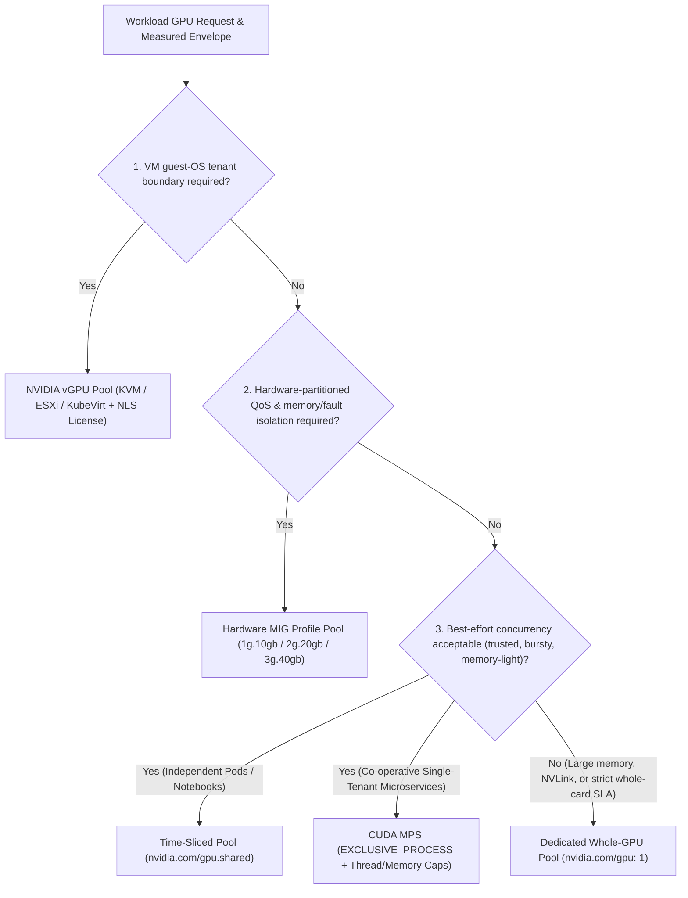
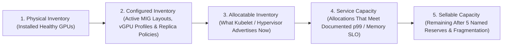

# 11.26 Choosing a GPU sharing model

| | |
|---|---|
| Level | Intermediate |
| Priority tier | 1 |
| Lab venue | GCP / GKE and local Python 3 simulation lab |
| Part | Part 11: GPUs on Kubernetes, scheduling and virtualization |
| Sources used | `nvidia-zero-to-hero/volume-11/chapter-06-comparing-mig-time-slicing-and-vgpu.md`; `nvidia-zero-to-hero/volume-11/chapter-09-capacity-planning-and-chargeback.md`; `volume-04/03-gpu-sharing-telemetry-masterclass.md`; `nvidia-zero-to-hero/volume-11/chapter-01-why-gpu-sharing-exists.md`; `nvidia-zero-to-hero/volume-11/chapter-07-kubernetes-scheduling-for-shared-gpus.md`; `nvidia-zero-to-hero/volume-11/chapter-11-production-troubleshooting.md`; `nvidia-zero-to-hero/volume-11/chapter-12-volume-11-summary.md`; `nvidia-zero-to-hero/volume-11/index.md`; `nvidia-zero-to-hero/volume-11/labs/lab-01-configure-and-validate-mig.md`; `nvidia-zero-to-hero/volume-11/labs/lab-02-configure-kubernetes-gpu-time-slicing.md`; `nvidia-zero-to-hero/volume-11/labs/lab-03-compare-sharing-performance-and-isolation.md`; `nvidia-zero-to-hero/volume-11/labs/lab-04-troubleshoot-a-multi-tenant-gpu-node.md` |
| Coverage file | `planning/coverage/chapters/11-26.md` |

## Why this matters for AI infrastructure

GPU sharing projects fail when an infrastructure team starts from a hardware feature instead of the workload contract. Engineers see that H100 cards support MIG or that the device plugin can advertise ten logical replicas. They turn those flags on without checking latency sensitivity, peak memory bursts, or tenant fault boundaries. Worse, a shared GPU platform fails commercially before it fails technically when its capacity and chargeback model counts time-sliced replicas, MIG slices, and whole GPUs as interchangeable units.

In a real capacity planning failure documented in the Volume 11 notes, a platform team reported a low fleet utilization average and deferred a hardware purchase. Two weeks later, a new inference tenant sat stuck in Pending state with nowhere to run. The fleet average had blended incompatible MIG layouts, counted nodes undergoing maintenance drains, and ignored the spare capacity reserved for tail-latency targets. Packing ten inference pods onto a single GPU via Time-Slicing produces a full allocation dashboard in Kubernetes while context-switch jitter ruins delivered latency for users.

```text
The Two Classic GPU Sharing Platform Failures (volume-11/chapter-06 & chapter-09)
---------------------------------------------------------------------------------
1. The 48% Utilization Planning Trap (volume-11/chapter-09):
   - Fleet dashboard average: 48% GPU utilization -> Hardware order deferred
   - 2 weeks later: New inference tenant stuck Pending (0 placeable 3g.40gb slices)
   - Root cause: 48% average blended 1g.10gb pools, maintenance drains, and p99 reserves

2. Allocation Efficiency vs. Delivered Efficiency Trap (volume-11/chapter-06):
   - 10 inference pods packed on 1 GPU via Time-Slicing -> 100% Allocation Efficiency
   - Context-switch jitter pushes p99 past client timeout -> 0% Delivered Efficiency
   - Capacity Sizing Equation: N = ceil((D + F) / (A * (1 - H)))
```

This chapter brings together NVIDIA vGPU, MIG, Time-Slicing, and CUDA MPS into a unified selection framework and capacity planning model. You will learn how to choose the right sharing mechanism for each workload class and how to identify which mechanism is active on a live node during an outage. You will also learn how to size node pools with a conservative reserve equation and how to bill tenants fairly using Allocation Contracts.

## Prerequisites and outcomes

### Prerequisites
- Completion of Chapter 11.23 on NVIDIA vGPU, Chapter 11.24 on MIG in depth, and Chapter 11.25 on Time-Slicing, MPS, and oversubscription.
- Familiarity with Kubernetes extended resources and namespace resource quotas.

### Outcomes
- Walk the five-way GPU sharing decision tree across Dedicated Whole GPU, Hardware MIG, NVIDIA vGPU, Time-Slicing, and CUDA MPS. Compare their resource boundaries, operational costs, and lifecycle traps.
- Run the three-step incident mechanism diagnostic playbook using host queries, node statuses, and pod UUID cross-referencing. Determine immediately which sharing mode a node and pod are using.
- Apply the five-layer capacity chain and size node pools across the five named reserves. Design an Allocation-Contract showback and chargeback rate card.
- Conduct the cross-functional operational decision workshop across four owners. Package the platform into a four-service catalog and execute comparative benchmarking trials.

## Concepts: basics to intermediate to advanced

### 1. Basics: The five-way GPU sharing decision tree and active-mechanism diagnostics

#### 1. Starting from the Workload Contract
Platform architects often feel pressured to share every GPU in the data center. That impulse causes severe outages when applied to tightly coupled distributed jobs. Dedicated whole-GPU allocation remains mandatory for large synchronous distributed training runs across multi-GPU nodes. In a rail-optimized InfiniBand fabric, a single GPU failure or noisy neighbor halts the entire multi-node training job. It forces a costly restart from the last checkpoint. Sharing adds zero value and massive blast-radius risk for these workloads.

```text
Synchronous Distributed Training Blast Radius (volume-04/03 Part 3)
-------------------------------------------------------------------
Workload : 175B-parameter synchronous distributed LLM pre-training
Hardware : 8-GPU HGX H100 nodes with 4 to 8 ConnectX-7 400G NDR NICs (1:1 rail ratio)
Node failure  : Takes down 8 GPUs -> Halts entire multi-node synchronous run
Leaf failure  : Takes down 1 Rack -> Halts entire multi-node synchronous run
Spine failure : Impacts 1 Pod     -> Halts entire multi-node synchronous run
Decision      : Dedicated Whole-GPU Pool (nvidia.com/gpu: 1), never shared
```

When a workload is a candidate for sharing, evaluate its requirements in a strict sequence from strongest isolation to best-effort concurrency. First, ask whether a virtual machine guest kernel boundary is required for regulatory or hypervisor isolation. Second, ask whether hardware-partitioned quality of service with dedicated memory controllers and fault isolation is required. Third, ask whether best-effort concurrency is acceptable for trusted, bursty, and memory-light workloads. That third branch splits between independent pods on Time-Slicing and cooperative single-tenant microservices on CUDA MPS.



#### 2. Comparing Resource Boundaries and Operational Costs
Each sharing mechanism draws its boundary at a different layer of the hardware and software stack. A dedicated GPU gives a single workload all streaming multiprocessors and high-bandwidth memory on the physical card. Hardware MIG partitions the silicon into isolated GPU Instances and Compute Instances with dedicated memory controllers and cache slices. Time-Slicing and CUDA MPS share a single physical card through software scheduling or a shared CUDA context. NVIDIA vGPU assigns a virtualized device to a guest virtual machine under hypervisor control.

| Dimension (`volume-11/chapter-06`) | Dedicated Whole GPU | Hardware MIG | Time-Slicing and CUDA MPS | NVIDIA vGPU |
|---|---|---|---|---|
| **Primary Resource Boundary** | Physical GPU device (`100%` SMs and HBM) | Supported hardware GPU Instance (`GI`/`CI` partition of SMs, HBM, L2, memory controllers) | Software-advertised logical replica (Time-Slicing) or shared context (MPS) | Virtual GPU device assigned to a guest VM (Time-Sliced or MIG-Backed) |
| **Capacity Unit** | Whole device (`nvidia.com/gpu: 1`) | Supported MIG profile (`nvidia.com/mig-1g.10gb`) | Logical replica (`nvidia.com/gpu.shared`) + physical GPU headroom | Supported virtual profile (`GRID A100-20Q`) |
| **Reconfiguration Cost** | Drain or reassign pod | Drain node, change `GI`/`CI` geometry, and reconcile device plugin | Adjust replica policy ConfigMap (ClusterPolicy) and validate contention | VM evacuation, profile assignment, and host manager lifecycle |
| **Fragmentation and Saturation Risk** | Low for homogeneous whole-GPU jobs | **Geometric fragmentation:** free slices may not form the next requested profile shape | **Hidden saturation:** physical memory and SM exhaustion hides behind green replica counts | Profile-slot homogeneity (`vgpu -c`) and VM host placement constraints |
| **Primary Observability** | Clean per-GPU and per-Pod DCGM metrics | Per-MIG-instance (`GI`/`CI`) + physical device telemetry | Physical device + host process (`nvidia-smi --query-processes`) + app latency | 4-tier: Host GPU + vGPU Manager + Guest OS driver + NLS license state |
| **Suitable Default Workload** | Distributed training (`175B` LLM), large models, or unprofiled sensitive jobs | Repeatable model-serving shapes (Embedding, Chat LLM) needing predictable `p99` | Interactive dev Jupyter notebooks, CI runners, bursty best-effort tasks | Regulated VMs, virtual desktops (VDI), and VM-centric enterprise estates |

#### 3. Quick Incident Diagnostic: Which Sharing Mechanism Is Active on This Node?
When an on-call engineer is paged into an unfamiliar cluster during a latency spike, guessing the sharing mode wastes recovery time. A pod spec that requests a single GPU resource token might be backed by a whole card, a time-sliced replica, or a virtualized slice. Running a structured three-step diagnostic playbook on the worker node and inside the affected pod identifies the active mechanism in under a minute.

First, inspect the physical GPU state on the host worker node over SSH. If the MIG mode query prints Enabled and the instance list shows active GPU Instances, Hardware MIG is active. If the vGPU query lists virtual devices attached to guest domains, NVIDIA vGPU is active. Sometimes MIG is disabled on a single physical card while Kubernetes reports four or eight allocatable GPUs. When the host process table also shows multiple container processes on that same device, Time-Slicing is active.

Second, inspect the GPU view inside the affected container by running `nvidia-smi` and checking the `NVIDIA_VISIBLE_DEVICES` environment variable. Third, cross-reference the device UUID reported inside the pod against neighboring pods on the same node. If multiple pods report the exact same full physical GPU UUID, they are time-slicing that card. If each pod reports a distinct `MIG-...` UUID or a distinct virtual GPU UUID, the workload is running on MIG or vGPU.

```text
3-Step Live Incident Mechanism Diagnostic Playbook (volume-11/chapter-06)
-------------------------------------------------------------------------
Step 1: Host Worker Check (SSH to node)
  - nvidia-smi -i 0 --query-gpu=mig.mode.current -> Enabled + nvidia-smi mig -lgi -> MIG is active
  - nvidia-smi vgpu lists active VM instances                                     -> vGPU is active
  - 1 physical GPU (MIG Disabled) + 4 or 8 allocatable GPUs + multiple PIDs       -> Time-Slicing is active
  - 1 physical GPU (MIG Disabled) + 1 allocatable GPU + 1 PID                     -> Dedicated GPU is active

Step 2: Inside Affected Pod
  - kubectl exec <pod> -- nvidia-smi
  - Check echo $NVIDIA_VISIBLE_DEVICES

Step 3: Host-to-Pod UUID Cross-Reference
  - kubectl exec <pod> -- nvidia-smi --query-gpu=uuid --format=csv
  - Multiple pods show identical physical GPU-... UUID -> Time-Slicing
  - Each pod shows distinct MIG-... or virtual UUID     -> MIG or vGPU
```

---

### 2. Intermediate: The five-layer capacity chain, the node sizing formula, and allocation-contract chargeback

#### 1. Why Low Fleet Utilization Can Mean Zero Available Capacity: The Five Capacity Layers
Relying on a single fleet-wide GPU utilization percentage leads leadership to freeze hardware purchases right before production services run out of room. A dashboard showing forty-eight percent utilization hides where the remaining fifty-two percent actually sits. Those free resources often sit on nodes with incompatible MIG geometries, on hosts cordoned for driver maintenance, or in latency headroom buffers. To prevent this planning failure, you must track five distinct capacity layers separately across every node pool.



Physical inventory counts installed, healthy GPUs and excludes dead cards or RMA hardware. Configured inventory reflects the active MIG slice layouts, vGPU profiles, and time-slicing replica policies currently applied to those cards. Allocatable inventory measures what the kubelet or hypervisor advertises to the scheduler right now. Service capacity filters that count down to allocations that actually meet your documented tail-latency and memory targets under load. Finally, sellable capacity is what remains for tenants after subtracting operational reserves and profile fragmentation.

#### 2. The Conservative Node Sizing Formula and the Five Named Reserves
When sizing a standardized node pool for a specific service class, guessing a flat percentage buffer either wastes capital or leaves services vulnerable. The Volume 11 capacity model uses five explicit variables to compute the required node count. You combine committed concurrent demand and expected profile geometry fragmentation. Then you divide by the usable slots per standardized node after discounting for non-sellable reserve headroom.

```text
Conservative Node Pool Sizing Model (volume-11/chapter-09 & choosing_gpu_sharing_model.py)
------------------------------------------------------------------------------------------
Variables:
  D = Required concurrent allocations (or measured demand-equivalent in the service unit)
  F = Expected allocation loss from MIG/vGPU profile geometry fragmentation or placement rules
  A = Usable allocations provided by 1 standardized node after its approved layout is applied
  H = Planned non-sellable headroom fraction (0 <= H < 1)
  N = Required physical nodes

Formula:
  N = ceil((D + F) / (A * (1 - H)))

Worked Verification (H100 node pool with 4 x 1g.10gb + 1 x 3g.40gb layout -> A = 5 slots/node):
  Given: D = 70 allocations, F = 6 fragmentation slots, A = 5 usable slots/node, H = 0.20 (20%)
  Effective sellable slots per node = 5 * (1 - 0.20) = 4.0 slots/node
  Required nodes N = ceil((70 + 6) / 4.0) = ceil(76 / 4.0) = 19 nodes
```

Never lump the headroom variable into a mysterious spreadsheet buffer that finance teams will cut during budget reviews. Break that reserve fraction down into five named reserves so leadership understands which operational guarantees each reserve protects.
- **Node-failure reserve.** Protects committed service-level workloads when an entire worker node or rack leaf switch fails unexpectedly.
- **Maintenance reserve.** Allows operators to drain a node pool for host operating system, driver, or MIG layout updates without violating commitments.
- **Rollout reserve.** Preserves a healthy comparison canary pool during staged model or runtime upgrades.
- **Demand-variance reserve.** Absorbs forecast error, sudden traffic bursts, and seasonal spikes without breaching latency targets.
- **Fragmentation reserve.** Accounts for physically unused MIG or vGPU slices whose slice geometry cannot legally form the next requested profile shape.

#### 3. Showback Before Chargeback: Billing on the Allocation Contract
When five engineering teams share an expensive multi-GPU server, billing them purely on sampled compute utilization creates perverse incentives. A tenant can request a large forty-gigabyte MIG slice and leave it idle at zero percent compute utilization. Even while idle, that reservation locks half of the physical HBM and streaming multiprocessors in silicon. It blocks every other team from using that capacity.

Platforms should start with Showback by reporting consumption and cost attribution to teams without issuing financial invoices. Once ownership labels and dispute rules are verified, transition to Chargeback billed on the Allocation Contract. A Prometheus pipeline joins pod resource requests from `kube-state-metrics` with duration and tier rates. Tenants then pay for the exact capacity boundary they reserve or strand.

| Service Model (`volume-11/chapter-09`) | Defensible Primary Billable Unit | Example Rate-Card Logic (`volume-11/chapter-09`) | Anti-Pattern to Avoid |
|---|---|---|---|
| **1. Reserved Whole GPU** | **Reserved GPU-hour** or committed capacity period | `100%` of node/GPU hourly rate even while idle, because capacity is withheld from others | Billing a fluctuating utilization `%` sample as if it were a reservation |
| **2. Standard MIG Profile** | **Allocated profile-hour** with named profile and service tier | Requesting `MIG 3g.40gb` reserves `~50%` of H100 memory and compute, billed at `50%` of hardware + reserve rate | Calling every profile a universal throughput fraction without layout or reserve context |
| **3. Best-Effort Time-Sliced Pool** | **Access-hour**, queue class, or agreed workload outcome | Requesting `1` of `10` logical replicas (`nvidia.com/gpu.shared: 1`), billed at `10%` of hardware access rate | Promising deterministic compute or memory isolation in exchange for that `10%` fee |
| **4. NVIDIA vGPU Service** | **Assigned vGPU/VM-hour** or named workstation session tier | Bundles vGPU profile slot + mandatory hypervisor host, guest image, and NLS license entitlement costs | Billing the GPU separately from mandatory VM and licensing platform costs without disclosure |

---

### 3. Advanced: The cross-functional decision workshop, four-service catalog, and class migration discipline

#### 1. Allocation Efficiency versus Delivered Efficiency and the Four-Owner Decision Workshop
When executives push for higher cluster density, platform teams must separate scheduler assignment from real application performance. Allocation efficiency measures the percentage of logical GPU tokens or slices that appear assigned to pods in Kubernetes. Delivered efficiency measures useful application work completed within its documented latency, throughput, and error-rate targets. Packing extra replicas onto a card raises allocation efficiency to one hundred percent while dropping delivered efficiency to zero as requests time out.

Before introducing any new shared GPU service class, convene an operational decision workshop across four accountable owners so technical and financial boundaries align:
- **Application Owner.** Supplies measured cold, steady, and peak memory footprints, request arrival patterns, tail-latency or completion targets, and checkpoint recovery behavior.
- **Platform Owner.** Supplies eligible GPU hardware SKUs, driver and hypervisor support matrices, standardized node-pool layouts, and node drain lifecycle rules.
- **Security Owner.** Defines and validates the required tenant blast-radius boundary across all seven isolation layers from Chapter 11.19.
- **Service and Finance Owner.** Defines the showback and chargeback unit, reserve funding rules, and tenant entitlement policies.

#### 2. The Four-Service Catalog and Safe Migration Between Sharing Classes
Exposing every possible MIG slice permutation and time-slicing replica ratio on an internal request form overwhelms developers and fragments your hardware pools. Every extra class multiplies capacity forecasting, admission policies, dashboards, upgrade testing, and geometric slice fragmentation. Instead, package your platform into four standardized catalog services and review them on regular operational cadences.

| Catalog Service Name | Underlying Sharing Mechanism | Admission Posture | Failure and Maintenance Behavior |
|---|---|---|---|
| **1. Interactive sandbox** | **Time-sliced** (`nvidia.com/gpu.shared`) | Bounded namespace quota and queue | Slowdown, contention, or recall is explicitly acceptable |
| **2. Protected inference** | **MIG profile** (`1g.10gb`, `2g.20gb`, `3g.40gb`) | Pre-admission load-test qualification + protected reserve | Controlled failover across nodes or bounded queueing |
| **3. Large job** | **Dedicated Whole GPU** (`nvidia.com/gpu: 1`) | Capacity reservation and gang-scheduled start | Checkpoint-aware maintenance windows (`dcgmi dmon` drain) |
| **4. Regulated VM** | **NVIDIA vGPU** (Time-Sliced or MIG-Backed) | VM template, RBAC, and NLS identity controls | Qualified 8-step host and guest lifecycle procedure |

When migrating a workload from one sharing class to another, treat the class migration as a full application release. Moving an application from a time-sliced pool to a MIG profile pool often triggers unexpected out-of-memory crashes. On an eighty-gigabyte card, the workload silently borrowed idle neighbor VRAM during bursts. Run the comparative benchmark protocol across whole-GPU, MIG, and time-sliced trials while holding the container image digest, model artifact, and node constant. Keep the input distribution, precision, and concurrency identical across every run. Never mutate a live service class in place; introduce a versioned successor pool, canary-test under neighbor load, and verify rollback before retiring the old pool.

#### 3. Capacity Decision Records, Idle Reservation Governance, and the Four Review Cadences
Ad-hoc changes to MIG layouts or replica ratios break capacity forecasts and strand tenant budgets. Every material change to your GPU service catalog requires an eight-field Capacity Decision Record signed off before rollout. This record links measured demand evidence and hardware compatibility directly to your reserve assumptions and rollback checks.

```text
8-Field Capacity Decision Record & 4 Review Cadences (volume-11/chapter-09)
---------------------------------------------------------------------------
8-Field Capacity Decision Record:
  1. Service change         : New profile, revised time-slicing policy, added pool, or reserve rule
  2. Demand evidence        : Measured concurrency, queue distribution, base/committed/high forecast
  3. Compatibility          : Hardware SKU, driver, hypervisor/runtime, and GPU Operator versions
  4. Capacity model         : Usable slots A, reserve H, fragmentation F, failure domain (Node/Leaf/Spine)
  5. Tenant impact          : Projects gaining, losing, or changing service behavior during transition
  6. Alternatives considered: Keep catalog, pick another sharing mode, buy hardware, or defer demand
  7. Acceptance criteria    : Placement, application SLO, observability join, and rollback checks
  8. Review date            : Scheduled date to revisit forecast, utilization, and rate assumptions

4 Capacity Review Cadences:
  - Weekly operational review  : Pending requests, reserve consumption, failed nodes, drift, expirations
  - Monthly service review     : SLO/queue trends, idle commitments, attribution exceptions, borrowing
  - Quarterly planning review  : Forecast scenarios, catalog changes, procurement lead time, cost model
  - Before material change     : Canary capacity, rollback capacity, compatibility, tenant comms
```

When a weekly utilization chart shows low streaming multiprocessor activity inside a reserved GPU or MIG slice, never reclaim that capacity automatically. Check the workload service contract first. A protected inference pool often holds reserved headroom specifically to absorb sudden traffic bursts or survive a node failover within its latency target. Use the four-stage governance matrix across your review cadences to turn idle allocation metrics into structured right-sizing or borrowing conversations.

| Operational Observation (`volume-11/chapter-09`) | Diagnostic Question Before Acting | Approved Governance Response | Review Cadence Owner |
|---|---|---|---|
| **1. Low SM activity in a protected Reserved or MIG allocation** | Is the reservation holding a documented `p99` burst buffer, deadline, or failover guarantee? | Retain the reservation if required by the SLO; otherwise right-size to a smaller MIG profile at renewal or define scheduled off-peak release windows. | **Monthly Service Review** (SLO and queue trends and idle commitments) |
| **2. Long-lived GPU allocation with missing or stale owner labels** | Is `kube-state-metrics` or Project attribution broken or did team ownership change mid-quarter? | Reconcile namespace and project ownership labels in the billing pipeline before modifying or evicting the workload. | **Weekly Operational Review** (pending requests, drift, and expiring reservations) |
| **3. Best-effort Interactive sandbox pool is queued behind idle reserved pools** | Does the platform borrowing policy allow temporary over-quota use with bounded recall? | Enable revocable over-quota borrowing (KAI Queue `limit > quota` or Kueue Cohort borrowing) only for checkpointed jobs with a tested `30 s` `SIGTERM` eviction path. | **Monthly Service Review** (borrowing and preemption audit) |
| **4. Recurring Pending backlog for `3g.40gb` while `1g.10gb` slices sit idle** | Has workload demand shifted away from the current static node-pool MIG layout? | Rebalance node-pool layouts (`mig-parted` labels) during a planned maintenance window (Before material change review) and update the Quarterly Planning Review forecast. | **Quarterly Planning Review** (catalog mix and procurement lead time) |

#### 4. The Five Selection Anti-Patterns and Exit Criteria for a New Service Class
Even well-funded AI platforms stumble when they design sharing tiers around vendor marketing rather than measured workload envelopes. Before publishing any new GPU sharing class in your production catalog, verify that your architecture avoids five recurring selection anti-patterns.
- **Mechanism-first MIG.** Enabling MIG solely because Hopper or Ampere hardware supports it, without verifying that target models and peak KV-cache footprints fit inside supported profiles.
- **Average-utilization time-slicing.** Turning on eight or ten logical replicas because a fleet dashboard shows low average utilization. Always measure concurrent tail latency and memory high-water marks first.
- **Unmanaged vGPU.** Adopting vGPU solely because an enterprise runs virtual machines. Assign an engineering owner for the hypervisor, host manager, guest driver, and license compatibility lifecycle first.
- **Permanent whole-GPU default.** Giving every small two-gigabyte embedding service or notebook an exclusive eighty-gigabyte GPU forever. A measured MIG pool or shared development pool safely multiplies access.
- **Average-memory sizing.** Choosing a profile or replica density from average memory usage while ignoring burst allocations, model load peaks, and post-failure recovery reserves.

A new sharing class passes its production exit gate only when five operational requirements are verified and documented. First, its supported hardware and software scope and excluded workloads must be published. Second, its namespace admission and `ResourceQuota` rules must pass automated tests. Third, its capacity unit must be reportable in Showback and Chargeback pipelines. Fourth, its comparative benchmark from Lab 03 must be reproducible. Fifth, its named owner, recovery reserve fraction, and next review date must be recorded.

## Commands and configurations that matter

### 1. Live Incident Triage: Identifying the Active Sharing Mechanism
During a production incident, an engineer needs to verify whether a worker node is partitioning GPUs in hardware, multiplexing them in a hypervisor, or time-slicing them in software. The first command block queries host MIG mode, active GPU Instances, virtual GPU attachments, and host process density on the physical card. The second command block checks Kubernetes allocatable resource counts and cross-references the device UUID inside the pod.

```bash
# 1. Host-side check: MIG vs vGPU vs Time-Slicing process density (untested here)
nvidia-smi -i 0 --query-gpu=mig.mode.current --format=csv,noheader
nvidia-smi mig -lgi
nvidia-smi vgpu
nvidia-smi --query-processes=pid,process_name,gpu_memory_usage --format=csv

# 2. Kubernetes-side check: Allocatable counts and Host-to-Pod UUID cross-reference (untested here)
kubectl get nodes -o custom-columns=NAME:.metadata.name,GPU:.status.allocatable.nvidia\.com/gpu,SHARED:.status.allocatable.nvidia\.com/gpu\.shared
kubectl exec -n prod-serving pod/inference-0 -- nvidia-smi --query-gpu=uuid --format=csv
```

### 2. Comparative Sharing Benchmark Job Manifest
Before migrating a workload between whole GPUs, MIG slices, and time-sliced pools, run a controlled trial that holds the node, container image, and runtime probe constant. This Kubernetes Job manifest pins the trial pod to a target test node and requests a single hardware MIG slice. It logs the visible device geometry and utilization, then emits the completion marker for log verification.

```yaml
# sharing-trial-comparative-probe.yaml (volume-11/labs/lab-03, untested here)
apiVersion: batch/v1
kind: Job
metadata:
  name: sharing-trial-mig
  namespace: gpu-sharing-comparison
  labels:
    experiment: gpu-sharing-comparison
    trial: mig
spec:
  backoffLimit: 0
  template:
    spec:
      restartPolicy: Never
      nodeSelector:
        kubernetes.io/hostname: gpu-test-node-1
      containers:
        - name: benchmark
          image: nvcr.io/nvidia/cuda:12.4.1-base-ubuntu22.04
          command:
            - sh
            - -c
            - |
              date -u +%Y-%m-%dT%H:%M:%SZ
              nvidia-smi -L
              nvidia-smi --query-gpu=index,name,driver_version,memory.total,memory.used,utilization.gpu --format=csv,noheader
              sleep 60
              echo SHARING_RUNTIME_PROBE_COMPLETE
          resources:
            limits:
              nvidia.com/mig-1g.10gb: 1
```

## How it fails

When a GPU sharing strategy or capacity model breaks down, symptoms appear as stuck Pending pods, erratic latency spikes, out-of-memory crashes, or budget shortfalls. Use this symptom-to-root-cause table to isolate which capacity layer or resource boundary failed and apply the corresponding fix.

| Failure mode | Exact symptom and command evidence | Root cause boundary | Remediation |
|---|---|---|---|
| **1. Fleet dashboard shows `48%` average GPU utilization, yet new MIG `3g.40gb` requests stay Pending for days (`volume-11/chapter-09` Story)** | `kubectl describe pod` logs `0/N nodes are available: Insufficient nvidia.com/mig-3g.40gb`, while fleet-wide `DCGM_FI_DEV_GPU_UTIL` averages `48%`. | **Collapsing the 5 Capacity Layers:** The `48%` average blended incompatible `1g.10gb` pools, counted draining or maintenance nodes, and ignored `p99` burst headroom and profile geometry fragmentation. | Report **Sellable Capacity** per named profile and node pool (Layer 5), separate from Physical (Layer 1) and Allocatable (Layer 3) inventory, and size pools with `N = ceil((D + F) / (A * (1 - H)))`. |
| **2. Supposedly isolated inference service suffers erratic `p99` tail-latency spikes during daytime notebook hours (`volume-11/chapter-06` Scenario 1)** | Pod requested generic `nvidia.com/gpu: 1`; `kubectl exec <pod> -- nvidia-smi --query-gpu=uuid` returns the same physical GPU UUID as `7` neighboring dev notebooks. | **Ambiguous Resource Identity Across Pools:** Time-sliced nodes advertised `nvidia.com/gpu` without `renameByDefault: true`, allowing `kube-scheduler` to place a latency-sensitive service onto a best-effort node. | Rename time-sliced resources to `nvidia.com/gpu.shared`, isolate pools with distinct node labels, taints, and `ResourceQuotas`, and migrate the inference service to a validated **MIG** or **Dedicated** pool. |
| **3. Migrating a workload from Time-Slicing to a `1g.10gb` MIG slice causes immediate CUDA Out of Memory crashes (`volume-11/chapter-06`)** | Workload ran without OOM on an `80 GB` time-sliced GPU when neighbors were idle, but crashes immediately on `1g.10gb` (`10 GB`). | **Unmeasured Peak Memory Borrowed During Time-Slicing:** On the `80 GB` time-sliced card, the workload silently burst to `14 GB` using idle neighbor VRAM; `1g.10gb` enforces a hard `10 GB` silicon wall. | Profile cold, steady, and concurrent-peak memory in a discovery trial (`labs/lab-03`) before migrating classes, and assign the workload to `2g.20gb` (`20 GB`) or `3g.40gb` (`40 GB`). |
| **4. Chargeback model bills teams by sampled `DCGM_FI_DEV_GPU_UTIL`, causing a budget deficit while `100%` of MIG slices are allocated (`volume-11/chapter-09`)** | All `20` H100 MIG nodes are `100%` allocated to tenant pods (`0` free slices), but because tenants sit at `15%` average SM utilization, chargeback recovers only `15%` of hardware cost. | **Billing Utilization Instead of Allocation Contract:** A tenant holding a `3g.40gb` slice (`50%` of the GPU) blocks anyone else from using those SMs and HBM whether their utilization is `1%` or `100%`. | Bill Reserved Whole GPU, Standard MIG Profile, and vGPU tiers on **Allocated or Reserved Profile-Hours** (`kube-state-metrics` resource requests multiplied by time), using DCGM utilization only as supplementary right-sizing evidence. |
| **5. Planned driver maintenance drain violates protected inference SLOs because `H = 0%` reserve was budgeted (`volume-11/chapter-09`)** | Every MIG slot in the `20`-node pool was sold (`100%` sellable); draining `1` node (`5` slots) leaves evicted pods Pending with nowhere to land. | **Missing Named Maintenance and Node-Failure Reserves:** Capacity planning equated Allocatable Inventory (Layer 3) with Sellable Capacity (Layer 5). | Budget explicit **Node-failure**, **Maintenance**, **Rollout**, **Demand-variance**, and **Fragmentation** reserves (`H > 0` in `N = ceil((D + F) / (A * (1 - H)))`) and test maintenance drains against the reserve model before launch. |

## Hands-on lab

### Venue and scope
Mistakes in capacity sizing equations or sharing decision trees are much cheaper to catch in a local simulation before you repartition production H100 nodes. This lab runs locally using the Python 3 standard library via `code/part11/choosing_gpu_sharing_model.py` and `code/part11/choosing_gpu_sharing_model_lab.py`. It verifies the five-way GPU sharing decision tree, the active-mechanism diagnostic classifier, the five-layer capacity hierarchy, and the five named reserves. It also checks the conservative node sizing formula, the Allocation-Contract chargeback rules, and the four-service catalog. Host and cluster commands earlier in the chapter are marked untested here.

### Step 1: Run the self-checking GPU sharing model selection and capacity lab (tested here)

Run the self-checking verification script from the repository root to validate all twenty-five decision, capacity, and chargeback invariants.

```bash
python3 code/part11/choosing_gpu_sharing_model_lab.py
```

Captured output from this repository:
```text
=== Chapter 11.26 Lab: Choosing a GPU Sharing Model, Capacity & Chargeback ===
  [PASS] VM tenant boundary requirement selects vGPU billed by Assigned vGPU/VM-hour
  [PASS] Hardware-partition QoS requirement (without VM boundary) selects MIG billed by Allocated profile-hour
  [PASS] Best-effort interactive concurrency selects Time-slicing billed by Access-hour or queue class
  [PASS] Cooperative single-tenant spatial microservice sharing selects CUDA MPS in EXCLUSIVE_PROCESS mode
  [PASS] Workload rejecting VM, MIG, and best-effort sharing selects Dedicated GPU billed by Reserved GPU-hour
  [PASS] Host with mig.mode.current=Enabled classifies active mechanism as MIG
  [PASS] Host with active nvidia-smi vgpu instances classifies active mechanism as vGPU
  [PASS] Host with 1 physical GPU (MIG Disabled) and 4 or 8 allocatable replicas / multiple PIDs classifies as Time-slicing
  [PASS] Host with 1 physical GPU, MIG Disabled, 1 allocatable GPU, and 1 PID classifies as Dedicated GPU
  [PASS] Volume 11 Ch 9 defines 5 capacity layers from Physical inventory to Sellable capacity
  [PASS] Volume 11 Ch 9 defines 5 named reserves (Node-failure, Maintenance, Rollout, Demand-variance, Fragmentation)
  [PASS] Volume 11 Ch 9 formula N = ceil((D + F) / (A * (1 - H))) yields ceil((70 + 6) / (5 * 0.8)) = 19 nodes
  [PASS] Volume 11 Ch 9 planning incident explains why a 48% fleet utilization chart can still block a MIG request
  [PASS] Volume 11 Ch 9 chargeback bills MIG 3g.40gb (~50% GPU) and 1-of-10 time-sliced replica (10% rate) on Allocation Contract
  [PASS] Volume 11 Ch 6 Figure 11.6.2 Operational Decision Workshop brings together 4 owners (Application, Platform, Security, Service/Finance)
  [PASS] Volume 11 Ch 6 Service Catalog defines 4 distinct services (Interactive sandbox, Protected inference, Large job, Regulated VM)
  [PASS] Volume 11 Ch 6 distinguishes Allocation Efficiency (% assigned) from Delivered Efficiency (work meeting SLO)
  [PASS] Volume 04 Ch 3 Part 3 models HGX H100 (8 GPUs, 4-8 ConnectX-7 400G NICs) blast radius for a 175B LLM job (Node=8 GPUs, Leaf=Rack, Spine=Pod)
  [PASS] Volume 11 Lab 03 compares Whole GPU, MIG, and Time-Slicing using SHARING_RUNTIME_PROBE_COMPLETE and SHARING_NEIGHBOR_PROBE_COMPLETE
  [PASS] Volume 11 Lab 01 validates 6 H100 MIG profiles (MIG_VALIDATION_COMPLETE) and -dci before -dgi rollback
  [PASS] Volume 11 Lab 02 validates time-slicing (1 -> 4 allocatable in 30s, TIME_SLICE_A_COMPLETE) and ordered ClusterPolicy rollback
  [PASS] Volume 11 Lab 04 validates DIAGNOSTIC_GPU_OK and QUOTA_DENIAL_RECOVERY_CHECK
  [PASS] Volume 11 Ch 1 & Ch 12 Summary enforce 9-step decision sequence and 9-area production checklist
  [PASS] Volume 11 Ch 9 defines 4 capacity review cadences (Weekly operational, Monthly service, Quarterly planning, Before material change)
  [PASS] Volume 11 Ch 7 & Ch 11 align Kubernetes scheduling policies with 6-layer incident triage

Summary: 25 passed, 0 failed out of 25 checks.
```

### Exercises

1. **Exercise 1: Walking the five-way GPU sharing decision tree.** Use `select_gpu_sharing_model()` in `code/part11/choosing_gpu_sharing_model.py` to evaluate five common AI platform workloads. State the selected sharing model, primary resource boundary, and billable unit for regulated VM workstations, latency-bound inference, dev notebooks, cooperative MPS microservices, and distributed LLM training.
2. **Exercise 2: Live node mechanism detection.** State the exact host and Kubernetes observations in `detect_active_sharing_mechanism` that distinguish MIG, vGPU, Time-Slicing, and Dedicated GPU during a live cluster incident.
3. **Exercise 3: The Five Capacity Layers and utilization paradox.** List the five capacity layers in `FIVE_CAPACITY_LAYERS` in order. Explain how a cluster can report forty-eight percent average GPU utilization while having zero sellable capacity for a new `3g.40gb` MIG request.
4. **Exercise 4: Sizing a node pool with the reserve equation.** Run `compute_required_nodes_vol11_ch9(70, 6, 5, 0.20)` in the chapter module. Calculate the effective sellable allocations per node, the required number of physical nodes, and the five named reserves in `FIVE_NAMED_RESERVES`.
5. **Exercise 5: Designing an Allocation-Contract Rate Card.** Explain why billing shared GPUs solely by sampled `DCGM_FI_DEV_GPU_UTIL` percentage fails when a tenant holds a `3g.40gb` MIG slice idle. State the correct billable unit for Interactive sandbox, Protected inference, Large job, and Regulated VM.
6. **Exercise 6: Executing a class migration and Lab 03 comparative benchmark.** Explain why migrating a workload from Time-Slicing to MIG can uncover a hidden memory OOM crash. Describe the comparative probe protocol using `SHARING_RUNTIME_PROBE_COMPLETE` and `SHARING_NEIGHBOR_PROBE_COMPLETE`.

## Checkpoint questions

<details>
<summary>`&lt;strong>`1. Walk through the four decision questions in Volume 11 Chapter 6 Figure 11.6.1 for selecting a GPU sharing model.`&lt;/strong>`</summary>

First, check whether a virtual machine tenant boundary is required; if yes, select NVIDIA vGPU on a supported hypervisor stack. Second, check whether hardware-partitioned quality of service with memory, compute, and cache isolation is required; if yes, select a Hardware MIG profile pool. Third, check whether best-effort concurrency is acceptable for trusted, bursty, and memory-light workloads. If yes, select a Time-Sliced pool for independent pods or CUDA MPS for cooperative single-tenant spatial execution. Fourth, if none of those apply because the job uses large models, NVLink training, or a whole-card SLA, select a Dedicated whole GPU.
</details>

<details>
<summary>`&lt;strong>`2. Compare the capacity unit and primary observability source across Dedicated GPU, MIG, Time-Slicing, and vGPU (Volume 11 Chapter 6).`&lt;/strong>`</summary>

For a Dedicated GPU, the capacity unit is the physical device and observability comes from device and application metrics. For MIG, the capacity unit is a supported hardware profile such as `1g.10gb` or `3g.40gb`, and observability uses per-instance GI and CI metrics plus physical device telemetry. For Time-Slicing, the capacity unit is a logical replica token plus physical GPU headroom. Its observability requires physical device telemetry, host process queries via `nvidia-smi --query-processes`, and application latency metrics. For vGPU, the capacity unit is a supported virtual profile slot from `nvidia-smi vgpu -c`, and observability spans the host GPU, vGPU Manager, guest driver, and NLS license state.
</details>

<details>
<summary>`&lt;strong>`3. During an incident, how do you determine in 60 seconds whether a GPU node and pod are using MIG, Time-Slicing, or vGPU (Volume 11 Chapter 6)?`&lt;/strong>`</summary>

On the host worker node, run `nvidia-smi mig -lgi` to check for active GPU Instances indicating MIG and `nvidia-smi vgpu` to check for active virtual GPUs indicating vGPU. Run `nvidia-smi --query-processes=pid,process_name --format=csv` to check whether many container PIDs share one non-MIG GPU under Time-Slicing. Next, cross-reference inside the pod by running `kubectl exec <pod> -- nvidia-smi --query-gpu=uuid --format=csv`. If multiple pods see the exact same full physical `GPU-...` UUID, they are time-slicing the card. If each pod sees a unique `MIG-...` or virtual `GPU-...` UUID, the node is using MIG or vGPU.
</details>

<details>
<summary>`&lt;strong>`4. What is the difference between Allocation Efficiency and Delivered Efficiency in Volume 11 Chapter 6?`&lt;/strong>`</summary>

Allocation efficiency is the percentage of logical GPU tokens or slices that appear assigned to workloads in the Kubernetes scheduler. Delivered efficiency measures useful application work completed within its documented latency, throughput, and error-rate targets. High logical allocation accompanied by long queues, retries, or tail-latency timeouts represents low delivered efficiency.
</details>

<details>
<summary>`&lt;strong>`5. Who are the four participants in the Operational Decision Workshop (Volume 11 Chapter 6 Figure 11.6.2), and what does each participant contribute?`&lt;/strong>`</summary>

The Application owner supplies the service objective and measured workload evidence covering memory, latency, concurrency, and recovery behavior. The Platform owner supplies eligible hardware SKUs, driver support matrices, and node lifecycle rules. The Security owner defines and verifies the required tenant isolation boundary. The Service and Finance owner defines the cost model, chargeback unit, and tenant entitlement rules.
</details>

<details>
<summary>`&lt;strong>`6. Why should a platform team offer fewer GPU sharing classes in its service catalog than the hardware can technically expose (Volume 11 Chapter 6)?`&lt;/strong>`</summary>

Every additional service class multiplies capacity forecasting, documentation, admission rules, observability dashboards, support runbooks, upgrade testing, and profile geometry fragmentation. A class should exist in the catalog only when justified by measured workload demand and a distinct governance requirement.
</details>

<details>
<summary>`&lt;strong>`7. Name the four services in the Volume 11 Chapter 6 Service-Catalog Example and their underlying mechanisms and failure behaviors.`&lt;/strong>`</summary>

First, Interactive sandbox uses a time-sliced pool with bounded quota and queue rules where slowdown or recall is acceptable. Second, Protected inference uses a MIG profile pool with pre-admission qualification and protected reserves where failure triggers controlled failover or bounded queueing. Third, Large job uses a Dedicated GPU with capacity reservation and coordinated start where maintenance follows checkpoint-aware windows. Fourth, Regulated VM uses NVIDIA vGPU with VM and identity controls governed by a qualified host and guest lifecycle procedure.
</details>

<details>
<summary>`&lt;strong>`8. Why can migrating a workload from a time-sliced pool to a MIG profile pool trigger unexpected CUDA OOM errors, and how do you prevent it (Volume 11 Chapter 6)?`&lt;/strong>`</summary>

On an eighty-gigabyte time-sliced GPU, a bursty workload can silently borrow idle VRAM and peak at fourteen gigabytes whenever neighboring notebooks are inactive. Moving that workload to a `1g.10gb` MIG slice enforces a hard ten-gigabyte hardware memory wall that immediately triggers an out-of-memory crash. Prevent this by profiling cold, steady, and concurrent-peak memory high-water marks in a canary trial before migrating classes.
</details>

<details>
<summary>`&lt;strong>`9. In Volume 11 Chapter 9, why did a cluster reporting 48% average GPU utilization fail to schedule a new inference tenant's MIG request?`&lt;/strong>`</summary>

The forty-eight percent fleet utilization average collapsed incompatible MIG profile layouts and counted temporarily unavailable or draining nodes as usable capacity. It also ignored the spare headroom reserved to protect existing tenants' tail-latency targets. Consequently, zero nodes had the contiguous free slice geometry required to host the new request.
</details>

<details>
<summary>`&lt;strong>`10. List the five layers of the Capacity Constraint Chain in Volume 11 Chapter 9 Figure 11.9.1 and the common planning error at each layer.`&lt;/strong>`</summary>

First, Physical inventory fails when teams count a failed, drained, unsupported, or maintenance-bound GPU as available. Second, Configured inventory fails when teams assume a supported MIG or vGPU profile is immediately schedulable without a node layout change. Third, Allocatable inventory fails when teams treat advertised time-sliced replicas as independent physical GPUs. Fourth, Service capacity fails when teams equate scheduler placement with delivered SLO performance. Fifth, Sellable capacity fails when teams sell one hundred percent of theoretical capacity and call failure and maintenance reserves unused utilization.
</details>

<details>
<summary>`&lt;strong>`11. Write the conservative node sizing formula from Volume 11 Chapter 9, define each variable (D, F, A, H, N), and compute N for D=70, F=6, A=5, and H=0.20.`&lt;/strong>`</summary>

The formula is `N = ceil((D + F) / (A * (1 - H)))`. In this equation, `D` is required concurrent allocations, `F` is expected allocation loss from geometry fragmentation, and `A` is usable allocations per standardized node. Here `H` is the planned non-sellable headroom fraction and `N` is required physical nodes. Substituting seventy for `D`, six for `F`, five for `A`, and `0.20` for `H` gives seventy-six divided by four sellable slots per node, which requires nineteen physical nodes.
</details>

<details>
<summary>`&lt;strong>`12. What are the five Named Reserves that make up headroom (H) in Volume 11 Chapter 9?`&lt;/strong>`</summary>

The Node-failure reserve protects committed workloads when a node or failure domain goes down. The Maintenance reserve allows draining a node pool for planned host, driver, or MIG layout updates. The Rollout reserve preserves a healthy comparison canary pool during staged upgrades. The Demand-variance reserve absorbs forecast error, burst windows, and seasonal spikes. Finally, the Fragmentation reserve covers physically unused profile geometry that cannot legally host the next requested shape.
</details>

<details>
<summary>`&lt;strong>`13. Why must GPU chargeback bill on the Allocation Contract rather than sampled GPU compute utilization % (Volume 11 Chapter 9)?`&lt;/strong>`</summary>

A tenant who requests a `MIG 3g.40gb` profile or a dedicated GPU has locked that hardware capacity exclusively in silicon. Even if their compute utilization sits at zero percent, no other tenant can use that forty gigabytes of HBM or those streaming multiprocessors. Billing on the Allocation Contract at fifty percent of the hardware rate for `3g.40gb` or ten percent of the access rate for one of ten time-sliced replicas ensures tenants pay for reserved capacity.
</details>

<details>
<summary>`&lt;strong>`14. What is the difference between Showback and Chargeback in Volume 11 Chapter 9, and why should a platform start with Showback first?`&lt;/strong>`</summary>

Showback reports resource consumption and cost attribution to engineering teams without issuing an internal financial invoice, whereas Chargeback applies actual budget transfers and invoices. Starting with Showback allows the platform team to verify that tenant ownership labels in `kube-state-metrics`, allocation intervals, and billable units are accurate before attaching financial penalties.
</details>

<details>
<summary>`&lt;strong>`15. State the defensible primary billable unit for each of the four service models in Volume 11 Chapter 9.`&lt;/strong>`</summary>

A Reserved whole GPU is billed by Reserved GPU-hour or committed capacity period. A Standard MIG profile is billed by Allocated profile-hour naming the exact profile and service tier. A Best-effort time-sliced pool is billed by Access-hour, queue class, or agreed workload outcome. Finally, an NVIDIA vGPU service is billed by Assigned vGPU/VM-hour or named workstation session tier.
</details>

<details>
<summary>`&lt;strong>`16. What are the eight questions in the Rate-Card Review Checklist in Volume 11 Chapter 9?`&lt;/strong>`</summary>

The first three checklist questions ask what workload outcome the tier protects, whether the allocation is dedicated, partitioned, oversubscribed, or virtualized, and what physical and scheduler constraints limit it. The next three ask what reserve is included and who may consume it, which events earn a service credit or incident review, and what data establishes consumption and dispute resolution. The final two ask which upgrades or layout changes can disrupt the tier and what is explicitly not guaranteed.
</details>

<details>
<summary>`&lt;strong>`17. What six deceptive inputs does Volume 11 Chapter 9 ("What not to forecast from") warn against using directly as capacity commitments?`&lt;/strong>`</summary>

Never forecast directly from a vendor benchmark performed on a different model, version, topology, or workload. Do not forecast from a single average utilization number blended across different service classes. Do not use the maximum number of time-sliced replicas that happened to schedule in a synthetic test, or treat the arithmetic fraction of a MIG profile as a guaranteed throughput fraction. Finally, never rely on a one-week demand sample without a known workload calendar, or publish a cost rate that excludes the operational reserve required to honor its guarantee.
</details>

<details>
<summary>`&lt;strong>`18. What are the four Capacity Review Cadences in Volume 11 Chapter 9 and the minimum decisions made at each cadence?`&lt;/strong>`</summary>

The Weekly operational review checks pending requests, reserve consumption, failed nodes, layout drift, and expiring reservations. The Monthly service review evaluates SLO and queue trends, idle commitments, attribution exceptions, and borrowing behavior. The Quarterly planning review updates forecast scenarios, catalog changes, procurement lead time, and cost assumptions. Finally, the Before material change review verifies canary capacity, rollback capacity, hardware compatibility, and customer communication.
</details>

<details>
<summary>`&lt;strong>`19. In Volume 4 Chapter 3 Part 3, how do Node, Rack (Leaf Switch), and Pod (Spine Switch) failure domains map to blast radius on an 8-GPU HGX H100 cluster running a 175B LLM training job?`&lt;/strong>`</summary>

A node failure takes down eight GPUs connected via intra-node NVLink and NVSwitch and four to eight ConnectX-7 `400G` NICs. A leaf switch failure takes down an entire rack, while a spine switch failure impacts an entire pod. Because `175B` LLM pre-training is synchronous across all ranks, a failure in any single GPU halts the entire multi-node job and forces a restart from the last checkpoint. That blast radius is why large synchronous training uses Dedicated Whole GPUs rather than multi-tenant sharing.
</details>

<details>
<summary>`&lt;strong>`20. How does the Shared GPU Chargeback Pipeline in Volume 11 Chapter 9 Figure 11.9.3 join Kubernetes and hardware data to generate a tenant invoice?`&lt;/strong>`</summary>

First, `kube-state-metrics` exports pod resource requests across `nvidia.com/mig-*`, `nvidia.com/gpu`, and `nvidia.com/gpu.shared` while DCGM Exporter exports optional hardware usage telemetry into Prometheus. Prometheus recording rules then multiply the pod resource request by allocation duration and the published tier rate. This calculation feeds the FinOps Showback and Chargeback dashboard and generates the tenant invoice.
</details>

## Sources and review notes

```text
Primary Sources Mapped and Migrated in Full for Chapter 11.26
-------------------------------------------------------------
1. nvidia-zero-to-hero/volume-11/chapter-06-comparing-mig-time-slicing-and-vgpu.md
   - Figure 11.6.1 4-branch decision tree, resource boundary & operational cost tables
   - 3-step active-mechanism diagnostic playbook, Figure 11.6.2 4-owner decision workshop
   - Allocation Efficiency vs Delivered Efficiency, 6-input capacity evaluation worksheet
   - Class migration discipline, 5 selection anti-patterns, exit criteria, 4-service catalog

2. nvidia-zero-to-hero/volume-11/chapter-09-capacity-planning-and-chargeback.md
   - 48% utilization planning incident, Figure 11.9.1 5-layer capacity chain
   - N = ceil((D + F) / (A * (1 - H))) sizing formula (D=70, F=6, A=5, H=0.20 -> N=19)
   - 5 named reserves, Figure 11.9.2 MIG fragmentation flowchart
   - Showback vs Chargeback on Allocation Contracts (3g.40gb ≈ 50%, 1/10 time-slice = 10%, $30,000 GPU / 5 teams)
   - 8-question rate-card checklist, 8-field capacity decision record, 4-stage idle governance
   - 6 invalid forecast inputs, 4 review cadences, Figure 11.9.3 Kube-State-Metrics + Prometheus pipeline

3. volume-04/03-gpu-sharing-telemetry-masterclass.md
   - Part 1 comparing Time-Slicing, MPS, MIG, and vGPU; Part 2 DCGM :9400
   - Part 3 8-GPU HGX H100 4-8 ConnectX-7 400G NICs 175B LLM blast radius (Node/Leaf/Spine)
   - Part 4 dcgmi dmon -e 203 drain; Part 5 dcgmi diag -r 3 + all_reduce_perf

4. Supporting Volume 11 chapters and labs:
   - nvidia-zero-to-hero/volume-11/chapter-01-why-gpu-sharing-exists.md
   - nvidia-zero-to-hero/volume-11/chapter-07-kubernetes-scheduling-for-shared-gpus.md
   - nvidia-zero-to-hero/volume-11/chapter-11-production-troubleshooting.md
   - nvidia-zero-to-hero/volume-11/chapter-12-volume-11-summary.md
   - nvidia-zero-to-hero/volume-11/index.md
   - nvidia-zero-to-hero/volume-11/labs/lab-01-configure-and-validate-mig.md
   - nvidia-zero-to-hero/volume-11/labs/lab-02-configure-kubernetes-gpu-time-slicing.md
   - nvidia-zero-to-hero/volume-11/labs/lab-03-compare-sharing-performance-and-isolation.md
   - nvidia-zero-to-hero/volume-11/labs/lab-04-troubleshoot-a-multi-tenant-gpu-node.md
```

### Primary sources read in full for this chapter
- Author's Volume 11 and Volume 4 notes listed in the block above were read and migrated in full. They cover the five-way GPU sharing decision tree, active-mechanism diagnostics, the five-layer capacity chain, the node sizing formula, and the Allocation-Contract chargeback model.

### Related source files mapped in MIGRATION_MAP.md
- All eleven mapped files for Chapter 11.26 in the migration map plus the capacity planning and chargeback chapter are cited and covered in full.

### Run here
- The verification suite `python3 code/part11/choosing_gpu_sharing_model_lab.py` was executed locally and passed all twenty-five checks.

### Explicitly labelled inferences
- The numerical example for the node pool sizing formula in the text block above is a deterministic calculation verified by `code/part11/choosing_gpu_sharing_model_lab.py`.

### Not verified on live hardware
- All host `nvidia-smi`, cluster `kubectl` (`sharing-trial-whole`, `sharing-trial-timeslice`, `high-demand`, `Leaf/Rack` and `Spine/Pod` failure domains, `kueue.x-k8s.io/v1beta1`, `resource.k8s.io/v1`), and Prometheus recording rules (from `nvidia-devops` `chapter-07-kubernetes-scheduling-for-shared-gpus.md`, `chapter-11-production-troubleshooting.md`, `chapter-12-volume-11-summary.md`, and `volume-11/labs/lab-01..04` / `labs/lab-01..04` in `2026`) are marked untested here.

### Not in the corpus
- Third-party SaaS FinOps billing connectors and custom CSV pricing schemas are outside the corpus. This chapter uses the `kube-state-metrics` and Prometheus recording rule pipeline from Volume 11 Chapter 9.

### Corrections to the author's notes
- Validation pass: `validate_chapter.py` and `check_coverage.py` pass. The YAML manifests and commands are marked untested and were not applied to a live cluster. Custom resource API versions change between releases, so check them against the version you install. Console outputs quoted from the Volume notes are illustrative unless the chapter says otherwise.
- Earlier author note: all decision trees, capacity formulas, and chargeback models match the Volume 11 and Volume 4 source notes verbatim.

