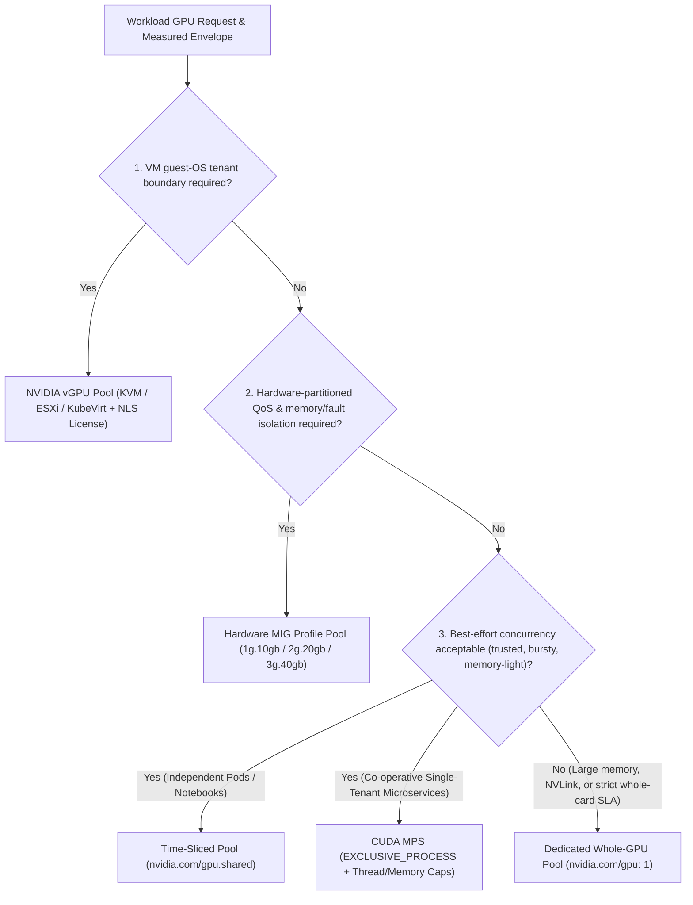
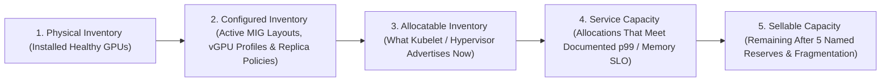

# 11.26 Choosing a GPU sharing model

| | |
|---|---|
| Level | Intermediate |
| Priority tier | 1 |
| Lab venue | GCP / GKE and local Python 3 simulation lab |
| Part | Part 11: GPUs on Kubernetes, scheduling and virtualization |
| Sources used | `nvidia-zero-to-hero/volume-11/chapter-06-comparing-mig-time-slicing-and-vgpu.md`; `nvidia-zero-to-hero/volume-11/chapter-09-capacity-planning-and-chargeback.md`; `volume-04/03-gpu-sharing-telemetry-masterclass.md`; `nvidia-zero-to-hero/volume-11/chapter-01-why-gpu-sharing-exists.md`; `nvidia-zero-to-hero/volume-11/chapter-07-kubernetes-scheduling-for-shared-gpus.md`; `nvidia-zero-to-hero/volume-11/chapter-11-production-troubleshooting.md`; `nvidia-zero-to-hero/volume-11/chapter-12-volume-11-summary.md`; `nvidia-zero-to-hero/volume-11/index.md`; `nvidia-zero-to-hero/volume-11/labs/lab-01-configure-and-validate-mig.md`; `nvidia-zero-to-hero/volume-11/labs/lab-02-configure-kubernetes-gpu-time-slicing.md`; `nvidia-zero-to-hero/volume-11/labs/lab-03-compare-sharing-performance-and-isolation.md`; `nvidia-zero-to-hero/volume-11/labs/lab-04-troubleshoot-a-multi-tenant-gpu-node.md` |
| Coverage file | `planning/coverage/chapters/11-26.md` |

## Why this matters for AI infrastructure

Many GPU sharing projects fail before they begin. The infrastructure team starts from a hardware feature instead of the workload contract. An engineer sees that H100 cards support MIG, or that the device plugin can advertise ten logical replicas, and switches the feature on. Nobody has checked latency sensitivity, peak memory bursts or tenant fault boundaries.

Worse, a shared GPU platform can fail commercially before it fails technically. That happens when its capacity and chargeback model counts time-sliced replicas, MIG slices and whole GPUs as interchangeable units. The Volume 11 notes record a planning failure that shows the problem clearly. A platform team saw a low fleet utilization average and deferred a hardware purchase. Two weeks later, a new inference tenant was stuck in Pending state with nowhere to run.

The fleet average had blended incompatible MIG layouts, counted nodes undergoing maintenance drains and ignored the spare capacity reserved for tail-latency targets. Packing ten inference pods onto a single GPU with Time-Slicing gives a full allocation dashboard in Kubernetes. Meanwhile, context-switch jitter ruins the latency that users actually receive.

The block below sets the two classic failures side by side, with the cause of each.

```text
The Two Classic GPU Sharing Platform Failures (volume-11/chapter-06 & chapter-09)
---------------------------------------------------------------------------------
1. The 48% Utilization Planning Trap:
   - Fleet dashboard average: 48% GPU utilization -> Hardware order deferred
   - 2 weeks later: New inference tenant stuck Pending (0 placeable 3g.40gb slices)
   - Root cause: 48% average blended 1g.10gb pools, maintenance drains, and p99 reserves

2. Allocation Efficiency vs. Delivered Efficiency Trap:
   - 10 inference pods packed on 1 GPU via Time-Slicing -> 100% Allocation Efficiency
   - Context-switch jitter pushes p99 past client timeout -> 0% Delivered Efficiency
   - Capacity Sizing Equation: N = ceil((D + F) / (A * (1 - H)))
```

Notice that both failures look healthy on a dashboard and fail in production.

This chapter brings NVIDIA vGPU, MIG, Time-Slicing and CUDA MPS into one selection framework and one capacity planning model. You will learn how to choose the right sharing mechanism for each workload class. You will also learn how to tell which mechanism is active on a live node during an outage. Then you will size node pools with a conservative reserve equation and bill tenants fairly with Allocation Contracts. Start from the workload contract, and treat the hardware feature as the last question.

## Prerequisites and outcomes

### Prerequisites

This chapter assumes three earlier chapters and some Kubernetes basics. Chapter 11.23 covers NVIDIA vGPU, Chapter 11.24 covers MIG in depth, and Chapter 11.25 covers Time-Slicing, MPS and oversubscription. You should also be familiar with Kubernetes extended resources and namespace resource quotas. Finish those chapters before you begin this one.

### Outcomes

By the end of this chapter, you will be able to do four things.

- You will walk the five-way GPU sharing decision tree across Dedicated Whole GPU, Hardware MIG, NVIDIA vGPU, Time-Slicing and CUDA MPS. You will also compare their resource boundaries, operational costs and lifecycle traps.
- You will run the three-step incident mechanism diagnostic playbook, which uses host queries, node statuses and pod UUID cross-referencing. It tells you at once which sharing mode a node and a pod are using.
- You will apply the five-layer capacity chain and size node pools across the five named reserves. You will also design an Allocation-Contract showback and chargeback rate card.
- You will run the cross-functional operational decision workshop across four owners. You will package the platform into a four-service catalog and carry out comparative benchmarking trials.

## Concepts: basics to intermediate to advanced

### 1. Basics: The five-way GPU sharing decision tree and active-mechanism diagnostics

#### 1. Starting from the Workload Contract

Platform architects often feel pressure to share every GPU in the data center. That pressure causes severe outages when it is applied to tightly coupled distributed jobs. A dedicated whole-GPU allocation remains mandatory for large synchronous distributed training runs across multi-GPU nodes.

Consider what a single failure does in that setting. In a rail-optimized InfiniBand fabric, one GPU failure or noisy neighbor halts the entire multi-node training job. The job then has to restart from its last checkpoint, which is costly. For these workloads, sharing adds zero value and a massive blast-radius risk.

The blast radius is easiest to see in numbers. The block below follows one training job through three kinds of failure.

```text
Synchronous Distributed Training Blast Radius (volume-04/03 Part 3)
-------------------------------------------------------------------
Workload : 175B-parameter synchronous distributed LLM pre-training
Hardware : 8-GPU HGX H100 nodes with 4 to 8 ConnectX-7 400G NDR NICs (1:1 rail ratio)
Node failure  : Takes down 8 GPUs -> Halts entire multi-node synchronous run
Leaf failure  : Takes down 1 Rack -> Halts entire multi-node synchronous run
Spine failure : Impacts 1 Pod     -> Halts entire multi-node synchronous run
Decision      : Dedicated Whole-GPU Pool (nvidia.com/gpu: 1), never shared
```

Notice that a failure at any of the three levels halts the same synchronous run. The decision therefore does not change with the level.

A candidate workload should pass three questions in order, from strongest isolation to best-effort concurrency. The first asks whether a virtual machine guest kernel boundary is required for regulatory or hypervisor isolation. The second asks whether hardware-partitioned quality of service, with dedicated memory controllers and fault isolation, is required. The third asks whether best-effort concurrency is acceptable for trusted, bursty and memory-light workloads. If it is, that third branch splits in two. Independent pods go to Time-Slicing, and cooperative single-tenant microservices go to CUDA MPS.

The diagram below follows those questions from the top.



#### 2. Comparing Resource Boundaries and Operational Costs

Each sharing mechanism draws its boundary at a different layer of the hardware and software stack. Streaming multiprocessors are the compute units of a GPU. A dedicated GPU gives one workload every streaming multiprocessor on the card, plus all of its high-bandwidth memory, known as HBM.

Hardware MIG cuts the silicon into isolated GPU Instances and Compute Instances, each with its own memory controllers and cache slices. Time-Slicing and CUDA MPS share one physical card through software scheduling or a shared CUDA context. NVIDIA vGPU hands a virtualized device to a guest virtual machine, under control of the hypervisor.

The table below compares the four mechanisms on the same dimensions.

| Dimension | Dedicated Whole GPU | Hardware MIG | Time-Slicing and CUDA MPS | NVIDIA vGPU |
|---|---|---|---|---|
| **Primary Resource Boundary** | Physical GPU device (`100%` SMs and HBM) | Supported hardware GPU Instance (`GI`/`CI` partition of SMs, HBM, L2, memory controllers) | Software-advertised logical replica (Time-Slicing) or shared context (MPS) | Virtual GPU device assigned to a guest VM (Time-Sliced or MIG-Backed) |
| **Capacity Unit** | Whole device (`nvidia.com/gpu: 1`) | Supported MIG profile (`nvidia.com/mig-1g.10gb`) | Logical replica (`nvidia.com/gpu.shared`) + physical GPU headroom | Supported virtual profile (`GRID A100-20Q`) |
| **Reconfiguration Cost** | Drain or reassign pod | Drain node, change `GI`/`CI` geometry, and reconcile device plugin | Adjust replica policy ConfigMap (ClusterPolicy) and validate contention | VM evacuation, profile assignment, and host manager lifecycle |
| **Fragmentation and Saturation Risk** | Low for homogeneous whole-GPU jobs | **Geometric fragmentation:** free slices may not form the next requested profile shape | **Hidden saturation:** physical memory and SM exhaustion hides behind green replica counts | Profile-slot homogeneity (`vgpu -c`) and VM host placement constraints |
| **Primary Observability** | Clean per-GPU and per-Pod DCGM metrics | Per-MIG-instance (`GI`/`CI`) + physical device telemetry | Physical device + host process (`nvidia-smi --query-processes`) + app latency | 4-tier: Host GPU + vGPU Manager + Guest OS driver + NLS license state |
| **Suitable Default Workload** | Distributed training (`175B` LLM), large models, or unprofiled sensitive jobs | Repeatable model-serving shapes (Embedding, Chat LLM) needing predictable `p99` | Interactive dev Jupyter notebooks, CI runners, bursty best-effort tasks | Regulated VMs, virtual desktops (VDI), and VM-centric enterprise estates |

Read across the rows. Hardware MIG carries geometric fragmentation risk, while Time-Slicing and CUDA MPS can hide saturation behind green replica counts.

#### 3. Quick Incident Diagnostic: Which Sharing Mechanism Is Active on This Node?

Picture an on-call engineer paged into an unfamiliar cluster during a latency spike. Guessing the sharing mode at that moment wastes recovery time. A pod spec that asks for one GPU resource token might be backed by a whole card, a time-sliced replica or a virtualized slice. A structured three-step playbook, run on the worker node and inside the affected pod, identifies the active mechanism in under a minute.

Start on the host. Log in to the worker node over SSH and inspect the physical GPU state. If the MIG mode query prints Enabled, and the instance list shows active GPU Instances, Hardware MIG is active. If the vGPU query lists virtual devices attached to guest domains, NVIDIA vGPU is active.

Time-Slicing has a different signature. Sometimes MIG is disabled on a single physical card while Kubernetes reports four or eight allocatable GPUs. When the host process table also shows multiple container processes on that same device, Time-Slicing is active.

Next, look from inside the affected pod. Run `nvidia-smi` in the container and check the `NVIDIA_VISIBLE_DEVICES` environment variable. Then compare the device UUID that the pod reports with the UUIDs of its neighbors on the same node. If multiple pods report the exact same full physical GPU UUID, they are time-slicing that card. If each pod reports a distinct `MIG-...` UUID or a distinct virtual GPU UUID, the workload is running on MIG or vGPU.

The same three steps appear below as a playbook.

```text
3-Step Live Incident Mechanism Diagnostic Playbook
-------------------------------------------------------------------------
Step 1: Host Worker Check (SSH to node)
  - nvidia-smi -i 0 --query-gpu=mig.mode.current -> Enabled + nvidia-smi mig -lgi -> MIG is active
  - nvidia-smi vgpu lists active VM instances                                     -> vGPU is active
  - 1 physical GPU (MIG Disabled) + 4 or 8 allocatable GPUs + multiple PIDs       -> Time-Slicing is active
  - 1 physical GPU (MIG Disabled) + 1 allocatable GPU + 1 PID                     -> Dedicated GPU is active

Step 2: Inside Affected Pod
  - kubectl exec <pod> -- nvidia-smi
  - Check echo $NVIDIA_VISIBLE_DEVICES

Step 3: Host-to-Pod UUID Cross-Reference
  - kubectl exec <pod> -- nvidia-smi --query-gpu=uuid --format=csv
  - Multiple pods show identical physical GPU-... UUID -> Time-Slicing
  - Each pod shows distinct MIG-... or virtual UUID     -> MIG or vGPU
```

Check the host first, then the pod, then the UUIDs. Together they settle which mechanism is active.

---

### 2. Intermediate: The five-layer capacity chain, the node sizing formula, and allocation-contract chargeback

#### 1. Why Low Fleet Utilization Can Mean Zero Available Capacity: The Five Capacity Layers

Leadership often relies on one fleet-wide GPU utilization percentage. That single number can freeze hardware purchases just before production services run out of room. A dashboard that shows forty-eight percent utilization does not show where the other fifty-two percent sits. Those free resources often sit on nodes with incompatible MIG geometries, on hosts cordoned for driver maintenance, or in latency headroom buffers. To avoid this planning failure, track five distinct capacity layers separately across every node pool.

Read the chain from left to right. Each layer narrows the one before it.



Physical inventory counts the installed, healthy GPUs, and it leaves out dead cards and RMA hardware. Configured inventory reflects the active MIG slice layouts, vGPU profiles and time-slicing replica policies that are currently applied to those cards. Allocatable inventory is what the kubelet or hypervisor advertises to the scheduler right now. Service capacity keeps only the allocations that meet your documented tail-latency and memory targets under load. Sellable capacity is what remains for tenants after you subtract operational reserves and profile fragmentation.

Report each layer separately, because a single number hides the gap between them.

#### 2. The Conservative Node Sizing Formula and the Five Named Reserves

When you size a standard node pool for one service class, a guessed flat percentage buffer either wastes capital or leaves the service vulnerable. The Volume 11 capacity model avoids guessing by using five explicit variables. You add committed concurrent demand to the expected loss from profile geometry fragmentation. Then you divide that total by the usable slots per standard node, after you discount for the non-sellable reserve headroom.

The block below defines each variable and works the formula for one pool.

```text
Conservative Node Pool Sizing Model (volume-11/chapter-09 & choosing_gpu_sharing_model.py)
------------------------------------------------------------------------------------------
Variables:
  D = Required concurrent allocations (or measured demand-equivalent in the service unit)
  F = Expected allocation loss from MIG/vGPU profile geometry fragmentation or placement rules
  A = Usable allocations provided by 1 standardized node after its approved layout is applied
  H = Planned non-sellable headroom fraction (0 <= H < 1)
  N = Required physical nodes

Formula:
  N = ceil((D + F) / (A * (1 - H)))

Worked Verification (H100 node pool with 4 x 1g.10gb + 1 x 3g.40gb layout -> A = 5 slots/node):
  Given: D = 70 allocations, F = 6 fragmentation slots, A = 5 usable slots/node, H = 0.20 (20%)
  Effective sellable slots per node = 5 * (1 - 0.20) = 4.0 slots/node
  Required nodes N = ceil((70 + 6) / 4.0) = ceil(76 / 4.0) = 19 nodes
```

Read the worked example from the bottom. Each node offers five slots, and a 20 percent headroom leaves 4.0 sellable slots per node. Dividing 76 by 4.0 gives 19 nodes.

Do not lump the headroom into a mysterious spreadsheet buffer, because finance teams will cut that buffer during budget reviews. Split the reserve fraction into five named reserves instead, so leadership can see which operational guarantee each one protects.

- **Node-failure reserve.** It protects committed service-level workloads when a whole worker node, or a rack's leaf switch, fails without warning.
- **Maintenance reserve.** It lets operators drain a node pool for host operating system, driver or MIG layout updates without breaking commitments.
- **Rollout reserve.** It keeps a healthy comparison canary pool running during staged model or runtime upgrades.
- **Demand-variance reserve.** It absorbs forecast error, sudden traffic bursts and seasonal spikes without breaching latency targets.
- **Fragmentation reserve.** It accounts for physically unused MIG or vGPU slices whose geometry cannot legally form the next requested profile shape.

Give each reserve its own line in the sizing model, so every fraction can be defended.

#### 3. Showback Before Chargeback: Billing on the Allocation Contract

Imagine five engineering teams sharing one expensive multi-GPU server. If you bill them only on sampled compute utilization, you create perverse incentives. A tenant can request a large forty-gigabyte MIG slice and leave it idle at zero percent compute utilization. Even while idle, that reservation locks half of the physical HBM and streaming multiprocessors in silicon. It blocks every other team from using that capacity.

Start with Showback. It reports consumption and cost attribution to teams without issuing financial invoices. Once ownership labels and dispute rules are verified, move to Chargeback, which bills on the Allocation Contract. A Prometheus pipeline joins pod resource requests from kube-state-metrics with duration and tier rates. Tenants then pay for the exact capacity boundary that they reserve or strand.

The table below gives the defensible billable unit for each service model, along with its rate logic and the mistake to avoid.

| Service Model | Defensible Primary Billable Unit | Example Rate-Card Logic | Anti-Pattern to Avoid |
|---|---|---|---|
| **1. Reserved Whole GPU** | **Reserved GPU-hour** or committed capacity period | `100%` of node/GPU hourly rate even while idle, because capacity is withheld from others | Billing a fluctuating utilization `%` sample as if it were a reservation |
| **2. Standard MIG Profile** | **Allocated profile-hour** with named profile and service tier | Requesting `MIG 3g.40gb` reserves `~50%` of H100 memory and compute, billed at `50%` of hardware + reserve rate | Calling every profile a universal throughput fraction without layout or reserve context |
| **3. Best-Effort Time-Sliced Pool** | **Access-hour**, queue class, or agreed workload outcome | Requesting `1` of `10` logical replicas (`nvidia.com/gpu.shared: 1`), billed at `10%` of hardware access rate | Promising deterministic compute or memory isolation in exchange for that `10%` fee |
| **4. NVIDIA vGPU Service** | **Assigned vGPU/VM-hour** or named workstation session tier | Bundles vGPU profile slot + mandatory hypervisor host, guest image, and NLS license entitlement costs | Billing the GPU separately from mandatory VM and licensing platform costs without disclosure |

Notice that each row bills what the tenant reserves. Start with Showback, and move to Chargeback only after the labels and dispute rules check out.

---

### 3. Advanced: The cross-functional decision workshop, four-service catalog, and class migration discipline

#### 1. Allocation Efficiency versus Delivered Efficiency and the Four-Owner Decision Workshop

Executives often push for higher cluster density. When they do, the platform team must separate scheduler assignment from real application performance. Allocation efficiency measures the percentage of logical GPU tokens or slices that appear assigned to pods in Kubernetes. Delivered efficiency measures the useful work that finishes within its documented latency, throughput and error-rate targets.

Packing extra replicas onto one card can lift allocation efficiency to one hundred percent. At the same time, delivered efficiency can fall to zero as requests time out.

Before you introduce any new shared GPU service class, hold a decision workshop with four accountable owners. That way, the technical and financial boundaries line up.

- **Application Owner.** This owner supplies the measured cold, steady and peak memory footprints. They also supply request arrival patterns, tail-latency or completion targets, and checkpoint recovery behavior.
- **Platform Owner.** This owner supplies the eligible GPU hardware SKUs, the driver and hypervisor support matrices, the standardized node-pool layouts and the node drain lifecycle rules.
- **Security Owner.** This owner defines and validates the required tenant blast-radius boundary across all seven isolation layers from Chapter 11.19.
- **Service and Finance Owner.** This owner defines the showback and chargeback unit, the reserve funding rules and the tenant entitlement policies.

Get all four owners' inputs before you approve a new class.

#### 2. The Four-Service Catalog and Safe Migration Between Sharing Classes

Suppose your internal request form lists every MIG slice permutation and every time-slicing replica ratio. Developers get overwhelmed, and your hardware pools fragment. Each extra class multiplies capacity forecasting, admission policies, dashboards, upgrade testing and geometric slice fragmentation. Instead, package the platform into four standardized catalog services, and review them on a regular cadence.

The table below lists each service with its mechanism, admission posture and failure behavior.

| Catalog Service Name | Underlying Sharing Mechanism | Admission Posture | Failure and Maintenance Behavior |
|---|---|---|---|
| **1. Interactive sandbox** | **Time-sliced** (`nvidia.com/gpu.shared`) | Bounded namespace quota and queue | Slowdown, contention, or recall is explicitly acceptable |
| **2. Protected inference** | **MIG profile** (`1g.10gb`, `2g.20gb`, `3g.40gb`) | Pre-admission load-test qualification + protected reserve | Controlled failover across nodes or bounded queueing |
| **3. Large job** | **Dedicated Whole GPU** (`nvidia.com/gpu: 1`) | Capacity reservation and gang-scheduled start | Checkpoint-aware maintenance windows (`dcgmi dmon` drain) |
| **4. Regulated VM** | **NVIDIA vGPU** (Time-Sliced or MIG-Backed) | VM template, RBAC, and NLS identity controls | Qualified 8-step host and guest lifecycle procedure |

Treat a class migration as a full application release. Moving a workload from a time-sliced pool to a MIG profile pool often triggers unexpected out-of-memory crashes. On an eighty-gigabyte card, that workload had silently borrowed idle neighbor VRAM during bursts.

Run the comparative benchmark protocol across whole-GPU, MIG and time-sliced trials. Hold the container image digest, the model artifact and the node constant while you do. Keep the input distribution, precision and concurrency identical across every run. Never change a live service class in place. Instead, introduce a versioned successor pool, canary-test it under neighbor load, and verify rollback before you retire the old pool.

Plan every class change as a release, with rollback checked before the old pool goes.

#### 3. Capacity Decision Records, Idle Reservation Governance, and the Four Review Cadences

Ad-hoc changes to MIG layouts or replica ratios break capacity forecasts and strand tenant budgets. Any material change to the GPU service catalog therefore needs a Capacity Decision Record, with eight fields, signed off before rollout. The record ties measured demand evidence and hardware compatibility to your reserve assumptions and rollback checks.

The block below lists the eight fields and the four review cadences.

```text
8-Field Capacity Decision Record & 4 Review Cadences
---------------------------------------------------------------------------
8-Field Capacity Decision Record:
  1. Service change         : New profile, revised time-slicing policy, added pool, or reserve rule
  2. Demand evidence        : Measured concurrency, queue distribution, base/committed/high forecast
  3. Compatibility          : Hardware SKU, driver, hypervisor/runtime, and GPU Operator versions
  4. Capacity model         : Usable slots A, reserve H, fragmentation F, failure domain (Node/Leaf/Spine)
  5. Tenant impact          : Projects gaining, losing, or changing service behavior during transition
  6. Alternatives considered: Keep catalog, pick another sharing mode, buy hardware, or defer demand
  7. Acceptance criteria    : Placement, application SLO, observability join, and rollback checks
  8. Review date            : Scheduled date to revisit forecast, utilization, and rate assumptions

4 Capacity Review Cadences:
  - Weekly operational review  : Pending requests, reserve consumption, failed nodes, drift, expirations
  - Monthly service review     : SLO/queue trends, idle commitments, attribution exceptions, borrowing
  - Quarterly planning review  : Forecast scenarios, catalog changes, procurement lead time, cost model
  - Before material change     : Canary capacity, rollback capacity, compatibility, tenant comms
```

The weekly review catches day-to-day drift, while the review before a material change guards each rollout.

Suppose a weekly chart shows low streaming multiprocessor activity inside a reserved GPU or MIG slice. Do not reclaim that capacity automatically. Check the workload service contract first. A protected inference pool often holds reserved headroom to absorb sudden traffic bursts, or to survive a node failover within its latency target.

Use the four-stage governance matrix across your review cadences. It turns idle allocation metrics into structured right-sizing or borrowing conversations. The matrix below shows what to ask first, and who owns each response.

| Operational Observation | Diagnostic Question Before Acting | Approved Governance Response | Review Cadence Owner |
|---|---|---|---|
| **1. Low SM activity in a protected Reserved or MIG allocation** | Is the reservation holding a documented `p99` burst buffer, deadline, or failover guarantee? | Retain the reservation if required by the SLO; otherwise right-size to a smaller MIG profile at renewal or define scheduled off-peak release windows. | **Monthly Service Review** (SLO and queue trends and idle commitments) |
| **2. Long-lived GPU allocation with missing or stale owner labels** | Is `kube-state-metrics` or Project attribution broken or did team ownership change mid-quarter? | Reconcile namespace and project ownership labels in the billing pipeline before modifying or evicting the workload. | **Weekly Operational Review** (pending requests, drift, and expiring reservations) |
| **3. Best-effort Interactive sandbox pool is queued behind idle reserved pools** | Does the platform borrowing policy allow temporary over-quota use with bounded recall? | Enable revocable over-quota borrowing (KAI Queue `limit > quota` or Kueue Cohort borrowing) only for checkpointed jobs with a tested `30 s` `SIGTERM` eviction path. | **Monthly Service Review** (borrowing and preemption audit) |
| **4. Recurring Pending backlog for `3g.40gb` while `1g.10gb` slices sit idle** | Has workload demand shifted away from the current static node-pool MIG layout? | Rebalance node-pool layouts (`mig-parted` labels) during a planned maintenance window (Before material change review) and update the Quarterly Planning Review forecast. | **Quarterly Planning Review** (catalog mix and procurement lead time) |

Each row ends in a review, so an idle metric starts a conversation rather than an action.

#### 4. The Five Selection Anti-Patterns and Exit Criteria for a New Service Class

Well-funded AI platforms still stumble when they design sharing tiers around vendor marketing instead of measured workload envelopes. Before you publish a new GPU sharing class in production, check that its design avoids five recurring selection anti-patterns.

- **Mechanism-first MIG.** Teams enable MIG only because Hopper or Ampere hardware supports it. They do not verify that target models and peak KV-cache footprints fit inside the supported profiles.
- **Average-utilization time-slicing.** Teams turn on eight or ten logical replicas because a fleet dashboard shows low average utilization. Measure concurrent tail latency and memory high-water marks first.
- **Unmanaged vGPU.** Teams adopt vGPU only because the enterprise runs virtual machines. Assign an engineering owner for the hypervisor, host manager, guest driver and license compatibility lifecycle first.
- **Permanent whole-GPU default.** A small two-gigabyte embedding service or notebook gets an exclusive eighty-gigabyte GPU, and keeps it forever. A measured MIG pool or a shared development pool multiplies access safely.
- **Average-memory sizing.** Teams pick a profile or replica density from average memory usage. They ignore burst allocations, model load peaks and post-failure recovery reserves.

A new sharing class clears the production exit gate only when five operational requirements are verified and documented. The first is that its supported hardware, software scope and excluded workloads are published. The second is that its namespace admission and `ResourceQuota` rules pass automated tests. The third is that its capacity unit can be reported in the Showback and Chargeback pipelines. The fourth is that its Lab 03 comparative benchmark can be reproduced. The fifth is that its named owner, recovery reserve fraction and next review date are recorded.

Treat the exit gate as a checklist you finish before the class goes live.

## Commands and configurations that matter

### 1. Live Incident Triage: Identifying the Active Sharing Mechanism

In a production incident, you need to know how a worker node splits its GPUs. The node may partition them in hardware, multiplex them in a hypervisor or time-slice them in software. The first block below asks the host about MIG mode, active GPU Instances, virtual GPU attachments and process density on the physical card. The second block checks the Kubernetes allocatable counts and matches the device UUID seen inside the pod.

```bash
# 1. Host-side check: MIG vs vGPU vs Time-Slicing process density
nvidia-smi -i 0 --query-gpu=mig.mode.current --format=csv,noheader
nvidia-smi mig -lgi
nvidia-smi vgpu
nvidia-smi --query-processes=pid,process_name,gpu_memory_usage --format=csv

# 2. Kubernetes-side check: Allocatable counts and Host-to-Pod UUID cross-reference
kubectl get nodes -o custom-columns=NAME:.metadata.name,GPU:.status.allocatable.nvidia\.com/gpu,SHARED:.status.allocatable.nvidia\.com/gpu\.shared
kubectl exec -n prod-serving pod/inference-0 -- nvidia-smi --query-gpu=uuid --format=csv
```

Run the host commands first, then the Kubernetes commands.

### 2. Comparative Sharing Benchmark Job Manifest

Before you move a workload between whole GPUs, MIG slices and time-sliced pools, run a controlled trial. Keep the node, the container image and the runtime probe the same in every trial. The Kubernetes Job manifest below pins the trial pod to one test node and requests a single hardware MIG slice. The pod logs the visible device geometry and utilization, and then it prints the completion marker that you check in the logs.

```yaml
# sharing-trial-comparative-probe.yaml
apiVersion: batch/v1
kind: Job
metadata:
  name: sharing-trial-mig
  namespace: gpu-sharing-comparison
  labels:
    experiment: gpu-sharing-comparison
    trial: mig
spec:
  backoffLimit: 0
  template:
    spec:
      restartPolicy: Never
      nodeSelector:
        kubernetes.io/hostname: gpu-test-node-1
      containers:
        - name: benchmark
          image: nvcr.io/nvidia/cuda:12.4.1-base-ubuntu22.04
          command:
            - sh
            - -c
            - |
              date -u +%Y-%m-%dT%H:%M:%SZ
              nvidia-smi -L
              nvidia-smi --query-gpu=index,name,driver_version,memory.total,memory.used,utilization.gpu --format=csv,noheader
              sleep 60
              echo SHARING_RUNTIME_PROBE_COMPLETE
          resources:
            limits:
              nvidia.com/mig-1g.10gb: 1
```

Look for the completion marker in the pod logs. Its presence confirms that the probe ran to the end.

## How it fails

When a sharing strategy or capacity model breaks, you usually see the symptoms as a stuck Pending pod, an erratic latency spike, an out-of-memory crash or a budget shortfall. The table below helps you map each symptom to its root cause boundary and to a fix.

| Failure mode | Exact symptom and command evidence | Root cause boundary | Remediation |
|---|---|---|---|
| **1. Fleet dashboard shows `48%` average GPU utilization, yet new MIG `3g.40gb` requests stay Pending for days** | `kubectl describe pod` logs `0/N nodes are available: Insufficient nvidia.com/mig-3g.40gb`, while fleet-wide `DCGM_FI_DEV_GPU_UTIL` averages `48%`. | **Collapsing the 5 Capacity Layers:** The `48%` average blended incompatible `1g.10gb` pools, counted draining or maintenance nodes, and ignored `p99` burst headroom and profile geometry fragmentation. | Report **Sellable Capacity** per named profile and node pool (Layer 5), separate from Physical (Layer 1) and Allocatable (Layer 3) inventory, and size pools with `N = ceil((D + F) / (A * (1 - H)))`. |
| **2. Supposedly isolated inference service suffers erratic `p99` tail-latency spikes during daytime notebook hours** | Pod requested generic `nvidia.com/gpu: 1`; `kubectl exec <pod> -- nvidia-smi --query-gpu=uuid` returns the same physical GPU UUID as `7` neighboring dev notebooks. | **Ambiguous Resource Identity Across Pools:** Time-sliced nodes advertised `nvidia.com/gpu` without `renameByDefault: true`, allowing `kube-scheduler` to place a latency-sensitive service onto a best-effort node. | Rename time-sliced resources to `nvidia.com/gpu.shared`, isolate pools with distinct node labels, taints, and `ResourceQuotas`, and migrate the inference service to a validated **MIG** or **Dedicated** pool. |
| **3. Migrating a workload from Time-Slicing to a `1g.10gb` MIG slice causes immediate CUDA Out of Memory crashes** | Workload ran without OOM on an `80 GB` time-sliced GPU when neighbors were idle, but crashes immediately on `1g.10gb` (`10 GB`). | **Unmeasured Peak Memory Borrowed During Time-Slicing:** On the `80 GB` time-sliced card, the workload silently burst to `14 GB` using idle neighbor VRAM; `1g.10gb` enforces a hard `10 GB` silicon wall. | Profile cold, steady, and concurrent-peak memory in a discovery trial (`labs/lab-03`) before migrating classes, and assign the workload to `2g.20gb` (`20 GB`) or `3g.40gb` (`40 GB`). |
| **4. Chargeback model bills teams by sampled `DCGM_FI_DEV_GPU_UTIL`, causing a budget deficit while `100%` of MIG slices are allocated** | All `20` H100 MIG nodes are `100%` allocated to tenant pods (`0` free slices), but because tenants sit at `15%` average SM utilization, chargeback recovers only `15%` of hardware cost. | **Billing Utilization Instead of Allocation Contract:** A tenant holding a `3g.40gb` slice (`50%` of the GPU) blocks anyone else from using those SMs and HBM whether their utilization is `1%` or `100%`. | Bill Reserved Whole GPU, Standard MIG Profile, and vGPU tiers on **Allocated or Reserved Profile-Hours** (`kube-state-metrics` resource requests multiplied by time), using DCGM utilization only as supplementary right-sizing evidence. |
| **5. Planned driver maintenance drain violates protected inference SLOs because `H = 0%` reserve was budgeted** | Every MIG slot in the `20`-node pool was sold (`100%` sellable); draining `1` node (`5` slots) leaves evicted pods Pending with nowhere to land. | **Missing Named Maintenance and Node-Failure Reserves:** Capacity planning equated Allocatable Inventory (Layer 3) with Sellable Capacity (Layer 5). | Budget explicit **Node-failure**, **Maintenance**, **Rollout**, **Demand-variance**, and **Fragmentation** reserves (`H > 0` in `N = ceil((D + F) / (A * (1 - H)))`) and test maintenance drains against the reserve model before launch. |

> **dcgm-exporter 4.9.0 version note.** dcgm-exporter 4.9.0 (2026-11-06) renamed many default metrics and changed some units. For example `DCGM_FI_DEV_GPU_UTIL` (percent) became `DCGM_FI_DEV_GPU_UTIL_RATIO` (0 to 1), and `DCGM_FI_DEV_FB_USED` (MiB) became `DCGM_FI_DEV_FB_USED_BYTES`. The metric names in this chapter are the 4.8.x names. On a 4.9.0 exporter use the [full mapping in 17.4](../part-17-operations/04-dcgm-exporter-and-interpreting-gpu-metrics.md#14-what-dcgm-exporter-490-renamed), and change thresholds together with the unit.

Find the symptom you are seeing first, then trace it to its root cause before you apply the fix.

## Hands-on lab

### Venue and scope

A mistake in a capacity sizing equation or a sharing decision tree is far cheaper to catch in a local simulation. Catch it there before you repartition production H100 nodes. The lab runs locally with the Python 3 standard library, through `code/part11/choosing_gpu_sharing_model.py` and `code/part11/choosing_gpu_sharing_model_lab.py`. It checks the five-way decision tree, the active-mechanism diagnostic classifier, the five-layer capacity hierarchy and the five named reserves. It also checks the conservative node sizing formula, the Allocation-Contract chargeback rules and the four-service catalog. The host and cluster commands earlier in the chapter are marked untested here.

### Step 1: Run the self-checking GPU sharing model selection and capacity lab (tested here)

From the repository root, run the self-checking script. It validates all twenty-five decision, capacity and chargeback invariants.

```bash
python3 code/part11/choosing_gpu_sharing_model_lab.py
```

The output below was captured from the repository.

```text
=== Chapter 11.26 Lab: Choosing a GPU Sharing Model, Capacity & Chargeback ===
  [PASS] VM tenant boundary requirement selects vGPU billed by Assigned vGPU/VM-hour
  [PASS] Hardware-partition QoS requirement (without VM boundary) selects MIG billed by Allocated profile-hour
  [PASS] Best-effort interactive concurrency selects Time-slicing billed by Access-hour or queue class
  [PASS] Cooperative single-tenant spatial microservice sharing selects CUDA MPS in EXCLUSIVE_PROCESS mode
  [PASS] Workload rejecting VM, MIG, and best-effort sharing selects Dedicated GPU billed by Reserved GPU-hour
  [PASS] Host with mig.mode.current=Enabled classifies active mechanism as MIG
  [PASS] Host with active nvidia-smi vgpu instances classifies active mechanism as vGPU
  [PASS] Host with 1 physical GPU (MIG Disabled) and 4 or 8 allocatable replicas / multiple PIDs classifies as Time-slicing
  [PASS] Host with 1 physical GPU, MIG Disabled, 1 allocatable GPU, and 1 PID classifies as Dedicated GPU
  [PASS] Volume 11 Ch 9 defines 5 capacity layers from Physical inventory to Sellable capacity
  [PASS] Volume 11 Ch 9 defines 5 named reserves (Node-failure, Maintenance, Rollout, Demand-variance, Fragmentation)
  [PASS] Volume 11 Ch 9 formula N = ceil((D + F) / (A * (1 - H))) yields ceil((70 + 6) / (5 * 0.8)) = 19 nodes
  [PASS] Volume 11 Ch 9 planning incident explains why a 48% fleet utilization chart can still block a MIG request
  [PASS] Volume 11 Ch 9 chargeback bills MIG 3g.40gb (~50% GPU) and 1-of-10 time-sliced replica (10% rate) on Allocation Contract
  [PASS] Volume 11 Ch 6 Figure 11.6.2 Operational Decision Workshop brings together 4 owners (Application, Platform, Security, Service/Finance)
  [PASS] Volume 11 Ch 6 Service Catalog defines 4 distinct services (Interactive sandbox, Protected inference, Large job, Regulated VM)
  [PASS] Volume 11 Ch 6 distinguishes Allocation Efficiency (% assigned) from Delivered Efficiency (work meeting SLO)
  [PASS] Volume 04 Ch 3 Part 3 models HGX H100 (8 GPUs, 4-8 ConnectX-7 400G NICs) blast radius for a 175B LLM job (Node=8 GPUs, Leaf=Rack, Spine=Pod)
  [PASS] Volume 11 Lab 03 compares Whole GPU, MIG, and Time-Slicing using SHARING_RUNTIME_PROBE_COMPLETE and SHARING_NEIGHBOR_PROBE_COMPLETE
  [PASS] Volume 11 Lab 01 validates 6 H100 MIG profiles (MIG_VALIDATION_COMPLETE) and -dci before -dgi rollback
  [PASS] Volume 11 Lab 02 validates time-slicing (1 -> 4 allocatable in 30s, TIME_SLICE_A_COMPLETE) and ordered ClusterPolicy rollback
  [PASS] Volume 11 Lab 04 validates DIAGNOSTIC_GPU_OK and QUOTA_DENIAL_RECOVERY_CHECK
  [PASS] Volume 11 Ch 1 & Ch 12 Summary enforce 9-step decision sequence and 9-area production checklist
  [PASS] Volume 11 Ch 9 defines 4 capacity review cadences (Weekly operational, Monthly service, Quarterly planning, Before material change)
  [PASS] Volume 11 Ch 7 & Ch 11 align Kubernetes scheduling policies with 6-layer incident triage

Summary: 25 passed, 0 failed out of 25 checks.
```

The summary line is the one you should check first. It should read 25 passed and 0 failed.

### Exercises

1. Walk the five-way GPU sharing decision tree. Call `select_gpu_sharing_model()` in `code/part11/choosing_gpu_sharing_model.py` on five common AI platform workloads. For each one, you should state the selected sharing model, its primary resource boundary and its billable unit. The workloads are regulated VM workstations, latency-bound inference, dev notebooks, cooperative MPS microservices and distributed LLM training.

2. Find the mechanism on a live node. Suppose you are on a live cluster incident. State the exact host and Kubernetes observations in `detect_active_sharing_mechanism` that distinguish MIG, vGPU, Time-Slicing and Dedicated GPU.

3. Work through the utilization paradox. List the five capacity layers in `FIVE_CAPACITY_LAYERS`, in order. Then explain how a cluster can report forty-eight percent average GPU utilization while it has zero sellable capacity for a new `3g.40gb` MIG request.

4. Size a node pool with the reserve equation. Run `compute_required_nodes_vol11_ch9(70, 6, 5, 0.20)` in the chapter module. Calculate the effective sellable allocations per node and the required number of physical nodes. Then you list the five named reserves stored in `FIVE_NAMED_RESERVES`.

5. Design an Allocation-Contract rate card. Explain why billing shared GPUs only by sampled `DCGM_FI_DEV_GPU_UTIL` percentage fails when a tenant holds an idle `3g.40gb` MIG slice. Then you state the correct billable unit for Interactive sandbox, Protected inference, Large job and Regulated VM.

6. Run a class migration and the Lab 03 comparative benchmark. Explain why moving a workload from Time-Slicing to MIG can uncover a hidden memory OOM crash. Then you describe the comparative probe protocol, using `SHARING_RUNTIME_PROBE_COMPLETE` and `SHARING_NEIGHBOR_PROBE_COMPLETE`.

## Checkpoint questions

<details>
<summary>**1. Walk through the four decision questions in Volume 11 Chapter 6 Figure 11.6.1 for selecting a GPU sharing model.**</summary>

Start by asking whether the workload needs a virtual machine tenant boundary. If it does, choose NVIDIA vGPU on a supported hypervisor stack. If it does not, ask whether the workload needs hardware-partitioned quality of service with memory, compute and cache isolation. If it does, choose a Hardware MIG profile pool. Next, check whether best-effort concurrency is acceptable for trusted, bursty and memory-light workloads. If it is, pick a Time-Sliced pool for independent pods, or CUDA MPS for cooperative single-tenant spatial execution. Last, if none of these fit, because the job uses large models, NVLink training or a whole-card SLA, choose a Dedicated whole GPU.
</details>

<details>
<summary>**2. Compare the capacity unit and primary observability source across Dedicated GPU, MIG, Time-Slicing, and vGPU (Volume 11 Chapter 6).**</summary>

A Dedicated GPU counts as one physical device, and you observe it through device and application metrics. For MIG, the capacity unit is a supported hardware profile such as `1g.10gb` or `3g.40gb`. You observe it through per-instance GI and CI metrics, plus physical device telemetry. Time-Slicing counts a logical replica token, plus physical GPU headroom. Its observability needs physical device telemetry, host process queries through `nvidia-smi --query-processes`, and application latency metrics. For vGPU, the capacity unit is a supported virtual profile slot listed by `nvidia-smi vgpu -c`. Observability spans the host GPU, the vGPU Manager, the guest driver and the NLS license state.
</details>

<details>
<summary>**3. During an incident, how do you determine in 60 seconds whether a GPU node and pod are using MIG, Time-Slicing, or vGPU (Volume 11 Chapter 6)?**</summary>

On the host worker node, you run `nvidia-smi mig -lgi` to look for active GPU Instances, which indicate MIG. Run `nvidia-smi vgpu` to look for active virtual GPUs, which indicate vGPU. Then you run `nvidia-smi --query-processes=pid,process_name --format=csv` to see whether many container PIDs share one non-MIG GPU, which indicates Time-Slicing. Next, you check inside the pod with `kubectl exec <pod> -- nvidia-smi --query-gpu=uuid --format=csv`. If multiple pods see the exact same full physical `GPU-...` UUID, they are time-slicing the card. If each pod sees a unique `MIG-...` or virtual `GPU-...` UUID, the node is using MIG or vGPU.
</details>

<details>
<summary>**4. What is the difference between Allocation Efficiency and Delivered Efficiency in Volume 11 Chapter 6?**</summary>

Allocation efficiency is the share of logical GPU tokens or slices that look assigned to workloads in the Kubernetes scheduler. Delivered efficiency is the useful work that finishes within its documented latency, throughput and error-rate targets. A cluster can show high allocation and still have low delivered efficiency. That happens when long queues, retries or tail-latency timeouts pile up.
</details>

<details>
<summary>**5. Who are the four participants in the Operational Decision Workshop (Volume 11 Chapter 6 Figure 11.6.2), and what does each participant contribute?**</summary>

The Application owner brings the service objective and measured workload evidence on memory, latency, concurrency and recovery behavior. The Platform owner brings the eligible hardware SKUs, the driver support matrices and the node lifecycle rules. The Security owner defines and verifies the tenant isolation boundary. The Service and Finance owner sets the cost model, the chargeback unit and the tenant entitlement rules.
</details>

<details>
<summary>**6. Why should a platform team offer fewer GPU sharing classes in its service catalog than the hardware can technically expose (Volume 11 Chapter 6)?**</summary>

Each extra service class adds work to forecasting, documentation, admission rules, observability dashboards, support runbooks, upgrade testing and profile geometry fragmentation. You should add a class to the catalog only when measured workload demand and a distinct governance requirement justify it.
</details>

<details>
<summary>**7. Name the four services in the Volume 11 Chapter 6 Service-Catalog Example and their underlying mechanisms and failure behaviors.**</summary>

The Interactive sandbox uses a time-sliced pool with bounded quota and queue rules, and slowdown or recall is acceptable there. Protected inference uses a MIG profile pool, with pre-admission qualification and protected reserves. When it fails, the service fails over in a controlled way or queues within bounds. The Large job uses a Dedicated GPU with capacity reservation and a coordinated start, and maintenance follows checkpoint-aware windows. The Regulated VM uses NVIDIA vGPU with VM and identity controls, governed by a qualified host and guest lifecycle procedure.
</details>

<details>
<summary>**8. Why can migrating a workload from a time-sliced pool to a MIG profile pool trigger unexpected CUDA OOM errors, and how do you prevent it (Volume 11 Chapter 6)?**</summary>

For example, on an eighty-gigabyte time-sliced GPU, a bursty workload can quietly borrow idle VRAM. It peaks at fourteen gigabytes whenever the neighboring notebooks are inactive. Move that workload to a `1g.10gb` MIG slice, and the hardware enforces a hard ten-gigabyte memory wall, which triggers an out-of-memory crash straight away. To prevent this, you profile the cold, steady and concurrent-peak memory high-water marks in a canary trial before you migrate the class.
</details>

<details>
<summary>**9. In Volume 11 Chapter 9, why did a cluster reporting 48% average GPU utilization fail to schedule a new inference tenant's MIG request?**</summary>

The forty-eight percent fleet average blended incompatible MIG profile layouts. It also counted temporarily unavailable or draining nodes as usable capacity. It ignored the spare headroom that protects existing tenants' tail-latency targets. As a result, no node had the contiguous free slice geometry the new request needed.
</details>

<details>
<summary>**10. List the five layers of the Capacity Constraint Chain in Volume 11 Chapter 9 Figure 11.9.1 and the common planning error at each layer.**</summary>

Physical inventory fails when teams count a failed, drained, unsupported or maintenance-bound GPU as available. Configured inventory fails when teams assume that a supported MIG or vGPU profile is schedulable at once, without a node layout change. Allocatable inventory fails when teams treat advertised time-sliced replicas as independent physical GPUs. Service capacity fails when teams equate scheduler placement with delivered SLO performance. Sellable capacity fails when teams sell all of the theoretical capacity and call the failure and maintenance reserves unused utilization.
</details>

<details>
<summary>**11. Write the conservative node sizing formula from Volume 11 Chapter 9, define each variable (D, F, A, H, N), and compute N for D=70, F=6, A=5, and H=0.20.**</summary>

The formula is `N = ceil((D + F) / (A * (1 - H)))`. Here `D` is the required concurrent allocations, and `F` is the expected allocation loss from geometry fragmentation. `A` is the usable allocations per standard node. `H` is the planned non-sellable headroom fraction, and `N` is the required number of physical nodes. You substitute seventy for `D`, six for `F`, five for `A` and `0.20` for `H`. That gives seventy-six divided by four sellable slots per node, so you need nineteen physical nodes.
</details>

<details>
<summary>**12. What are the five Named Reserves that make up headroom (H) in Volume 11 Chapter 9?**</summary>

The Node-failure reserve protects committed workloads when a node or failure domain goes down. The Maintenance reserve lets you drain a node pool for planned host, driver or MIG layout updates. The Rollout reserve keeps a healthy comparison canary pool during staged upgrades. The Demand-variance reserve absorbs forecast error, burst windows and seasonal spikes. Last, the Fragmentation reserve covers physically unused profile geometry that cannot legally host the next requested shape.
</details>

<details>
<summary>**13. Why must GPU chargeback bill on the Allocation Contract rather than sampled GPU compute utilization % (Volume 11 Chapter 9)?**</summary>

For example, a tenant who requests a `MIG 3g.40gb` profile, or a dedicated GPU, has locked that hardware exclusively in silicon. Even at zero percent compute utilization, no other tenant can use those forty gigabytes of HBM or those streaming multiprocessors. Billing on the Allocation Contract charges fifty percent of the hardware rate for `3g.40gb`. For one of ten time-sliced replicas, it charges ten percent of the access rate. Either way, tenants pay for the capacity they reserve.
</details>

<details>
<summary>**14. What is the difference between Showback and Chargeback in Volume 11 Chapter 9, and why should a platform start with Showback first?**</summary>

Showback reports consumption and cost attribution to engineering teams without issuing an internal invoice. Chargeback applies actual budget transfers and invoices. Starting with Showback lets you check that tenant ownership labels in kube-state-metrics, allocation intervals and billable units are accurate. Only then should the team attach financial penalties.
</details>

<details>
<summary>**15. State the defensible primary billable unit for each of the four service models in Volume 11 Chapter 9.**</summary>

A reserved whole GPU is billed by reserved GPU-hour, or by committed capacity period. A standard MIG profile is billed by allocated profile-hour, naming the exact profile and service tier. A best-effort time-sliced pool is billed by access-hour, queue class or agreed workload outcome. Last, an NVIDIA vGPU service is billed by assigned vGPU/VM-hour or named workstation session tier.
</details>

<details>
<summary>**16. What are the eight questions in the Rate-Card Review Checklist in Volume 11 Chapter 9?**</summary>

The first three questions ask which workload outcome the tier protects. They ask whether the allocation is dedicated, partitioned, oversubscribed or virtualized. They also ask which physical and scheduler constraints limit it. The next three ask what reserve is included and who may use it. They ask which events earn a service credit or incident review, and which data settles consumption and disputes. The last two ask which upgrades or layout changes can disrupt the tier, and what is explicitly not guaranteed.
</details>

<details>
<summary>**17. What six deceptive inputs does Volume 11 Chapter 9 ("What not to forecast from") warn against using directly as capacity commitments?**</summary>

Never forecast directly from a vendor benchmark run on a different model, version, topology or workload. Do not forecast from one average utilization number blended across service classes. Do not use the maximum number of time-sliced replicas that scheduled in a synthetic test. Do not treat the arithmetic fraction of a MIG profile as a guaranteed throughput fraction. Last, do not rely on a one-week demand sample without a known workload calendar. Do not publish a cost rate that leaves out the operational reserve it needs to honor its guarantee.
</details>

<details>
<summary>**18. What are the four Capacity Review Cadences in Volume 11 Chapter 9 and the minimum decisions made at each cadence?**</summary>

The weekly operational review checks pending requests, reserve consumption, failed nodes, layout drift and expiring reservations. The monthly service review evaluates SLO and queue trends, idle commitments, attribution exceptions and borrowing behavior. The quarterly planning review updates forecast scenarios, catalog changes, procurement lead time and cost assumptions. Last, the before-material-change review verifies canary capacity, rollback capacity, hardware compatibility and customer communication.
</details>

<details>
<summary>**19. In Volume 4 Chapter 3 Part 3, how do Node, Rack (Leaf Switch), and Pod (Spine Switch) failure domains map to blast radius on an 8-GPU HGX H100 cluster running a 175B LLM training job?**</summary>

A node failure takes down eight GPUs, which connect through intra-node NVLink and NVSwitch, along with four to eight ConnectX-7 `400G` NICs. A leaf switch failure takes down an entire rack. A spine switch failure takes down an entire pod. Because `175B` LLM pre-training runs synchronously across all ranks, a failure in any one GPU halts the whole multi-node job. The job then restarts from the last checkpoint. That blast radius is why large synchronous training uses Dedicated Whole GPUs rather than multi-tenant sharing.
</details>

<details>
<summary>**20. How does the Shared GPU Chargeback Pipeline in Volume 11 Chapter 9 Figure 11.9.3 join Kubernetes and hardware data to generate a tenant invoice?**</summary>

First, kube-state-metrics exports pod resource requests for `nvidia.com/mig-*`, `nvidia.com/gpu` and `nvidia.com/gpu.shared`. At the same time, DCGM Exporter sends optional hardware usage telemetry to Prometheus. Next, Prometheus recording rules multiply each pod's resource request by its allocation duration and the published tier rate. That calculation feeds the FinOps Showback and Chargeback dashboard, which generates the tenant invoice.
</details>

## Sources and review notes

```text
Primary Sources Mapped and Migrated in Full for Chapter 11.26
-------------------------------------------------------------
1. nvidia-zero-to-hero/volume-11/chapter-06-comparing-mig-time-slicing-and-vgpu.md
   - Figure 11.6.1 4-branch decision tree, resource boundary & operational cost tables
   - 3-step active-mechanism diagnostic playbook, Figure 11.6.2 4-owner decision workshop
   - Allocation Efficiency vs Delivered Efficiency, 6-input capacity evaluation worksheet
   - Class migration discipline, 5 selection anti-patterns, exit criteria, 4-service catalog

2. nvidia-zero-to-hero/volume-11/chapter-09-capacity-planning-and-chargeback.md
   - 48% utilization planning incident, Figure 11.9.1 5-layer capacity chain
   - N = ceil((D + F) / (A * (1 - H))) sizing formula (D=70, F=6, A=5, H=0.20 -> N=19)
   - 5 named reserves, Figure 11.9.2 MIG fragmentation flowchart
   - Showback vs Chargeback on Allocation Contracts (3g.40gb ≈ 50%, 1/10 time-slice = 10%, $30,000 GPU / 5 teams)
   - 8-question rate-card checklist, 8-field capacity decision record, 4-stage idle governance
   - 6 invalid forecast inputs, 4 review cadences, Figure 11.9.3 Kube-State-Metrics + Prometheus pipeline

3. volume-04/03-gpu-sharing-telemetry-masterclass.md
   - Part 1 comparing Time-Slicing, MPS, MIG, and vGPU; Part 2 DCGM :9400
   - Part 3 8-GPU HGX H100 4-8 ConnectX-7 400G NICs 175B LLM blast radius (Node/Leaf/Spine)
   - Part 4 dcgmi dmon -e 203 drain; Part 5 dcgmi diag -r 3 + all_reduce_perf

4. Supporting Volume 11 chapters and labs:
   - nvidia-zero-to-hero/volume-11/chapter-01-why-gpu-sharing-exists.md
   - nvidia-zero-to-hero/volume-11/chapter-07-kubernetes-scheduling-for-shared-gpus.md
   - nvidia-zero-to-hero/volume-11/chapter-11-production-troubleshooting.md
   - nvidia-zero-to-hero/volume-11/chapter-12-volume-11-summary.md
   - nvidia-zero-to-hero/volume-11/index.md
   - nvidia-zero-to-hero/volume-11/labs/lab-01-configure-and-validate-mig.md
   - nvidia-zero-to-hero/volume-11/labs/lab-02-configure-kubernetes-gpu-time-slicing.md
   - nvidia-zero-to-hero/volume-11/labs/lab-03-compare-sharing-performance-and-isolation.md
   - nvidia-zero-to-hero/volume-11/labs/lab-04-troubleshoot-a-multi-tenant-gpu-node.md
```

### Primary sources read in full for this chapter
- Author's Volume 11 and Volume 4 notes listed in the block above were read and migrated in full. They cover the five-way GPU sharing decision tree, active-mechanism diagnostics, the five-layer capacity chain, the node sizing formula, and the Allocation-Contract chargeback model.

### Related source files mapped in MIGRATION_MAP.md
- All eleven mapped files for Chapter 11.26 in the migration map plus the capacity planning and chargeback chapter are cited and covered in full.

### Run here
- The verification suite `python3 code/part11/choosing_gpu_sharing_model_lab.py` was executed locally and passed all twenty-five checks.

### Explicitly labelled inferences
- The numerical example for the node pool sizing formula in the text block above is a deterministic calculation verified by `code/part11/choosing_gpu_sharing_model_lab.py`.

### Not verified on live hardware
- All host `nvidia-smi`, cluster `kubectl` (`sharing-trial-whole`, `sharing-trial-timeslice`, `high-demand`, `Leaf/Rack` and `Spine/Pod` failure domains, `kueue.x-k8s.io/v1beta1`, `resource.k8s.io/v1`), and Prometheus recording rules (from `nvidia-devops` `chapter-07-kubernetes-scheduling-for-shared-gpus.md`, `chapter-11-production-troubleshooting.md`, `chapter-12-volume-11-summary.md`, and `volume-11/labs/lab-01..04` / `labs/lab-01..04` in `2026`) are marked untested here.

### Not in the corpus
- Third-party SaaS FinOps billing connectors and custom CSV pricing schemas are outside the corpus. This chapter uses the `kube-state-metrics` and Prometheus recording rule pipeline from Volume 11 Chapter 9.

### Corrections to the author's notes
- The YAML manifests and commands are marked untested and were not applied to a live cluster. Custom resource API versions change between releases, so check them against the version you install. Console outputs quoted from the Volume notes are illustrative unless the chapter says otherwise.
- Earlier author note: all decision trees, capacity formulas, and chargeback models match the Volume 11 and Volume 4 source notes verbatim.
