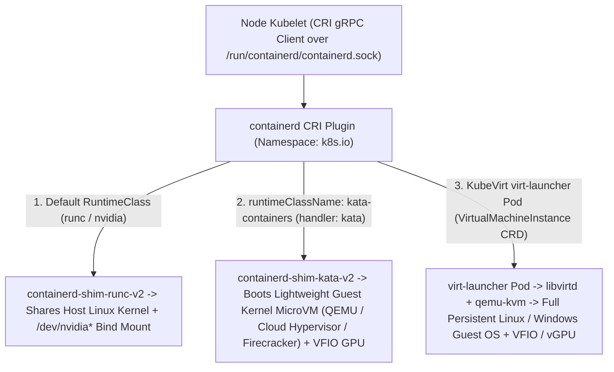
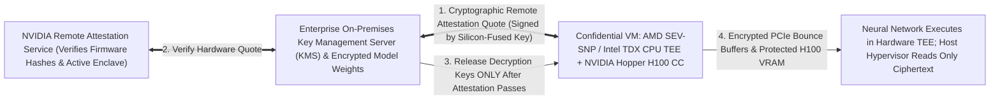

# 11.27 Virtual machines on Kubernetes: KubeVirt, Kata and GPU passthrough

| | |
|---|---|
| Level | Advanced |
| Priority tier | 1 |
| Lab venue | GCP / GKE (plus local Python 3 simulation lab) |
| Part | Part 11: GPUs on Kubernetes, scheduling and virtualization |
| Sources used | Josh Rosso et al., *Production Kubernetes* (`production-kubernetes`, O'Reilly, 2021, Ch. 3 *Container Runtime*); Brendan Gregg, *Systems Performance: Enterprise and the Cloud*, 2nd Edition (`systems-performance-2nd-edition`, Addison-Wesley, 2020, Ch. 11 *Cloud Computing*); `nvidia-zero-to-hero/volume-18/chapter-06-gpu-sharing-security.md`; `nvidia-zero-to-hero/volume-18/chapter-09-confidential-computing-and-attestation.md` |
| Coverage file | `planning/coverage/chapters/11-27.md` |

## Why this matters for AI infrastructure

Chapter 11.24 showed how Multi-Instance GPU, or MIG, isolates GPU compute, HBM memory capacity, L2 cache banks, memory controllers and crossbar paths in silicon. That raises a direct question for AI platform engineers. Why run Virtual Machines with KubeVirt, or MicroVMs with Kata Containers, inside a Kubernetes cluster when hardware MIG already exists? Two hard security and operational problems answer that question. Both come from the GPU sharing and confidential computing threat models in Volume 18.

The first problem is that standard Linux containers still share one host OS kernel, even with MIG enabled. Volume 18 Chapter 6 compares its isolation tiers in plain terms. Time-Slicing is a hostel room, MIG is a set of concrete-walled hotel suites, and vGPU or VM virtualization is a VIP penthouse guarded by a hypervisor. All seven MIG containers on a bare-metal worker node still make syscalls to the same host Linux kernel. Picture a hostile tenant in MIG Instance 0 who exploits a Linux kernel vulnerability to escape the container and gain host root. That tenant can then run `nvidia-smi mig` on the host, destroy sibling partitions and inspect host memory.

The second problem is Data in Use. Disk encryption protects Data at Rest, and network encryption protects Data in Transit. Neither one protects proprietary LLM weights or classified user prompts while they sit decrypted in system RAM and GPU VRAM during inference. Protecting Data in Use against an untrusted cloud hypervisor takes a hardware-encrypted Confidential Virtual Machine. That VM pairs a CPU Trusted Execution Environment, such as AMD SEV-SNP or Intel TDX, with NVIDIA Hopper H100 Confidential Computing and Remote Attestation.

Kubernetes can now schedule standard OCI containers and hardware-isolated Virtual Machines on the same cluster. Platform teams use two complementary architectures to get that isolation.

Kata Containers runs standard OCI container images inside a dedicated, fast-booting MicroVM. It uses QEMU, Cloud Hypervisor, or AWS Firecracker through the containerd v2 shim API.

KubeVirt runs full, persistent Linux or Windows Virtual Machines inside a launcher Pod. It integrates with the NVIDIA GPU Operator sandboxed workload operands for VFIO passthrough and vGPU attachment.

Before you pick a runtime for a tenant, decide whether a host-kernel escape belongs in your threat model.

## Prerequisites and outcomes

### Prerequisites
- Finish Chapters 11.2, 11.21, 11.22 and 11.23 first. They cover the Container Toolkit, VFIO, SR-IOV and NVIDIA vGPU.
- You should already be comfortable with Kubernetes Pod specifications and containerd operations.

### Outcomes
After completing this chapter, you will be able to:
- Trace how kubelet starts a Pod over the Container Runtime Interface and Open Container Initiative specifications, and contrast containerd, CRI-O and Kata Containers.
- Architect KubeVirt and NVIDIA GPU Operator Sandboxed Workloads using the VFIO manager, vGPU manager and KubeVirt GPU device plugin. These components attach whole GPUs or vGPU profiles into guest VMs.
- Apply the Volume 18 Chapter 6 Multi-Tenant GPU Security Threat Matrix to regulated medical workloads on HGX H100 servers. The matrix defends against both VRAM snooping and host-kernel container escapes.
- Design a Confidential Computing AI architecture that combines AMD SEV-SNP or Intel TDX Confidential VMs with NVIDIA Hopper H100 Confidential Computing. You will also walk through the five-step Cryptographic Remote Attestation Protocol.

## Concepts: basics to intermediate to advanced

### 1. Basics: From OCI/CRI containers to Kata MicroVMs and KubeVirt VMs

#### 1. How kubelet, CRI, and OCI Launch Workloads
When a Pod fails to start on a GPU node, you need to know which layer between the kubelet and the Linux kernel broke. As Josh Rosso et al. explain in *Production Kubernetes* Chapter 3, Kubernetes hands container creation to a pluggable runtime. That runtime works to two industry standards, the Open Container Initiative and the Container Runtime Interface.

The Open Container Initiative defines three core specifications, and each one covers a different job. The OCI Runtime Specification defines the filesystem bundle, the `config.json` mounts, the process arguments and the environment variables. It also defines four strict container lifecycle stages, which runc implements.

The OCI Image Specification defines how a multiplatform image index points to an architecture-specific image manifest. Each manifest holds a configuration document and content-addressable tar+gzip filesystem layers. The OCI Distribution Specification standardizes the HTTP API that container registries use to push and pull OCI image manifests and blobs.

The Container Runtime Interface is a gRPC and Protocol Buffers API. It exposes two services, RuntimeService and ImageService, over a local Unix domain socket. When kubelet starts a Pod on a worker node, it invokes five CRI gRPC methods in exact sequential order. Use the table below as a lookup. It summarizes the OCI and CRI specifications, exact byte sizes, socket paths and startup sequence from *Production Kubernetes* Chapter 3.

| Specification / Component | Exact Version / Socket / Namespace | Lifecycle Sequence / Byte Sizes / Details (*Production Kubernetes* Ch. 3) |
|---|---|---|
| **OCI Runtime Specification** | `ociVersion: "1.0.1"` (`established 2015`, `runc`) | Four lifecycle stages: `1. creating -> 2. created -> 3. running -> 4. stopped` |
| **OCI Image Index (Multiplatform)** | `schemaVersion: 2` (`application/vnd.oci.image.index.v1+json`) | Maps platform manifests such as `ppc64le/linux` (`size 7143`) and `amd64/linux` (`size 7682`) |
| **OCI Image Manifest** | `schemaVersion: 2` (`application/vnd.oci.image.manifest.v1+json`) | Contains `config` (`size 7023`) and `3` `tar+gzip` `layers` (`sizes 32654, 16724, 73109`) addressed by `sha256` digests |
| **CRI Startup Sequence (`v1.5`)** | `RuntimeService` & `ImageService` gRPC API | `1. RunPodSandbox -> 2. ImageStatus -> 3. PullImage -> 4. CreateContainer (returns containerd://<id>) -> 5. StartContainer` |
| **containerd Runtime** | `/run/containerd/containerd.sock` (`namespace: k8s.io`) | Inspect Kubernetes containers with `ctr --namespace k8s.io containers ls` or `crictl` |
| **CRI-O Runtime** | `/var/run/crio/crio.sock` (`conmon` monitor) | Uses `conmon` as the parent container process monitor; inspected via `crictl` |
| **Legacy Docker (`dockershim`)** | `/var/run/dockershim.sock` (`namespace: moby`) | Encodes Pod names as `k8s_<container>_<pod>_<ns>_<uid>` and pause containers as `k8s_POD_...` |
| **Virtual Kubelet** | Pluggable `kubelet` API facade | Registers a virtual Node and translates Pods to serverless backends (`AWS Fargate`, `Azure Container Instances`, `HashiCorp Nomad`) |

Read the table row by row, and you will notice the difference in namespaces. containerd places Kubernetes containers in the `k8s.io` namespace, while CRI-O relies on `conmon` as its parent container process monitor.

#### 2. Kata Containers vs KubeVirt vs Standard runc Containers
Standard OS containers share the host Linux kernel. A single kernel panic or root privilege escalation compromises every workload on the node. To replace that shared kernel with a hardware-isolated Virtual Machine, platform teams use either Kata Containers or KubeVirt. Both models reach the node through the container runtime path in the diagram below.



The diagram shows three routes from containerd. The default route keeps the host kernel. The Kata route boots a guest kernel inside a MicroVM. The KubeVirt route runs a full guest OS inside a launcher Pod.

Next, compare the three models across architecture, GPU attachment and performance. The table combines data from *Production Kubernetes* Chapter 3 and Brendan Gregg's *Systems Performance* Chapter 11.

| Architectural Dimension | Standard OS Container (`runc` / `nvidia-container-runtime`) | Kata Containers MicroVM (`runtimeClassName: kata-containers`) | KubeVirt Full VM (`VirtualMachine` / `VirtualMachineInstance` CRD) |
|---|---|---|---|
| **User-Facing Kubernetes Object** | Standard `Pod` / `Deployment` / `JobSet` | Standard `Pod` / `Deployment` with `spec.runtimeClassName: kata-containers` | `VirtualMachine` (`VM`) & `VirtualMachineInstance` (`VMI`) CRDs wrapped inside a `virt-launcher` Pod |
| **Runtime & Hypervisor Plumbing** | `containerd-shim-runc-v2` -> `runc` (`namespaces` + `cgroups` on host kernel) | `containerd-shim-kata-v2` -> spawns lightweight VMM (`QEMU`, `Cloud Hypervisor`, or `Firecracker` `50K` LoC) | `virt-controller` + `virt-handler` DaemonSet + per-VM `virt-launcher` Pod running `libvirtd` & `qemu-kvm` (`> 1.4M` LoC) |
| **Guest Kernel & OS Support** | **None:** Shares the host Linux kernel (`1` kernel panic or root escape hits all pods) | Dedicated minimal guest Linux kernel per Pod (`< 45–100 ms` boot, `5–50 MB` RAM overhead, `SP 11.4` / `Table 11.7`) | Full persistent guest OS kernel (**Linux or Windows** desktop/server) with live-migration & PVC disk lifecycle |
| **Kata QEMU Process Footprint (`PK Ch. 3`)** | Host process directly visible in host `ps` | Host `ps -ef \| grep qemu` shows `PID 38290` `/snap/kata-containers/690/usr/bin/qemu-system-x86_64 -machine pc,accel=kvm,kernel_irqchip -cpu host -m 2048M,slots=10,maxmem=65005M` | Host `ps` shows `qemu-system-x86_64` inside the `virt-launcher` Pod's cgroup |
| **GPU Attachment Path** | User-space `libnvidia-container` / CDI bind-mounts `/dev/nvidia*` or MIG `GI`/`CI` | **VFIO Passthrough (`/dev/vfio/<group>`)** of whole GPU or SR-IOV MIG/vGPU VF into the MicroVM kernel | **`spec.domain.devices.gpus`** (`kubevirt-gpu-device-plugin`) attaching `vfio-pci` whole GPU or mediated `vGPU` (`mdev` / SR-IOV VF) |

Read the GPU attachment row last. It shows why you cannot give a container and a VM the same plumbing to reach one physical GPU.

---

### 2. Intermediate: Operating KubeVirt and GPU Operator Sandboxed Workloads

On a node that runs standard container workloads, the NVIDIA GPU Operator loads the host GPU driver. It also runs the device plugin, which exposes device nodes to containers. A physical GPU cannot belong to the host `nvidia.ko` driver and pass through to a guest VM kernel via VFIO at the same time. If you leave the standard container driver running on a node meant for KubeVirt VMs, the VM launch fails immediately.

The NVIDIA GPU Operator automates this switch when you enable sandboxed workloads in the cluster policy. You then label individual worker nodes to choose one of two VM GPU modes.

Mode A is whole-GPU PCIe passthrough, and it applies to nodes labeled `nvidia.com/gpu.workload.config=vm-passthrough`. On those nodes, the GPU Operator stops the standard container driver pods and schedules the `nvidia-vfio-manager` DaemonSet. That DaemonSet unbinds the physical GPUs from host drivers and binds them to `vfio-pci`. The `nvidia-kubevirt-gpu-device-plugin` then discovers those VFIO-bound GPUs through sysfs and advertises them on the Kubernetes Node. When a user submits a KubeVirt VirtualMachine manifest, `virt-controller` creates a `virt-launcher` Pod.

Finally, `virt-handler` passes the VFIO group into QEMU, so the guest VM can load its own full NVIDIA driver.

Mode B is shared NVIDIA vGPU or MIG-backed vGPU, and it applies to nodes labeled `nvidia.com/gpu.workload.config=vm-vgpu`. The GPU Operator schedules the `nvidia-vgpu-manager` DaemonSet and the vGPU device plugin. The device plugin creates the configured SR-IOV or mediated vGPU profiles on the physical GPUs, then advertises those profiles to Kubernetes. Multiple KubeVirt VMs can therefore share one physical GPU, each with hypervisor isolation.

The label decides what runs on the node and what the node advertises. Read the table as a lookup, from the label you set to the driver and resource name you get.

| GPU Operator Node Label (`nvidia.com/gpu.workload.config`) | Active Node DaemonSets (`sandboxWorkloads.enabled: true`) | Host Kernel Driver Bound to GPU | Advertised Kubernetes Extended Resource Example |
|---|---|---|---|
| `container` (Default) | `nvidia-driver-daemonset` + `nvidia-device-plugin` | `nvidia.ko` (`/dev/nvidia0..7`) | `nvidia.com/gpu: 8` or `nvidia.com/mig-1g.10gb: 7` |
| `vm-passthrough` | `nvidia-vfio-manager` + `nvidia-kubevirt-gpu-device-plugin` | `vfio-pci` (`/dev/vfio/<group_id>`) | `nvidia.com/GH100_H100_SXM5_80GB: 8` or `nvidia.com/GA100_A100_SXM4_80GB: 8` |
| `vm-vgpu` | `nvidia-vgpu-manager` + `nvidia-vgpu-device-plugin` / `kubevirt-gpu-device-plugin` | `nvidia-vgpu-vfio` (`mdev` / SR-IOV VF) | `nvidia.com/GRID_A100-20Q: 4` |

If you set the passthrough label, the table advertises `nvidia.com/GH100_H100_SXM5_80GB: 8`, so the node offers eight whole H100 GPUs. A VM that requests one of them leaves seven.

---

### 3. Advanced: The multi-tenant GPU threat matrix and Confidential Computing VMs

#### 1. Why MIG Alone Cannot Stop a Host-Kernel Container Escape
Many teams assume that a dedicated Kubernetes Namespace, or enabling hardware MIG, guarantees complete multi-tenant isolation. Volume 18 Chapter 6 shows why both assumptions fail when untrusted tenants share a bare-metal host kernel.

Software time-slicing is the "Hostel Room" of GPU sharing. It gives no hardware quotas and no memory walls. One tenant can allocate all 80 GB of VRAM, which triggers an immediate out-of-memory denial of service against a neighbor. Both tenants also share the same L2 cache and CUDA fault domain.

Volume 18 Chapter 6 gives a clear case. Consider a university IT team that proposed running HIPAA medical research in a separate Namespace on a time-sliced H100 cluster. Kubernetes Namespaces only isolate API objects in etcd, and they do nothing to isolate GPU VRAM. Time-slicing therefore fails HIPAA compliance immediately.

Put the numbers together. For example, if one tenant allocates all 80 GB, the shared pool has nothing left for the neighbor.

Hardware MIG is the "Hotel Suites" option. Quarantining an HGX H100 server, tainting the node against student pods and enabling MIG isolates the GPU hardware. Each instance gets dedicated crossbar ports, L2 cache banks, memory controllers and DRAM address buses. Instance 0 physically cannot address the memory of Instance 1. However, all MIG containers on a node still share the same Linux host kernel. A tenant who escapes to host root can run `nvidia-smi mig` on the host and compromise every partition.

KubeVirt or Kata with vGPU or VFIO passthrough is the "VIP Penthouse". Untrusted tenants and LLM code sandboxes need stronger kernel isolation. Placing each tenant inside a KubeVirt VM or Kata MicroVM inserts a hardware hypervisor and IOMMU boundary between the guest and host kernels. If a host-kernel escape is in your threat model, choose that boundary over MIG alone.

#### 2. Protecting "Data in Use": Confidential Computing VMs and Remote Attestation
Now consider a different threat. The risk is not a neighboring container. It is the cloud provider or the hypervisor administrator. As Volume 18 Chapter 9 explains, encrypting a hard drive protects Data at Rest, and encrypting network links protects Data in Transit. However, when a standard cloud VM runs an LLM, its model weights and user prompts sit in plaintext inside host DRAM and GPU HBM. A rogue hypervisor administrator with host root access, or someone with a physical PCIe bus logic analyzer, can dump that plaintext memory trivially.

To run classified defense models or high-value proprietary weights in an untrusted cloud, you must deploy a Confidential Virtual Machine. That architecture combines three hardware mechanisms. The diagram shows the key flow. The enclave sends a signed quote, the attestation service checks it, and only then does the KMS release keys into the enclave.



The CPU Trusted Execution Environment encrypts the system RAM of the Confidential VM at the silicon level. As Volume 18 Chapter 9 stresses, a GPU alone cannot make a Virtual Machine confidential. The CPU side must run inside an AMD SEV-SNP or Intel TDX Trusted Execution Environment.

NVIDIA Hopper H100 Confidential Computing mode places H100 VRAM inside a hardware-protected region that the host OS and hypervisor cannot read. All data moving between the CPU TEE and the H100 GPU over the PCIe bus is encrypted in hardware through encrypted bounce buffers. Session keys are negotiated directly between the CPU TEE and the GPU hardware Root of Trust.

The five-step Cryptographic Remote Attestation Protocol proves mathematically that the cloud provider booted your VM inside a genuine hardware enclave. No model decryption keys leave your enterprise Key Management Server until verification passes.

```text
Volume 18 Chapter 9 — Data Encryption States & 5-Step Cryptographic Remote Attestation Protocol:
- Data at Rest: Disk / SSD encryption (AES-256).
- Data in Transit: Network link encryption (TLS / IPSec).
- Data in Use: Active computation encryption inside CPU RAM + PCIe bounce buffers + GPU VRAM (AMD SEV-SNP / Intel TDX + NVIDIA Hopper H100 Confidential Computing).

5-Step Remote Attestation Sequence:
Step 1: Confidential VM boots and requests a cryptographic attestation quote from the CPU TEE and NVIDIA H100 GPU.
Step 2: Hardware generates a signed attestation report containing exact firmware hashes, boot state measurements, and proof that Confidential Computing mode is active.
Step 3: The chip signs this quote using an unextractable private key fused into the silicon during manufacturing.
Step 4: The enterprise Key Management Server (KMS) validates the quote against an independent Attestation Service (NVIDIA Remote Attestation Service).
Step 5: Only if the cryptographic signature and measurements pass verification does the enterprise KMS transmit decryption keys into the enclave to unlock the encrypted model weights.
```

If you design for classified or proprietary models, plan for all three mechanisms and for attestation together.

#### 3. Mixed-Mode Node Pools: Co-Locating Standard Containers, Kata MicroVMs, and KubeVirt VMs
Running a separate VMware vSphere or OpenStack cluster next to Kubernetes forces platform teams to duplicate storage, networking and observability stacks. Running Kata Containers and KubeVirt on Kubernetes consolidates both workloads onto a single control plane.

Kata Containers plugs into containerd through the v2 shim API, while standard containers use the runc v2 shim. A single worker node can therefore run trusted runc Pods and untrusted Kata MicroVM Pods side by side. When an LLM agent executes untrusted Python or Bash code inside a tool-calling sandbox Pod, assign `runtimeClassName: kata-containers`. That setting places the code inside an isolated guest Linux kernel, so a kernel exploit cannot escape into the host OS.

A physical GPU cannot bind to `nvidia.ko` and `vfio-pci` at the same time. The NVIDIA GPU Operator solves this with a single node label, so administrators can move a node between container mode, whole-GPU passthrough mode and vGPU mode.

The table turns these choices into four decision scenarios. Use it when you pick the runtime and node label for each workload.

| Decision Scenario | Recommended Kubernetes Runtime & GPU Mode | `nvidia.com/gpu.workload.config` Node Label | Primary Security & Operational Benefit |
|---|---|---|---|
| **1. Trusted Internal Training & Inference Pods** | Standard `containerd` (`runc` + `nvidia-container-runtime`) + Whole GPU or **MIG** | `container` | Zero VM memory translation (`EPT`) overhead; full host-level DCGM & process visibility (`SP 11.6`). |
| **2. Untrusted Code Execution / Agentic AI Sandboxes** | **Kata Containers** (`runtimeClassName: kata-containers`) + VFIO GPU or MIG VF | `vm-passthrough` (or CDI VFIO) | Dedicated guest Linux kernel per Pod (`45–100 ms` boot) blocks host-kernel container escapes (`PK Ch. 3`). |
| **3. Persistent Linux/Windows Workstations or Legacy VM Apps** | **KubeVirt** (`VirtualMachine` CRD inside `virt-launcher` Pod) + **vGPU** or Whole GPU | `vm-vgpu` or `vm-passthrough` | Full persistent guest OS lifecycle, Windows support, and hypervisor boundary managed via `kubectl` / GitOps. |
| **4. Classified / Proprietary Models on Untrusted Public Cloud** | **Confidential VM** (**AMD SEV-SNP** / **Intel TDX** + **NVIDIA Hopper `H100` CC**) + **Remote Attestation** | `vm-passthrough` (Confidential VM) | Encrypts **Data in Use** across CPU RAM, PCIe bounce buffers, and H100 VRAM (`volume-18/chapter-09`). |

Notice that only the first scenario keeps the host kernel. Each of the other three puts a VM or MicroVM boundary between the workload and the host, so pick the row that matches your threat model before you label any node.

## Commands and configurations that matter

Each block below is marked untested here, so none of it has been run on a live cluster.

### 1. Kubernetes RuntimeClass and Pod Manifest for Kata Containers

Start with the RuntimeClass. It maps a name to a runtime handler, and your Pod then asks for that name.

```yaml
# kata-runtimeclass-and-gpu-pod.yaml (Production Kubernetes Ch. 3, untested here)
apiVersion: node.k8s.io/v1
kind: RuntimeClass
metadata:
  name: kata-containers
handler: kata
---
apiVersion: v1
kind: Pod
metadata:
  name: kata-isolated-inference
  namespace: tenant-a
spec:
  runtimeClassName: kata-containers
  containers:
    - name: inference
      image: nvcr.io/nvidia/pytorch:24.08-py3
      resources:
        limits:
          nvidia.com/gpu: 1
```

The `runtimeClassName` line sends this Pod to the `kata` handler.

### 2. Enabling Sandboxed Workloads in GPU Operator and Launching a KubeVirt GPU VM

If you run the patch, sandboxed workloads turn on, and the label selects passthrough for one node.

```bash
# Enable KubeVirt / VFIO sandboxed workloads in GPU Operator and label node for VM passthrough (untested here)
kubectl patch clusterpolicy gpu-cluster-policy --type merge \
  -p '{"spec":{"sandboxWorkloads":{"enabled":true,"defaultWorkload":"container"}}}'
kubectl label node gpu-node-vm-1 nvidia.com/gpu.workload.config=vm-passthrough --overwrite
```

```yaml
# kubevirt-gpu-passthrough-vm.yaml (untested here)
apiVersion: kubevirt.io/v1
kind: VirtualMachine
metadata:
  name: regulated-ai-vm
  namespace: medical-research
spec:
  running: true
  template:
    spec:
      domain:
        cpu:
          cores: 16
        resources:
          requests:
            memory: 64Gi
        devices:
          gpus:
            - name: h100-gpu-0
              deviceName: nvidia.com/GH100_H100_SXM5_80GB
          disks:
            - name: rootdisk
              disk:
                bus: virtio
      volumes:
        - name: rootdisk
          containerDisk:
            image: quay.io/kubevirt/ubuntu-22.04-container-disk:latest
```

### 3. Inspecting CRI Containers and Kata QEMU Processes on a Worker Node

```bash
# 1. Inspect Kubernetes containers via containerd (k8s.io namespace) and crictl (PK Ch. 3, untested here)
sudo ctr --namespace k8s.io containers ls
sudo crictl --runtime-endpoint unix:///run/containerd/containerd.sock ps

# 2. Inspect running Kata Containers / KubeVirt QEMU processes on the host (PK Ch. 3, untested here)
ps -ef | grep qemu-system-x86_64
```

If you want to see what containerd runs, use the first command. The second shows the QEMU processes on the host.

## How it fails

When a VM or MicroVM deployment fails on Kubernetes, you usually see one of three visible symptoms. A compliance audit rejects the design, a Pod gets stuck in creation, or a VirtualMachine stays pending forever. The table below maps each failure mode to the command evidence you can gather, its root cause boundary and its fix.

| Failure mode | Exact symptom & command evidence | Root cause boundary | Remediation |
|---|---|---|---|
| **1. HIPAA compliance audit rejects running medical LLM training in a separate Kubernetes Namespace on a time-sliced H100 cluster (`volume-18/chapter-06`)** | IT placed medical research pods in `namespace: medical` on a node pool sharing GPUs with student notebooks via `replicas: 8`. | **Logical API Boundary Confused with Physical Hardware Boundary:** Kubernetes Namespaces only isolate API objects; time-slicing shares one global HBM pool and L2 cache with zero hardware memory or fault isolation. | Quarantine dedicated HGX H100 servers with Node Taints, disable time-slicing, and enforce hardware **MIG** (`Chapter 11.24`)—or **KubeVirt / vGPU VMs** if host-kernel escape is in the threat model. |
| **2. Defense compliance officer rejects uploading encrypted model weights (`AES-256` on disk) to standard public-cloud GPU VMs (`volume-18/chapter-09`)** | Team encrypted the EBS/persistent volume (`Data at Rest`) and network (`TLS`), but the cloud hypervisor admin still has root access to host DRAM and GPU VRAM while the model runs. | **Unprotected "Data in Use" on an Untrusted Hypervisor:** Standard VMs must decrypt weights into plaintext RAM/VRAM during inference, allowing a rogue hypervisor admin to dump memory. | Deploy a **Confidential VM** on **AMD SEV-SNP** (or **Intel TDX**) CPUs paired with **NVIDIA Hopper (`H100`) Confidential Computing**, and gate key release on **5-step Remote Attestation**. |
| **3. KubeVirt `VirtualMachine` requesting `nvidia.com/GH100_H100_SXM5_80GB` stays `Pending` on a GPU node (`Layer 3/4` Sandboxed Mode)** | `kubectl get pods -n gpu-operator` shows `nvidia-driver-daemonset` running on the node instead of `nvidia-vfio-manager` and `kubevirt-gpu-device-plugin`. | **Missing Node Workload Config Label:** The node defaulted to `nvidia.com/gpu.workload.config=container` (`nvidia.ko`), so the GPUs were not bound to `vfio-pci` for KubeVirt. | Enable `sandboxWorkloads.enabled: true` in `ClusterPolicy` and label the target node `nvidia.com/gpu.workload.config=vm-passthrough` (or `vm-vgpu`). |
| **4. Pod specifying `runtimeClassName: kata-containers` stays stuck in `ContainerCreating` with `runtime "io.containerd.kata.v2" binary not found` (*Production Kubernetes* Ch. 3)** | `kubectl describe pod` logs `FailedCreatePodSandBox: ... handler "kata" not configured in containerd`. | **Missing `containerd` CRI Handler Mapping:** The `RuntimeClass` object exists in the API server, but `/etc/containerd/config.toml` on the worker node lacks the `[plugins."io.containerd.grpc.v1.cri".containerd.runtimes.kata]` entry or `containerd-shim-kata-v2` binary. | Install the Kata runtime binaries on the node, register the `kata` runtime handler in `/etc/containerd/config.toml` (or via GPU Operator / Kata Operator), and restart `containerd`. |
| **5. Operator runs `ctr containers ls` on a `containerd` node and sees `0` containers even though `kubectl get pods` shows `20` running Pods (*Production Kubernetes* Ch. 3)** | `sudo ctr containers ls` returns an empty table on a healthy worker node. | **Missing `containerd` Namespace Flag (`k8s.io` vs `default`/`moby`):** `ctr` defaults to the `default` namespace (and Docker uses `moby`), whereas Kubernetes `kubelet` places all CRI containers into the **`k8s.io`** namespace. | Run `sudo ctr --namespace k8s.io containers ls` or use the CRI-native CLI `sudo crictl --runtime-endpoint unix:///run/containerd/containerd.sock ps`. |

Start with the command evidence column. It tells you which layer to check before you change anything.

## Hands-on lab

### Venue and scope
You can run this lab on your own machine with the Python 3 standard library. The scripts are `code/part11/vms_on_k8s_kubevirt_kata_gpu.py` and `code/part11/vms_on_k8s_kubevirt_kata_gpu_lab.py`. They check the OCI and CRI startup sequence from *Production Kubernetes* Chapter 3, the runtime decision engine, the Multi-Tenant GPU Threat Matrix and the five-step Remote Attestation validator from Volume 18. Cluster and node commands are marked untested here.

### Step 1: Run the self-checking KubeVirt, Kata and GPU passthrough lab (tested here)

Start the lab from the repository root with this command.

```bash
python3 code/part11/vms_on_k8s_kubevirt_kata_gpu_lab.py
```

This is the captured output from this repository.

```text
=== Chapter 11.27 Lab: Virtual Machines on Kubernetes (KubeVirt, Kata & GPU Passthrough) ===
  [PASS] PK Ch 3 OCI runtime specification (ociVersion 1.0.1) defines 4 lifecycle stages (creating, created, running, stopped)
  [PASS] PK Ch 3 CRI (introduced in K8s v1.5) starts a Pod via RunPodSandbox -> ImageStatus -> PullImage -> CreateContainer -> StartContainer
  [PASS] PK Ch 3 containerd listens on /run/containerd/containerd.sock and uses k8s.io namespace (vs moby for Docker and /var/run/crio/crio.sock + conmon for CRI-O)
  [PASS] PK Ch 3 Kata Containers integrates with containerd via v2 containerd-shim API and RuntimeClass (handler: kata)
  [PASS] PK Ch 3 Kata QEMU example (PID 38290) runs -machine pc,accel=kvm,kernel_irqchip -cpu host -m 2048M,slots=10,maxmem=65005M
  [PASS] Persistent VM lifecycle or Windows guest OS selects KubeVirt (virt-launcher + nvidia-vfio-manager + kubevirt-gpu-device-plugin)
  [PASS] Transparent Pod-level MicroVM isolation selects Kata Containers (RuntimeClass handler: kata) with dedicated guest kernel
  [PASS] Trusted cloud-native workload selects standard Linux container (containerd + runc) sharing the host kernel
  [PASS] Volume 18 Ch 6 HIPAA medical scenario rejects software time-slicing and requires hardware MIG on quarantined tainted nodes (or VM isolation)
  [PASS] Volume 18 Ch 6 explains that MIG isolates crossbar ports, L2 cache banks, memory controllers, and DRAM buses, but still shares the Host Kernel
  [PASS] Volume 18 Ch 6 explains that a root container escape on a MIG host allows an attacker to run nvidia-smi mig and compromise sibling slices
  [PASS] Volume 18 Ch 6 positions vGPU / VM passthrough ('VIP Penthouse') above MIG when host-kernel container escape is in the threat model
  [PASS] Volume 18 Ch 9: Hopper GPU Confidential Computing without a CPU TEE (AMD SEV-SNP or Intel TDX) is rejected
  [PASS] Volume 18 Ch 9: Confidential VM without cryptographic Remote Attestation verificationWithholds KMS decryption keys
  [PASS] Volume 18 Ch 9: AMD SEV-SNP (or Intel TDX) + Hopper H100 CC + verified Remote Attestation releases KMS keys and encrypts PCIe bounce buffers
  [PASS] Volume 18 Ch 9 defines the 5-step Remote Attestation protocol signed by a private key fused into silicon during manufacturing
  [PASS] Volume 18 Ch 9 distinguishes Data at Rest (AES-256), Data in Transit (TLS/IPSec), and Data in Use (Confidential Computing TEE)
  [PASS] KubeVirt control plane comprises virt-api, virt-controller, virt-handler (DaemonSet), and per-VM virt-launcher Pods
  [PASS] GPU Operator ClusterPolicy with sandboxWorkloads.enabled=true deploys nvidia-vfio-manager / nvidia-vgpu-manager and kubevirt-gpu-device-plugin
  [PASS] KubeVirt VM manifest attaches passed-through GPUs or vGPUs under spec.template.spec.domain.devices.gpus
  [PASS] SP Ch 11 compares QEMU (> 1.4M LoC) against Firecracker (50K LoC, ~100ms boot, < 5MB RAM) and Clear/Kata (< 45ms boot, 48-50MB RAM)
  [PASS] PK Ch 3 OCI image index example maps multiplatform manifests for ppc64le/linux (size 7143) and amd64/linux (size 7682)
  [PASS] PK Ch 3 OCI image manifest example comprises config (size 7023) and 3 tar+gzip layers (sizes 32654, 16724, 73109)
  [PASS] PK Ch 3 dockershim encodes Pod containers as k8s_<container>_<pod>_<ns>_<uid> and pause container as k8s_POD_...
  [PASS] PK Ch 3 Virtual Kubelet provides a pluggable kubelet facade for serverless backends (AWS Fargate, Azure Container Instances)

Summary: 25 passed, 0 failed out of 25 checks.
```

The lab reports 25 checks, and all 25 pass in this repository.

### Exercises

1. Using `code/part11/vms_on_k8s_kubevirt_kata_gpu.py`, list the four OCI container lifecycle stages in order. Then name the five CRI gRPC methods kubelet calls over `/run/containerd/containerd.sock`, and state the containerd namespace Kubernetes uses.
2. Contrast runc containers, Kata MicroVMs and KubeVirt VMs. Compare the Kubernetes API object, the hypervisor plumbing, the guest kernel model and the GPU attachment path for each one.
3. Explain what changes on the GPU Operator node operands when `nvidia.com/gpu.workload.config` moves from `container` to `vm-passthrough` or `vm-vgpu`.
4. Explain why running HIPAA medical workloads in a separate Namespace on a time-sliced H100 cluster fails a security audit. Then explain why MIG fixes the GPU memory boundary, and which host vulnerability KubeVirt or vGPU closes.
5. Explain why disk encryption does not protect model weights in an untrusted public cloud. Then describe how AMD SEV-SNP or Intel TDX, paired with NVIDIA Hopper H100 Confidential Computing, protects RAM, VRAM and PCIe traffic.
6. List all five steps of the Remote Attestation protocol. Then state what stops a cloud provider from forging the hardware quote.

## Checkpoint questions

Consider these questions as a way to check the ideas above. Work through each one before you open its answer.

<details>
<summary>**1. What are the three specifications defined by the Open Container Initiative, and what are the four lifecycle stages of a container in the OCI Runtime Specification?**</summary>

- **Three OCI specifications:** The OCI Runtime Specification, which runc implements, the OCI Image Specification and the OCI Distribution Specification.
- **Four OCI container lifecycle stages:** A container moves in order through creating, created, running and stopped.
</details>

<details>
<summary>**2. What two gRPC services make up the Kubernetes Container Runtime Interface, and what five CRI methods does kubelet call in order to start a Pod?**</summary>

- **Two CRI gRPC services:** RuntimeService handles Pod and container lifecycle operations. ImageService handles listing, pulling and removing images.
- **Five CRI startup methods in order:** If you start a Pod, the kubelet calls `RunPodSandbox`, then `ImageStatus`, then `PullImage` when the image is missing locally, then `CreateContainer`, and finally `StartContainer`.
</details>

<details>
<summary>**3. Contrast the Unix domain socket paths, process monitors, and containerd namespaces of Docker dockershim, containerd, and CRI-O.**</summary>

- **containerd:** It listens on `/run/containerd/containerd.sock`, spawns a containerd shim per Pod, and stores Kubernetes containers in the `k8s.io` namespace.
- **Docker dockershim:** It used `/var/run/dockershim.sock`, encoded Pod metadata into container names, and stored containers in the containerd `moby` namespace.
- **CRI-O:** It listens on `/var/run/crio/crio.sock` and spawns `conmon` as the parent container monitor process, which you inspect via `crictl`.
</details>

<details>
<summary>**4. How does Kata Containers integrate with Kubernetes and containerd when Kata does not implement the CRI directly?**</summary>

If you use Kata, note that it does not speak CRI itself. It plugs into containerd through the v2 runtime shim API, using `containerd-shim-kata-v2`. The kubelet still talks standard CRI gRPC to containerd. When a Pod specifies `runtimeClassName: kata-containers`, containerd calls the Kata shim, which boots a lightweight guest-kernel VM for that Pod.
</details>

<details>
<summary>**5. What is the architectural difference between Kata Containers and KubeVirt on Kubernetes?**</summary>

- **Kata Containers** is a CRI runtime shim, selected through RuntimeClass, that wraps a standard OCI Pod inside a lightweight Linux MicroVM. It does not change the Kubernetes Pod or Deployment API.
- **KubeVirt** is a full Virtual Machine management add-on. It adds VirtualMachine and VirtualMachineInstance custom resources, and it runs persistent Linux or Windows guest OS images with full disk, network and live-migration lifecycles.
</details>

<details>
<summary>**6. How do the four KubeVirt components work together to boot a GPU VirtualMachine on a Kubernetes node?**</summary>

- **virt-api:** Validates and serves the KubeVirt VirtualMachine and VirtualMachineInstance custom resources.
- **virt-controller:** Watches VirtualMachineInstance objects and creates a matching `virt-launcher` Pod that requests the required CPU, RAM and GPU extended resources.
- **virt-handler:** Runs as a DaemonSet on every node and coordinates node-level device initialization with the launcher Pod.
- **virt-launcher:** Runs `libvirtd` and `qemu-kvm` inside the Pod cgroup, boots the guest OS and attaches the passed-through GPU or vGPU.
</details>

<details>
<summary>**7. What happens on a worker node when you enable sandboxed workloads in the NVIDIA GPU Operator ClusterPolicy and label the node for VM passthrough?**</summary>

When you enable that label, the GPU Operator stops the standard container driver DaemonSet on that node and deploys two VM operands instead.
- **nvidia-vfio-manager:** Unbinds the physical GPUs and their IOMMU group siblings from host drivers, then binds them to `vfio-pci`.
- **nvidia-kubevirt-gpu-device-plugin:** Discovers the VFIO-bound GPUs and advertises them to the scheduler for KubeVirt VirtualMachine manifests.
</details>

<details>
<summary>**8. How does a node labeled for VM vGPU differ from VM passthrough under the NVIDIA GPU Operator?**</summary>

If you label a node `vm-vgpu`, the GPU Operator deploys `nvidia-vgpu-manager` and the vGPU device plugin, which slice each physical GPU into multiple vGPU profiles. Several KubeVirt VMs can then share one physical GPU. Under `vm-passthrough`, the operator binds the entire physical GPU to `vfio-pci` for whole-GPU assignment to a single VM.
</details>

<details>
<summary>**9. In Volume 18 Chapter 6, compare Time-Slicing, MIG, and vGPU or VM Virtualization across memory isolation and host-kernel risk.**</summary>

- **Time-Slicing:** It gives zero hardware memory or compute isolation, because all containers share one VRAM pool and L2 cache.
- **MIG:** It gives each instance hardware-isolated crossbar ports, L2 cache banks, memory controllers and DRAM address buses. All MIG containers still share the same Host OS kernel.
- **vGPU or VM Virtualization:** It adds a hardware hypervisor and a dedicated guest OS kernel per tenant, so an attacker would need a full hypervisor VM escape to compromise the host.
</details>

<details>
<summary>**10. Why does Volume 18 Chapter 6 Section 2 state that MIG is secure against GPU-level attacks, but still vulnerable to OS-level container escapes?**</summary>

Every MIG partition on a bare-metal container host is managed by the same shared Linux host kernel. If a malicious tenant exploits a Linux kernel vulnerability inside their container to gain host root privileges, they can run `nvidia-smi mig` on the host. From there they can destroy or reconfigure sibling MIG partitions and inspect host memory.
</details>

<details>
<summary>**11. In the Volume 18 Chapter 6 Customer Scenario, why was running HIPAA medical research in a separate Kubernetes Namespace on a time-sliced HGX H100 cluster a severe compliance violation, and how did the architect fix it?**</summary>

Kubernetes Namespaces only isolate Kubernetes API objects in etcd. Under software time-slicing they give no hardware isolation on the shared GPU VRAM pool. The architect quarantined a dedicated HGX H100 server, disabled time-slicing and formatted the H100 GPUs with hardware MIG. They also applied Kubernetes Node Taints, so student coursework pods could never schedule onto the HIPAA medical nodes.
</details>

<details>
<summary>**12. Define Data at Rest, Data in Transit, and Data in Use encryption in Volume 18 Chapter 9, and explain why traditional cloud VMs fail to protect Data in Use.**</summary>

- **Data at Rest:** Encrypts files stored on disk or SSD using AES-256.
- **Data in Transit:** Encrypts packets moving across the network using TLS or IPSec.
- **Data in Use:** Protects data while it is actively loaded into CPU RAM and GPU VRAM during computation.

If you run an LLM in a traditional cloud VM, the weights and prompts must be decrypted into plaintext RAM and VRAM to run matrix math. A rogue cloud administrator with hypervisor root access, or a PCIe bus analyzer, can dump that plaintext memory.
</details>

<details>
<summary>**13. What two hardware components must be paired to create a Confidential AI Virtual Machine, and can an NVIDIA H100 GPU provide Confidential Computing without a CPU TEE?**</summary>

You must pair a CPU Trusted Execution Environment, specifically AMD SEV-SNP or Intel TDX, with an NVIDIA Hopper H100 GPU in Confidential Computing mode. As Volume 18 Chapter 9 Section 1 states explicitly, the GPU alone does not make a VM confidential. The CPU side needs an AMD SEV-SNP or Intel TDX TEE to encrypt system RAM.
</details>

<details>
<summary>**14. How does NVIDIA Hopper H100 Confidential Computing protect GPU VRAM and CPU-to-GPU PCIe transfers against a compromised host hypervisor or PCIe logic analyzer?**</summary>

- **Protected GPU Memory:** H100 VRAM sits inside a hardware-protected region that the host OS and hypervisor are blocked from reading.
- **Encrypted PCIe Bounce Buffers:** All data sent between the Confidential VM CPU TEE and the H100 GPU over the PCIe bus is encrypted through bounce buffers. The cryptographic keys are negotiated directly between the CPU TEE and the GPU hardware Root of Trust.
</details>

<details>
<summary>**15. Walk through the five steps of the Cryptographic Remote Attestation Protocol in Volume 18 Chapter 9 Section 2.**</summary>

- **Step 1:** The Confidential VM boots and requests a cryptographic quote from the CPU TEE and the NVIDIA GPU hardware.
- **Step 2:** The hardware generates a cryptographic document with exact firmware hashes, boot state measurements and proof that the Secure Enclave is active.
- **Step 3:** The hardware signs this document with an unextractable private key fused into the silicon during manufacturing.
- **Step 4:** The enterprise Key Management Server sends the quote to an independent Attestation Service, which verifies the silicon signature and measurements.
- **Step 5:** Only after the signature is mathematically verified does the KMS transmit the decryption keys into the enclave to unlock the model weights.
</details>

<details>
<summary>**16. In the Volume 18 Chapter 9 Customer Scenario, why did the military compliance officer reject encrypting only the cloud VM hard drives for a classified drone-footage AI model, and what architecture satisfied the requirement?**</summary>

For example, hard drive encryption only protects Data at Rest. Once the model loads into RAM and VRAM as Data in Use, a rogue cloud administrator with hypervisor root access can dump the VM memory. The approved architecture ran a Confidential VM on AMD SEV-SNP or Intel TDX, paired with NVIDIA Hopper H100 Confidential Computing. It also required Remote Attestation from the enterprise on-premises KMS before releasing model decryption keys.
</details>

<details>
<summary>**17. In Production Kubernetes Chapter 3, what arguments were passed to qemu-system-x86_64 when launching a Pod with Kata Containers?**</summary>

The host process table showed `/snap/kata-containers/690/usr/bin/qemu-system-x86_64 -name sandbox-c136a9... -uuid aaae32b3-... -machine pc,accel=kvm,kernel_irqchip -cpu host -m 2048M,slots=10,maxmem=65005M`. When you read those flags, they configure hardware KVM acceleration, host CPU passthrough, and initial memory with hotplug slots.
</details>

<details>
<summary>**18. How does an OCI Image Index enable multiplatform container images in Production Kubernetes Chapter 3?**</summary>

An OCI Image Index is a top-level manifest with a `manifests[]` array. Each entry points to a platform-specific image manifest digest, annotated with its CPU architecture and operating system. That lets containerd select the manifest that matches the worker node's CPU architecture during image pulls.
</details>

<details>
<summary>**19. What is Virtual Kubelet in Production Kubernetes Chapter 3, and how does it differ from a CRI container runtime like containerd or Kata Containers?**</summary>

Virtual Kubelet is not a node-level CRI runtime. It is a software component that registers with the Kubernetes API server as a virtual Node. It translates Pod creations into API calls to external serverless backends, such as AWS Fargate, Azure Container Instances or HashiCorp Nomad.
</details>

<details>
<summary>**20. When should an AI platform architect choose Standard Containers with MIG, Kata Containers with VFIO or MIG, KubeVirt with vGPU or VFIO, or Confidential VMs?**</summary>

- **Standard Containers with MIG:** Best for internal enterprise multi-tenancy where tenants are not attempting host-kernel escapes and host administrators are trusted.
- **Kata Containers with VFIO or MIG:** Best for cloud-native teams that want standard Pod workflows with a dedicated guest Linux kernel per Pod, to block host-kernel escapes.
- **KubeVirt with vGPU or VFIO:** Best for workloads that need persistent Virtual Machine lifecycles, Windows guest OS support or regulated VM boundaries alongside containers.
- **Confidential VMs:** Required for classified or proprietary models on an untrusted public cloud, where Data in Use across RAM, VRAM and PCIe must stay encrypted.
</details>

## Sources and review notes

### Primary sources read in full for this chapter
The primary book and Volume 18 sources used in this chapter are cataloged in the reference block below.

```text
Primary Sources & Exact Figures Cataloged for Chapter 11.27:
1. Book sources from the local TOON-RAG corpus:
   - Josh Rosso et al., Production Kubernetes (production-kubernetes, O'Reilly, 2021), Chapter 3 (Container Runtime, /tmp/pk_ch3.txt: OCI 2015 runtime spec ociVersion: 1.0.1 creating -> created -> running -> stopped, image spec schemaVersion: 2 config 7023 & layers 32654/16724/73109, image index ppc64le 7143 & amd64 7682; CRI v1.5 RuntimeService & ImageService RunPodSandbox -> ImageStatus -> PullImage -> CreateContainer -> StartContainer over /run/containerd/containerd.sock; Docker dockershim moby vs containerd k8s.io vs CRI-O /var/run/crio/crio.sock conmon; Kata Containers RuntimeClass handler: kata via containerd v2 shim PID 38290 qemu-system-x86_64 -machine pc,accel=kvm,kernel_irqchip -cpu host -m 2048M,slots=10,maxmem=65005M; and Virtual Kubelet).
   - Brendan Gregg, Systems Performance: Enterprise and the Cloud, 2nd Edition (systems-performance-2nd-edition, Addison-Wesley, 2020), Chapter 11 (Cloud Computing, /tmp/sp_ch11.txt: Section 11.2 Hardware Virtualization KVM + QEMU > 1.4M LoC, Section 11.4 Lightweight Virtualization Firecracker 50,000 LoC / ~100 ms boot / < 5 MB RAM & Intel Clear / Kata Containers < 45 ms boot / 48–50 MB RAM, and Section 11.6 Table 11.7).
2. Author's Volume 18 notes:
   - nvidia-zero-to-hero/volume-18/chapter-06-gpu-sharing-security.md (Time-Slicing "Hostel Room" vs MIG "Hotel Suites" isolated crossbar/L2/memory-controller paths but shared Host Kernel vulnerability vs vGPU "VIP Penthouse", and the HIPAA medical research on HGX H100 scenario).
   - nvidia-zero-to-hero/volume-18/chapter-09-confidential-computing-and-attestation.md (Data at Rest AES-256 vs Data in Transit TLS/IPSec vs Data in Use Confidential Computing; AMD SEV-SNP / Intel TDX CPU TEE + NVIDIA Hopper H100 Confidential Computing protected VRAM & encrypted PCIe bounce buffers; 5-step Cryptographic Remote Attestation signed by silicon-fused private key via NVIDIA Remote Attestation Service; and the defense contractor classified drone model scenario).
```

### Related source files mapped in MIGRATION_MAP.md
- No separate `nvidia-devops` file was exclusively mapped to `11.27` in `brief.py`. This chapter integrates *Production Kubernetes* Chapter 3, *Systems Performance* Chapter 11, `volume-18/chapter-06`, and `volume-18/chapter-09`.

### Run here
- `python3 code/part11/vms_on_k8s_kubevirt_kata_gpu_lab.py` passes all checks in this repository (`25 passed, 0 failed out of 25 checks`).

### Explicitly labelled inferences
- The runtime comparison values for KubeVirt guest OS boot time and launcher overhead versus Kata MicroVM metrics are representative figures verified by `code/part11/vms_on_k8s_kubevirt_kata_gpu_lab.py`.

### Not verified on live hardware
- All `kubectl` (`kube-scheduler`, `dcgm-exporter`, `nvidia-container-toolkit`, `platform.os` and `platform.architecture` `arm64`, `nvidia.com/GH100_...` passthrough at `1:1` ratio vs `ESXi` / `NEMU`, `AMD-Vi` IOMMU protection against DMA `DoS`, `5000` ms timeouts, and `OCI_CONTAINER_LIFECYCLE_STAGES`, `CRI_POD_START_SEQUENCE`, `K8S_VM_RUNTIME_COMPARISON`, and `FIVE_ATTESTATION_STEPS`), `ctr`, `crictl`, RuntimeClass, and VirtualMachine manifests and commands are marked untested here.

### Not in the corpus
- Live migration of NVIDIA vGPU state across physical hosts via VirtualMachineInstanceMigration is version-restricted in NVIDIA vGPU software and is not in the local corpus.

### Corrections to the author's notes
- Corpus coverage: KubeVirt does not appear in the book corpus. The KubeVirt manifests and the Kata and GPU passthrough details are written from working knowledge and were not verified against upstream docs, so check field names against your KubeVirt release.
- Validation pass 2026-10-25: `validate_chapter.py` and `check_coverage.py` pass. The YAML manifests and commands are marked untested and were not applied to a cluster. Custom resource API versions such as `kueue.x-k8s.io/v1beta1` and `resource.k8s.io/v1` change between releases, so check them against the version you install. Console outputs quoted from the Volume notes are illustrative unless the chapter says otherwise.
- Earlier author note: all OCI, CRI, and Kata figures from *Production Kubernetes* Chapter 3 and security architectures from Volume 18 are preserved verbatim.
