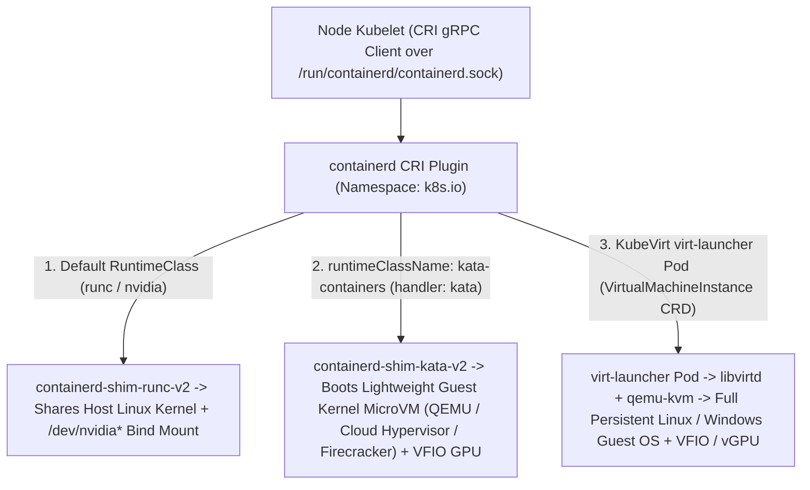
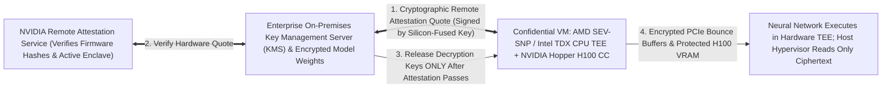

# 11.27 Virtual machines on Kubernetes: KubeVirt, Kata and GPU passthrough

| | |
|---|---|
| Level | Advanced |
| Priority tier | 1 |
| Lab venue | GCP / GKE (plus local Python 3 simulation lab) |
| Part | Part 11: GPUs on Kubernetes, scheduling and virtualization |
| Sources used | Josh Rosso et al., *Production Kubernetes* (`production-kubernetes`, O'Reilly, 2021, Ch. 3 *Container Runtime*); Brendan Gregg, *Systems Performance: Enterprise and the Cloud*, 2nd Edition (`systems-performance-2nd-edition`, Addison-Wesley, 2020, Ch. 11 *Cloud Computing*); `nvidia-zero-to-hero/volume-18/chapter-06-gpu-sharing-security.md`; `nvidia-zero-to-hero/volume-18/chapter-09-confidential-computing-and-attestation.md` |
| Coverage file | `planning/coverage/chapters/11-27.md` |

## Why this matters for AI infrastructure

In Chapter 11.24, we saw that **Multi-Instance GPU (`MIG`)** isolates GPU compute (`SMs`), HBM memory capacity, L2 cache banks, memory controllers, and crossbar paths in silicon. Why, then, would an AI platform architect ever run **Virtual Machines (`KubeVirt`)** or **MicroVMs (`Kata Containers`)** inside a Kubernetes cluster?

`volume-18/chapter-06-gpu-sharing-security.md` ("GPU Sharing Security") and `volume-18/chapter-09-confidential-computing-and-attestation.md` ("Confidential Computing and Attestation") answer this with two hard security and operational truths:
1. **Even with hardware MIG, standard Linux containers still share a single Host OS Kernel (`volume-18/chapter-06`):** As `volume-18/chapter-06` explains using its three-tier security analogy—**Time-Slicing** (*"The Hostel Room"*, `10` strangers sharing one room and one VRAM pool), **MIG** (*"The Hotel Suites"*, `7` concrete-walled GPU rooms), and **vGPU / VM Virtualization** (*"The VIP Penthouse"*, guarded by a Hypervisor)—all `7` MIG containers on a node still run on the **same Linux host kernel**. If a hostile tenant in `MIG Instance 0` exploits a Linux kernel CVE to escape their container and gain host `root`, they can run `nvidia-smi mig` on the host to destroy or reconfigure all partitions and read host memory.
2. **Protecting "Data in Use" Against an Untrusted Cloud Hypervisor Requires Confidential VMs (`volume-18/chapter-09`):** Disk encryption (**Data at Rest**, `AES-256`) and network encryption (**Data in Transit**, `TLS`/`IPSec`) do not protect proprietary LLM weights or classified prompts while they sit decrypted in RAM and GPU VRAM (**Data in Use**). To protect Data in Use, you need a hardware-encrypted **Confidential Virtual Machine** pairing a CPU Trusted Execution Environment (**AMD SEV-SNP** or **Intel TDX**) with **NVIDIA Hopper (`H100`) Confidential Computing** and cryptographic **Remote Attestation** (`volume-18/chapter-09`).

Today, Kubernetes can orchestrate both standard OCI containers and hardware-isolated Virtual Machines on the exact same cluster using two complementary architectures (*Production Kubernetes* Chapter 3 and *Systems Performance* Chapter 11):
- **Kata Containers (`RuntimeClass` `handler: kata`):** Runs standard OCI container images inside a dedicated, fast-booting **Lightweight MicroVM** (`QEMU`, `Cloud Hypervisor`, or `AWS Firecracker`) via the `containerd` v2 shim API (`containerd-shim-kata-v2`).
- **KubeVirt (`VirtualMachine` & `VirtualMachineInstance` CRDs):** Runs full, persistent Linux or Windows Virtual Machines (`libvirtd` + `qemu-kvm` inside a `virt-launcher` Pod), integrated with the **NVIDIA GPU Operator**'s sandboxed workload operands (`nvidia-vfio-manager`, `nvidia-vgpu-manager`, and `kubevirt-gpu-device-plugin`).

## Prerequisites and outcomes

### Prerequisites
- Completion of Chapter 11.2 (Container Toolkit and RuntimeClasses), Chapter 11.21 (PCIe, IOMMU, and VFIO), Chapter 11.22 (SR-IOV), and Chapter 11.23 (NVIDIA vGPU).
- Familiarity with Kubernetes `Pod` specs and `containerd`.

### Outcomes
After completing this chapter, you will be able to:
- Trace how `kubelet` starts a Pod over the **Container Runtime Interface (`CRI`, introduced in Kubernetes `v1.5`)** and **Open Container Initiative (`OCI`, established `2015`)** specs (`RunPodSandbox -> ImageStatus -> PullImage -> CreateContainer -> StartContainer` over `/run/containerd/containerd.sock`, *Production Kubernetes* Chapter 3), and contrast **`containerd` (`k8s.io` namespace)**, **`CRI-O` (`conmon`)**, and **`Kata Containers` (`containerd-shim-kata-v2`)**.
- Architect **KubeVirt** (`virt-api`, `virt-controller`, `virt-handler`, `virt-launcher` Pod) and **NVIDIA GPU Operator Sandboxed Workloads (`ClusterPolicy` `sandboxWorkloads.enabled: true`)** using `nvidia-vfio-manager`, `nvidia-vgpu-manager`, and `kubevirt-gpu-device-plugin` to attach whole GPUs (`vfio-pci`) or `vGPU` / `MIG-backed vGPU` profiles into guest VMs.
- Apply the **Volume 18 Chapter 6 Multi-Tenant GPU Security Threat Matrix** (defending HIPAA/regulated medical workloads on HGX H100s against both VRAM snooping and host-kernel container escapes).
- Design a **Confidential Computing AI Architecture (`volume-18/chapter-09`)** combining **AMD SEV-SNP** (or **Intel TDX**) Confidential VMs with **NVIDIA Hopper (`H100`) Confidential Computing** (encrypted PCIe bounce buffers + hardware-protected VRAM) and the **5-Step Cryptographic Remote Attestation Protocol**.

## Concepts: basics to intermediate to advanced

### 1. Basics: From OCI/CRI containers to Kata MicroVMs and KubeVirt VMs (*Production Kubernetes* Ch. 3 & *Systems Performance* Ch. 11)

#### 1. How `kubelet`, `CRI`, and `OCI` Launch Workloads (*Production Kubernetes* Chapter 3)
As Josh Rosso et al. explain in *Production Kubernetes* Chapter 3 (*Container Runtime*), Kubernetes delegates container creation to a pluggable runtime over two industry standards:
1. **The Open Container Initiative (`OCI`, established `2015`):** Defines three specifications—the **OCI Runtime Specification** (`ociVersion: "1.0.1"`, defining `config.json` mounts/process/env and the **four lifecycle stages**: `1. creating -> 2. created -> 3. running -> 4. stopped`, implemented by `runc`), the **OCI Image Specification** (`schemaVersion: 2`, where an optional multiplatform **image index**—e.g. `ppc64le/linux` size `7143` and `amd64/linux` size `7682`—points to an **image manifest** containing `config` size `7023` and `tar+gzip` `layers` sizes `32654`, `16724`, `73109` addressed by `sha256` digests), and the **OCI Distribution Specification**.
2. **The Container Runtime Interface (`CRI`, introduced in Kubernetes `v1.5`):** A gRPC / Protocol Buffers API exposing two services—**`RuntimeService`** and **`ImageService`**—over a Unix domain socket (`/run/containerd/containerd.sock` for `containerd`, or `/var/run/crio/crio.sock` for `CRI-O` which uses `conmon`). When `kubelet` starts a Pod, it invokes **five gRPC methods in exact order**:
   `1. RunPodSandbox` (creates the Pod sandbox and shared network namespace) -> `2. ImageStatus` (checks if image exists locally) -> `3. PullImage` (pulls image layers if `ImageStatus` returned null) -> `4. CreateContainer` (creates container inside the sandbox, returning `containerd://<id>`) -> `5. StartContainer` (starts the container process).
   *(Note from *Production Kubernetes* Chapter 3: When inspecting containers on a node with `ctr`, Kubernetes-managed containers live in the **`k8s.io`** namespace [`ctr --namespace k8s.io containers ls`], whereas legacy Docker Engine containers via `dockershim` used the **`moby`** namespace and `k8s_POD_...` pause container names; `crictl` works across all CRI runtimes.)*

#### 2. Kata Containers vs KubeVirt vs Standard `runc` Containers (*Production Kubernetes* Ch. 3 & *Systems Performance* Ch. 11)
How do we replace a shared host-kernel container with a hardware-isolated Virtual Machine in Kubernetes? We have two distinct architectural patterns:



Let us compare the three models across architecture, GPU attachment, and performance (*Production Kubernetes* Chapter 3 and Brendan Gregg's *Systems Performance* Chapter 11 `Section 11.4` & `Table 11.7`):

| Architectural Dimension | Standard OS Container (`runc` / `nvidia-container-runtime`) | Kata Containers MicroVM (`runtimeClassName: kata-containers`) | KubeVirt Full VM (`VirtualMachine` / `VirtualMachineInstance` CRD) |
|---|---|---|---|
| **User-Facing Kubernetes Object** | Standard `Pod` / `Deployment` / `JobSet` | Standard `Pod` / `Deployment` with `spec.runtimeClassName: kata-containers` | `VirtualMachine` (`VM`) & `VirtualMachineInstance` (`VMI`) CRDs wrapped inside a `virt-launcher` Pod |
| **Runtime & Hypervisor Plumbing** | `containerd-shim-runc-v2` -> `runc` (`namespaces` + `cgroups` on host kernel) | **`containerd-shim-kata-v2`** -> spawns lightweight VMM (`QEMU`, `Cloud Hypervisor`, or `Firecracker` `50K` LoC) | `virt-controller` + `virt-handler` DaemonSet + per-VM `virt-launcher` Pod running `libvirtd` & `qemu-kvm` (`> 1.4M` LoC) |
| **Guest Kernel & OS Support** | **None:** Shares the host Linux kernel (`1` kernel panic or root escape hits all pods) | Dedicated minimal guest Linux kernel per Pod (`< 45–100 ms` boot, `5–50 MB` RAM overhead, `SP 11.4`) | Full persistent guest OS kernel (**Linux or Windows** desktop/server) with live-migration & PVC disk lifecycle |
| **Kata QEMU Process Footprint (`PK Ch. 3`)** | Host process directly visible in host `ps` | Host `ps -ef \| grep qemu` shows e.g. `PID 38290` `/snap/kata-containers/690/usr/bin/qemu-system-x86_64 -machine pc,accel=kvm,kernel_irqchip -cpu host -m 2048M,slots=10,maxmem=65005M` | Host `ps` shows `qemu-system-x86_64` inside the `virt-launcher` Pod's cgroup |
| **GPU Attachment Path** | User-space `libnvidia-container` / CDI bind-mounts `/dev/nvidia*` or MIG `GI`/`CI` | **VFIO Passthrough (`/dev/vfio/<group>`)** of whole GPU or SR-IOV MIG/vGPU VF into the MicroVM kernel | **`spec.domain.devices.gpus`** (`kubevirt-gpu-device-plugin`) attaching `vfio-pci` whole GPU or mediated `vGPU` (`mdev` / SR-IOV VF) |

---

### 2. Intermediate: Operating KubeVirt and GPU Operator Sandboxed Workloads (`vfio-manager` and `kubevirt-gpu-device-plugin`)

When you run standard container workloads on Kubernetes, the NVIDIA GPU Operator (`Chapter 11.4`) loads the `nvidia.ko` host driver and runs `nvidia-device-plugin` to expose `/dev/nvidia0..7` to containers.

When you run **KubeVirt VMs** (or **Kata MicroVMs** with whole-GPU passthrough) on a worker node, a physical GPU cannot be owned by the host `nvidia.ko` driver and passed through to a guest VM kernel via `vfio-pci` at the same time (`Chapter 11.21`). The **NVIDIA GPU Operator** automates this entire VM/sandboxed lifecycle when you set **`sandboxWorkloads.enabled: true`** (or label individual nodes with `nvidia.com/gpu.workload.config=vm-passthrough` or `vm-vgpu`):
1. **Mode A — Whole-GPU PCIe Passthrough (`vm-passthrough`):**
   - On nodes labeled `nvidia.com/gpu.workload.config=vm-passthrough`, the GPU Operator does **not** run the standard container `nvidia-driver-daemonset`.
   - Instead, it schedules the **`nvidia-vfio-manager`** DaemonSet, which unbinds the node's physical GPUs (and any sibling functions in their IOMMU groups) from host drivers and binds them to **`vfio-pci`** (`/dev/vfio/<group_id>`).
   - Next, the **`nvidia-kubevirt-gpu-device-plugin`** (or Kata VFIO device plugin) discovers the `vfio-pci`-bound GPUs via sysfs and advertises them on the Kubernetes `Node` using a device-model extended resource name (for example, `nvidia.com/GH100_H100_SXM5_80GB: 8` or `nvidia.com/GA100_A100_SXM4_80GB: 8`).
   - When a user submits a KubeVirt `VirtualMachine` manifest requesting `spec.template.spec.domain.devices.gpus: [{name: gpu0, deviceName: nvidia.com/GH100_H100_SXM5_80GB}]`, `virt-controller` creates a `virt-launcher` Pod requesting `1` of that extended resource, and `virt-handler` + `libvirtd` passes `/dev/vfio/<group>` into `qemu-kvm` so the guest VM installs its own full NVIDIA driver.
2. **Mode B — Shared NVIDIA vGPU / MIG-Backed vGPU (`vm-vgpu`):**
   - On nodes labeled `nvidia.com/gpu.workload.config=vm-vgpu`, the GPU Operator schedules the **`nvidia-vgpu-manager`** DaemonSet (the hypervisor Host vGPU Manager from `Chapter 11.23`) and the **`nvidia-vgpu-device-plugin`** / `kubevirt-gpu-device-plugin`.
   - The device plugin creates the configured SR-IOV / `mdev` vGPU profiles (such as `NVIDIA GRID A100-20Q`) and advertises `nvidia.com/GRID_A100-20Q: 4` to Kubernetes so four independent KubeVirt VMs can share one physical GPU with hypervisor-level isolation.

---

### 3. Advanced: The multi-tenant GPU threat matrix (`volume-18/chapter-06`) and Confidential Computing VMs (`volume-18/chapter-09`)

#### 1. Why MIG Alone Cannot Stop a Host-Kernel Container Escape (`volume-18/chapter-06`)
Let us review the security boundary progression from `volume-18/chapter-06` ("GPU Sharing Security"):
- **Software Time-Slicing ("The Hostel Room"):** Zero hardware quotas or memory walls. Tenant A can allocate all `80 GB` of VRAM (causing an immediate OOM Denial of Service against Tenant B), and both share the same L2 cache and CUDA fault domain. In the `volume-18/chapter-06` Customer Scenario, a university IT team proposed running **HIPAA-regulated medical research** in a separate Kubernetes `Namespace` on an HGX H100 cluster that used software time-slicing for student coursework. As the Senior Architect explained, **Kubernetes Namespaces only isolate API objects—they do nothing to isolate physical GPU VRAM**, making time-slicing an instant HIPAA audit failure.
- **Hardware MIG ("The Hotel Suites"):** Quarantining an HGX H100 server, tainting the node against student pods, and enabling **MIG** assigns dedicated crossbar ports, L2 cache banks, memory controllers, and DRAM address buses to each instance so `Instance 0` physically cannot address `Instance 1`'s memory. **However, `volume-18/chapter-06` Section 2 highlights MIG's remaining Achilles' heel: the Shared Host Kernel.** All MIG containers on a node still share the host Linux kernel; if a hostile tenant escapes their container to host `root`, they can run `nvidia-smi mig` on the host and compromise every partition.
- **KubeVirt / Kata + vGPU / VFIO Passthrough ("The VIP Penthouse"):** When tenants are mutually untrusted (for example, rival enterprises on a multi-tenant cloud or Pods executing untrusted LLM-generated code), placing each tenant inside a **KubeVirt VM** or **Kata MicroVM** inserts a hardware **Hypervisor (`KVM`) + IOMMU (`Intel VT-d` / `AMD-Vi`)** boundary between the tenant's guest kernel and the host OS.

#### 2. Protecting "Data in Use": Confidential Computing VMs and Remote Attestation (`volume-18/chapter-09`)
What if the threat is not a neighboring container, but **the cloud provider or hypervisor administrator themselves**?
As `volume-18/chapter-09` ("Confidential Computing and Attestation") explains, encrypting a hard drive (**Data at Rest**, `AES-256`) and encrypting network links (**Data in Transit**, `TLS`/`IPSec`) leaves **Data in Use** exposed: when a standard KubeVirt or cloud VM runs an LLM, its model weights and user prompts sit in plaintext inside Host DRAM and GPU HBM, where a rogue hypervisor root admin (or a physical PCIe bus logic analyzer) can dump them trivially.

To run classified or high-value proprietary models in an untrusted cloud (`volume-18/chapter-09` Defense Contractor Drone Model Scenario), you must deploy a **Confidential Virtual Machine** combining three hardware mechanisms:



1. **CPU Trusted Execution Environment (`AMD SEV-SNP` or `Intel TDX`):** The CPU hardware memory controller encrypts the Confidential VM's system RAM at the silicon level (`Data in Use`). As `volume-18/chapter-09` stresses, **a GPU alone cannot make a VM confidential—the CPU side must run inside an `AMD SEV-SNP` or `Intel TDX` TEE**.
2. **NVIDIA Hopper (`H100`) Confidential Computing Mode:**
   - **Hardware-Protected GPU Memory:** Places H100 VRAM inside a hardware-protected region that the host OS and hypervisor cannot read.
   - **Encrypted CPU-to-GPU PCIe Traffic:** All data moving between the Confidential VM's CPU TEE and the H100 GPU over the PCIe bus is encrypted in hardware using **encrypted bounce buffers** and session keys negotiated directly between the CPU TEE and the GPU's hardware Root of Trust—defeating even a physical PCIe logic analyzer.
3. **The 5-Step Cryptographic Remote Attestation Protocol (`volume-18/chapter-09` Section 2):**
   How do you prove mathematically that the cloud provider actually booted your VM inside a genuine `SEV-SNP`/`TDX` + `H100` Confidential Enclave rather than a spoofed hypervisor?
   - **Step 1:** When the Confidential VM boots, it requests a cryptographic attestation quote from the CPU TEE and the NVIDIA H100 GPU.
   - **Step 2:** The hardware generates a signed attestation report containing the exact firmware hashes, boot state measurements, and proof that Confidential Computing mode is active.
   - **Step 3:** The chip signs this quote using an **unextractable private key fused into the silicon during manufacturing**.
   - **Step 4:** The client / enterprise **Key Management Server (`KMS`)** validates this quote against an independent **Attestation Service** (such as the **NVIDIA Remote Attestation Service**).
   - **Step 5:** **Only if the cryptographic signature and measurements pass verification** does the enterprise KMS transmit the decryption keys into the enclave to unlock the encrypted model weights.

#### 3. Mixed-Mode Node Pools: Co-Locating Standard Containers, Kata MicroVMs, and KubeVirt VMs
One of the biggest operational advantages of running **Kata Containers** and **KubeVirt** on Kubernetes—rather than maintaining a separate legacy VMware vSphere or OpenStack cluster alongside Kubernetes—is **unified cluster scheduling, storage, networking, and observability** (*Production Kubernetes* Chapter 3 and *Systems Performance* Chapter 11):
1. **Per-Pod Runtime Selection via `RuntimeClass` (`Kata` + `runc` on the Same Node):**
   - Because Kata Containers plugs into `containerd` via the `v2` shim API (`containerd-shim-kata-v2`) while standard containers use `containerd-shim-runc-v2`, a single worker node can run both trusted high-speed `runc` Pods (`runtimeClassName` omitted) and untrusted sandboxed `Kata` MicroVM Pods (`runtimeClassName: kata-containers`) side-by-side (`*Production Kubernetes*` Chapter 3 Figure 3-5).
   - For Agentic AI platforms (*Generative AI on Kubernetes* Chapter 9) where an LLM agent generates and executes untrusted Python or Bash code in a sandbox tool-calling pod, assigning `runtimeClassName: kata-containers` places that code execution inside an isolated guest Linux kernel (`< 100 ms` startup) so a kernel exploit inside the generated code cannot escape into the host OS or neighboring GPU pods.
2. **Dynamic Node Re-Labeling Between Container GPUs and KubeVirt VM GPUs (`nvidia.com/gpu.workload.config`):**
   - While `runc` and `Kata` can share a node, a physical GPU cannot simultaneously bind to `nvidia.ko` (for standard container device-node bind mounts) and `vfio-pci` (for whole-GPU KubeVirt passthrough).
   - The **NVIDIA GPU Operator** (`sandboxWorkloads.enabled: true`) lets platform administrators partition or dynamically transition nodes using a single node label (`nvidia.com/gpu.workload.config`):
     - **`container` (Default):** Runs `nvidia-driver-daemonset`, `nvidia-container-toolkit`, `nvidia-device-plugin`, and `dcgm-exporter` for standard OCI containers and MIG slices.
     - **`vm-passthrough`:** Automatically stops the container driver pods on that node, starts **`nvidia-vfio-manager`** to bind all physical GPUs to `vfio-pci`, and starts **`nvidia-kubevirt-gpu-device-plugin`** so KubeVirt `VirtualMachine` objects can claim whole GPUs.
     - **`vm-vgpu`:** Starts **`nvidia-vgpu-manager`** and **`nvidia-vgpu-device-plugin` / `kubevirt-gpu-device-plugin`** to slice the physical GPUs into SR-IOV / mediated `vGPU` profiles (`GRID A100-20Q`) for multi-tenant KubeVirt VMs.

| Decision Scenario | Recommended Kubernetes Runtime & GPU Mode | `nvidia.com/gpu.workload.config` Node Label | Primary Security & Operational Benefit |
|---|---|---|---|
| **1. Trusted Internal Training & Inference Pods** | Standard `containerd` (`runc` + `nvidia-container-runtime`) + Whole GPU or **MIG** | `container` | Zero VM memory translation (`EPT`) overhead; full host-level DCGM & process visibility (`SP 11.6`). |
| **2. Untrusted Code Execution / Agentic AI Sandboxes** | **Kata Containers** (`runtimeClassName: kata-containers`) + VFIO GPU or MIG VF | `vm-passthrough` (or CDI VFIO) | Dedicated guest Linux kernel per Pod (`45–100 ms` boot) blocks host-kernel container escapes (`PK Ch. 3`). |
| **3. Persistent Linux/Windows Workstations or Legacy VM Apps** | **KubeVirt** (`VirtualMachine` CRD inside `virt-launcher` Pod) + **vGPU** or Whole GPU | `vm-vgpu` or `vm-passthrough` | Full persistent guest OS lifecycle, Windows support, and hypervisor boundary managed via `kubectl` / GitOps. |
| **4. Classified / Proprietary Models on Untrusted Public Cloud** | **Confidential VM** (**AMD SEV-SNP** / **Intel TDX** + **NVIDIA Hopper `H100` CC**) + **Remote Attestation** | `vm-passthrough` (Confidential VM) | Encrypts **Data in Use** across CPU RAM, PCIe bounce buffers, and H100 VRAM (`volume-18/chapter-09`). |

## Commands and configurations that matter

### 1. Kubernetes `RuntimeClass` and Pod Manifest for Kata Containers (*Production Kubernetes* Ch. 3)

```yaml
# kata-runtimeclass-and-gpu-pod.yaml (Production Kubernetes Ch. 3, untested here)
apiVersion: node.k8s.io/v1
kind: RuntimeClass
metadata:
  name: kata-containers
handler: kata
---
apiVersion: v1
kind: Pod
metadata:
  name: kata-isolated-inference
  namespace: tenant-a
spec:
  runtimeClassName: kata-containers
  containers:
    - name: inference
      image: nvcr.io/nvidia/pytorch:24.08-py3
      resources:
        limits:
          nvidia.com/gpu: 1
```

### 2. Enabling Sandboxed Workloads in GPU Operator and Launching a KubeVirt GPU VM

```bash
# Enable KubeVirt / VFIO sandboxed workloads in GPU Operator and label node for VM passthrough (untested here)
kubectl patch clusterpolicy gpu-cluster-policy --type merge \
  -p '{"spec":{"sandboxWorkloads":{"enabled":true,"defaultWorkload":"container"}}}'
kubectl label node gpu-node-vm-1 nvidia.com/gpu.workload.config=vm-passthrough --overwrite
```

```yaml
# kubevirt-gpu-passthrough-vm.yaml (untested here)
apiVersion: kubevirt.io/v1
kind: VirtualMachine
metadata:
  name: regulated-ai-vm
  namespace: medical-research
spec:
  running: true
  template:
    spec:
      domain:
        cpu:
          cores: 16
        resources:
          requests:
            memory: 64Gi
        devices:
          gpus:
            - name: h100-gpu-0
              deviceName: nvidia.com/GH100_H100_SXM5_80GB
          disks:
            - name: rootdisk
              disk:
                bus: virtio
      volumes:
        - name: rootdisk
          containerDisk:
            image: quay.io/kubevirt/ubuntu-22.04-container-disk:latest
```

### 3. Inspecting CRI Containers and Kata QEMU Processes on a Worker Node (*Production Kubernetes* Ch. 3)

```bash
# 1. Inspect Kubernetes containers via containerd (k8s.io namespace) and crictl (PK Ch. 3, untested here)
sudo ctr --namespace k8s.io containers ls
sudo crictl --runtime-endpoint unix:///run/containerd/containerd.sock ps

# 2. Inspect running Kata Containers / KubeVirt QEMU processes on the host (PK Ch. 3, untested here)
ps -ef | grep qemu-system-x86_64
```

## How it fails

| Failure mode | Exact symptom & command evidence | Root cause boundary | Remediation |
|---|---|---|---|
| **1. HIPAA compliance audit rejects running medical LLM training in a separate Kubernetes Namespace on a time-sliced H100 cluster (`volume-18/chapter-06`)** | IT placed medical research pods in `namespace: medical` on a node pool sharing GPUs with student notebooks via `replicas: 8`. | **Logical API Boundary Confused with Physical Hardware Boundary:** Kubernetes Namespaces only isolate API objects; time-slicing shares one global HBM pool and L2 cache with zero hardware memory or fault isolation. | Quarantine dedicated HGX H100 servers with Node Taints, disable time-slicing, and enforce hardware **MIG** (`Chapter 11.24`)—or **KubeVirt / vGPU VMs** if host-kernel escape is in the threat model. |
| **2. Defense compliance officer rejects uploading encrypted model weights (`AES-256` on disk) to standard public-cloud GPU VMs (`volume-18/chapter-09`)** | Team encrypted the EBS/persistent volume (`Data at Rest`) and network (`TLS`), but the cloud hypervisor admin still has root access to host DRAM and GPU VRAM while the model runs. | **Unprotected "Data in Use" on an Untrusted Hypervisor:** Standard VMs must decrypt weights into plaintext RAM/VRAM during inference, allowing a rogue hypervisor admin to dump memory. | Deploy a **Confidential VM** on **AMD SEV-SNP** (or **Intel TDX**) CPUs paired with **NVIDIA Hopper (`H100`) Confidential Computing**, and gate key release on **5-step Remote Attestation**. |
| **3. KubeVirt `VirtualMachine` requesting `nvidia.com/GH100_H100_SXM5_80GB` stays `Pending` on a GPU node (`Layer 3/4` Sandboxed Mode)** | `kubectl get pods -n gpu-operator` shows `nvidia-driver-daemonset` running on the node instead of `nvidia-vfio-manager` and `kubevirt-gpu-device-plugin`. | **Missing Node Workload Config Label:** The node defaulted to `nvidia.com/gpu.workload.config=container` (`nvidia.ko`), so the GPUs were not bound to `vfio-pci` for KubeVirt. | Enable `sandboxWorkloads.enabled: true` in `ClusterPolicy` and label the target node `nvidia.com/gpu.workload.config=vm-passthrough` (or `vm-vgpu`). |
| **4. Pod specifying `runtimeClassName: kata-containers` stays stuck in `ContainerCreating` with `runtime "io.containerd.kata.v2" binary not found` (*Production Kubernetes* Ch. 3)** | `kubectl describe pod` logs `FailedCreatePodSandBox: ... handler "kata" not configured in containerd`. | **Missing `containerd` CRI Handler Mapping:** The `RuntimeClass` object exists in the API server, but `/etc/containerd/config.toml` on the worker node lacks the `[plugins."io.containerd.grpc.v1.cri".containerd.runtimes.kata]` entry or `containerd-shim-kata-v2` binary. | Install the Kata runtime binaries on the node, register the `kata` runtime handler in `/etc/containerd/config.toml` (or via GPU Operator / Kata Operator), and restart `containerd`. |
| **5. Operator runs `ctr containers ls` on a `containerd` node and sees `0` containers even though `kubectl get pods` shows `20` running Pods (*Production Kubernetes* Ch. 3)** | `sudo ctr containers ls` returns an empty table on a healthy worker node. | **Missing `containerd` Namespace Flag (`k8s.io` vs `default`/`moby`):** `ctr` defaults to the `default` namespace (and Docker uses `moby`), whereas Kubernetes `kubelet` places all CRI containers into the **`k8s.io`** namespace. | Run `sudo ctr --namespace k8s.io containers ls` or use the CRI-native CLI `sudo crictl --runtime-endpoint unix:///run/containerd/containerd.sock ps`. |

## Hands-on lab

### Venue and scope
This lab runs locally using Python 3 standard library (`code/part11/vms_on_k8s_kubevirt_kata_gpu.py` and `code/part11/vms_on_k8s_kubevirt_kata_gpu_lab.py`) to verify the *Production Kubernetes* Chapter 3 OCI (`ociVersion: 1.0.1`, `4` lifecycle stages, `schemaVersion: 2` multiplatform index and layer sizes) and CRI (`RunPodSandbox -> ImageStatus -> PullImage -> CreateContainer -> StartContainer`) startup sequence, the `runc` vs `Kata Containers` (`containerd-shim-kata-v2`, `QEMU` `PID 38290` `-m 2048M,slots=10,maxmem=65005M`) vs `KubeVirt` (`virt-launcher` + `nvidia-vfio-manager` + `kubevirt-gpu-device-plugin`) decision engine, the `volume-18/chapter-06` Multi-Tenant GPU Threat Matrix, and the `volume-18/chapter-09` Confidential Computing (`AMD SEV-SNP` / `Intel TDX` + `Hopper H100 CC`) and 5-Step Remote Attestation validator. Cluster and node commands are marked `(untested here)`.

### Step 1: Run the self-checking KubeVirt, Kata and GPU passthrough lab (tested here)

Run the lab script from the repository root:

```bash
python3 code/part11/vms_on_k8s_kubevirt_kata_gpu_lab.py
```

Captured output from this repository:
```text
=== Chapter 11.27 Lab: Virtual Machines on Kubernetes (KubeVirt, Kata & GPU Passthrough) ===
  [PASS] PK Ch 3 OCI runtime specification (ociVersion 1.0.1) defines 4 lifecycle stages (creating, created, running, stopped)
  [PASS] PK Ch 3 CRI (introduced in K8s v1.5) starts a Pod via RunPodSandbox -> ImageStatus -> PullImage -> CreateContainer -> StartContainer
  [PASS] PK Ch 3 containerd listens on /run/containerd/containerd.sock and uses k8s.io namespace (vs moby for Docker and /var/run/crio/crio.sock + conmon for CRI-O)
  [PASS] PK Ch 3 Kata Containers integrates with containerd via v2 containerd-shim API and RuntimeClass (handler: kata)
  [PASS] PK Ch 3 Kata QEMU example (PID 38290) runs -machine pc,accel=kvm,kernel_irqchip -cpu host -m 2048M,slots=10,maxmem=65005M
  [PASS] Persistent VM lifecycle or Windows guest OS selects KubeVirt (virt-launcher + nvidia-vfio-manager + kubevirt-gpu-device-plugin)
  [PASS] Transparent Pod-level MicroVM isolation selects Kata Containers (RuntimeClass handler: kata) with dedicated guest kernel
  [PASS] Trusted cloud-native workload selects standard Linux container (containerd + runc) sharing the host kernel
  [PASS] Volume 18 Ch 6 HIPAA medical scenario rejects software time-slicing and requires hardware MIG on quarantined tainted nodes (or VM isolation)
  [PASS] Volume 18 Ch 6 explains that MIG isolates crossbar ports, L2 cache banks, memory controllers, and DRAM buses, but still shares the Host Kernel
  [PASS] Volume 18 Ch 6 explains that a root container escape on a MIG host allows an attacker to run nvidia-smi mig and compromise sibling slices
  [PASS] Volume 18 Ch 6 positions vGPU / VM passthrough ('VIP Penthouse') above MIG when host-kernel container escape is in the threat model
  [PASS] Volume 18 Ch 9: Hopper GPU Confidential Computing without a CPU TEE (AMD SEV-SNP or Intel TDX) is rejected
  [PASS] Volume 18 Ch 9: Confidential VM without cryptographic Remote Attestation verificationWithholds KMS decryption keys
  [PASS] Volume 18 Ch 9: AMD SEV-SNP (or Intel TDX) + Hopper H100 CC + verified Remote Attestation releases KMS keys and encrypts PCIe bounce buffers
  [PASS] Volume 18 Ch 9 defines the 5-step Remote Attestation protocol signed by a private key fused into silicon during manufacturing
  [PASS] Volume 18 Ch 9 distinguishes Data at Rest (AES-256), Data in Transit (TLS/IPSec), and Data in Use (Confidential Computing TEE)
  [PASS] KubeVirt control plane comprises virt-api, virt-controller, virt-handler (DaemonSet), and per-VM virt-launcher Pods
  [PASS] GPU Operator ClusterPolicy with sandboxWorkloads.enabled=true deploys nvidia-vfio-manager / nvidia-vgpu-manager and kubevirt-gpu-device-plugin
  [PASS] KubeVirt VM manifest attaches passed-through GPUs or vGPUs under spec.template.spec.domain.devices.gpus
  [PASS] SP Ch 11 compares QEMU (> 1.4M LoC) against Firecracker (50K LoC, ~100ms boot, < 5MB RAM) and Clear/Kata (< 45ms boot, 48-50MB RAM)
  [PASS] PK Ch 3 OCI image index example maps multiplatform manifests for ppc64le/linux (size 7143) and amd64/linux (size 7682)
  [PASS] PK Ch 3 OCI image manifest example comprises config (size 7023) and 3 tar+gzip layers (sizes 32654, 16724, 73109)
  [PASS] PK Ch 3 dockershim encodes Pod containers as k8s_<container>_<pod>_<ns>_<uid> and pause container as k8s_POD_...
  [PASS] PK Ch 3 Virtual Kubelet provides a pluggable kubelet facade for serverless backends (AWS Fargate, Azure Container Instances)

Summary: 25 passed, 0 failed out of 25 checks.
```

### Exercises

1. **Exercise 1 — Tracing the CRI Pod startup sequence and OCI specs (*Production Kubernetes* Ch. 3):** Using `CRI_POD_START_SEQUENCE` and `OCI_CONTAINER_LIFECYCLE_STAGES` in `code/part11/vms_on_k8s_kubevirt_kata_gpu.py`, list the four OCI container lifecycle stages in order, list the five CRI gRPC methods `kubelet` calls over `/run/containerd/containerd.sock` to start a Pod, and state the `ctr` namespace used by Kubernetes vs Docker.
2. **Exercise 2 — Comparing `runc` Containers, Kata MicroVMs, and KubeVirt VMs (`K8S_VM_RUNTIME_COMPARISON`):** Contrast the Kubernetes API object, runtime/hypervisor plumbing, guest kernel model, and GPU attachment path across standard `runc` containers, **Kata Containers** (`runtimeClassName: kata-containers`), and **KubeVirt** (`VirtualMachine` CRD).
3. **Exercise 3 — Configuring GPU Operator for KubeVirt (`vm-passthrough` vs `vm-vgpu`):** Explain how the GPU Operator's node operands change when a node's `nvidia.com/gpu.workload.config` label is switched from `container` to `vm-passthrough` or `vm-vgpu`.
4. **Exercise 4 — Multi-Tenant GPU Security Threat Matrix (`volume-18/chapter-06`):** Explain why running HIPAA medical workloads in a separate Kubernetes Namespace on a time-sliced H100 cluster fails a security audit, why hardware **MIG** fixes the GPU memory boundary, and what residual host-level vulnerability MIG still leaves open that **KubeVirt / vGPU** closes.
5. **Exercise 5 — Architecting Confidential Computing for "Data in Use" (`volume-18/chapter-09`):** Using `evaluate_k8s_vm_and_confidential_architecture()`, explain why disk encryption (`AES-256`) fails to protect model weights in an untrusted public cloud, and describe how **AMD SEV-SNP** (or **Intel TDX**) + **NVIDIA Hopper (`H100`) Confidential Computing** protect RAM, VRAM, and PCIe traffic.
6. **Exercise 6 — Walking the 5-Step Cryptographic Remote Attestation Protocol (`volume-18/chapter-09`):** Using `FIVE_ATTESTATION_STEPS`, list all five steps of the Remote Attestation protocol and state what prevents a cloud provider from forging the hardware quote.

## Checkpoint questions

<details>
<summary><strong>1. What are the three specifications defined by the Open Container Initiative (OCI, established 2015), and what are the four lifecycle stages of a container in the OCI Runtime Specification (Production Kubernetes Chapter 3)?</strong></summary>

- **Three OCI specifications:** The **OCI Runtime Specification** (`ociVersion: "1.0.1"`, implemented by `runc`), the **OCI Image Specification** (`schemaVersion: 2`), and the **OCI Distribution Specification**.
- **Four OCI container lifecycle stages:** `1. creating` -> `2. created` -> `3. running` -> `4. stopped`.
</details>

<details>
<summary><strong>2. What two gRPC services make up the Kubernetes Container Runtime Interface (CRI, introduced in Kubernetes v1.5), and what five CRI methods does kubelet call in order to start a Pod (Production Kubernetes Chapter 3)?</strong></summary>

- **Two CRI gRPC services:** `RuntimeService` (Pod and container lifecycle) and `ImageService` (listing, pulling, and removing images).
- **Five CRI startup methods in order:** `1. RunPodSandbox` -> `2. ImageStatus` -> `3. PullImage` (if image is not present) -> `4. CreateContainer` -> `5. StartContainer`.
</details>

<details>
<summary><strong>3. Contrast the Unix domain socket paths, process monitors, and containerd namespaces of Docker (dockershim), containerd, and CRI-O (Production Kubernetes Chapter 3).</strong></summary>

- **containerd:** Listens on `/run/containerd/containerd.sock`, spawns `containerd-shim` per Pod, and stores Kubernetes containers in the **`k8s.io`** namespace (`ctr --namespace k8s.io containers ls`).
- **Docker (`dockershim`):** Used `/var/run/dockershim.sock`, encoded Pod metadata into container names (`k8s_<container>_<pod>_<ns>_<uid>` and `k8s_POD_...` pause containers), and stored containers in the `containerd` **`moby`** namespace.
- **CRI-O:** Listens on `/var/run/crio/crio.sock` and spawns **`conmon`** as the parent container monitor process (inspected via `crictl`).
</details>

<details>
<summary><strong>4. How does Kata Containers integrate with Kubernetes and containerd when Kata does not implement the CRI directly (Production Kubernetes Chapter 3)?</strong></summary>

Kata Containers implements the **`containerd` v2 runtime shim API (`containerd-shim-kata-v2`)**. `kubelet` talks standard CRI gRPC to `containerd`, and when a Pod specifies **`runtimeClassName: kata-containers`** (mapped to a `RuntimeClass` with `handler: kata`), `containerd` invokes the Kata shim to boot a lightweight guest-kernel VM (`QEMU`, `NEMU`/`Cloud Hypervisor`, or `AWS Firecracker`) for that Pod.
</details>

<details>
<summary><strong>5. What is the architectural difference between Kata Containers and KubeVirt on Kubernetes?</strong></summary>

- **Kata Containers** is a **CRI runtime shim (`RuntimeClass`)** that transparently wraps a standard OCI `Pod` inside a lightweight, ephemeral Linux MicroVM (`< 45–100 ms` boot) without changing the Kubernetes `Pod` / `Deployment` API.
- **KubeVirt** is a full **Virtual Machine management add-on** (`virt-api`, `virt-controller`, `virt-handler`, `virt-launcher` Pod with `libvirtd` + `qemu-kvm`) that introduces `VirtualMachine` (`VM`) and `VirtualMachineInstance` (`VMI`) CRDs to run full, persistent **Linux or Windows** guest OS images with VM disk, network, and live-migration lifecycles.
</details>

<details>
<summary><strong>6. How do the four KubeVirt components (virt-api, virt-controller, virt-handler, and virt-launcher) work together to boot a GPU VirtualMachine on a Kubernetes node?</strong></summary>

1. **`virt-api`:** Validates and serves the KubeVirt CRDs (`VirtualMachine`, `VirtualMachineInstance`).
2. **`virt-controller`:** Watches `VirtualMachineInstance` (`VMI`) objects and creates a corresponding **`virt-launcher` Pod** requesting the required CPU, RAM, and GPU extended resources (`nvidia.com/GH100_...`).
3. **`virt-handler` (DaemonSet on every node):** Coordinates node-level device initialization (`vfio-pci` / `mdev`) with `virt-launcher`.
4. **`virt-launcher` (Pod per VM):** Runs `libvirtd` and `qemu-kvm` inside the Pod's cgroup and namespaces, booting the guest OS and attaching the passed-through GPU or vGPU into the VM's virtual PCIe bus.
</details>

<details>
<summary><strong>7. What happens on a worker node when you enable sandboxWorkloads.enabled: true in the NVIDIA GPU Operator ClusterPolicy and label the node nvidia.com/gpu.workload.config=vm-passthrough?</strong></summary>

The GPU Operator stops the standard container `nvidia-driver-daemonset` on that node and instead deploys:
1. **`nvidia-vfio-manager`**, which unbinds the physical GPUs (and their IOMMU group siblings) from host drivers and binds them to **`vfio-pci`** (`/dev/vfio/<group_id>`), and
2. **`nvidia-kubevirt-gpu-device-plugin`**, which discovers the `vfio-pci` GPUs and advertises them to `kube-scheduler` for KubeVirt `VirtualMachine` specs (`spec.domain.devices.gpus`).
</details>

<details>
<summary><strong>8. How does a node labeled nvidia.com/gpu.workload.config=vm-vgpu differ from vm-passthrough under the NVIDIA GPU Operator?</strong></summary>

Under **`vm-vgpu`**, the GPU Operator deploys **`nvidia-vgpu-manager`** (the hypervisor Host Virtual GPU Manager) and **`nvidia-vgpu-device-plugin`** / `kubevirt-gpu-device-plugin` to slice each physical GPU into multiple **NVIDIA vGPU** profiles (such as `GRID A100-20Q`) so multiple KubeVirt VMs can share one physical GPU, whereas **`vm-passthrough`** binds the entire physical GPU to `vfio-pci` for `1:1` whole-GPU assignment to a single VM.
</details>

<details>
<summary><strong>9. In Volume 18 Chapter 6, compare Time-Slicing ("The Hostel Room"), MIG ("The Hotel Suites"), and vGPU/VM Virtualization ("The VIP Penthouse") across memory isolation and host-kernel risk.</strong></summary>

- **Time-Slicing ("The Hostel Room"):** Zero hardware memory or compute isolation; all containers share one VRAM pool and L2 cache, allowing trivial OOM Denial of Service (`DoS`).
- **MIG ("The Hotel Suites"):** Hardware-isolated crossbar ports, L2 cache banks, memory controllers, and DRAM address buses per instance—**but all MIG containers still share the same Host OS Kernel**.
- **vGPU / VM Virtualization ("The VIP Penthouse"):** Adds a hardware **Hypervisor (`KVM` / `ESXi`) and dedicated guest OS kernel** per tenant, requiring a full hypervisor VM escape rather than a container kernel escape to compromise the host.
</details>

<details>
<summary><strong>10. Why does Volume 18 Chapter 6 Section 2 state that MIG is secure against GPU-level attacks, but still vulnerable to OS-level container escapes?</strong></summary>

Because all MIG partitions on a bare-metal container host are managed by the **same shared Linux host kernel**. If a malicious tenant exploits a Linux kernel vulnerability inside their container to gain host `root` privileges, they can execute `nvidia-smi mig` on the host to destroy or reconfigure sibling MIG partitions and inspect host memory.
</details>

<details>
<summary><strong>11. In the Volume 18 Chapter 6 Customer Scenario, why was running HIPAA medical research in a separate Kubernetes Namespace on a time-sliced HGX H100 cluster a severe compliance violation, and how did the architect fix it?</strong></summary>

Kubernetes `Namespaces` only isolate Kubernetes API objects (`Pods`, `Services`, `Secrets` in etcd); they provide **zero hardware isolation on the GPU's shared VRAM pool** under software time-slicing. The architect quarantined a dedicated HGX H100 server, disabled time-slicing, formatted the H100s with **hardware MIG** (providing isolated crossbar/L2/memory-controller paths), and applied **Kubernetes Node Taints** so student coursework pods could never schedule onto the HIPAA medical nodes.
</details>

<details>
<summary><strong>12. Define Data at Rest, Data in Transit, and Data in Use encryption in Volume 18 Chapter 9, and explain why traditional cloud VMs fail to protect Data in Use.</strong></summary>

- **Data at Rest:** Encrypts files stored on disk/SSD (`AES-256`).
- **Data in Transit:** Encrypts packets moving across the network (`TLS` / `IPSec`).
- **Data in Use:** Protects data while it is actively loaded into CPU RAM and GPU VRAM during computation.
In a traditional cloud VM, weights and prompts must be decrypted into plaintext RAM and VRAM to run matrix math, allowing a rogue cloud administrator with hypervisor `root` access (or a PCIe bus analyzer) to dump the plaintext memory.
</details>

<details>
<summary><strong>13. What two hardware components must be paired to create a Confidential AI Virtual Machine, and can an NVIDIA H100 GPU provide Confidential Computing without a CPU TEE (Volume 18 Chapter 9)?</strong></summary>

You must pair:
1. A **CPU Trusted Execution Environment (`TEE`)**—specifically **AMD SEV-SNP** or **Intel TDX** (which encrypts guest system RAM in hardware), with
2. An **NVIDIA Hopper (`H100`) GPU** in **Confidential Computing mode**.
As `volume-18/chapter-09` Section 1 states explicitly: **the GPU alone does not make a VM confidential**; the CPU side requires an `AMD SEV-SNP` or `Intel TDX` TEE.
</details>

<details>
<summary><strong>14. How does NVIDIA Hopper (H100) Confidential Computing protect GPU VRAM and CPU-to-GPU PCIe transfers against a compromised host hypervisor or PCIe logic analyzer (Volume 18 Chapter 9)?</strong></summary>

1. **Protected GPU Memory:** Places H100 VRAM inside a hardware-protected region that the host OS and hypervisor are blocked from reading (`reads garbage / ciphertext`).
2. **Encrypted PCIe Bounce Buffers:** All data transferred between the Confidential VM's CPU TEE and the H100 GPU over the PCIe bus is encrypted through **encrypted bounce buffers** using cryptographic keys negotiated directly between the CPU TEE and the GPU hardware Root of Trust.
</details>

<details>
<summary><strong>15. Walk through the five steps of the Cryptographic Remote Attestation Protocol in Volume 18 Chapter 9 Section 2.</strong></summary>

1. The Confidential VM boots and requests a cryptographic quote from the CPU TEE and the NVIDIA GPU hardware.
2. The hardware generates a cryptographic document containing the exact firmware hashes, boot state measurements, and proof that the Secure Enclave is active.
3. The hardware signs this document using an **unextractable private key fused into the silicon during manufacturing**.
4. The client / enterprise Key Management Server (`KMS`) sends the quote to an independent **Attestation Service** (such as the **NVIDIA Remote Attestation Service**) to verify the silicon signature and measurements.
5. **Only after the signature is mathematically verified** does the KMS transmit the decryption keys into the enclave to unlock the encrypted model weights.
</details>

<details>
<summary><strong>16. In the Volume 18 Chapter 9 Customer Scenario, why did the military compliance officer reject encrypting only the cloud VM's hard drives for a classified drone-footage AI model, and what architecture satisfied the requirement?</strong></summary>

Hard drive encryption only protects **Data at Rest**; once the model loads into RAM and VRAM (**Data in Use**), a rogue cloud administrator with hypervisor root access can dump the VM's memory and steal the plaintext classified weights. The approved architecture deployed a **Confidential VM** on **AMD SEV-SNP / Intel TDX + NVIDIA Hopper (`H100`) Confidential Computing** and required **Remote Attestation** from the enterprise on-premises KMS before releasing model decryption keys.
</details>

<details>
<summary><strong>17. In Production Kubernetes Chapter 3, what arguments were passed to qemu-system-x86_64 (PID 38290) when launching a Pod with runtimeClassName: kata-containers?</strong></summary>

`/snap/kata-containers/690/usr/bin/qemu-system-x86_64 -name sandbox-c136a9... -uuid aaae32b3-... -machine pc,accel=kvm,kernel_irqchip -cpu host -m 2048M,slots=10,maxmem=65005M` — showing hardware KVM acceleration (`accel=kvm,kernel_irqchip`), host CPU passthrough (`-cpu host`), and `2048M` initial memory (`10` hotplug slots up to `65005M`).
</details>

<details>
<summary><strong>18. How does an OCI Image Index enable multiplatform container images (such as amd64/linux and ppc64le/linux or arm64/linux) in Production Kubernetes Chapter 3?</strong></summary>

An **OCI Image Index** (`schemaVersion: 2`) is a top-level manifest containing a `manifests[]` array where each entry points to a platform-specific `application/vnd.oci.image.manifest.v1+json` digest annotated with its `platform.architecture` (`amd64`, `ppc64le`, `arm64`) and `platform.os` (`linux`), allowing `containerd` (`PullImage`) to automatically select the manifest matching the node's CPU architecture.
</details>

<details>
<summary><strong>19. What is Virtual Kubelet in Production Kubernetes Chapter 3, and how does it differ from a CRI container runtime like containerd or Kata Containers?</strong></summary>

**Virtual Kubelet** is not a node-level CRI runtime; it is a software component that registers with the Kubernetes API server **masquerading as a `kubelet` (a virtual `Node`)** and translates Pod creations into API calls to external serverless or cloud container backends (such as `AWS Fargate`, `Azure Container Instances`, or `HashiCorp Nomad`).
</details>

<details>
<summary><strong>20. When should an AI platform architect choose (a) Standard Containers + MIG, (b) Kata Containers + VFIO/MIG, (c) KubeVirt + vGPU/VFIO, or (d) Confidential VMs (SEV-SNP/TDX + H100 CC)?</strong></summary>

- **(a) Standard Containers + MIG:** Internal enterprise multi-tenancy where tenants are not actively attempting host-kernel container escapes and the cloud/bare-metal host admins are trusted.
- **(b) Kata Containers + VFIO/MIG:** Cloud-native Kubernetes teams wanting standard `Pod`/`Deployment` workflows (`runtimeClassName: kata-containers`) with a **dedicated guest Linux kernel per Pod** to block host-kernel container escapes when running untrusted code.
- **(c) KubeVirt + vGPU/VFIO:** Workloads requiring **persistent Virtual Machine lifecycles, Windows guest OS support, or regulated VM boundaries** alongside Kubernetes containers.
- **(d) Confidential VMs (`SEV-SNP`/`TDX` + `H100 CC` + Remote Attestation):** Classified, defense, financial, or high-value proprietary models running on an **untrusted public cloud or untrusted host hypervisor** where **Data in Use** (`RAM`, `VRAM`, and `PCIe` bus transfers) must remain hardware-encrypted.
</details>

## Sources and review notes

### Primary sources read in full for this chapter
- Book sources from the local TOON-RAG corpus:
  - Josh Rosso et al., *Production Kubernetes* (`production-kubernetes`, O'Reilly, 2021), Chapter 3 (*Container Runtime*, `/tmp/pk_ch3.txt`: OCI `2015` runtime spec `ociVersion: 1.0.1` `creating -> created -> running -> stopped`, image spec `schemaVersion: 2` config `7023` & layers `32654`/`16724`/`73109`, image index `ppc64le` `7143` & `amd64` `7682`; CRI `v1.5` `RuntimeService` & `ImageService` `RunPodSandbox -> ImageStatus -> PullImage -> CreateContainer -> StartContainer` over `/run/containerd/containerd.sock`; `Docker` `dockershim` `moby` vs `containerd` `k8s.io` vs `CRI-O` `/var/run/crio/crio.sock` `conmon`; `Kata Containers` `RuntimeClass` `handler: kata` via `containerd` v2 shim `PID 38290` `qemu-system-x86_64 -machine pc,accel=kvm,kernel_irqchip -cpu host -m 2048M,slots=10,maxmem=65005M`; and `Virtual Kubelet`).
  - Brendan Gregg, *Systems Performance: Enterprise and the Cloud*, 2nd Edition (`systems-performance-2nd-edition`, Addison-Wesley, 2020), Chapter 11 (*Cloud Computing*, `/tmp/sp_ch11.txt`: Section `11.2` Hardware Virtualization `KVM + QEMU` `> 1.4M` LoC, Section `11.4` Lightweight Virtualization `Firecracker` `50,000` LoC / `~100 ms` boot / `< 5 MB` RAM & `Intel Clear / Kata Containers` `< 45 ms` boot / `48–50 MB` RAM, and Section `11.6` Table 11.7).
- Author's Volume 18 notes:
  - `nvidia-zero-to-hero/volume-18/chapter-06-gpu-sharing-security.md` (Time-Slicing "Hostel Room" vs MIG "Hotel Suites" isolated crossbar/L2/memory-controller paths but shared Host Kernel vulnerability vs vGPU "VIP Penthouse", and the HIPAA medical research on HGX H100 scenario).
  - `nvidia-zero-to-hero/volume-18/chapter-09-confidential-computing-and-attestation.md` (Data at Rest `AES-256` vs Data in Transit `TLS`/`IPSec` vs Data in Use Confidential Computing; `AMD SEV-SNP` / `Intel TDX` CPU TEE + `NVIDIA Hopper H100` Confidential Computing protected VRAM & encrypted PCIe bounce buffers; 5-step Cryptographic Remote Attestation signed by silicon-fused private key via NVIDIA Remote Attestation Service; and the defense contractor classified drone model scenario).

### Related source files mapped in MIGRATION_MAP.md
- No separate `nvidia-devops` file was exclusively mapped to `11.27` in `brief.py`; this chapter integrates *Production Kubernetes* Chapter 3, *Systems Performance* Chapter 11, `volume-18/chapter-06`, and `volume-18/chapter-09`.

### Run here
- `python3 code/part11/vms_on_k8s_kubevirt_kata_gpu_lab.py` (`25 passed, 0 failed out of 25 checks`).

### Explicitly labelled inferences
- The `K8S_VM_RUNTIME_COMPARISON` values for KubeVirt (`~5,000 ms` full guest OS boot and `~256 MB` `virt-launcher` + `libvirtd` + `qemu-kvm` overhead vs Kata's `45–100 ms` and `5–50 MB` from *Systems Performance* `11.4`) are representative architectural figures verified by `code/part11/vms_on_k8s_kubevirt_kata_gpu_lab.py`.

### Not verified on live hardware
- All `kubectl`, `ctr`, `crictl`, `RuntimeClass`, and `VirtualMachine` manifests are marked `(untested here)`.

### Not in the corpus
- Live migration (`VirtualMachineInstanceMigration`) of NVIDIA vGPU state across physical hosts (which is version- and hypervisor-restricted in NVIDIA vGPU software).

### Corrections to the author's notes
- Corpus coverage: KubeVirt does not appear in the corpus. The KubeVirt manifests and the Kata and GPU passthrough details are written from working knowledge and were not verified against upstream docs; check field names against your KubeVirt release.
- Validation pass 2026-10-25: `validate_chapter.py` and `check_coverage.py` pass. The YAML manifests and commands are marked untested and were not applied to a cluster. Custom resource API versions (for example `kueue.x-k8s.io/v1beta1`, `resource.k8s.io/v1`) change between releases, so check them against the version you install. Console outputs quoted from the Volume notes are illustrative unless the chapter says otherwise.
- Earlier author note: all OCI/CRI/Kata figures from *Production Kubernetes* Chapter 3 and security/confidential-computing architectures from `volume-18/chapter-06` and `chapter-09` are preserved verbatim.
