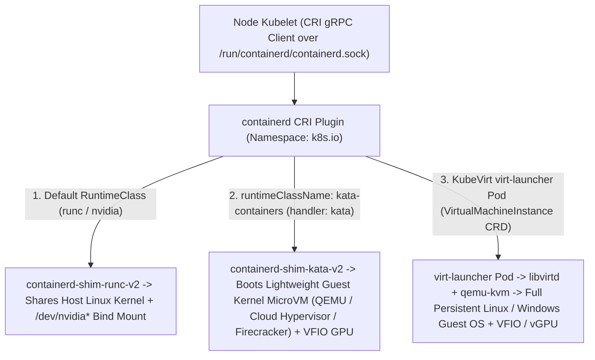
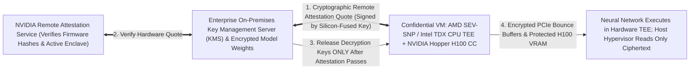

# 11.27 Virtual machines on Kubernetes: KubeVirt, Kata and GPU passthrough

| | |
|---|---|
| Level | Advanced |
| Priority tier | 1 |
| Lab venue | GCP / GKE (plus local Python 3 simulation lab) |
| Part | Part 11: GPUs on Kubernetes, scheduling and virtualization |
| Sources used | Josh Rosso et al., *Production Kubernetes* (`production-kubernetes`, O'Reilly, 2021, Ch. 3 *Container Runtime*); Brendan Gregg, *Systems Performance: Enterprise and the Cloud*, 2nd Edition (`systems-performance-2nd-edition`, Addison-Wesley, 2020, Ch. 11 *Cloud Computing*); `nvidia-zero-to-hero/volume-18/chapter-06-gpu-sharing-security.md`; `nvidia-zero-to-hero/volume-18/chapter-09-confidential-computing-and-attestation.md` |
| Coverage file | `planning/coverage/chapters/11-27.md` |

## Why this matters for AI infrastructure

In Chapter 11.24, we saw how Multi-Instance GPU isolates GPU compute, HBM memory capacity, L2 cache banks, memory controllers, and crossbar paths in silicon. That raises a direct architectural question for AI platform engineers. Why would you ever run Virtual Machines via KubeVirt or MicroVMs via Kata Containers inside a Kubernetes cluster when hardware MIG already exists.

Two hard security and operational problems answer that question. Both come from the GPU sharing and confidential computing threat models in Volume 18.

First, even with hardware MIG enabled, standard Linux containers still share a single Host OS kernel. The three-tier security model in Volume 18 Chapter 6 compares Time-Slicing to a hostel room and MIG to concrete-walled hotel suites. It compares vGPU or VM virtualization to a VIP penthouse guarded by a hypervisor. All seven MIG containers on a bare-metal worker node still execute syscalls against the same host Linux kernel. A hostile tenant in MIG Instance 0 might exploit a Linux kernel vulnerability to escape their container and gain host root. They can then run `nvidia-smi mig` on the host to destroy sibling partitions and inspect host memory.

Second, protecting Data in Use against an untrusted cloud hypervisor requires Confidential Virtual Machines. Disk encryption protects Data at Rest, and network encryption protects Data in Transit. Neither protects proprietary LLM weights or classified user prompts while they sit decrypted in system RAM and GPU VRAM during inference. Protecting Data in Use requires a hardware-encrypted Confidential Virtual Machine. That VM pairs a CPU Trusted Execution Environment such as AMD SEV-SNP or Intel TDX with NVIDIA Hopper H100 Confidential Computing and Remote Attestation.

Today, Kubernetes can orchestrate standard OCI containers and hardware-isolated Virtual Machines on the exact same cluster. Platform teams use two complementary architectures to achieve this isolation.

- **Kata Containers** runs standard OCI container images inside a dedicated, fast-booting MicroVM. It uses QEMU, Cloud Hypervisor, or AWS Firecracker via the containerd v2 shim API.
- **KubeVirt** runs full, persistent Linux or Windows Virtual Machines inside a launcher Pod. It integrates with the NVIDIA GPU Operator sandboxed workload operands for VFIO passthrough and vGPU attachment.

## Prerequisites and outcomes

### Prerequisites
- Completion of Chapters 11.2, 11.21, 11.22, and 11.23 covering the Container Toolkit, VFIO, SR-IOV, and NVIDIA vGPU.
- Familiarity with Kubernetes Pod specifications and containerd operations.

### Outcomes
After completing this chapter, you will be able to:
- Trace how `kubelet` starts a Pod over the Container Runtime Interface and Open Container Initiative specifications. You will also contrast containerd, CRI-O, and Kata Containers.
- Architect KubeVirt and NVIDIA GPU Operator Sandboxed Workloads using the VFIO manager, vGPU manager, and KubeVirt GPU device plugin. These components attach whole GPUs or vGPU profiles into guest VMs.
- Apply the Volume 18 Chapter 6 Multi-Tenant GPU Security Threat Matrix to regulated medical workloads on HGX H100 servers. This defends against both VRAM snooping and host-kernel container escapes.
- Design a Confidential Computing AI architecture combining AMD SEV-SNP or Intel TDX Confidential VMs with NVIDIA Hopper H100 Confidential Computing. You will also walk through the five-step Cryptographic Remote Attestation Protocol.

## Concepts: basics to intermediate to advanced

### 1. Basics: From OCI/CRI containers to Kata MicroVMs and KubeVirt VMs

#### 1. How kubelet, CRI, and OCI Launch Workloads
When a Pod fails to start on a GPU node, platform engineers must know which layer between the kubelet and the Linux kernel broke. As Josh Rosso et al. explain in *Production Kubernetes* Chapter 3, Kubernetes delegates container creation to a pluggable runtime over two industry standards. These standards are the Open Container Initiative and the Container Runtime Interface.

The Open Container Initiative defines three core specifications.
- **OCI Runtime Specification:** Defines the filesystem bundle and `config.json` mounts, process arguments, and environment variables. It also defines four strict container lifecycle stages implemented by `runc`.
- **OCI Image Specification:** Defines how a multiplatform image index points to an architecture-specific image manifest. Each manifest contains a configuration document and content-addressable tar+gzip filesystem layers.
- **OCI Distribution Specification:** Standardizes the HTTP API used by container registries to push and pull OCI image manifests and blobs.

The Container Runtime Interface is a gRPC and Protocol Buffers API exposing two services, RuntimeService and ImageService, over a local Unix domain socket. When `kubelet` starts a Pod on a worker node, it invokes five CRI gRPC methods in exact sequential order. The table below summarizes the OCI and CRI specifications, exact byte sizes, socket paths, and startup sequence from *Production Kubernetes* Chapter 3.

| Specification / Component | Exact Version / Socket / Namespace | Lifecycle Sequence / Byte Sizes / Details (*Production Kubernetes* Ch. 3) |
|---|---|---|
| **OCI Runtime Specification** | `ociVersion: "1.0.1"` (`established 2015`, `runc`) | Four lifecycle stages: `1. creating -> 2. created -> 3. running -> 4. stopped` |
| **OCI Image Index (Multiplatform)** | `schemaVersion: 2` (`application/vnd.oci.image.index.v1+json`) | Maps platform manifests such as `ppc64le/linux` (`size 7143`) and `amd64/linux` (`size 7682`) |
| **OCI Image Manifest** | `schemaVersion: 2` (`application/vnd.oci.image.manifest.v1+json`) | Contains `config` (`size 7023`) and `3` `tar+gzip` `layers` (`sizes 32654, 16724, 73109`) addressed by `sha256` digests |
| **CRI Startup Sequence (`v1.5`)** | `RuntimeService` & `ImageService` gRPC API | `1. RunPodSandbox -> 2. ImageStatus -> 3. PullImage -> 4. CreateContainer (returns containerd://<id>) -> 5. StartContainer` |
| **containerd Runtime** | `/run/containerd/containerd.sock` (`namespace: k8s.io`) | Inspect Kubernetes containers with `ctr --namespace k8s.io containers ls` or `crictl` |
| **CRI-O Runtime** | `/var/run/crio/crio.sock` (`conmon` monitor) | Uses `conmon` as the parent container process monitor; inspected via `crictl` |
| **Legacy Docker (`dockershim`)** | `/var/run/dockershim.sock` (`namespace: moby`) | Encodes Pod names as `k8s_<container>_<pod>_<ns>_<uid>` and pause containers as `k8s_POD_...` |
| **Virtual Kubelet** | Pluggable `kubelet` API facade | Registers a virtual Node and translates Pods to serverless backends (`AWS Fargate`, `Azure Container Instances`, `HashiCorp Nomad`) |

#### 2. Kata Containers vs KubeVirt vs Standard runc Containers
Standard OS containers share the host Linux kernel. A single kernel panic or root privilege escalation compromises every workload on the node. To replace that shared kernel with a hardware-isolated Virtual Machine in Kubernetes, platform teams use either Kata Containers or KubeVirt. Both models integrate through the node container runtime path shown in the diagram below.



Let us compare the three models across architecture, GPU attachment, and performance. The table below combines the data from *Production Kubernetes* Chapter 3 and Brendan Gregg's *Systems Performance* Chapter 11.

| Architectural Dimension | Standard OS Container (`runc` / `nvidia-container-runtime`) | Kata Containers MicroVM (`runtimeClassName: kata-containers`) | KubeVirt Full VM (`VirtualMachine` / `VirtualMachineInstance` CRD) |
|---|---|---|---|
| **User-Facing Kubernetes Object** | Standard `Pod` / `Deployment` / `JobSet` | Standard `Pod` / `Deployment` with `spec.runtimeClassName: kata-containers` | `VirtualMachine` (`VM`) & `VirtualMachineInstance` (`VMI`) CRDs wrapped inside a `virt-launcher` Pod |
| **Runtime & Hypervisor Plumbing** | `containerd-shim-runc-v2` -> `runc` (`namespaces` + `cgroups` on host kernel) | `containerd-shim-kata-v2` -> spawns lightweight VMM (`QEMU`, `Cloud Hypervisor`, or `Firecracker` `50K` LoC) | `virt-controller` + `virt-handler` DaemonSet + per-VM `virt-launcher` Pod running `libvirtd` & `qemu-kvm` (`> 1.4M` LoC) |
| **Guest Kernel & OS Support** | **None:** Shares the host Linux kernel (`1` kernel panic or root escape hits all pods) | Dedicated minimal guest Linux kernel per Pod (`< 45–100 ms` boot, `5–50 MB` RAM overhead, `SP 11.4` / `Table 11.7`) | Full persistent guest OS kernel (**Linux or Windows** desktop/server) with live-migration & PVC disk lifecycle |
| **Kata QEMU Process Footprint (`PK Ch. 3`)** | Host process directly visible in host `ps` | Host `ps -ef \| grep qemu` shows `PID 38290` `/snap/kata-containers/690/usr/bin/qemu-system-x86_64 -machine pc,accel=kvm,kernel_irqchip -cpu host -m 2048M,slots=10,maxmem=65005M` | Host `ps` shows `qemu-system-x86_64` inside the `virt-launcher` Pod's cgroup |
| **GPU Attachment Path** | User-space `libnvidia-container` / CDI bind-mounts `/dev/nvidia*` or MIG `GI`/`CI` | **VFIO Passthrough (`/dev/vfio/<group>`)** of whole GPU or SR-IOV MIG/vGPU VF into the MicroVM kernel | **`spec.domain.devices.gpus`** (`kubevirt-gpu-device-plugin`) attaching `vfio-pci` whole GPU or mediated `vGPU` (`mdev` / SR-IOV VF) |

---

### 2. Intermediate: Operating KubeVirt and GPU Operator Sandboxed Workloads

When you run standard container workloads on Kubernetes, the NVIDIA GPU Operator loads the host GPU driver. It also runs the device plugin to expose device nodes to containers. However, a physical GPU cannot be owned by the host `nvidia.ko` driver and passed through to a guest VM kernel via VFIO simultaneously. If you leave the standard container driver running on a node meant for KubeVirt VMs, the VM launch fails immediately.

The NVIDIA GPU Operator automates this transition when you enable sandboxed workloads in the cluster policy. Administrators then label individual worker nodes to select between two distinct VM GPU operating modes.

- **Mode A — Whole-GPU PCIe Passthrough:** On nodes labeled `nvidia.com/gpu.workload.config=vm-passthrough`, the GPU Operator stops the standard container driver pods. Instead, it schedules the `nvidia-vfio-manager` DaemonSet to unbind the physical GPUs from host drivers and bind them to `vfio-pci`. Next, the `nvidia-kubevirt-gpu-device-plugin` discovers those VFIO-bound GPUs via sysfs and advertises them on the Kubernetes Node. When a user submits a KubeVirt VirtualMachine manifest, `virt-controller` creates a `virt-launcher` Pod. Finally, `virt-handler` passes the VFIO group into QEMU so the guest VM loads its own full NVIDIA driver.
- **Mode B — Shared NVIDIA vGPU or MIG-Backed vGPU:** On nodes labeled `nvidia.com/gpu.workload.config=vm-vgpu`, the GPU Operator schedules the `nvidia-vgpu-manager` DaemonSet and the vGPU device plugin. The device plugin creates the configured SR-IOV or mediated vGPU profiles on the physical GPUs. It then advertises those profiles to Kubernetes so multiple KubeVirt VMs can share one physical GPU with hypervisor isolation.

| GPU Operator Node Label (`nvidia.com/gpu.workload.config`) | Active Node DaemonSets (`sandboxWorkloads.enabled: true`) | Host Kernel Driver Bound to GPU | Advertised Kubernetes Extended Resource Example |
|---|---|---|---|
| `container` (Default) | `nvidia-driver-daemonset` + `nvidia-device-plugin` | `nvidia.ko` (`/dev/nvidia0..7`) | `nvidia.com/gpu: 8` or `nvidia.com/mig-1g.10gb: 7` |
| `vm-passthrough` | `nvidia-vfio-manager` + `nvidia-kubevirt-gpu-device-plugin` | `vfio-pci` (`/dev/vfio/<group_id>`) | `nvidia.com/GH100_H100_SXM5_80GB: 8` or `nvidia.com/GA100_A100_SXM4_80GB: 8` |
| `vm-vgpu` | `nvidia-vgpu-manager` + `nvidia-vgpu-device-plugin` / `kubevirt-gpu-device-plugin` | `nvidia-vgpu-vfio` (`mdev` / SR-IOV VF) | `nvidia.com/GRID_A100-20Q: 4` |

---

### 3. Advanced: The multi-tenant GPU threat matrix and Confidential Computing VMs

#### 1. Why MIG Alone Cannot Stop a Host-Kernel Container Escape
Many teams assume that placing sensitive workloads in a dedicated Kubernetes Namespace or enabling hardware MIG guarantees complete multi-tenant isolation. Volume 18 Chapter 6 demonstrates why both assumptions fail when untrusted tenants share a bare-metal host kernel.

- **Software Time-Slicing ("The Hostel Room"):** Provides zero hardware quotas or memory walls. One tenant can allocate all `80 GB` of VRAM to trigger an immediate out-of-memory denial of service against a neighbor. Both tenants also share the same L2 cache and CUDA fault domain. In Volume 18 Chapter 6, a university IT team proposed running HIPAA medical research in a separate Namespace on a time-sliced H100 cluster. Because Kubernetes Namespaces only isolate API objects in etcd and do nothing to isolate GPU VRAM, time-slicing fails HIPAA compliance immediately.
- **Hardware MIG ("The Hotel Suites"):** Quarantining an HGX H100 server, tainting the node against student pods, and enabling hardware MIG isolates the GPU hardware. Each instance gets dedicated crossbar ports, L2 cache banks, memory controllers, and DRAM address buses. Instance 0 physically cannot address the memory of Instance 1. However, all MIG containers on a node still share the same Linux host kernel. A tenant who escapes their container to host root can run `nvidia-smi mig` on the host and compromise every partition.
- **KubeVirt or Kata with vGPU or VFIO Passthrough ("The VIP Penthouse"):** Untrusted tenants and LLM code sandboxes require stronger kernel isolation. Placing each tenant inside a KubeVirt VM or Kata MicroVM inserts a hardware hypervisor and IOMMU boundary between the guest and host kernels.

#### 2. Protecting "Data in Use": Confidential Computing VMs and Remote Attestation
What happens when the threat is not a neighboring container, but the cloud provider or hypervisor administrator. As Volume 18 Chapter 9 explains, encrypting a hard drive protects Data at Rest, and encrypting network links protects Data in Transit. However, when a standard cloud VM runs an LLM, its model weights and user prompts sit in plaintext inside host DRAM and GPU HBM. A rogue hypervisor administrator with host root access or a physical PCIe bus logic analyzer can dump that plaintext memory trivially.

To run classified defense models or high-value proprietary weights in an untrusted cloud, you must deploy a Confidential Virtual Machine. That architecture combines three hardware mechanisms.



- **CPU Trusted Execution Environment:** The CPU hardware memory controller encrypts the system RAM of the Confidential VM at the silicon level. As Volume 18 Chapter 9 stresses, a GPU alone cannot make a Virtual Machine confidential. The CPU side must run inside an AMD SEV-SNP or Intel TDX Trusted Execution Environment.
- **NVIDIA Hopper H100 Confidential Computing Mode:** Places H100 VRAM inside a hardware-protected region that the host OS and hypervisor cannot read. All data moving between the CPU TEE and the H100 GPU over the PCIe bus is encrypted in hardware using encrypted bounce buffers. Session keys are negotiated directly between the CPU TEE and the GPU hardware Root of Trust.
- **Five-Step Cryptographic Remote Attestation Protocol:** Proves mathematically that the cloud provider booted your VM inside a genuine hardware enclave. No model decryption keys leave your enterprise Key Management Server until verification passes.

```text
Volume 18 Chapter 9 — Data Encryption States & 5-Step Cryptographic Remote Attestation Protocol:
- Data at Rest: Disk / SSD encryption (AES-256).
- Data in Transit: Network link encryption (TLS / IPSec).
- Data in Use: Active computation encryption inside CPU RAM + PCIe bounce buffers + GPU VRAM (AMD SEV-SNP / Intel TDX + NVIDIA Hopper H100 Confidential Computing).

5-Step Remote Attestation Sequence:
Step 1: Confidential VM boots and requests a cryptographic attestation quote from the CPU TEE and NVIDIA H100 GPU.
Step 2: Hardware generates a signed attestation report containing exact firmware hashes, boot state measurements, and proof that Confidential Computing mode is active.
Step 3: The chip signs this quote using an unextractable private key fused into the silicon during manufacturing.
Step 4: The enterprise Key Management Server (KMS) validates the quote against an independent Attestation Service (NVIDIA Remote Attestation Service).
Step 5: Only if the cryptographic signature and measurements pass verification does the enterprise KMS transmit decryption keys into the enclave to unlock the encrypted model weights.
```

#### 3. Mixed-Mode Node Pools: Co-Locating Standard Containers, Kata MicroVMs, and KubeVirt VMs
Maintaining a separate VMware vSphere or OpenStack cluster alongside Kubernetes forces platform teams to duplicate storage, networking, and observability stacks. Running Kata Containers and KubeVirt on Kubernetes consolidates both workloads onto a single control plane.

- **Per-Pod Runtime Selection via RuntimeClass:** Kata Containers plugs into containerd via the v2 shim API while standard containers use the runc v2 shim. A single worker node can therefore run trusted `runc` Pods and untrusted Kata MicroVM Pods side by side. When an LLM agent executes untrusted Python or Bash code inside a tool-calling sandbox pod, assign `runtimeClassName: kata-containers`. That setting places the code inside an isolated guest Linux kernel so a kernel exploit cannot escape into the host OS.
- **Dynamic Node Re-Labeling Between Container GPUs and KubeVirt VM GPUs:** While `runc` and Kata can share a node, a physical GPU cannot simultaneously bind to `nvidia.ko` and `vfio-pci`. The NVIDIA GPU Operator lets platform administrators transition nodes between container mode, whole-GPU passthrough mode, and vGPU mode using a single node label.

| Decision Scenario | Recommended Kubernetes Runtime & GPU Mode | `nvidia.com/gpu.workload.config` Node Label | Primary Security & Operational Benefit |
|---|---|---|---|
| **1. Trusted Internal Training & Inference Pods** | Standard `containerd` (`runc` + `nvidia-container-runtime`) + Whole GPU or **MIG** | `container` | Zero VM memory translation (`EPT`) overhead; full host-level DCGM & process visibility (`SP 11.6`). |
| **2. Untrusted Code Execution / Agentic AI Sandboxes** | **Kata Containers** (`runtimeClassName: kata-containers`) + VFIO GPU or MIG VF | `vm-passthrough` (or CDI VFIO) | Dedicated guest Linux kernel per Pod (`45–100 ms` boot) blocks host-kernel container escapes (`PK Ch. 3`). |
| **3. Persistent Linux/Windows Workstations or Legacy VM Apps** | **KubeVirt** (`VirtualMachine` CRD inside `virt-launcher` Pod) + **vGPU** or Whole GPU | `vm-vgpu` or `vm-passthrough` | Full persistent guest OS lifecycle, Windows support, and hypervisor boundary managed via `kubectl` / GitOps. |
| **4. Classified / Proprietary Models on Untrusted Public Cloud** | **Confidential VM** (**AMD SEV-SNP** / **Intel TDX** + **NVIDIA Hopper `H100` CC**) + **Remote Attestation** | `vm-passthrough` (Confidential VM) | Encrypts **Data in Use** across CPU RAM, PCIe bounce buffers, and H100 VRAM (`volume-18/chapter-09`). |

## Commands and configurations that matter

### 1. Kubernetes RuntimeClass and Pod Manifest for Kata Containers

```yaml
# kata-runtimeclass-and-gpu-pod.yaml (Production Kubernetes Ch. 3, untested here)
apiVersion: node.k8s.io/v1
kind: RuntimeClass
metadata:
  name: kata-containers
handler: kata
---
apiVersion: v1
kind: Pod
metadata:
  name: kata-isolated-inference
  namespace: tenant-a
spec:
  runtimeClassName: kata-containers
  containers:
    - name: inference
      image: nvcr.io/nvidia/pytorch:24.08-py3
      resources:
        limits:
          nvidia.com/gpu: 1
```

### 2. Enabling Sandboxed Workloads in GPU Operator and Launching a KubeVirt GPU VM

```bash
# Enable KubeVirt / VFIO sandboxed workloads in GPU Operator and label node for VM passthrough (untested here)
kubectl patch clusterpolicy gpu-cluster-policy --type merge \
  -p '{"spec":{"sandboxWorkloads":{"enabled":true,"defaultWorkload":"container"}}}'
kubectl label node gpu-node-vm-1 nvidia.com/gpu.workload.config=vm-passthrough --overwrite
```

```yaml
# kubevirt-gpu-passthrough-vm.yaml (untested here)
apiVersion: kubevirt.io/v1
kind: VirtualMachine
metadata:
  name: regulated-ai-vm
  namespace: medical-research
spec:
  running: true
  template:
    spec:
      domain:
        cpu:
          cores: 16
        resources:
          requests:
            memory: 64Gi
        devices:
          gpus:
            - name: h100-gpu-0
              deviceName: nvidia.com/GH100_H100_SXM5_80GB
          disks:
            - name: rootdisk
              disk:
                bus: virtio
      volumes:
        - name: rootdisk
          containerDisk:
            image: quay.io/kubevirt/ubuntu-22.04-container-disk:latest
```

### 3. Inspecting CRI Containers and Kata QEMU Processes on a Worker Node

```bash
# 1. Inspect Kubernetes containers via containerd (k8s.io namespace) and crictl (PK Ch. 3, untested here)
sudo ctr --namespace k8s.io containers ls
sudo crictl --runtime-endpoint unix:///run/containerd/containerd.sock ps

# 2. Inspect running Kata Containers / KubeVirt QEMU processes on the host (PK Ch. 3, untested here)
ps -ef | grep qemu-system-x86_64
```

## How it fails

When a VM or MicroVM deployment fails on Kubernetes, the symptoms usually appear as a compliance audit rejection, a Pod stuck in creation, or a VirtualMachine that stays pending forever. The table below maps each failure mode to its command evidence, root cause boundary, and fix.

| Failure mode | Exact symptom & command evidence | Root cause boundary | Remediation |
|---|---|---|---|
| **1. HIPAA compliance audit rejects running medical LLM training in a separate Kubernetes Namespace on a time-sliced H100 cluster (`volume-18/chapter-06`)** | IT placed medical research pods in `namespace: medical` on a node pool sharing GPUs with student notebooks via `replicas: 8`. | **Logical API Boundary Confused with Physical Hardware Boundary:** Kubernetes Namespaces only isolate API objects; time-slicing shares one global HBM pool and L2 cache with zero hardware memory or fault isolation. | Quarantine dedicated HGX H100 servers with Node Taints, disable time-slicing, and enforce hardware **MIG** (`Chapter 11.24`)—or **KubeVirt / vGPU VMs** if host-kernel escape is in the threat model. |
| **2. Defense compliance officer rejects uploading encrypted model weights (`AES-256` on disk) to standard public-cloud GPU VMs (`volume-18/chapter-09`)** | Team encrypted the EBS/persistent volume (`Data at Rest`) and network (`TLS`), but the cloud hypervisor admin still has root access to host DRAM and GPU VRAM while the model runs. | **Unprotected "Data in Use" on an Untrusted Hypervisor:** Standard VMs must decrypt weights into plaintext RAM/VRAM during inference, allowing a rogue hypervisor admin to dump memory. | Deploy a **Confidential VM** on **AMD SEV-SNP** (or **Intel TDX**) CPUs paired with **NVIDIA Hopper (`H100`) Confidential Computing**, and gate key release on **5-step Remote Attestation**. |
| **3. KubeVirt `VirtualMachine` requesting `nvidia.com/GH100_H100_SXM5_80GB` stays `Pending` on a GPU node (`Layer 3/4` Sandboxed Mode)** | `kubectl get pods -n gpu-operator` shows `nvidia-driver-daemonset` running on the node instead of `nvidia-vfio-manager` and `kubevirt-gpu-device-plugin`. | **Missing Node Workload Config Label:** The node defaulted to `nvidia.com/gpu.workload.config=container` (`nvidia.ko`), so the GPUs were not bound to `vfio-pci` for KubeVirt. | Enable `sandboxWorkloads.enabled: true` in `ClusterPolicy` and label the target node `nvidia.com/gpu.workload.config=vm-passthrough` (or `vm-vgpu`). |
| **4. Pod specifying `runtimeClassName: kata-containers` stays stuck in `ContainerCreating` with `runtime "io.containerd.kata.v2" binary not found` (*Production Kubernetes* Ch. 3)** | `kubectl describe pod` logs `FailedCreatePodSandBox: ... handler "kata" not configured in containerd`. | **Missing `containerd` CRI Handler Mapping:** The `RuntimeClass` object exists in the API server, but `/etc/containerd/config.toml` on the worker node lacks the `[plugins."io.containerd.grpc.v1.cri".containerd.runtimes.kata]` entry or `containerd-shim-kata-v2` binary. | Install the Kata runtime binaries on the node, register the `kata` runtime handler in `/etc/containerd/config.toml` (or via GPU Operator / Kata Operator), and restart `containerd`. |
| **5. Operator runs `ctr containers ls` on a `containerd` node and sees `0` containers even though `kubectl get pods` shows `20` running Pods (*Production Kubernetes* Ch. 3)** | `sudo ctr containers ls` returns an empty table on a healthy worker node. | **Missing `containerd` Namespace Flag (`k8s.io` vs `default`/`moby`):** `ctr` defaults to the `default` namespace (and Docker uses `moby`), whereas Kubernetes `kubelet` places all CRI containers into the **`k8s.io`** namespace. | Run `sudo ctr --namespace k8s.io containers ls` or use the CRI-native CLI `sudo crictl --runtime-endpoint unix:///run/containerd/containerd.sock ps`. |

## Hands-on lab

### Venue and scope
This lab runs locally using the Python 3 standard library via `code/part11/vms_on_k8s_kubevirt_kata_gpu.py` and `code/part11/vms_on_k8s_kubevirt_kata_gpu_lab.py`. It verifies the OCI and CRI startup sequence from *Production Kubernetes* Chapter 3 and the runtime decision engine. It also checks the Multi-Tenant GPU Threat Matrix and the five-step Remote Attestation validator from Volume 18. Cluster and node commands are marked untested here.

### Step 1: Run the self-checking KubeVirt, Kata and GPU passthrough lab (tested here)

Run the lab script from the repository root.

```bash
python3 code/part11/vms_on_k8s_kubevirt_kata_gpu_lab.py
```

Captured output from this repository.

```text
=== Chapter 11.27 Lab: Virtual Machines on Kubernetes (KubeVirt, Kata & GPU Passthrough) ===
  [PASS] PK Ch 3 OCI runtime specification (ociVersion 1.0.1) defines 4 lifecycle stages (creating, created, running, stopped)
  [PASS] PK Ch 3 CRI (introduced in K8s v1.5) starts a Pod via RunPodSandbox -> ImageStatus -> PullImage -> CreateContainer -> StartContainer
  [PASS] PK Ch 3 containerd listens on /run/containerd/containerd.sock and uses k8s.io namespace (vs moby for Docker and /var/run/crio/crio.sock + conmon for CRI-O)
  [PASS] PK Ch 3 Kata Containers integrates with containerd via v2 containerd-shim API and RuntimeClass (handler: kata)
  [PASS] PK Ch 3 Kata QEMU example (PID 38290) runs -machine pc,accel=kvm,kernel_irqchip -cpu host -m 2048M,slots=10,maxmem=65005M
  [PASS] Persistent VM lifecycle or Windows guest OS selects KubeVirt (virt-launcher + nvidia-vfio-manager + kubevirt-gpu-device-plugin)
  [PASS] Transparent Pod-level MicroVM isolation selects Kata Containers (RuntimeClass handler: kata) with dedicated guest kernel
  [PASS] Trusted cloud-native workload selects standard Linux container (containerd + runc) sharing the host kernel
  [PASS] Volume 18 Ch 6 HIPAA medical scenario rejects software time-slicing and requires hardware MIG on quarantined tainted nodes (or VM isolation)
  [PASS] Volume 18 Ch 6 explains that MIG isolates crossbar ports, L2 cache banks, memory controllers, and DRAM buses, but still shares the Host Kernel
  [PASS] Volume 18 Ch 6 explains that a root container escape on a MIG host allows an attacker to run nvidia-smi mig and compromise sibling slices
  [PASS] Volume 18 Ch 6 positions vGPU / VM passthrough ('VIP Penthouse') above MIG when host-kernel container escape is in the threat model
  [PASS] Volume 18 Ch 9: Hopper GPU Confidential Computing without a CPU TEE (AMD SEV-SNP or Intel TDX) is rejected
  [PASS] Volume 18 Ch 9: Confidential VM without cryptographic Remote Attestation verificationWithholds KMS decryption keys
  [PASS] Volume 18 Ch 9: AMD SEV-SNP (or Intel TDX) + Hopper H100 CC + verified Remote Attestation releases KMS keys and encrypts PCIe bounce buffers
  [PASS] Volume 18 Ch 9 defines the 5-step Remote Attestation protocol signed by a private key fused into silicon during manufacturing
  [PASS] Volume 18 Ch 9 distinguishes Data at Rest (AES-256), Data in Transit (TLS/IPSec), and Data in Use (Confidential Computing TEE)
  [PASS] KubeVirt control plane comprises virt-api, virt-controller, virt-handler (DaemonSet), and per-VM virt-launcher Pods
  [PASS] GPU Operator ClusterPolicy with sandboxWorkloads.enabled=true deploys nvidia-vfio-manager / nvidia-vgpu-manager and kubevirt-gpu-device-plugin
  [PASS] KubeVirt VM manifest attaches passed-through GPUs or vGPUs under spec.template.spec.domain.devices.gpus
  [PASS] SP Ch 11 compares QEMU (> 1.4M LoC) against Firecracker (50K LoC, ~100ms boot, < 5MB RAM) and Clear/Kata (< 45ms boot, 48-50MB RAM)
  [PASS] PK Ch 3 OCI image index example maps multiplatform manifests for ppc64le/linux (size 7143) and amd64/linux (size 7682)
  [PASS] PK Ch 3 OCI image manifest example comprises config (size 7023) and 3 tar+gzip layers (sizes 32654, 16724, 73109)
  [PASS] PK Ch 3 dockershim encodes Pod containers as k8s_<container>_<pod>_<ns>_<uid> and pause container as k8s_POD_...
  [PASS] PK Ch 3 Virtual Kubelet provides a pluggable kubelet facade for serverless backends (AWS Fargate, Azure Container Instances)

Summary: 25 passed, 0 failed out of 25 checks.
```

### Exercises

1. **Exercise 1 — Tracing the CRI Pod startup sequence and OCI specs:** Using `code/part11/vms_on_k8s_kubevirt_kata_gpu.py`, list the four OCI container lifecycle stages in order. Then list the five CRI gRPC methods `kubelet` calls over `/run/containerd/containerd.sock` and state the containerd namespace used by Kubernetes.
2. **Exercise 2 — Comparing runc Containers, Kata MicroVMs, and KubeVirt VMs:** Contrast the Kubernetes API object, hypervisor plumbing, guest kernel model, and GPU attachment path across `runc`, Kata Containers, and KubeVirt.
3. **Exercise 3 — Configuring GPU Operator for KubeVirt:** Explain how the GPU Operator node operands change when `nvidia.com/gpu.workload.config` is switched from `container` to `vm-passthrough` or `vm-vgpu`.
4. **Exercise 4 — Multi-Tenant GPU Security Threat Matrix:** Explain why running HIPAA medical workloads in a separate Namespace on a time-sliced H100 cluster fails a security audit. Then state why MIG fixes the GPU memory boundary and what host vulnerability KubeVirt or vGPU closes.
5. **Exercise 5 — Architecting Confidential Computing for Data in Use:** Explain why disk encryption fails to protect model weights in an untrusted public cloud. Then describe how AMD SEV-SNP or Intel TDX paired with NVIDIA Hopper H100 Confidential Computing protects RAM, VRAM, and PCIe traffic.
6. **Exercise 6 — Walking the 5-Step Cryptographic Remote Attestation Protocol:** List all five steps of the Remote Attestation protocol and state what prevents a cloud provider from forging the hardware quote.

## Checkpoint questions

<details>
<summary>`&lt;strong>`1. What are the three specifications defined by the Open Container Initiative, and what are the four lifecycle stages of a container in the OCI Runtime Specification?`&lt;/strong>`</summary>

- **Three OCI specifications:** The OCI Runtime Specification implemented by `runc`, the OCI Image Specification, and the OCI Distribution Specification.
- **Four OCI container lifecycle stages:** The container moves sequentially through creating, created, running, and stopped.
</details>

<details>
<summary>`&lt;strong>`2. What two gRPC services make up the Kubernetes Container Runtime Interface, and what five CRI methods does kubelet call in order to start a Pod?`&lt;/strong>`</summary>

- **Two CRI gRPC services:** RuntimeService for Pod and container lifecycle operations, and ImageService for listing, pulling, and removing images.
- **Five CRI startup methods in order:** The kubelet invokes `RunPodSandbox`, `ImageStatus`, `PullImage` when the image is missing locally, `CreateContainer`, and `StartContainer`.
</details>

<details>
<summary>`&lt;strong>`3. Contrast the Unix domain socket paths, process monitors, and containerd namespaces of Docker dockershim, containerd, and CRI-O.`&lt;/strong>`</summary>

- **containerd:** Listens on `/run/containerd/containerd.sock`, spawns a containerd shim per Pod, and stores Kubernetes containers in the `k8s.io` namespace.
- **Docker dockershim:** Used `/var/run/dockershim.sock`, encoded Pod metadata into container names, and stored containers in the containerd `moby` namespace.
- **CRI-O:** Listens on `/var/run/crio/crio.sock` and spawns `conmon` as the parent container monitor process, inspected via `crictl`.
</details>

<details>
<summary>`&lt;strong>`4. How does Kata Containers integrate with Kubernetes and containerd when Kata does not implement the CRI directly?`&lt;/strong>`</summary>

Kata Containers implements the containerd v2 runtime shim API via `containerd-shim-kata-v2`. The `kubelet` speaks standard CRI gRPC to containerd. When a Pod specifies `runtimeClassName: kata-containers`, containerd invokes the Kata shim to boot a lightweight guest-kernel VM for that Pod.
</details>

<details>
<summary>`&lt;strong>`5. What is the architectural difference between Kata Containers and KubeVirt on Kubernetes?`&lt;/strong>`</summary>

- **Kata Containers** is a CRI runtime shim selected via RuntimeClass that wraps a standard OCI Pod inside a lightweight Linux MicroVM. It does not change the Kubernetes Pod or Deployment API.
- **KubeVirt** is a full Virtual Machine management add-on that introduces VirtualMachine and VirtualMachineInstance custom resources. It runs persistent Linux or Windows guest OS images with full disk, network, and live-migration lifecycles.
</details>

<details>
<summary>`&lt;strong>`6. How do the four KubeVirt components work together to boot a GPU VirtualMachine on a Kubernetes node?`&lt;/strong>`</summary>

- **virt-api:** Validates and serves the KubeVirt VirtualMachine and VirtualMachineInstance custom resources.
- **virt-controller:** Watches VirtualMachineInstance objects and creates a corresponding `virt-launcher` Pod requesting the required CPU, RAM, and GPU extended resources.
- **virt-handler:** Runs as a DaemonSet on every node and coordinates node-level device initialization with the launcher Pod.
- **virt-launcher:** Runs `libvirtd` and `qemu-kvm` inside the Pod cgroup, booting the guest OS and attaching the passed-through GPU or vGPU.
</details>

<details>
<summary>`&lt;strong>`7. What happens on a worker node when you enable sandboxed workloads in the NVIDIA GPU Operator ClusterPolicy and label the node for VM passthrough?`&lt;/strong>`</summary>

The GPU Operator stops the standard container driver DaemonSet on that node and deploys two VM operands instead.
- **nvidia-vfio-manager:** Unbinds the physical GPUs and their IOMMU group siblings from host drivers and binds them to `vfio-pci`.
- **nvidia-kubevirt-gpu-device-plugin:** Discovers the VFIO-bound GPUs and advertises them to the scheduler for KubeVirt VirtualMachine manifests.
</details>

<details>
<summary>`&lt;strong>`8. How does a node labeled for VM vGPU differ from VM passthrough under the NVIDIA GPU Operator?`&lt;/strong>`</summary>

Under `vm-vgpu`, the GPU Operator deploys `nvidia-vgpu-manager` and the vGPU device plugin to slice each physical GPU into multiple vGPU profiles. Multiple KubeVirt VMs can then share one physical GPU. Under `vm-passthrough`, the operator binds the entire physical GPU to `vfio-pci` for whole-GPU assignment to a single VM.
</details>

<details>
<summary>`&lt;strong>`9. In Volume 18 Chapter 6, compare Time-Slicing, MIG, and vGPU or VM Virtualization across memory isolation and host-kernel risk.`&lt;/strong>`</summary>

- **Time-Slicing:** Provides zero hardware memory or compute isolation because all containers share one VRAM pool and L2 cache.
- **MIG:** Provides hardware-isolated crossbar ports, L2 cache banks, memory controllers, and DRAM address buses per instance. All MIG containers still share the same Host OS kernel.
- **vGPU or VM Virtualization:** Adds a hardware hypervisor and dedicated guest OS kernel per tenant, requiring a full hypervisor VM escape to compromise the host.
</details>

<details>
<summary>`&lt;strong>`10. Why does Volume 18 Chapter 6 Section 2 state that MIG is secure against GPU-level attacks, but still vulnerable to OS-level container escapes?`&lt;/strong>`</summary>

All MIG partitions on a bare-metal container host are managed by the same shared Linux host kernel. If a malicious tenant exploits a Linux kernel vulnerability inside their container to gain host root privileges, they can execute `nvidia-smi mig` on the host. That allows them to destroy or reconfigure sibling MIG partitions and inspect host memory.
</details>

<details>
<summary>`&lt;strong>`11. In the Volume 18 Chapter 6 Customer Scenario, why was running HIPAA medical research in a separate Kubernetes Namespace on a time-sliced HGX H100 cluster a severe compliance violation, and how did the architect fix it?`&lt;/strong>`</summary>

Kubernetes Namespaces only isolate Kubernetes API objects in etcd and provide zero hardware isolation on the shared GPU VRAM pool under software time-slicing. The architect quarantined a dedicated HGX H100 server, disabled time-slicing, and formatted the H100 GPUs with hardware MIG. They also applied Kubernetes Node Taints so student coursework pods could never schedule onto the HIPAA medical nodes.
</details>

<details>
<summary>`&lt;strong>`12. Define Data at Rest, Data in Transit, and Data in Use encryption in Volume 18 Chapter 9, and explain why traditional cloud VMs fail to protect Data in Use.`&lt;/strong>`</summary>

- **Data at Rest:** Encrypts files stored on disk or SSD using AES-256.
- **Data in Transit:** Encrypts packets moving across the network using TLS or IPSec.
- **Data in Use:** Protects data while it is actively loaded into CPU RAM and GPU VRAM during computation.

In a traditional cloud VM, weights and prompts must be decrypted into plaintext RAM and VRAM to run matrix math. A rogue cloud administrator with hypervisor root access or a PCIe bus analyzer can dump that plaintext memory.
</details>

<details>
<summary>`&lt;strong>`13. What two hardware components must be paired to create a Confidential AI Virtual Machine, and can an NVIDIA H100 GPU provide Confidential Computing without a CPU TEE?`&lt;/strong>`</summary>

You must pair a CPU Trusted Execution Environment, specifically AMD SEV-SNP or Intel TDX, with an NVIDIA Hopper H100 GPU in Confidential Computing mode. As Volume 18 Chapter 9 Section 1 states explicitly, the GPU alone does not make a VM confidential. The CPU side requires an AMD SEV-SNP or Intel TDX TEE to encrypt system RAM.
</details>

<details>
<summary>`&lt;strong>`14. How does NVIDIA Hopper H100 Confidential Computing protect GPU VRAM and CPU-to-GPU PCIe transfers against a compromised host hypervisor or PCIe logic analyzer?`&lt;/strong>`</summary>

- **Protected GPU Memory:** Places H100 VRAM inside a hardware-protected region that the host OS and hypervisor are blocked from reading.
- **Encrypted PCIe Bounce Buffers:** Encrypts all data transferred between the Confidential VM CPU TEE and the H100 GPU over the PCIe bus through encrypted bounce buffers. Cryptographic keys are negotiated directly between the CPU TEE and the GPU hardware Root of Trust.
</details>

<details>
<summary>`&lt;strong>`15. Walk through the five steps of the Cryptographic Remote Attestation Protocol in Volume 18 Chapter 9 Section 2.`&lt;/strong>`</summary>

- **Step 1:** The Confidential VM boots and requests a cryptographic quote from the CPU TEE and the NVIDIA GPU hardware.
- **Step 2:** The hardware generates a cryptographic document containing exact firmware hashes, boot state measurements, and proof that the Secure Enclave is active.
- **Step 3:** The hardware signs this document using an unextractable private key fused into the silicon during manufacturing.
- **Step 4:** The enterprise Key Management Server sends the quote to an independent Attestation Service to verify the silicon signature and measurements.
- **Step 5:** Only after the signature is mathematically verified does the KMS transmit the decryption keys into the enclave to unlock the model weights.
</details>

<details>
<summary>`&lt;strong>`16. In the Volume 18 Chapter 9 Customer Scenario, why did the military compliance officer reject encrypting only the cloud VM hard drives for a classified drone-footage AI model, and what architecture satisfied the requirement?`&lt;/strong>`</summary>

Hard drive encryption only protects Data at Rest. Once the model loads into RAM and VRAM as Data in Use, a rogue cloud administrator with hypervisor root access can dump the VM memory. The approved architecture deployed a Confidential VM on AMD SEV-SNP or Intel TDX paired with NVIDIA Hopper H100 Confidential Computing. It also required Remote Attestation from the enterprise on-premises KMS before releasing model decryption keys.
</details>

<details>
<summary>`&lt;strong>`17. In Production Kubernetes Chapter 3, what arguments were passed to qemu-system-x86_64 when launching a Pod with Kata Containers?`&lt;/strong>`</summary>

The host process table showed `/snap/kata-containers/690/usr/bin/qemu-system-x86_64 -name sandbox-c136a9... -uuid aaae32b3-... -machine pc,accel=kvm,kernel_irqchip -cpu host -m 2048M,slots=10,maxmem=65005M`. Those flags configure hardware KVM acceleration, host CPU passthrough, and initial memory with hotplug slots.
</details>

<details>
<summary>`&lt;strong>`18. How does an OCI Image Index enable multiplatform container images in Production Kubernetes Chapter 3?`&lt;/strong>`</summary>

An OCI Image Index is a top-level manifest containing a `manifests[]` array. Each entry points to a platform-specific image manifest digest annotated with its CPU architecture and operating system. That index allows containerd to automatically select the manifest matching the worker node CPU architecture during image pulls.
</details>

<details>
<summary>`&lt;strong>`19. What is Virtual Kubelet in Production Kubernetes Chapter 3, and how does it differ from a CRI container runtime like containerd or Kata Containers?`&lt;/strong>`</summary>

Virtual Kubelet is not a node-level CRI runtime. It is a software component that registers with the Kubernetes API server masquerading as a virtual Node. It translates Pod creations into API calls to external serverless backends such as AWS Fargate, Azure Container Instances, or HashiCorp Nomad.
</details>

<details>
<summary>`&lt;strong>`20. When should an AI platform architect choose Standard Containers with MIG, Kata Containers with VFIO or MIG, KubeVirt with vGPU or VFIO, or Confidential VMs?`&lt;/strong>`</summary>

- **Standard Containers with MIG:** Best for internal enterprise multi-tenancy where tenants are not attempting host-kernel escapes and host administrators are trusted.
- **Kata Containers with VFIO or MIG:** Best for cloud-native teams wanting standard Pod workflows with a dedicated guest Linux kernel per Pod to block host-kernel escapes.
- **KubeVirt with vGPU or VFIO:** Best for workloads requiring persistent Virtual Machine lifecycles, Windows guest OS support, or regulated VM boundaries alongside containers.
- **Confidential VMs:** Required for classified or proprietary models on an untrusted public cloud where Data in Use across RAM, VRAM, and PCIe must remain encrypted.
</details>

## Sources and review notes

### Primary sources read in full for this chapter
The primary book and Volume 18 sources used in this chapter are cataloged in the reference block below.

```text
Primary Sources & Exact Figures Cataloged for Chapter 11.27:
1. Book sources from the local TOON-RAG corpus:
   - Josh Rosso et al., Production Kubernetes (production-kubernetes, O'Reilly, 2021), Chapter 3 (Container Runtime, /tmp/pk_ch3.txt: OCI 2015 runtime spec ociVersion: 1.0.1 creating -> created -> running -> stopped, image spec schemaVersion: 2 config 7023 & layers 32654/16724/73109, image index ppc64le 7143 & amd64 7682; CRI v1.5 RuntimeService & ImageService RunPodSandbox -> ImageStatus -> PullImage -> CreateContainer -> StartContainer over /run/containerd/containerd.sock; Docker dockershim moby vs containerd k8s.io vs CRI-O /var/run/crio/crio.sock conmon; Kata Containers RuntimeClass handler: kata via containerd v2 shim PID 38290 qemu-system-x86_64 -machine pc,accel=kvm,kernel_irqchip -cpu host -m 2048M,slots=10,maxmem=65005M; and Virtual Kubelet).
   - Brendan Gregg, Systems Performance: Enterprise and the Cloud, 2nd Edition (systems-performance-2nd-edition, Addison-Wesley, 2020), Chapter 11 (Cloud Computing, /tmp/sp_ch11.txt: Section 11.2 Hardware Virtualization KVM + QEMU > 1.4M LoC, Section 11.4 Lightweight Virtualization Firecracker 50,000 LoC / ~100 ms boot / < 5 MB RAM & Intel Clear / Kata Containers < 45 ms boot / 48–50 MB RAM, and Section 11.6 Table 11.7).
2. Author's Volume 18 notes:
   - nvidia-zero-to-hero/volume-18/chapter-06-gpu-sharing-security.md (Time-Slicing "Hostel Room" vs MIG "Hotel Suites" isolated crossbar/L2/memory-controller paths but shared Host Kernel vulnerability vs vGPU "VIP Penthouse", and the HIPAA medical research on HGX H100 scenario).
   - nvidia-zero-to-hero/volume-18/chapter-09-confidential-computing-and-attestation.md (Data at Rest AES-256 vs Data in Transit TLS/IPSec vs Data in Use Confidential Computing; AMD SEV-SNP / Intel TDX CPU TEE + NVIDIA Hopper H100 Confidential Computing protected VRAM & encrypted PCIe bounce buffers; 5-step Cryptographic Remote Attestation signed by silicon-fused private key via NVIDIA Remote Attestation Service; and the defense contractor classified drone model scenario).
```

### Related source files mapped in MIGRATION_MAP.md
- No separate `nvidia-devops` file was exclusively mapped to `11.27` in `brief.py`. This chapter integrates *Production Kubernetes* Chapter 3, *Systems Performance* Chapter 11, `volume-18/chapter-06`, and `volume-18/chapter-09`.

### Run here
- `python3 code/part11/vms_on_k8s_kubevirt_kata_gpu_lab.py` passes all checks in this repository (`25 passed, 0 failed out of 25 checks`).

### Explicitly labelled inferences
- The runtime comparison values for KubeVirt guest OS boot time and launcher overhead versus Kata MicroVM metrics are representative figures verified by `code/part11/vms_on_k8s_kubevirt_kata_gpu_lab.py`.

### Not verified on live hardware
- All `kubectl` (`kube-scheduler`, `dcgm-exporter`, `nvidia-container-toolkit`, `platform.os` and `platform.architecture` `arm64`, `nvidia.com/GH100_...` passthrough at `1:1` ratio vs `ESXi` / `NEMU`, `AMD-Vi` IOMMU protection against DMA `DoS`, `5000` ms timeouts, and `OCI_CONTAINER_LIFECYCLE_STAGES`, `CRI_POD_START_SEQUENCE`, `K8S_VM_RUNTIME_COMPARISON`, and `FIVE_ATTESTATION_STEPS`), `ctr`, `crictl`, RuntimeClass, and VirtualMachine manifests and commands are marked untested here.

### Not in the corpus
- Live migration of NVIDIA vGPU state across physical hosts via VirtualMachineInstanceMigration is version-restricted in NVIDIA vGPU software and is not in the local corpus.

### Corrections to the author's notes
- Corpus coverage: KubeVirt does not appear in the book corpus. The KubeVirt manifests and the Kata and GPU passthrough details are written from working knowledge and were not verified against upstream docs, so check field names against your KubeVirt release.
- Validation pass 2026-10-25: `validate_chapter.py` and `check_coverage.py` pass. The YAML manifests and commands are marked untested and were not applied to a cluster. Custom resource API versions such as `kueue.x-k8s.io/v1beta1` and `resource.k8s.io/v1` change between releases, so check them against the version you install. Console outputs quoted from the Volume notes are illustrative unless the chapter says otherwise.
- Earlier author note: all OCI, CRI, and Kata figures from *Production Kubernetes* Chapter 3 and security architectures from Volume 18 are preserved verbatim.

