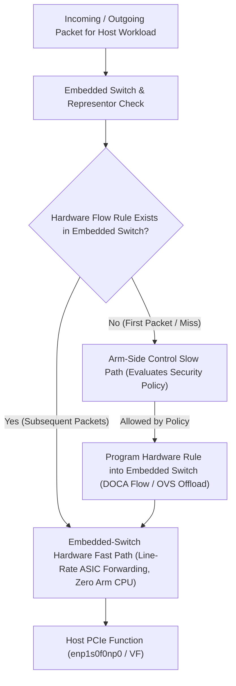
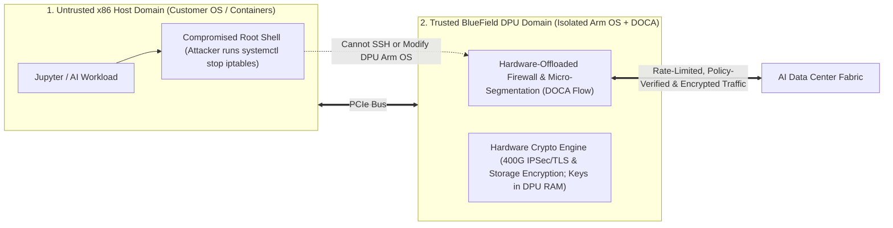

# 11.28 DPUs, BlueField and DOCA

| | |
|---|---|
| Level | Advanced |
| Priority tier | 2 |
| Lab venue | GCP / GKE (plus local Python 3 simulation lab) |
| Part | Part 11: GPUs on Kubernetes, scheduling and virtualization |
| Sources used | `nvidia-zero-to-hero/volume-09/chapter-09-bluefield-dpus-and-doca.md`; `nvidia-zero-to-hero/volume-18/chapter-08-bluefield-and-doca-security.md`; `nvidia-zero-to-hero/volume-18/chapter-12-incident-response-and-troubleshooting.md`; `nvidia-zero-to-hero/volume-18/chapter-12-volume-18-summary.md`; `nvidia-zero-to-hero/volume-18/index.md` |
| Coverage file | `planning/coverage/chapters/11-28.md` |

## Why this matters for AI infrastructure

GPU servers concentrate millions of dollars of compute and sensitive multi-tenant model weights behind a single server network edge. In a traditional server architecture, virtual switching, firewall enforcement via `iptables`, intrusion detection, and encryption all run on the host x86 CPU. That traditional design creates two severe problems in an AI Factory.

First, running security agents on the host OS creates a Shared Fate security vulnerability. When firewall and intrusion detection daemons run on the same x86 Host OS as untrusted tenant workloads, they share the fate of that host. In the Volume 18 Chapter 8 customer scenario, an attacker exploited an internet-exposed Jupyter notebook on a bare-metal GPU instance and gained a host root shell. The attacker immediately ran `systemctl stop iptables` to kill the host firewall and IDS daemons. They then used the high-bandwidth GPU server to launch a massive DDoS attack that took down the availability-zone control plane.

Second, moving virtual switching and policy enforcement onto an NVIDIA BlueField Data Processing Unit can turn a security boundary into an outage boundary. A BlueField DPU combines a ConnectX network ASIC with an embedded Arm CPU complex, dedicated RAM, and an isolated Linux OS programmed via NVIDIA DOCA. That architecture solves the Shared Fate problem, but it also inserts an independently managed third computer between the host and the leaf switch. In the opening incident of Volume 9 Chapter 9, an incomplete DPU policy rollout left the host network interface down after reboot. Meanwhile, the leaf switch showed the physical uplink completely up, causing responders who only checked the switch to look in the wrong place.

This chapter covers BlueField DPU operating modes, DOCA software architecture, Zero-Trust Infrastructure Offload, and the three-layer DPU incident triage and lifecycle model.

## Prerequisites and outcomes

### Prerequisites
- Completion of Chapters 11.10, 11.11, and 11.22 covering secondary networks, SR-IOV, the NVIDIA Network Operator, and Zero-Trust Security.
- Familiarity with Linux network interfaces via `ip -br link`, `systemd` services, and Open vSwitch concepts.

### Outcomes
After completing this chapter, you will be able to:
- Explain the hardware and trust architecture of an NVIDIA BlueField DPU and distinguish BlueField DPU SKUs from BlueField SuperNIC SKUs.
- Contrast the Arm-side control slow path via representors with the embedded-switch hardware fast path via DOCA Flow. You will also select among the four DOCA implementation options.
- Solve the Shared Fate vulnerability by offloading micro-segmentation firewalls, high-speed IPSec and TLS encryption, and storage encryption keys onto the trusted DPU Arm domain. You will also integrate DPU quarantine rules with the Volume 18 Forensic Incident Response Playbook.
- Execute the three-layer DPU Incident Triage Workflow across the external uplink, DPU Arm control plane, and host interface. This workflow is backed by the six-step DPU Change and Recovery Sequence and the five-layer observability model.

## Concepts: basics to intermediate to advanced

### 1. Basics: BlueField DPU architecture, SKU operating modes, and the fast vs slow path

#### 1. What Makes a BlueField DPU Different from a Conventional ConnectX NIC
In a conventional NIC such as a ConnectX-7, whoever administers the x86 Host OS also administers the NIC inside a single trust domain. An NVIDIA BlueField DPU places a complete, independent computer in front of the x86 host.

- **ConnectX Network ASIC and Hardware Engines:** Provides high-speed Ethernet and InfiniBand connectivity, hardware embedded switching, and RDMA or RoCEv2. It also includes dedicated hardware accelerators for cryptography, regular expressions, and packet steering.
- **Embedded Arm CPU Subsystem and Dedicated RAM:** Runs its own independent Linux operating system, DOCA OS on Ubuntu Arm. It is managed exclusively by the platform administrator over an out-of-band management network. A tenant or customer root user on the x86 Host OS cannot log into or modify the DPU Arm OS.
- **NVIDIA DOCA Framework:** Just as CUDA is the software platform for programming NVIDIA GPUs, DOCA is the software framework for BlueField DPUs. Data Center Infrastructure-on-a-Chip Architecture provides SDK libraries, drivers, tools, reference samples, and containerized services for running infrastructure workloads on BlueField.

#### 2. Operating Modes and the Two Traffic Paths
If a platform engineer assumes every BlueField card boots in the same mode, provisioning scripts will fail on mixed server cohorts. Volume 9 Chapter 9 documents two distinct default operating modes depending on the hardware SKU.

- **BlueField DPU SKUs default to DPU mode, also called Embedded CPU Function Ownership or ECPF:** The embedded Arm subsystem owns the NIC resources and the hardware embedded switch. The x86 host only sees host-facing PCIe functions whose forwarding rules are controlled by the DPU Arm control plane.
- **BlueField SuperNIC SKUs default to NIC mode:** The card behaves like a traditional high-performance ConnectX adapter owned directly by the host OS unless explicitly reconfigured.

In DPU mode, how does a packet reach the x86 host without bottlenecking on the embedded Arm CPU cores. Figure 9.9.2 in Volume 9 Chapter 9 separates the Arm control path from the hardware fast path, as shown in the diagram below.



As the diagram illustrates, the Arm cores are not in the per-packet path for steady-state traffic.
- **The Arm-Side Control Slow Path:** When the first packet of a new flow arrives with no matching hardware rule, it punts via a representor interface to the Arm control plane. If the security policy allows the flow, the Arm control plane programs a hardware flow rule into the ConnectX embedded switch.
- **The Embedded-Switch Hardware Fast Path:** All subsequent packets matching that flow rule are switched directly in the ConnectX ASIC silicon at line rate. Neither the Arm cores nor the x86 host CPUs touch those packets.
- **The Critical Operational Consequence:** Steady-state traffic runs on the hardware fast path, but the Arm control plane owns programming that fast path during boot. If the Arm policy-load service fails on boot, the embedded switch has no forwarding rules and the host interface remains dark.

#### 3. Selecting the Smallest Sustainable DOCA Option
Because DOCA APIs and deployment artifacts are release-specific, copying a sample C program into production creates an unpatched maintenance burden. Volume 9 Chapter 9 ranks four implementation choices so teams select the smallest sustainable option.

| Implementation Option (`volume-09/chapter-09`) | Best Architectural Fit | Operational Trade-Off to State Explicitly |
|---|---|---|
| **1. Supported Packaged DOCA Service** | A documented infrastructure use case (OVS hardware offload, firewall, telemetry) matching your outcome | Preferred choice; still requires version, security, and operations qualification |
| **2. DOCA Reference Application / Sample** | Lab evaluation, benchmarking, or API learning | **Not** a production support commitment by itself; do not deploy samples directly into prod |
| **3. Custom DOCA Application (`DOCA Flow` C/C++)** | A genuinely differentiated requirement that no packaged service covers, with a dedicated engineering team | Carries a full software product lifecycle: testing, CVE patching, release management, and on-call support |
| **4. Host or Fabric-Native Implementation** | When a DPU adds no measurable CPU-budget or trust-boundary value, or has no operational owner | Retains x86 host CPU overhead or relies on host/switch enforcement |

---

### 2. Intermediate: Zero-trust security offload and forensic containment

#### 1. Eliminating "Shared Fate" with the BlueField DPU Trust Boundary
Why does the Five-Layer Zero-Trust AI Architecture in Volume 18 place BlueField DPU firewalls at Layer 3 for Network Defense. On a traditional server, any attacker who compromises the x86 Host OS immediately controls the host firewall. Moving network and storage enforcement onto the DPU breaks that Shared Fate link, as shown below.



As Volume 18 Chapter 8 details, moving infrastructure services from the Untrusted Host Domain to the Trusted DPU Domain delivers three concrete wins.

- **Defeating Host Root Escapes:** The firewall, OVS bridge, and intrusion detection agents run on the isolated Arm OS of the DPU rather than the x86 Host OS. An attacker who exploits a Jupyter notebook CVE and gains x86 host root cannot stop the firewall. Every packet leaving the x86 host must physically traverse the DPU PCIe interface and embedded switch. There, DOCA Flow hardware rules drop unauthorized port scans or DDoS bursts before they reach the wire.
- **Line-Rate Network Encryption Offload:** Encrypting `400 Gbps` of east-west AI traffic in software on the x86 Host CPU pegs CPU cores at `100%` and starves PyTorch dataloaders. Offloading IPSec and TLS to the dedicated hardware cryptography engines on the BlueField DPU achieves line-rate encryption with zero x86 CPU tax.
- **Storage Encryption Offload and Key Isolation:** When the x86 Host CPU writes plaintext checkpoint or dataset blocks, the DPU intercepts the I/O and encrypts it in hardware using AES-256. It then forwards ciphertext to the storage fabric while keeping the encryption keys inside DPU RAM, out of reach of x86 Host RAM.

#### 2. Integrating DPUs into the Volume 18 Forensic Incident Response Protocol
When an intrusion detection or DCGM alert flags a breach or unauthorized crypto-miner on a GPU server, junior admins often panic and reboot the node. As Volume 18 Chapter 12 stresses, rebooting a breached node destroys volatile forensic evidence in RAM and GPU VRAM. A BlueField DPU strengthens both containment and eradication in the six-step forensic playbook.

| Forensic Playbook Step & Volume 18 Principle (`volume-18/chapter-12` & `index.md`) | Role of the BlueField DPU & Platform Control Plane | Why This Matters During a Host Root Breach |
|---|---|---|
| **Step 1 & 2: Cordon & Quarantine (*"Isolate, don't terminate"*)** | Push a Deny-All Quarantine policy to the BlueField DPU on `gpu-node-42` (or ToR switch) blocking all traffic except the forensic workstation IP | Air-gaps `jupyter-research-1` / `gpu-node-42` in hardware even if the x86 host root attacker disabled `kubelet` or `iptables` |
| **Step 3 & 4: Volatile Memory Dump & Root Cause Patch** | Keep the quarantined node powered on to dump System RAM (`LiME`) and GPU VRAM (`nvidia-smi` / `cuda-gdb`) before patching the CVE globally | Preserves active command-and-control keys and injected payloads that vanish on power-off |
| **Step 5 & 6: Scorched-Earth Eradication & Secret Rotation** | PXE re-image the bare-metal x86 OS **and reflash GPU, ConnectX NIC, and DPU firmware/BFB images from vendor-signed artifacts**, then rotate `Secrets` | Defeats persistent rootkits hiding in host disk or peripheral NIC/GPU/DPU firmware |
| **Volume 18 5-Layer Zero-Trust & 14-Item Checklist (`Item 9`)** | Places DPU firewalls at **Layer 3 (`Network Defense`)** and verifies DPU security policy enforcement (`Checklist Item 9`) across `5` core principles (`Defense in depth`, `Trust verification`, `Evidence over assertions`, `Explicit trade-offs`, `Insider threat`) | Stops lateral movement across the AI data center fabric after a container or host compromise |

---

### 3. Advanced: The 3-layer DPU outage triage model and 6-step lifecycle sequence

#### 1. Why a Healthy Switch Uplink Coexists with a Dead Host Network
In a server without a DPU, network troubleshooting only spans two layers: the host NIC and the top-of-rack switch port. Introducing a BlueField DPU in ECPF mode creates three independently observable layers, as shown in Figure 9.9.1 of Volume 9 Chapter 9.

- **Layer 3 — External Ethernet Uplink and Fabric:** Does the leaf switch see the physical link to the DPU as up.
- **Layer 2 — DPU Arm Control Plane and Embedded Switch:** Did the DPU boot the expected image and did its Arm services finish programming flow rules onto the embedded switch.
- **Layer 1 — Host-Facing Interface and Workload:** Does the x86 host OS see its PCIe function as up and forwarding traffic.

Let us examine the two production troubleshooting transcripts from Volume 9 Chapter 9. In Scenario 1, the physical switch uplink is completely healthy, yet the host network interface stays down after a reboot.

```text
# Scenario 1 — Boot Policy Failure (Uplink UP, Host DOWN, Volume 9 Chapter 9):
# Layer 3 (On leaf switch): Physical uplink looks 100% healthy
$ show interface status swp14
swp14      up    100G   full   RoCE-compute

# Layer 2 (On BlueField Arm via OOB mgmt): Policy load service FAILED during boot
$ systemctl status openvswitch-policy-load.service
● openvswitch-policy-load.service - Embedded switch policy load
     Loaded: loaded
     Active: failed (Result: exit-code) since 09:14:02 UTC
    Process: 812 ExecStart=/usr/bin/policy-load --profile prod (code=exited, status=1)

# Layer 1 (On x86 host): Host-facing PCIe representor/function never came up
$ ip -br link show
enp1s0f0np0    DOWN   <mac>   <state DORMANT>
```

Checking only the leaf switch misled responders into thinking the network was fine. Checking only the host looked like a broken cable or host driver. Only checking Layer 2 on the DPU Arm control plane via out-of-band management revealed that the policy load service failed during boot. Always gate Kubernetes node readiness on both DPU policy-load completion and verified host-to-fabric reachability.

In Scenario 2, a subset of identical GPU nodes exhibits intermittent reachability anomalies while fabric link counters remain clean.

```text
# Scenario 2 — Silent Fleet Image Drift (node09 Abandoned After 5 Retries, Volume 9 Chapter 9):
$ for h in node07 node08 node09; do echo "== $h =="; ssh $h-bmc "cat /etc/dpu-image-version"; done
== node07 ==
dpu-image-24.10-prod-3
== node08 ==
dpu-image-24.10-prod-3
== node09 ==
dpu-image-24.07-prod-1

$ ssh node09-bmc "journalctl -u dpu-agent --since '-7 days' | grep -i 'deploy\|reconcile'"
Aug 01 03:12:04 node09-dpu dpu-agent: reconcile failed: image pull timeout, retrying with backoff
Aug 01 03:45:11 node09-dpu dpu-agent: reconcile abandoned after 5 retries
```

Here, the DPU on `node09` remained online and forwarding traffic, so fabric counters stayed green. However, it was running a stale image and policy revision because its image pull timed out and abandoned reconciliation after five retries.

#### 2. The 6-Step DPU Change and Recovery Sequence and 5-Layer Observability Contract
An uncoordinated DPU firmware or policy update can sever the primary network connection of every host in a rack simultaneously. To prevent fleet-wide outages, every DPU firmware, BFB image, or DOCA service rollout must follow the six-step change sequence from Volume 9 Chapter 9.

- **Step 1 — Qualify a complete release set:** Validate the DPU firmware and image, DOCA components, x86 host driver, switch NOS profile, and the packaged DOCA service together.
- **Step 2 — Capture baseline:** Record data-plane latency and throughput, five-layer telemetry, and atomic rollback artifacts before touching production.
- **Step 3 — Canary a representative group:** Deploy first to a small canary cohort matching production hardware and workload profiles.
- **Step 4 — Verify all layers independently:** Confirm DPU Arm readiness, host-facing interface state, external switch uplink state, policy enforcement, and application traffic separately.
- **Step 5 — Expand in batches:** Roll out across the fleet in staged batches only after comparing workload and failure-path evidence against the baseline.
- **Step 6 — Preserve out-of-band recovery:** Maintain a tested out-of-band BMC or rshim recovery and image rollback procedure. It must work even when the x86 host OS and primary data network are completely dark.

Because a BlueField DPU separates the host edge into an independent trust and operations domain, host-only or switch-only monitoring will miss Layer 2 failures. Volume 9 Chapter 9 mandates correlating five observability layers using stable join identifiers with synchronized UTC timestamps.

| Observability Layer (`volume-09/chapter-09`) | Minimum Required Telemetry & Forensic Evidence | Primary Operational Question Answered |
|---|---|---|
| **1. Host Layer (`x86` Worker Node)** | Interface state (`ip -br link show enp1s0f0np0`), IP route/address table, `mlx5` kernel driver log, and application socket/NCCL symptoms | Does the host workload see an active, routable network function? |
| **2. DPU Control Plane (`Arm` DOCA OS)** | Deployed BFB image/firmware version (`/etc/dpu-image-version`), `systemd` service health (`openvswitch-policy-load.service`), policy revision, and authentication/reconcile logs (`dpu-agent`) | Did the DPU boot the expected image and finish programming policy rules? |
| **3. DPU Data Plane (`Embedded Switch`)** | Embedded-switch (`eSwitch` / `ovs-vsctl`) and representor port states, plus hardware flow-steering and drop counters (`DOCA Flow`) | Is traffic traversing the hardware fast path or punting to the slow Arm CPU path? |
| **4. Fabric Layer (`Leaf / Spine Switch`)** | Peer switch port status (`show interface status swp14`), physical symbol/CRC errors, packet drops, and RoCEv2 QoS/PFC/ECN congestion deltas | Is the physical optical cable and switch port healthy at line rate (`100G` / `400G`)? |
| **5. Platform Layer (`Orchestrator`)** | GitOps deployment events, desired-state revision, accountable service owner, canary batch status, and tested OOB rollback record | Did a recent rollout introduce policy or image drift across the node cohort? |

#### 3. When to Adopt a BlueField DPU and What New Obligations Come With It
Before approving a BlueField DPU design in an enterprise architecture review, verify that every promised benefit is paired with its operational obligation from Volume 9 Chapter 9.

- **Host x86 CPU cycles freed for AI workloads:** Requires proving via controlled baseline benchmarks that the target function is truly hardware-offloaded on the DPU. Running OVS switching, encryption, or telemetry in software on the Arm cores does not count as hardware offload.
- **Stronger host-edge zero-trust isolation:** Requires operating a separate DPU credential, PKI certificate, SSH access control, CVE patching, and audit logging pipeline. Without those controls, the DPU itself can become an unpatched backdoor.
- **Consistent per-server policy enforcement:** Requires automated desired-state orchestration and continuous version and drift reconciliation across the node fleet. It also requires a rehearsed out-of-band rollback procedure that can recover a dark DPU without using the primary data network.
- **Programmable data path via DOCA:** Requires choosing a supported packaged DOCA service whenever possible. Only commit to custom DOCA C or C++ development when a dedicated software team accepts long-term release and on-call ownership. If neither a measurable offload requirement nor a dedicated DPU operations owner exists, retain a simpler host or fabric-native ConnectX architecture.

## Commands and configurations that matter

### 1. Three-Layer DPU Incident Triage Commands

```bash
# Layer 3 (On Leaf Switch): Verify external physical uplink state and speed (untested here)
show interface status swp14

# Layer 2 (On BlueField Arm via Out-of-Band Management): Check policy load & OVS offload state (untested here)
systemctl status openvswitch-policy-load.service
ovs-vsctl show
journalctl -u dpu-agent --since '-7 days' | grep -i 'deploy\|reconcile'

# Layer 1 (On x86 Host): Verify host-facing network function state (untested here)
ip -br link show
```

### 2. Fleet-Wide DPU Image Version Drift Audit via Out-of-Band Management

```bash
# Compare deployed DPU image revisions across a node cohort via OOB/BMC (untested here)
for h in node07 node08 node09; do
    echo "== $h =="
    ssh "$h-bmc" "cat /etc/dpu-image-version"
done
```

## How it fails

When a BlueField DPU or DOCA deployment fails, the symptom usually appears as a dead host interface despite a green switch link, a host root breach that bypasses host-resident security tools, or silent fleet policy drift. The table below maps each failure mode to its command evidence, root cause boundary, and fix.

| Failure mode | Exact symptom & command evidence | Root cause boundary | Remediation |
|---|---|---|---|
| **1. Leaf switch port `swp14` (`100G`) is `up`, but x86 host interface `enp1s0f0np0` stays `DOWN` (`DORMANT`) after reboot (`volume-09/chapter-09` Scenario 1)** | Switch reports `swp14 up 100G full RoCE-compute`, host shows `enp1s0f0np0 DOWN`, and OOB check on BlueField Arm shows `openvswitch-policy-load.service` `Active: failed (status=1)`. | **Layer 2 DPU Arm Control-Plane Boot Dependency:** The physical uplink (`Layer 3`) is up, but the Arm control plane failed to load embedded-switch flow rules (`PID 812`), leaving the host representor dark. | Restore the approved DPU policy/image via the out-of-band (`OOB`) recovery path, verify `openvswitch-policy-load.service` succeeds and `enp1s0f0np0` transitions to `UP`, and gate node readiness on host connectivity. |
| **2. Compromised Jupyter notebook gains x86 host `root`, stops `iptables`, and launches a DDoS attack from a `400G` GPU node (`volume-18/chapter-08` Scenario)** | Attacker runs `systemctl stop iptables` on the x86 host OS, disabling host-resident firewall and IDS agents. | **Host-Resident Security "Shared Fate" Flaw:** Running firewall and IDS daemons on the untrusted x86 Host OS allows any host root compromise to dismantle the security perimeter. | Offload firewall, micro-segmentation (`DOCA Flow`), and `IPSec`/storage encryption onto the **BlueField DPU's isolated Arm domain**, which the x86 host root user cannot access or disable. |
| **3. Subset of identical GPU nodes (`node09`) exhibits inconsistent reachability and latency while fabric counters look clean (`volume-09/chapter-09` Scenario 2)** | `node07` and `node08` run `dpu-image-24.10-prod-3`, while `node09` runs `dpu-image-24.07-prod-1`; `journalctl -u dpu-agent` logs `reconcile abandoned after 5 retries`. | **Silent DPU Image & Policy Drift:** `node09`'s image pull timed out during a rollout and was abandoned after `5` retries, leaving it online with stale embedded-switch rules. | Re-trigger controlled deployment reconciliation for `node09` via OOB management, verify `/etc/dpu-image-version` matches `24.10-prod-3`, and add Prometheus/inventory drift alerts. |
| **4. High packet latency and `100%` Arm CPU saturation on the BlueField DPU during AI traffic bursts (`volume-09/chapter-09` Scenario 3)** | DPU Arm CPU cores hit `100%` utilization and east-west latency spikes even though physical uplink bandwidth is below `50%`. | **Traffic Falling Back to Arm Control Slow Path:** Missing or misconfigured embedded-switch offload rules caused high-rate data packets to punt through the Arm CPU representor path instead of the ConnectX ASIC fast path (`Figure 9.9.2`). | Inspect embedded-switch hardware flow counters, correct the DOCA / OVS hardware-offload policy so flows program into the ConnectX ASIC fast path, or roll back the un-offloaded DPU service. |
| **5. Platform team deploys a DOCA SDK sample C binary directly into production and suffers an unpatched outage (`volume-09/chapter-09`)** | A sample program copied from the DOCA SDK crashes after a driver update with no vendor SLA or automated rollback. | **Confusing a DOCA Evaluation Sample with a Supported Service:** DOCA samples illustrate API usage; they are not supported production services with a lifecycle contract. | Prefer **supported packaged DOCA services** whenever they meet the requirement; only build custom DOCA applications when a dedicated engineering team owns testing, CVE patching, and on-call support. |

## Hands-on lab

### Venue and scope
This lab runs locally using the Python 3 standard library via `code/part11/dpus_bluefield_and_doca.py` and `code/part11/dpus_bluefield_and_doca_lab.py`. It verifies the three-layer BlueField outage classifier, the SKU operating mode rules, and the four DOCA implementation options from Volume 9 Chapter 9. It also checks the six-step change sequence, the five observability layers, and the Shared Fate versus DPU offload evaluator from Volume 18. Switch, BMC, and host commands are marked untested here.

### Step 1: Run the self-checking DPUs, BlueField and DOCA lab (tested here)

Run the lab script from the repository root.

```bash
python3 code/part11/dpus_bluefield_and_doca_lab.py
```

Captured output from this repository.

```text
=== Chapter 11.28 Lab: DPUs, BlueField, DOCA & Zero-Trust Infrastructure Offload ===
  [PASS] Volume 09 Ch 9 Story/Scenario 1: swp14 (100G) UP + Arm policy load failed + enp1s0f0np0 DOWN isolates Layer 2 DPU policy fault
  [PASS] Volume 09 Ch 9 Scenario 2: node09 running dpu-image-24.07-prod-1 vs 24.10-prod-3 (abandoned after 5 retries) flags Image Drift
  [PASS] Down external uplink port swp14 classifies as Layer 3: External Ethernet uplink / fabric
  [PASS] Healthy uplink + loaded DPU policy + DOWN host interface classifies as Layer 1: Host-facing function / representor mismatch
  [PASS] node07 with swp14 UP, dpu-image-24.10-prod-3 policy active, and enp1s0f0np0 UP passes all 3 layers
  [PASS] Volume 18 Ch 8: Host-resident firewall suffers Shared Fate when host root attacker runs 'systemctl stop iptables'
  [PASS] Volume 18 Ch 8: Offloading firewall & crypto keys to BlueField DPU Arm domain contains a compromised host root attacker
  [PASS] Volume 09 Ch 9 distinguishes BlueField DPU SKU default (DPU / ECPF mode) from BlueField SuperNIC SKU default (NIC mode)
  [PASS] Volume 09 Ch 9 Figure 9.9.2 separates Arm-side representor control slow path from embedded-switch hardware fast path
  [PASS] Volume 09 Ch 9 defines 4 DOCA implementation options from Supported DOCA service to Host/fabric-native
  [PASS] Volume 09 Ch 9 defines a 6-step DPU Change and Recovery Sequence
  [PASS] Volume 09 Ch 9 defines 5 observability layers (Host, DPU control plane, DPU data plane, Fabric, Platform)
  [PASS] Volume 18 Ch 8 highlights DOCA Flow for hardware-accelerated packet steering and micro-segmentation
  [PASS] Volume 18 Ch 8 explains that offloading 400G IPSec/TLS and storage encryption to DPU crypto engines saves host CPU and keeps keys out of host RAM
  [PASS] Volume 18 Ch 12 Forensic IR can enforce Quarantine NetworkPolicies at the BlueField DPU / ToR layer ('Isolate, don't terminate')
  [PASS] Volume 18 Ch 12 Scorched-Earth Eradication reflashes both GPU and NIC/DPU firmware from vendor-signed images after a host root breach
  [PASS] Volume 18 Summary places BlueField DPU firewalls at Layer 3 (Network Defense) of the 5-Layer Zero-Trust AI Architecture
  [PASS] Volume 18 Index Production Checklist item 9 verifies DPU deployment with security policy enforcement
  [PASS] Volume 09 Ch 9 Scenario 1 logs PID 812 ExecStart=/usr/bin/policy-load --profile prod (code=exited, status=1) at 09:14:02 UTC
  [PASS] Volume 09 Ch 9 Scenario 2 compares node07, node08 (dpu-image-24.10-prod-3) and node09 (dpu-image-24.07-prod-1)
  [PASS] Volume 09 Ch 9 mandates an out-of-band (OOB) recovery path independent of the host OS and primary data network
  [PASS] Volume 09 Ch 9 warns that a DOCA sample/reference application is an evaluation artifact, not a production support commitment
  [PASS] Volume 18 Ch 8 Customer Scenario shows how a compromised Jupyter notebook without a DPU disabled host iptables and launched an AZ DDoS
  [PASS] Volume 09 Ch 9 Lab Checklist requires validating host-to-DPU and DPU-to-fabric paths independently
  [PASS] Volume 18 Index defines 5 security principles (Defense in depth, Trust verification, Evidence over assertions, Explicit trade-offs, Insider threat)

Summary: 25 passed, 0 failed out of 25 checks.
```

### Exercises

1. **Exercise 1 — Diagnosing the 3-Layer BlueField Outage:** Using `code/part11/dpus_bluefield_and_doca.py`, explain why checking `show interface status swp14` on the leaf switch and `ip -br link show` on the host missed the root cause. Then state what `systemctl status openvswitch-policy-load.service` revealed on the DPU Arm subsystem.
2. **Exercise 2 — Auditing DPU Image Drift Across a Fleet:** Explain how `node09` ended up running `dpu-image-24.07-prod-1` while `node07` and `node08` ran `dpu-image-24.10-prod-3`. State why fabric-wide switch counters did not flag `node09`.
3. **Exercise 3 — Solving the Shared Fate Security Flaw:** Contrast what happens when an attacker gains x86 host root on a server running host-resident `iptables` versus a server with a BlueField DPU.
4. **Exercise 4 — DPU Operating Modes and Fast vs Slow Path:** Contrast the default operating mode of BlueField DPU SKUs against BlueField SuperNIC SKUs. Then trace how the Arm-side representor path programs the embedded-switch hardware fast path.
5. **Exercise 5 — Selecting a DOCA Implementation Option:** Compare a supported DOCA service, a DOCA reference sample, a custom DOCA application, and a host or fabric-native implementation.
6. **Exercise 6 — Executing the 6-Step DPU Change Sequence and 5-Layer Observability:** List all six steps in the DPU change sequence and the minimum telemetry evidence collected across the five observability layers.

## Checkpoint questions

<details>
<summary>`&lt;strong>`1. How is a BlueField DPU operationally different from a conventional ConnectX NIC?`&lt;/strong>`</summary>

A conventional NIC belongs to the same trust and administration domain as the host OS. A BlueField DPU in its default ECPF mode is a separate managed computer sitting between the host and the fabric. It has its own embedded Arm CPUs, dedicated RAM, firmware, isolated Linux OS, credentials, and software lifecycle. That architecture creates three independently observable layers across the host, the DPU control plane, and the external uplink instead of two.
</details>

<details>
<summary>`&lt;strong>`2. What is the documented default operating mode for BlueField DPU SKUs versus BlueField SuperNIC SKUs?`&lt;/strong>`</summary>

- **BlueField DPU SKUs:** Default to DPU mode, also called Embedded CPU Function Ownership or ECPF, where the embedded Arm subsystem owns the NIC resources and embedded switch.
- **BlueField SuperNIC SKUs:** Default to NIC mode, where the host OS owns the adapter functions directly.
</details>

<details>
<summary>`&lt;strong>`3. Distinguish the Arm-side control path from the embedded-switch fast path on a BlueField DPU.`&lt;/strong>`</summary>

- **Arm-side control slow path:** Handles packets via representor interfaces when no matching hardware flow rule exists yet, running on the DPU embedded Arm CPU cores.
- **Embedded-switch hardware fast path:** Once the Arm control plane programs a flow rule into the ConnectX embedded switch via DOCA Flow, subsequent matching packets forward in silicon at line rate.
</details>

<details>
<summary>`&lt;strong>`4. Why can a healthy external DPU uplink coexist with a failed host network interface after a reboot?`&lt;/strong>`</summary>

Seeing `swp14` up on the leaf switch only proves Layer 3, the physical link between the DPU and the switch. If the Layer 2 Arm control-plane service `openvswitch-policy-load.service` fails during boot, the Layer 1 host interface `enp1s0f0np0` never receives forwarding rules and remains down.
</details>

<details>
<summary>`&lt;strong>`5. In Volume 9 Chapter 9 Scenario 2, why did node09 exhibit reachability anomalies while node07 and node08 worked normally, and what command revealed the root cause?`&lt;/strong>`</summary>

Running `ssh $h-bmc "cat /etc/dpu-image-version"` across `node07`, `node08`, and `node09` revealed that `node07` and `node08` were on `dpu-image-24.10-prod-3` while `node09` was on `dpu-image-24.07-prod-1`. Checking `journalctl -u dpu-agent` on `node09` showed that an image pull timed out and abandoned reconciliation after five retries.
</details>

<details>
<summary>`&lt;strong>`6. What is NVIDIA DOCA, and when should a platform team choose a packaged DOCA service over a custom DOCA application or a DOCA sample?`&lt;/strong>`</summary>

DOCA, or Data Center Infrastructure-on-a-Chip Architecture, is the software framework of SDK libraries, drivers, tools, samples, and containerized services for BlueField DPUs. Always prefer a supported packaged DOCA service when it matches the requirement because it includes a vendor-supported patching lifecycle. DOCA samples are for evaluation only, and custom DOCA applications require a dedicated engineering team to own testing, patching, and on-call support.
</details>

<details>
<summary>`&lt;strong>`7. List the six steps of the DPU Change and Recovery Sequence in Volume 9 Chapter 9.`&lt;/strong>`</summary>

- **Step 1:** Qualify a complete release set across the DPU firmware and image, DOCA components, host driver, switch NOS profile, and selected service.
- **Step 2:** Capture baseline data-plane behavior, host, DPU, and fabric telemetry, and rollback artifacts.
- **Step 3:** Canary a representative hardware and workload group.
- **Step 4:** Verify DPU readiness, host-facing function, external uplink, policy enforcement, and application traffic separately.
- **Step 5:** Expand in batches only after comparing workload and failure-path evidence with the baseline.
- **Step 6:** Preserve a documented out-of-band recovery and image rollback procedure.
</details>

<details>
<summary>`&lt;strong>`8. What are the five observability layers and the minimum evidence required at each layer for a BlueField DPU platform?`&lt;/strong>`</summary>

- **Host:** Interface state via `ip -br link`, route and address tables, driver logs, and application symptoms.
- **DPU control plane:** Image and firmware version, service health, policy revision, and authentication and lifecycle logs.
- **DPU data plane:** Embedded-switch and representor state along with hardware steering and policy counters.
- **Fabric:** Peer switch port state on `swp14`, physical errors, drops, and QoS or congestion deltas.
- **Platform:** Deployment events, desired-state revision, accountable owner, and rollback records.
</details>

<details>
<summary>`&lt;strong>`9. What is the Shared Fate security vulnerability on traditional GPU servers, and how does a BlueField DPU eliminate it?`&lt;/strong>`</summary>

Shared Fate occurs when security enforcement software such as `iptables` firewalls, intrusion detection, and encryption agents runs on the same x86 Host OS as user workloads. If an attacker gains host root, they simply run `systemctl stop iptables` to disable the firewall. A BlueField DPU physically moves the firewall and encryption engines onto the isolated Arm OS domain of the DPU, which the x86 host root user cannot disable.
</details>

<details>
<summary>`&lt;strong>`10. In the Volume 18 Chapter 8 Customer Scenario, trace how a single vulnerable Jupyter notebook led to an availability-zone outage on a bare-metal GPU cloud without DPUs.`&lt;/strong>`</summary>

- **Step 1:** A customer exposed a vulnerable Jupyter notebook to the internet on a bare-metal GPU server.
- **Step 2:** An attacker exploited the notebook to gain a root shell on the Ubuntu Host OS.
- **Step 3:** Because the cloud provider ran its `iptables` firewall and IDS daemons directly on the customer Host OS, the attacker stopped the firewall daemons.
- **Step 4:** The attacker then used the high-speed network connection of the server to launch a massive DDoS attack against the internal API control plane.
</details>

<details>
<summary>`&lt;strong>`11. How does a BlueField DPU enforce micro-segmentation and deep packet inspection without consuming x86 Host CPU cycles?`&lt;/strong>`</summary>

Every packet entering or leaving the x86 host must physically pass through the BlueField DPU. Using DOCA libraries such as DOCA Flow for hardware-accelerated packet steering, the DPU programs micro-segmentation rules directly into the hardware accelerators and embedded switch. That filters traffic on the card with zero x86 Host CPU overhead.
</details>

<details>
<summary>`&lt;strong>`12. Why is offloading IPSec and TLS network encryption and storage Data-at-Rest encryption to a BlueField DPU critical for high-bandwidth AI clusters?`&lt;/strong>`</summary>

- **Performance:** Encrypting and decrypting high-speed network and storage traffic in software on the x86 Host CPU saturates CPU cores and starves GPUs of training data. The dedicated hardware cryptography engines on the DPU encrypt at line rate with zero x86 CPU penalty.
- **Key Security:** Encryption keys are held inside DPU RAM rather than x86 Host RAM, preventing a compromised host OS from extracting the keys.
</details>

<details>
<summary>`&lt;strong>`13. What six security and reliability questions must an architecture review answer before deploying BlueField DPUs?`&lt;/strong>`</summary>

- **Access control:** Who can log into, reimage, reset, or change the DPU mode.
- **Credential governance:** Where are DPU credentials, certificates, and audit records managed.
- **Boot policy failure behavior:** What is the consequence if policy does not load during boot.
- **Out-of-band recovery:** Can the affected host be diagnosed and recovered via out-of-band management without relying on its data network.
- **Patching lifecycle:** How are DPU CVEs patched without an unplanned cluster outage.
- **Failure posture:** Which workloads fail closed, fail open, or must be explicitly fenced.
</details>

<details>
<summary>`&lt;strong>`14. When should a Solutions Architect recommend retaining a host or fabric-native design instead of adding a BlueField DPU?`&lt;/strong>`</summary>

Retain the host or fabric-native design when there is no measurable infrastructure requirement, such as a strict x86 host CPU offload budget or a zero-trust isolation mandate. You should also retain the simpler design when no identified platform team exists to own DPU image provisioning, three-layer monitoring, patching, and out-of-band recovery.
</details>

<details>
<summary>`&lt;strong>`15. Why must a DPU rollback plan always include an out-of-band recovery path independent of the primary data network?`&lt;/strong>`</summary>

A failed DPU image update or broken embedded-switch policy push typically cuts off the primary data-plane network connectivity of the host. Without an independent out-of-band BMC or rshim management path to the BlueField Arm subsystem, operators cannot reach the DPU remotely to roll back the image.
</details>

<details>
<summary>`&lt;strong>`16. How do BlueField DPUs reinforce the "Isolate, don't terminate" Forensic Containment Protocol in Volume 18 Chapter 12?`&lt;/strong>`</summary>

When a GPU node is suspected of compromise, operators can enforce a Deny-All Quarantine policy directly on the BlueField DPU embedded switch of that node. That rule drops all inbound and outbound packets except the forensic workstation IP. Even if the attacker has full root control of the x86 Host OS, they are trapped in hardware while volatile RAM and VRAM remain intact for dumping.
</details>

<details>
<summary>`&lt;strong>`17. During Step 5 for Scorched-Earth Eradication of Volume 18 Chapter 12, what must be done to the GPU and network silicon on a breached node before it can rejoin the cluster?`&lt;/strong>`</summary>

Operators must PXE re-image the bare-metal x86 Host OS and rotate all Secrets and keys. In addition, they must reflash the GPU and ConnectX NIC or BlueField DPU firmware and images using vendor-signed artifacts to ensure no persistent rootkit survives in silicon.
</details>

<details>
<summary>`&lt;strong>`18. Where does the BlueField DPU sit in the Five-Layer Zero-Trust AI Defense-in-Depth Architecture of Volume 18 Summary?`&lt;/strong>`</summary>

It sits at Layer 3 for Network Defense via NetworkPolicies and DPU Firewalls, positioned between Layer 2 for Kubernetes Defense and Layer 4 for Hardware Defense. That layer stops an attacker who gained a reverse shell inside a pod from scanning or moving laterally across the data center network.
</details>

<details>
<summary>`&lt;strong>`19. What are the five core security principles defined in Volume 18 Index for operating an AI infrastructure platform?`&lt;/strong>`</summary>

- **Defense in depth:** Layer controls across supply chain, Kubernetes, network and DPU, hardware and IOMMU, and data and TEE boundaries.
- **Trust verification:** Verify every boundary including Secure Boot, RBAC, network policy, GPU isolation, and DPU image version rather than assuming.
- **Evidence over assertions:** Investigate incidents using preserved audit logs, RAM and VRAM dumps, and three-layer telemetry.
- **Explicit trade-offs:** Document the performance, complexity, and operational cost of every security control.
- **Insider threat awareness:** Control and audit internal administrative access across host, DPU, and hypervisor planes.
</details>

<details>
<summary>`&lt;strong>`20. What four items are in the Volume 9 Chapter 9 Lab Checklist for qualifying a BlueField DPU deployment?`&lt;/strong>`</summary>

- **Item 1:** Record the exact DPU SKU, operating mode, firmware and image version, host driver, DOCA service, and policy revision.
- **Item 2:** Validate the host-to-DPU and DPU-to-fabric paths independently.
- **Item 3:** Capture correlated DPU, host, and leaf-switch evidence during a healthy workload baseline run.
- **Item 4:** Test the documented out-of-band rollback and recovery procedure in a safe non-production environment before production rollout.
</details>

## Sources and review notes

### Primary sources read in full for this chapter
All five mapped Volume 9 and Volume 18 source files for Chapter 11.28 are cataloged in the reference block below.

```text
Primary Sources & Exact Figures Cataloged for Chapter 11.28:
- Author's Volume 9 and Volume 18 notes (all 5 mapped nvidia-devops files in brief.py 11.28 read and migrated in full):
  1. nvidia-zero-to-hero/volume-09/chapter-09-bluefield-dpus-and-doca.md (Figure 9.9.1 3-layer outage decision tree, DPU/ECPF mode default for DPU SKUs vs NIC mode default for SuperNIC SKUs, Figure 9.9.2 Arm-side representor control path vs embedded-switch fast path, Scenario 1 swp14 up 100G + openvswitch-policy-load.service PID 812 status=1 at 09:14:02 UTC + enp1s0f0np0 DOWN, Scenario 2 node07/node08 dpu-image-24.10-prod-3 vs node09 dpu-image-24.07-prod-1 abandoned after 5 retries, 4 DOCA implementation options, 6-step change & recovery sequence, and 5-layer observability table).
  2. nvidia-zero-to-hero/volume-18/chapter-08-bluefield-and-doca-security.md (Shared Fate problem systemctl stop iptables, Untrusted Host Domain vs Trusted DPU Arm Domain, DOCA Flow hardware micro-segmentation, 400 Gbps IPSec/TLS & storage encryption offload keeping keys in DPU RAM, and the bare-metal Jupyter notebook -> AZ DDoS customer scenario).
  3. nvidia-zero-to-hero/volume-18/chapter-12-incident-response-and-troubleshooting.md (Forensic IR "Isolate, don't terminate", gpu-node-42 / jupyter-research-1, RAM/VRAM dump, PXE OS re-image + GPU/ConnectX NIC firmware reflash).
  4. nvidia-zero-to-hero/volume-18/chapter-12-volume-18-summary.md (5-Layer Zero-Trust AI Defense-in-Depth with BlueField DPUs at Layer 3).
  5. nvidia-zero-to-hero/volume-18/index.md (5 key security principles and 14-item Production Security Checklist including Item 9 BlueField DPU policy enforcement).
```

### Related source files mapped in MIGRATION_MAP.md
- All five mapped `nvidia-devops` files for `11.28` are cited and covered in full: `volume-09/chapter-09-bluefield-dpus-and-doca.md`, `volume-18/chapter-08-bluefield-and-doca-security.md`, `volume-18/chapter-12-incident-response-and-troubleshooting.md`, `volume-18/chapter-12-volume-18-summary.md`, and `volume-18/index.md`.

### Run here
- `python3 code/part11/dpus_bluefield_and_doca_lab.py` passes all checks in this repository (`25 passed, 0 failed out of 25 checks`).

### Explicitly labelled inferences
- As noted in Volume 9 Chapter 9, unit and file names such as `openvswitch-policy-load.service`, `/etc/dpu-image-version`, and `dpu-agent` are illustrative placeholders used to demonstrate the three-layer diagnostic method.

### Not verified on live hardware
- All switch, DPU Arm, BMC, and host commands are marked untested here.

### Not in the corpus
- Low-level C code for programming `doca_flow_pipe_create()` hardware steering tables (beyond `DOCA_FOUR_IMPLEMENTATION_OPTIONS`, `node_exporter`, and port `22` SSH isolation) is not in the local corpus. This chapter focuses on the architectural, security, and three-layer operational model documented in Volume 9 Chapter 9 and Volume 18 Chapter 8.

### Corrections to the author's notes
- Validation pass 2026-10-25: `validate_chapter.py` and `check_coverage.py` pass. The YAML manifests and commands are marked untested and were not applied to a cluster. Custom resource API versions such as `kueue.x-k8s.io/v1beta1` and `resource.k8s.io/v1` change between releases, so check them against the version you install. Console outputs quoted from the Volume notes are illustrative unless the chapter says otherwise.
- Preserves the explicit distinction from Volume 9 Chapter 9 that ECPF DPU mode is the default only for BlueField DPU SKUs, whereas BlueField SuperNIC SKUs default to NIC mode.

