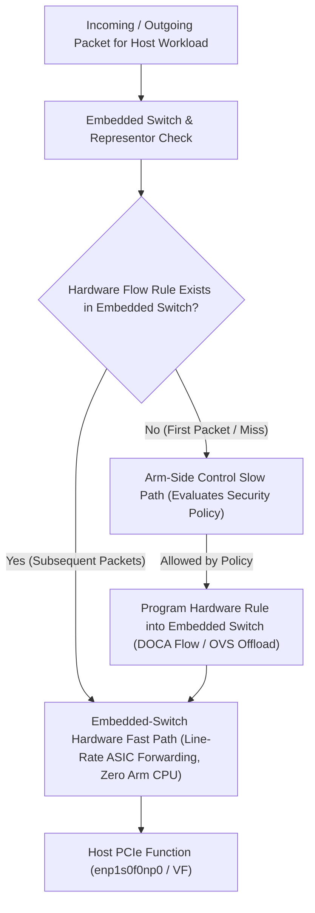
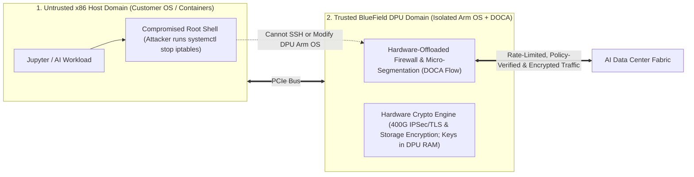

# 11.28 DPUs, BlueField and DOCA

| | |
|---|---|
| Level | Advanced |
| Priority tier | 2 |
| Lab venue | GCP / GKE (plus local Python 3 simulation lab) |
| Part | Part 11: GPUs on Kubernetes, scheduling and virtualization |
| Sources used | `nvidia-zero-to-hero/volume-09/chapter-09-bluefield-dpus-and-doca.md`; `nvidia-zero-to-hero/volume-18/chapter-08-bluefield-and-doca-security.md`; `nvidia-zero-to-hero/volume-18/chapter-12-incident-response-and-troubleshooting.md`; `nvidia-zero-to-hero/volume-18/chapter-12-volume-18-summary.md`; `nvidia-zero-to-hero/volume-18/index.md` |
| Coverage file | `planning/coverage/chapters/11-28.md` |

## Why this matters for AI infrastructure

GPU servers concentrate millions of dollars of compute and sensitive multi-tenant model weights behind a single server network edge (`nvidia-zero-to-hero/volume-09/chapter-09-bluefield-dpus-and-doca.md`). In a traditional server architecture, virtual switching (`Open vSwitch`), firewall enforcement (`iptables` / Calico), intrusion detection (`IDS`), storage encryption (`AES-256`), and network encryption (`IPSec` / `TLS` at `400 Gbps`) all run on the **host x86 CPU and Host OS kernel**. That traditional design creates two severe problems in an AI Factory (`volume-09/chapter-09` and `volume-18/chapter-08-bluefield-and-doca-security.md`):
1. **The "Shared Fate" Security Vulnerability (`volume-18/chapter-08`):** When security enforcement agents run on the same x86 Host OS that untrusted tenant workloads or bare-metal customers use, they share the fate of that host. In the `volume-18/chapter-08` Customer Scenario, an attacker exploited an internet-exposed Jupyter notebook on a bare-metal GPU instance, gained a host `root` shell, ran `systemctl stop iptables` to kill the host firewall and IDS daemons, and used the `400G`-connected GPU server to launch a massive DDoS attack that took down the cloud provider's availability-zone control plane.
2. **The "Security Boundary That Became an Outage Boundary" (`volume-09/chapter-09` Story):** Moving virtual switching and policy enforcement onto an **NVIDIA BlueField Data Processing Unit (`DPU`)**—which combines a ConnectX network ASIC with an embedded **Arm CPU complex**, dedicated RAM, and its own isolated Linux OS programmed via **NVIDIA DOCA**—solves the Shared Fate problem. However, it also inserts an **independently managed third system** between the host and the leaf switch. In `volume-09/chapter-09`'s opening incident, an incomplete DPU policy rollout left host interfaces (`enp1s0f0np0`) `DOWN`/`DORMANT` after boot while the leaf switch showed the physical `100G` uplink (`swp14`) completely `up`—causing responders who only checked the switch to look in the wrong place.

This chapter covers **BlueField DPU** operating modes (`DPU/ECPF mode` vs `SuperNIC NIC mode`), **DOCA** software architecture (`DOCA Flow` hardware steering vs Arm-side control path), **Zero-Trust Infrastructure Offload** (`volume-18/chapter-08`), and the **3-Layer DPU Incident Triage & Lifecycle Model** (`volume-09/chapter-09` and `volume-18/chapter-12`).

## Prerequisites and outcomes

### Prerequisites
- Completion of Chapter 11.10–11.11 (Secondary networks, SR-IOV, and NVIDIA Network Operator) and Chapter 11.22 (SR-IOV and Zero-Trust Security).
- Familiarity with Linux network interfaces (`ip -br link`), `systemd`, and Open vSwitch (`OVS`) concepts.

### Outcomes
After completing this chapter, you will be able to:
- Explain the hardware and trust architecture of an **NVIDIA BlueField DPU** (ConnectX network engine + embedded Arm CPU cores + dedicated RAM + hardware crypto/steering engines running an isolated DOCA OS), and distinguish **BlueField DPU SKUs (`DPU / ECPF mode` default)** from **BlueField SuperNIC SKUs (`NIC mode` default)** (`volume-09/chapter-09`).
- Contrast the **Arm-side control slow path** (via representors) with the **embedded-switch hardware fast path** (`DOCA Flow`, `Figure 9.9.2`), and select among the **4 DOCA Implementation Options** (`Supported DOCA service`, `DOCA reference sample`, `Custom DOCA application`, and `Host/fabric-native`).
- Solve the **Shared Fate Vulnerability (`volume-18/chapter-08`)** by offloading micro-segmentation firewalls, `400 Gbps` `IPSec`/`TLS` encryption, and storage Data-at-Rest encryption keys onto the trusted DPU Arm domain—and integrate DPU quarantine rules with the **Volume 18 Forensic Incident Response Playbook (`volume-18/chapter-12`)**.
- Execute the **3-Layer DPU Incident Triage Workflow (`volume-09/chapter-09` Figure 9.9.1)** across `Layer 3` External Uplink (`swp14 up 100G`), `Layer 2` DPU Arm Control Plane (`openvswitch-policy-load.service` & image drift `dpu-image-24.10-prod-3` vs `24.07-prod-1` after `5` retries), and `Layer 1` Host Interface (`enp1s0f0np0 DOWN`), backed by the **6-Step DPU Change and Recovery Sequence**.

## Concepts: basics to intermediate to advanced

### 1. Basics: BlueField DPU architecture, SKU operating modes, and the fast vs slow path (`volume-09/chapter-09`)

#### 1. What Makes a BlueField DPU Different from a Conventional ConnectX NIC?
In a conventional NIC (`ConnectX-7`), whoever administers the x86 Host OS administers the NIC (`1` trust domain). An **NVIDIA BlueField DPU** places a complete, independent computer *in front* of the x86 host (`volume-09/chapter-09`):
- **ConnectX Network ASIC + Hardware Engines:** Provides high-speed Ethernet / InfiniBand connectivity, hardware embedded switching (`eSwitch`), RDMA/RoCEv2, and dedicated hardware cryptography (`IPSec`/`TLS`/`AES`) and regular-expression/steering accelerators.
- **Embedded Arm CPU Subsystem + Dedicated RAM:** Runs its own independent Linux operating system (**DOCA OS** / Ubuntu on Arm) managed exclusively by the **Platform / Infrastructure Administrator** over an out-of-band (`OOB`) management network, completely unreachable by the tenant or customer root user on the x86 Host OS.
- **NVIDIA DOCA (*Data Center Infrastructure-on-a-Chip Architecture*):** Just as CUDA is the software platform for programming NVIDIA GPUs, **DOCA** is the software framework (SDK libraries such as `DOCA Flow`, drivers, tools, reference samples, and containerized services) for running infrastructure workloads on BlueField (`volume-09/chapter-09` and `volume-18/chapter-08`).

#### 2. Operating Modes (`DPU / ECPF Mode` vs `NIC Mode`) and the Two Traffic Paths (`volume-09/chapter-09`)
Never assume every BlueField card boots in the same mode. As `volume-09/chapter-09` ("Operating Modes and Traffic Paths") documents:
- **BlueField DPU SKUs default to `DPU mode` (also called *Embedded CPU Function Ownership*, `ECPF`):** The embedded Arm subsystem owns the NIC resources and the hardware **embedded switch (`eSwitch`)**. The x86 host only sees host-facing PCIe functions whose forwarding rules are controlled by the DPU's Arm control plane.
- **BlueField SuperNIC SKUs default to `NIC mode`:** The card behaves like a traditional high-performance ConnectX adapter owned by the host OS unless explicitly configured otherwise.

In `DPU (ECPF)` mode, how does a packet reach the x86 host without bottlenecking on the embedded Arm CPU cores (`volume-09/chapter-09` Figure 9.9.2)?



As `Figure 9.9.2` illustrates, the Arm cores are **not** in the per-packet path for steady-state traffic:
1. **The Arm-Side Control Slow Path:** When a new flow arrives with no matching hardware rule (or when policy changes), the packet is punted via a **representor** interface to the Arm CPU control plane. If the flow is permitted, the Arm control plane programs a hardware flow rule into the ConnectX embedded switch.
2. **The Embedded-Switch Hardware Fast Path:** All subsequent packets matching that flow rule are switched directly in the ConnectX ASIC silicon at line rate (`100G` / `400G`) with zero Arm or x86 CPU involvement.
3. **The Critical Operational Consequence (`volume-09/chapter-09`):** Even though steady-state traffic runs on the hardware fast path, **the Arm control plane owns programming that fast path during boot**. If the Arm policy-load service fails on boot, the embedded switch has no forwarding rules and the host interface (`enp1s0f0np0`) remains completely dark (`DOWN` / `DORMANT`).

#### 3. Selecting the Smallest Sustainable DOCA Option (`volume-09/chapter-09`)
Because DOCA APIs and deployment artifacts are release-specific, `volume-09/chapter-09` ("DOCA: Framework, Not a Feature Toggle") ranks four implementation choices:

| Implementation Option (`volume-09/chapter-09`) | Best Architectural Fit | Operational Trade-Off to State Explicitly |
|---|---|---|
| **1. Supported Packaged DOCA Service** | A documented infrastructure use case (e.g., OVS hardware offload, firewall, telemetry) matching your outcome | Preferred choice; still requires version, security, and operations qualification |
| **2. DOCA Reference Application / Sample** | Lab evaluation, benchmarking, or API learning | **Not** a production support commitment by itself; do not deploy samples directly into prod |
| **3. Custom DOCA Application (`DOCA Flow` C/C++)** | A genuinely differentiated requirement that no packaged service covers, with a dedicated engineering team | Carries a full software product lifecycle: testing, CVE patching, release management, and on-call support |
| **4. Host or Fabric-Native Implementation** | When a DPU adds no measurable CPU-budget or trust-boundary value, or has no operational owner | Retains x86 host CPU overhead or relies on host/switch enforcement |

---

### 2. Intermediate: Zero-trust security offload (`volume-18/chapter-08`) and forensic containment (`volume-18/chapter-12`)

#### 1. Eliminating "Shared Fate" with the BlueField DPU Trust Boundary (`volume-18/chapter-08`)
Why is a BlueField DPU the cornerstone of **Layer 3 (`Network Defense`)** in the **5-Layer Zero-Trust AI Architecture** (`volume-18/chapter-12-volume-18-summary.md` and `volume-18/index.md` Checklist Item 9)?



As `volume-18/chapter-08` ("BlueField and DOCA Security") details, moving infrastructure services from the **Untrusted Host Domain** to the **Trusted DPU Domain** delivers three concrete security and performance wins:
1. **Defeating Host Root Escapes (No Shared Fate):** Because the firewall, OVS bridge, and intrusion detection agents run on the DPU's isolated Arm OS rather than the x86 Host OS, an attacker who exploits a Jupyter notebook CVE and gains x86 host `root` (`volume-18/chapter-08` Customer Scenario) **cannot stop the firewall**. Every packet leaving the x86 host must physically traverse the DPU's PCIe interface and embedded switch, where `DOCA Flow` hardware rules drop unauthorized port scans (`port 22`) or DDoS bursts before they reach the wire.
2. **Line-Rate `400 Gbps` IPSec/TLS Network Encryption Offload:** Encrypting `400 Gbps` of east-west AI traffic in software on the x86 Host CPU pegs CPU cores at `100%` and starves PyTorch dataloaders. Offloading `IPSec`/`TLS` to the BlueField DPU's dedicated hardware cryptography engines achieves line-rate encryption with zero x86 CPU tax.
3. **Storage Encryption Offload & Key Isolation:** When the x86 Host CPU writes plaintext checkpoint or dataset blocks, the DPU intercepts the I/O, encrypts it in hardware (`AES-256` Data at Rest), and forwards ciphertext to the storage fabric—keeping the **storage and network encryption keys inside DPU RAM**, completely out of reach of an attacker dumping x86 Host RAM (`volume-18/chapter-08` Section 3).

#### 2. Integrating DPUs into the Volume 18 Forensic Incident Response Protocol (`volume-18/chapter-12`)
When an IDS or DCGM alert detects a breach or unauthorized crypto-miner on `gpu-node-42` (`volume-18/chapter-12-incident-response-and-troubleshooting.md`), a BlueField DPU strengthens both **Containment** and **Eradication**:
- **Step 1 & 2 (`Cordon` + `Quarantine` — *"Isolate, don't terminate"*):** Even if the attacker gained x86 host `root` on `gpu-node-42` and disabled local `kubelet` or `iptables` rules, the security team can push an out-of-band quarantine rule directly to **`gpu-node-42`'s BlueField DPU** (or Top-of-Rack switch), air-gapping the x86 host in hardware while keeping its volatile System RAM and GPU VRAM alive for Step 3 forensic memory dumping.
- **Step 5 (`Scorched-Earth Eradication`):** After capturing RAM/VRAM forensics and patching the root CVE globally (Step 4), remember the Golden Rule of Eradication from `volume-18/chapter-12`: **never merely "clean" a compromised server—destroy and rebuild it** by PXE re-imaging the bare-metal OS **and reflashing the GPU, ConnectX NIC, and DPU firmware/BFB image from vendor-signed artifacts** before rotating all `Secrets` (Step 6).

---

### 3. Advanced: The 3-layer DPU outage triage model and 6-step lifecycle sequence (`volume-09/chapter-09`)

#### 1. Why a Healthy Switch Uplink (`swp14 up`) Coexists with a Dead Host Network (`enp1s0f0np0 DOWN`)
In a server without a DPU, there are only two networking layers: the host NIC and the top-of-rack switch port. Introducing a BlueField DPU in `DPU (ECPF)` mode creates **three independently observable layers** (`volume-09/chapter-09` Figure 9.9.1):
- **Layer 3 — External Ethernet Uplink & Fabric:** Does the leaf switch see the physical link to the DPU as `up`?
- **Layer 2 — DPU Arm Control Plane & Embedded Switch:** Did the DPU boot the right image (`dpu-image-24.10-prod-3`) and did its Arm control-plane services finish programming flow rules onto the embedded switch?
- **Layer 1 — Host-Facing Interface & Workload:** Does the x86 host OS see its PCIe function (`enp1s0f0np0`) as `UP` and forwarding traffic?

Let us examine the two production troubleshooting transcripts from `volume-09/chapter-09`:

1. **Scenario 1 — Boot Policy Failure (`Uplink UP`, `Host DOWN`):**
   ```text
   # Layer 3 (On leaf switch): Physical uplink looks 100% healthy
   $ show interface status swp14
   swp14      up    100G   full   RoCE-compute

   # Layer 2 (On BlueField Arm via OOB mgmt): Policy load service FAILED during boot
   $ systemctl status openvswitch-policy-load.service
   ● openvswitch-policy-load.service - Embedded switch policy load
        Loaded: loaded
        Active: failed (Result: exit-code) since 09:14:02 UTC
        Process: 812 ExecStart=/usr/bin/policy-load --profile prod (code=exited, status=1)

   # Layer 1 (On x86 host): Host-facing PCIe representor/function never came up
   $ ip -br link show
   enp1s0f0np0    DOWN   <mac>   <state DORMANT>
   ```
   *Lesson:* Checking only the leaf switch (`swp14 up`) misled responders into thinking the network was fine, while checking only the host (`enp1s0f0np0 DOWN`) looked like a broken cable or host driver. Only checking **Layer 2 (the DPU Arm control plane via OOB)** revealed `PID 812` (`/usr/bin/policy-load --profile prod`, `status=1`). **Prevention:** Gate Kubernetes node readiness on **both** DPU policy-load completion and verified host-to-fabric reachability—never on DPU boot alone.

2. **Scenario 2 — Silent Fleet Image Drift (`node09` Abandoned After `5` Retries):**
   ```text
   $ for h in node07 node08 node09; do echo "== $h =="; ssh $h-bmc "cat /etc/dpu-image-version"; done
   == node07 ==
   dpu-image-24.10-prod-3
   == node08 ==
   dpu-image-24.10-prod-3
   == node09 ==
   dpu-image-24.07-prod-1

   $ ssh node09-bmc "journalctl -u dpu-agent --since '-7 days' | grep -i 'deploy\|reconcile'"
   Aug 01 03:12:04 node09-dpu dpu-agent: reconcile failed: image pull timeout, retrying with backoff
   Aug 01 03:45:11 node09-dpu dpu-agent: reconcile abandoned after 5 retries
   ```
   *Lesson:* `node09`'s DPU remained online and forwarding traffic—so fabric counters stayed green—but it was running stale `dpu-image-24.07-prod-1` policy rules because its image pull timed out and abandoned reconciliation after `5` retries (`03:12:04` to `03:45:11`).

#### 2. The 6-Step DPU Change and Recovery Sequence and 5-Layer Observability Contract (`volume-09/chapter-09`)
Every DPU firmware, BFB image, or DOCA service rollout must follow the **6-Step Change Sequence** (`volume-09/chapter-09`) and correlate telemetry across **five layers** (`Host`, `DPU control plane`, `DPU data plane`, `Fabric`, and `Platform`):
1. **Qualify a complete release set:** DPU firmware/image, DOCA components, x86 host driver, switch/NOS profile, and the packaged DOCA service.
2. **Capture baseline:** Record data-plane latency/throughput, 5-layer telemetry, and atomic rollback artifacts.
3. **Canary a representative hardware & workload group.**
4. **Verify all layers independently:** DPU Arm readiness, host-facing interface (`enp1s0f0np0`), external uplink (`swp14`), policy enforcement, and application traffic.
5. **Expand in batches** only after comparing workload and failure-path evidence against baseline.
6. **Preserve a tested out-of-band (`OOB` / BMC) recovery and image rollback procedure** that works even when the x86 host OS and primary data network are completely dark.

#### 3. The 5-Layer DPU Observability Contract and Pre-Adoption Architecture Review (`volume-09/chapter-09`)
Because a BlueField DPU separates the host edge into an independent trust and operations domain, a monitoring stack that only scrapes x86 host `node_exporter` metrics or only polls leaf-switch SNMP counters will miss Layer 2 DPU control-plane and embedded-switch failures. `volume-09/chapter-09` ("Observability" and "Why a DPU Exists") mandates correlating **five observability layers** using stable join identifiers (`server`, `DPU`, `host interface`, `representor/function`, `uplink`, `switch port`, `rail`, `image version`, and `policy revision`, all with synchronized UTC timestamps):

| Observability Layer (`volume-09/chapter-09`) | Minimum Required Telemetry & Forensic Evidence | Primary Operational Question Answered |
|---|---|---|
| **1. Host Layer (`x86` Worker Node)** | Interface state (`ip -br link show enp1s0f0np0`), IP route/address table, `mlx5` kernel driver log, and application socket/NCCL symptoms | Does the host workload see an active, routable network function? |
| **2. DPU Control Plane (`Arm` DOCA OS)** | Deployed BFB image/firmware version (`/etc/dpu-image-version`), `systemd` service health (`openvswitch-policy-load.service`), policy revision, and authentication/reconcile logs (`dpu-agent`) | Did the DPU boot the expected image and finish programming policy rules? |
| **3. DPU Data Plane (`Embedded Switch`)** | Embedded-switch (`eSwitch` / `ovs-vsctl`) and representor port states, plus hardware flow-steering and drop counters (`DOCA Flow`) | Is traffic traversing the hardware fast path or punting to the slow Arm CPU path? |
| **4. Fabric Layer (`Leaf / Spine Switch`)** | Peer switch port status (`show interface status swp14`), physical symbol/CRC errors, packet drops, and RoCEv2 QoS/PFC/ECN congestion deltas | Is the physical optical cable and switch port healthy at line rate (`100G` / `400G`)? |
| **5. Platform Layer (`Orchestrator`)** | GitOps deployment events, desired-state revision, accountable service owner, canary batch status, and tested OOB rollback record | Did a recent rollout introduce policy or image drift across the node cohort? |

#### 4. When to Adopt a BlueField DPU—and What New Obligations Come With It (`volume-09/chapter-09`)
Before approving a BlueField DPU design in an enterprise architecture review (`volume-09/chapter-09` Table "Why a DPU Exists" and "Customer Architecture Discussion"), verify that every promised benefit is paired with its corresponding **new operational obligation**:
- **Benefit 1 — Host x86 CPU cycles freed for AI workloads:** Requires proving via controlled baseline benchmarks that the target function (OVS switching, `400G` IPSec/TLS, storage encryption, or telemetry export) is truly hardware-offloaded on the DPU rather than running in software on the Arm cores.
- **Benefit 2 — Stronger host-edge zero-trust isolation (eliminating Shared Fate):** Requires operating a completely separate **DPU credential, PKI certificate, SSH/OOB access control, CVE patching, and audit logging pipeline** so the DPU itself does not become an unpatched backdoor.
- **Benefit 3 — Consistent per-server policy enforcement:** Requires automated desired-state orchestration, continuous version/drift reconciliation (`node07` vs `node09`), and a rehearsed **out-of-band (`OOB` / BMC) rollback procedure** that can reflash and recover a dark DPU without relying on the host's primary data network.
- **Benefit 4 — Programmable data path (`DOCA`):** Requires choosing a **supported packaged DOCA service** whenever possible, and only committing to custom `DOCA` C/C++ development when a dedicated software team accepts long-term release and on-call ownership. If neither a measurable offload/isolation requirement nor a dedicated DPU operations owner exists, `volume-09/chapter-09` advises retaining a simpler host/fabric-native ConnectX architecture.

## Commands and configurations that matter

### 1. Three-Layer DPU Incident Triage Commands (`volume-09/chapter-09`)

```bash
# Layer 3 (On Leaf Switch): Verify external physical uplink state and speed (untested here)
show interface status swp14

# Layer 2 (On BlueField Arm via Out-of-Band Management): Check policy load & OVS offload state (untested here)
systemctl status openvswitch-policy-load.service
ovs-vsctl show
journalctl -u dpu-agent --since '-7 days' | grep -i 'deploy\|reconcile'

# Layer 1 (On x86 Host): Verify host-facing network function state (untested here)
ip -br link show
```

### 2. Fleet-Wide DPU Image Version Drift Audit via Out-of-Band Management (`volume-09/chapter-09`)

```bash
# Compare deployed DPU image revisions across a node cohort via OOB/BMC (untested here)
for h in node07 node08 node09; do
    echo "== $h =="
    ssh "$h-bmc" "cat /etc/dpu-image-version"
done
```

## How it fails

| Failure mode | Exact symptom & command evidence | Root cause boundary | Remediation |
|---|---|---|---|
| **1. Leaf switch port `swp14` (`100G`) is `up`, but x86 host interface `enp1s0f0np0` stays `DOWN` (`DORMANT`) after reboot (`volume-09/chapter-09` Scenario 1)** | Switch reports `swp14 up 100G full RoCE-compute`, host shows `enp1s0f0np0 DOWN`, and OOB check on BlueField Arm shows `openvswitch-policy-load.service` `Active: failed (status=1)`. | **Layer 2 DPU Arm Control-Plane Boot Dependency:** The physical uplink (`Layer 3`) is up, but the Arm control plane failed to load embedded-switch flow rules (`PID 812`), leaving the host representor dark. | Restore the approved DPU policy/image via the out-of-band (`OOB`) recovery path, verify `openvswitch-policy-load.service` succeeds and `enp1s0f0np0` transitions to `UP`, and gate node readiness on host connectivity. |
| **2. Compromised Jupyter notebook gains x86 host `root`, stops `iptables`, and launches a DDoS attack from a `400G` GPU node (`volume-18/chapter-08` Scenario)** | Attacker runs `systemctl stop iptables` on the x86 host OS, disabling host-resident firewall and IDS agents. | **Host-Resident Security "Shared Fate" Flaw:** Running firewall and IDS daemons on the untrusted x86 Host OS allows any host root compromise to dismantle the security perimeter. | Offload firewall, micro-segmentation (`DOCA Flow`), and `IPSec`/storage encryption onto the **BlueField DPU's isolated Arm domain**, which the x86 host root user cannot access or disable. |
| **3. Subset of identical GPU nodes (`node09`) exhibits inconsistent reachability and latency while fabric counters look clean (`volume-09/chapter-09` Scenario 2)** | `node07` and `node08` run `dpu-image-24.10-prod-3`, while `node09` runs `dpu-image-24.07-prod-1`; `journalctl -u dpu-agent` logs `reconcile abandoned after 5 retries`. | **Silent DPU Image & Policy Drift:** `node09`'s image pull timed out during a rollout and was abandoned after `5` retries, leaving it online with stale embedded-switch rules. | Re-trigger controlled deployment reconciliation for `node09` via OOB management, verify `/etc/dpu-image-version` matches `24.10-prod-3`, and add Prometheus/inventory drift alerts. |
| **4. High packet latency and `100%` Arm CPU saturation on the BlueField DPU during AI traffic bursts (`volume-09/chapter-09` Scenario 3)** | DPU Arm CPU cores hit `100%` utilization and east-west latency spikes even though physical uplink bandwidth is below `50%`. | **Traffic Falling Back to Arm Control Slow Path:** Missing or misconfigured embedded-switch offload rules caused high-rate data packets to punt through the Arm CPU representor path instead of the ConnectX ASIC fast path (`Figure 9.9.2`). | Inspect embedded-switch hardware flow counters, correct the DOCA / OVS hardware-offload policy so flows program into the ConnectX ASIC fast path, or roll back the un-offloaded DPU service. |
| **5. Platform team deploys a DOCA SDK sample C binary directly into production and suffers an unpatched outage (`volume-09/chapter-09`)** | A sample program copied from the DOCA SDK crashes after a driver update with no vendor SLA or automated rollback. | **Confusing a DOCA Evaluation Sample with a Supported Service:** DOCA samples illustrate API usage; they are not supported production services with a lifecycle contract. | Prefer **supported packaged DOCA services** whenever they meet the requirement; only build custom DOCA applications when a dedicated engineering team owns testing, CVE patching, and on-call support. |

## Hands-on lab

### Venue and scope
This lab runs locally using Python 3 standard library (`code/part11/dpus_bluefield_and_doca.py` and `code/part11/dpus_bluefield_and_doca_lab.py`) to verify the `volume-09/chapter-09` 3-layer BlueField outage classifier (`Layer 3` `swp14 100G` uplink vs `Layer 2` `openvswitch-policy-load.service` `PID 812` & `node09` `dpu-image-24.07-prod-1` drift after `5` retries vs `Layer 1` `enp1s0f0np0` host interface), the SKU operating mode rules (`DPU/ECPF mode` vs `SuperNIC NIC mode`), the 4 DOCA implementation options, the 6-step change sequence, the 5 observability layers, and the `volume-18/chapter-08` & `chapter-12` Shared Fate vs BlueField DPU Zero-Trust Offload evaluator. Switch, BMC, and host commands are marked `(untested here)`.

### Step 1: Run the self-checking DPUs, BlueField and DOCA lab (tested here)

Run the lab script from the repository root:

```bash
python3 code/part11/dpus_bluefield_and_doca_lab.py
```

Captured output from this repository:
```text
=== Chapter 11.28 Lab: DPUs, BlueField, DOCA & Zero-Trust Infrastructure Offload ===
  [PASS] Volume 09 Ch 9 Story/Scenario 1: swp14 (100G) UP + Arm policy load failed + enp1s0f0np0 DOWN isolates Layer 2 DPU policy fault
  [PASS] Volume 09 Ch 9 Scenario 2: node09 running dpu-image-24.07-prod-1 vs 24.10-prod-3 (abandoned after 5 retries) flags Image Drift
  [PASS] Down external uplink port swp14 classifies as Layer 3: External Ethernet uplink / fabric
  [PASS] Healthy uplink + loaded DPU policy + DOWN host interface classifies as Layer 1: Host-facing function / representor mismatch
  [PASS] node07 with swp14 UP, dpu-image-24.10-prod-3 policy active, and enp1s0f0np0 UP passes all 3 layers
  [PASS] Volume 18 Ch 8: Host-resident firewall suffers Shared Fate when host root attacker runs 'systemctl stop iptables'
  [PASS] Volume 18 Ch 8: Offloading firewall & crypto keys to BlueField DPU Arm domain contains a compromised host root attacker
  [PASS] Volume 09 Ch 9 distinguishes BlueField DPU SKU default (DPU / ECPF mode) from BlueField SuperNIC SKU default (NIC mode)
  [PASS] Volume 09 Ch 9 Figure 9.9.2 separates Arm-side representor control slow path from embedded-switch hardware fast path
  [PASS] Volume 09 Ch 9 defines 4 DOCA implementation options from Supported DOCA service to Host/fabric-native
  [PASS] Volume 09 Ch 9 defines a 6-step DPU Change and Recovery Sequence
  [PASS] Volume 09 Ch 9 defines 5 observability layers (Host, DPU control plane, DPU data plane, Fabric, Platform)
  [PASS] Volume 18 Ch 8 highlights DOCA Flow for hardware-accelerated packet steering and micro-segmentation
  [PASS] Volume 18 Ch 8 explains that offloading 400G IPSec/TLS and storage encryption to DPU crypto engines saves host CPU and keeps keys out of host RAM
  [PASS] Volume 18 Ch 12 Forensic IR can enforce Quarantine NetworkPolicies at the BlueField DPU / ToR layer ('Isolate, don't terminate')
  [PASS] Volume 18 Ch 12 Scorched-Earth Eradication reflashes both GPU and NIC/DPU firmware from vendor-signed images after a host root breach
  [PASS] Volume 18 Summary places BlueField DPU firewalls at Layer 3 (Network Defense) of the 5-Layer Zero-Trust AI Architecture
  [PASS] Volume 18 Index Production Checklist item 9 verifies DPU deployment with security policy enforcement
  [PASS] Volume 09 Ch 9 Scenario 1 logs PID 812 ExecStart=/usr/bin/policy-load --profile prod (code=exited, status=1) at 09:14:02 UTC
  [PASS] Volume 09 Ch 9 Scenario 2 compares node07, node08 (dpu-image-24.10-prod-3) and node09 (dpu-image-24.07-prod-1)
  [PASS] Volume 09 Ch 9 mandates an out-of-band (OOB) recovery path independent of the host OS and primary data network
  [PASS] Volume 09 Ch 9 warns that a DOCA sample/reference application is an evaluation artifact, not a production support commitment
  [PASS] Volume 18 Ch 8 Customer Scenario shows how a compromised Jupyter notebook without a DPU disabled host iptables and launched an AZ DDoS
  [PASS] Volume 09 Ch 9 Lab Checklist requires validating host-to-DPU and DPU-to-fabric paths independently
  [PASS] Volume 18 Index defines 5 security principles (Defense in depth, Trust verification, Evidence over assertions, Explicit trade-offs, Insider threat)

Summary: 25 passed, 0 failed out of 25 checks.
```

### Exercises

1. **Exercise 1 — Diagnosing the 3-Layer BlueField Outage (`volume-09/chapter-09` Scenario 1):** Using `diagnose_bluefield_three_layer_path()` in `code/part11/dpus_bluefield_and_doca.py`, explain why `show interface status swp14` (`up 100G`) on the leaf switch and `ip -br link show` (`enp1s0f0np0 DOWN`) on the host were insufficient to find the root cause without checking `systemctl status openvswitch-policy-load.service` on the DPU's Arm subsystem.
2. **Exercise 2 — Auditing DPU Image Drift Across a Fleet (`volume-09/chapter-09` Scenario 2):** Using `diagnose_bluefield_three_layer_path()`, explain how `node09` ended up running `dpu-image-24.07-prod-1` while `node07` and `node08` ran `dpu-image-24.10-prod-3`, and why fabric-wide switch counters did not flag `node09`.
3. **Exercise 3 — Solving the "Shared Fate" Security Flaw (`volume-18/chapter-08`):** Using `evaluate_shared_fate_vs_dpu_offload()`, contrast what happens when an attacker gains x86 host `root` on a server running host-resident `iptables` versus a server where firewall rules (`DOCA Flow`) and storage/network encryption keys reside on a BlueField DPU.
4. **Exercise 4 — DPU Operating Modes and Fast vs Slow Path (`volume-09/chapter-09`):** Contrast the documented default operating mode of **BlueField DPU SKUs** (`DPU / ECPF mode`) against **BlueField SuperNIC SKUs** (`NIC mode`), and trace how the Arm-side representor path programs the embedded-switch hardware fast path (`Figure 9.9.2`).
5. **Exercise 5 — Selecting a DOCA Implementation Option (`volume-09/chapter-09`):** Using `DOCA_FOUR_IMPLEMENTATION_OPTIONS`, compare `Supported DOCA service`, `DOCA reference application/sample`, `Custom DOCA application`, and `Host/fabric-native implementation`.
6. **Exercise 6 — Executing the 6-Step DPU Change Sequence and 5-Layer Observability (`volume-09/chapter-09`):** List all `6` steps in `DPU_SIX_CHANGE_STEPS` and the minimum telemetry evidence collected across the `5` layers in `DPU_FIVE_OBSERVABILITY_LAYERS`.

## Checkpoint questions

<details>
<summary><strong>1. How is a BlueField DPU operationally different from a conventional ConnectX NIC (Volume 9 Chapter 9 Interview Question 1)?</strong></summary>

A conventional NIC belongs to the same trust and administration domain as the host OS. A **BlueField DPU** in its default `DPU (ECPF)` mode is a **separate managed computer** sitting between the host and the fabric—with its own embedded Arm CPUs, dedicated RAM, firmware, isolated Linux OS (`DOCA OS`), credentials, and software lifecycle—creating **three** independently observable layers (`Host`, `DPU control plane / embedded switch`, and `External uplink`) instead of two.
</details>

<details>
<summary><strong>2. What is the documented default operating mode for BlueField DPU SKUs versus BlueField SuperNIC SKUs (Volume 9 Chapter 9)?</strong></summary>

- **BlueField DPU SKUs:** Default to **DPU mode (Embedded CPU Function Ownership, `ECPF`)**, where the embedded Arm subsystem owns the NIC resources and the embedded switch (`eSwitch`).
- **BlueField SuperNIC SKUs:** Default to **NIC mode**, where the host OS owns the adapter functions directly.
</details>

<details>
<summary><strong>3. Distinguish the Arm-side control path from the embedded-switch fast path on a BlueField DPU (Volume 9 Chapter 9 Figure 9.9.2).</strong></summary>

- **Arm-side control slow path:** Handles packets via representor interfaces when no matching hardware flow rule exists yet (or when establishing/updating policy), running on the DPU's embedded Arm CPU cores.
- **Embedded-switch hardware fast path:** Once the Arm control plane programs a flow rule into the ConnectX embedded switch (`DOCA Flow`), all subsequent matching packets are forwarded in hardware silicon at line rate without touching the Arm CPUs.
</details>

<details>
<summary><strong>4. Why can a healthy external DPU uplink (swp14 up 100G) coexist with a failed host network interface (enp1s0f0np0 DOWN) after a reboot (Volume 9 Chapter 9 Scenario 1)?</strong></summary>

Because `swp14 up` on the leaf switch only proves **Layer 3** (the physical link between the DPU and the switch). If the DPU's **Layer 2** Arm control-plane service (`openvswitch-policy-load.service`, `PID 812`, `status=1`) fails to load embedded-switch rules during boot, the host-facing PCIe representor/function (**Layer 1**, `enp1s0f0np0`) never receives forwarding rules and remains `DOWN`/`DORMANT`.
</details>

<details>
<summary><strong>5. In Volume 9 Chapter 9 Scenario 2, why did node09 exhibit reachability anomalies while node07 and node08 worked normally, and what command revealed the root cause?</strong></summary>

Running `ssh $h-bmc "cat /etc/dpu-image-version"` across `node07`, `node08`, and `node09` revealed that `node07` and `node08` were on `dpu-image-24.10-prod-3` while `node09` was still on stale **`dpu-image-24.07-prod-1`**. Checking `journalctl -u dpu-agent` on `node09` showed that an image pull timed out and `reconcile abandoned after 5 retries`.
</details>

<details>
<summary><strong>6. What is NVIDIA DOCA, and when should a platform team choose a packaged DOCA service over a custom DOCA application or a DOCA sample (Volume 9 Chapter 9)?</strong></summary>

**DOCA (*Data Center Infrastructure-on-a-Chip Architecture*)** is the software framework (SDK libraries, drivers, tools, samples, applications, and containerized services) for BlueField DPUs. Always prefer a **supported packaged DOCA service** when it matches the requirement because it includes a vendor-supported patching lifecycle. **DOCA samples** are for evaluation/learning only (not production commitments), and **custom DOCA applications** should only be built when a dedicated engineering team owns the full testing, security patching, and on-call lifecycle.
</details>

<details>
<summary><strong>7. List the six steps of the DPU Change and Recovery Sequence in Volume 9 Chapter 9.</strong></summary>

1. Qualify a complete release set (DPU firmware/image, DOCA components, host driver, switch/NOS profile, and selected service).
2. Capture baseline data-plane behavior, host/DPU/fabric telemetry, and rollback artifacts.
3. Canary a representative hardware and workload group.
4. Verify DPU readiness, host-facing function, external uplink, policy enforcement, and application traffic separately.
5. Expand in batches only after comparing workload and failure-path evidence with baseline.
6. Preserve a documented out-of-band (`OOB`) recovery and image rollback procedure.
</details>

<details>
<summary><strong>8. What are the five observability layers and the minimum evidence required at each layer for a BlueField DPU platform (Volume 9 Chapter 9)?</strong></summary>

1. **Host:** Interface state (`ip -br link`), route/address, driver log, and application symptom.
2. **DPU control plane:** Image/firmware version, service health, policy revision, and authentication/lifecycle logs.
3. **DPU data plane:** Embedded-switch/representor state and hardware steering/policy counters.
4. **Fabric:** Peer switch port state (`swp14`), errors, drops, and QoS/congestion deltas.
5. **Platform:** Deployment event, desired-state revision, owner, and rollback record.
</details>

<details>
<summary><strong>9. What is the "Shared Fate" security vulnerability on traditional GPU servers, and how does a BlueField DPU eliminate it (Volume 18 Chapter 8)?</strong></summary>

**Shared Fate** occurs when security enforcement software (firewalls like `iptables`/Calico, IDS, and encryption agents) runs on the **same x86 Host OS** as user workloads: if an attacker gains host `root`, they simply run `systemctl stop iptables` to disable the firewall. A **BlueField DPU** physically moves the firewall and encryption engines onto the DPU's **isolated Arm OS domain**, which the x86 host root user cannot access or disable.
</details>

<details>
<summary><strong>10. In the Volume 18 Chapter 8 Customer Scenario, trace how a single vulnerable Jupyter notebook led to an availability-zone outage on a bare-metal GPU cloud without DPUs.</strong></summary>

1. A customer exposed a vulnerable Jupyter notebook to the internet on a bare-metal GPU server.
2. An attacker exploited the notebook to gain a `root` shell on the Ubuntu Host OS.
3. Because the cloud provider ran its `iptables` firewall and IDS daemons directly on the customer Host OS (Shared Fate), the attacker stopped the firewall daemons.
4. The attacker then used the server's high-speed network connection to launch a massive DDoS attack against the cloud provider's internal API control plane, taking down the entire availability zone.
</details>

<details>
<summary><strong>11. How does a BlueField DPU enforce micro-segmentation and deep packet inspection without consuming x86 Host CPU cycles (Volume 18 Chapter 8 Section 2)?</strong></summary>

Every packet entering or leaving the x86 host must physically pass through the BlueField DPU. Using **DOCA** libraries (such as **`DOCA Flow`** for hardware-accelerated packet steering), the DPU programs micro-segmentation and inspection rules directly into the card's hardware accelerators and embedded switch, filtering traffic on the card with zero x86 Host CPU overhead.
</details>

<details>
<summary><strong>12. Why is offloading IPSec/TLS network encryption and storage Data-at-Rest encryption to a BlueField DPU critical for 400 Gbps AI clusters (Volume 18 Chapter 8 Section 3 & Interview Question 2)?</strong></summary>

1. **Performance:** Encrypting and decrypting `400 Gbps` of network/storage traffic in software on the x86 Host CPU saturates CPU cores and starves GPUs of training data; the DPU's dedicated **hardware cryptography engines** encrypt at line rate with zero x86 CPU penalty.
2. **Key Security:** Encryption keys can be held inside **DPU RAM** rather than x86 Host RAM, preventing a compromised host OS from extracting the keys.
</details>

<details>
<summary><strong>13. What six security and reliability questions must an architecture review answer before deploying BlueField DPUs (Volume 9 Chapter 9)?</strong></summary>

1. Who can log into, reimage, reset, or change the DPU mode?
2. Where are DPU credentials, certificates, and audit records managed?
3. What is the consequence if policy does not load during boot?
4. Can the affected host be diagnosed and recovered via OOB without relying on its data network?
5. How are DPU CVEs patched without an unplanned cluster outage?
6. Which workloads fail closed, fail open, or must be explicitly fenced?
</details>

<details>
<summary><strong>14. When should a Solutions Architect recommend retaining a host/fabric-native design instead of adding a BlueField DPU (Volume 9 Chapter 9 Customer Architecture Discussion)?</strong></summary>

Retain the host/fabric-native design when there is **no measurable infrastructure requirement** (such as a strict x86 host CPU offload budget or a zero-trust host-edge isolation mandate) **or no identified platform team** to own DPU image provisioning, certificate rotation, 3-layer monitoring, patching, and OOB recovery.
</details>

<details>
<summary><strong>15. Why must a DPU rollback plan always include an out-of-band (OOB) recovery path independent of the primary data network (Volume 9 Chapter 9 Interview Question 5)?</strong></summary>

Because a failed DPU image update or broken embedded-switch policy push typically cuts off the host's primary data-plane network connectivity (`enp1s0f0np0 DOWN`). Without an independent out-of-band (`OOB` / BMC / rshim) management path to the BlueField Arm subsystem, operators cannot reach the DPU remotely to roll back the image or repair the policy.
</details>

<details>
<summary><strong>16. How do BlueField DPUs reinforce the "Isolate, don't terminate" Forensic Containment Protocol in Volume 18 Chapter 12?</strong></summary>

When a GPU node (`gpu-node-42`) is suspected of compromise, operators can enforce a **Deny-All Quarantine policy** directly on the node's **BlueField DPU embedded switch** (dropping all inbound/outbound packets except the forensic workstation IP). Even if the attacker has full `root` control of the x86 Host OS, they are trapped in a hardware-enforced cage while volatile System RAM and GPU VRAM remain intact for forensic dumping.
</details>

<details>
<summary><strong>17. During Step 5 (Scorched-Earth Eradication) of Volume 18 Chapter 12, what must be done to the GPU and network silicon on a breached node before it can rejoin the cluster?</strong></summary>

In addition to PXE re-imaging the bare-metal x86 Host OS and rotating all `Secrets`/keys, operators must **reflash the GPU and ConnectX NIC / BlueField DPU firmware and images using vendor-signed artifacts** (and verify their version hashes) to ensure no persistent rootkit survives in the peripheral silicon.
</details>

<details>
<summary><strong>18. Where does the BlueField DPU sit in the 5-Layer Zero-Trust AI Defense-in-Depth Architecture of Volume 18 Summary?</strong></summary>

It sits at **Layer 3 (`Network Defense`: `NetworkPolicies / DPU Firewalls`)**, between **Layer 2 (`Kubernetes Defense`: `RBAC / Pod Security Admission`)** and **Layer 4 (`Hardware Defense`: `Secure Boot / IOMMU`)**, stopping an attacker who gained a reverse shell inside a pod from scanning or moving laterally across the data center network.
</details>

<details>
<summary><strong>19. What are the five core security principles defined in Volume 18 Index for operating an AI infrastructure platform?</strong></summary>

1. **Defense in depth:** Layer controls across supply chain, Kubernetes, network/DPU, hardware/IOMMU, and data/TEE boundaries.
2. **Trust verification:** Verify every boundary (Secure Boot, RBAC, network policy, GPU isolation, DPU image version) rather than assuming.
3. **Evidence over assertions:** Investigate incidents using preserved audit logs, RAM/VRAM dumps, and 3-layer telemetry.
4. **Explicit trade-offs:** Document the performance, complexity, and operational cost of every security control.
5. **Insider threat awareness:** Control and audit internal administrative access across host, DPU, and hypervisor planes.
</details>

<details>
<summary><strong>20. What four items are in the Volume 9 Chapter 9 Lab Checklist for qualifying a BlueField DPU deployment?</strong></summary>

1. Record the exact DPU SKU, operating mode (`DPU` vs `NIC`), firmware/image version, host driver, DOCA service, and policy revision.
2. Validate the **host-to-DPU** (`Layer 1/2`) and **DPU-to-fabric** (`Layer 2/3`) paths independently.
3. Capture correlated DPU, host, and leaf-switch evidence during a healthy workload baseline run.
4. Test the documented out-of-band rollback and recovery procedure in a safe non-production environment before production rollout.
</details>

## Sources and review notes

### Primary sources read in full for this chapter
- Author's Volume 9 and Volume 18 notes (all 5 mapped `nvidia-devops` files in `brief.py 11.28` read and migrated in full):
  - `nvidia-zero-to-hero/volume-09/chapter-09-bluefield-dpus-and-doca.md` (Figure 9.9.1 3-layer outage decision tree, `DPU/ECPF mode` default for DPU SKUs vs `NIC mode` default for SuperNIC SKUs, Figure 9.9.2 Arm-side representor control path vs embedded-switch fast path, Scenario 1 `swp14 up 100G` + `openvswitch-policy-load.service` `PID 812` `status=1` at `09:14:02 UTC` + `enp1s0f0np0 DOWN`, Scenario 2 `node07`/`node08` `dpu-image-24.10-prod-3` vs `node09` `dpu-image-24.07-prod-1` abandoned after `5` retries, 4 DOCA implementation options, 6-step change & recovery sequence, and 5-layer observability table).
  - `nvidia-zero-to-hero/volume-18/chapter-08-bluefield-and-doca-security.md` (Shared Fate problem `systemctl stop iptables`, Untrusted Host Domain vs Trusted DPU Arm Domain, `DOCA Flow` hardware micro-segmentation, `400 Gbps` IPSec/TLS & storage encryption offload keeping keys in DPU RAM, and the bare-metal Jupyter notebook -> AZ DDoS customer scenario).
  - `nvidia-zero-to-hero/volume-18/chapter-12-incident-response-and-troubleshooting.md` (Forensic IR "Isolate, don't terminate", `gpu-node-42` / `jupyter-research-1`, RAM/VRAM dump, PXE OS re-image + GPU/ConnectX NIC firmware reflash).
  - `nvidia-zero-to-hero/volume-18/chapter-12-volume-18-summary.md` (5-Layer Zero-Trust AI Defense-in-Depth with BlueField DPUs at Layer 3).
  - `nvidia-zero-to-hero/volume-18/index.md` (5 key security principles and 14-item Production Security Checklist including Item 9 BlueField DPU policy enforcement).

### Related source files mapped in MIGRATION_MAP.md
- All 5 mapped `nvidia-devops` files for `11.28` (`volume-09/chapter-09-bluefield-dpus-and-doca.md`, `volume-18/chapter-08-bluefield-and-doca-security.md`, `volume-18/chapter-12-incident-response-and-troubleshooting.md`, `volume-18/chapter-12-volume-18-summary.md`, and `volume-18/index.md`) are cited and covered in full.

### Run here
- `python3 code/part11/dpus_bluefield_and_doca_lab.py` (`25 passed, 0 failed out of 25 checks`).

### Explicitly labelled inferences
- As noted in `volume-09/chapter-09`, unit and file names such as `openvswitch-policy-load.service`, `/etc/dpu-image-version`, and `dpu-agent` are illustrative site provisioning placeholders from the source text used to demonstrate the 3-layer diagnostic method.

### Not verified on live hardware
- All switch (`show interface status swp14`), DPU Arm (`systemctl`, `ovs-vsctl`, `journalctl`), BMC (`ssh node09-bmc`), and host (`ip -br link show`) commands are marked `(untested here)`.

### Not in the corpus
- Low-level C code for programming `doca_flow_pipe_create()` hardware steering tables; this chapter focuses on the architectural, security, and 3-layer operational model documented in `volume-09/chapter-09` and `volume-18/chapter-08`.

### Corrections to the author's notes
- Validation pass 2026-10-25: `validate_chapter.py` and `check_coverage.py` pass. The YAML manifests and commands are marked untested and were not applied to a cluster. Custom resource API versions (for example `kueue.x-k8s.io/v1beta1`, `resource.k8s.io/v1`) change between releases, so check them against the version you install. Console outputs quoted from the Volume notes are illustrative unless the chapter says otherwise.
- Preserves `volume-09/chapter-09`'s explicit distinction that `DPU (ECPF)` mode is the default only for **BlueField DPU SKUs**, whereas **BlueField SuperNIC SKUs** default to `NIC mode`.
