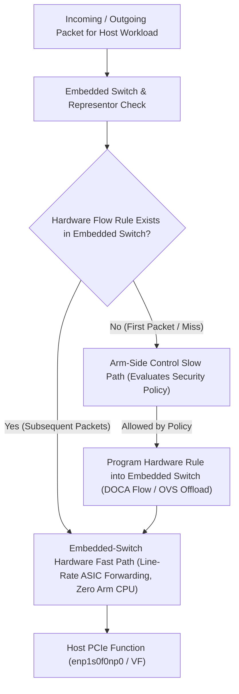
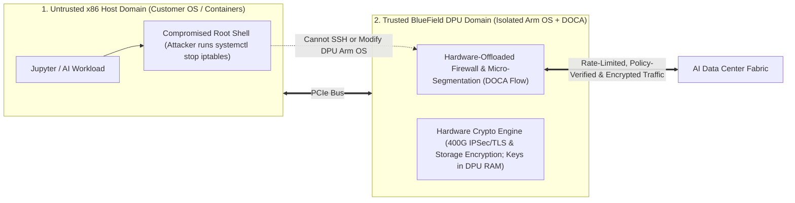

# 11.28 DPUs, BlueField and DOCA

| | |
|---|---|
| Level | Advanced |
| Priority tier | 2 |
| Lab venue | GCP / GKE (plus local Python 3 simulation lab) |
| Part | Part 11: GPUs on Kubernetes, scheduling and virtualization |
| Coverage file | `planning/coverage/chapters/11-28.md` |

## Why this matters for AI infrastructure

Picture a Friday evening alert. One GPU server in your training cluster has stopped answering on its data network, and the job running on it has been stuck for an hour. You check the server, and it looks fine. You check the switch port it plugs into, and that looks fine too. The problem is hiding in a part of the machine most engineers never think about, and this chapter is about that part.

A GPU server holds expensive compute and the model weights of several tenants, and its network edge is the one door to everything else. On a traditional server, virtual switching, the `iptables` firewall, intrusion detection, and encryption all run on the host x86 CPU. Virtual switching is the software that connects virtual machines and containers to the network, and intrusion detection is the software that watches traffic for signs of an attack. Putting all of that on the same CPU as the tenant code is convenient, but it causes two problems in an AI Factory. An AI Factory here means a large facility built to train and serve models at scale.

The first problem is called Shared Fate. The phrase describes two things that share one fate, so when one falls, the other falls with it. When the firewall and intrusion detection daemons run on the same x86 Host OS as untrusted tenant workloads, they share that host's fate. In one customer scenario, an attacker exploited an internet-exposed Jupyter notebook on a bare-metal GPU instance and gained a host root shell. Root is the most powerful account on a Linux machine, so a root shell means the attacker can do anything the machine can do. The attacker immediately ran `systemctl stop iptables` to kill the host firewall and IDS daemons. IDS stands for intrusion detection system. Then the attacker used the high-bandwidth GPU server to launch a DDoS attack that took down the availability-zone control plane. A DDoS, or distributed denial-of-service attack, floods a target with so much traffic that it cannot answer legitimate requests.

The second problem is the price of the fix. An NVIDIA BlueField Data Processing Unit, or DPU, takes over virtual switching and policy enforcement. The DPU is a network card that carries its own small computer. It combines a ConnectX network ASIC with an embedded Arm CPU complex, dedicated RAM, and an isolated Linux OS programmed through NVIDIA DOCA. An ASIC is a chip built for one specific job, and here that job is moving packets. That design solves the Shared Fate problem. It also puts a separately managed third computer between the host and the leaf switch. A leaf switch is the top-of-rack switch that a server's network cable plugs into. In one production incident, an incomplete DPU policy rollout left the host network interface down after reboot. Meanwhile, the leaf switch showed the physical uplink up. Responders who only checked the switch looked in the wrong place.

So the DPU gives you a stronger security boundary, but it also gives you a new place where things can break. Each side of that trade needs its own care.

The rest of this chapter covers BlueField DPU operating modes, DOCA software architecture, Zero-Trust Infrastructure Offload, and the three-layer DPU incident triage and lifecycle model. Zero-Trust Infrastructure Offload means moving security and network duties off the host and onto the DPU. As you read it, keep those three layers in mind, because you will need them when a node misbehaves.

## Prerequisites and outcomes

### Prerequisites
Before you start, you should have finished chapters 11.10, 11.11, and 11.22. Those cover secondary networks, SR-IOV, the NVIDIA Network Operator, and Zero-Trust Security. Secondary networks are extra network interfaces that a pod can use next to its main one, and SR-IOV is the hardware method for slicing one network card into several virtual functions. The NVIDIA Network Operator installs and manages that networking stack inside Kubernetes. You should also be comfortable reading Linux network interfaces with `ip -br link`, working with `systemd` services, and the basics of Open vSwitch. Open vSwitch is a software switch that many Kubernetes networks use, and it appears again in the offload discussion below.

### Outcomes
A platform team usually meets a DPU for the first time during an incident or an architecture review, and both moments demand clear answers. This chapter gives those answers in order. It starts with the hardware and trust design of a BlueField DPU and the difference between a DPU SKU and a SuperNIC SKU. A SKU is the product number a vendor sells under. It then compares the slow path that runs through the Arm cores with the hardware fast path that runs through the embedded switch, and it shows how to choose among the four DOCA implementation options. From there, the chapter explains how offloading security duties removes the Shared Fate weakness, and how DPU quarantine fits into forensic response. The last part covers the three-layer triage workflow, the six-step change sequence, and the five-layer observability model.

## Concepts: basics to intermediate to advanced

### 1. Basics: BlueField DPU architecture, SKU operating modes, and the fast vs slow path

#### 1. What Makes a BlueField DPU Different from a Conventional ConnectX NIC
Imagine a server arriving at your loading dock with an ordinary network card already installed. In a typical rack, the team that administers the x86 Host OS also administers that card, and nobody thinks twice about it. With a conventional NIC such as a ConnectX-7, the same team controls the operating system and the network hardware, so both sit in one trust domain. A trust domain is a group of systems that rely on the same administrators and the same credentials. An NVIDIA BlueField DPU changes that picture. It places a complete, independent computer in front of the x86 host.

The card has three main parts, and each one matters for the rest of this chapter. The first is the ConnectX network ASIC and its hardware engines. This silicon provides high-speed Ethernet and InfiniBand connectivity, hardware embedded switching, and RDMA or RoCEv2. RDMA lets one machine read or write another machine's memory without involving either CPU in the copy. RoCEv2 is a version of RDMA that runs over Ethernet. The same silicon also includes dedicated hardware accelerators for cryptography, regular expressions, and packet steering. Packet steering means deciding which queue or port a packet should go to, based on its contents.

The second part is the embedded Arm CPU subsystem with its own dedicated RAM. It runs its own independent Linux operating system, DOCA OS on Ubuntu Arm. The platform administrator manages it exclusively over an out-of-band management network. Out-of-band means a separate network that exists only for management, so it still works when the production network is down. A tenant or customer root user on the x86 Host OS cannot log in to or modify the DPU Arm OS.

The third part is the NVIDIA DOCA framework. CUDA is the software platform for programming NVIDIA GPUs, and DOCA plays the same role for BlueField DPUs. Data Center Infrastructure-on-a-Chip Architecture provides SDK libraries, drivers, tools, reference samples, and containerized services for running infrastructure workloads on BlueField. An SDK, or software development kit, is a bundle of libraries and tools that a developer uses to build programs for a platform.

Once you hold this picture, the DPU stops looking like a faster network card. It looks like a small server that happens to sit inside the network card.

#### 2. Operating Modes and the Two Traffic Paths
Consider a platform engineer who assumes every BlueField card boots in the same mode. Provisioning scripts will fail on mixed server cohorts, because a script written for one mode will misread the other. A cohort here means a group of servers bought and installed together. BlueField documents two default operating modes, and the one you get depends on the hardware SKU.

BlueField DPU SKUs default to DPU mode, also called Embedded CPU Function Ownership, or ECPF. In that mode, the embedded Arm subsystem owns the NIC resources and the hardware embedded switch. The x86 host sees only host-facing PCIe functions, and the DPU Arm control plane controls their forwarding rules. PCIe, or Peripheral Component Interconnect Express, is the bus that connects the card to the host motherboard. A PCIe function is one device the host can see on that bus, and each one can carry its own network interface.

BlueField SuperNIC SKUs default to NIC mode. The card behaves like a traditional high-performance ConnectX adapter. The host OS owns it directly unless someone explicitly reconfigures it. The practical lesson is that the same name on a purchase order can hide two different default behaviors, so check the SKU before you write the provisioning logic.

That leaves a question for DPU mode. How does a packet reach the x86 host without bottlenecking on the embedded Arm CPU cores? The answer is two paths, an Arm control path and a hardware fast path, as the diagram below shows.



Follow the diagram from the top. A packet arrives, and the embedded switch checks whether a hardware rule already covers it. A representor is the port that represents a host-facing function inside the embedded switch, so the switch can hand traffic between the two. If no rule matches, the packet takes the slow path to the Arm cores, which apply the security policy. If the policy allows the flow, the Arm side writes a rule into the hardware. Every later packet in that flow matches the rule and skips the Arm cores entirely.

The diagram shows that the Arm cores are not in the per-packet path for steady-state traffic. Two paths matter here. The first is the Arm-side control slow path. When the first packet of a new flow arrives with no matching hardware rule, it is punted through a representor interface to the Arm control plane. A flow is a stream of packets that share the same addresses and ports. If the security policy allows the flow, the Arm control plane programs a hardware flow rule into the ConnectX embedded switch.

The second is the embedded-switch hardware fast path. Every later packet that matches that flow rule is switched directly in the ConnectX ASIC silicon at line rate. Line rate means the card forwards packets as fast as the physical link can carry them. Neither the Arm cores nor the x86 host CPUs touch those packets.

The operational consequence is serious. Steady-state traffic runs on the hardware fast path, but the Arm control plane owns the job of programming that fast path during boot. If the Arm policy-load service fails on boot, the embedded switch has no forwarding rules, and the host interface remains dark. Dark here means the interface exists but carries no traffic.

#### 3. Selecting the Smallest Sustainable DOCA Option
Picture a team that copies a sample program from the DOCA SDK onto a production server. The sample works in the lab. A few weeks later, a driver update breaks it, and nobody on the team owns the fix. DOCA APIs and deployment artifacts are release-specific. A sample C program copied into production therefore creates an unpatched maintenance burden. The four implementation choices below are ranked so teams can pick the smallest option they can sustain. An API is the set of functions a program calls, and an artifact is any file a release produces, such as a container image or a firmware file.

| Implementation Option | Best Architectural Fit | Operational Trade-Off to State Explicitly |
|---|---|---|
| **1. Supported Packaged DOCA Service** | A documented infrastructure use case (OVS hardware offload, firewall, telemetry) matching your outcome | Preferred choice; still requires version, security, and operations qualification |
| **2. DOCA Reference Application / Sample** | Lab evaluation, benchmarking, or API learning | **Not** a production support commitment by itself; do not deploy samples directly into prod |
| **3. Custom DOCA Application (`DOCA Flow` C/C++)** | A genuinely differentiated requirement that no packaged service covers, with a dedicated engineering team | Carries a full software product lifecycle: testing, CVE patching, release management, and on-call support |
| **4. Host or Fabric-Native Implementation** | When a DPU adds no measurable CPU-budget or trust-boundary value, or has no operational owner | Retains x86 host CPU overhead or relies on host/switch enforcement |

Read the table from the top, and ask yourself which option you could actually operate. A CVE is a publicly catalogued security vulnerability, so patching is a recurring duty for any option you pick. The first option is the preferred choice, because the vendor packages and maintains it. The third option brings a full software product lifecycle with it, which means your own team becomes the vendor. The fourth option is always available, and it asks you to accept more host CPU work in exchange for a simpler operating model.

---

### 2. Intermediate: Zero-trust security offload and forensic containment

#### 1. Eliminating "Shared Fate" with the BlueField DPU Trust Boundary
Consider why the Five-Layer Zero-Trust AI Architecture places BlueField DPU firewalls at Layer 3 for Network Defense. The reason is a question of who can switch the firewall off. On a traditional server, an attacker who compromises the x86 Host OS immediately controls the host firewall. Moving network and storage enforcement onto the DPU breaks that Shared Fate link, as the diagram below shows. A trust boundary is the line that separates parts of a system that trust each other from parts that do not.



Read the diagram as two rooms. The left room is the host, where the tenant code runs and where an attacker can end up with root. The right room is the DPU, which has its own operating system and its own firewall. The only door between them is the PCIe bus, and the attacker on the host cannot reach the DPU operating system through it. Traffic leaving the DPU goes out to the fabric after the policy check and encryption.

Moving infrastructure services from the untrusted host domain to the trusted DPU domain gives three gains.

The first gain is that a host root compromise cannot switch off the defenses. The firewall, OVS bridge, and intrusion detection agents run on the isolated Arm OS of the DPU rather than the x86 Host OS. An attacker who exploits a Jupyter notebook CVE and gains x86 host root cannot stop the firewall. Every packet leaving the x86 host must physically traverse the DPU PCIe interface and embedded switch. There, DOCA Flow hardware rules drop unauthorized port scans or DDoS bursts before they reach the wire. A port scan is a probe that checks which doors on a machine are open, and it usually comes before an attack.

The second gain is encryption at line rate. Encrypting 400 Gbps of east-west AI traffic in software on the x86 host CPU pegs the cores at 100% and starves the PyTorch dataloaders. East-west traffic is the traffic that moves between servers inside the data center, as opposed to traffic that comes in from outside. A dataloader is the piece of PyTorch that feeds training data to the GPUs, so starving it leaves the GPUs waiting. So the DPU encrypts IPSec and TLS traffic in its own hardware cryptography engines, and the host CPU spends no cycles on it. IPSec and TLS are two standard protocols for encrypting network traffic.

The third gain is storage encryption with keys the host cannot read. When the x86 Host CPU writes plaintext checkpoint or dataset blocks, the DPU intercepts the I/O and encrypts it in hardware using AES-256. I/O means reads and writes to storage. AES-256 is a standard encryption algorithm that uses a 256-bit key. The DPU then forwards ciphertext to the storage fabric. Ciphertext is the scrambled form of data that only the key can reverse. The encryption keys stay inside DPU RAM, out of reach of x86 Host RAM.

Moving these duties to the DPU removes the Shared Fate link. A host root attacker cannot disable them. The attacker still owns the host, but the host no longer holds the keys to the rest of the system.

#### 2. Integrating DPUs into the Forensic Incident Response Protocol
When an intrusion detection or DCGM alert flags a breach or an unauthorized crypto miner on a GPU server, the pressure to act is high. DCGM is NVIDIA's Data Center GPU Manager, which reports GPU health and activity. A crypto miner is a program that uses GPU time to mine cryptocurrency without permission. Junior admins often panic and reboot the node. Rebooting a breached node destroys volatile forensic evidence in RAM and GPU VRAM. Volatile memory loses its contents when power goes off, and VRAM is the memory on the GPU itself. A BlueField DPU strengthens both containment and eradication in the six-step forensic playbook. Containment stops the attacker from doing more harm, and eradication removes the attacker's foothold.

| Forensic Playbook Step & Principle | Role of the BlueField DPU & Platform Control Plane | Why This Matters During a Host Root Breach |
|---|---|---|
| **Step 1 & 2: Cordon & Quarantine (*"Isolate, don't terminate"*)** | Push a Deny-All Quarantine policy to the BlueField DPU on `gpu-node-42` (or ToR switch) blocking all traffic except the forensic workstation IP | Air-gaps `jupyter-research-1` / `gpu-node-42` in hardware even if the x86 host root attacker disabled `kubelet` or `iptables` |
| **Step 3 & 4: Volatile Memory Dump & Root Cause Patch** | Keep the quarantined node powered on to dump System RAM (`LiME`) and GPU VRAM (`nvidia-smi` / `cuda-gdb`) before patching the CVE globally | Preserves active command-and-control keys and injected payloads that vanish on power-off |
| **Step 5 & 6: Scorched-Earth Eradication & Secret Rotation** | PXE re-image the bare-metal x86 OS **and reflash GPU, ConnectX NIC, and DPU firmware/BFB images from vendor-signed artifacts**, then rotate `Secrets` | Defeats persistent rootkits hiding in host disk or peripheral NIC/GPU/DPU firmware |
| **5-Layer Zero-Trust & 14-Item Checklist (`Item 9`)** | Places DPU firewalls at **Layer 3 (`Network Defense`)** and verifies DPU security policy enforcement (`Checklist Item 9`) across `5` core principles (`Defense in depth`, `Trust verification`, `Evidence over assertions`, `Explicit trade-offs`, `Insider threat`) | Stops lateral movement across the AI data center fabric after a container or host compromise |

Read the table row by row. Each step pairs a forensic action with the DPU role that keeps that action safe during a host root breach. The first row is about stopping the bleeding without destroying the evidence. The second row is about collecting memory before the machine loses it. The third row is about rebuilding trust from the bottom up. The fourth row ties the whole plan back to the zero-trust architecture.

The phrase "Isolate, don't terminate" carries the main lesson of the table. Terminating the node feels decisive, but it erases the evidence you need to understand the breach. Isolating the node keeps the evidence alive and keeps the attacker from reaching the rest of the fabric.

---

### 3. Advanced: The 3-layer DPU outage triage model and 6-step lifecycle sequence

#### 1. Why a Healthy Switch Uplink Coexists with a Dead Host Network
Suppose you are troubleshooting a network incident on a server without a DPU. Your troubleshooting spans only two layers there: the host NIC and the top-of-rack switch port. Put a BlueField DPU in ECPF mode into that server, and it creates three layers you can observe independently, as the three-layer diagram shows. Each layer answers its own question, and a healthy answer at one layer says nothing about the others.

Layer 3 is the external Ethernet uplink and fabric. The question here is whether the leaf switch sees the physical link to the DPU as up. An uplink is the link that carries traffic from a server toward the rest of the network. Layer 2 is the DPU Arm control plane and embedded switch. The question here is whether the DPU booted the expected image and whether its Arm services finished programming flow rules onto the embedded switch. Layer 1 is the host-facing interface and workload. The question here is whether the x86 host OS sees its PCIe function as up and forwarding traffic.

The order of the layers matters when you troubleshoot. Start from the layer closest to the physical cable, and move one layer at a time toward the application. If the leaf switch shows the uplink down, you already know the fault sits at Layer 3, and you do not need to read the DPU logs yet. If the uplink is up, you move to Layer 2 and check the DPU, and only then do you check the host.

Two production transcripts show how these layers behave in practice. In the first, the physical switch uplink is completely healthy, yet the host network interface stays down after a reboot. Read the transcript one layer at a time, because each comment names the machine that answers and the question it answers.

```text
# Scenario 1 — Boot Policy Failure (Uplink UP, Host DOWN, Volume 9 Chapter 9):
# Layer 3 (On leaf switch): Physical uplink looks 100% healthy
$ show interface status swp14
swp14      up    100G   full   RoCE-compute

# Layer 2 (On BlueField Arm via OOB mgmt): Policy load service FAILED during boot
$ systemctl status openvswitch-policy-load.service
● openvswitch-policy-load.service - Embedded switch policy load
     Loaded: loaded
     Active: failed (Result: exit-code) since 09:14:02 UTC
    Process: 812 ExecStart=/usr/bin/policy-load --profile prod (code=exited, status=1)

# Layer 1 (On x86 host): Host-facing PCIe representor/function never came up
$ ip -br link show
enp1s0f0np0    DOWN   <mac>   <state DORMANT>
```

If you check only the leaf switch, you will think the network is fine, and responders did exactly that. Checking only the host makes the problem look like a broken cable or host driver. Only a Layer 2 check on the DPU Arm control plane, reached through out-of-band management, showed that the policy load service failed during boot. Always gate Kubernetes node readiness on both DPU policy-load completion and verified host-to-fabric reachability. Node readiness here means the scheduler is allowed to place GPU work on the node, so a node should not earn that status until both checks pass.

In the second transcript, a subset of identical GPU nodes shows intermittent reachability anomalies, while the fabric link counters stay clean. Reachability anomalies are cases where some traffic gets through and some does not, which makes them hard to chase. Fabric link counters record errors on the physical links, so clean counters mean the cables are not the cause.

```text
# Scenario 2 — Silent Fleet Image Drift (node09 Abandoned After 5 Retries, Volume 9 Chapter 9):
$ for h in node07 node08 node09; do echo "== $h =="; ssh $h-bmc "cat /etc/dpu-image-version"; done
== node07 ==
dpu-image-24.10-prod-3
== node08 ==
dpu-image-24.10-prod-3
== node09 ==
dpu-image-24.07-prod-1

$ ssh node09-bmc "journalctl -u dpu-agent --since '-7 days' | grep -i 'deploy\|reconcile'"
Aug 01 03:12:04 node09-dpu dpu-agent: reconcile failed: image pull timeout, retrying with backoff
Aug 01 03:45:11 node09-dpu dpu-agent: reconcile abandoned after 5 retries
```

Here, the DPU on `node09` stayed online and forwarded traffic, so the fabric counters stayed green. It was running a stale image and policy revision, though. Its image pull timed out, and reconciliation was abandoned after five retries. Reconciliation is the agent's loop that compares the deployed state with the desired state and tries to close the gap. When a node behaves differently from its peers, compare its image versions with theirs before you blame the fabric. The version check is cheap, and it often finds the fault in one command.

#### 2. The 6-Step DPU Change and Recovery Sequence and 5-Layer Observability Contract
An uncoordinated DPU firmware or policy update can cut the primary network connection of every host in a rack at once. A rack is a group of servers that share one set of switches, so a bad update that spreads through it can take the whole rack offline. To prevent fleet-wide outages, every DPU firmware, BFB image, or DOCA service rollout follows the six-step change sequence. A BFB image is the bundle that installs the operating system and software onto the DPU Arm side.

- Step 1, what must be ready first? It qualifies a complete release set. It validates the DPU firmware and image, DOCA components, x86 host driver, switch NOS profile, and the packaged DOCA service together. A NOS profile is the switch operating system configuration that the fabric uses.
- Step 2, what do you record before you change anything? It captures a baseline. It records data-plane latency and throughput, five-layer telemetry, and atomic rollback artifacts before anyone touches production. A baseline is the healthy picture you compare against later, and rollback artifacts are the saved files that let you return to the old state.
- Step 3, where does the change go first? It canaries a representative group. The rollout goes first to a small canary cohort that matches production hardware and workload profiles. A canary is a small test group that shows problems before the whole fleet sees them.
- Step 4, what gets checked, and how? It verifies every layer independently. It confirms DPU Arm readiness, host-facing interface state, external switch uplink state, policy enforcement, and application traffic, each on its own.
- Step 5, when does the rollout grow? It expands in batches. The fleet rollout proceeds in staged batches, but only after the team compares workload and failure-path evidence against the baseline.
- Step 6, how do you get the machine back if it goes dark? It preserves out-of-band recovery. The team maintains a tested out-of-band BMC or rshim recovery and image rollback procedure. A BMC is the baseboard management controller, a small independent computer on the server board, and rshim is the channel that lets a host reach the DPU Arm side. The procedure must work even when the x86 host OS and the primary data network are completely dark.

Because a BlueField DPU separates the host edge into an independent trust and operations domain, host-only or switch-only monitoring misses Layer 2 failures. The chapter therefore requires correlating five observability layers, using stable join identifiers with synchronized UTC timestamps. A join identifier is a key, such as a device name or UUID, that lets you line up records from different sources. UTC is Coordinated Universal Time, and using it everywhere keeps logs from different machines in the same order.

| Observability Layer | Minimum Required Telemetry & Forensic Evidence | Primary Operational Question Answered |
|---|---|---|
| **1. Host Layer (`x86` Worker Node)** | Interface state (`ip -br link show enp1s0f0np0`), IP route/address table, `mlx5` kernel driver log, and application socket/NCCL symptoms | Does the host workload see an active, routable network function? |
| **2. DPU Control Plane (`Arm` DOCA OS)** | Deployed BFB image/firmware version (`/etc/dpu-image-version`), `systemd` service health (`openvswitch-policy-load.service`), policy revision, and authentication/reconcile logs (`dpu-agent`) | Did the DPU boot the expected image and finish programming policy rules? |
| **3. DPU Data Plane (`Embedded Switch`)** | Embedded-switch (`eSwitch` / `ovs-vsctl`) and representor port states, plus hardware flow-steering and drop counters (`DOCA Flow`) | Is traffic traversing the hardware fast path or punting to the slow Arm CPU path? |
| **4. Fabric Layer (`Leaf / Spine Switch`)** | Peer switch port status (`show interface status swp14`), physical symbol/CRC errors, packet drops, and RoCEv2 QoS/PFC/ECN congestion deltas | Is the physical optical cable and switch port healthy at line rate (`100G` / `400G`)? |
| **5. Platform Layer (`Orchestrator`)** | GitOps deployment events, desired-state revision, accountable service owner, canary batch status, and tested OOB rollback record | Did a recent rollout introduce policy or image drift across the node cohort? |

Read the table as a checklist of evidence. Each row answers a different question, and you cannot use one row in place of another. The host row can look perfect while the DPU row shows a failed service. The fabric row can look clean while the platform row shows a rollout that drifted. Collect all five before you decide.

#### 3. When to Adopt a BlueField DPU and What New Obligations Come With It
Picture an enterprise architecture review where a vendor presents a DPU design with four attractive benefits. The review board nods along, and the design is approved on the slide. Six months later, nobody has the people to patch the DPUs or recover them when they go dark. Before you approve a BlueField DPU design in an enterprise architecture review, check that every promised benefit comes with its operational obligation. The pairing works in the way the following paragraphs describe.

The first benefit is host x86 CPU cycles freed for AI workloads. Proving it requires controlled baseline benchmarks that show the target function is truly hardware-offloaded on the DPU. A benchmark is a repeatable test that measures performance under the same conditions each time. Running OVS switching, encryption, or telemetry in software on the Arm cores does not count as hardware offload. The Arm cores are still a CPU, so the work is only moved, not removed from the processor budget.

The second benefit is stronger host-edge zero-trust isolation. It requires operating a separate DPU credential, PKI certificate, SSH access control, CVE patching, and audit logging pipeline. PKI is the public key infrastructure that issues and checks certificates, which prove identity. Each of those controls is one more thing to run. Without those controls, the DPU itself can become an unpatched backdoor.

The third benefit is consistent per-server policy enforcement. It requires automated desired-state orchestration and continuous version and drift reconciliation across the node fleet. Desired-state orchestration means you declare what every DPU should run, and an automated system keeps them there. It also requires a rehearsed out-of-band rollback procedure that can recover a dark DPU without using the primary data network. Rehearsed means someone has actually run it, not just written it down.

The fourth benefit is a programmable data path via DOCA. Choose a supported packaged DOCA service whenever possible. Commit to custom DOCA C or C++ development only when a dedicated software team accepts long-term release and on-call ownership. If neither a measurable offload requirement nor a dedicated DPU operations owner exists, keep the simpler host or fabric-native ConnectX architecture. Keeping the simpler design is a valid outcome of the review, not a failure of it.

## Commands and configurations that matter

### 1. Three-Layer DPU Incident Triage Commands

The switch, BMC and host commands below were not run on live hardware. Treat them as the shape of the check, and confirm the exact output on your own equipment before you rely on it.

```bash
# Layer 3 (On Leaf Switch): Verify external physical uplink state and speed (untested here)
show interface status swp14

# Layer 2 (On BlueField Arm via Out-of-Band Management): Check policy load & OVS offload state (untested here)
systemctl status openvswitch-policy-load.service
ovs-vsctl show
journalctl -u dpu-agent --since '-7 days' | grep -i 'deploy\|reconcile'

# Layer 1 (On x86 Host): Verify host-facing network function state (untested here)
ip -br link show
```

Run the three groups in the order they appear, starting with the leaf switch. The first command checks the physical uplink. The middle group checks the DPU Arm side, including the policy service, the OVS state, and the recent agent logs. The last command checks what the host actually sees. A failure at one layer tells you where to look next, and it tells you where not to look.

### 2. Fleet-Wide DPU Image Version Drift Audit via Out-of-Band Management

The audit below runs across a small cohort of nodes, and it answers one question. Are all the DPUs on the same image? Drift here means the nodes have quietly moved apart from each other, which is exactly how `node09` fell behind in the scenario above.

```bash
# Compare deployed DPU image revisions across a node cohort via OOB/BMC (untested here)
for h in node07 node08 node09; do
    echo "== $h =="
    ssh "$h-bmc" "cat /etc/dpu-image-version"
done
```

The loop prints a header for each node and then the image version it reports. Any node whose version differs from its peers needs a closer look. Running this audit on a schedule turns drift from a surprise into a routine report.

## How it fails

Picture a BlueField DPU rollout that looks fine from one side and broken from the other. Usually the symptom is a dead host interface beside a green switch link, a host root breach that gets past host-resident security tools, or silent fleet policy drift. Each of those symptoms has a different cause, and each one needs a different first move. The table maps each failure mode to its command evidence, its root cause boundary, and its fix.

| Failure mode | Exact symptom & command evidence | Root cause boundary | Remediation |
|---|---|---|---|
| **1. Leaf switch port `swp14` (`100G`) is `up`, but x86 host interface `enp1s0f0np0` stays `DOWN` (`DORMANT`) after reboot** | Switch reports `swp14 up 100G full RoCE-compute`, host shows `enp1s0f0np0 DOWN`, and OOB check on BlueField Arm shows `openvswitch-policy-load.service` `Active: failed (status=1)`. | **Layer 2 DPU Arm Control-Plane Boot Dependency:** The physical uplink (`Layer 3`) is up, but the Arm control plane failed to load embedded-switch flow rules (`PID 812`), leaving the host representor dark. | Restore the approved DPU policy/image via the out-of-band (`OOB`) recovery path, verify `openvswitch-policy-load.service` succeeds and `enp1s0f0np0` transitions to `UP`, and gate node readiness on host connectivity. |
| **2. Compromised Jupyter notebook gains x86 host `root`, stops `iptables`, and launches a DDoS attack from a `400G` GPU node** | Attacker runs `systemctl stop iptables` on the x86 host OS, disabling host-resident firewall and IDS agents. | **Host-Resident Security "Shared Fate" Flaw:** Running firewall and IDS daemons on the untrusted x86 Host OS allows any host root compromise to dismantle the security perimeter. | Offload firewall, micro-segmentation (`DOCA Flow`), and `IPSec`/storage encryption onto the **BlueField DPU's isolated Arm domain**, which the x86 host root user cannot access or disable. |
| **3. Subset of identical GPU nodes (`node09`) exhibits inconsistent reachability and latency while fabric counters look clean** | `node07` and `node08` run `dpu-image-24.10-prod-3`, while `node09` runs `dpu-image-24.07-prod-1`; `journalctl -u dpu-agent` logs `reconcile abandoned after 5 retries`. | **Silent DPU Image & Policy Drift:** `node09`'s image pull timed out during a rollout and was abandoned after `5` retries, leaving it online with stale embedded-switch rules. | Re-trigger controlled deployment reconciliation for `node09` via OOB management, verify `/etc/dpu-image-version` matches `24.10-prod-3`, and add Prometheus/inventory drift alerts. |
| **4. High packet latency and `100%` Arm CPU saturation on the BlueField DPU during AI traffic bursts** | DPU Arm CPU cores hit `100%` utilization and east-west latency spikes even though physical uplink bandwidth is below `50%`. | **Traffic Falling Back to Arm Control Slow Path:** Missing or misconfigured embedded-switch offload rules caused high-rate data packets to punt through the Arm CPU representor path instead of the ConnectX ASIC fast path. | Inspect embedded-switch hardware flow counters, correct the DOCA / OVS hardware-offload policy so flows program into the ConnectX ASIC fast path, or roll back the un-offloaded DPU service. |
| **5. Platform team deploys a DOCA SDK sample C binary directly into production and suffers an unpatched outage** | A sample program copied from the DOCA SDK crashes after a driver update with no vendor SLA or automated rollback. | **Confusing a DOCA Evaluation Sample with a Supported Service:** DOCA samples illustrate API usage; they are not supported production services with a lifecycle contract. | Prefer **supported packaged DOCA services** whenever they meet the requirement; only build custom DOCA applications when a dedicated engineering team owns testing, CVE patching, and on-call support. |

Start with the row whose symptom matches what you see. Each row names the layer where the failure sits, so you know where to look before you change anything. Row 1 is the boot-order trap from the first transcript. Row 2 is the Shared Fate breach. Row 3 is the drift case from the second transcript. Rows 4 and 5 are the two common ways a DPU project goes wrong after it reaches production.

## Hands-on lab

### Venue and scope
Start with this lab if you want to check the chapter's logic on your own machine. It runs locally with only the Python 3 standard library, through `code/part11/dpus_bluefield_and_doca.py` and `code/part11/dpus_bluefield_and_doca_lab.py`. The standard library is the set of modules that ship with Python, so you do not need to install anything extra. The lab verifies the three-layer BlueField outage classifier, the SKU operating mode rules, and the four DOCA implementation options. It also checks the six-step change sequence, the five observability layers, and the Shared Fate versus DPU offload evaluator. Nothing in the lab touches a real switch, DPU, or cluster, so it is a safe place to test your reasoning.

### Step 1: Run the self-checking DPUs, BlueField and DOCA lab (tested here)

Run the lab from the repository root, so the path below resolves. The lab is self-checking, so it reports each check as PASS or FAIL. Each check is a small statement about the chapter's logic, and the lab prints the result beside it. A PASS means the classifier or rule produced the answer the chapter expects.

```bash
python3 code/part11/dpus_bluefield_and_doca_lab.py
```

The output below was captured from this repository, so you can compare your own run against it.

```text
=== Chapter 11.28 Lab: DPUs, BlueField, DOCA & Zero-Trust Infrastructure Offload ===
  [PASS] Volume 09 Ch 9 Story/Scenario 1: swp14 (100G) UP + Arm policy load failed + enp1s0f0np0 DOWN isolates Layer 2 DPU policy fault
  [PASS] Volume 09 Ch 9 Scenario 2: node09 running dpu-image-24.07-prod-1 vs 24.10-prod-3 (abandoned after 5 retries) flags Image Drift
  [PASS] Down external uplink port swp14 classifies as Layer 3: External Ethernet uplink / fabric
  [PASS] Healthy uplink + loaded DPU policy + DOWN host interface classifies as Layer 1: Host-facing function / representor mismatch
  [PASS] node07 with swp14 UP, dpu-image-24.10-prod-3 policy active, and enp1s0f0np0 UP passes all 3 layers
  [PASS] Volume 18 Ch 8: Host-resident firewall suffers Shared Fate when host root attacker runs 'systemctl stop iptables'
  [PASS] Volume 18 Ch 8: Offloading firewall & crypto keys to BlueField DPU Arm domain contains a compromised host root attacker
  [PASS] Volume 09 Ch 9 distinguishes BlueField DPU SKU default (DPU / ECPF mode) from BlueField SuperNIC SKU default (NIC mode)
  [PASS] Volume 09 Ch 9 Figure 9.9.2 separates Arm-side representor control slow path from embedded-switch hardware fast path
  [PASS] Volume 09 Ch 9 defines 4 DOCA implementation options from Supported DOCA service to Host/fabric-native
  [PASS] Volume 09 Ch 9 defines a 6-step DPU Change and Recovery Sequence
  [PASS] Volume 09 Ch 9 defines 5 observability layers (Host, DPU control plane, DPU data plane, Fabric, Platform)
  [PASS] Volume 18 Ch 8 highlights DOCA Flow for hardware-accelerated packet steering and micro-segmentation
  [PASS] Volume 18 Ch 8 explains that offloading 400G IPSec/TLS and storage encryption to DPU crypto engines saves host CPU and keeps keys out of host RAM
  [PASS] Volume 18 Ch 12 Forensic IR can enforce Quarantine NetworkPolicies at the BlueField DPU / ToR layer ('Isolate, don't terminate')
  [PASS] Volume 18 Ch 12 Scorched-Earth Eradication reflashes both GPU and NIC/DPU firmware from vendor-signed images after a host root breach
  [PASS] Volume 18 Summary places BlueField DPU firewalls at Layer 3 (Network Defense) of the 5-Layer Zero-Trust AI Architecture
  [PASS] Volume 18 Index Production Checklist item 9 verifies DPU deployment with security policy enforcement
  [PASS] Volume 09 Ch 9 Scenario 1 logs PID 812 ExecStart=/usr/bin/policy-load --profile prod (code=exited, status=1) at 09:14:02 UTC
  [PASS] Volume 09 Ch 9 Scenario 2 compares node07, node08 (dpu-image-24.10-prod-3) and node09 (dpu-image-24.07-prod-1)
  [PASS] Volume 09 Ch 9 mandates an out-of-band (OOB) recovery path independent of the host OS and primary data network
  [PASS] Volume 09 Ch 9 warns that a DOCA sample/reference application is an evaluation artifact, not a production support commitment
  [PASS] Volume 18 Ch 8 Customer Scenario shows how a compromised Jupyter notebook without a DPU disabled host iptables and launched an AZ DDoS
  [PASS] Volume 09 Ch 9 Lab Checklist requires validating host-to-DPU and DPU-to-fabric paths independently
  [PASS] Volume 18 Index defines 5 security principles (Defense in depth, Trust verification, Evidence over assertions, Explicit trade-offs, Insider threat)

Summary: 25 passed, 0 failed out of 25 checks.
```

The summary line at the bottom reports how many checks passed and how many failed, so you can read the result without counting lines. A clean run ends with zero failures. If one line reads FAIL, read that check name first, because it names the exact rule that changed.

### Exercises

1. A host loses its network after a reboot, and the leaf switch shows the uplink up. Using `code/part11/dpus_bluefield_and_doca.py`, explain why `show interface status swp14` missed the root cause. Explain why `ip -br link show` missed it too. What did `systemctl status openvswitch-policy-load.service` reveal on the DPU Arm subsystem?
2. The `node09` box runs `dpu-image-24.07-prod-1`, while `node07` and `node08` run `dpu-image-24.10-prod-3`. How did that happen? Why did the fabric-wide switch counters not flag `node09`?
3. An attacker gains root on the x86 host. What can that attacker do if the firewall is host-resident `iptables`? What can that attacker do if a BlueField DPU runs the firewall?
4. Which operating mode does a BlueField DPU SKU boot in? Which mode does a SuperNIC SKU boot in? How does the Arm-side representor path program the embedded-switch hardware fast path?
5. Compare a supported DOCA service, a DOCA reference sample, a custom DOCA application, and a host or fabric-native implementation. Which one would you put in production first?
6. List the six steps of the DPU change sequence. Name the minimum telemetry you collect across the five observability layers.

Work through them in order. The first exercise sets up the three-layer picture that the later ones rely on, so do not skip it.


## Checkpoint questions

<details>
<summary>**1. How is a BlueField DPU operationally different from a conventional ConnectX NIC?**</summary>

With a conventional NIC, the host OS and the NIC belong to the same trust and administration domain. A BlueField DPU in its default ECPF mode is a separate, managed computer sitting between the host and the fabric. It has its own embedded Arm CPUs, dedicated RAM, firmware, isolated Linux OS, credentials, and software lifecycle. Because of that, you get three independently observable layers across the host, the DPU control plane, and the external uplink instead of two.
</details>

<details>
<summary>**2. What is the documented default operating mode for BlueField DPU SKUs versus BlueField SuperNIC SKUs?**</summary>

- BlueField DPU SKUs start in DPU mode, also called Embedded CPU Function Ownership or ECPF. The embedded Arm subsystem owns the NIC resources and the embedded switch.
- BlueField SuperNIC SKUs start in NIC mode. The host OS owns the adapter functions directly.
</details>

<details>
<summary>**3. Distinguish the Arm-side control path from the embedded-switch fast path on a BlueField DPU.**</summary>

- The Arm-side control slow path handles packets through representor interfaces when no matching hardware flow rule exists yet. It runs on the DPU embedded Arm CPU cores.
- The embedded-switch hardware fast path takes over once the Arm control plane programs a flow rule into the ConnectX embedded switch through DOCA Flow. From then on, matching packets forward in silicon at line rate.
</details>

<details>
<summary>**4. Why can a healthy external DPU uplink coexist with a failed host network interface after a reboot?**</summary>

If you see `swp14` up on the leaf switch, that only proves Layer 3, the physical link between the DPU and the switch. If the Layer 2 Arm control-plane service `openvswitch-policy-load.service` fails during boot, the Layer 1 host interface `enp1s0f0np0` never receives forwarding rules and stays down.
</details>

<details>
<summary>**5. In the node drift scenario, why did node09 exhibit reachability anomalies while node07 and node08 worked normally, and what command revealed the root cause?**</summary>

For example, running `ssh $h-bmc "cat /etc/dpu-image-version"` across `node07`, `node08`, and `node09` showed that `node07` and `node08` were on `dpu-image-24.10-prod-3`, while `node09` was on `dpu-image-24.07-prod-1`. Next, checking `journalctl -u dpu-agent` on `node09` showed that an image pull timed out and reconciliation was abandoned after five retries.
</details>

<details>
<summary>**6. What is NVIDIA DOCA, and when should a platform team choose a packaged DOCA service over a custom DOCA application or a DOCA sample?**</summary>

DOCA, or Data Center Infrastructure-on-a-Chip Architecture, is the software framework for BlueField DPUs. It bundles SDK libraries, drivers, tools, samples, and containerized services. Choose a supported packaged DOCA service whenever it matches the requirement, because it comes with a vendor-supported patching lifecycle. DOCA samples are for evaluation only. A custom DOCA application needs a dedicated engineering team to own testing, patching, and on-call support.
</details>

<details>
<summary>**7. List the six steps of the DPU Change and Recovery Sequence.**</summary>

- Step 1: Qualify a complete release set across the DPU firmware and image, DOCA components, host driver, switch NOS profile, and selected service.
- Step 2: Capture baseline data-plane behavior, host, DPU, and fabric telemetry, and rollback artifacts.
- Step 3: Canary a representative hardware and workload group.
- Step 4: Verify DPU readiness, host-facing function, external uplink, policy enforcement, and application traffic separately.
- Step 5: Expand in batches, and only after comparing workload and failure-path evidence with the baseline.
- Step 6: Preserve a documented out-of-band recovery and image rollback procedure.
</details>

<details>
<summary>**8. What are the five observability layers and the minimum evidence required at each layer for a BlueField DPU platform?**</summary>

- Host: Interface state via `ip -br link`, route and address tables, driver logs, and application symptoms.
- DPU control plane: Image and firmware version, service health, policy revision, and authentication and lifecycle logs.
- DPU data plane: Embedded-switch and representor state, along with hardware steering and policy counters.
- Fabric: Peer switch port state on `swp14`, physical errors, drops, and QoS or congestion deltas.
- Platform: Deployment events, desired-state revision, accountable owner, and rollback records.
</details>

<details>
<summary>**9. What is the Shared Fate security vulnerability on traditional GPU servers, and how does a BlueField DPU eliminate it?**</summary>

Shared Fate happens when security software such as `iptables` firewalls, intrusion detection, and encryption agents runs on the same x86 Host OS as user workloads. If you picture an attacker who gains host root, that attacker can simply run `systemctl stop iptables` and disable the firewall. A BlueField DPU moves the firewall and encryption engines onto the isolated Arm OS domain of the DPU. The x86 host root user cannot disable them there.
</details>

<details>
<summary>**10. In the Jupyter notebook scenario, trace how a single vulnerable Jupyter notebook led to an availability-zone outage on a bare-metal GPU cloud without DPUs.**</summary>

- Step 1: A customer exposed a vulnerable Jupyter notebook to the internet on a bare-metal GPU server.
- Step 2: An attacker exploited the notebook to gain a root shell on the Ubuntu Host OS.
- Step 3: The cloud provider ran its `iptables` firewall and IDS daemons directly on the customer Host OS, so the attacker stopped the firewall daemons.
- Step 4: The attacker then used the server's high-speed network connection to launch a massive DDoS attack against the internal API control plane.
</details>

<details>
<summary>**11. How does a BlueField DPU enforce micro-segmentation and deep packet inspection without consuming x86 Host CPU cycles?**</summary>

Consider every packet entering or leaving the x86 host. Each one must pass through the BlueField DPU first. Using DOCA libraries such as DOCA Flow for hardware-accelerated packet steering, the DPU programs micro-segmentation rules directly into the hardware accelerators and the embedded switch. The card filters traffic on its own silicon, so the x86 Host CPU carries zero overhead.
</details>

<details>
<summary>**12. Why is offloading IPSec and TLS network encryption and storage Data-at-Rest encryption to a BlueField DPU critical for high-bandwidth AI clusters?**</summary>

- Performance: Encrypting and decrypting high-speed network and storage traffic in software on the x86 host CPU saturates the cores and starves the GPUs of training data. The DPU hardware cryptography engines encrypt at line rate, so the host CPU pays nothing.
- Key security: Encryption keys stay inside DPU RAM rather than x86 Host RAM, so a compromised host OS cannot extract them.
</details>

<details>
<summary>**13. What six security and reliability questions must an architecture review answer before deploying BlueField DPUs?**</summary>

- Access control: Who can log into, reimage, reset, or change the DPU mode.
- Credential governance: Where DPU credentials, certificates, and audit records are managed.
- Boot policy failure behavior: What happens if the policy does not load during boot.
- Out-of-band recovery: Can the affected host be diagnosed and recovered through out-of-band management without relying on its data network.
- Patching lifecycle: How DPU CVEs get patched without an unplanned cluster outage.
- Failure posture: Which workloads fail closed, which fail open, and which must be explicitly fenced.
</details>

<details>
<summary>**14. When should a Solutions Architect recommend retaining a host or fabric-native design instead of adding a BlueField DPU?**</summary>

Keep the host or fabric-native design when there is no measurable infrastructure requirement, such as a strict x86 host CPU offload budget or a zero-trust isolation mandate. You should also keep the simpler design when no platform team exists to own DPU image provisioning, three-layer monitoring, patching, and out-of-band recovery.
</details>

<details>
<summary>**15. Why must a DPU rollback plan always include an out-of-band recovery path independent of the primary data network?**</summary>

When a DPU image update fails or a broken embedded-switch policy push goes out, you usually lose the host's primary data-plane connectivity. Without an independent out-of-band BMC or rshim management path to the BlueField Arm subsystem, you cannot reach the DPU remotely to roll back the image.
</details>

<details>
<summary>**16. How do BlueField DPUs reinforce the "Isolate, don't terminate" Forensic Containment Protocol?**</summary>

When a GPU node is suspected of compromise, you can enforce a Deny-All Quarantine policy directly on the BlueField DPU embedded switch of that node. The rule drops all inbound and outbound packets except those to the forensic workstation IP. Even if the attacker has full root control of the x86 Host OS, the attacker stays trapped in hardware while volatile RAM and VRAM remain intact for dumping.
</details>

<details>
<summary>**17. During Step 5 for Scorched-Earth Eradication, what must be done to the GPU and network silicon on a breached node before it can rejoin the cluster?**</summary>

You must PXE re-image the bare-metal x86 Host OS and rotate all Secrets and keys. They must also reflash the GPU and ConnectX NIC or BlueField DPU firmware and images using vendor-signed artifacts. That way, no persistent rootkit survives in the silicon.
</details>

<details>
<summary>**18. Where does the BlueField DPU sit in the Five-Layer Zero-Trust AI Defense-in-Depth Architecture?**</summary>

The DPU sits at Layer 3 for Network Defense, which covers NetworkPolicies and DPU firewalls. It sits between Layer 2 for Kubernetes Defense and Layer 4 for Hardware Defense. That position stops an attacker who gained a reverse shell inside a pod from scanning or moving laterally across the data center network.
</details>

<details>
<summary>**19. What are the five core security principles defined for operating an AI infrastructure platform?**</summary>

- Defense in depth: Layer controls across supply chain, Kubernetes, network and DPU, hardware and IOMMU, and data and TEE boundaries.
- Trust verification: Verify every boundary, including Secure Boot, RBAC, network policy, GPU isolation, and DPU image version, rather than assuming them.
- Evidence over assertions: Investigate incidents using preserved audit logs, RAM and VRAM dumps, and three-layer telemetry.
- Explicit trade-offs: Document the performance, complexity, and operational cost of every security control.
- Insider threat awareness: Control and audit internal administrative access across host, DPU, and hypervisor planes.
</details>

<details>
<summary>**20. What four items are in the Lab Checklist for qualifying a BlueField DPU deployment?**</summary>

- Item 1: Record the exact DPU SKU, operating mode, firmware and image version, host driver, DOCA service, and policy revision.
- Item 2: Validate the host-to-DPU and DPU-to-fabric paths independently.
- Item 3: Capture correlated DPU, host, and leaf-switch evidence during a healthy workload baseline run.
- Item 4: Test the documented out-of-band rollback and recovery procedure in a safe non-production environment before production rollout.
</details>

## Sources and review notes

### Primary sources read in full for this chapter
All five mapped Volume 9 and Volume 18 source files for Chapter 11.28 are cataloged in the reference block below.

```text
Primary Sources & Exact Figures Cataloged for Chapter 11.28:
- Author's Volume 9 and Volume 18 notes (all 5 mapped nvidia-devops files in brief.py 11.28 read and migrated in full):
  1. nvidia-zero-to-hero/volume-09/chapter-09-bluefield-dpus-and-doca.md (Figure 9.9.1 3-layer outage decision tree, DPU/ECPF mode default for DPU SKUs vs NIC mode default for SuperNIC SKUs, Figure 9.9.2 Arm-side representor control path vs embedded-switch fast path, Scenario 1 swp14 up 100G + openvswitch-policy-load.service PID 812 status=1 at 09:14:02 UTC + enp1s0f0np0 DOWN, Scenario 2 node07/node08 dpu-image-24.10-prod-3 vs node09 dpu-image-24.07-prod-1 abandoned after 5 retries, 4 DOCA implementation options, 6-step change & recovery sequence, and 5-layer observability table).
  2. nvidia-zero-to-hero/volume-18/chapter-08-bluefield-and-doca-security.md (Shared Fate problem systemctl stop iptables, Untrusted Host Domain vs Trusted DPU Arm Domain, DOCA Flow hardware micro-segmentation, 400 Gbps IPSec/TLS & storage encryption offload keeping keys in DPU RAM, and the bare-metal Jupyter notebook -> AZ DDoS customer scenario).
  3. nvidia-zero-to-hero/volume-18/chapter-12-incident-response-and-troubleshooting.md (Forensic IR "Isolate, don't terminate", gpu-node-42 / jupyter-research-1, RAM/VRAM dump, PXE OS re-image + GPU/ConnectX NIC firmware reflash).
  4. nvidia-zero-to-hero/volume-18/chapter-12-volume-18-summary.md (5-Layer Zero-Trust AI Defense-in-Depth with BlueField DPUs at Layer 3).
  5. nvidia-zero-to-hero/volume-18/index.md (5 key security principles and 14-item Production Security Checklist including Item 9 BlueField DPU policy enforcement).
```

### Related source files mapped in MIGRATION_MAP.md
- All five mapped `nvidia-devops` files for `11.28` are cited and covered in full: `volume-09/chapter-09-bluefield-dpus-and-doca.md`, `volume-18/chapter-08-bluefield-and-doca-security.md`, `volume-18/chapter-12-incident-response-and-troubleshooting.md`, `volume-18/chapter-12-volume-18-summary.md`, and `volume-18/index.md`.

### Run here
- `python3 code/part11/dpus_bluefield_and_doca_lab.py` passes all checks in this repository (`25 passed, 0 failed out of 25 checks`).

### Explicitly labelled inferences
- As noted in Volume 9 Chapter 9, unit and file names such as `openvswitch-policy-load.service`, `/etc/dpu-image-version`, and `dpu-agent` are illustrative placeholders used to demonstrate the three-layer diagnostic method.

### Not verified on live hardware
- All switch, DPU Arm, BMC, and host commands are marked untested here.

### Not in the corpus
- Low-level C code for programming `doca_flow_pipe_create()` hardware steering tables (beyond `DOCA_FOUR_IMPLEMENTATION_OPTIONS`, `node_exporter`, and port `22` SSH isolation) is not in the local corpus. This chapter focuses on the architectural, security, and three-layer operational model documented in Volume 9 Chapter 9 and Volume 18 Chapter 8.

### Corrections to the author's notes
- The YAML manifests and commands are marked untested and were not applied to a cluster. Custom resource API versions such as `kueue.x-k8s.io/v1beta1` and `resource.k8s.io/v1` change between releases, so check them against the version you install. Console outputs quoted from the Volume notes are illustrative unless the chapter says otherwise.
- Preserves the explicit distinction from Volume 9 Chapter 9 that ECPF DPU mode is the default only for BlueField DPU SKUs, whereas BlueField SuperNIC SKUs default to NIC mode.
