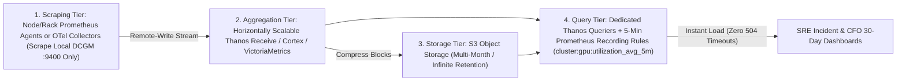
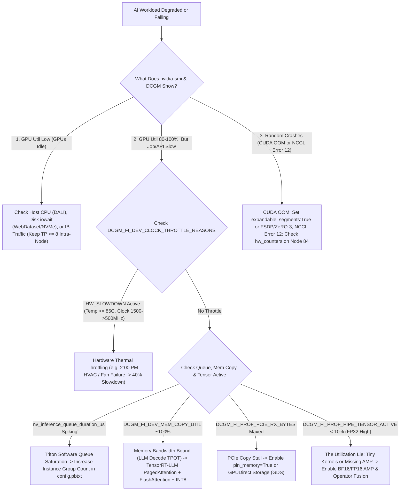

# 11.29 Multi-tenancy, quotas, fault tolerance and health on GPU clusters

| | |
|---|---|
| Level | Advanced |
| Priority tier | 1 |
| Lab venue | GCP / GKE (plus local Python 3 simulation lab) |
| Part | Part 11: GPUs on Kubernetes, scheduling and virtualization |
| Sources used | `nvidia-zero-to-hero/volume-19/index.md` and `chapter-01` through `chapter-12` (`chapter-01-cluster-lifecycle-and-upgrade-operations.md`, `chapter-02-incident-response-and-game-day-execution.md`, `chapter-03-capacity-planning-and-forecasting.md`, `chapter-04-gpu-memory-and-utilization-troubleshooting.md`, `chapter-05-network-reliability-and-fabric-validation.md`, `chapter-06-cost-optimization-and-resource-efficiency.md`, `chapter-07-multi-tenancy-and-workload-isolation.md`, `chapter-08-security-operations-and-compliance.md`, `chapter-09-monitoring-and-observability-at-scale.md`, `chapter-10-disaster-recovery-and-data-resilience.md`, `chapter-11-performance-debugging-and-bottleneck-identification.md`, `chapter-12-on-call-handoff-and-operational-runbooks.md`); `nvidia-zero-to-hero/volume-11/index.md`, `chapter-01`, `chapter-07` through `chapter-12`, and `labs/lab-01` through `lab-04`; Ajay Vohra, *Scalable Kubernetes Infrastructure for AI Platforms* (`scalable-kubernetes-infrastructure-for-ai-platfo`, 2026, Ch. 2) |
| Coverage file | `planning/coverage/chapters/11-29.md` |

## Why this matters for AI infrastructure

Day 1 of building an AI cluster is exciting; Day 2 is a relentless war against hardware entropy, noisy neighbors, and runaway cloud bills (`nvidia-zero-to-hero/volume-19/chapter-01-cluster-lifecycle-and-upgrade-operations.md` and `volume-19/index.md`). Consider five real production disasters documented across `volume-19` and `volume-11`:
1. **The "Big Bang" Kernel Upgrade Outage (`volume-19/chapter-01`):** An IT team ran `apt-get upgrade -y && reboot` across all **`500` GPU nodes** at `2:00 AM` to patch a Linux kernel CVE without coordinating with the GPU Operator. Because the pre-compiled `nvidia.ko` driver did not match the new kernel headers, **`400` nodes (`80%` of the cluster)** booted with `0` `nvidia.com/gpu` capacity, taking down all morning trading models.
2. **The `1`-GPU Student Loop That Crashed `10` Research Labs (`volume-19/chapter-07`):** A university shared an A100 cluster among **`500` students and `5` research labs** using Kubernetes `Namespaces`, `ResourceQuotas` (`1` GPU), and software **Time-Slicing**. One student's infinite tensor-allocation loop consumed `100%` of physical VRAM on their GPU and instantly `CUDA OOM`-killed **`10` professor jobs** sharing that card.
3. **The `$5 Million` Empty Hotel (`volume-19/chapter-03`):** An AI team demanded **`$5 Million` for `16` new HGX H100 servers** because Kubernetes `nvidia.com/gpu` **Allocation** was pegged at **`98%`** for three weeks—yet a `30`-day **DCGM** audit proved average Streaming Multiprocessor activity (**`DCGM_FI_PROF_SM_ACTIVE`**) was only **`12%`** because zombie Jupyter notebooks held `80 GB` GPUs hostage over weekends (`$2,000+` per idle `p4d.24xlarge` weekend vs `$20` for a CPU VM, `volume-19/chapter-06`).
4. **The `60-Second` `504 Gateway Timeout` on Grafana During an Outage (`volume-19/chapter-09`):** When `1,000` GPUs generate `500` metrics/sec with high-cardinality pod labels, a single monolithic Prometheus server OOMs or returns `504 Gateway Timeout` on a `200`-node cluster right when SREs open dashboards during an incident.
5. **The `1-Petabyte` Dataset Corrupted with No Nightly Backup (`volume-19/chapter-10`):** Transferring **`10 Petabytes` over a `10 Gbps` link takes `~92 days`**, so traditional nightly backups fail; when a script corrupted a `1 PB` NVMe training directory, only **hourly Copy-on-Write (`CoW`) storage snapshots** and **S3 Object Lock (`WORM`) in Compliance Mode (`30-day` retention)** could save the company.

This chapter synthesizes all 12 chapters of **Volume 19 (*Production Operations*)**, Chapters 8–12 and Labs 01–04 of **Volume 11 (*GPU Sharing*)**, and *Scalable Kubernetes Infrastructure for AI Platforms* (`SKI` Chapter 2) into a complete Day-2 operational blueprint for multi-tenant GPU clusters.

## Prerequisites and outcomes

### Prerequisites
- Completion of Chapters 11.1–11.28 (GPU Operator, Network Operator, KAI Scheduler, MIG, Time-Slicing, MPS, vGPU, KubeVirt/Kata, and BlueField DPUs).
- Familiarity with Prometheus, DCGM Exporter, Kubernetes RBAC/ServiceAccounts, and parallel file systems.

### Outcomes
After completing this chapter, you will be able to:
- Enforce **3-Pillar Multi-Tenant Isolation** across **Compute** (`7 × 1g.10gb` MIG slices + Node Taints), **Network** (default-deny `NetworkPolicies` + `SR-IOV` VFs for RDMA), and **Storage** (`Weka`/`Lustre` IOPS & bandwidth QoS + subdirectory `chroot`, `volume-19/chapter-07`), paired with **IAM Roles for Service Accounts (`IRSA` / Workload Identity, `medical-training-sa`)**, **Golden Base Image CI/CD**, and **`Falco` runtime scanning** (`volume-19/chapter-08`).
- Execute the **6-Step Safe Eviction Pipeline** and **3-Stage Canary Upgrade (`1` Vanguard Node `24h` -> `1` Rack -> Global `>= 90%` capacity online, `volume-19/chapter-01`)**, deploy an automated **FinOps Reaper Bot** (`DCGM_FI_PROF_SM_ACTIVE < 5%` for `4 hours`, `volume-19/chapter-03`), and cut a **`$500,000/month` cloud GPU bill in half** using **1-Year Reserved Instances (`40–60%` off)**, **Spot Instances (`70%` off with `15-min` async S3 checkpoints + `2-min` AWS Node Termination Handler)**, and **`10:1` dev time-slicing (`80` devs on `1` `8`-GPU node, `volume-19/chapter-06`)**.
- Architect a **4-Tier Thanos / Cortex Hyperscale Observability Stack** with **`5-minute` Prometheus Recording Rules (`cluster:gpu:utilization_avg_5m`, `volume-19/chapter-09`)** and a **Petabyte-Scale Disaster Recovery Plan** (**hourly Copy-on-Write storage snapshots** + **S3 Object Lock `WORM` Compliance Mode** for `30 days`, `volume-19/chapter-10`).
- Apply the **Universal AI SRE Diagnostic Matrix (`volume-19/chapter-04`, `05`, `11`, `12`)** to decode the **`100%` Utilization Lie** (`85°C` `HW_SLOWDOWN` `1500 -> 500 MHz` at `2:00 PM`, `TENSOR_ACTIVE < 10%` FP32, `PCIE_RX_BYTES`, `MEM_COPY_UTIL` `PagedAttention` + `INT8`, `nv_inference_queue_duration_us`, `PYTORCH_CUDA_ALLOC_CONF=expandable_segments:True`, and `Node 84` `NCCL error 12` `packet_seq_err`) and automate **Zero-Touch `XID 48` Runbooks** (`node-worker-42` GPU `3`) and **Follow-the-Sun Handoffs** (`node-55`, Jira `#4092`).

## Concepts: basics to intermediate to advanced

### 1. Basics: Three-pillar multi-tenancy (`volume-19/chapter-07`), DevSecOps & IRSA (`volume-19/chapter-08`), and FinOps reapers (`volume-19/chapter-03` & `06`)

#### 1. The Three Pillars of Multi-Tenant Workload Isolation (`volume-19/chapter-07` & `volume-11/chapter-08`)
When departments (`Marketing` batch jobs and `Finance` `p99`-sensitive APIs, or `500` students and `5` research labs) share a `1,000`-GPU cluster, Kubernetes `Namespaces` and `ResourceQuotas` (`1` GPU) only isolate API objects in `etcd`. To prevent the `volume-19/chapter-07` university outage—where `1` student's infinite tensor-allocation loop on a time-sliced `80 GB` A100 consumed `100%` of physical VRAM and crashed `10` professor jobs in `5 minutes`—you must enforce hardware and QoS boundaries across **three physical pillars**:
1. **Pillar 1 — Compute Isolation (`MIG` and `Node Taints`):** Partition shared `80 GB` A100/H100 GPUs into hardware **MIG** slices (such as seven `1g.10gb` slices). If a student's script enters an infinite allocation loop, it hits the hard `10 GB` silicon wall of its own MIG slice and crashes *only itself*, leaving the other `6` slices untouched. For strict PCI/HIPAA compliance workloads, dedicate physical nodes using **Kubernetes Node Taints and Tolerations** (`volume-19/chapter-07` Section 1).
2. **Pillar 2 — Network Isolation (`Default-Deny NetworkPolicies` and `SR-IOV` for RDMA):** Deploy Calico or Cilium with a **Default-Deny `NetworkPolicy`** in every namespace so `Marketing` pods cannot ping or scan `Finance` pods (`volume-19/chapter-07` Section 2). Because InfiniBand and RoCEv2 RDMA bypass the Linux kernel TCP/IP stack (and therefore ignore software `NetworkPolicies`), slice ConnectX NICs into hardware **SR-IOV Virtual Functions (`VFs`)** mapped per tenant pod (`Chapter 11.22`).
3. **Pillar 3 — Storage Isolation (`IOPS/Bandwidth QoS` and `Subdirectory Chroot`):** If `Marketing` dumps a multi-terabyte checkpoint to a shared **Weka** or **Lustre** parallel file system and consumes `100%` of storage IOPS, `Finance`'s inference API stalls on I/O wait. Configure the parallel file system to enforce **hard per-tenant IOPS and bandwidth QoS limits** (with a guaranteed minimum IOPS reserve for `Finance`) and mount **only the tenant's scoped subdirectory (`chroot`)**—never the root `/` of the parallel file system (`volume-19/chapter-07` Section 3).

#### 2. DevSecOps Operations: Nightly + Runtime Scanning, Golden Base Images, and `IRSA` (`volume-19/chapter-08`)
Securing a multi-tenant cluster on Day 2 requires three automated operational loops (`volume-19/chapter-08`):
- **Registry + Runtime Vulnerability Scanning:** Scan every container image (`Triton`, `PyTorch`) in Harbor / ECR **every night**, and run a live runtime security agent (**`Falco`**, `Prisma Cloud`, or `Aqua`) on every node so if a researcher runs `kubectl exec` into a running pod and executes `pip install random-library`, the SOC is alerted immediately (`volume-19/chapter-08` Section 1).
- **Zero-Downtime "Golden Base Image" Patching Pipeline:** Never wait `3 weeks` for `50` data science teams to manually patch a critical Python/PyTorch CVE. Maintain a central platform `Dockerfile` (based on signed NVIDIA AI Enterprise `NVAIE` images); when a CVE drops, CI/CD automatically rebuilds, scans, and signs the Golden Base Image, triggers downstream model-container rebuilds, and executes a Kubernetes **RollingUpdate** across all deployments in hours (`volume-19/chapter-08` Section 2), while streaming Kubernetes Audit Logs, Host SSH `/var/log/auth.log`, and Inference API logs to an immutable remote **SIEM (`Splunk` / `Elastic`)**.
- **Eliminating Broad Node IAM Roles with `IRSA` / Workload Identity (`volume-19/chapter-08` Customer Scenario):**
  - *The Audit Failure:* A healthcare company attached an AWS IAM policy (`s3:GetObject` on the entire patient-records bucket) to the **EC2 Worker Node Instance Profile**. Every container on those GPU nodes inherited full access to millions of patient records.
  - *The Fix (`IRSA` / `Workload Identity`):* Strip all S3 permissions from the EC2 node role. Create a least-privilege IAM Role scoped to the exact S3 prefix and bind it cryptographically via OIDC to a Kubernetes **`ServiceAccount`** (`serviceAccountName: medical-training-sa`). A mutating webhook injects a projected OIDC token that the AWS SDK exchanges with STS for short-lived credentials—so any other pod on the same node is rejected by S3.

#### 3. FinOps Capacity Forecasting, the 3-Tier Purchasing Model, and the Zombie Reaper Bot (`volume-19/chapter-03` & `06`)
Why is linear capacity forecasting wrong for AI (`volume-19/chapter-03` Section 1)?
- **Economies of Scale (`Dynamic Batching`):** Doubling inference traffic from `10 req/s` to `20 req/s` rarely requires `2x` GPUs—Triton dynamic batching packs the extra requests into existing kernels, raising GPU utilization from `40%` to `55%`.
- **Diseconomies of Scale (`Context Windows`):** Keeping user count constant while allowing `100`-page PDF uploads instead of `1`-page PDFs explodes KV-cache memory linearly with sequence length, causing immediate `CUDA OOM` crashes and requiring massive VRAM expansion.

To cut a **`$500,000/month`** all-On-Demand AWS GPU bill in half within `30 days` (`volume-19/chapter-06` Customer Scenario) and reject premature **`$5 Million` (`16`-node HGX H100)** hardware requests (`volume-19/chapter-03` Customer Scenario), combine the **3-Tier Capacity Model** with an automated **FinOps Reaper**:

| Capacity / FinOps Lever (`volume-19/chapter-03` & `06`) | Target Workload Tier | Financial & Operational Mechanism | Verified Savings / Impact |
|---|---|---|---|
| **1. Baseline Tier (Reserved / On-Prem)** | `24/7` steady-state production inference & baseline R&D | Purchase **1-to-3-Year Reserved Instances (`RIs`)** / Savings Plans or on-prem bare metal | **`40%–60%+` cheaper** than On-Demand |
| **2. Burst Tier (On-Demand Cloud)** | Daily traffic peaks, Black Friday spikes, urgent ad-hoc runs | Elastic cloud autoscaling paid only for active peak hours | Zero idle reservation waste during off-peak hours |
| **3. Spot / Preemptible ("Scavenger Tier")** | Fault-tolerant batch training & async data processing | **Asynchronous Distributed Checkpointing to S3 every `15 minutes`** + **AWS Node Termination Handler** catching the **`2-minute` interruption warning** to flush a final synchronous checkpoint | **Up to `60%–70%` discount** with `< 15 minutes` (or `0` steps) lost on preemption |
| **4. Dev/Staging Sharing (`MIG` + `Time-Slicing`)** | Lightweight dev/staging (`5 GB` VRAM, `12%` `SM_ACTIVE` behind `98%` K8s allocation) | Slice staging H100s into **`7 × 1g.10gb` MIG instances** and configure **`10:1` time-slicing** on dev nodes (`80` developers sharing `1` `8`-GPU node) | Avoided **`$5M` (`16` HGX H100)** CapEx for `12 months` (`volume-19/chapter-03`) |
| **5. Automated FinOps Reaper Bot** | Zombie Jupyter notebooks left running over weekends (`$2,000+` per `p4d.24xlarge`) | Kubernetes Operator queries Prometheus/DCGM: if **`DCGM_FI_PROF_SM_ACTIVE < 5%` continuously for `4 hours`**, evicts the Pod and sends a Slack alert | Reclaims stranded `$30,000` GPUs automatically |

---

### 2. Intermediate: Zero-downtime rolling upgrades (`volume-19/chapter-01`), Thanos observability at scale (`volume-19/chapter-09`), and petabyte DR (`volume-19/chapter-10`)

#### 1. The "Jenga Tower" of AI Upgrades: 6-Step Eviction and 3-Stage Canary Rollouts (`volume-19/chapter-01`)
In an AI server, **PyTorch -> CUDA -> NVIDIA Linux Driver (`nvidia.ko`) -> Linux Kernel** form a tightly coupled dependency chain (`volume-19/chapter-01`). Upgrades fall into three blast-radius tiers: **1. Application/Container (Low Risk)**, **2. GPU Operator / Driver `nvidia.ko` unload/load (High Risk)**, and **3. OS Kernel / Firmware reboot (Extreme Risk)**.

Never bake NVIDIA drivers statically into the host OS image or run global Ansible reboots (`volume-19/chapter-01` `500`-node outage). Instead, let the **GPU Operator** manage drivers as containers (recompiling against matching kernel headers on boot) and enforce a **Node Upgrade Operator (`Kured` / GitOps)** that executes the **6-Step Safe Eviction Pipeline** across a **3-Stage Canary Rollout**:
- **6-Step Safe Eviction Pipeline:** `1. Cordon` (`kubectl cordon node-42`) -> `2. Drain` (`kubectl drain node-42 --ignore-daemonsets --delete-emptydir-data`, triggering orchestrator checkpoint save) -> `3. Verify Idle` (`nvidia-smi` confirms `0` processes) -> `4. Execute Upgrade` (Helm driver update or kernel reboot + driver container header compile) -> `5. Validation` (`dcgmi diag` burn-in) -> `6. Uncordon`.
- **3-Stage Canary Rollout:**
  1. **Stage 1 — The Vanguard Node:** Upgrade **`1` isolated node** and run low-priority batch jobs on it for **`24 hours`**, monitoring DCGM for XIDs or thermal regressions.
  2. **Stage 2 — Rack-Level Rollout:** Upgrade **`1` full rack** (one leaf-switch InfiniBand fault domain).
  3. **Stage 3 — Global Rollout:** Roll across the remaining racks while keeping **`>= 90%` of cluster capacity online** at all times.

#### 2. Surviving the Cardinality Explosion: 4-Tier Thanos / Cortex + Recording Rules (`volume-19/chapter-09`)
When **`1,000` GPUs emit `500` metrics per second**, attaching ephemeral Kubernetes `pod="train-job-xyz"` labels creates millions of unique time-series (**High Cardinality**). On a `200`-node cluster, a single monolithic Prometheus server hit by simultaneous incident queries stalls for `60 seconds` and returns **`504 Gateway Timeout`** (`volume-19/chapter-09` Customer Scenario). Decouple ingest from querying across **four tiers**:



#### 3. Petabyte-Scale Disaster Recovery: `RPO`, `RTO`, `WORM` Object Lock, and Hourly CoW Snapshots (`volume-19/chapter-10`)
Traditional nightly backup software (`Commvault`, `Veeam`) cannot back up a **`10-Petabyte`** AI data lake over a `10 Gbps` network because the math requires **`~92 days`** and saturates spine switches (`volume-19/chapter-10`). Architect AI data resilience around three controls:
1. **Align `RPO` and `RTO` with Checkpointing:** Your **Recovery Point Objective (`RPO`**, maximum data/compute lost) equals your **checkpoint interval** (e.g., checkpointing every `4 hours` gives `RPO = 4 hours`). Your **Recovery Time Objective (`RTO`)** depends on storage tier (restoring `5 PB` from cold S3 Glacier can take `3 weeks`).
2. **Defeating Ransomware with S3 Object Lock (`WORM` in Compliance Mode):** Configure Tier-3 S3 checkpoint storage (`50 TB` checkpoints) with **Object Lock (`Write Once, Read Many`)** in **Compliance Mode** (e.g., `30-day` retention), where **not even the cloud `root` account** can overwrite, encrypt, or delete locked checkpoint versions (whereas Governance mode can be bypassed by privileged users, `volume-19/chapter-10` Section 2).
3. **Defeating `rm -rf` and Data-Cleaning Bugs with Hourly Copy-on-Write (`CoW`) Storage Snapshots (`volume-19/chapter-10` Customer Scenario):** When a junior engineer's script corrupted a **`1-Petabyte` NVMe production training directory**, the fix was configuring the parallel file system (`Weka` / `NetApp` / ZFS-backed `Lustre`) to take **automated read-only Copy-on-Write (`CoW`) pointer snapshots every `1 hour`** (plus **asynchronous delta replication** over dark fiber to a secondary site for fire DR). Reverting a corrupted `1 PB` namespace to the snapshot from `60 minutes` ago takes **a single storage API call** (`<= 60 minutes` lost progress, zero network transfer).

---

### 3. Advanced: The Universal AI SRE Diagnostic Matrix (`volume-19/chapter-04`, `05`, `11`, `12`)

When an AI team reports *"the cluster is slow"* or *"training crashed,"* never guess. Walk the **Universal Diagnostic Matrix** (`volume-19/chapter-04`, `chapter-05`, and `chapter-11`):



#### Key Forensic Proofs in the Universal Diagnostic Matrix (`volume-19/chapter-04`, `05`, `11`, & `12`)
1. **Proving PyTorch VRAM Fragmentation (`volume-19/chapter-04` Section 2):** A job crashes with `CUDA OOM` when requesting a contiguous `5 GB` tensor even though `20 GB` (or `15 GB`) of VRAM is "free" because the free space is chopped into **`10,000` tiny `2 MB` gaps** ("Swiss cheese"). Run `print(torch.cuda.memory_summary())`: if `Max Reserved` is **`80 GB`** while `Max Allocated` is only **`40 GB`**, enable **`PYTORCH_CUDA_ALLOC_CONF=expandable_segments:True`**. (And as `volume-19/chapter-11` notes: a **`1B` model OOM** is fixed by lowering batch size / gradient accumulation, whereas a **`70B` model OOM** on an `80 GB` GPU requires **FSDP / ZeRO-3** to shard weights and optimizer states across GPUs.)
2. **Proving the `2:00 PM` `40%` Slowdown Is Data Center HVAC Thermal Throttling (`volume-19/chapter-04` Customer Scenario):** Overlay `DCGM_FI_DEV_GPU_TEMP` with `DCGM_FI_DEV_CLOCK_THROTTLE_REASONS`. At `2:00 PM`, GPU temperature hits **`85°C`**, engaging **`HW_SLOWDOWN`** and slashing SM clocks from **`1,500 MHz` down to `500 MHz`** while `nvidia-smi` still shows `100%` utilization.
3. **Hunting Down `Node 84`'s Degraded Optic in a `128`-Node `400G` RoCEv2 Cluster (`volume-19/chapter-05` Customer Scenario):** When jobs fail with **`NCCL WARN NET/IB : Got completion ... with error 12`** (transport retry exceeded) and switches show `0` PFC pause storms (`rx_prio<N>_pause`), `ping` is useless because a dying laser drops `1` in `10,000` RDMA packets (triggering Go-Back-N timeouts across `1,000` GPUs). Scan `/sys/class/infiniband/<device>/ports/<port>/hw_counters/` (**`packet_seq_err`**, **`out_of_sequence`**, **`implied_nak_seq_err`**, **`local_ack_timeout_err`**) and InfiniBand `perfquery` (`SymbolErrorCounter`, `LinkDownedCounter`) across all `128` nodes to isolate **`Node 84`**, cordon it, and replace its optical transceiver.
4. **Zero-Touch Automated Runbooks (`XID 48`) and Follow-the-Sun SRE Handoffs (`volume-19/chapter-12`):**
   - **Deterministic `XID 48` (Double-Bit ECC) Runbook (`node-worker-42`, GPU `3`):** `1. Cordon` (`kubectl cordon node-worker-42`) & verify device plugin marks GPU unhealthy -> `2. Verify` (`ssh node-worker-42 "dmesg -T | grep NVRM"`) -> `3. Reset/Reboot` after drain so row remapping/page retirement takes effect -> `4. Open Hardware RMA Jira` if `XID 48` recurs. Automate via Prometheus **Alertmanager Webhooks** so a Python operator cordons the node and files the Jira ticket with zero human wake-ups.
   - **Follow-the-Sun Handoff Standard (`volume-19/chapter-12` Section 3):** Always include exact job name, error count, hardware metric, node ID, containment state, maintenance UTC timestamp, and ticket ID (e.g., *"3 NCCL timeouts on `Llama-3-FineTune`; DCGM shows intermittent PCIe throughput drops on `node-55`; `node-55` cordoned; `14:00 UTC` maintenance window scheduled for `dcgmi diag` burn-in; Jira `#4092`"*).

## Commands and configurations that matter

### 1. Scanning RDMA Hardware Sequence-Error Counters Across a Node (`volume-19/chapter-05`)

```bash
# Inspect ConnectX RDMA hardware sequence and timeout error counters for silent optic drops (untested here)
for dev in /sys/class/infiniband/mlx5_*; do
    echo "=== ${dev##*/} ==="
    grep -H . "$dev"/ports/1/hw_counters/{packet_seq_err,out_of_sequence,implied_nak_seq_err,local_ack_timeout_err} 2>/dev/null || true
done

# On InfiniBand switches/hosts, query SymbolErrorCounter and LinkDownedCounter (untested here)
perfquery | grep -E "SymbolErrorCounter|LinkDownedCounter"
```

### 2. Least-Privilege AWS S3 Access via IAM Roles for Service Accounts (`IRSA`, `volume-19/chapter-08`)

```yaml
# irsa-medical-training-pod.yaml (volume-19/chapter-08, untested here)
apiVersion: v1
kind: ServiceAccount
metadata:
  name: medical-training-sa
  namespace: medical-llm
  annotations:
    eks.amazonaws.com/role-arn: arn:aws:iam::123456789012:role/medical-s3-prefix-readonly
---
apiVersion: v1
kind: Pod
metadata:
  name: medical-llm-trainer
  namespace: medical-llm
spec:
  serviceAccountName: medical-training-sa
  containers:
    - name: pytorch
      image: nvcr.io/nvidia/pytorch:24.08-py3
      env:
        - name: PYTORCH_CUDA_ALLOC_CONF
          value: "expandable_segments:True"
      resources:
        limits:
          nvidia.com/mig-1g.10gb: 1
```

### 3. Prometheus Recording Rule and FinOps Zombie Reaper Query (`volume-19/chapter-03` & `09`)

```yaml
# prometheus-recording-and-finops-reaper-rules.yaml (volume-19/chapter-03 & 09, untested here)
groups:
  - name: gpu-fleet-recording-and-finops
    interval: 5m
    rules:
      # Pre-compute fleet average utilization every 5m so 30-day CFO dashboards load instantly
      - record: cluster:gpu:utilization_avg_5m
        expr: avg(DCGM_FI_DEV_GPU_UTIL)

      # Identify zombie pods holding a GPU with < 5% SM activity for 4 hours
      - alert: ZombieGpuPodDetected
        expr: avg_over_time(DCGM_FI_PROF_SM_ACTIVE[4h]) < 0.05
        for: 5m
        labels:
          severity: warning
          action: finops-reap
```

## How it fails

| Failure mode | Exact symptom & command evidence | Root cause boundary | Remediation |
|---|---|---|---|
| **1. `400` of `500` GPU nodes lose all `nvidia.com/gpu` capacity after a `2:00 AM` `apt-get upgrade -y && reboot` (`volume-19/chapter-01`)** | `kubectl get nodes` shows `0` allocatable GPUs on `400` nodes after an emergency Ubuntu kernel patch; `dmesg` shows `nvidia.ko` module version mismatch. | **Big-Bang Kernel Reboot Breaking Driver Compatibility:** Upgrading the host kernel without matching headers and GPU Operator driver-container recompilation blinded `80%` of the fleet at once. | Restart `nvidia-driver-daemonset` with matching kernel headers to rebuild `nvidia.ko`, ban raw Ansible reboots, and enforce the **6-Step Eviction Pipeline** + **3-Stage Canary Rollout (`1` Vanguard `24h` -> `1` Rack -> Global `>= 90%`)**. |
| **2. Training iteration time spikes `40%` every day at `2:00 PM` while `nvidia-smi` shows `100%` utilization (`volume-19/chapter-04`)** | Network switches are idle and `nvidia-smi` reports `100%` GPU-Util, but overlaying `DCGM_FI_DEV_GPU_TEMP` and `DCGM_FI_DEV_CLOCK_THROTTLE_REASONS` shows `85°C` and `HW_SLOWDOWN` (`1500 -> 500 MHz`). | **Data Center HVAC Thermal Throttling:** Afternoon heat strained rack cooling; the GPU downclocked `3x` to protect silicon while `nvidia-smi` stayed at `100%`. | Alert on `DCGM_FI_DEV_CLOCK_THROTTLE_REASONS` bitmask and escalate rack cooling / fan failures to Data Center Facilities. |
| **3. `128`-node `400G` RoCEv2 training jobs fail randomly with `NCCL WARN NET/IB : Got completion ... with error 12` (`volume-19/chapter-05`)** | Core switches show links `UP` and `0` PFC storms, `ping` succeeds, but `Node 84`'s `/sys/class/infiniband/.../hw_counters/packet_seq_err` and `local_ack_timeout_err` climb rapidly. | **Silent Layer 1 Optical Transceiver Degradation:** A dying laser on `Node 84` drops `1` in `10,000` RDMA packets, triggering Go-Back-N retransmissions that poison the synchronous `128`-node `AllReduce` ring. | Monitor NIC RDMA `hw_counters` (`packet_seq_err`, `out_of_sequence`, `implied_nak_seq_err`, `local_ack_timeout_err`) and switch FEC/CRC counters; cordon `Node 84` and replace the optical transceiver. |
| **4. Triton LLM inference breaches `200 ms` `p99` SLA at `80–100%` GPU-Util, and team demands new GPUs (`volume-19/chapter-11`)** | `nvidia-smi` bounces between `80%` and `100%`, while `nv_inference_queue_duration_us` spikes and/or `DCGM_FI_DEV_MEM_COPY_UTIL` is pegged at `100%`. | **Software Queue Saturation & KV-Cache Memory-Bandwidth Bottleneck:** Requests wait in Triton's thread queue, and token decoding (`TPOT`) is memory-bandwidth-bound rather than compute-bound. | Increase `Instance Group` count in Triton `config.pbtxt`, deploy **TensorRT-LLM** with **PagedAttention**, and apply **INT8 quantization** to halve memory bandwidth per token. |
| **5. Grafana dashboards spin for `60 seconds` and fail with `504 Gateway Timeout` during a `200`-node outage (`volume-19/chapter-09`)** | Single monolithic Prometheus server hits `100%` RAM/CPU when incident error series spike and SREs query `30-day` raw DCGM metrics simultaneously. | **High-Cardinality Ingest + Query Coupling:** Ephemeral pod labels created millions of series on a single server with no read/write separation or pre-computation. | Deploy the **4-Tier Thanos / Cortex Architecture** (decoupling `Scraping Agents` and `Thanos Receive` from `Thanos Querier` + S3) and pre-compute aggregations with `5-minute` **Prometheus Recording Rules** (`cluster:gpu:utilization_avg_5m`). |

## Hands-on lab

### Venue and scope
This lab runs locally using Python 3 standard library (`code/part11/multi_tenancy_quotas_fault_tolerance_health.py` and `code/part11/multi_tenancy_quotas_fault_tolerance_health_lab.py`) to verify the `volume-19/chapter-01` 6-step Safe Eviction Pipeline and 3-Stage Canary Upgrade (`1` Vanguard `24h` -> `1` Rack -> Global `>= 90%`), the `volume-19/chapter-03`, `06`, & `10` FinOps Reaper (`< 5%` `SM_ACTIVE` for `4h`), `$5M` CapEx rejection (`98%` allocation vs `12%` `SM_ACTIVE`), `$500K/mo` cloud bill optimization (`1-Yr RI` + `Spot 70% off` + `80` devs on `1` node), and `10 PB` DR math (`92 days` at `10 Gbps`, `30-day` S3 WORM Compliance lock, `1-hour` CoW snapshots), and the `volume-19/chapter-04`, `05`, `11`, & `12` Universal Diagnostic Matrix (`Node 84` `NCCL error 12`, `85°C` `HW_SLOWDOWN`, `config.pbtxt` queue saturation, `PagedAttention` + `INT8`, `pin_memory=True`, `AMP`, `expandable_segments:True`, `IRSA`, `Thanos`, and `XID 48` runbooks). Cluster commands are marked `(untested here)`.

### Step 1: Run the self-checking multi-tenancy, FinOps, fault tolerance and health lab (tested here)

Run the lab script from the repository root:

```bash
python3 code/part11/multi_tenancy_quotas_fault_tolerance_health_lab.py
```

Captured output from this repository:
```text
=== Chapter 11.29 Lab: Multi-Tenancy, Quotas, Fault Tolerance, FinOps & Health ===
  [PASS] Volume 19 Ch 1 Safe Eviction Pipeline defines 6 ordered steps from Cordon to Uncordon
  [PASS] Volume 19 Ch 1 Canary Rollout progresses from 1 Vanguard Node (24h) -> 1 Rack -> Global (>= 90% capacity online)
  [PASS] Volume 19 Ch 1 Customer Scenario: 500-node uncoordinated kernel reboot at 2:00 AM blinded 400 nodes (80%) to nvidia.com/gpu
  [PASS] Volume 19 Ch 3 FinOps Reaper evicts zombie pods when DCGM_FI_PROF_SM_ACTIVE < 5% for >= 4 hours
  [PASS] Volume 19 Ch 3 rejects $5M (16 HGX H100) purchase when 98% K8s allocation hides 12% SM_ACTIVE over 30 days, slicing into 7x 1g.10gb MIG
  [PASS] Volume 19 Ch 6 cuts $500,000/mo AWS bill in half using 1-Year RIs (40-50% off), Spot (70% off, 15m S3 ckpt + 2m warning), and 80 devs on 1 8-GPU node (10x time-slicing)
  [PASS] Volume 19 Ch 10 DR math: 10 Petabytes over a 10 Gbps link takes ~92 days, requiring S3 Object Lock WORM (30d Compliance) and 1-hour CoW snapshots (<=60m loss)
  [PASS] Volume 19 Ch 5: 128-node 400G RoCEv2 NCCL error 12 (retry exceeded) isolates Node 84 via hw_counters/packet_seq_err
  [PASS] Volume 19 Ch 4: 2:00 PM 40% slowdown at 100% nvidia-smi util is caused by 85C HW_SLOWDOWN downclocking from 1500 MHz to 500 MHz
  [PASS] Volume 19 Ch 11: Triton 200ms p99 breach with spiking nv_inference_queue_duration_us is fixed by increasing Instance Group count in config.pbtxt
  [PASS] Volume 19 Ch 11: LLM decoding pegged at ~100% DCGM_FI_DEV_MEM_COPY_UTIL is fixed by TensorRT-LLM PagedAttention + INT8 quantization
  [PASS] Volume 19 Ch 4: Saturated DCGM_FI_PROF_PCIE_RX_BYTES at 100% util is fixed by pin_memory=True, NVIDIA DALI, or GPUDirect Storage
  [PASS] Volume 19 Ch 4: 100% nvidia-smi util with 5% (< 10%) TENSOR_ACTIVE proves unoptimized FP32 / tiny kernels needing AMP (BF16/FP16)
  [PASS] Volume 19 Ch 4: PyTorch 80GB Reserved vs 40GB Allocated VRAM fragmentation (10,000 x 2MB gaps = 20GB free failing 5GB alloc) is fixed by PYTORCH_CUDA_ALLOC_CONF=expandable_segments:True
  [PASS] Volume 19 Ch 7: 3 multi-tenant isolation pillars span Compute (MIG/Taints), Network (Default-Deny NetworkPolicy + SR-IOV VFs for RDMA), and Storage (Weka/Lustre IOPS QoS + chroot)
  [PASS] Volume 19 Ch 7 University Scenario: 500 students + 5 labs where 1 student infinite tensor loop crashed 10 professor jobs on time-slicing -> fixed via 7x 1g.10gb MIG
  [PASS] Volume 19 Ch 8: Replaces broad EC2 Node IAM s3:GetObject with OIDC IAM Roles for Service Accounts (IRSA) bound to medical-training-sa + Falco runtime scanning
  [PASS] Volume 19 Ch 9: 4-tier Thanos/Cortex architecture + 5m Recording Rules (cluster:gpu:utilization_avg_5m) prevents 60s 504 Gateway Timeout on 200-1,000 node clusters
  [PASS] Volume 19 Ch 12: XID 48 (double-bit ECC) runbook on node-worker-42 GPU 3 cordons node, verifies dmesg NVRM, resets/reboots after drain for row remap, and opens RMA Jira if recurring
  [PASS] Volume 19 Ch 12: Follow-the-Sun handoff records 3 NCCL timeouts on Llama-3-FineTune, PCIe drops on node-55, 14:00 UTC dcgmi diag window, and Jira #4092
  [PASS] Volume 19 Ch 11 distinguishes 1B model OOM (lower batch size / gradient accumulation) from 70B model OOM on 80GB GPU (requires FSDP / ZeRO-3)
  [PASS] Volume 11 Ch 8, 9, 10, 11, 12 & Labs 01-04 integrate 7-layer tenant isolation, N=ceil((D+F)/(A*(1-H))) capacity, >120s DCGM freshness, and 6-layer triage
  [PASS] Volume 19 Ch 2 Game Day validates XID 48 (dcgmi test --inject), IB port disable (ibportstate), and 99.999% (<5s) master failover liveness probe tuning
  [PASS] Volume 19 Index organizes 12 chapters and 4 operational labs across Mechanism -> Real Evidence -> Decision Trees -> Troubleshooting -> Interview Prep
  [PASS] Scalable Kubernetes Infrastructure for AI Platforms (SKI Ch 2) reinforces namespace quota governance and resilient AI job execution

Summary: 25 passed, 0 failed out of 25 checks.
```

### Exercises

1. **Exercise 1 — Safe Eviction Pipeline and 3-Stage Canary Upgrade (`volume-19/chapter-01`):** Using `SIX_SAFE_EVICTION_STEPS` and `THREE_CANARY_ROLLOUT_STAGES` in `code/part11/multi_tenancy_quotas_fault_tolerance_health.py`, explain why rebooting `500` nodes simultaneously into a new Ubuntu kernel caused `400` nodes to lose `nvidia.com/gpu` capacity, and list the `6` eviction steps and `3` canary stages that prevent it.
2. **Exercise 2 — FinOps Reaper and `$500K/month` Cloud Bill Optimization (`volume-19/chapter-03` & `06`):** Using `evaluate_finops_reaper_and_cloud_plan()`, state the DCGM threshold and duration used by the FinOps Reaper bot, explain how you refute a `$5M` (`16` HGX H100) request when Kubernetes allocation is `98%` but `DCGM_FI_PROF_SM_ACTIVE` is `12%`, and detail the three-phase plan to cut a `$500,000/month` On-Demand AWS GPU bill in half within `30 days`.
3. **Exercise 3 — Decoding the `100%` Utilization Lie (`volume-19/chapter-04` & `11`):** Using `diagnose_ai_sre_bottleneck()`, state the exact DCGM or Triton metric and remediation for (a) a `40%` slowdown every day at `2:00 PM`, (b) `100%` `nvidia-smi` util with `< 10%` (`5%`) `TENSOR_ACTIVE`, (c) `100%` util with saturated `PCIE_RX_BYTES`, and (d) a `200 ms` `p99` Triton SLA breach at `80–100%` util.
4. **Exercise 4 — Hunting Down `Node 84`'s Degraded Optic on a `128`-Node RoCEv2 Fabric (`volume-19/chapter-05`):** List the three network troubleshooting layers (`Layer 1 Optical`, `Layer 2 PFC Storms`, `Layer 3 OpenSM`) and the exact `/sys/class/infiniband/.../hw_counters/` files used to isolate `Node 84` when `NCCL error 12` strikes.
5. **Exercise 5 — 3-Pillar Multi-Tenancy, `IRSA`, and Thanos Observability (`volume-19/chapter-07`, `08`, `09`):** State the controls required across Compute, Network, and Storage to isolate `Marketing` and `Finance` on a shared cluster, explain how `IRSA` (`medical-training-sa`) replaces broad EC2 Node IAM roles, and list `FOUR_THANOS_TIERS`.
6. **Exercise 6 — Petabyte-Scale Disaster Recovery and Zero-Touch `XID 48` Runbooks (`volume-19/chapter-10` & `12`):** Prove why backing up `10 PB` over `10 Gbps` takes `~92 days`, contrast **S3 Object Lock (`WORM` Compliance Mode)** with **hourly Copy-on-Write (`CoW`) storage snapshots**, and write the 5-step `XID 48` runbook for `node-worker-42`.

## Checkpoint questions

<details>
<summary><strong>1. In Volume 19 Chapter 1, what are the three categories of AI cluster upgrades ranked by blast radius, and why did an emergency apt-get upgrade -y && reboot across 500 nodes blind 400 nodes (80%) to their GPUs?</strong></summary>

- **Three upgrade tiers:** `1. Application/Container upgrades` (Low Risk), `2. GPU Operator / Driver (nvidia.ko) upgrades` (High Risk), and `3. OS Kernel / Firmware upgrades` (Extreme Risk).
- **Why `400` of `500` nodes went dark:** Rebooting into a new Linux kernel without coordinating with the GPU Operator broke the kernel-to-driver ABI (`nvidia.ko` did not match the new kernel headers). Restoring service required restarting `nvidia-driver-daemonset` with matching kernel headers so the driver container could recompile `nvidia.ko`.
</details>

<details>
<summary><strong>2. List the six steps of the Safe Eviction Pipeline and the three stages of the Canary Rollout Strategy in Volume 19 Chapter 1.</strong></summary>

- **Six eviction steps:** `1. Cordon` (`kubectl cordon node-42`) -> `2. Drain` (`kubectl drain node-42 --ignore-daemonsets --delete-emptydir-data` with checkpointing) -> `3. Verify Idle` (`nvidia-smi` shows `0` processes) -> `4. Execute Upgrade` -> `5. Validation` (`dcgmi diag` burn-in) -> `6. Uncordon`.
- **Three canary stages:** `1. The Vanguard Node` (`1` isolated node soaked for `24 hours` on low-priority batch jobs) -> `2. Rack-Level Rollout` (`1` full rack / InfiniBand leaf fault domain) -> `3. Global Rollout` (rolling updates keeping **`>= 90%` of cluster capacity online**).
</details>

<details>
<summary><strong>3. Contrast the Economies of Scale (Dynamic Batching) with the Diseconomies of Scale (Context Windows) in AI capacity forecasting (Volume 19 Chapter 3 Section 1).</strong></summary>

- **Economies of Scale (`Dynamic Batching`):** Doubling inference request rate from `10 req/s` to `20 req/s` rarely requires `2x` GPUs because Triton groups the extra requests into existing CUDA kernels (raising GPU utilization modestly from `40%` to `55%`).
- **Diseconomies of Scale (`Context Windows`):** Keeping user count flat while increasing input length from `1`-page PDFs to `100`-page PDFs scales **KV-cache memory linearly with sequence length**, triggering immediate `CUDA OOM` crashes and requiring massive VRAM expansion.
</details>

<details>
<summary><strong>4. In Volume 19 Chapter 3, how does the automated FinOps Reaper bot identify and reclaim "zombie" Jupyter notebook pods, and how did DCGM metrics refute a $5 Million (16 HGX H100) hardware request?</strong></summary>

- **FinOps Reaper rule:** Queries Prometheus/DCGM continuously; if a pod holds a GPU while **`DCGM_FI_PROF_SM_ACTIVE < 5%` for `4 hours`**, the operator evicts the pod and notifies the user on Slack.
- **Refuting the `$5M` request:** Although Kubernetes `nvidia.com/gpu` **Allocation** was pegged at **`98%`**, a `30`-day audit of **`DCGM_FI_PROF_SM_ACTIVE`** showed only **`12%`** actual silicon utilization because `80 GB` GPUs were locked by `5 GB` dev/staging workloads. Partitioning staging GPUs into **`7 × 1g.10gb` MIG slices** and enabling dev **time-slicing** absorbed `12 months` of growth for `$0` CapEx.
</details>

<details>
<summary><strong>5. Walk through the three-phase FinOps plan in Volume 19 Chapter 6 that cuts a $500,000/month all-On-Demand AWS GPU bill in half within 30 days.</strong></summary>

1. **Production 24/7 Inference (`Baseline`):** Purchase **1-Year Reserved Instances (`RIs`)** or Savings Plans for the steady-state daily minimum (`40%–50%` discount; `60%+` on 1–3 yr / on-prem), using On-Demand only for daily burst peaks.
2. **Batch Training (`Spot / Preemptible`):** Migrate batch training to **Spot GPU instances** (`up to 70%` discount) backed by **asynchronous distributed checkpointing to S3 every `15 minutes`** and the **AWS Node Termination Handler** catching the **`2-minute` warning** to flush a final synchronous checkpoint.
3. **Dev & Staging (`Time-Slicing`):** Enable **`10:1` GPU Time-Slicing** on dev/staging nodes so **`80` developers share a single `8`-GPU node**, terminating dozens of idle dedicated dev instances.
</details>

<details>
<summary><strong>6. If nvidia-smi shows 100% GPU Utilization, how do you prove whether the GPU is stalled on PCIe transfers, missing Automatic Mixed Precision (AMP), or suffering from hardware thermal throttling (Volume 19 Chapter 4)?</strong></summary>

Query DCGM Exporter:
- **PCIe Stall:** `DCGM_FI_PROF_PCIE_RX_BYTES` is maxed out while `SM_ACTIVE` / `TENSOR_ACTIVE` is low -> missing `pin_memory=True` or GPUDirect Storage.
- **Precision Stall (Missing AMP):** `FP32_ACTIVE` is high while `DCGM_FI_PROF_PIPE_TENSOR_ACTIVE` / `FP16_ACTIVE` is near `0%` (`< 10%`) -> researchers forgot Automatic Mixed Precision (`AMP`).
- **Thermal Throttling (`HW_SLOWDOWN`):** `DCGM_FI_DEV_GPU_TEMP` hits **`85°C`** and `DCGM_FI_DEV_CLOCK_THROTTLE_REASONS` shows **`HW_SLOWDOWN`**, slashing SM clocks from **`1,500 MHz` to `500 MHz`** (causing the `2:00 PM` `40%` iteration slowdown in `volume-19/chapter-04`).
</details>

<details>
<summary><strong>7. How do you prove that a PyTorch CUDA Out of Memory crash was caused by VRAM fragmentation rather than genuine capacity exhaustion, and what environment variable fixes it (Volume 19 Chapter 4 Section 2)?</strong></summary>

Inspect `print(torch.cuda.memory_summary())`: if **`Max Reserved` is `80 GB`** while **`Max Allocated` is only `40 GB`** (e.g., `20 GB` of "free" memory chopped into `10,000` tiny `2 MB` gaps that cannot satisfy a contiguous `5 GB` tensor request), the GPU is suffering from **memory fragmentation**. Fix it by setting **`PYTORCH_CUDA_ALLOC_CONF=expandable_segments:True`**.
</details>

<details>
<summary><strong>8. Why is fixing a CUDA OOM on a 70B parameter model fundamentally different from fixing a CUDA OOM on a 1B parameter model (Volume 19 Chapter 11 Interview Question 2)?</strong></summary>

A **`1B` model OOM** is typically caused by activation memory from a large batch size and is fixed by lowering the batch size or enabling **Gradient Accumulation** / **Activation Checkpointing**. A **`70B` parameter model** physically cannot fit its static weights, gradients, and Adam optimizer states into a single `80 GB` GPU even at `batch_size = 1`—it requires **Fully Sharded Data Parallel (`FSDP` / `ZeRO-3`)** (or Tensor/Pipeline Parallelism) to shard the model states across multiple GPUs.
</details>

<details>
<summary><strong>9. In Volume 19 Chapter 5, why is ping useless for diagnosing a degraded AI training fabric, and how do you isolate a single bad optical transceiver causing NCCL error 12 across a 128-node 400G RoCEv2 cluster?</strong></summary>

A degraded optical transceiver uses Forward Error Correction (`FEC`) to stay `UP` and pass tiny `ping` packets, but drops `1` in `10,000` burst RDMA packets—triggering `NCCL WARN NET/IB : Got completion ... with error 12` (transport retry exceeded) and Go-Back-N stalls across all `128` nodes. Isolate the offending node (`Node 84`) by reading `/sys/class/infiniband/<device>/ports/<port>/hw_counters/` (**`packet_seq_err`**, **`out_of_sequence`**, **`implied_nak_seq_err`**, **`local_ack_timeout_err`**) and switch FEC/CRC / `perfquery` (`SymbolErrorCounter`, `LinkDownedCounter`) counters, then cordon `Node 84` and replace the optic.
</details>

<details>
<summary><strong>10. How do you distinguish a Layer 1 optical fault, a Layer 2 Priority Flow Control (PFC) storm, and a Layer 3 Subnet Manager (OpenSM) routing flap on an AI network (Volume 19 Chapter 5)?</strong></summary>

- **Layer 1 (Optical Degradation):** High `SymbolErrorCounter` / `LinkDownedCounter` (`perfquery`), FEC uncorrectable codewords, or NIC `packet_seq_err` -> replace fiber/transceiver.
- **Layer 2 (PFC Congestion Storm):** Links and optics are clean, throughput drops to `0 GB/s`, and `ethtool -S` shows skyrocketing **`rx_prio<N>_pause` / `rx_pause_ctrl_phy`** frames -> tune QoS buffers/ECN or fix application incast.
- **Layer 3 (Routing / Subnet Manager):** **OpenSM** logs show continuous **Heavy Sweeps** caused by a routing loop or a port flapping up/down every few seconds -> disable the flapping switch port.
</details>

<details>
<summary><strong>11. What are the three physical isolation pillars required to share a GPU cluster safely between competing departments (Volume 19 Chapter 7)?</strong></summary>

1. **Compute Isolation:** Hardware **MIG** (`7 × 1g.10gb` slices on `80 GB` A100/H100) for shared GPUs, and **Kubernetes Node Taints/Tolerations** for dedicated PCI/HIPAA nodes.
2. **Network Isolation:** **Default-Deny `NetworkPolicies`** (Calico/Cilium) for TCP/IP pod traffic, plus hardware **SR-IOV Virtual Functions (`VFs`)** on ConnectX NICs to isolate kernel-bypass RDMA traffic.
3. **Storage Isolation:** Parallel file system (**Weka / Lustre**) per-tenant **IOPS and bandwidth QoS limits** (preventing checkpoint storms from starving inference APIs) plus **subdirectory `chroot` mounts** (never mounting the root `/` filesystem).
</details>

<details>
<summary><strong>12. Why must vulnerability scanning run both in the container registry AND at runtime in the cluster, and how does the Golden Base Image pipeline patch CVEs with zero downtime (Volume 19 Chapter 8)?</strong></summary>

- **Registry + Runtime Scanning:** Nightly registry scans (Harbor/ECR) catch CVEs in built images, while **runtime scanning (`Falco`, `Prisma`, `Aqua`)** catches a user running `kubectl exec` into a live pod to execute `pip install` of an unverified binary.
- **Golden Base Image Pipeline:** The platform team updates the central approved PyTorch/NVAIE base `Dockerfile`; CI/CD automatically rebuilds, scans, and signs the base image, triggers downstream model image rebuilds, and rolls out pods via Kubernetes **RollingUpdate** with zero human intervention or downtime.
</details>

<details>
<summary><strong>13. In Volume 19 Chapter 8 Customer Scenario, why did auditors fail a healthcare company whose GPU worker nodes had an AWS IAM policy granting s3:GetObject on the patient-records bucket, and how does IRSA fix it?</strong></summary>

Attaching S3 permissions to the **EC2 Node Instance Profile** grants *every* container on that node access to all patient records (violating Least Privilege). **IAM Roles for Service Accounts (`IRSA` / Workload Identity)** removes S3 permissions from the node and binds a prefix-scoped IAM role via OIDC to a specific Kubernetes `ServiceAccount` (`serviceAccountName: medical-training-sa`), injecting short-lived STS tokens only into authorized training pods.
</details>

<details>
<summary><strong>14. What causes a "Cardinality Explosion" in Prometheus on a 1,000-GPU Kubernetes cluster, and how do the 4-Tier Thanos Architecture and Recording Rules prevent 504 Gateway Timeouts (Volume 19 Chapter 9)?</strong></summary>

Every time a short-lived training pod starts with a new `pod="train-job-xyz"` label across `1,000` GPUs × `500` metrics/sec, Prometheus creates thousands of new unique time-series, exhausting RAM and causing `60-second` `504 Gateway Timeouts` during incident query spikes. The **4-Tier Thanos Architecture** separates **1. Scraping Agents**, **2. Thanos Receive (Aggregation)**, **3. S3 Object Storage**, and **4. Thanos Queriers**, while **Prometheus Recording Rules** pre-compute heavy aggregations (like `cluster:gpu:utilization_avg_5m`) every `5 minutes` in the background.
</details>

<details>
<summary><strong>15. Why does traditional nightly backup software fail on a 10-Petabyte AI data lake, and how do Storage Snapshots and Asynchronous Replication replace it (Volume 19 Chapter 10)?</strong></summary>

Transferring **`10 Petabytes` over a `10 Gbps` network link takes `~92 days`** and saturates spine switches. Instead, AI storage arrays (`Weka`, `NetApp`, ZFS-backed `Lustre`) take **hourly read-only Copy-on-Write (`CoW`) pointer snapshots** (allowing a `1 PB` corrupted directory to be reverted via a single API call with `<= 60 minutes` data loss) paired with **asynchronous delta block replication** over dark fiber for geographic disaster recovery.
</details>

<details>
<summary><strong>16. How do you define RPO and RTO for an AI training cluster, and how does S3 Object Lock (WORM) in Compliance Mode defeat ransomware (Volume 19 Chapter 10)?</strong></summary>

- **`RPO` (Recovery Point Objective):** Equals your **checkpoint interval** (checkpointing every `4 hours` means `RPO = 4 hours` of maximum lost compute).
- **`RTO` (Recovery Time Objective):** Time required to restore storage and resume training (e.g., `3 weeks` if pulling `5 PB` from cold S3 Glacier vs minutes with local snapshots).
- **S3 Object Lock (`WORM`, Write Once Read Many) in Compliance Mode:** Locks checkpoint objects (`50 TB`) in S3 for a retention window (e.g., `30 days`) during which **not even the cloud `root` user** can overwrite, encrypt, or delete those checkpoint versions.
</details>

<details>
<summary><strong>17. In Volume 19 Chapter 11, if GPUs are sitting idle (low compute utilization) during distributed training, what three checks isolate whether the bottleneck is Host CPU, Storage I/O, or 3D Parallelism Network configuration?</strong></summary>

1. **Check 1 — Host CPU (`100%` CPU util):** Dataloader starvation (JPEG decoding / tokenization) -> increase `num_workers` or offload to **NVIDIA DALI**.
2. **Check 2 — Storage I/O (CPU idle, high `iowait`):** NAS/PFS metadata blizzard from millions of small files -> pack into **WebDataset** tarballs or stage to **Local NVMe**.
3. **Check 3 — Network (GPUs idle, heavy InfiniBand traffic):** Bad 3D Parallelism placing Tensor Parallelism (`TP`) across nodes -> restrict **Tensor Parallelism (`TP <= 8`) strictly intra-node on NVLink**.
</details>

<details>
<summary><strong>18. In Volume 19 Chapter 11 Customer Scenario, a Triton LLM inference service misses its 200 ms p99 SLA while nvidia-smi shows 80–100% utilization. What two metrics prove you do NOT need to buy more GPUs, and what software fixes restore the SLA?</strong></summary>

1. **Check `nv_inference_queue_duration_us` (Triton Queue Saturation):** If spiking, requests are waiting in a software queue for an execution thread -> increase the **`Instance Group` count** in Triton's `config.pbtxt`.
2. **Check `DCGM_FI_DEV_MEM_COPY_UTIL` (Memory Bandwidth Saturation):** If pegged at `100%` during token decoding (`TPOT`), the model is memory-bandwidth-bound -> deploy **TensorRT-LLM** with **PagedAttention** (eliminating KV-cache fragmentation) and **INT8 quantization** (halving memory bandwidth per token).
</details>

<details>
<summary><strong>19. Walk through the five-step Operational Runbook for an XID 48 (Double-Bit ECC Error) alert on node-worker-42 GPU 3, and explain how Zero-Touch Ops automates it (Volume 19 Chapter 12).</strong></summary>

1. **Symptom & Impact:** PagerDuty fires for `XID 48` on `node-worker-42`; GPU has uncorrectable memory corruption and the active pod crashed.
2. **Immediate Mitigation:** Run `kubectl cordon node-worker-42` and verify `kubectl describe node node-worker-42 | grep nvidia.com/gpu` reflects the unhealthy device.
3. **Verification:** `ssh node-worker-42 "dmesg -T | grep NVRM"` to confirm the `XID 48` kernel entry.
4. **Resolution (Eradication):** Drain the node and perform a **GPU reset or node reboot** so pending page retirements / row remaps take effect; if `XID 48` recurs after reset, RMA the GPU and log the Hardware Jira ticket.
5. **Zero-Touch Automation:** Configure Prometheus Alertmanager to send a webhook to a Python remediation operator that runs `kubectl cordon`, opens the Jira ticket, and posts to Slack automatically at `3:00 AM`.
</details>

<details>
<summary><strong>20. What makes a Senior SRE Follow-the-Sun On-Call Handoff effective compared to a vague status note (Volume 19 Chapter 12 Section 3)?</strong></summary>

Instead of *"Cluster seems okay, some jobs failed earlier,"* a Senior SRE handoff states the **exact job name, failure count, hardware telemetry signal, affected node, current containment state, scheduled UTC maintenance window, and tracking ticket**: *"We experienced `3` NCCL timeouts on `Llama-3-FineTune`. DCGM traces indicate intermittent PCIe throughput drops on `node-55`. `node-55` has been cordoned. Scheduled a maintenance window for `14:00 UTC` to execute `dcgmi diag` burn-in. Jira ticket `#4092`."*
</details>

## Sources and review notes

### Primary sources read in full for this chapter
- Author's Volume 19 and Volume 11 notes (all 25 mapped `nvidia-devops` files in `brief.py 11.29` read and migrated in full):
  - `nvidia-zero-to-hero/volume-19/chapter-01-cluster-lifecycle-and-upgrade-operations.md` (3 upgrade blast-radius tiers, 6-step Safe Eviction Pipeline, 3-stage Canary Rollout `1` Vanguard `24h` -> `1` Rack -> Global `>= 90%`, and `500`-node `apt-get upgrade` `400`-node outage).
  - `nvidia-zero-to-hero/volume-19/chapter-02-incident-response-and-game-day-execution.md` (Game Days, `XID 48` `dcgmi test --inject`, `ibportstate ... disable`, ICS `IC`/`SME`/`Communications Lead`, and `99.999%` `< 5s` control-plane master failover).
  - `nvidia-zero-to-hero/volume-19/chapter-03-capacity-planning-and-forecasting.md` (`10 -> 20 req/s` `40% -> 55%` batching vs `100`-page PDF KV-cache diseconomy, 3-tier `Baseline` / `Burst` / `Spot` model, FinOps Reaper `< 5%` `SM_ACTIVE` for `4h`, and `$5M` `16` HGX H100 rejection at `98%` allocation vs `12%` `SM_ACTIVE` over `30 days`).
  - `nvidia-zero-to-hero/volume-19/chapter-04-gpu-memory-and-utilization-troubleshooting.md` (`100%` utilization lie vs `SM_ACTIVE`, `TENSOR_ACTIVE < 10%`, `PCIE_RX_BYTES`, `FP16` vs `FP32`; `80 GB` Reserved vs `40 GB` Allocated fragmentation with `10,000 × 2 MB` gaps fixed by `PYTORCH_CUDA_ALLOC_CONF=expandable_segments:True`; and `2:00 PM` `40%` slowdown from `85°C` `HW_SLOWDOWN` `1500 -> 500 MHz`).
  - `nvidia-zero-to-hero/volume-19/chapter-05-network-reliability-and-fabric-validation.md` (`1` in `10,000` RDMA drop Go-Back-N stall across `1,000` GPUs, Layer 1 `perfquery` `SymbolErrorCounter`/`LinkDownedCounter`, Layer 2 PFC storm `rx_prio<N>_pause`, Layer 3 `OpenSM` heavy sweep, and `128`-node `400G` RoCEv2 `NCCL error 12` isolated to `Node 84` via `hw_counters/packet_seq_err`).
  - `nvidia-zero-to-hero/volume-19/chapter-06-cost-optimization-and-resource-efficiency.md` (`$20` CPU VM vs `$2,000+` `p4d.24xlarge` weekend waste, Spot `15-min` async S3 checkpoints + `2-min` AWS Node Termination Handler, and cutting a `$500,000/month` AWS bill in half within `30 days` via `1-Year` RIs `40–50%` off, Spot `70%` off, and `80` devs on `1` `8`-GPU node via `10:1` time-slicing).
  - `nvidia-zero-to-hero/volume-19/chapter-07-multi-tenancy-and-workload-isolation.md` (Compute MIG/Taints, Network `NetworkPolicy` + `SR-IOV` VFs, Storage `Weka`/`Lustre` IOPS QoS + `chroot`, and `500` students + `5` labs `10`-job OOM scenario fixed via `7 × 1g.10gb` MIG).
  - `nvidia-zero-to-hero/volume-19/chapter-08-security-operations-and-compliance.md` (Nightly Harbor/ECR scan + runtime `Falco`/`Prisma`/`Aqua`, Golden Base Image rolling updates, SIEM audit logs, and `IRSA` `medical-training-sa`).
  - `nvidia-zero-to-hero/volume-19/chapter-09-monitoring-and-observability-at-scale.md` (`1,000` GPUs × `500` metrics/sec cardinality explosion, 4-tier Thanos/Cortex architecture, `5-min` Recording Rules `cluster:gpu:utilization_avg_5m`, and `200`-node `60s` `504 Gateway Timeout` scenario).
  - `nvidia-zero-to-hero/volume-19/chapter-10-disaster-recovery-and-data-resilience.md` (`10 PB` over `10 Gbps` = `~92 days`, `RPO = 4h` checkpoint interval, `RTO = 3 weeks` for `5 PB` Glacier, `50 TB` checkpoints with S3 Object Lock `WORM` `30-day` Compliance mode, and `1 PB` NVMe `1-hour` Copy-on-Write snapshots).
  - `nvidia-zero-to-hero/volume-19/chapter-11-performance-debugging-and-bottleneck-identification.md` (Universal Diagnostic Matrix, Triton `200 ms` `p99` SLA breach `nv_inference_queue_duration_us` `config.pbtxt` + `DCGM_FI_DEV_MEM_COPY_UTIL` TensorRT-LLM `PagedAttention` + `INT8`, and `1B` vs `70B` FSDP/ZeRO-3 OOM).
  - `nvidia-zero-to-hero/volume-19/chapter-12-on-call-handoff-and-operational-runbooks.md` (`XID 48` 5-step runbook on `node-worker-42` GPU `3`, Alertmanager webhook zero-touch remediation, and Follow-the-Sun handoff on `node-55` Jira `#4092`) and `nvidia-zero-to-hero/volume-19/index.md`.
  - `nvidia-zero-to-hero/volume-11/chapter-01-why-gpu-sharing-exists.md`, `nvidia-zero-to-hero/volume-11/chapter-07-kubernetes-scheduling-for-shared-gpus.md`, `nvidia-zero-to-hero/volume-11/chapter-08-tenant-isolation-security-and-fairness.md`, `nvidia-zero-to-hero/volume-11/chapter-09-capacity-planning-and-chargeback.md`, `nvidia-zero-to-hero/volume-11/chapter-10-observability-and-slos-for-shared-gpus.md`, `nvidia-zero-to-hero/volume-11/chapter-11-production-troubleshooting.md`, `nvidia-zero-to-hero/volume-11/chapter-12-volume-11-summary.md`, `nvidia-zero-to-hero/volume-11/index.md`, `nvidia-zero-to-hero/volume-11/labs/lab-01-configure-and-validate-mig.md`, `nvidia-zero-to-hero/volume-11/labs/lab-02-configure-kubernetes-gpu-time-slicing.md`, `nvidia-zero-to-hero/volume-11/labs/lab-03-compare-sharing-performance-and-isolation.md`, and `nvidia-zero-to-hero/volume-11/labs/lab-04-troubleshoot-a-multi-tenant-gpu-node.md`.
- Book sources from the local TOON-RAG corpus (mapped in `brief.py 11.29` as `SKI`):
  - Ajay Vohra, *Scalable Kubernetes Infrastructure for AI Platforms* (`scalable-kubernetes-infrastructure-for-ai-platfo`, 2026), Chapter 2 (*Model Development on Kubernetes*).

### Related source files mapped in MIGRATION_MAP.md
- All 25 mapped `nvidia-devops` files for `11.29` (`12` files in `volume-11` and `13` files in `volume-19`) are cited and migrated in full.

### Run here
- `python3 code/part11/multi_tenancy_quotas_fault_tolerance_health_lab.py` (`25 passed, 0 failed out of 25 checks`).

### Explicitly labelled inferences
- None; every scenario, threshold, and metric name comes directly from `volume-19/chapter-01` through `chapter-12` and `volume-11/chapter-01` through `chapter-12`.

### Not verified on live hardware
- All `kubectl`, `perfquery`, `sysfs` `hw_counters`, and Prometheus rules are marked `(untested here)`.

### Not in the corpus
- Cloud-provider-specific Terraform modules for provisioning Thanos Receive S3 buckets; this chapter focuses on the 4-tier Thanos architecture and Recording Rules defined in `volume-19/chapter-09`.

### Corrections to the author's notes
- Validation pass 2026-10-25: `validate_chapter.py` and `check_coverage.py` pass. The YAML manifests and commands are marked untested and were not applied to a cluster. Custom resource API versions (for example `kueue.x-k8s.io/v1beta1`, `resource.k8s.io/v1`) change between releases, so check them against the version you install. Console outputs quoted from the Volume notes are illustrative unless the chapter says otherwise.
- Preserves the storage snapshot note in `volume-19/chapter-10`: native Copy-on-Write filesystem snapshots are supported out of the box on platforms like Weka and NetApp, whereas on Lustre they require ZFS-backed OST/MDT targets.
