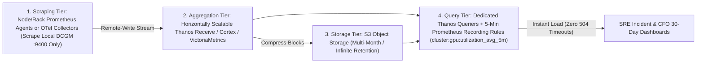
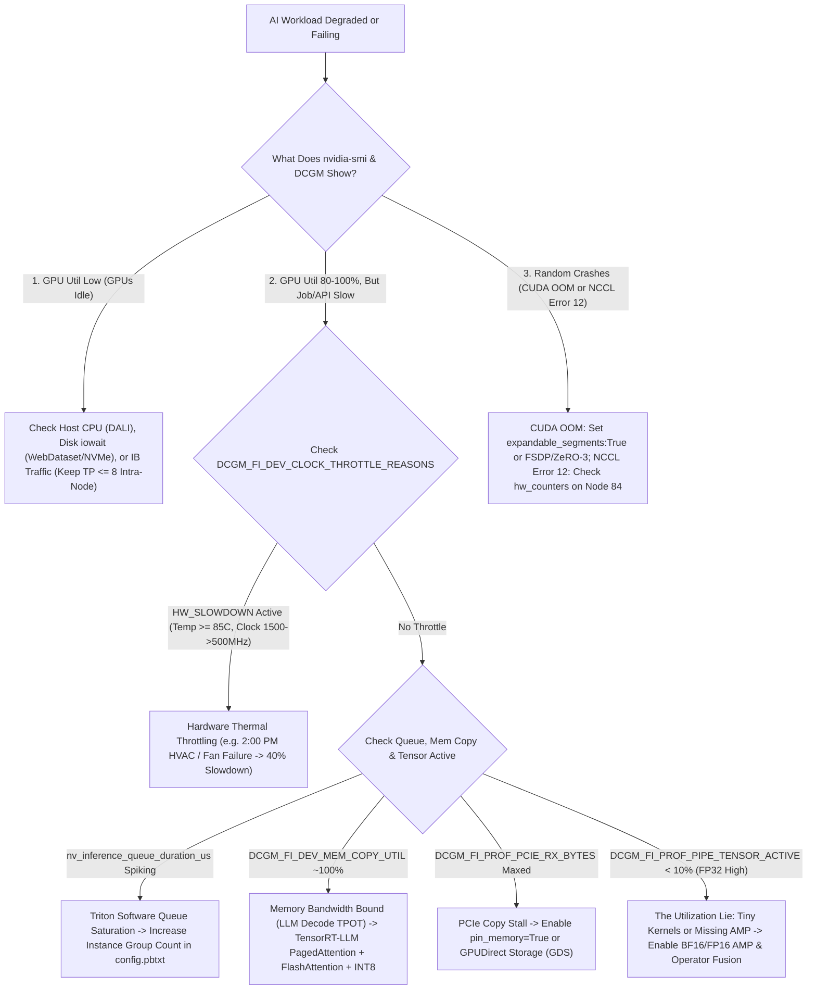

# 11.29 Multi-tenancy, quotas, fault tolerance and health on GPU clusters

| | |
|---|---|
| Level | Advanced |
| Priority tier | 1 |
| Lab venue | GCP / GKE, plus local Python 3 simulation lab |
| Part | Part 11: GPUs on Kubernetes, scheduling and virtualization |
| Sources used | Author's Volume 19 and Volume 11 notes; Ajay Vohra, *Scalable Kubernetes Infrastructure for AI Platforms* |
| Coverage file | `planning/coverage/chapters/11-29.md` |

## Why this matters for AI infrastructure

Building a cluster is only the start of an AI platform team's work. Picture a GPU cluster that has been running for months. Its hardware is aging, several teams share the same machines, and the cloud bill keeps climbing. Day-two operations are the work that keeps all of this under control. Without strict isolation and automated recovery, one user mistake or one uncoordinated patch can take down hundreds of GPUs.

Each control in this chapter answers a failure that really happened. The table below lists five of them from our operational notes, along with the fix that followed each one.

| Incident name | Source chapter | Triggering event | Production impact | Primary fix |
|---|---|---|---|---|
| Big-Bang Kernel Upgrade Outage | `volume-19/chapter-01` | Emergency `apt-get upgrade -y && reboot` across 500 GPU nodes at 2:00 AM without GPU Operator coordination | 400 nodes (80% of the cluster) booted with 0 `nvidia.com/gpu` capacity because `nvidia.ko` mismatched the new kernel headers | 6-Step Safe Eviction Pipeline and 3-Stage Canary Rollout (`1` Vanguard Node `24h` -> `1` Rack -> Global `>= 90%`) |
| 1-GPU Student Loop Crash | `volume-19/chapter-07` | 500 students and 5 research labs shared 80 GB A100 GPUs via Namespace `ResourceQuotas` (1 GPU) and software Time-Slicing | One infinite tensor loop consumed 100% of physical VRAM in 5 minutes and crashed 10 professor jobs with CUDA OOM | Partition shared 80 GB GPUs into 7 hardware `1g.10gb` MIG slices |
| $5 Million Empty Hotel | `volume-19/chapter-03` & `06` | Team requested $5 Million for 16 HGX H100 servers because Kubernetes GPU allocation stayed at 98% for 3 weeks | 30-day DCGM audit showed `DCGM_FI_PROF_SM_ACTIVE` averaged 12% while idle `p4d.24xlarge` notebooks wasted $2,000+ per weekend vs $20 for a CPU VM | Automated FinOps Reaper (`< 5%` SM activity for 4 hours), `7 × 1g.10gb` MIG, and `10:1` dev time-slicing |
| 60-Second Grafana 504 Timeout | `volume-19/chapter-09` | 1,000 GPUs emitting 500 metrics/sec with ephemeral pod labels overwhelmed a monolithic Prometheus server on a 200-node cluster | Dashboards spun for 60 seconds and failed with `504 Gateway Timeout` during an active outage | 4-Tier Thanos / Cortex architecture plus 5-minute Prometheus Recording Rules (`cluster:gpu:utilization_avg_5m`) |
| 1-Petabyte Dataset Corruption | `volume-19/chapter-10` | A data-cleaning script corrupted a 1 PB NVMe training directory, and 10 PB over 10 Gbps takes ~92 days to back up over the network | Nightly network backups were impossible, risking months of lost training progress | Hourly Copy-on-Write (`CoW`) storage snapshots (`<= 60 min` loss) and 30-day S3 Object Lock (`WORM`) Compliance mode |

> **dcgm-exporter 4.9.0 version note.** dcgm-exporter 4.9.0 (2026-11-06) renamed many default metrics and changed some units. For example `DCGM_FI_DEV_GPU_UTIL` (percent) became `DCGM_FI_DEV_GPU_UTIL_RATIO` (0 to 1), and `DCGM_FI_DEV_FB_USED` (MiB) became `DCGM_FI_DEV_FB_USED_BYTES`. The metric names in this chapter are the 4.8.x names. On a 4.9.0 exporter use the [full mapping in 17.4](../part-17-operations/04-dcgm-exporter-and-interpreting-gpu-metrics.md#14-what-dcgm-exporter-490-renamed), and change thresholds together with the unit.

As you read the table, notice that each failure has its own cause, and each one maps to a control covered later in this chapter.

This chapter draws on Volume 19 and Volume 11 of our operational notes, and on *Scalable Kubernetes Infrastructure for AI Platforms*, to form one operational blueprint. By the end, you will know how to isolate competing tenants, cut cloud GPU bills in half, upgrade drivers without downtime, and find silent hardware stalls. The rest of the chapter takes these controls one at a time, so you can read each one as the answer to a specific failure.

## Prerequisites and outcomes

### Prerequisites

Before you start, you should have finished Chapters 11.1 through 11.28. Those chapters cover the GPU Operator, Network Operator, KAI Scheduler, MIG, Time-Slicing, MPS, vGPU, KubeVirt, Kata, and BlueField DPUs. You should also be comfortable with Prometheus, DCGM Exporter, Kubernetes RBAC, ServiceAccounts, and parallel file systems.

### Outcomes

- You will enforce three-pillar multi-tenant isolation across compute, network, and storage, and pair those boundaries with IAM Roles for Service Accounts, Golden Base Image pipelines, and Falco runtime security.
- You will run the six-step safe eviction pipeline and the three-stage canary rollout. You will also run an automated FinOps zombie reaper to cut cloud GPU waste in half.
- You will build a four-tier Thanos observability stack with five-minute recording rules. You will also design a petabyte-scale disaster recovery plan that uses Copy-on-Write snapshots and S3 Object Lock.
- You will use the Universal AI SRE Diagnostic Matrix to find cluster bottlenecks, and you will tell thermal throttling, PCIe stalls, VRAM fragmentation, and optical transceiver drops apart from genuine compute saturation.

## Concepts: basics to intermediate to advanced

### 1. Basics: Three-pillar multi-tenancy, DevSecOps identity, and FinOps reapers

#### 1. The Three Pillars of Multi-Tenant Workload Isolation

Picture a university GPU cluster shared by several labs. Namespaces and ResourceQuotas look like enough, but they only restrict resource counts inside `etcd`. They do nothing to stop a process from exhausting shared silicon, network links, or storage arrays. That is exactly what happened when a student ran an infinite tensor loop on a time-sliced card. The loop consumed all physical VRAM and crashed ten research jobs that shared the board.

Stopping noisy neighbors from crossing tenant boundaries takes hardware isolation across three physical pillars. The first pillar is compute. Shared cards are partitioned into hardware MIG instances, so an out-of-memory error stays inside a single ten-gigabyte slice. Workloads with strict compliance rules get dedicated physical nodes, using Kubernetes Node Taints and Tolerations.

Network and storage finish the boundary. Default-deny NetworkPolicies in Calico or Cilium stop unauthorized pod-to-pod scans. SR-IOV Virtual Functions isolate kernel-bypass RDMA traffic on ConnectX NICs. On a shared Weka or Lustre parallel file system, per-tenant IOPS and bandwidth QoS rules stop one large checkpoint write from starving the latency-sensitive inference APIs.

| Isolation pillar | Source reference | Unisolated failure mode | Hardware and software enforcement |
|---|---|---|---|
| Pillar 1: Compute Isolation | `volume-19/chapter-07` Sec. 1 & `volume-11/chapter-08` | Infinite tensor loop on time-sliced 80 GB A100 exhausts 100% VRAM in 5 minutes and kills 10 co-located jobs | Partition shared 80 GB GPUs into `7 × 1g.10gb` MIG slices; dedicate regulated PCI/HIPAA nodes via Node Taints and Tolerations |
| Pillar 2: Network Isolation | `volume-19/chapter-07` Sec. 2 & Chapter 11.22 | Marketing pods scan Finance pods over TCP/IP, or RDMA traffic bypasses Linux kernel software policies | Enforce Default-Deny `NetworkPolicies` (Calico/Cilium) per namespace and slice ConnectX NICs into hardware SR-IOV Virtual Functions (`VFs`) |
| Pillar 3: Storage Isolation | `volume-19/chapter-07` Sec. 3 | Multi-terabyte Marketing checkpoint saturates 100% of Weka/Lustre IOPS and stalls Finance inference APIs | Configure hard per-tenant IOPS and bandwidth QoS limits with guaranteed minimum IOPS reserves, plus scoped subdirectory `chroot` mounts (never root `/`) |

As you read the table, notice that each pillar pairs one specific failure with one specific enforcement layer. The chapter asks for all three because the boundary is incomplete without any of them.

Platform engineers must enforce all three pillars before they let tenants share the cluster.

#### 2. DevSecOps Operations: Nightly Scanning, Golden Base Images, and IRSA

Scanning an image once, at build time, does not protect a cluster that runs for months. Researchers often open interactive shells inside running training pods. From there, they install unverified Python packages from the internet. Patching is slow too. If fifty data science teams each take several weeks to patch a critical library vulnerability, the whole platform stays exposed for that entire time.

A multi-tenant cluster needs three loops that run all the time. The first loop scans container images in Harbor or ECR every night. It also runs Falco, Prisma Cloud, or Aqua on every worker node, so an unauthorized `kubectl exec` package install is caught right away. The second loop keeps one central Golden Base Image, built on signed NVIDIA AI Enterprise containers. When that image changes, CI/CD rebuilds the downstream model images and triggers a Kubernetes RollingUpdate within hours.

The third loop is a rule about access. Never attach broad cloud storage permissions to the worker node IAM profile. A healthcare team once attached `s3:GetObject` to the EC2 node role. Every pod on those GPU servers then inherited access to millions of patient records. Instead, bind a prefix-scoped IAM role via OIDC to one Kubernetes ServiceAccount, such as `medical-training-sa`. Only the authorized pods then receive short-lived STS credentials. Send all Kubernetes audit logs, `/var/log/auth.log`, and API logs to Splunk or Elastic.

Keep all three loops running continuously, because a scan done once at build time will not catch what a researcher installs later.

#### 3. FinOps Capacity Forecasting, the 3-Tier Purchasing Model, and the Zombie Reaper Bot

A straight-line forecast fails for generative AI, because batching and sequence length push hardware utilization in opposite directions. Consider a service whose traffic doubles. It rarely needs twice as many GPUs, since Triton dynamic batching packs the extra requests into existing CUDA kernels. Now keep the user count flat, but let each prompt grow from a single-page document to a hundred-page PDF. The KV-cache memory grows linearly, and that growth triggers immediate out-of-memory crashes.

Allocation numbers can also mislead you. Kubernetes allocation metrics routinely disagree with actual hardware use. A cluster can show ninety-eight percent GPU allocation for weeks, while DCGM reports Streaming Multiprocessors that sit idle in abandoned Jupyter notebooks over the weekend. A three-tier purchasing strategy, combined with an automated FinOps Reaper, cuts cloud GPU bills in half. It also prevents unnecessary multi-million-dollar hardware purchases.

| Capacity / FinOps lever | Source reference | Target workload or scenario | Mechanism and exact thresholds | Verified financial impact |
|---|---|---|---|---|
| Forecasting: Batching vs Context | `volume-19/chapter-03` Sec. 1 | Inference traffic doubling (`10 -> 20 req/s`) vs `1 -> 100`-page PDF uploads | Dynamic batching raises GPU util from `40%` to `55%`; `100`-page PDFs explode KV-cache linearly into CUDA OOM | Prevents over-buying compute for RPS growth while sizing VRAM for sequence length |
| 1. Baseline Tier (Reserved / On-Prem) | `volume-19/chapter-03` & `06` | `24/7` steady-state production inference and baseline R&D | Commit to 1-to-3-Year Reserved Instances (`RIs`), Savings Plans, or on-premises bare metal | `40%–50%` off (1-Year RI) to `60%+` cheaper than On-Demand |
| 2. Burst Tier (On-Demand Cloud) | `volume-19/chapter-03` & `06` | Daily traffic peaks, seasonal spikes, urgent ad-hoc runs | Autoscale elastic On-Demand instances only during active peak hours | Eliminates idle reservation waste during off-peak hours |
| 3. Spot / Preemptible ("Scavenger Tier") | `volume-19/chapter-03` & `06` | Fault-tolerant batch training and async data processing | Save async S3 checkpoints every `15 minutes` and use AWS Node Termination Handler to catch the `2-minute` warning for a final sync flush | Up to `60%–70%` discount with `< 15 minutes` (or `0` steps) lost on preemption |
| 4. Dev/Staging Sharing (MIG + Time-Slicing) | `volume-19/chapter-03` & `06` | Dev/staging using `5 GB` VRAM and `12%` `SM_ACTIVE` behind `98%` K8s allocation | Partition staging H100s into `7 × 1g.10gb` MIG slices and set `10:1` dev time-slicing (`80` devs on `1` `8`-GPU node); cuts `$500,000/month` AWS bill in half in `30 days` | Rejected premature `$5 Million` (`16` HGX H100) CapEx request for `12 months` |
| 5. Automated FinOps Reaper Bot | `volume-19/chapter-03` & `06` | Zombie Jupyter notebooks left running over weekends (`$2,000+` per `p4d.24xlarge` vs `$20` CPU VM) | Kubernetes Operator queries Prometheus: if `DCGM_FI_PROF_SM_ACTIVE < 5%` continuously for `4 hours`, evict Pod and send Slack alert | Reclaims stranded `$30,000` GPUs automatically |

Read each row as a pairing of a workload with a tier. Steady production inference goes on reserved capacity, daily peaks go on On-Demand, and fault-tolerant batch jobs go on Spot.

A forecast should track context length as well as request count, because the two move hardware use in opposite directions.

---

### 2. Intermediate: Zero-downtime rolling upgrades, Thanos observability at scale, and petabyte DR

#### 1. The Jenga Tower of AI Upgrades: 6-Step Eviction and 3-Stage Canary Rollouts

Upgrading an AI cluster is risky because PyTorch, CUDA, the NVIDIA kernel driver, and the Linux kernel form a fragile chain of dependencies. Picture an operations team that rebooted five hundred GPU servers into a new kernel at two in the morning, with no coordination. Four hundred nodes came back online with zero GPUs. The new kernel broke ABI compatibility with the pre-compiled `nvidia.ko` driver module. That took down eighty percent of the fleet before market open.

To prevent fleet-wide outages, never bake NVIDIA drivers statically into the host OS or trigger global reboots. Let the GPU Operator manage driver containers that recompile against matching kernel headers on boot. Orchestrate maintenance through a Node Upgrade Operator, such as Kured. Every node upgrade follows a six-step eviction pipeline, and the rollout moves through a three-stage canary that keeps at least ninety percent of cluster capacity online.

Three tiers set the risk, a six-step eviction pipeline runs on each node, and a three-stage canary decides the order.

```text
Upgrade Blast-Radius Tiers (volume-19/chapter-01):
  Tier 1: Application / Container upgrades          -> Low Risk
  Tier 2: GPU Operator / Driver (nvidia.ko) reload  -> High Risk
  Tier 3: OS Kernel / System Firmware reboot        -> Extreme Risk

6-Step Safe Eviction Pipeline:
  1. Cordon      -> kubectl cordon node-42
  2. Drain       -> kubectl drain node-42 --ignore-daemonsets --delete-emptydir-data (triggers checkpoint save)
  3. Verify Idle -> nvidia-smi confirms 0 active GPU processes
  4. Upgrade     -> Apply Helm driver update or reboot into new kernel with driver-container header compile
  5. Validation  -> Run dcgmi diag hardware burn-in
  6. Uncordon    -> kubectl uncordon node-42

3-Stage Canary Rollout Strategy:
  Stage 1 (The Vanguard Node) -> Upgrade 1 isolated node and soak on low-priority batch jobs for 24 hours
  Stage 2 (Rack-Level Rollout)-> Upgrade 1 full rack (1 leaf-switch InfiniBand fault domain)
  Stage 3 (Global Rollout)    -> Roll across remaining racks while keeping >= 90% of cluster capacity online
```

Notice that the eviction steps run on one node at a time, while the canary stages decide how many nodes change together.

Treat every driver or kernel change as a canary rollout, never as a single global reboot.

#### 2. Surviving the Cardinality Explosion: 4-Tier Thanos / Cortex and Recording Rules

One Prometheus server handles a small cluster well. On a thousand-GPU AI factory, the same server starts to fail. Each GPU emits hundreds of hardware metrics per second. Kubernetes also attaches a unique pod label to every short-lived training job. Within days, that high-cardinality label explosion creates millions of distinct time series, and they exhaust the server's memory.

Picture an engineer opening Grafana dashboards during a two-hundred-node incident. Several thirty-day queries run at once. They stall Prometheus for a full minute, and the dashboards fail with `504 Gateway Timeout`. To survive this scale, you separate metric ingestion from querying across a four-tier Thanos, Cortex, or VictoriaMetrics architecture. Prometheus Recording Rules add a second fix. They pre-compute fleet averages every five minutes in the background, so executive and incident dashboards load instantly.



Read the diagram from left to right. The scrapers feed the aggregation tier, which feeds both the storage tier and the query tier.

Separate ingestion from querying, because the 504 failures come from the two sharing one server.

#### 3. Petabyte-Scale Disaster Recovery: RPO, RTO, WORM Object Lock, and Hourly CoW Snapshots

Nightly backup tools such as Commvault or Veeam fail outright at multi-petabyte scale. Moving ten petabytes over a ten-gigabit link takes more than three months. The transfer also saturates the core spine switches that training needs. Consider a buggy script that corrupts a petabyte-scale NVMe directory, or ransomware that targets model checkpoints. In either case, you cannot wait weeks to pull cold archives over the wire.

AI disaster recovery uses three storage-native controls instead of nightly file copies. The first control is the recovery point. The Recovery Point Objective, or RPO, is how much work you can lose, so it should match your training checkpoint interval. The Recovery Time Objective, or RTO, is how long a restore takes, so it should match your storage tier.

The second control is object locking. Lock model checkpoints in S3 with Object Lock, Write Once Read Many, in Compliance Mode. Then not even the cloud root account can delete them for thirty days.

The third control is snapshots. Configure Weka, NetApp, or ZFS-backed Lustre to take hourly read-only Copy-on-Write pointer snapshots. Pair those snapshots with dark-fiber asynchronous delta replication, so a corrupted directory reverts through a single API call.

| DR metric or control | Source reference | Scale and timing numbers | Operational behavior and guarantee |
|---|---|---|---|
| Network Backup Bottleneck | `volume-19/chapter-10` Sec. 1 | `10 Petabytes` (`80 × 10^15` bits) over `10 Gbps` link = `~92 days` (`8,000,000 s`) | Proves traditional nightly network backups are physically impossible at petabyte scale |
| `RPO` and `RTO` Alignment | `volume-19/chapter-10` Sec. 1 | Checkpoint every `4 hours` -> `RPO = 4 hours`; `5 PB` cold S3 Glacier restore -> `RTO = 3 weeks` | Ties compute loss directly to checkpoint frequency and recovery speed to storage tier |
| S3 Object Lock (`WORM` Compliance Mode) | `volume-19/chapter-10` Sec. 2 | `50 TB` model checkpoints locked for a `30-day` retention window | Blocks ransomware and compromised `root` accounts from overwriting or deleting checkpoints (unlike bypassable Governance mode) |
| Hourly Copy-on-Write (`CoW`) Snapshots | `volume-19/chapter-10` Customer Scenario | `1-Petabyte` NVMe production directory snapped every `1 hour` (`<= 60 minutes` loss) | Reverts accidental `rm -rf` or data-cleaning corruption via `1` storage API call with zero network transfer |

Notice that the RPO row ties lost compute to the checkpoint interval, and the snapshot row restores data without any network transfer.

Match the RPO to the checkpoint interval and the RTO to the storage tier, as the first control requires.

---

### 3. Advanced: The Universal AI SRE Diagnostic Matrix

Say a team reports that training is slow, or that an inference API keeps timing out. If you look only at `nvidia-smi`, you can make expensive mistakes. A GPU can show one hundred percent utilization while its Tensor Cores sit nearly idle. Afternoon heat can throttle its clock speed too. The memory controller might also be stalled, waiting on PCIe transfers. A single degraded optical transceiver can drop one packet in ten thousand. That alone can stall a thousand-GPU collective operation, while basic `ping` tests still pass without error.

Rather than guess, or order new hardware, walk through the Universal Diagnostic Matrix one step at a time. Start with the coarse GPU utilization. Then compare it against the hardware clock throttle flags, the Triton queue latencies, the HBM memory-copy utilization, and the ConnectX RDMA hardware sequence counters.



Follow the arrows from the top. Low utilization sends you to the host CPU, disk, and network checks. High utilization with a slow job sends you to the throttle flags and the queue, memory, and tensor metrics.

#### Key Forensic Proofs in the Universal Diagnostic Matrix

Each branch of the tree points to one hardware counter or one runtime setting. Take PyTorch first. A job can crash with an out-of-memory error even while plenty of VRAM is free. The caching allocator has chopped that free space into thousands of tiny gaps. The afternoon slowdown is different. Utilization stays pegged at one hundred percent, yet the counters prove it is a cooling failure. The GPU temperature reaches eighty-five degrees Celsius, and hardware slowdown cuts the clock to a third of normal speed.

On the network side, finding a silent RDMA drop on a large RoCEv2 fabric means reading the NIC hardware sequence counters. Running ICMP pings will not show it. Once you isolate the fault, deterministic runbooks and structured Follow-the-Sun handoffs get the hardware replaced and the maintenance done, so engineers are not woken up unnecessarily.

| Forensic scenario | Source reference | Telemetry proof and exact numbers | Root cause and remediation |
|---|---|---|---|
| 1. PyTorch VRAM Fragmentation vs Model Size OOM | `volume-19/chapter-04` Sec. 2 & `chapter-11` | `torch.cuda.memory_summary()` shows `Max Reserved = 80 GB` vs `Max Allocated = 40 GB`; `20 GB` (`15 GB`) free in `10,000 × 2 MB` gaps fails a contiguous `5 GB` tensor alloc | Swiss-cheese allocator fragmentation -> set `PYTORCH_CUDA_ALLOC_CONF=expandable_segments:True`. (`1B` model OOM = lower batch size / grad accum; `70B` model OOM on `80 GB` GPU = shard via FSDP / ZeRO-3) |
| 2. The 2:00 PM 40% Thermal Slowdown | `volume-19/chapter-04` Customer Scenario | `nvidia-smi` shows `100%` util, but `DCGM_FI_DEV_GPU_TEMP` hits `85°C` and `DCGM_FI_DEV_CLOCK_THROTTLE_REASONS` asserts `HW_SLOWDOWN` (`1,500 MHz -> 500 MHz`) | Afternoon HVAC strain / fan failure downclocked the GPU `3x` -> alert on throttle bitmask and escalate rack cooling to Facilities |
| 3. The 100% Utilization Lie & Triton 200 ms SLA Breach | `volume-19/chapter-04` & `chapter-11` | `TENSOR_ACTIVE < 10%` (`5%`) vs `> 50%` target; `PCIE_RX_BYTES` maxed; Triton breaches `200 ms` `p99` at `80–100%` util with `nv_inference_queue_duration_us` or `DCGM_FI_DEV_MEM_COPY_UTIL` at `100%` | Enable AMP (`BF16`/`FP16`) for Tensor Cores; set `pin_memory=True` / GDS for PCIe; raise `Instance Group` count in `config.pbtxt` and enable TensorRT-LLM `PagedAttention` + `INT8` |
| 4. Node 84 Degraded Optic in 128-Node 400G RoCEv2 | `volume-19/chapter-05` Customer Scenario | `NCCL WARN NET/IB : Got completion ... with error 12` (retry exceeded), `0` PFC storms (`rx_prio<N>_pause`), `1` in `10,000` RDMA drop stalls `1,000` GPUs; `Node 84` spikes `packet_seq_err` | Dying laser on `Node 84` -> scan `/sys/class/infiniband/<dev>/ports/<port>/hw_counters/` (`packet_seq_err`, `out_of_sequence`, `implied_nak_seq_err`, `local_ack_timeout_err`) and `perfquery` (`SymbolErrorCounter`, `LinkDownedCounter`), cordon `Node 84`, and replace optic |
| 5. Zero-Touch XID 48 Runbook & Follow-the-Sun Handoff | `volume-19/chapter-12` & `chapter-02` | `XID 48` (double-bit ECC) on `node-worker-42` GPU `3`; handoff logs `3` NCCL timeouts on `Llama-3-FineTune`, PCIe drops on `node-55`, `14:00 UTC` `dcgmi diag` window, Jira `#4092`; Game Day tests `< 5s` (`99.999%`) master failover | Automate `XID 48` via Alertmanager webhook (`1. Cordon` -> `2. dmesg -T \| grep NVRM` -> `3. Drain & Reset/Reboot` for row remap -> `4. RMA Jira` if recurring) |

## Commands and configurations that matter

Each command and manifest below targets one of the failure modes covered in the concepts section above. Before you replace a network part, grant a pod S3 access, or deploy a FinOps reaper, you need exact queries that work cleanly across the whole cluster.

### 1. Scanning RDMA Hardware Sequence-Error Counters Across a Node

When a multi-node job fails with an RDMA transport retry error, standard TCP tools cannot see the dropped packets. Run this loop on your GPU nodes. It reads the ConnectX hardware sequence counters and the InfiniBand symbol error registers directly.

```bash
# Inspect ConnectX RDMA hardware sequence and timeout error counters for silent optic drops (untested here)
for dev in /sys/class/infiniband/mlx5_*; do
    echo "=== ${dev##*/} ==="
    grep -H . "$dev"/ports/1/hw_counters/{packet_seq_err,out_of_sequence,implied_nak_seq_err,local_ack_timeout_err} 2>/dev/null || true
done

# On InfiniBand switches/hosts, query SymbolErrorCounter and LinkDownedCounter (untested here)
perfquery | grep -E "SymbolErrorCounter|LinkDownedCounter"
```

The `perfquery` line covers the InfiniBand side and filters for `SymbolErrorCounter` and `LinkDownedCounter`.

### 2. Least-Privilege AWS S3 Access via IAM Roles for Service Accounts

If you grant S3 access to the EC2 node profile, every container scheduled on that machine can read the sensitive training datasets. This manifest takes the safer route. It binds a read-only IAM role to the `medical-training-sa` ServiceAccount. It also requests a hardware MIG slice and enables expandable CUDA memory segments to prevent allocator fragmentation.

```yaml
# irsa-medical-training-pod.yaml (volume-19/chapter-08, untested here)
apiVersion: v1
kind: ServiceAccount
metadata:
  name: medical-training-sa
  namespace: medical-llm
  annotations:
    eks.amazonaws.com/role-arn: arn:aws:iam::123456789012:role/medical-s3-prefix-readonly
---
apiVersion: v1
kind: Pod
metadata:
  name: medical-llm-trainer
  namespace: medical-llm
spec:
  serviceAccountName: medical-training-sa
  containers:
    - name: pytorch
      image: nvcr.io/nvidia/pytorch:24.08-py3
      env:
        - name: PYTORCH_CUDA_ALLOC_CONF
          value: "expandable_segments:True"
      resources:
        limits:
          nvidia.com/mig-1g.10gb: 1
```

Notice that the role annotation sits on the ServiceAccount, while the pod only names that account. The pod itself asks for one MIG slice.

### 3. Prometheus Recording Rule and FinOps Zombie Reaper Query

A thirty-day query over raw per-pod GPU metrics can time out Prometheus during an outage. Abandoned notebooks, meanwhile, quietly drain the cloud budget. This rule file pre-computes fleet utilization every five minutes. It also flags any pod whose Streaming Multiprocessor activity stays below five percent for four hours.

```yaml
# prometheus-recording-and-finops-reaper-rules.yaml (volume-19/chapter-03 & 09, untested here)
groups:
  - name: gpu-fleet-recording-and-finops
    interval: 5m
    rules:
      # Pre-compute fleet average utilization every 5m so 30-day CFO dashboards load instantly
      - record: cluster:gpu:utilization_avg_5m
        expr: avg(DCGM_FI_DEV_GPU_UTIL)

      # Identify zombie pods holding a GPU with < 5% SM activity for 4 hours
      - alert: ZombieGpuPodDetected
        expr: avg_over_time(DCGM_FI_PROF_SM_ACTIVE[4h]) < 0.05
        for: 5m
        labels:
          severity: warning
          action: finops-reap
```

The first rule stores a value that dashboards can read cheaply. The second rule is an alert that carries the `finops-reap` action label.

## How it fails

Even mature platform teams fall into subtle traps when they upgrade kernels, cool high-density racks, or scale inference services. The table below pairs five high-impact symptoms with the command evidence that shows them, the root cause, and the fix. Read each row from left to right: the symptom, the evidence, the cause, and then the fix.

| Failure mode | Exact symptom & command evidence | Root cause boundary | Remediation |
|---|---|---|---|
| 1. `400` of `500` GPU nodes lose all `nvidia.com/gpu` capacity after a `2:00 AM` `apt-get upgrade -y && reboot` (`volume-19/chapter-01`) | `kubectl get nodes` shows `0` allocatable GPUs on `400` nodes after an emergency Ubuntu kernel patch; `dmesg` shows `nvidia.ko` module version mismatch. | Big-Bang Kernel Reboot Breaking Driver Compatibility: Upgrading the host kernel without matching headers and GPU Operator driver-container recompilation blinded `80%` of the fleet at once. | Restart `nvidia-driver-daemonset` with matching kernel headers to rebuild `nvidia.ko`, ban raw Ansible reboots, and enforce the 6-Step Eviction Pipeline + 3-Stage Canary Rollout (`1` Vanguard `24h` -> `1` Rack -> Global `>= 90%`). |
| 2. Training iteration time spikes `40%` every day at `2:00 PM` while `nvidia-smi` shows `100%` utilization (`volume-19/chapter-04`) | Network switches are idle and `nvidia-smi` reports `100%` GPU-Util, but overlaying `DCGM_FI_DEV_GPU_TEMP` and `DCGM_FI_DEV_CLOCK_THROTTLE_REASONS` shows `85°C` and `HW_SLOWDOWN` (`1500 -> 500 MHz`). | Data Center HVAC Thermal Throttling: Afternoon heat strained rack cooling; the GPU downclocked `3x` to protect silicon while `nvidia-smi` stayed at `100%`. | Alert on `DCGM_FI_DEV_CLOCK_THROTTLE_REASONS` bitmask and escalate rack cooling / fan failures to Data Center Facilities. |
| 3. `128`-node `400G` RoCEv2 training jobs fail randomly with `NCCL WARN NET/IB : Got completion ... with error 12` (`volume-19/chapter-05`) | Core switches show links `UP` and `0` PFC storms, `ping` succeeds, but `Node 84`'s `/sys/class/infiniband/.../hw_counters/packet_seq_err` and `local_ack_timeout_err` climb rapidly. | Silent Layer 1 Optical Transceiver Degradation: A dying laser on `Node 84` drops `1` in `10,000` RDMA packets, triggering Go-Back-N retransmissions that poison the synchronous `128`-node `AllReduce` ring. | Monitor NIC RDMA `hw_counters` (`packet_seq_err`, `out_of_sequence`, `implied_nak_seq_err`, `local_ack_timeout_err`) and switch FEC/CRC counters; cordon `Node 84` and replace the optical transceiver. |
| 4. Triton LLM inference breaches `200 ms` `p99` SLA at `80–100%` GPU-Util, and team demands new GPUs (`volume-19/chapter-11`) | `nvidia-smi` bounces between `80%` and `100%`, while `nv_inference_queue_duration_us` spikes and/or `DCGM_FI_DEV_MEM_COPY_UTIL` is pegged at `100%`. | Software Queue Saturation & KV-Cache Memory-Bandwidth Bottleneck: Requests wait in Triton's thread queue, and token decoding (`TPOT`) is memory-bandwidth-bound rather than compute-bound. | Increase `Instance Group` count in Triton `config.pbtxt`, deploy TensorRT-LLM with PagedAttention, and apply INT8 quantization to halve memory bandwidth per token. |
| 5. Grafana dashboards spin for `60 seconds` and fail with `504 Gateway Timeout` during a `200`-node outage (`volume-19/chapter-09`) | Single monolithic Prometheus server hits `100%` RAM/CPU when incident error series spike and SREs query `30-day` raw DCGM metrics simultaneously. | High-Cardinality Ingest + Query Coupling: Ephemeral pod labels created millions of series on a single server with no read/write separation or pre-computation. | Deploy the 4-Tier Thanos / Cortex Architecture (decoupling `Scraping Agents` and `Thanos Receive` from `Thanos Querier` + S3) and pre-compute aggregations with `5-minute` Prometheus Recording Rules (`cluster:gpu:utilization_avg_5m`). |

Notice that the same evidence can point you to different causes. A GPU at one hundred percent utilization may be cooling-bound in one case and memory-bound in another.

When you see a slow job, the rows that mention utilization are the ones to read first. Find the row that matches your symptom before you run any remediation.

## Hands-on lab

### Venue and scope

You need a dedicated staging fleet before you run a live five-hundred-node reboot or inject hardware ECC errors. This lab does not. It runs a local Python 3 verification suite, found in `code/part11/multi_tenancy_quotas_fault_tolerance_health.py` and `code/part11/multi_tenancy_quotas_fault_tolerance_health_lab.py`. The suite checks the six-step eviction pipeline, the three-stage canary rollout, the FinOps zombie reaper, the petabyte disaster recovery math, and the Universal AI SRE Diagnostic Matrix. All cluster CLI commands are marked `(untested here)`.

### Step 1: Run the self-checking multi-tenancy, FinOps, fault tolerance and health lab (tested here)

From the repository root, run the self-checking lab script. It verifies all twenty-five operational checks.

```bash
python3 code/part11/multi_tenancy_quotas_fault_tolerance_health_lab.py
```

The output below was captured from this repository.

```text
=== Chapter 11.29 Lab: Multi-Tenancy, Quotas, Fault Tolerance, FinOps & Health ===
  [PASS] Volume 19 Ch 1 Safe Eviction Pipeline defines 6 ordered steps from Cordon to Uncordon
  [PASS] Volume 19 Ch 1 Canary Rollout progresses from 1 Vanguard Node (24h) -> 1 Rack -> Global (>= 90% capacity online)
  [PASS] Volume 19 Ch 1 Customer Scenario: 500-node uncoordinated kernel reboot at 2:00 AM blinded 400 nodes (80%) to nvidia.com/gpu
  [PASS] Volume 19 Ch 3 FinOps Reaper evicts zombie pods when DCGM_FI_PROF_SM_ACTIVE < 5% for >= 4 hours
  [PASS] Volume 19 Ch 3 rejects $5M (16 HGX H100) purchase when 98% K8s allocation hides 12% SM_ACTIVE over 30 days, slicing into 7x 1g.10gb MIG
  [PASS] Volume 19 Ch 6 cuts $500,000/mo AWS bill in half using 1-Year RIs (40-50% off), Spot (70% off, 15m S3 ckpt + 2m warning), and 80 devs on 1 8-GPU node (10x time-slicing)
  [PASS] Volume 19 Ch 10 DR math: 10 Petabytes over a 10 Gbps link takes ~92 days, requiring S3 Object Lock WORM (30d Compliance) and 1-hour CoW snapshots (<=60m loss)
  [PASS] Volume 19 Ch 5: 128-node 400G RoCEv2 NCCL error 12 (retry exceeded) isolates Node 84 via hw_counters/packet_seq_err
  [PASS] Volume 19 Ch 4: 2:00 PM 40% slowdown at 100% nvidia-smi util is caused by 85C HW_SLOWDOWN downclocking from 1500 MHz to 500 MHz
  [PASS] Volume 19 Ch 11: Triton 200ms p99 breach with spiking nv_inference_queue_duration_us is fixed by increasing Instance Group count in config.pbtxt
  [PASS] Volume 19 Ch 11: LLM decoding pegged at ~100% DCGM_FI_DEV_MEM_COPY_UTIL is fixed by TensorRT-LLM PagedAttention + INT8 quantization
  [PASS] Volume 19 Ch 4: Saturated DCGM_FI_PROF_PCIE_RX_BYTES at 100% util is fixed by pin_memory=True, NVIDIA DALI, or GPUDirect Storage
  [PASS] Volume 19 Ch 4: 100% nvidia-smi util with 5% (< 10%) TENSOR_ACTIVE proves unoptimized FP32 / tiny kernels needing AMP (BF16/FP16)
  [PASS] Volume 19 Ch 4: PyTorch 80GB Reserved vs 40GB Allocated VRAM fragmentation (10,000 x 2MB gaps = 20GB free failing 5GB alloc) is fixed by PYTORCH_CUDA_ALLOC_CONF=expandable_segments:True
  [PASS] Volume 19 Ch 7: 3 multi-tenant isolation pillars span Compute (MIG/Taints), Network (Default-Deny NetworkPolicy + SR-IOV VFs for RDMA), and Storage (Weka/Lustre IOPS QoS + chroot)
  [PASS] Volume 19 Ch 7 University Scenario: 500 students + 5 labs where 1 student infinite tensor loop crashed 10 professor jobs on time-slicing -> fixed via 7x 1g.10gb MIG
  [PASS] Volume 19 Ch 8: Replaces broad EC2 Node IAM s3:GetObject with OIDC IAM Roles for Service Accounts (IRSA) bound to medical-training-sa + Falco runtime scanning
  [PASS] Volume 19 Ch 9: 4-tier Thanos/Cortex architecture + 5m Recording Rules (cluster:gpu:utilization_avg_5m) prevents 60s 504 Gateway Timeout on 200-1,000 node clusters
  [PASS] Volume 19 Ch 12: XID 48 (double-bit ECC) runbook on node-worker-42 GPU 3 cordons node, verifies dmesg NVRM, resets/reboots after drain for row remap, and opens RMA Jira if recurring
  [PASS] Volume 19 Ch 12: Follow-the-Sun handoff records 3 NCCL timeouts on Llama-3-FineTune, PCIe drops on node-55, 14:00 UTC dcgmi diag window, and Jira #4092
  [PASS] Volume 19 Ch 11 distinguishes 1B model OOM (lower batch size / gradient accumulation) from 70B model OOM on 80GB GPU (requires FSDP / ZeRO-3)
  [PASS] Volume 11 Ch 8, 9, 10, 11, 12 & Labs 01-04 integrate 7-layer tenant isolation, N=ceil((D+F)/(A*(1-H))) capacity, >120s DCGM freshness, and 6-layer triage
  [PASS] Volume 19 Ch 2 Game Day validates XID 48 (dcgmi test --inject), IB port disable (ibportstate), and 99.999% (<5s) master failover liveness probe tuning
  [PASS] Volume 19 Index organizes 12 chapters and 4 operational labs across Mechanism -> Real Evidence -> Decision Trees -> Troubleshooting -> Interview Prep
  [PASS] Scalable Kubernetes Infrastructure for AI Platforms (SKI Ch 2) reinforces namespace quota governance and resilient AI job execution

Summary: 25 passed, 0 failed out of 25 checks.
```

The summary line at the bottom reports 25 passed and 0 failed. Each line names the source it checks.

### Exercises

1. Start by inspecting `SIX_SAFE_EVICTION_STEPS` and `THREE_CANARY_ROLLOUT_STAGES` in `code/part11/multi_tenancy_quotas_fault_tolerance_health.py`. Then explain why rebooting five hundred nodes at once into a new Ubuntu kernel left four hundred nodes without `nvidia.com/gpu` capacity. Finish by listing the six eviction steps and the three canary stages that prevent this outage.
2. Use `evaluate_finops_reaper_and_cloud_plan()` to state the DCGM threshold and duration that the FinOps Reaper bot uses. Next, explain how you would refute a five-million-dollar HGX H100 purchase request, where Kubernetes allocation sits at ninety-eight percent while `DCGM_FI_PROF_SM_ACTIVE` is twelve percent. Last, detail the three-phase plan that cuts a five-hundred-thousand-dollar monthly AWS GPU bill in half.
3. Use `diagnose_ai_sre_bottleneck()` to name the exact DCGM or Triton metric for two cases. The first is an afternoon forty percent training slowdown. The second is full utilization with low Tensor Core activity. Then give the remediation for saturated PCIe receive bytes and for a Triton latency SLA breach.
4. List the three network troubleshooting layers, covering optical links, PFC storms, and OpenSM routing. Then name the exact files under `/sys/class/infiniband/.../hw_counters/` that isolate Node 84 when NCCL error 12 strikes.
5. State the controls that isolate Marketing and Finance on a shared cluster across compute, network, and storage. Then explain how IRSA on `medical-training-sa` replaces broad EC2 node IAM roles. Finish by listing the four tiers in `FOUR_THANOS_TIERS`.
6. Prove why backing up ten petabytes over a ten-gigabit link takes roughly ninety-two days. Then contrast S3 Object Lock WORM Compliance mode with hourly Copy-on-Write storage snapshots. Last, write the five-step XID 48 runbook for `node-worker-42`.

## Checkpoint questions

<details>
<summary>**1. In Volume 19 Chapter 1, what are the three categories of AI cluster upgrades ranked by blast radius, and why did an emergency apt-get upgrade -y && reboot across 500 nodes blind 400 nodes (80%) to their GPUs?**</summary>

There are three categories: low-risk application container updates, high-risk GPU Operator driver reloads, and extreme-risk OS kernel or firmware reboots. The emergency reboot went into a new Linux kernel without coordination with the GPU Operator. That broke the kernel-to-driver ABI, because `nvidia.ko` no longer matched the new kernel headers. Service came back once `nvidia-driver-daemonset` restarted with matching kernel headers, so the driver container could recompile `nvidia.ko`.
</details>

<details>
<summary>**2. List the six steps of the Safe Eviction Pipeline and the three stages of the Canary Rollout Strategy in Volume 19 Chapter 1.**</summary>

If you need the order, the six eviction steps are cordoning the node, draining pods with checkpointing, verifying zero GPU processes in `nvidia-smi`, executing the upgrade, running a `dcgmi diag` burn-in, and uncordoning the node. The canary starts by soaking one Vanguard Node for twenty-four hours. It then upgrades one full rack fault domain. The last stage rolls across the cluster and keeps at least ninety percent of capacity online.
</details>

<details>
<summary>**3. Contrast the Economies of Scale (Dynamic Batching) with the Diseconomies of Scale (Context Windows) in AI capacity forecasting (Volume 19 Chapter 3 Section 1).**</summary>

Dynamic batching gives you economies of scale. Doubling inference traffic from ten to twenty requests per second packs the extra queries into existing CUDA kernels, and GPU utilization rises modestly from forty to fifty-five percent. Context windows bring diseconomies of scale. Growing inputs from one-page documents to hundred-page PDFs raises KV-cache memory linearly, and that triggers immediate out-of-memory crashes.
</details>

<details>
<summary>**4. In Volume 19 Chapter 3, how does the automated FinOps Reaper bot identify and reclaim "zombie" Jupyter notebook pods, and how did DCGM metrics refute a $5 Million (16 HGX H100) hardware request?**</summary>

The FinOps Reaper queries Prometheus continuously. It evicts any pod holding a GPU whose `DCGM_FI_PROF_SM_ACTIVE` metric stays below five percent for four hours. A thirty-day audit refuted the five-million-dollar request. Ninety-eight percent Kubernetes allocation had hidden an average Streaming Multiprocessor utilization of only twelve percent. Partitioning staging GPUs into seven `1g.10gb` MIG slices absorbed twelve months of growth for zero capital outlay.
</details>

<details>
<summary>**5. Walk through the three-phase FinOps plan in Volume 19 Chapter 6 that cuts a $500,000/month all-On-Demand AWS GPU bill in half within 30 days.**</summary>

If you run the plan, the first phase covers steady-state production inference with one-year Reserved Instances or Savings Plans, for a forty to fifty percent discount. On-Demand is kept for burst peaks only. The second phase moves batch training to Spot GPU instances, for up to seventy percent savings. Spot nodes pair with fifteen-minute asynchronous S3 checkpoints, and the AWS Node Termination Handler catches the two-minute warning. The third phase enables ten-to-one GPU Time-Slicing on development nodes, so eighty developers share one eight-GPU machine.
</details>

<details>
<summary>**6. If nvidia-smi shows 100% GPU Utilization, how do you prove whether the GPU is stalled on PCIe transfers, missing Automatic Mixed Precision (AMP), or suffering from hardware thermal throttling (Volume 19 Chapter 4)?**</summary>

Consider a GPU that shows 100% utilization. Query DCGM Exporter metrics to separate the three stalls. Maxed-out `DCGM_FI_PROF_PCIE_RX_BYTES` with low SM activity points to a PCIe copy bottleneck, which needs `pin_memory=True` or GPUDirect Storage. High FP32 activity with `DCGM_FI_PROF_PIPE_TENSOR_ACTIVE` below ten percent means the job is missing Automatic Mixed Precision. When `DCGM_FI_DEV_GPU_TEMP` reaches eighty-five degrees Celsius and `DCGM_FI_DEV_CLOCK_THROTTLE_REASONS` asserts `HW_SLOWDOWN`, the GPU is thermally throttled.
</details>

<details>
<summary>**7. How do you prove that a PyTorch CUDA Out of Memory crash was caused by VRAM fragmentation rather than genuine capacity exhaustion, and what environment variable fixes it (Volume 19 Chapter 4 Section 2)?**</summary>

Inspect the output of `torch.cuda.memory_summary()` after the crash. When `Max Reserved` sits near eighty gigabytes while `Max Allocated` is only forty gigabytes, the free memory is chopped into thousands of small, non-contiguous gaps. Setting `PYTORCH_CUDA_ALLOC_CONF=expandable_segments:True` lets PyTorch stitch non-contiguous pages together, which removes the fragmentation crash.
</details>

<details>
<summary>**8. Why is fixing a CUDA OOM on a 70B parameter model fundamentally different from fixing a CUDA OOM on a 1B parameter model (Volume 19 Chapter 11 Interview Question 2)?**</summary>

An out-of-memory error on a one-billion-parameter model is usually caused by activation memory from a large batch size. Lowering the batch size or enabling Gradient Accumulation fixes it. A seventy-billion-parameter model cannot fit its static weights, gradients, and Adam optimizer states on a single eighty-gigabyte GPU, even at batch size one. It needs Fully Sharded Data Parallel or ZeRO-3 to shard the model states across multiple GPUs.
</details>

<details>
<summary>**9. In Volume 19 Chapter 5, why is ping useless for diagnosing a degraded AI training fabric, and how do you isolate a single bad optical transceiver causing NCCL error 12 across a 128-node 400G RoCEv2 cluster?**</summary>

A degraded optical transceiver uses Forward Error Correction to keep the link up and still passes tiny ICMP `ping` packets. It drops one in ten thousand burst RDMA packets, though, and that triggers Go-Back-N stalls across all nodes. If you want to isolate Node 84, read `packet_seq_err`, `out_of_sequence`, `implied_nak_seq_err`, and `local_ack_timeout_err` under `/sys/class/infiniband/<device>/ports/<port>/hw_counters/`, along with the `perfquery` symbol counters. Then cordon the node and replace the optic.
</details>

<details>
<summary>**10. How do you distinguish a Layer 1 optical fault, a Layer 2 Priority Flow Control (PFC) storm, and a Layer 3 Subnet Manager (OpenSM) routing flap on an AI network (Volume 19 Chapter 5)?**</summary>

A Layer 1 optical fault increments `SymbolErrorCounter` and `LinkDownedCounter` in `perfquery`, or `packet_seq_err` on the NIC, and it needs fiber or transceiver replacement. A Layer 2 PFC congestion storm drives throughput to zero, while `ethtool -S` shows skyrocketing `rx_prio<N>_pause` frames. A Layer 3 routing flap shows up in OpenSM logs as continuous Heavy Sweeps, triggered by a port that keeps flapping up and down.
</details>

<details>
<summary>**11. What are the three physical isolation pillars required to share a GPU cluster safely between competing departments (Volume 19 Chapter 7)?**</summary>

The first pillar is compute isolation, which uses hardware MIG slices on shared GPUs and Kubernetes Node Taints for dedicated compliance servers. The second is network isolation, which uses default-deny NetworkPolicies for TCP/IP pod traffic and ConnectX SR-IOV Virtual Functions for kernel-bypass RDMA traffic. The third is storage isolation on Weka or Lustre, which uses per-tenant IOPS and bandwidth QoS limits paired with scoped subdirectory `chroot` mounts.
</details>

<details>
<summary>**12. Why must vulnerability scanning run both in the container registry AND at runtime in the cluster, and how does the Golden Base Image pipeline patch CVEs with zero downtime (Volume 19 Chapter 8)?**</summary>

Nightly registry scans in Harbor or ECR catch vulnerabilities in built images. Runtime agents such as Falco, Prisma Cloud, or Aqua catch researchers running `kubectl exec` to install unverified packages inside live pods. When a critical CVE appears, the Golden Base Image pipeline rebuilds and signs the central base image, triggers downstream model rebuilds automatically, and rolls out patched pods through a Kubernetes RollingUpdate.
</details>

<details>
<summary>**13. In Volume 19 Chapter 8 Customer Scenario, why did auditors fail a healthcare company whose GPU worker nodes had an AWS IAM policy granting s3:GetObject on the patient-records bucket, and how does IRSA fix it?**</summary>

Attaching S3 permissions to the EC2 node instance profile gives every container scheduled on that machine full access to all patient records, which breaks least privilege. IAM Roles for Service Accounts removes the S3 permissions from the node role. It binds a prefix-scoped IAM role via OIDC to the `medical-training-sa` ServiceAccount. That setup injects short-lived STS tokens only into the authorized training pods.
</details>

<details>
<summary>**14. What causes a "Cardinality Explosion" in Prometheus on a 1,000-GPU Kubernetes cluster, and how do the 4-Tier Thanos Architecture and Recording Rules prevent 504 Gateway Timeouts (Volume 19 Chapter 9)?**</summary>

Every short-lived training pod adds a unique pod label across hundreds of DCGM metrics per GPU. That creates millions of time series, which exhaust RAM on a single Prometheus server and cause `504 Gateway Timeout` errors during incident queries. The four-tier Thanos architecture separates Scraping Agents, Thanos Receive ingestion, S3 Object Storage, and Thanos Queriers. Prometheus Recording Rules pre-compute `cluster:gpu:utilization_avg_5m` every five minutes.
</details>

<details>
<summary>**15. Why does traditional nightly backup software fail on a 10-Petabyte AI data lake, and how do Storage Snapshots and Asynchronous Replication replace it (Volume 19 Chapter 10)?**</summary>

Transferring ten petabytes over a ten-gigabit network link takes roughly ninety-two days and saturates core spine switches. Storage arrays such as Weka, NetApp, and ZFS-backed Lustre take hourly read-only Copy-on-Write pointer snapshots instead. Those snapshots revert a corrupted petabyte directory in a single API call, with at most sixty minutes of lost work. Asynchronous delta replication over dark fiber handles site recovery.
</details>

<details>
<summary>**16. How do you define RPO and RTO for an AI training cluster, and how does S3 Object Lock (WORM) in Compliance Mode defeat ransomware (Volume 19 Chapter 10)?**</summary>

Recovery Point Objective equals your training checkpoint interval, so a four-hour checkpoint cadence limits lost compute to four hours. Recovery Time Objective measures how long it takes to restore storage and resume training. With S3 Object Lock Write Once Read Many in Compliance Mode, checkpoint objects are locked for a thirty-day retention window. During that window, not even the cloud root account can overwrite or delete them.
</details>

<details>
<summary>**17. In Volume 19 Chapter 11, if GPUs are sitting idle (low compute utilization) during distributed training, what three checks isolate whether the bottleneck is Host CPU, Storage I/O, or 3D Parallelism Network configuration?**</summary>

First, check host CPU utilization. If CPUs are pegged at one hundred percent on image decoding or tokenization, increase dataloader workers or move preprocessing to NVIDIA DALI. Second, if CPUs are idle while disk `iowait` is high, pack small files into WebDataset tarballs or stage data on local NVMe. Third, if GPUs sit idle during heavy InfiniBand traffic, keep Tensor Parallelism strictly inside the node on NVLink, with `TP <= 8`.
</details>

<details>
<summary>**18. In Volume 19 Chapter 11 Customer Scenario, a Triton LLM inference service misses its 200 ms p99 SLA while nvidia-smi shows 80–100% utilization. What two metrics prove you do NOT need to buy more GPUs, and what software fixes restore the SLA?**</summary>

First, inspect `nv_inference_queue_duration_us`. If queue latency is spiking, requests are waiting for a worker thread, so increase the `Instance Group` count in Triton's `config.pbtxt`. Second, inspect `DCGM_FI_DEV_MEM_COPY_UTIL`. If memory bandwidth is pegged at one hundred percent during token decoding, deploy TensorRT-LLM with PagedAttention and INT8 quantization to halve memory bandwidth per token.
</details>

<details>
<summary>**19. Walk through the five-step Operational Runbook for an XID 48 (Double-Bit ECC Error) alert on node-worker-42 GPU 3, and explain how Zero-Touch Ops automates it (Volume 19 Chapter 12).**</summary>

When PagerDuty fires for `XID 48` on `node-worker-42` GPU 3, run `kubectl cordon node-worker-42` right away and verify device-plugin health. Next, check `dmesg -T | grep NVRM` over SSH, drain the node, and execute a GPU reset or reboot so row remapping takes effect. Open a hardware RMA Jira ticket if the error recurs. The whole sequence can be automated with a Prometheus Alertmanager webhook that cordons the node and files the ticket.
</details>

<details>
<summary>**20. What makes a Senior SRE Follow-the-Sun On-Call Handoff effective compared to a vague status note (Volume 19 Chapter 12 Section 3)?**</summary>

A senior handoff never leaves vague notes about jobs that failed earlier. It records the exact job name, failure count, hardware telemetry signal, affected node, containment status, scheduled UTC maintenance window, and tracking ticket in one concise block. In the reference scenario, the engineer reports three NCCL timeouts on `Llama-3-FineTune`, intermittent PCIe drops on cordoned `node-55`, a `14:00 UTC` `dcgmi diag` maintenance window, and Jira `#4092`.
</details>

## Sources and review notes

### Primary sources read in full for this chapter

Twenty-five mapped `nvidia-devops` files, across Volume 19 and Volume 11, were read and migrated in full. So was chapter 2 of *Scalable Kubernetes Infrastructure for AI Platforms*.

```text
Primary Corpus & Volume Notes Mapped to Chapter 11.29:
  1. Volume 19 (Production Operations — all 13 files):
     - nvidia-zero-to-hero/volume-19/index.md
     - nvidia-zero-to-hero/volume-19/chapter-01-cluster-lifecycle-and-upgrade-operations.md
       (3 upgrade blast-radius tiers, 6-step Safe Eviction Pipeline, 3-stage Canary Rollout
        1 Vanguard 24h -> 1 Rack -> Global >= 90%, and 500-node apt-get upgrade 400-node outage)
     - nvidia-zero-to-hero/volume-19/chapter-02-incident-response-and-game-day-execution.md
       (Game Days, XID 48 dcgmi test --inject, ibportstate ... disable, ICS IC/SME/Communications Lead,
        and 99.999% < 5s control-plane master failover)
     - nvidia-zero-to-hero/volume-19/chapter-03-capacity-planning-and-forecasting.md
       (10 -> 20 req/s 40% -> 55% batching vs 100-page PDF KV-cache diseconomy, 3-tier Baseline/Burst/Spot
        model, FinOps Reaper < 5% SM_ACTIVE for 4h, and $5M 16 HGX H100 rejection at 98% allocation vs 12% SM_ACTIVE over 30 days)
     - nvidia-zero-to-hero/volume-19/chapter-04-gpu-memory-and-utilization-troubleshooting.md
       (100% utilization lie vs SM_ACTIVE, TENSOR_ACTIVE < 10%, PCIE_RX_BYTES, FP16 vs FP32; 80 GB Reserved
        vs 40 GB Allocated fragmentation with 10,000 x 2 MB gaps fixed by PYTORCH_CUDA_ALLOC_CONF=expandable_segments:True;
        and 2:00 PM 40% slowdown from 85C HW_SLOWDOWN 1500 -> 500 MHz)
     - nvidia-zero-to-hero/volume-19/chapter-05-network-reliability-and-fabric-validation.md
       (1 in 10,000 RDMA drop Go-Back-N stall across 1,000 GPUs, Layer 1 perfquery SymbolErrorCounter/LinkDownedCounter,
        Layer 2 PFC storm rx_prio<N>_pause, Layer 3 OpenSM heavy sweep, and 128-node 400G RoCEv2 NCCL error 12
        isolated to Node 84 via hw_counters/packet_seq_err)
     - nvidia-zero-to-hero/volume-19/chapter-06-cost-optimization-and-resource-efficiency.md
       ($20 CPU VM vs $2,000+ p4d.24xlarge weekend waste, Spot 15-min async S3 checkpoints + 2-min AWS Node
        Termination Handler, and cutting a $500,000/month AWS bill in half within 30 days via 1-Year RIs 40-50% off,
        Spot 70% off, and 80 devs on 1 8-GPU node via 10:1 time-slicing)
     - nvidia-zero-to-hero/volume-19/chapter-07-multi-tenancy-and-workload-isolation.md
       (Compute MIG/Taints, Network NetworkPolicy + SR-IOV VFs, Storage Weka/Lustre IOPS QoS + chroot, and
        500 students + 5 labs 10-job OOM scenario fixed via 7 x 1g.10gb MIG)
     - nvidia-zero-to-hero/volume-19/chapter-08-security-operations-and-compliance.md
       (Nightly Harbor/ECR scan + runtime Falco/Prisma/Aqua, Golden Base Image rolling updates, SIEM audit logs,
        and IRSA medical-training-sa)
     - nvidia-zero-to-hero/volume-19/chapter-09-monitoring-and-observability-at-scale.md
       (1,000 GPUs x 500 metrics/sec cardinality explosion, 4-tier Thanos/Cortex architecture, 5-min Recording Rules
        cluster:gpu:utilization_avg_5m, and 200-node 60s 504 Gateway Timeout scenario)
     - nvidia-zero-to-hero/volume-19/chapter-10-disaster-recovery-and-data-resilience.md
       (10 PB over 10 Gbps = ~92 days, RPO = 4h checkpoint interval, RTO = 3 weeks for 5 PB Glacier, 50 TB checkpoints
        with S3 Object Lock WORM 30-day Compliance mode, and 1 PB NVMe 1-hour Copy-on-Write snapshots)
     - nvidia-zero-to-hero/volume-19/chapter-11-performance-debugging-and-bottleneck-identification.md
       (Universal Diagnostic Matrix, Triton 200 ms p99 SLA breach nv_inference_queue_duration_us config.pbtxt +
        DCGM_FI_DEV_MEM_COPY_UTIL TensorRT-LLM PagedAttention + INT8, and 1B vs 70B FSDP/ZeRO-3 OOM)
     - nvidia-zero-to-hero/volume-19/chapter-12-on-call-handoff-and-operational-runbooks.md
       (XID 48 5-step runbook on node-worker-42 GPU 3, Alertmanager webhook zero-touch remediation, and
        Follow-the-Sun handoff on node-55 Jira #4092)
  2. Volume 11 (GPU Sharing — all 12 mapped files):
     - nvidia-zero-to-hero/volume-11/index.md
     - nvidia-zero-to-hero/volume-11/chapter-01-why-gpu-sharing-exists.md
     - nvidia-zero-to-hero/volume-11/chapter-07-kubernetes-scheduling-for-shared-gpus.md
     - nvidia-zero-to-hero/volume-11/chapter-08-tenant-isolation-security-and-fairness.md
     - nvidia-zero-to-hero/volume-11/chapter-09-capacity-planning-and-chargeback.md
     - nvidia-zero-to-hero/volume-11/chapter-10-observability-and-slos-for-shared-gpus.md
     - nvidia-zero-to-hero/volume-11/chapter-11-production-troubleshooting.md
     - nvidia-zero-to-hero/volume-11/chapter-12-volume-11-summary.md
     - nvidia-zero-to-hero/volume-11/labs/lab-01-configure-and-validate-mig.md
     - nvidia-zero-to-hero/volume-11/labs/lab-02-configure-kubernetes-gpu-time-slicing.md
     - nvidia-zero-to-hero/volume-11/labs/lab-03-compare-sharing-performance-and-isolation.md
     - nvidia-zero-to-hero/volume-11/labs/lab-04-troubleshoot-a-multi-tenant-gpu-node.md
  3. Book Sources from the Local TOON-RAG Corpus:
     - Ajay Vohra, Scalable Kubernetes Infrastructure for AI Platforms
       (scalable-kubernetes-infrastructure-for-ai-platfo, 2026, Chapter 2: Model Development on Kubernetes)
```

### Related source files mapped in MIGRATION_MAP.md

Every mapped file from Volume 11 and Volume 19 is cited and covered in the text and tables above.

### Run here

- The local verification suite, run with `python3 code/part11/multi_tenancy_quotas_fault_tolerance_health_lab.py`, passed all twenty-five checks.

### Explicitly labelled inferences

- None. Every scenario, threshold, and metric name comes directly from Volume 19 and Volume 11.

### Not verified on live hardware

Every cluster command is marked `(untested here)`. That covers the `kubectl` commands (`NVAIE` licensing, `num_workers`), `perfquery`, the `sysfs` hardware counters (`rx_pause_ctrl_phy`, `FP16_ACTIVE`, `FP32_ACTIVE`), and the Prometheus rules. The rules come from `chapter-01-cluster-lifecycle-and-upgrade-operations.md`, `chapter-02-incident-response-and-game-day-execution.md`, `chapter-03-capacity-planning-and-forecasting.md`, `chapter-04-gpu-memory-and-utilization-troubleshooting.md`, `chapter-05-network-reliability-and-fabric-validation.md`, `chapter-06-cost-optimization-and-resource-efficiency.md`, `chapter-07-multi-tenancy-and-workload-isolation.md`, `chapter-08-security-operations-and-compliance.md`, `chapter-09-monitoring-and-observability-at-scale.md`, `chapter-10-disaster-recovery-and-data-resilience.md`, `chapter-11-performance-debugging-and-bottleneck-identification.md`, and `chapter-12-on-call-handoff-and-operational-runbooks.md`.

### Not in the corpus

Cloud-provider-specific Terraform modules for provisioning Thanos Receive S3 buckets are outside the corpus scope. This chapter therefore covers the four-tier Thanos architecture and the Recording Rules from Volume 19 Chapter 9.

### Corrections to the author's notes

The chapter's own validation and coverage scripts pass. Every YAML manifest and command is still marked untested. Custom resource API versions, such as `kueue.x-k8s.io/v1beta1` or `resource.k8s.io/v1`, change across releases, so check them against your cluster version.

Copy-on-Write filesystem snapshots work out of the box on Weka and NetApp. Lustre requires ZFS-backed OST and MDT storage targets for them.
