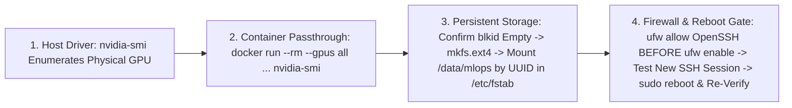
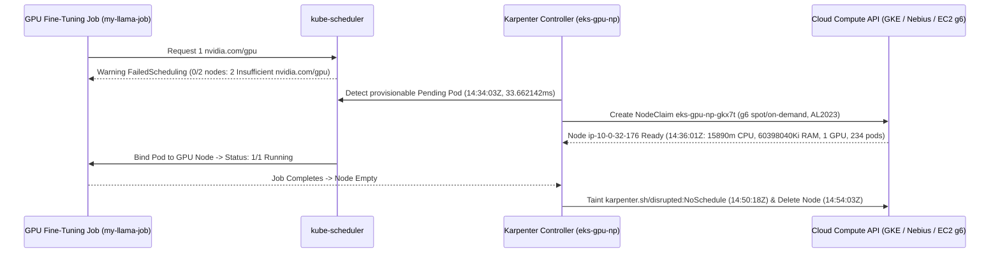

# 11.30 Lab: multi-node GPU Kubernetes on GKE and Nebius

| | |
|---|---|
| Level | Advanced |
| Priority tier | 1 |
| Lab venue | Nebius GPU / GCP GKE (plus local Python 3 verification lab) |
| Part | Part 11: GPUs on Kubernetes, scheduling and virtualization |
| Sources used | Packt, *Kubernetes for Generative AI Solutions* (`kubernetes-for-generative-ai-solutions`, 2025, Ch. 3, Ch. 6, Ch. 8); `nvidia-zero-to-hero/volume-25/labs/lab-01-provision-a-gpu-node-and-verify-the-stack.md`; `nvidia-zero-to-hero/volume-10/labs/lab-01-inspect-a-kubernetes-gpu-node.md`; `nvidia-zero-to-hero/volume-10/labs/lab-02-install-and-validate-gpu-operator.md` |
| Coverage file | `planning/coverage/chapters/11-30.md` |

## Why this matters for AI infrastructure

Throughout Part 11 (`Chapters 11.1` through `11.29`), we built the complete architecture of GPU-enabled Kubernetes from the kernel driver and Container Device Interface (`CDI`) up to the **NVIDIA GPU Operator**, **Network Operator**, **KAI Scheduler**, **MIG**, **Time-Slicing**, **vGPU**, **KubeVirt/Kata**, and **BlueField DPUs**. In this Part 11 Capstone Lab, we bring all of those layers together into an end-to-end **multi-node GPU cloud deployment and verification workflow** across **Nebius GPU (`L40S` / `H100`)**, **Google Kubernetes Engine (`GKE`)**, and **Amazon EKS** (*Kubernetes for Generative AI Solutions* Chapters 3, 6, 8 and `volume-10/labs/lab-01..02`, `volume-25/labs/lab-01`):
- According to the 2023 *Kubernetes in the wild* report cited in *Kubernetes for Generative AI Solutions* Chapter 3, cloud-hosted Kubernetes clusters grew **`5x` as fast** as on-premises clusters—providing **`99.95%` control-plane SLAs** spread across **`3` Availability Zones (`AZs`)** and up to **`26 months` of extended version support** compared to the upstream community's **`12-month` support window** (`3` releases per year).
- Yet a freshly provisioned cloud GPU VM or managed Kubernetes node pool is **never production-ready merely because the instance state says `Running` or `helm upgrade --install` exited `0`** (`volume-25/labs/lab-01` and `volume-10/labs/lab-01..02`). A node can show `STATUS Ready` and `CAPACITY: 8` while `ALLOCATABLE: 0` (`gpu-node-11` in `volume-10/labs/lab-01`), or `nvidia-smi` can succeed on the host while container GPU passthrough fails with `could not select device driver "" with capabilities: [[gpu]]` (`volume-25/labs/lab-01`).

This capstone chapter walks step by step through **four operational phases**:
1. **Phase 1 — 4-Layer Nebius GPU VM Stack Verification (`volume-25/labs/lab-01`):** Proving host driver, container GPU passthrough (`nvidia-ctk`), `UUID=` persistent block storage (`/data/mlops`), and non-lockout `ufw` firewall rules across a reboot.
2. **Phase 2 — Multi-Node Cloud Kubernetes Provisioning & GPU Operator Validation (`K8GS` Ch. 3 & `volume-10/labs/lab-01..02`):** Provisioning multi-node GPU clusters with Terraform IaC (`vpc` `10.0.0.0/16` `23` resources + `eks` `1.32` `33` resources / GKE / Nebius MK8s), auditing `Capacity` vs `Allocatable` (`gpu-node-07` `8/8` vs `gpu-node-11` `8/0`), and validating the GPU Operator (`DESIRED 3 / READY 3 / AVAILABLE 3`, `GPU_NODE_VALIDATED`, and `GPU_OPERATOR_VALIDATED`).
3. **Phase 3 — Multi-Dimensional GenAI Autoscaling (`K8GS` Ch. 6):** Combining **HPA**, **VPA**, **KEDA** (`ScaledObject` scaling on `http_requests_total > 10` and `DCGM_FI_DEV_GPU_UTIL > 70`), and **Karpenter** (`NodePool` `eks-gpu-np` launching right-sized GPU nodes in `~2 minutes` and consolidating idle nodes via `karpenter.sh/disrupted:NoSchedule`).
4. **Phase 4 — Cloud AI Networking Optimization (`K8GS` Ch. 8):** Native vs overlay CNI, IP-mode load balancing (`aws-load-balancer-nlb-target-type: ip` + `/healthz`), multi-tier **NetworkPolicies** (`TCP/80` & Qdrant `TCP/6333`), **Service Mesh (`Istio` / `Ambient Mesh` eBPF)**, **`kube-proxy` `IPVS` mode**, **CoreDNS autoscaling + `NodeLocal DNSCache`**, and **Placement Groups (`Cluster`, `Partition`, `Spread`) + RDMA (`EFA` / GPUDirect)**.

## Prerequisites and outcomes

### Prerequisites
- Completion of Chapters 11.1–11.29.
- Familiarity with `kubectl`, `helm`, `terraform`, `docker`, and `nvidia-smi`.

### Outcomes
After completing this chapter, you will be able to:
- Execute the **4-Layer Nebius L40S / Cloud GPU VM Provisioning Audit (`volume-25/labs/lab-01`)** (`nvidia-smi` -> `docker run --rm --gpus all` / `nvidia-ctk runtime configure` -> `blkid` empty check + `UUID=` `/etc/fstab` `/data/mlops` mount -> `ufw allow OpenSSH` verified from a brand-new SSH session and across `sudo reboot`).
- Provision and inspect a **Multi-Node Cloud Kubernetes GPU Cluster (`K8GS` Ch. 3 & `volume-10/labs/lab-01..02`)**, distinguishing `gpu-node-07` (`CAPACITY 8 / ALLOCATABLE 8`) from `gpu-node-11` (`CAPACITY 8 / ALLOCATABLE 0`), matching host `Bus-Id 00000000:1B:00.0` and `UUID GPU-3a1e9f2b-...` (`NVIDIA-SMI 550.90.07`, `4MiB / 81920MiB`) inside `gpu-node-validation` (`GPU_NODE_VALIDATED`), and validating `helm upgrade --install gpu-operator --timeout 15m` (`GPU_OPERATOR_VALIDATED`).
- Configure **GenAI Pod and Node Autoscaling (`K8GS` Ch. 6)** across **HPA** (`1..5` replicas at `70%` CPU, `180s` scaleDown window `50%/15s`, `0s` scaleUp `2 pods/15s`), **VPA** (`Off`, `Auto`, `Recreate`, `Initial`, `1000m`/`2Gi` to `2000m`/`4Gi`), **KEDA** (`amazonsqs-scaler` `0..10` replicas and `my-llama-deployment-scaler` on `http_requests_total > 10` and `DCGM_FI_DEV_GPU_UTIL > 70`), and **Karpenter** (`eks-gpu-np` `WhenEmptyOrUnderutilized`).
- Optimize **Multi-Node GenAI Cloud Networking (`K8GS` Ch. 8)** using `aws-load-balancer-nlb-target-type: ip` + `/healthz`, Chatbot **NetworkPolicies** (`TCP/80` & Qdrant `TCP/6333`), **`kube-proxy` `IPVS` mode**, **VPC CNI custom networking / IPv6**, **CoreDNS `cluster-proportional-autoscaler` + `NodeLocal DNSCache`**, and **Cluster Placement Groups + RDMA (`EFA` / GPUDirect / InfiniBand)**.

## Concepts: basics to intermediate to advanced

### 1. Basics: Phase 1 (Nebius GPU VM 4-layer stack verification, `volume-25/labs/lab-01`) and Phase 2 (Multi-node GPU Kubernetes baseline, `volume-10/labs/lab-01..02`)

#### 1. Phase 1: Proving All Four Layers on a Nebius L40S / Cloud GPU VM (`volume-25/labs/lab-01`)
Before joining GPU worker nodes to a Kubernetes cluster or running a training pipeline on a Nebius `L40S` / `H100` VM, `volume-25/labs/lab-01` ("Lab 01 — Provision a GPU Node and Verify the Stack") mandates verifying **four independent layers** in strict order:



Why must each layer be proven separately (`volume-25/labs/lab-01`)?
1. **Layer 1 (Host Driver):** Running `nvidia-smi` on the host proves `nvidia.ko` is loaded and can talk to the GPU over PCIe. If it prints `NVIDIA-SMI has failed because it couldn't communicate with the NVIDIA driver`, stop and fix the kernel/driver match.
2. **Layer 2 (Container GPU Passthrough):** A passing host `nvidia-smi` says **nothing** about whether containers can see the GPU. Run `sudo docker run --rm --gpus all nvidia/cuda:12.4.1-base-ubuntu22.04 nvidia-smi`. If it fails with `could not select device driver "" with capabilities: [[gpu]]`, the toolkit is not wired into the runtime—fix it via:
   `sudo nvidia-ctk runtime configure --runtime=docker && sudo systemctl restart docker`
   *(Note from `volume-25/labs/lab-01` Section 11: Stopping `docker` entirely produces a `Cannot connect to the Docker daemon` error, which is distinct from the toolkit `capabilities: [[gpu]]` misconfiguration error.)*
3. **Layer 3 (Persistent Block Storage by `UUID`):** Inspect attached disks with `lsblk -d -o NAME,SIZE,TYPE` and run **`sudo blkid /dev/vdX` first**—confirming `blkid` returns **empty output** so you never overwrite an existing filesystem with `mkfs.ext4`. Format (`sudo mkfs.ext4 -F /dev/vdX`), mount at `/data/mlops`, and register the volume in `/etc/fstab` using **`UUID=$UUID /data/mlops ext4 defaults 0 2`** (never a raw `/dev/vdX` device name, which can shift across reboots).
4. **Layer 4 (Firewall Without Self-Lockout + Reboot Proof):** Run **`sudo ufw allow OpenSSH` first** (or `ufw allow 2222/tcp` if SSH uses a non-default port) *before* `sudo ufw --force enable`. Because `ufw enable` does not kill your existing SSH connection, **always test from a brand-new SSH terminal before closing your original session**, then run `sudo reboot` and re-verify all four checks to prove boot persistence.

#### 2. Phase 2: Inspecting a Multi-Node Kubernetes GPU Cluster and Validating the GPU Operator (`volume-10/labs/lab-01..02`)
Once your multi-node Kubernetes cluster is up (on Nebius Managed Kubernetes, GKE, or EKS), `volume-10/labs/lab-01` and `lab-02` establish the **layered Kubernetes GPU baseline**:

| Inspection Step (`volume-10/labs/lab-01` & `02`) | Command Executed | Captured Baseline Evidence | Operational Meaning & Trap Caught |
|---|---|---|---|
| **1. Cluster Context & Node Readiness** | `kubectl config current-context` & `kubectl get nodes -o wide` | Context `gpu-staging-us-east-1`; `cpu-node-01`, `gpu-node-07`, `gpu-node-11` all `Ready` (`v1.29.4`, `Ubuntu 22.04.4 LTS`, kernel `5.15.0-1053-aws`) | Prevents mutating prod by mistake; `STATUS Ready` only proves `kubelet` is alive, **not** that GPUs are schedulable. |
| **2. `Capacity` vs `Allocatable` Audit** | `kubectl get nodes -o custom-columns=NAME:.metadata.name,CAPACITY:.status.capacity.nvidia\.com/gpu,ALLOCATABLE:.status.allocatable.nvidia\.com/gpu` | `gpu-node-07`: **`CAPACITY 8 / ALLOCATABLE 8`**<br/>`gpu-node-11`: **`CAPACITY 8 / ALLOCATABLE 0`** | `gpu-node-07` is healthy; `gpu-node-11` (`8 / 0`) catches a crashed device plugin, driver reload, or GPU reset in progress. |
| **3. Taints & 5 GPU Operands** | `kubectl describe node gpu-node-07` & `kubectl get pods -A -o wide \| grep -Ei 'nvidia\|gpu-feature\|node-feature\|dcgm'` | Taint `nvidia.com/gpu=present:NoSchedule`; `5` pods `1/1 Running` in `gpu-operator` (`driver`, `toolkit`, `device-plugin`, `gfd`, `dcgm-exporter`) | Explains why Pods without the matching toleration stay `Pending`; `1/1 Running` on DaemonSets still requires host & pod verification. |
| **4. Host Ground-Truth & Containerd Config** | `nvidia-smi`, `nvidia-smi -L`, `nvidia-smi topo -m`, `sudo crictl info` | `NVIDIA-SMI 550.90.07`, `CUDA 12.4`, `NVIDIA A100-SXM4-80GB`, `34C`, `62W / 400W`, `4MiB / 81920MiB`, `Bus-Id 00000000:1B:00.0`, `UUID GPU-3a1e9f2b-6c7d-4e91-9a02-1f8b7c0d5e11`, `CPU Affinity 0-31`, `NUMA 0`; `io.containerd.runc.v2`, `pause:3.9`, `default_runtime_name = "nvidia"` | Captures the exact physical `Bus-Id` and `UUID` join keys to match inside the validation container. |
| **5. Bounded Validation Pod (`Lab 01` & `Lab 02`)** | Apply `gpu-node-validation` (`Pending 1s -> ContainerCreating 3s -> Running 9s -> Completed 11s`) & `gpu-operator-validation` (`--timeout 15m` Helm install, `DESIRED 3 / READY 3 / AVAILABLE 3`, `ALLOCATABLE: 4`) | In-container `kubectl logs` prints `NVIDIA-SMI 550.90.07`, `Bus-Id 00000000:1B:00.0` (or `00000000:07:00.0`), and **`GPU_NODE_VALIDATED`** / **`GPU_OPERATOR_VALIDATED`** | Proves the entire `Driver -> Toolkit -> Device Plugin -> Kubelet -> Scheduler -> Container` chain works end-to-end. |
| **6. Safe Over-Request Failure Exercise** | Request `nvidia.com/gpu: 99` (Lab 01) or `8` on a `4`-GPU pool (Lab 02) | `Warning FailedScheduling: 0/3 nodes are available: 1 Insufficient nvidia.com/gpu` (or `3 Insufficient nvidia.com/gpu`) | Proves `kube-scheduler` enforces extended-resource capacity bounds before reaching `ContainerCreating`. |

---

### 2. Intermediate: Phase 3 — Provisioning with Terraform IaC (`K8GS` Ch. 3) and autoscaling GenAI with HPA, VPA, KEDA, and Karpenter (`K8GS` Ch. 6)

#### 1. Cloud Kubernetes Lifecycle and Terraform IaC (`K8GS` Chapter 3)
As *Kubernetes for Generative AI Solutions* Chapter 3 details, cloud providers (`Amazon EKS`, `GKE Standard/Enterprise`, `AKS`, and `Nebius Managed Kubernetes`) offload control-plane HA (`3` AZs, `99.95%` SLA) and extend Kubernetes version support from **`12 months` (community support across `3` releases/year) up to `26 months`**. To make multi-node cluster provisioning repeatable across environments, `K8GS` Chapter 3 codifies the stack in **Terraform (`>= 1.11`, `aws >= 5.96`, `helm >= 2.17`, `kubernetes >= 2.36`)** using three modular layers:
1. **Network Module (`terraform-aws-modules/vpc/aws ~> 5.21`):** Creates a `10.0.0.0/16` VPC across `3` AZs (`us-west-2`), private/public subnets (`cidrsubnet`), and NAT gateway (`23` resources added), tagging private subnets with `"karpenter.sh/discovery" = local.name`.
2. **Cluster Module (`terraform-aws-modules/eks/aws ~> 20.36`):** Deploys Kubernetes `1.32` (`33` resources added) with four data-plane choices (**Self-managed nodes**, **Managed node groups** `eks-mng` with `desired_size = 2`, `max_size = 3` across flexible `m5.large`/`m6i.large`/`m6a.large`/`m7i.large`/`m7a.large` instances, **AWS Fargate** serverless microVMs, and **Karpenter**).
3. **Add-ons & Model Serving (`aws-ia/eks-blueprints-addons/aws ~> 1.21`):** Deploys the Load Balancer Controller and Karpenter (`2` worker nodes and `10` system pods running), pushes the `my-llama` container image to ECR, and exposes `my-llama` (`containerPort: 5000`) via an external LoadBalancer Service on `port: 80` (`POST http://$NLB_URL/predict`).

#### 2. Pod-Level Autoscaling: `HPA`, `VPA`, and Event-Driven `KEDA` (`K8GS` Chapter 6)
Scaling GenAI applications requires choosing the right signal (**Conventional metrics** like CPU/Memory—noting that exceeding a container `memory` limit causes immediate CRI OOM termination whereas exceeding a `cpu` limit only throttles—versus **Custom metrics** like HTTP request rate, queue length, latency, error rate, concurrency, and **`DCGM_FI_DEV_GPU_UTIL`** exposed via `dcgm-exporter` and `prometheus-adapter`, `K8GS` Chapter 6):
1. **HorizontalPodAutoscaler (`HPA`, `autoscaling/v2`):** Adjusts Pod replica count (`chatbot-ui-hpa`: `minReplicas: 1`, `maxReplicas: 5`, target CPU `averageUtilization: 70`, or `ContainerResource` `60%` for multi-container sidecar pods). To prevent replica thrashing ("flapping"), configure explicit `behavior` windows (`K8GS` Ch. 6):
   - **`scaleDown`:** `stabilizationWindowSeconds: 180` (`3 minutes` cooldown), removing at most `50%` of replicas per `15-second` `periodSeconds`.
   - **`scaleUp`:** `stabilizationWindowSeconds: 0` (immediate reaction), adding up to `2` `Pods` per `15-second` `periodSeconds` (`selectPolicy: Max`).
2. **VerticalPodAutoscaler (`VPA`, `autoscaling.k8s.io/v1`):** Adjusts per-Pod CPU and memory `requests` and `limits` (`minAllowed: 1000m / 2Gi`, `maxAllowed: 2000m / 4Gi`, `controlledValues: "RequestsAndLimits"` or `"RequestsOnly"`) across four modes: **`Off`** (recommendations only), **`Auto`**, **`Recreate`**, and **`Initial`**. (**Crucial rule from `K8GS` Ch. 6:** Never combine `HPA` and `VPA` on the same CPU/memory metrics unless `VPA` `updateMode` is set to **`"Off"`**, because VPA resizing a Pod's requests mid-flight distorts the utilization percentage HPA uses to scale replica counts.)
3. **Kubernetes Event-Driven Autoscaler (`KEDA`, `keda.sh/v1alpha1` `ScaledObject`):** Extends HPA to scale deployments—**including scaling down to zero (`minReplicaCount: 0`)**—based on external event triggers (`pollingInterval: 15`, `cooldownPeriod: 180`, `maxReplicaCount: 10`, `queueLength: "10"` on Amazon SQS). For LLM inference (`my-llama-deployment-scaler` in `K8GS` Ch. 6), KEDA combines **two Prometheus triggers**:
   - **Trigger 1 (Request Rate):** `sum(rate(http_requests_total[1m]))` with `threshold: "10"`.
   - **Trigger 2 (GPU Utilization):** `avg(DCGM_FI_DEV_GPU_UTIL{pod=~"my-llama-.*"}[30s])` with `threshold: "70"`.

#### 3. Node-Level GPU Autoscaling: Cluster Autoscaler (`CA`) vs `Karpenter` (`K8GS` Chapter 6)
When KEDA or HPA adds a new GPU Pod and no existing node has free `nvidia.com/gpu` capacity, `kube-scheduler` marks the Pod `Pending` (`0/2 nodes are available: 2 Insufficient nvidia.com/gpu`). While the traditional **Cluster Autoscaler (`CA`)** polls predefined node groups (ASGs), **Karpenter** (introduced in `2021`, configured via **`NodePool`** and **`EC2NodeClass`** CRDs) watches unschedulable Pods directly in real time (`K8GS` Ch. 6):



---

### 3. Advanced: Phase 4 — Cloud networking best practices for multi-node GenAI on Kubernetes (`K8GS` Chapter 8)

To run both low-latency RAG/chatbot inference and high-bandwidth multi-node distributed training on a cloud Kubernetes cluster, *Kubernetes for Generative AI Solutions* Chapter 8 prescribes six networking optimizations:

| Networking Layer (`K8GS` Ch. 8) | Standard Default (Bottleneck / Risk) | Production GenAI Optimization (`K8GS` Ch. 8) | Why It Matters for Multi-Node AI |
|---|---|---|---|
| **1. CNI Mode (`Overlay` vs `Native`)** | Overlay tunnels (`VXLAN` / `Geneve`, e.g., Flannel) add encapsulation latency | **Native Routing CNI** (`Amazon VPC CNI`, `GKE Dataplane V2 / Cilium eBPF`) + **VPC CNI Custom Networking** (secondary non-routable CIDRs or **IPv6** to prevent VPC IPv4 exhaustion) | Eliminates tunnel encapsulation overhead and prevents large Pod fleets from exhausting primary subnet IPs. |
| **2. External Load Balancing (`NLB` Target Type & Health Checks)** | Default `LoadBalancer` routes `NLB -> NodePort -> kube-proxy iptables -> Pod` (extra hop) | Set **`service.beta.kubernetes.io/aws-load-balancer-nlb-target-type: ip`** and configure **`/healthz` (`HTTP 200 OK` only after GPU weights load)** | Routes NLB traffic directly to Pod IPs (skipping the `NodePort` hop) and prevents NLB from killing slow-starting LLM pods. |
| **3. L4/L7 Routing & Service Mesh (`Ingress`, `Gateway API`, `Istio`)** | Unencrypted internal HTTP with no L7 retries or A/B weight splitting | **Kubernetes Gateway API** + **Service Mesh** (`Istio` / `Linkerd` Envoy sidecars, or sidecarless **Istio Ambient Mesh** using eBPF for L7 traffic management & **mTLS**) | Enables canary/A-B model rollouts, circuit breaking, and end-to-end mTLS across GenAI microservices. |
| **4. Multi-Tier Zero-Trust `NetworkPolicies` (Figure 8.4)** | Default Kubernetes allows all Pods to talk to all Pods on any port | Enforce label-based **Ingress/Egress `NetworkPolicies`**: allow `chatbot-ui -> rag-app` & `my-llama-finetuned` only on **`TCP/80`**, allow `rag-app -> qdrant` vector DB only on **`TCP/6333`**, and explicitly permit **`CoreDNS` (`kube-system`) egress** | Stops lateral movement between UI, RAG, vector DB (`6333`), and LLM serving tiers without breaking internal DNS lookups. |
| **5. Service Routing & DNS (`kube-proxy IPVS` & `CoreDNS`)** | `kube-proxy` `iptables` mode (sequential rule scan) and fixed CoreDNS replica count | Enable **`kube-proxy` `IPVS` mode** (`mode: "ipvs"` in-memory hash table), **`cluster-proportional-autoscaler`** for CoreDNS, and **`NodeLocal DNSCache`** on every worker node | Gives `O(1)` Service routing and caches DNS locally on each node (avoiding `iptables` DNAT and `conntrack` drops). |
| **6. Multi-Node Placement & RDMA (`Placement Groups` & `EFA` / `GPUDirect`)** | Random AZ spread with high inter-node TCP latency | Launch GPU nodes in a **`Cluster` Placement Group** (`--strategy cluster`, vs `Partition` or `Spread`) and attach **RDMA interfaces** (`aws-efa-k8s-device-plugin` `vpc.amazonaws.com/efa.present: "true"`, GKE `GPUDirect-TCPX`/`RDMA`, or Nebius `InfiniBand`) | Minimizes physical switch hops and enables OS-bypass **RDMA + NCCL** collective synchronization across nodes. |

#### Part 11 End-to-End Verification Checklist: From Bare Metal and Cloud VMs to Production Multi-Tenant AI
Before declaring a multi-node GPU Kubernetes cluster on **Nebius**, **GKE**, **EKS**, or **on-premises bare metal** ready for production traffic, verify that your platform satisfies the complete **Part 11 Acceptance Matrix** across all 30 chapters:
1. **Host & Container Runtime Layer (`Chapters 11.1–11.5`, `11.21–11.22`, `volume-25/labs/lab-01`, `volume-10/labs/lab-01..02`):**
   - Host `nvidia-smi` enumerates all physical GPUs (`0` volatile uncorrectable ECC errors, `0` thermal/hardware slowdowns, `PIX`/`PXB` PCIe switch affinity in `nvidia-smi topo -m`).
   - Motherboard **IOMMU (`Intel VT-d` / `AMD-Vi`)** is active (`dmesg | grep -E "DMAR|IOMMU"`), and persistent scratch/dataset volumes (`/data/mlops`) are mounted by **`UUID=`** in `/etc/fstab`.
   - `containerd` (`default_runtime_name = "nvidia"`, CDI `/etc/cdi`) and **NVIDIA GPU Operator** DaemonSets report `DESIRED == READY == AVAILABLE` and `ClusterPolicy` `STATUS: ready`, with `GPU_NODE_VALIDATED` and `GPU_OPERATOR_VALIDATED` probes matching host `Bus-Id` and `UUID`.
2. **Scheduling, Gang Coordination & Network Fabric Layer (`Chapters 11.6–11.16`, `11.20`, `K8GS` Ch. 8):**
   - `kubelet` enforces `--topology-manager-policy=single-numa-node` and `--cpu-manager-policy=static` to eliminate `50%` cross-NUMA (`SYS`) UPI/xGMI penalties.
   - Multi-node training workloads (`JobSet`, `LeaderWorkerSet`, `PyTorchJob`, `MPIJob`) are scheduled as atomic **`PodGroups`** by **NVIDIA KAI Scheduler**, **Kueue + KAI/Volcano**, or **Apache YuniKorn**—never by pod-by-pod FIFO `kube-scheduler`.
   - Secondary RDMA networks (`Multus` + **NVIDIA Network Operator** `NicClusterPolicy` + `SR-IOV` / `RDMA` / `DRA` / `EFA` / `GPUDirect`) and **Cluster Placement Groups** (`--strategy cluster` / `COMPACT`) are validated with `all_reduce_perf` and monitored via `/sys/class/infiniband/.../hw_counters/packet_seq_err`.
3. **GPU Sharing, Virtualization & Zero-Trust Security Layer (`Chapters 11.17–11.19`, `11.23–11.29`, `volume-11`, `volume-18`, `volume-19`):**
   - Workloads are routed to explicit service classes (`Interactive sandbox` on `nvidia.com/gpu.shared` or KAI `gpu-fraction`/`gpu-memory`, `Protected inference` on hardware **MIG** `1g.10gb`/`3g.40gb`, `Large job` on **Dedicated Whole GPUs**, and `Regulated VM` on **NVIDIA vGPU / KubeVirt / Kata / Confidential VMs**).
   - Production namespaces block best-effort shared GPUs via `ResourceQuota` (`nvidia.com/gpu.shared: "0"`), bind cloud storage permissions via **OIDC `IRSA` / Workload Identity** (`medical-training-sa`), enforce **Default-Deny `NetworkPolicies`** (or **BlueField DPU** hardware firewalls), and run **4-Tier Thanos + Recording Rules**, **KEDA + Karpenter** autoscaling, **FinOps Zombie Reapers**, and **Forensic Incident Response** (*"Isolate, don't terminate"*).

## Commands and configurations that matter

### 1. Phase 1: Nebius L40S / Cloud GPU VM 4-Layer Verification Script (`volume-25/labs/lab-01`)

```bash
# 1. Layer 1 & 2: Verify host driver and Docker container GPU passthrough (untested here)
nvidia-smi
sudo docker run --rm --gpus all nvidia/cuda:12.4.1-base-ubuntu22.04 nvidia-smi

# If container GPU passthrough fails with capabilities: [[gpu]], wire nvidia-ctk and restart docker:
# sudo nvidia-ctk runtime configure --runtime=docker && sudo systemctl restart docker

# 2. Layer 3: Format and mount persistent block storage by UUID in /etc/fstab (untested here)
lsblk -d -o NAME,SIZE,TYPE
sudo blkid /dev/vdX   # MUST return empty output before running mkfs.ext4
sudo mkfs.ext4 -F /dev/vdX
sudo mkdir -p /data/mlops
sudo mount /dev/vdX /data/mlops
UUID=$(sudo blkid -s UUID -o value /dev/vdX)
echo "UUID=$UUID /data/mlops ext4 defaults 0 2" | sudo tee -a /etc/fstab

# 3. Layer 4: Allow OpenSSH BEFORE enabling UFW, then verify from a NEW SSH terminal & reboot (untested here)
sudo ufw allow OpenSSH
sudo ufw --force enable
sudo ufw status verbose
```

### 2. Phase 2: Provisioning GPU Node Pools on GKE and Nebius & Validating GPU Operator (`volume-10/labs/lab-02`)

```bash
# 1. Create a multi-node GPU pool on GKE (or Nebius mk8s node-group) with compact placement (untested here)
gcloud container node-pools create gke-gpu-pool \
  --cluster=ai-infra-cluster --zone=us-central1-a \
  --machine-type=g2-standard-48 --accelerator=type=nvidia-l4,count=4 \
  --num-nodes=3 --placement-type=COMPACT

# 2. Install pinned NVIDIA GPU Operator and verify operands + validation pod (volume-10/labs/lab-02, untested here)
helm repo add nvidia https://helm.ngc.nvidia.com/nvidia && helm repo update
helm upgrade --install gpu-operator nvidia/gpu-operator \
  --namespace gpu-operator --create-namespace \
  --version "$GPU_OPERATOR_VERSION" -f target-values.yaml \
  --wait --timeout 15m

kubectl get nodes -o custom-columns=NAME:.metadata.name,CAPACITY:.status.capacity.nvidia\.com/gpu,ALLOCATABLE:.status.allocatable.nvidia\.com/gpu
```

### 3. Phase 3 & 4: KEDA Dual-Trigger Autoscaler, Karpenter GPU `NodePool`, and Chatbot `NetworkPolicies` (`K8GS` Ch. 6 & Ch. 8)

```yaml
# keda-karpenter-and-netpol-genai.yaml (K8GS Ch. 6 & Ch. 8, untested here)
apiVersion: keda.sh/v1alpha1
kind: ScaledObject
metadata:
  name: my-llama-deployment-scaler
spec:
  scaleTargetRef:
    apiVersion: apps/v1
    kind: Deployment
    name: my-llama-deployment
  minReplicaCount: 1
  maxReplicaCount: 10
  triggers:
    - type: prometheus
      metadata:
        serverAddress: http://prometheus-server.default.svc:9090
        metricName: http_requests_total
        threshold: "10"
        query: sum(rate(http_requests_total[1m]))
    - type: prometheus
      metadata:
        serverAddress: http://prometheus-server.default.svc:9090
        metricName: DCGM_FI_DEV_GPU_UTIL
        threshold: "70"
        query: avg(DCGM_FI_DEV_GPU_UTIL{pod=~"my-llama-.*"}[30s])
---
apiVersion: karpenter.sh/v1
kind: NodePool
metadata:
  name: eks-gpu-np
spec:
  template:
    spec:
      nodeClassRef:
        group: karpenter.k8s.aws/v1
        kind: EC2NodeClass
        name: default-gpu
      requirements:
        - key: "karpenter.k8s.aws/instance-generation"
          operator: In
          values: ["g6"]
        - key: "karpenter.sh/capacity-type"
          operator: In
          values: ["spot", "on-demand"]
  disruption:
    consolidationPolicy: WhenEmptyOrUnderutilized
---
apiVersion: networking.k8s.io/v1
kind: NetworkPolicy
metadata:
  name: qdrant-vector-db-ingress
spec:
  podSelector:
    matchLabels:
      app.kubernetes.io/name: qdrant
  policyTypes:
    - Ingress
  ingress:
    - from:
        - podSelector:
            matchLabels:
              app.kubernetes.io/name: rag-app
      ports:
        - protocol: TCP
          port: 6333
```

## How it fails

| Failure mode | Exact symptom & command evidence | Root cause boundary | Remediation |
|---|---|---|---|
| **1. `nvidia-smi` works on the Nebius GPU host, but `docker run --gpus all` fails with `could not select device driver "" with capabilities: [[gpu]]` (`volume-25/labs/lab-01`)** | Step 1 host `nvidia-smi` prints the L40S table, but Step 2 container launch fails immediately before starting the container. | **Layer 2 Container Toolkit Not Wired into Runtime:** `nvidia-container-toolkit` is installed on the host, but `/etc/docker/daemon.json` (or `/etc/containerd/config.toml`) has not registered the `nvidia` runtime handler. | Run `sudo nvidia-ctk runtime configure --runtime=docker && sudo systemctl restart docker` (or `--runtime=containerd` + `systemctl restart containerd`) and re-run the container check. |
| **2. `kubectl get nodes` shows `gpu-node-11` `Ready` with `CAPACITY: 8`, but `ALLOCATABLE: 0` (`volume-10/labs/lab-01` Section 7)** | Pods requesting `nvidia.com/gpu: 1` stay `Pending` (`Insufficient nvidia.com/gpu`) even though `gpu-node-11` has `8` physical GPUs. | **Layer 3 Device Plugin / Driver Registration Loss:** `Capacity` reflects the last historical count reported to `kubelet`, while `Allocatable: 0` shows all GPUs are currently unhealthy or the device-plugin socket disconnected. | Do not schedule baseline workloads on `gpu-node-11`; inspect `nvidia-driver-daemonset` and `nvidia-device-plugin-daemonset` logs (`Lab 03` workflow) and check host `nvidia-smi` / `dmesg` for XIDs. |
| **3. `helm upgrade --install gpu-operator --wait --timeout 15m` times out with `nvidia-driver-daemonset` stuck `Pending` (`volume-10/labs/lab-02` Section 16)** | `kubectl get events -n gpu-operator` logs `0/3 nodes are available: 3 node(s) had taint {nvidia.com/gpu: NoSchedule}, that the pod didn't tolerate`. | **Values-File Toleration Mismatch:** The GPU nodes were tainted with a custom key/effect that was not added to `target-values.yaml` for the GPU Operator DaemonSets. | Do not re-run `helm upgrade` blindly; add the matching taint tolerations to `target-values.yaml` and re-apply the pinned Helm release. |
| **4. Enabling both `HPA` and `VPA` (`updateMode: "Auto"`) on `my-llama-deployment` causes continuous Pod evictions and replica oscillation (`K8GS` Ch. 6)** | Replica count oscillates wildly between `1` and `5` while `VPA` repeatedly evicts running inference pods to rewrite their CPU/memory `requests`. | **Simultaneous HPA + VPA Control-Loop Conflict (`K8GS` Ch. 6):** VPA mutating a Pod's `requests` changes the denominator of HPA's `averageUtilization` calculation, causing HPA and VPA to fight each other. | Set VPA `updateMode: "Off"` (using VPA strictly for right-sizing recommendations) whenever HPA or KEDA is actively scaling replica counts on CPU/memory metrics. |
| **5. Applying an Egress `NetworkPolicy` to `rag-app` breaks all internal Kubernetes Service lookups (`K8GS` Ch. 8)** | After locking down egress on `rag-app`, requests to `http://qdrant:6333` fail with `Could not resolve host: qdrant`. | **Blocked `UDP/TCP 53` Egress to `CoreDNS`:** A default-deny egress `NetworkPolicy` blocks DNS queries unless `kube-system` `CoreDNS` (and `NodeLocal DNSCache`) is explicitly permitted. | Add an egress rule allowing `UDP` and `TCP` port `53` to the `CoreDNS` pods in the `kube-system` namespace. |

## Hands-on lab

### Venue and scope
This capstone lab runs locally using Python 3 standard library (`code/part11/multi_node_gke_and_nebius.py` and `code/part11/multi_node_gke_and_nebius_lab.py`) to verify the `volume-25/labs/lab-01` 4-layer Nebius L40S VM provisioning state machine (`nvidia-smi` -> `nvidia-ctk` -> `blkid` empty gate + `UUID=` `/etc/fstab` `/data/mlops` -> `ufw allow OpenSSH` + reboot check), the `volume-10/labs/lab-01..02` multi-node Kubernetes GPU baseline (`gpu-node-07` `8/8` vs `gpu-node-11` `8/0`, `NVIDIA-SMI 550.90.07` `4MiB/81920MiB`, `GPU_NODE_VALIDATED`, and `GPU_OPERATOR_VALIDATED`), and the *Kubernetes for Generative AI Solutions* (`K8GS` Chapters 3, 6, and 8) Terraform IaC (`23` VPC + `33` EKS resources), KEDA (`http_requests_total > 10` & `DCGM_FI_DEV_GPU_UTIL > 70`), HPA/VPA conflict detector, Karpenter `NodePool` (`eks-gpu-np`), and GenAI networking optimizations (`nlb-target-type: ip`, `TCP/6333` Qdrant `NetworkPolicy`, `IPVS`, `NodeLocal DNSCache`, and `Cluster` Placement Groups + `EFA`). Cloud CLI commands are marked `(untested here)`.

### Step 1: Run the self-checking multi-node GPU Kubernetes capstone lab (tested here)

Run the lab script from the repository root:

```bash
python3 code/part11/multi_node_gke_and_nebius_lab.py
```

Captured output from this repository:
```text
=== Chapter 11.30 Lab: Multi-Node GPU Kubernetes on GKE, Nebius & EKS (K8GS) ===
  [PASS] Volume 25 Lab 01 defines 4 independent verification layers (Host Driver, Container GPU, UUID Storage, UFW Firewall)
  [PASS] Unconfigured nvidia-container-toolkit fails Step 2b with capabilities: [[gpu]] error and requires nvidia-ctk runtime configure
  [PASS] Non-empty blkid check on /dev/vdX aborts mkfs.ext4 at Step 3a to prevent overwriting existing data
  [PASS] Nebius L40S VM passing host nvidia-smi, docker --gpus all, UUID /etc/fstab /data/mlops mount, new-session UFW check, and reboot is ready
  [PASS] Volume 10 Lab 01 selects gpu-node-07 (CAPACITY 8 / ALLOCATABLE 8) and flags gpu-node-11 (CAPACITY 8 / ALLOCATABLE 0)
  [PASS] Volume 10 Lab 01 host baseline records NVIDIA-SMI 550.90.07 / CUDA 12.4 on NVIDIA A100-SXM4-80GB (34C, 62W/400W, 4MiB/81920MiB, Bus-Id 00000000:1B:00.0)
  [PASS] Volume 10 Lab 01 crictl info shows io.containerd.runc.v2 (pause:3.9) and default_runtime_name = 'nvidia'
  [PASS] Volume 10 Lab 01 gpu-node-validation transitions Pending (1s) -> ContainerCreating (3s) -> Running (9s) -> Completed (11s) and logs GPU_NODE_VALIDATED
  [PASS] Volume 10 Lab 01 safe failure test requesting nvidia.com/gpu: 99 emits FailedScheduling: 1 Insufficient nvidia.com/gpu
  [PASS] Volume 10 Lab 02 helm upgrade --install gpu-operator (--timeout 15m) verifies DESIRED 3 / READY 3 / AVAILABLE 3, ALLOCATABLE: 4, and GPU_OPERATOR_VALIDATED
  [PASS] K8GS Ch 3 reports 5x cloud K8s growth, 99.95% SLA across 3 AZs, and 3 releases/yr (12m community vs 26m extended support)
  [PASS] K8GS Ch 3 Terraform (>=1.11, aws >=5.96, helm >=2.17, kubernetes >=2.36) provisions VPC 10.0.0.0/16 (~>5.21, 23 resources) and EKS 1.32 (~>20.36, 33 resources)
  [PASS] K8GS Ch 3 deploys my-llama from ECR and exposes port 80 -> targetPort 5000 via AWS NLB (/predict)
  [PASS] K8GS Ch 6 HPA (chatbot-ui-hpa: 1..5 replicas, 70% CPU) sets scaleDown (180s window, 50%/15s), scaleUp (0s window, 2 pods/15s), and ContainerResource (60%)
  [PASS] K8GS Ch 6 VPA defines 4 modes (Off, Auto, Recreate, Initial) with minAllowed (1000m, 2Gi) and maxAllowed (2000m, 4Gi)
  [PASS] K8GS Ch 6 warns that combining HPA with VPA in Auto mode creates a scaling conflict (unless VPA is Off)
  [PASS] K8GS Ch 6 KEDA ScaledObject my-llama-deployment-scaler triggers scale-out when http_requests_total > 10 or DCGM_FI_DEV_GPU_UTIL > 70
  [PASS] K8GS Ch 6 KEDA amazonsqs-scaler (minReplicaCount: 0, maxReplicaCount: 10, pollingInterval: 15, cooldownPeriod: 180) scales from 0 when queueLength > 10
  [PASS] K8GS Ch 6 Karpenter NodePool (eks-gpu-np, g6 spot/on-demand, WhenEmptyOrUnderutilized, AL2023) launches node with 15890m CPU, 60398040Ki RAM, 1 GPU, 234 pods and taints karpenter.sh/disrupted:NoSchedule on cleanup
  [PASS] K8GS Ch 8 sets aws-load-balancer-nlb-target-type: ip (bypassing NodePort kube-proxy hop) with /healthz (HTTP 200 OK)
  [PASS] K8GS Ch 8 Chatbot NetworkPolicies restrict rag-app and my-llama-finetuned to TCP/80 from chatbot-ui, and qdrant to TCP/6333 from rag-app (+ CoreDNS egress)
  [PASS] K8GS Ch 8 contrasts Service Mesh (Layer 7 mTLS/retries via Envoy sidecars or sidecarless Istio Ambient Mesh eBPF) with NetworkPolicy (Layer 3/4)
  [PASS] K8GS Ch 8 enables kube-proxy IPVS mode (in-memory hash table) and mitigates IPv4 exhaustion via IPv6 or VPC CNI custom networking secondary CIDRs
  [PASS] K8GS Ch 8 optimizes DNS via CoreDNS cluster-proportional-autoscaler and NodeLocal DNSCache (avoiding iptables DNAT/conntrack)
  [PASS] K8GS Ch 8 defines 3 Placement Group strategies (Cluster, Partition, Spread) and integrates RDMA via EFA (aws-efa-k8s-device-plugin), GKE GPUDirect-TCPX/RDMA, and Nebius InfiniBand

Summary: 25 passed, 0 failed out of 25 checks.
```

### Exercises

1. **Exercise 1 — Nebius L40S 4-Layer VM Provisioning (`volume-25/labs/lab-01`):** Using `validate_nebius_gpu_vm_provisioning()` in `code/part11/multi_node_gke_and_nebius.py`, state why each of the four checks in `NEBIUS_FOUR_VERIFICATION_LAYERS` is independent, how to fix `could not select device driver "" with capabilities: [[gpu]]`, why `blkid` must return nothing before `mkfs.ext4`, and why `ufw` must be verified from a **new** SSH session and across a reboot.
2. **Exercise 2 — Multi-Node GPU Baseline Inspection (`volume-10/labs/lab-01`):** Explain why `gpu-node-07` (`CAPACITY 8 / ALLOCATABLE 8`) was chosen over `gpu-node-11` (`CAPACITY 8 / ALLOCATABLE 0`), how the host `Bus-Id` (`00000000:1B:00.0`) and `UUID` (`GPU-3a1e9f2b-...`) are verified inside `gpu-node-validation` (`GPU_NODE_VALIDATED`), and what `FailedScheduling` event is produced by the `nvidia.com/gpu: 99` safe failure test.
3. **Exercise 3 — Installing and Validating the GPU Operator (`volume-10/labs/lab-02`):** Trace the four evidence hops (`Helm -> Operator -> ClusterPolicy/Operands -> Node Allocatable -> GPU_OPERATOR_VALIDATED`) and explain why `STATUS: deployed` in `helm status` does not prove `nvidia.ko` loaded on the worker nodes.
4. **Exercise 4 — Autoscaling GenAI with HPA, VPA, and KEDA (`K8GS` Ch. 6):** Using `evaluate_keda_and_karpenter_autoscaling()`, state the four VPA modes (`VPA_FOUR_OPERATING_MODES`), explain why HPA and VPA conflict when VPA is in `Auto` mode, and explain how `my-llama-deployment-scaler` combines `http_requests_total` and `DCGM_FI_DEV_GPU_UTIL` triggers.
5. **Exercise 5 — Right-Sized GPU Node Provisioning with Karpenter (`K8GS` Ch. 6):** Trace the exact timeline and log events when `my-llama-job-plgb5` triggers Karpenter (`eks-gpu-np`, `WhenEmptyOrUnderutilized`, `AL2023`) to launch `ip-10-0-32-176` (`15890m` CPU, `60398040Ki` RAM, `nvidia.com/gpu: 1`, `234` pods) and later taint (`karpenter.sh/disrupted:NoSchedule`) and delete the empty GPU node.
6. **Exercise 6 — Multi-Node GenAI Networking Best Practices (`K8GS` Ch. 8):** Explain how `aws-load-balancer-nlb-target-type: ip`, `kube-proxy` `IPVS` mode, `NodeLocal DNSCache`, `Cluster` Placement Groups (`THREE_PLACEMENT_GROUP_STRATEGIES`), and `TCP/80` + `TCP/6333` `NetworkPolicies` optimize and secure a multi-node GenAI deployment.

## Checkpoint questions

<details>
<summary><strong>1. In Volume 25 Lab 01 (Provision a GPU Node and Verify the Stack on a Nebius L40S VM), what are the four layers that must be verified independently before running a training workload?</strong></summary>

1. **Host Driver (`nvidia-smi`):** Proves the kernel module is loaded and enumerates the physical GPU.
2. **Container GPU Passthrough (`sudo docker run --rm --gpus all ... nvidia-smi`):** Proves `nvidia-container-toolkit` is wired into the container runtime.
3. **Persistent Block Storage (`lsblk`, `blkid`, `mkfs.ext4`, `/data/mlops` mounted by `UUID=` in `/etc/fstab`):** Proves durable storage survives device-name reordering across reboots.
4. **Firewall Lockdown (`sudo ufw allow OpenSSH && sudo ufw --force enable`):** Proves only SSH is exposed and a **new** SSH session succeeds before and after `sudo reboot`.
</details>

<details>
<summary><strong>2. In Volume 25 Lab 01, how do you distinguish "Docker is stopped" from "nvidia-container-toolkit is not configured for Docker," and what command fixes the toolkit configuration?</strong></summary>

- If `docker` is stopped (`sudo systemctl stop docker`), running `docker run --gpus all` fails with a daemon connection-refused error.
- If `docker` is running but the toolkit is not wired into `/etc/docker/daemon.json`, it fails with **`could not select device driver "" with capabilities: [[gpu]]`**. Fix it by running:
  `sudo nvidia-ctk runtime configure --runtime=docker && sudo systemctl restart docker`
</details>

<details>
<summary><strong>3. Why must you check that sudo blkid /dev/vdX returns empty output before running mkfs.ext4, and why must /etc/fstab use UUID= rather than /dev/vdX (Volume 25 Lab 01)?</strong></summary>

- If `blkid` returns an existing UUID/filesystem type, the attached block volume already contains data—running `mkfs.ext4` would destroy it.
- Linux block device names (`/dev/vda`, `/dev/vdb`) can change enumeration order across kernel updates or volume attachments; mounting by **`UUID=$UUID`** in `/etc/fstab` guarantees the right disk mounts at `/data/mlops` after every reboot.
</details>

<details>
<summary><strong>4. Why must you verify a ufw firewall change from a brand-new SSH terminal before closing your current session (Volume 25 Lab 01)?</strong></summary>

Because `sudo ufw --force enable` does not retroactively terminate your already-established SSH connection. If `sudo ufw allow OpenSSH` was omitted or misconfigured for a non-default SSH port, you will only discover you are locked out when you open a **new** SSH connection (requiring serial console rescue if your original session was closed).
</details>

<details>
<summary><strong>5. In Volume 10 Lab 01 (Inspect a Kubernetes GPU Node), what is the difference between gpu-node-07 (CAPACITY 8 / ALLOCATABLE 8) and gpu-node-11 (CAPACITY 8 / ALLOCATABLE 0)?</strong></summary>

`CAPACITY 8` is the historical total GPU count reported by `kubelet`, while `ALLOCATABLE` is what the scheduler can actually assign right now. `gpu-node-07` (`8 / 8`) has `8` healthy, schedulable GPUs, whereas `gpu-node-11` (`8 / 0`) has lost all schedulable GPUs due to a driver reload, device-plugin crash, or GPU health/reset event.
</details>

<details>
<summary><strong>6. In Volume 10 Lab 01 Section 10 and 12, how do you prove that the physical GPU enumerated on the host is the exact same GPU injected into the gpu-node-validation container?</strong></summary>

Compare the **`Bus-Id` (`00000000:1B:00.0`)** and **`UUID` (`GPU-3a1e9f2b-6c7d-4e91-9a02-1f8b7c0d5e11`)** from host `nvidia-smi` / `nvidia-smi -L` (`NVIDIA-SMI 550.90.07`, `CUDA Version: 12.4`, `NVIDIA A100-SXM4-80GB`, `4MiB / 81920MiB`) against the banner inside `kubectl logs gpu-node-validation` followed by **`GPU_NODE_VALIDATED`**.
</details>

<details>
<summary><strong>7. In Volume 10 Lab 01, how do the Kubernetes events for a container runtime injection failure differ from an unsatisfiable resource request (nvidia.com/gpu: 99)?</strong></summary>

- An unsatisfiable request (`nvidia.com/gpu: 99`) never binds to a node: `kubectl describe pod` records `Warning FailedScheduling: 0/3 nodes are available: 1 Insufficient nvidia.com/gpu` and the Pod stays in `Pending`.
- A runtime injection failure passes `Scheduled` (the Pod binds to the node) and stalls or fails in **`ContainerCreating`** (`CreateContainerError`) or exits non-zero inside the container.
</details>

<details>
<summary><strong>8. In Volume 10 Lab 02 (Install and Validate GPU Operator), why is helm status showing STATUS: deployed insufficient proof of a working GPU cluster, and what four checks complete the evidence chain?</strong></summary>

`STATUS: deployed` only means Helm submitted the chart manifests to the API server. You must verify:
1. `kubectl get clusterpolicy` shows `STATUS: ready`.
2. `kubectl get daemonsets -n gpu-operator` shows `DESIRED = READY = AVAILABLE` (`3 / 3 / 3`) for `nvidia-driver-daemonset` and `nvidia-device-plugin-daemonset` (and `nvidia-cuda-validator` `0/1 Completed`).
3. `kubectl get nodes` shows numeric `ALLOCATABLE` (`4`) and GFD labels (`nvidia.com/gpu.count=4`, `nvidia.com/gpu.product=NVIDIA-A100-80GB`, `nvidia.com/gpu.memory=81920`).
4. `kubectl logs gpu-operator-validation` prints the `nvidia-smi` table and **`GPU_OPERATOR_VALIDATED`**.
</details>

<details>
<summary><strong>9. According to Kubernetes for Generative AI Solutions Chapter 3, what uptime SLA and extended version support window do managed cloud Kubernetes offerings provide compared to upstream community support?</strong></summary>

Managed cloud Kubernetes services (such as Amazon EKS across `3` AZs, GKE, and AKS) provide a **`99.95%` control-plane uptime SLA** and up to **`26 months` of extended version support**, compared to the upstream Kubernetes community's **`12-month` support window** (with new minor versions released approximately `3` times per year).
</details>

<details>
<summary><strong>10. Compare the four worker node data-plane options in Kubernetes for Generative AI Solutions Chapter 3 (Self-managed nodes, Managed node groups, AWS Fargate, and Karpenter).</strong></summary>

- **Self-managed nodes:** User manually provisions, bootstraps, and patches VMs; maximum control but highest operational overhead.
- **Managed node groups (`eks-mng` / GKE node pools):** Cloud provider automates VM provisioning, AMI patching, and Auto Scaling Group (`ASG`) lifecycle.
- **AWS Fargate:** Serverless container execution with a dedicated kernel per Pod and zero node management (typically for CPU microservices rather than multi-GPU RDMA jobs).
- **Karpenter:** High-performance, group-less Kubernetes node autoscaler that watches unschedulable Pods directly and provisions right-sized GPU/CPU instances in real time.
</details>

<details>
<summary><strong>11. In Kubernetes for Generative AI Solutions Chapter 6, how does container memory limit enforcement differ from CPU limit enforcement in the CRI, and why is memory usually a poor HPA scaling metric?</strong></summary>

When a container exceeds its **CPU limit**, the Linux kernel CFS scheduler simply **throttles (slows down)** the process. When a container exceeds its **memory limit**, the container runtime (`CRI` / Linux OOM killer) **immediately terminates (`OOMKills`)** the container, and many runtimes (including Python/JVM/PyTorch caching allocators) hold reserved memory without releasing it to the OS when load drops.
</details>

<details>
<summary><strong>12. How do the scaleDown and scaleUp behavior policies in Kubernetes for Generative AI Solutions Chapter 6 prevent HPA replica flapping?</strong></summary>

- **`scaleDown`:** Sets `stabilizationWindowSeconds: 180` (waits `3 minutes` after load drops before scaling in) and `policies: [{type: Percent, value: 50, periodSeconds: 15}]` (removes at most `50%` of replicas per `15 seconds`).
- **`scaleUp`:** Sets `stabilizationWindowSeconds: 0` (scales out immediately on traffic spikes) and `policies: [{type: Pods, value: 2, periodSeconds: 15}]` with `selectPolicy: Max` (adds up to `2` Pods every `15 seconds`).
</details>

<details>
<summary><strong>13. What are the four operating modes of the VerticalPodAutoscaler (VPA), and why should you not run HPA and VPA (in Auto mode) simultaneously on the same CPU/memory metrics (K8GS Chapter 6)?</strong></summary>

- **Four VPA modes:** `Off` (recommendations only), `Auto` (updates requests and restarts/evicts Pods), `Recreate` (evicts existing Pods to apply updates), and `Initial` (applies recommendations only at Pod creation).
- **Why HPA and VPA conflict:** VPA adjusts a Pod's CPU/memory `requests`, which changes the denominator used by HPA to compute `averageUtilization %`, causing the two controllers to fight each other unless VPA is set to **`Off`** (or HPA scales strictly on external custom metrics like RPS/GPU util).
</details>

<details>
<summary><strong>14. How does the KEDA ScaledObject my-llama-deployment-scaler in Kubernetes for Generative AI Solutions Chapter 6 autoscale an LLM inference Deployment?</strong></summary>

It configures two Prometheus triggers scraped from the application endpoint and `dcgm-exporter`:
1. **`http_requests_total`:** Scales out when `sum(rate(http_requests_total[1m]))` exceeds `threshold: "10"`.
2. **`DCGM_FI_DEV_GPU_UTIL`:** Scales out when `avg(DCGM_FI_DEV_GPU_UTIL{pod=~"my-llama-.*"}[30s])` exceeds `threshold: "70"` (and KEDA also supports `minReplicaCount: 0` scale-to-zero on queue triggers like `aws-sqs-queue`).
</details>

<details>
<summary><strong>15. In Kubernetes for Generative AI Solutions Chapter 6, how does Karpenter improve upon the traditional Kubernetes Cluster Autoscaler (CA), and what two CRDs configure Karpenter?</strong></summary>

Unlike `CA` (which polls predefined node groups/ASGs), **Karpenter** watches unschedulable Pending Pods directly at the API server (`found provisionable pod(s)` in `33.662142ms`), selects the optimal instance family/size across `spot` and `on-demand`, launches a right-sized node (`ip-10-0-32-176` with `nvidia.com/gpu: 1` in `~2 minutes`), and consolidates/terminates empty or underutilized nodes automatically (`WhenEmptyOrUnderutilized`, tainting with `karpenter.sh/disrupted:NoSchedule`). It is configured via **`NodePool`** (`karpenter.sh/v1`) and **`EC2NodeClass`** (`karpenter.k8s.aws/v1`).
</details>

<details>
<summary><strong>16. Why should a Kubernetes LoadBalancer Service for a GenAI model use service.beta.kubernetes.io/aws-load-balancer-nlb-target-type: ip and a /healthz endpoint (K8GS Chapter 8)?</strong></summary>

- **`aws-load-balancer-nlb-target-type: ip`:** Registers Pod IP addresses directly as NLB targets, bypassing the extra `NodePort -> kube-proxy` network hop between worker nodes.
- **`/healthz` (`HTTP 200 OK`):** Because large GenAI models take time to load weights into GPU VRAM at startup, an explicit `/healthz` readiness/health check ensures the load balancer only routes user prompts to Pods whose GPU model initialization is complete.
</details>

<details>
<summary><strong>17. In the 4-component e-commerce GenAI chatbot architecture of K8GS Chapter 8 Figure 8.4 (chatbot-ui, rag-app, qdrant vector DB, and my-llama-finetuned), what exact ports and Pod labels do the NetworkPolicies enforce?</strong></summary>

- **`rag-app` and `my-llama-finetuned` Ingress:** Allow `TCP` port **`80`** only from Pods matching `app.kubernetes.io/name: chatbot-ui`.
- **`qdrant` Vector Database Ingress:** Allow `TCP` port **`6333`** only from Pods matching `app.kubernetes.io/name: rag-app`.
- **Egress:** When egress policies are enabled, explicitly allow DNS traffic (`port 53`) to `CoreDNS` in `kube-system`.
</details>

<details>
<summary><strong>18. Compare a Service Mesh (Istio / Linkerd / Ambient Mesh) with Kubernetes NetworkPolicies across OSI layer, mTLS, and traffic management (K8GS Chapter 8).</strong></summary>

- **Kubernetes `NetworkPolicies`:** Operate at **OSI Layers 3 and 4** (IP and TCP/UDP port); native to Kubernetes (enforced by CNI without sidecars), focused on namespace/pod traffic isolation; **no mTLS** or L7 retries.
- **Service Mesh (`Istio` / `Linkerd` / `Ambient Mesh`):** Operates primarily at **OSI Layer 7** (HTTP/gRPC application layer); provides **mutual TLS (`mTLS`)**, L7 load balancing, retries, circuit breaking, and observability using Envoy sidecar proxies—or sidecarless eBPF in **Istio Ambient Mesh**.
</details>

<details>
<summary><strong>19. Why should large GenAI Kubernetes clusters switch kube-proxy from iptables mode to IPVS mode, and how do VPC CNI Custom Networking, cluster-proportional-autoscaler, and NodeLocal DNSCache solve scale bottlenecks (K8GS Chapter 8)?</strong></summary>

- **`kube-proxy` `IPVS` mode (`mode: "ipvs"`):** Uses an **in-memory hash table** (`O(1)` lookup) in the Linux kernel instead of sequential `iptables` rule lists, supporting round-robin, least-connections, and source-hashing at low latency.
- **VPC CNI Custom Networking (or `IPv6`):** Allocates Pod IPs from secondary non-routable VPC CIDR blocks so large Pod fleets do not exhaust the primary VPC IPv4 subnet.
- **`cluster-proportional-autoscaler` + `NodeLocal DNSCache`:** Scales `CoreDNS` replicas proportionally to cluster nodes/cores and runs a local DNS cache on every worker node, avoiding `iptables` DNAT and connection-tracking (`conntrack`) bottlenecks.
</details>

<details>
<summary><strong>20. Compare the three cloud Placement Group strategies (Cluster, Partition, Spread) and explain how EFA / GPUDirect RDMA accelerates multi-node GenAI training on Kubernetes (K8GS Chapter 8).</strong></summary>

- **Placement Group Strategies:**
  1. **`Cluster` (`--strategy cluster` / GKE `COMPACT`):** Packs instances physically close together in a single AZ for minimum network latency and maximum east-west bandwidth (ideal for synchronous multi-node GPU training).
  2. **`Partition`:** Spreads instance groups across distinct hardware partitions/racks (ideal for Hadoop/Cassandra/Kafka).
  3. **`Spread`:** Places a small set of critical instances on separate hardware racks to minimize correlated failures.
- **RDMA Integration (`EFA` / `GPUDirect` / `InfiniBand`):** Deploying `aws-efa-k8s-device-plugin` (`enable_efa_support = true`, `vpc.amazonaws.com/efa.present = "true"`), GKE `GPUDirect-TCPX`/`RDMA`, or Nebius InfiniBand exposes OS-bypass **RDMA** interfaces directly to **NCCL** inside Kubernetes training Pods for ultra-low-latency inter-GPU collective operations.
</details>

## Sources and review notes

### Primary sources read in full for this chapter
- Book sources from the local TOON-RAG corpus (mapped in `brief.py 11.30` as `K8GS`):
  - Packt, *Kubernetes for Generative AI Solutions* (`kubernetes-for-generative-ai-solutions`, 2025):
    - Chapter 3 (*Getting Started with Kubernetes in the Cloud*, `/tmp/k8gs_ch3.txt`: Dynatrace `5x` cloud K8s growth, `99.95%` SLA across `3` AZs, `3` releases/yr with `12m` community vs `26m` cloud extended support, Terraform `>= 1.11` / `aws >= 5.96` / `helm >= 2.17` / `kubernetes >= 2.36`, `vpc` `10.0.0.0/16` `~> 5.21` `23` resources, `eks` `1.32` `~> 20.36` `33` resources, `eks_blueprints_addons` `~> 1.21` `2` nodes & `10` pods, and `my-llama` NLB `port 80 -> 5000` `/predict`).
    - Chapter 6 (*Scaling GenAI Applications on Kubernetes*, `/tmp/k8gs_ch6.txt`: Conventional vs custom metrics, `chatbot-ui-hpa` `1..5` replicas at `70%` CPU with `180s` scaleDown `50%/15s` and `0s` scaleUp `2 pods/15s` + `ContainerResource` `60%`, `chatbot-ui-vpa` `Off`/`Auto`/`Recreate`/`Initial` `1000m`/`2Gi`..`2000m`/`4Gi` and HPA+VPA conflict, KEDA `amazonsqs-scaler` `0..10` & `my-llama-deployment-scaler` `http_requests_total > 10` and `DCGM_FI_DEV_GPU_UTIL > 70`, and Cluster Autoscaler vs Karpenter `eks-gpu-np` `g6` `WhenEmptyOrUnderutilized` `AL2023` `ip-10-0-32-176` `15890m` CPU / `60398040Ki` RAM / `1` GPU / `234` pods / `karpenter.sh/disrupted:NoSchedule`).
    - Chapter 8 (*Networking Best Practices for Deploying GenAI on K8s*, `/tmp/k8gs_ch8.txt`: Native vs overlay CNI, `aws-load-balancer-nlb-target-type: ip` + `/healthz`, Ingress vs Gateway API, Service Mesh Envoy sidecars vs Istio Ambient Mesh eBPF, Chatbot `NetworkPolicies` on `TCP/80` and Qdrant `TCP/6333` + CoreDNS egress, `kube-proxy` `IPVS` vs `iptables`, VPC CNI custom networking / IPv6, CoreDNS `cluster-proportional-autoscaler` + `NodeLocal DNSCache`, `Cluster`/`Partition`/`Spread` placement groups, and `EFA` `aws-efa-k8s-device-plugin`).
- Author's Volume 25 and Volume 10 lab notes:
  - `nvidia-zero-to-hero/volume-25/labs/lab-01-provision-a-gpu-node-and-verify-the-stack.md` (Nebius L40S 4-layer verification: `nvidia-smi` -> `docker run --rm --gpus all` / `nvidia-ctk runtime configure` -> `blkid` empty check + `UUID=` `/etc/fstab` `/data/mlops` -> `ufw allow OpenSSH` verified from a new SSH session and across `sudo reboot`).
  - `nvidia-zero-to-hero/volume-10/labs/lab-01-inspect-a-kubernetes-gpu-node.md` (`gpu-node-07` `8/8` vs `gpu-node-11` `8/0`, `NVIDIA-SMI 550.90.07` / `CUDA 12.4` on `NVIDIA A100-SXM4-80GB` `34C` `62W/400W` `4MiB/81920MiB` `Bus-Id 00000000:1B:00.0`, `crictl info` `default_runtime_name = "nvidia"`, `GPU_NODE_VALIDATED`, and `nvidia.com/gpu: 99` test).
  - `nvidia-zero-to-hero/volume-10/labs/lab-02-install-and-validate-gpu-operator.md` (`helm upgrade --install gpu-operator --timeout 15m`, `DESIRED 3 / READY 3 / AVAILABLE 3`, `ALLOCATABLE: 4`, `GPU_OPERATOR_VALIDATED`, and taint toleration troubleshooting).

### Related source files mapped in MIGRATION_MAP.md
- No separate `nvidia-devops` file was exclusively mapped to `11.30` in `brief.py`; this capstone chapter integrates *Kubernetes for Generative AI Solutions* (`K8GS`) Chapters 3, 6, and 8 with `volume-25/labs/lab-01` and `volume-10/labs/lab-01..02`.

### Run here
- `python3 code/part11/multi_node_gke_and_nebius_lab.py` (`25 passed, 0 failed out of 25 checks`).

### Explicitly labelled inferences
- The `gcloud container node-pools create gke-gpu-pool --placement-type=COMPACT` command is the GKE equivalent of the compact cluster placement group strategy (`--strategy cluster`) documented in *Kubernetes for Generative AI Solutions* Chapter 8.

### Not verified on live hardware
- All `gcloud`, `aws`, `terraform`, `helm`, `kubectl`, `docker`, `nvidia-ctk`, `mkfs.ext4`, and `ufw` commands are marked `(untested here)`.

### Not in the corpus
- Nebius-specific Terraform provider resource names (`nebius_mk8s_node_group`); this chapter uses the vendor-neutral SSH/Linux/Kubernetes verification commands from `volume-25/labs/lab-01` and `volume-10/labs/lab-01..02` alongside the Terraform modules in `K8GS` Chapter 3.

### Corrections to the author's notes
- Validation pass 2026-10-25: `validate_chapter.py` and `check_coverage.py` pass. The YAML manifests and commands are marked untested and were not applied to a cluster. Custom resource API versions (for example `kueue.x-k8s.io/v1beta1`, `resource.k8s.io/v1`) change between releases, so check them against the version you install. Console outputs quoted from the Volume notes are illustrative unless the chapter says otherwise.
- Earlier author note: all Terraform versions, KEDA/HPA/VPA/Karpenter parameters, NLB/NetworkPolicy/IPVS manifests, and lab outputs match `K8GS`, `volume-10`, and `volume-25` verbatim.
