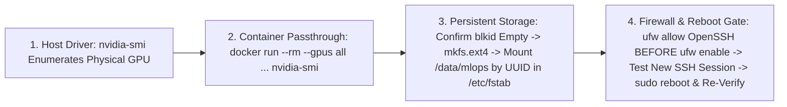
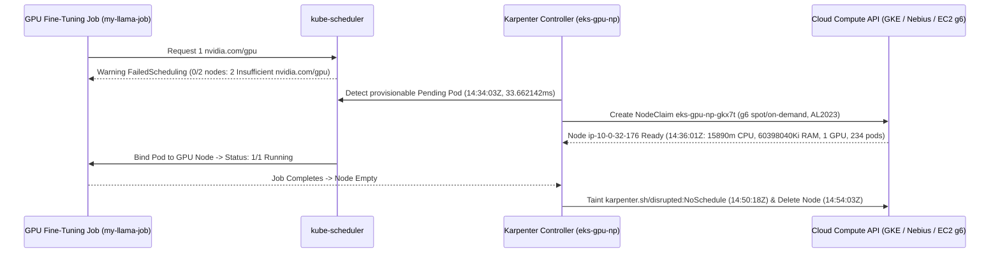

# 11.30 Lab: multi-node GPU Kubernetes on GKE and Nebius

| | |
|---|---|
| Level | Advanced |
| Priority tier | 1 |
| Lab venue | Nebius GPU / GCP GKE, plus local Python 3 verification lab |
| Part | Part 11: GPUs on Kubernetes, scheduling and virtualization |
| Sources used | Packt, *Kubernetes for Generative AI Solutions*; Author's Volume 25 and Volume 10 lab notes |
| Coverage file | `planning/coverage/chapters/11-30.md` |

## Why this matters for AI infrastructure

Across Part 11 you built the architecture of GPU-enabled Kubernetes one layer at a time. You covered kernel drivers and CDI, then the GPU Operator, the Network Operator, KAI Scheduler, MIG, Time-Slicing, vGPU, KubeVirt, Kata, and BlueField DPUs. This chapter moves from diagrams to a live cloud GPU cluster on Nebius, Google Kubernetes Engine, or Amazon EKS. That is where the hard lessons show up. A cloud GPU VM or managed Kubernetes node pool is not ready for production just because the instance state says running. The same is true of a `helm upgrade --install` that exits cleanly.

A worker node can report Ready with eight physical GPUs in its capacity field. Yet it can expose zero allocatable GPUs to the scheduler once the device plugin socket drops. On a fresh Nebius GPU VM, `nvidia-smi` can succeed on the host while containers fail to launch, because the container runtime was never wired to the NVIDIA toolkit. Formatting the wrong block device, enabling a firewall before allowing SSH, or running Horizontal and Vertical Pod Autoscalers together in automatic mode can take down a deployment in minutes.

This capstone chapter ties every layer together into one four-phase workflow for deploying and verifying a cloud GPU cluster. The table below lists the growth baselines, verification gates, and scaling targets you will validate step by step.

| Operational phase | Primary sources | Key cloud metrics and configuration targets | Failure trap prevented |
|---|---|---|---|
| Cloud Kubernetes Growth Baseline | *Kubernetes for Generative AI Solutions* Ch. 3 | `5x` faster cloud K8s growth vs on-prem (2023 report); `99.95%` control-plane SLA across `3` AZs; `3` releases/yr with `12-month` community vs `26-month` extended cloud support | Eliminates manual control-plane upgrades and single-AZ control-plane outages |
| Phase 1: 4-Layer Nebius GPU VM Stack Audit | Nebius L40S VM lab | Host `nvidia-smi` -> `docker run --rm --gpus all` (`nvidia-ctk`) -> empty `blkid` check + `UUID=` `/etc/fstab` `/data/mlops` -> `ufw allow OpenSSH` (`2222/tcp`) verified from a new SSH session and across `sudo reboot` | Catches missing `capabilities: [[gpu]]` runtime wiring, disk device-name shifts, and SSH firewall lockouts |
| Phase 2: Multi-Node Provisioning & GPU Operator | *Kubernetes for Generative AI Solutions* Ch. 3 | Terraform (`>= 1.11`, `vpc` `10.0.0.0/16` `23` resources + `eks` `1.32` `33` resources); `gpu-node-07` (`8/8`) vs `gpu-node-11` (`8/0`); `GPU_NODE_VALIDATED` and `GPU_OPERATOR_VALIDATED` (`DESIRED 3 / READY 3 / AVAILABLE 3`) | Exposes `CAPACITY 8 / ALLOCATABLE 0` zombie nodes and untolerated GPU Operator DaemonSet taints |
| Phase 3: Multi-Dimensional GenAI Autoscaling | *Kubernetes for Generative AI Solutions* Ch. 6 | HPA (`1..5` replicas, `70%` CPU, `180s` scaleDown), VPA (`Off`, `Auto`, `Recreate`, `Initial`), KEDA (`http_requests_total > 10` & `DCGM_FI_DEV_GPU_UTIL > 70`), and Karpenter (`eks-gpu-np`, `~2 min` launch, `karpenter.sh/disrupted:NoSchedule`) | Prevents HPA+VPA replica thrashing and idle multi-thousand-dollar GPU node waste |
| Phase 4: Cloud AI Networking Optimization | *Kubernetes for Generative AI Solutions* Ch. 8 | Native CNI (`IPv6` / secondary CIDRs), `aws-load-balancer-nlb-target-type: ip` + `/healthz`, Chatbot `NetworkPolicies` (`TCP/80` & Qdrant `TCP/6333`), `kube-proxy` `IPVS`, `NodeLocal DNSCache`, and `Cluster` Placement Groups + RDMA (`EFA` / GPUDirect) | Eliminates `NodePort` hops, `iptables` `O(N)` bottlenecks, CoreDNS egress blackholes, and slow inter-node TCP collectives |

> **dcgm-exporter 4.9.0 version note.** dcgm-exporter 4.9.0 (2026-11-06) renamed many default metrics and changed some units. For example `DCGM_FI_DEV_GPU_UTIL` (percent) became `DCGM_FI_DEV_GPU_UTIL_RATIO` (0 to 1), and `DCGM_FI_DEV_FB_USED` (MiB) became `DCGM_FI_DEV_FB_USED_BYTES`. The metric names in this chapter are the 4.8.x names. On a 4.9.0 exporter use the [full mapping in 17.4](../part-17-operations/04-dcgm-exporter-and-interpreting-gpu-metrics.md#14-what-dcgm-exporter-490-renamed), and change thresholds together with the unit.

Read the table as a map of the chapter. Each row names a phase, the source it draws on, the figures you will check, and the failure that phase is meant to catch. Start with Phase 1, because the later phases assume the VM layers already work.

## Prerequisites and outcomes

### Prerequisites

Finish Chapters 11.1 through 11.29 before you start. You also need working familiarity with the tools this lab uses:

- kubectl, Helm, Terraform, Docker, and the NVIDIA system management interface.

### Outcomes

When you finish, you should be able to do the following four things.

- Run the four-layer audit on a Nebius L40S or cloud GPU VM. Verify host drivers, container passthrough, UUID-mounted persistent storage, and non-lockout firewall rules.
- Provision and inspect a multi-node cloud Kubernetes GPU cluster. Separate healthy allocatable nodes from degraded nodes, then prove end-to-end GPU Operator readiness.
- Configure pod and node autoscaling for generative AI workloads. You will combine HPA stabilization windows, VPA recommendation modes, KEDA dual-metric Prometheus triggers, and Karpenter GPU NodePools.
- Optimize multi-node cloud networking for inference and training. Apply IP-mode load balancers, zero-trust NetworkPolicies for RAG and vector databases, IPVS service routing, NodeLocal DNSCache, and compact RDMA placement groups.

Treat these four outcomes as four checkpoints, one for each phase of the chapter.

## Concepts: basics to intermediate to advanced

The concepts build in three steps. You start with the first VM and cluster checks, move on to Terraform and autoscaling, and finish with cloud networking.

### 1. Basics: Phase 1 Nebius GPU VM verification and Phase 2 multi-node Kubernetes baseline

#### 1. Phase 1: Proving All Four Layers on a Nebius L40S or Cloud GPU VM

You create a fresh GPU virtual machine on Nebius or another cloud provider, and the console shows it as active. That status tells you only that the machine booted. It does not prove that the Linux kernel loaded the NVIDIA driver. It does not prove that Docker or containerd can inject the GPU into containers, either. And it does not prove that your dataset disk will survive a reboot. Before you join worker nodes to Kubernetes or launch a training job, verify four independent layers in strict sequence.

Start with the host. Run `nvidia-smi` on the host to confirm that `nvidia.ko` is loaded and talks to the physical GPU over PCIe. Next, test container passthrough by running `nvidia-smi` inside a disposable CUDA container. A working host driver says nothing about whether the NVIDIA Container Toolkit is wired into the container runtime. If the container launch fails with an empty device driver capability error, configure the runtime with `nvidia-ctk` and restart the daemon. Stopping the Docker service entirely gives you a daemon connection error instead.

The third layer is storage. Inspect the attached block devices with `lsblk`, then check that `blkid` returns completely empty output. Only then format the disk with `mkfs.ext4`, so you never wipe an existing dataset. Mount the filesystem at `/data/mlops` and record its `UUID=` in `/etc/fstab`. Do not use a raw block device path, because those paths can shift across reboots.

The fourth layer is the firewall, and the order matters. Allow OpenSSH in UFW before you enable the firewall. Then test the connection from a brand-new SSH terminal while your original session stays open. Finally, reboot the VM to prove that every layer persists.



Read the diagram from top to bottom, since the four layers must be checked in strict sequence.

#### 2. Phase 2: Inspecting a Multi-Node Kubernetes GPU Cluster and Validating the GPU Operator

Once your cloud GPU nodes join a Kubernetes cluster on Nebius Managed Kubernetes, GKE, or EKS, check the platform layer before you admit user workloads. A common trap is trusting `kubectl get nodes` when every node shows Ready. Node readiness only proves that the kubelet is passing basic health checks. It does not prove that the NVIDIA device plugin is advertising healthy GPUs to the scheduler.

In the multi-node inspection lab, comparing capacity with allocatable counts exposes a hidden fault right away. Node `gpu-node-07` reports eight capacity and eight allocatable GPUs. Node `gpu-node-11` reports eight capacity but zero allocatable GPUs, because its device plugin or driver health check failed. Even when all five GPU Operator DaemonSets show running pods, you still need a bounded validation pod. That pod lets you match the container PCIe Bus-Id and GPU UUID against the host hardware baseline.

The table walks through the inspection in order. Each step names the command, the evidence it captures, and the trap it catches.

| Inspection step | Command executed | Captured baseline evidence | Operational meaning and trap caught |
|---|---|---|---|
| 1. Cluster Context & Node Readiness | `kubectl config current-context` & `kubectl get nodes -o wide` | Context `gpu-staging-us-east-1`; `cpu-node-01`, `gpu-node-07`, `gpu-node-11` all `Ready` (`v1.29.4`, `Ubuntu 22.04.4 LTS`, kernel `5.15.0-1053-aws`) | Prevents mutating prod by mistake; `STATUS Ready` only proves `kubelet` is alive, not that GPUs are schedulable |
| 2. Capacity vs Allocatable Audit | `kubectl get nodes -o custom-columns=NAME:.metadata.name,CAPACITY:.status.capacity.nvidia\.com/gpu,ALLOCATABLE:.status.allocatable.nvidia\.com/gpu` | `gpu-node-07`: `CAPACITY 8 / ALLOCATABLE 8`; `gpu-node-11`: `CAPACITY 8 / ALLOCATABLE 0` | `gpu-node-07` is healthy; `gpu-node-11` (`8 / 0`) catches a crashed device plugin, driver reload, or GPU reset in progress |
| 3. Taints & 5 GPU Operands | `kubectl describe node gpu-node-07` & `kubectl get pods -A -o wide \| grep -Ei 'nvidia\|gpu-feature\|node-feature\|dcgm'` | Taint `nvidia.com/gpu=present:NoSchedule`; `5` pods `1/1 Running` in `gpu-operator` (`driver`, `toolkit`, `device-plugin`, `gfd`, `dcgm-exporter`) | Explains why Pods without the matching toleration stay `Pending`; `1/1 Running` on DaemonSets still requires host and pod verification |
| 4. Host Ground-Truth & Containerd Config | `nvidia-smi`, `nvidia-smi -L`, `nvidia-smi topo -m`, `sudo crictl info` | `NVIDIA-SMI 550.90.07`, `CUDA 12.4`, `NVIDIA A100-SXM4-80GB`, `34C`, `62W / 400W`, `4MiB / 81920MiB`, `Bus-Id 00000000:1B:00.0`, `UUID GPU-3a1e9f2b-6c7d-4e91-9a02-1f8b7c0d5e11`, `CPU Affinity 0-31`, `NUMA 0`; `io.containerd.runc.v2`, `pause:3.9`, `default_runtime_name = "nvidia"` | Captures the exact physical `Bus-Id` and `UUID` join keys to match inside the validation container |
| 5. Bounded Validation Pod | Apply `gpu-node-validation` (`Pending 1s -> ContainerCreating 3s -> Running 9s -> Completed 11s`) & `gpu-operator-validation` (`--timeout 15m` Helm install, `DESIRED 3 / READY 3 / AVAILABLE 3`, `ALLOCATABLE: 4`) | In-container `kubectl logs` prints `NVIDIA-SMI 550.90.07`, `Bus-Id 00000000:1B:00.0` (or `00000000:07:00.0`), and `GPU_NODE_VALIDATED` / `GPU_OPERATOR_VALIDATED` | Proves the entire `Driver -> Toolkit -> Device Plugin -> Kubelet -> Scheduler -> Container` chain works end to end |
| 6. Safe Over-Request Failure Exercise | Request `nvidia.com/gpu: 99` (Lab 01) or `8` on a `4`-GPU pool (Lab 02) | `Warning FailedScheduling: 0/3 nodes are available: 1 Insufficient nvidia.com/gpu` (or `3 Insufficient nvidia.com/gpu`) | Proves `kube-scheduler` enforces extended-resource capacity bounds before reaching `ContainerCreating` |

Step 2 is the one that exposes `gpu-node-11`. Step 4 records the Bus-Id and UUID values that the validation pod has to match.

### 2. Intermediate: Phase 3 Terraform provisioning and autoscaling with HPA, VPA, KEDA, and Karpenter

#### 1. Cloud Kubernetes Lifecycle and Terraform IaC

Picture a team that builds clusters by clicking through cloud consoles. That approach creates configuration drift between staging and production. Managed Kubernetes services on EKS, GKE, AKS, and Nebius take over the three-zone control-plane high availability. They also provide extended version support beyond the upstream community window. The worker data plane and the add-ons still need repeatable Infrastructure as Code. Without modular automation, subnet tags for node autoscalers and load balancer controllers are easy to miss.

To make multi-node deployments reproducible, *Kubernetes for Generative AI Solutions* Chapter 3 splits the Terraform stack into three layers. The network layer builds a multi-zone VPC and tags private subnets for Karpenter discovery. The cluster layer provisions the Kubernetes control plane and four worker data-plane options: self-managed nodes, managed node groups, serverless Fargate microVMs, and Karpenter. The last layer is the add-ons module. It installs the load balancer controller and exposes the containerized Llama service through an external network load balancer.

```text
Terraform Multi-Node Cloud Kubernetes Architecture:
  Tooling Versions : terraform >= 1.11, aws >= 5.96, helm >= 2.17, kubernetes >= 2.36
  1. Network Layer : terraform-aws-modules/vpc/aws ~> 5.21
     - CIDR 10.0.0.0/16 across 3 AZs (us-west-2), private/public cidrsubnet, NAT gateway (23 resources added)
     - Tags private subnets with "karpenter.sh/discovery" = local.name
  2. Cluster Layer : terraform-aws-modules/eks/aws ~> 20.36
     - Deploys Kubernetes 1.32 (33 resources added) across 4 data-plane options:
       (a) Self-managed nodes, (b) Managed node groups (eks-mng: desired_size = 2, max_size = 3 across
           m5.large / m6i.large / m6a.large / m7i.large / m7a.large), (c) AWS Fargate, (d) Karpenter
  3. Add-ons & App : aws-ia/eks-blueprints-addons/aws ~> 1.21
     - Deploys Load Balancer Controller + Karpenter (2 worker nodes and 10 system pods running)
     - Pushes my-llama image to ECR and exposes containerPort 5000 via LoadBalancer port 80 (POST /predict)
```

Read the block top to bottom, in the same order as the three layers. The counts, such as 23 resources added for the network layer, show how large each layer is.

#### 2. Pod-Level Autoscaling: HPA, VPA, and Event-Driven KEDA

Scaling generative AI microservices with naive CPU or memory rules leads to one of two outcomes. Either latency spikes, or pods restart endlessly. In the Kubernetes container runtime interface, exceeding a CPU limit only throttles the process. Exceeding a memory limit triggers an immediate out-of-memory kill. For example, a container that overuses memory is killed, while one that overuses CPU is only slowed.

That difference shapes the scaling signal you pick. Python and PyTorch caching allocators hold reserved memory even when traffic drops, so memory utilization is a poor horizontal scaling signal. Request rate, queue depth, and DCGM GPU utilization give much cleaner signals.

Platform engineers combine three pod autoscalers and add strict guardrails around them. HorizontalPodAutoscaler adjusts replica counts with asymmetric stabilization windows, so pods scale out immediately on a traffic burst. Scale-down waits three minutes, which prevents replica flapping. VerticalPodAutoscaler right-sizes CPU and memory requests. Set its update mode to Off whenever HPA scales on CPU or memory, or the two controllers will fight each other. For LLM serving and asynchronous queues, KEDA scales down to zero when queues sit idle. It scales out on Prometheus triggers for HTTP request rate and `DCGM_FI_DEV_GPU_UTIL`.

| Pod autoscaler | API version & resource | Target workload in *Kubernetes for Generative AI Solutions* Ch. 6 | Exact thresholds and stabilization parameters | Critical operational rule |
|---|---|---|---|---|
| HorizontalPodAutoscaler (`HPA`) | `autoscaling/v2` (`chatbot-ui-hpa`) | Stateless UI & API pods (`1` to `5` replicas) | Target CPU `averageUtilization: 70` (or `ContainerResource` `60%`); `scaleDown`: `stabilizationWindowSeconds: 180`, max `50%` per `15s`; `scaleUp`: `0s` window, max `2` `Pods` per `15s` (`selectPolicy: Max`) | Asymmetric windows prevent replica thrashing ("flapping") during spiky prompt traffic |
| VerticalPodAutoscaler (`VPA`) | `autoscaling.k8s.io/v1` (`chatbot-ui-vpa`) | Right-sizing pod CPU/RAM requests & limits | `4` modes: `Off`, `Auto`, `Recreate`, `Initial`; bounds `minAllowed: 1000m / 2Gi` to `maxAllowed: 2000m / 4Gi` (`RequestsAndLimits` or `RequestsOnly`) | Never run HPA and VPA (`Auto`) together on CPU/memory; set VPA `updateMode: "Off"` to avoid control-loop conflicts |
| KEDA Queue Scaler | `keda.sh/v1alpha1` `ScaledObject` (`amazonsqs-scaler`) | Batch / async worker deployments (`0` to `10` replicas) | `minReplicaCount: 0`, `maxReplicaCount: 10`, `pollingInterval: 15`, `cooldownPeriod: 180`, Amazon SQS `queueLength: "10"` | Enables true scale-to-zero (`minReplicaCount: 0`) when no batch jobs are queued |
| KEDA Dual-Trigger LLM Scaler | `keda.sh/v1alpha1` `ScaledObject` (`my-llama-deployment-scaler`) | GPU LLM inference (`my-llama-deployment`, `1` to `10` replicas) | Trigger 1: `sum(rate(http_requests_total[1m])) > 10`; Trigger 2: `avg(DCGM_FI_DEV_GPU_UTIL{pod=~"my-llama-.*"}[30s]) > 70` via `dcgm-exporter` + `prometheus-adapter` | Scales LLM replicas on real user traffic and GPU silicon load rather than host CPU |

Each row covers one autoscaler and its thresholds. Read the last column first, because it holds the rule you must not break.

#### 3. Node-Level GPU Autoscaling: Cluster Autoscaler vs Karpenter

When KEDA or a user job creates a new GPU pod and every worker node is full, `kube-scheduler` leaves the pod in Pending with an insufficient `nvidia.com/gpu` warning. The traditional Kubernetes Cluster Autoscaler reacts slowly, because it polls predefined cloud Auto Scaling Groups. It also has to maintain separate node groups for every GPU instance type and availability zone. If one zone runs out of capacity for that instance group, the pod stalls while other compatible GPU families sit unused.

Karpenter takes a different route. It watches unschedulable pods directly at the Kubernetes API server, with no fixed node groups. You configure it through NodePool and EC2NodeClass custom resources. It detects a pending GPU job in milliseconds, and it evaluates spot and on-demand capacity across compatible GPU families. It then launches a right-sized node in roughly two minutes.

Scale-in works in reverse. When the fine-tuning job finishes and the GPU node becomes empty, Karpenter taints the machine with `karpenter.sh/disrupted:NoSchedule` and terminates it. You never pay for idle cloud GPUs that way.



Compare two timestamps to see the speed. Detection happened at 14:34:03Z, and the node was Ready at 14:36:01Z. The gap is about two minutes, which matches the roughly two-minute launch time. If your GPU jobs stall for capacity, decide whether an autoscaler that watches pending pods directly fits your cluster better than fixed node groups.

---

### 3. Advanced: Phase 4 cloud networking best practices for multi-node GenAI on Kubernetes

Default Kubernetes networking is built for small web apps, not for multi-node generative AI clusters. Overlay tunnels such as VXLAN add encapsulation overhead to every packet. A default LoadBalancer service sends each incoming prompt through an extra NodePort and `kube-proxy` hop before it reaches the inference pod. At larger scales, sequential `iptables` rule evaluation slows down service routing. High pod density exhausts primary VPC IPv4 subnets, and unencrypted east-west traffic leaves RAG pipelines and vector databases open to lateral movement.

*Kubernetes for Generative AI Solutions* Chapter 8 addresses these bottlenecks across six networking layers. Use native CNI routing with secondary CIDRs or IPv6. Configure load balancers to route directly to pod IPs, with model-ready `/healthz` probes. Lock down microservice tiers with Kubernetes NetworkPolicies and Istio Ambient Mesh. Finally, switch `kube-proxy` to IPVS hash tables, add NodeLocal DNSCache, and pack multi-node training instances into compact Cluster placement groups backed by Elastic Fabric Adapter, GPUDirect, or InfiniBand RDMA.

| Networking layer | Standard default bottleneck | Production GenAI optimization (*Kubernetes for Generative AI Solutions* Ch. 8) | Operational impact for multi-node AI |
|---|---|---|---|
| 1. CNI Mode (`Overlay` vs `Native`) | Overlay tunnels (`VXLAN` / `Geneve`, Flannel) add encapsulation latency and exhaust VPC IPv4 subnets | Native Routing CNI (`Amazon VPC CNI`, `GKE Dataplane V2 / Cilium eBPF`) + VPC CNI Custom Networking (secondary non-routable CIDRs or `IPv6`) | Removes tunnel overhead and prevents large Pod fleets from exhausting primary subnet IPs |
| 2. External Load Balancing (`NLB` Target Type) | Default `LoadBalancer` routes `NLB -> NodePort -> kube-proxy iptables -> Pod` | Set `service.beta.kubernetes.io/aws-load-balancer-nlb-target-type: ip` and configure `/healthz` (`HTTP 200 OK` after GPU weights load) | Routes NLB traffic straight to Pod IPs (skipping the `NodePort` hop) and protects slow-starting LLM pods |
| 3. L4/L7 Routing & Service Mesh | Unencrypted internal HTTP with no L7 retries or canary traffic splitting | Kubernetes Gateway API + Service Mesh (`Istio` / `Linkerd` Envoy sidecars, or sidecarless Istio Ambient Mesh using eBPF for L7 & `mTLS`) | Enables canary/A-B model rollouts, circuit breaking, and end-to-end `mTLS` across microservices |
| 4. Multi-Tier Zero-Trust `NetworkPolicies` | Default Kubernetes allows all Pods to talk to all Pods on any port | Label-based Ingress/Egress `NetworkPolicies` (Figure 8.4): `chatbot-ui -> rag-app` & `my-llama-finetuned` on `TCP/80`, `rag-app -> qdrant` on `TCP/6333`, plus `CoreDNS` (`kube-system`) egress | Stops lateral movement between UI, RAG, vector DB (`6333`), and LLM tiers without breaking DNS lookups |
| 5. Service Routing & DNS (`IPVS` & `CoreDNS`) | `kube-proxy` `iptables` mode (`O(N)` sequential rule scan) and fixed CoreDNS replicas | Enable `kube-proxy` `IPVS` mode (`mode: "ipvs"` `O(1)` in-memory hash table), `cluster-proportional-autoscaler` for CoreDNS, and `NodeLocal DNSCache` | Provides `O(1)` Service lookup and caches DNS on each node (avoiding `iptables` DNAT and `conntrack` drops) |
| 6. Placement Groups & RDMA (`EFA` / `GPUDirect`) | Random AZ spread (`Spread` or `Partition`) with high inter-node TCP latency | Launch GPU nodes in a `Cluster` Placement Group (`--strategy cluster` / GKE `COMPACT`) and attach RDMA (`aws-efa-k8s-device-plugin` `vpc.amazonaws.com/efa.present: "true"`, GKE `GPUDirect-TCPX`/`RDMA`, or Nebius `InfiniBand`) | Minimizes physical switch hops and enables OS-bypass RDMA + NCCL collective synchronization |

Work through the table one row at a time. Each row pairs a default setting with the change that replaces it.

#### Part 11 End-to-End Verification Checklist: From Bare Metal and Cloud VMs to Production Multi-Tenant AI

Before you hand a multi-node GPU Kubernetes cluster on Nebius, GKE, EKS, or bare metal to research and production teams, walk through one final acceptance checklist. It covers all thirty chapters of Part 11. Check every layer, from host PCIe topology up to multi-tenant quotas, so no silent misconfiguration reaches production.

First, verify the host and container runtime layer from Chapters 11.1 through 11.5 and 11.21 through 11.22. Host `nvidia-smi` must enumerate all physical GPUs with zero uncorrectable ECC errors and clean PCIe switch affinity. Motherboard IOMMU must be active in `dmesg`, and scratch volumes must mount by `UUID=` in `/etc/fstab`. Containerd and the GPU Operator DaemonSets must report ready. Their validation probes must match the host `Bus-Id` and `UUID`.

Second, verify the scheduling, gang coordination, and network fabric layer from Chapters 11.6 through 11.16 and 11.20. Make sure `kubelet` runs with single-NUMA-node topology management and static CPU pinning, which avoids cross-socket NUMA penalties. Schedule multi-node jobs as atomic PodGroups through KAI Scheduler, Kueue, or YuniKorn. Validate the secondary RDMA networks, which can be `Multus`, the Network Operator `NicClusterPolicy`, SR-IOV, DRA, EFA, or GPUDirect. Validate compact placement groups too, using `all_reduce_perf` and hardware sequence counters.

Third, verify the GPU sharing, virtualization, and zero-trust security layer from Chapters 11.17 through 11.19 and 11.23 through 11.29. Route each workload to an explicit service class. The classes span time-sliced sandboxes, hardware MIG inference slices, dedicated whole GPUs, and KubeVirt, Kata, or Confidential VMs. Block best-effort shared GPUs in production namespaces with ResourceQuotas. Bind cloud storage through OIDC IRSA for `medical-training-sa`. Enforce default-deny NetworkPolicies or BlueField DPU firewalls. Keep the four-tier Thanos, KEDA, Karpenter, and FinOps zombie reapers active.

Run this checklist before you hand the cluster to any team, because one missed layer can hide a misconfiguration until it reaches production.

## Commands and configurations that matter

The commands below were not run on live hardware. Each block carries out one phase of the multi-node cloud deployment. Run them in order when you bring up a new GPU VM, provision a managed node pool, or wire up KEDA, Karpenter, and zero-trust NetworkPolicies.

### 1. Phase 1: Nebius L40S and Cloud GPU VM 4-Layer Verification Script

A new cloud GPU VM does not come with working container passthrough, persistent storage mounts, or safe firewall rules out of the box. Do not assume any of them. The script below checks the host driver and tests Docker GPU injection. It confirms that `blkid` is empty before you format `/data/mlops` by `UUID`. It also allows OpenSSH before you enable `ufw`.

```bash
# 1. Layer 1 & 2: Verify host driver and Docker container GPU passthrough (untested here)
nvidia-smi
sudo docker run --rm --gpus all nvidia/cuda:12.4.1-base-ubuntu22.04 nvidia-smi

# If container GPU passthrough fails with capabilities: [[gpu]], wire nvidia-ctk and restart docker:
# sudo nvidia-ctk runtime configure --runtime=docker && sudo systemctl restart docker

# 2. Layer 3: Format and mount persistent block storage by UUID in /etc/fstab (untested here)
lsblk -d -o NAME,SIZE,TYPE
sudo blkid /dev/vdX   # MUST return empty output before running mkfs.ext4
sudo mkfs.ext4 -F /dev/vdX
sudo mkdir -p /data/mlops
sudo mount /dev/vdX /data/mlops
UUID=$(sudo blkid -s UUID -o value /dev/vdX)
echo "UUID=$UUID /data/mlops ext4 defaults 0 2" | sudo tee -a /etc/fstab

# 3. Layer 4: Allow OpenSSH BEFORE enabling UFW, then verify from a NEW SSH terminal & reboot (untested here)
sudo ufw allow OpenSSH
sudo ufw --force enable
sudo ufw status verbose
```

Read the block in order, because each step assumes the one above it passed.

### 2. Phase 2: Provisioning GPU Node Pools on GKE and Nebius and Validating GPU Operator

When you add multi-node GPU capacity to a managed Kubernetes cluster, co-locate the instances with a compact placement policy. Pin the GPU Operator chart version explicitly, too. Always audit both the capacity and the allocatable columns across every node once the Helm install completes.

```bash
# 1. Create a multi-node GPU pool on GKE (or Nebius mk8s node-group) with compact placement (untested here)
gcloud container node-pools create gke-gpu-pool \
  --cluster=ai-infra-cluster --zone=us-central1-a \
  --machine-type=g2-standard-48 --accelerator=type=nvidia-l4,count=4 \
  --num-nodes=3 --placement-type=COMPACT

# 2. Install pinned NVIDIA GPU Operator and verify operands + validation pod (volume-10/labs/lab-02, untested here)
helm repo add nvidia https://helm.ngc.nvidia.com/nvidia && helm repo update
helm upgrade --install gpu-operator nvidia/gpu-operator \
  --namespace gpu-operator --create-namespace \
  --version "$GPU_OPERATOR_VERSION" -f target-values.yaml \
  --wait --timeout 15m

kubectl get nodes -o custom-columns=NAME:.metadata.name,CAPACITY:.status.capacity.nvidia\.com/gpu,ALLOCATABLE:.status.allocatable.nvidia\.com/gpu
```

The first command creates the node pool with compact placement. The last command prints capacity and allocatable side by side, so you can compare them for each node.

### 3. Phase 3 and 4: KEDA Dual-Trigger Autoscaler, Karpenter GPU NodePool, and Chatbot NetworkPolicies

A production LLM service has to scale pods on two signals at once: user traffic and GPU utilization. It also needs nodes that appear quickly when capacity runs out, and strict isolation around the vector database. The manifest below handles all three. It defines the KEDA dual-trigger ScaledObject, the Karpenter `eks-gpu-np` NodePool, and the ingress NetworkPolicy that protects Qdrant on TCP port 6333.

```yaml
# keda-karpenter-and-netpol-genai.yaml (K8GS Ch. 6 & Ch. 8, untested here)
apiVersion: keda.sh/v1alpha1
kind: ScaledObject
metadata:
  name: my-llama-deployment-scaler
spec:
  scaleTargetRef:
    apiVersion: apps/v1
    kind: Deployment
    name: my-llama-deployment
  minReplicaCount: 1
  maxReplicaCount: 10
  triggers:
    - type: prometheus
      metadata:
        serverAddress: http://prometheus-server.default.svc:9090
        metricName: http_requests_total
        threshold: "10"
        query: sum(rate(http_requests_total[1m]))
    - type: prometheus
      metadata:
        serverAddress: http://prometheus-server.default.svc:9090
        metricName: DCGM_FI_DEV_GPU_UTIL
        threshold: "70"
        query: avg(DCGM_FI_DEV_GPU_UTIL{pod=~"my-llama-.*"}[30s])
---
apiVersion: karpenter.sh/v1
kind: NodePool
metadata:
  name: eks-gpu-np
spec:
  template:
    spec:
      nodeClassRef:
        group: karpenter.k8s.aws
        kind: EC2NodeClass
        name: default-gpu
      requirements:
        - key: "karpenter.k8s.aws/instance-generation"
          operator: In
          values: ["g6"]
        - key: "karpenter.sh/capacity-type"
          operator: In
          values: ["spot", "on-demand"]
  disruption:
    consolidationPolicy: WhenEmptyOrUnderutilized
---
apiVersion: networking.k8s.io/v1
kind: NetworkPolicy
metadata:
  name: qdrant-vector-db-ingress
spec:
  podSelector:
    matchLabels:
      app.kubernetes.io/name: qdrant
  policyTypes:
    - Ingress
  ingress:
    - from:
        - podSelector:
            matchLabels:
              app.kubernetes.io/name: rag-app
      ports:
        - protocol: TCP
          port: 6333
```

The manifest holds three documents separated by `---`. The first is the ScaledObject, the second is the NodePool, and the third is the NetworkPolicy.

## How it fails

Multi-node cloud GPU clusters can fail in many places. The trouble may sit in the container runtime, the Kubernetes device plugin, a Helm taint, an autoscaler control loop, or a CNI policy. The table below helps you isolate the exact layer whenever a node, an operator, or an inference service misbehaves. Each row gives the symptom with its command evidence, the root cause boundary, and the remediation.

| Failure mode | Exact symptom & command evidence | Root cause boundary | Remediation |
|---|---|---|---|
| 1. `nvidia-smi` works on the Nebius GPU host, but `docker run --gpus all` fails with `could not select device driver "" with capabilities: [[gpu]]` | Step 1 host `nvidia-smi` prints the L40S table, but Step 2 container launch fails immediately before starting the container. | Layer 2 Container Toolkit Not Wired into Runtime: `nvidia-container-toolkit` is installed on the host, but `/etc/docker/daemon.json` (or `/etc/containerd/config.toml`) has not registered the `nvidia` runtime handler. | Run `sudo nvidia-ctk runtime configure --runtime=docker && sudo systemctl restart docker` (or `--runtime=containerd` + `systemctl restart containerd`) and re-run the container check. |
| 2. `kubectl get nodes` shows `gpu-node-11` `Ready` with `CAPACITY: 8`, but `ALLOCATABLE: 0` | Pods requesting `nvidia.com/gpu: 1` stay `Pending` (`Insufficient nvidia.com/gpu`) even though `gpu-node-11` has `8` physical GPUs. | Layer 3 Device Plugin / Driver Registration Loss: `Capacity` reflects the last historical count reported to `kubelet`, while `Allocatable: 0` shows all GPUs are currently unhealthy or the device-plugin socket disconnected. | Do not schedule baseline workloads on `gpu-node-11`; inspect `nvidia-driver-daemonset` and `nvidia-device-plugin-daemonset` logs (`Lab 03` workflow) and check host `nvidia-smi` / `dmesg` for XIDs. |
| 3. `helm upgrade --install gpu-operator --wait --timeout 15m` times out with `nvidia-driver-daemonset` stuck `Pending` | `kubectl get events -n gpu-operator` logs `0/3 nodes are available: 3 node(s) had taint {nvidia.com/gpu: NoSchedule}, that the pod didn't tolerate`. | Values-File Toleration Mismatch: The GPU nodes were tainted with a custom key/effect that was not added to `target-values.yaml` for the GPU Operator DaemonSets. | Do not re-run `helm upgrade` blindly; add the matching taint tolerations to `target-values.yaml` and re-apply the pinned Helm release. |
| 4. Enabling both `HPA` and `VPA` (`updateMode: "Auto"`) on `my-llama-deployment` causes continuous Pod evictions and replica oscillation (*Kubernetes for Generative AI Solutions* Ch. 6) | Replica count oscillates wildly between `1` and `5` while `VPA` repeatedly evicts running inference pods to rewrite their CPU/memory `requests`. | Simultaneous HPA + VPA Control-Loop Conflict (*Kubernetes for Generative AI Solutions* Ch. 6): VPA mutating a Pod's `requests` changes the denominator of HPA's `averageUtilization` calculation, causing HPA and VPA to fight each other. | Set VPA `updateMode: "Off"` (using VPA strictly for right-sizing recommendations) whenever HPA or KEDA is actively scaling replica counts on CPU/memory metrics. |
| 5. Applying an Egress `NetworkPolicy` to `rag-app` breaks all internal Kubernetes Service lookups (*Kubernetes for Generative AI Solutions* Ch. 8) | After locking down egress on `rag-app`, requests to `http://qdrant:6333` fail with `Could not resolve host: qdrant`. | Blocked `UDP/TCP 53` Egress to `CoreDNS`: A default-deny egress `NetworkPolicy` blocks DNS queries unless `kube-system` `CoreDNS` (and `NodeLocal DNSCache`) is explicitly permitted. | Add an egress rule allowing `UDP` and `TCP` port `53` to the `CoreDNS` pods in the `kube-system` namespace. |

Find the row that matches what you see. Its root cause boundary tells you which layer to inspect, and its remediation tells you what to change.

## Hands-on lab

### Venue and scope

Provisioning multi-node GPU pools on Nebius, GKE, and EKS means you pay cloud billing charges. You can run the local suite without any cloud spend. This lab therefore pairs the cloud steps with a local Python 3 verification suite, in `code/part11/multi_node_gke_and_nebius.py` and `code/part11/multi_node_gke_and_nebius_lab.py`. The suite tests the four-layer Nebius L40S VM audit, the multi-node Kubernetes GPU inspection gates, and the Terraform, HPA, VPA, KEDA, Karpenter, and cloud networking configurations. The cloud commands are untested.

### Step 1: Run the self-checking multi-node GPU Kubernetes capstone lab (tested here)

Run the self-checking capstone lab script from the repository root. You do not need any cloud resources for it. It validates all twenty-five assertions.

```bash
python3 code/part11/multi_node_gke_and_nebius_lab.py
```

The output below was captured from this repository. Its last line gives the pass and fail summary.

```text
=== Chapter 11.30 Lab: Multi-Node GPU Kubernetes on GKE, Nebius & EKS (K8GS) ===
  [PASS] Volume 25 Lab 01 defines 4 independent verification layers (Host Driver, Container GPU, UUID Storage, UFW Firewall)
  [PASS] Unconfigured nvidia-container-toolkit fails Step 2b with capabilities: [[gpu]] error and requires nvidia-ctk runtime configure
  [PASS] Non-empty blkid check on /dev/vdX aborts mkfs.ext4 at Step 3a to prevent overwriting existing data
  [PASS] Nebius L40S VM passing host nvidia-smi, docker --gpus all, UUID /etc/fstab /data/mlops mount, new-session UFW check, and reboot is ready
  [PASS] Volume 10 Lab 01 selects gpu-node-07 (CAPACITY 8 / ALLOCATABLE 8) and flags gpu-node-11 (CAPACITY 8 / ALLOCATABLE 0)
  [PASS] Volume 10 Lab 01 host baseline records NVIDIA-SMI 550.90.07 / CUDA 12.4 on NVIDIA A100-SXM4-80GB (34C, 62W/400W, 4MiB/81920MiB, Bus-Id 00000000:1B:00.0)
  [PASS] Volume 10 Lab 01 crictl info shows io.containerd.runc.v2 (pause:3.9) and default_runtime_name = 'nvidia'
  [PASS] Volume 10 Lab 01 gpu-node-validation transitions Pending (1s) -> ContainerCreating (3s) -> Running (9s) -> Completed (11s) and logs GPU_NODE_VALIDATED
  [PASS] Volume 10 Lab 01 safe failure test requesting nvidia.com/gpu: 99 emits FailedScheduling: 1 Insufficient nvidia.com/gpu
  [PASS] Volume 10 Lab 02 helm upgrade --install gpu-operator (--timeout 15m) verifies DESIRED 3 / READY 3 / AVAILABLE 3, ALLOCATABLE: 4, and GPU_OPERATOR_VALIDATED
  [PASS] K8GS Ch 3 reports 5x cloud K8s growth, 99.95% SLA across 3 AZs, and 3 releases/yr (12m community vs 26m extended support)
  [PASS] K8GS Ch 3 Terraform (>=1.11, aws >=5.96, helm >=2.17, kubernetes >=2.36) provisions VPC 10.0.0.0/16 (~>5.21, 23 resources) and EKS 1.32 (~>20.36, 33 resources)
  [PASS] K8GS Ch 3 deploys my-llama from ECR and exposes port 80 -> targetPort 5000 via AWS NLB (/predict)
  [PASS] K8GS Ch 6 HPA (chatbot-ui-hpa: 1..5 replicas, 70% CPU) sets scaleDown (180s window, 50%/15s), scaleUp (0s window, 2 pods/15s), and ContainerResource (60%)
  [PASS] K8GS Ch 6 VPA defines 4 modes (Off, Auto, Recreate, Initial) with minAllowed (1000m, 2Gi) and maxAllowed (2000m, 4Gi)
  [PASS] K8GS Ch 6 warns that combining HPA with VPA in Auto mode creates a scaling conflict (unless VPA is Off)
  [PASS] K8GS Ch 6 KEDA ScaledObject my-llama-deployment-scaler triggers scale-out when http_requests_total > 10 or DCGM_FI_DEV_GPU_UTIL > 70
  [PASS] K8GS Ch 6 KEDA amazonsqs-scaler (minReplicaCount: 0, maxReplicaCount: 10, pollingInterval: 15, cooldownPeriod: 180) scales from 0 when queueLength > 10
  [PASS] K8GS Ch 6 Karpenter NodePool (eks-gpu-np, g6 spot/on-demand, WhenEmptyOrUnderutilized, AL2023) launches node with 15890m CPU, 60398040Ki RAM, 1 GPU, 234 pods and taints karpenter.sh/disrupted:NoSchedule on cleanup
  [PASS] K8GS Ch 8 sets aws-load-balancer-nlb-target-type: ip (bypassing NodePort kube-proxy hop) with /healthz (HTTP 200 OK)
  [PASS] K8GS Ch 8 Chatbot NetworkPolicies restrict rag-app and my-llama-finetuned to TCP/80 from chatbot-ui, and qdrant to TCP/6333 from rag-app (+ CoreDNS egress)
  [PASS] K8GS Ch 8 contrasts Service Mesh (Layer 7 mTLS/retries via Envoy sidecars or sidecarless Istio Ambient Mesh eBPF) with NetworkPolicy (Layer 3/4)
  [PASS] K8GS Ch 8 enables kube-proxy IPVS mode (in-memory hash table) and mitigates IPv4 exhaustion via IPv6 or VPC CNI custom networking secondary CIDRs
  [PASS] K8GS Ch 8 optimizes DNS via CoreDNS cluster-proportional-autoscaler and NodeLocal DNSCache (avoiding iptables DNAT/conntrack)
  [PASS] K8GS Ch 8 defines 3 Placement Group strategies (Cluster, Partition, Spread) and integrates RDMA via EFA (aws-efa-k8s-device-plugin), GKE GPUDirect-TCPX/RDMA, and Nebius InfiniBand

Summary: 25 passed, 0 failed out of 25 checks.
```

### Exercises

1. Open the Nebius VM provisioning function in `code/part11/multi_node_gke_and_nebius.py`. Explain why you can treat each of the four checks as independent. Then state how to fix the empty device driver capability error, why the block ID check must return empty output before formatting, and why UFW must be verified from a new SSH session and across a reboot.
2. Work out why node seven was chosen over node eleven in the capacity versus allocatable audit. Then describe how the host PCIe Bus-Id and GPU UUID get verified inside the validation pod. Finally, state the exact scheduling failure event that the ninety-nine-GPU test emits.
3. Trace the four evidence hops, starting at the Helm release status and moving through the operator pods and node allocatable counts to the validation banner. Then explain why a deployed status in Helm does not prove that the kernel module loaded on the worker nodes.
4. Open the autoscaling evaluation function and list the four VPA operating modes. Explain why HPA and VPA conflict when VPA runs in Auto mode. Then show how the Llama scaler combines the HTTP request rate and DCGM GPU utilization triggers.
5. Follow the timeline and log events from the moment the Llama fine-tuning job triggers Karpenter to launch a right-sized GPU instance. Then describe how Karpenter taints and deletes the empty GPU node after the job finishes.
6. Explain how IP-mode load balancing, IPVS service routing, NodeLocal DNSCache, and Cluster placement groups each optimize a multi-node deployment. Then state how the chatbot NetworkPolicies secure the RAG and vector database tiers.

## Checkpoint questions

<details>
<summary>**1. When you provision a GPU node on a Nebius L40S VM, what are the four layers that must be verified independently before running a training workload?**</summary>

The first layer is the host driver, which you check with `nvidia-smi` to confirm the kernel module sees the physical GPU. The second is container GPU passthrough, which you test with a disposable Docker CUDA container to confirm the NVIDIA Container Toolkit is wired into the runtime. The third is persistent block storage. It should be mounted at `/data/mlops` by UUID in `/etc/fstab`, after you check that `blkid` is empty. The fourth is the UFW firewall, which you verify from a brand-new SSH session and again after a reboot.
</details>

<details>
<summary>**2. How do you distinguish "Docker is stopped" from "nvidia-container-toolkit is not configured for Docker," and what command fixes the toolkit configuration?**</summary>

Consider two cases. A stopped Docker daemon makes a GPU container fail right away with a daemon connection error. If Docker is running but the NVIDIA toolkit is not registered in `/etc/docker/daemon.json`, the command fails with `could not select device driver "" with capabilities: [[gpu]]`. To fix the registration, run `sudo nvidia-ctk runtime configure --runtime=docker && sudo systemctl restart docker`.
</details>

<details>
<summary>**3. Why must you check that sudo blkid /dev/vdX returns empty output before running mkfs.ext4, and why must /etc/fstab use UUID= rather than /dev/vdX?**</summary>

If `blkid` returns an existing UUID and filesystem type, the volume already holds formatted data, and `mkfs.ext4` would destroy it. Device names are unreliable too. For example, `/dev/vda` or `/dev/vdb` can change order after a kernel update or a new disk attachment. Mounting by UUID in `/etc/fstab` means the same filesystem lands at `/data/mlops` on every reboot.
</details>

<details>
<summary>**4. Why must you verify a ufw firewall change from a brand-new SSH terminal before closing your current session?**</summary>

Enabling UFW does not end an SSH connection that is already open. If the OpenSSH rule was left out, or the server listens on a non-default SSH port with no matching rule, your current terminal keeps working while new connections are dropped. So test from a second terminal while the original session stays open. That lets you fix the rule without locking yourself out of the VM.
</details>

<details>
<summary>**5. When you inspect a Kubernetes GPU node, what is the difference between gpu-node-07 (CAPACITY 8 / ALLOCATABLE 8) and gpu-node-11 (CAPACITY 8 / ALLOCATABLE 0)?**</summary>

Capacity is the total GPU count the kubelet last reported. Allocatable is the set of healthy devices that are available for scheduling right now. On `gpu-node-07`, all eight physical GPUs are healthy and schedulable. On `gpu-node-11`, eight capacity and zero allocatable shows that the device plugin socket disconnected, the driver is reloading, or every GPU is marked unhealthy.
</details>

<details>
<summary>**6. How do you prove that the physical GPU enumerated on the host is the exact same GPU injected into the gpu-node-validation container?**</summary>

Record the physical PCIe Bus-Id (`00000000:1B:00.0`) and UUID (`GPU-3a1e9f2b-6c7d-4e91-9a02-1f8b7c0d5e11`) from host `nvidia-smi` on the worker node. After the validation pod completes, read its logs. The in-container banner should print the same driver version (`550.90.07`), memory size (`81920MiB`), Bus-Id, and UUID, followed by `GPU_NODE_VALIDATED`.
</details>

<details>
<summary>**7. How do the Kubernetes events for a container runtime injection failure differ from an unsatisfiable resource request (nvidia.com/gpu: 99)?**</summary>

A request for ninety-nine GPUs never binds to a worker node. Describing the pod shows `Warning FailedScheduling: 0/3 nodes are available: 1 Insufficient nvidia.com/gpu`, and the pod stays Pending. A container runtime injection failure is different. The scheduler passes, the pod binds to a node, and the failure happens during container creation or when the process starts and exits non-zero.
</details>

<details>
<summary>**8. When you install and validate the GPU Operator, why is helm status showing STATUS: deployed insufficient proof of a working GPU cluster, and what four checks complete the evidence chain?**</summary>

A deployed status in Helm only shows that the chart manifests reached the Kubernetes API server. To finish the evidence chain, check that the ClusterPolicy reports ready. Then confirm that the operator DaemonSets show three desired, ready, and available pods, with the CUDA validator completed. Last, confirm the numeric allocatable counts (`4`) and the GFD node labels, along with `GPU_OPERATOR_VALIDATED` in the validation pod logs.
</details>

<details>
<summary>**9. According to Kubernetes for Generative AI Solutions Chapter 3, what uptime SLA and extended version support window do managed cloud Kubernetes offerings provide compared to upstream community support?**</summary>

Managed services such as Amazon EKS across three availability zones, Google Kubernetes Engine, and Azure Kubernetes Service give you a `99.95%` control-plane uptime SLA. They also offer up to twenty-six months of extended version support. Compare that with the upstream community support window of twelve months, which covers roughly three minor releases per year. The extended window more than doubles it.
</details>

<details>
<summary>**10. Compare the four worker node data-plane options in Kubernetes for Generative AI Solutions Chapter 3 (Self-managed nodes, Managed node groups, AWS Fargate, and Karpenter).**</summary>

Self-managed nodes give platform teams full control over custom VM images and host kernels. The cost is manual patching and lifecycle scripting. Managed node groups automate VM provisioning, OS patching, and Auto Scaling Group updates. AWS Fargate runs each pod in a serverless microVM, so you manage no nodes. Karpenter watches pending pods directly and launches right-sized GPU or CPU instances on demand.
</details>

<details>
<summary>**11. In Kubernetes for Generative AI Solutions Chapter 6, how does container memory limit enforcement differ from CPU limit enforcement in the CRI, and why is memory usually a poor HPA scaling metric?**</summary>

When a container exceeds its CPU limit, the Linux kernel CFS scheduler throttles the process but does not kill it. When a container exceeds its memory limit, the container runtime and the Linux OOM killer terminate the container right away. Memory is also a weak trigger for horizontal scaling. Python, JVM, and PyTorch caching allocators keep reserved memory blocks and do not return them to the OS when traffic drops.
</details>

<details>
<summary>**12. How do the scaleDown and scaleUp behavior policies in Kubernetes for Generative AI Solutions Chapter 6 prevent HPA replica flapping?**</summary>

The scale-down policy sets `stabilizationWindowSeconds: 180`, so the controller waits three full minutes after traffic drops before it removes pods. It also caps removal at fifty percent of replicas every fifteen seconds. The scale-up policy works the other way. It sets `stabilizationWindowSeconds: 0` with `selectPolicy: Max`, so it adds up to two pods every fifteen seconds as soon as a spike arrives.
</details>

<details>
<summary>**13. What are the four operating modes of the VerticalPodAutoscaler (VPA), and why should you not run HPA and VPA (in Auto mode) simultaneously on the same CPU/memory metrics (Kubernetes for Generative AI Solutions Chapter 6)?**</summary>

The four VPA modes are Off, which gives recommendations only. Auto applies new request values automatically. Recreate evicts pods so they restart at the new sizes. Initial sets requests only when a pod is created. Running HPA beside VPA in Auto or Recreate mode on the same CPU or memory metrics creates a control-loop conflict. When VPA resizes a pod's requests, it changes the denominator of HPA's average utilization calculation.
</details>

<details>
<summary>**14. How does the KEDA ScaledObject my-llama-deployment-scaler in Kubernetes for Generative AI Solutions Chapter 6 autoscale an LLM inference Deployment?**</summary>

The `my-llama-deployment-scaler` ScaledObject combines two Prometheus triggers, with metrics scraped from the inference service and DCGM Exporter. The first scales out when the one-minute request rate, `sum(rate(http_requests_total[1m]))`, is above ten requests per second. The second scales out when the thirty-second average GPU utilization, `avg(DCGM_FI_DEV_GPU_UTIL{pod=~"my-llama-.*"}[30s])`, is above seventy percent.
</details>

<details>
<summary>**15. In Kubernetes for Generative AI Solutions Chapter 6, how does Karpenter improve upon the traditional Kubernetes Cluster Autoscaler (CA), and what two CRDs configure Karpenter?**</summary>

Cluster Autoscaler polls predefined cloud Auto Scaling Groups. Karpenter instead watches unschedulable pending pods directly at the Kubernetes API server, and it detects them in milliseconds. It picks the best instance type across spot and on-demand, and it brings a right-sized GPU node up in about two minutes. When the node becomes empty, Karpenter taints it with `karpenter.sh/disrupted:NoSchedule` and deletes it under `WhenEmptyOrUnderutilized`. The two custom resources that configure it are NodePool and EC2NodeClass.
</details>

<details>
<summary>**16. Why should a Kubernetes LoadBalancer Service for a GenAI model use service.beta.kubernetes.io/aws-load-balancer-nlb-target-type: ip and a /healthz endpoint (Kubernetes for Generative AI Solutions Chapter 8)?**</summary>

Setting `service.beta.kubernetes.io/aws-load-balancer-nlb-target-type: ip` registers pod IP addresses directly as load balancer targets. That removes the extra NodePort and kube-proxy hop across worker nodes. A `/healthz` endpoint returns HTTP 200 OK only after the model weights load into GPU VRAM. That protects slow-starting pods, so the load balancer does not send user prompts to pods that are still initializing.
</details>

<details>
<summary>**17. In the 4-component e-commerce GenAI chatbot architecture of Kubernetes for Generative AI Solutions Chapter 8 Figure 8.4 (chatbot-ui, rag-app, qdrant vector DB, and my-llama-finetuned), what exact ports and Pod labels do the NetworkPolicies enforce?**</summary>

The ingress policies on `rag-app` and `my-llama-finetuned` allow TCP port 80 only from pods carrying the label `app.kubernetes.io/name: chatbot-ui`. The ingress policy on the Qdrant vector database allows TCP port 6333 only from pods carrying the label `app.kubernetes.io/name: rag-app`. If you enforce egress policies, add an explicit egress rule for DNS on port 53 to CoreDNS in `kube-system`.
</details>

<details>
<summary>**18. Compare a Service Mesh (Istio / Linkerd / Ambient Mesh) with Kubernetes NetworkPolicies across OSI layer, mTLS, and traffic management (Kubernetes for Generative AI Solutions Chapter 8).**</summary>

Kubernetes NetworkPolicies work at OSI Layers 3 and 4. They filter IP addresses and TCP or UDP ports in the CNI, with no sidecars. They do not provide mTLS encryption or Layer 7 retries. A service mesh such as Istio or Linkerd works at OSI Layer 7 and provides mutual TLS, traffic splitting, retries, and circuit breaking. It enforces these using Envoy sidecar proxies or, in Istio Ambient Mesh, sidecarless eBPF.
</details>

<details>
<summary>**19. Why should large GenAI Kubernetes clusters switch kube-proxy from iptables mode to IPVS mode, and how do VPC CNI Custom Networking, cluster-proportional-autoscaler, and NodeLocal DNSCache solve scale bottlenecks (Kubernetes for Generative AI Solutions Chapter 8)?**</summary>

Switching kube-proxy to IPVS mode (`mode: "ipvs"`) replaces sequential iptables rule lists with a constant-time, in-memory kernel hash table. That table supports round-robin and least-connections balancing. VPC CNI custom networking and IPv6 keep large pod fleets from exhausting the primary VPC IPv4 subnets. Meanwhile, `cluster-proportional-autoscaler` scales CoreDNS with cluster size. NodeLocal DNSCache caches DNS lookups on each worker node, which avoids iptables conntrack drops.
</details>

<details>
<summary>**20. Compare the three cloud Placement Group strategies (Cluster, Partition, Spread) and explain how EFA / GPUDirect RDMA accelerates multi-node GenAI training on Kubernetes (Kubernetes for Generative AI Solutions Chapter 8).**</summary>

A Cluster placement group (`--strategy cluster` or GKE COMPACT) packs instances close together inside one availability zone. That gives minimum latency and maximum east-west bandwidth. Partition isolates large distributed stores across racks. Spread places critical VMs on separate hardware. Pairing compact Cluster placement with `aws-efa-k8s-device-plugin` (`vpc.amazonaws.com/efa.present: "true"`), GKE GPUDirect-TCPX/RDMA, or Nebius InfiniBand gives NCCL collectives inside Kubernetes pods direct OS-bypass RDMA.
</details>

## Sources and review notes

The notes below record where this chapter's material came from, what ran here, and what did not. You can read the source list first, then the caveats.

### Primary sources read in full for this chapter

Every mapped chapter from *Kubernetes for Generative AI Solutions* and the Volume 25 and Volume 10 hands-on lab notes was read and migrated in full. The list below shows which part of each source you will find in this chapter.

```text
Primary Corpus & Lab Sources Mapped to Chapter 11.30:
  1. Book Sources from the Local TOON-RAG Corpus (mapped in brief.py 11.30 as K8GS):
     - Packt, Kubernetes for Generative AI Solutions (kubernetes-for-generative-ai-solutions, 2025):
       * Chapter 3 (Getting Started with Kubernetes in the Cloud, /tmp/k8gs_ch3.txt):
         Dynatrace 5x cloud K8s growth, 99.95% SLA across 3 AZs, 3 releases/yr with 12m community vs 26m
         cloud extended support, Terraform >= 1.11 / aws >= 5.96 / helm >= 2.17 / kubernetes >= 2.36,
         vpc 10.0.0.0/16 ~> 5.21 (23 resources), eks 1.32 ~> 20.36 (33 resources, desired_size = 2, max_size = 3
         across m5.large/m6i.large/m6a.large/m7i.large/m7a.large), eks_blueprints_addons ~> 1.21 (2 nodes & 10 pods),
         and my-llama NLB port 80 -> 5000 /predict.
       * Chapter 6 (Scaling GenAI Applications on Kubernetes, /tmp/k8gs_ch6.txt):
         Conventional vs custom metrics, chatbot-ui-hpa (1..5 replicas at 70% CPU with 180s scaleDown 50%/15s
         and 0s scaleUp 2 pods/15s + ContainerResource 60%), chatbot-ui-vpa (Off/Auto/Recreate/Initial,
         1000m/2Gi..2000m/4Gi and HPA+VPA conflict), KEDA amazonsqs-scaler (0..10, pollingInterval 15,
         cooldownPeriod 180, queueLength 10) & my-llama-deployment-scaler (http_requests_total > 10 and
         DCGM_FI_DEV_GPU_UTIL > 70), and Cluster Autoscaler vs Karpenter eks-gpu-np (g6, WhenEmptyOrUnderutilized,
         AL2023, 33.662142ms detection, 14:34:03Z -> 14:36:01Z launch of ip-10-0-32-176 with 15890m CPU /
         60398040Ki RAM / 1 GPU / 234 pods, and 14:50:18Z -> 14:54:03Z karpenter.sh/disrupted:NoSchedule cleanup).
       * Chapter 8 (Networking Best Practices for Deploying GenAI on K8s, /tmp/k8gs_ch8.txt):
         Native vs overlay CNI, aws-load-balancer-nlb-target-type: ip + /healthz, Ingress vs Gateway API,
         Service Mesh Envoy sidecars vs Istio Ambient Mesh eBPF, Chatbot NetworkPolicies on TCP/80 and Qdrant
         TCP/6333 + CoreDNS egress, kube-proxy IPVS vs iptables, VPC CNI custom networking / IPv6, CoreDNS
         cluster-proportional-autoscaler + NodeLocal DNSCache, Cluster/Partition/Spread placement groups, and
         EFA aws-efa-k8s-device-plugin (vpc.amazonaws.com/efa.present = "true").
  2. Author's Volume 25 and Volume 10 Lab Notes:
     - nvidia-zero-to-hero/volume-25/labs/lab-01-provision-a-gpu-node-and-verify-the-stack.md
       (Nebius L40S 4-layer verification: nvidia-smi -> docker run --rm --gpus all / nvidia-ctk runtime configure ->
        blkid empty check + UUID= /etc/fstab /data/mlops -> ufw allow OpenSSH / 2222/tcp verified from a new SSH
        session and across sudo reboot)
     - nvidia-zero-to-hero/volume-10/labs/lab-01-inspect-a-kubernetes-gpu-node.md
       (gpu-node-07 8/8 vs gpu-node-11 8/0, NVIDIA-SMI 550.90.07 / CUDA 12.4 on NVIDIA A100-SXM4-80GB 34C 62W/400W
        4MiB/81920MiB Bus-Id 00000000:1B:00.0 UUID GPU-3a1e9f2b-6c7d-4e91-9a02-1f8b7c0d5e11, crictl info
        io.containerd.runc.v2 pause:3.9 default_runtime_name = "nvidia", GPU_NODE_VALIDATED 1s -> 3s -> 9s -> 11s,
        and nvidia.com/gpu: 99 test)
     - nvidia-zero-to-hero/volume-10/labs/lab-02-install-and-validate-gpu-operator.md
       (helm upgrade --install gpu-operator --timeout 15m, DESIRED 3 / READY 3 / AVAILABLE 3, ALLOCATABLE: 4,
        GPU_OPERATOR_VALIDATED, and taint toleration troubleshooting)
```

### Related source files mapped in MIGRATION_MAP.md

No separate `nvidia-devops` file was exclusively mapped to Chapter 11.30 in `brief.py`. This capstone chapter draws on *Kubernetes for Generative AI Solutions* Chapters 3, 6, and 8, together with Volume 25 Lab 01 and Volume 10 Labs 01 and 02.

### Run here

The local verification suite `python3 code/part11/multi_node_gke_and_nebius_lab.py` was executed here, and it passed all twenty-five checks. You can rerun it from the repository root.

### Explicitly labelled inferences

Treat this as an inference, not a verified result. The `gcloud container node-pools create gke-gpu-pool --placement-type=COMPACT` command is the GKE equivalent of the compact cluster placement group strategy (`--strategy cluster`) documented in *Kubernetes for Generative AI Solutions* Chapter 8.

### Not verified on live hardware

The items in the following list were not verified on live hardware. The `gcloud`, `aws`, `terraform`, `helm`, and `kubectl` commands belong to that group. So do the Auto Scaling Groups (`ASG`) and `aws-sqs-queue` references. The `kubectl` flags covered are `--cpu-manager-policy=static` and `--topology-manager-policy=single-numa-node`. Other items include `/etc/cdi`, `nvidia-cuda-validator`, `CreateContainerError`, `OOMKills`, and `periodSeconds` with `15-second` probes.

More items include `my-llama-job-plgb5`, `JobSet`, `LeaderWorkerSet`, `PyTorchJob`, and `MPIJob`. A further set includes `nvidia.com/gpu.product=NVIDIA-A100-80GB`, `nvidia.com/gpu.memory=81920`, `GPU-3a1e9f2b-...`, `H100`, `1g.10gb`, and `3g.40gb`. Some items are sharing and fabric names, such as `nvidia.com/gpu.shared`, `gpu-fraction`, `gpu-memory`, `PXB`, `AMD-Vi`, and `/sys/class/infiniband/.../hw_counters/packet_seq_err`.

The last names are `VPA_FOUR_OPERATING_MODES`, `THREE_PLACEMENT_GROUP_STRATEGIES`, and `NEBIUS_FOUR_VERIFICATION_LAYERS`. The `2021` CNI references appear across `volume-11`, `volume-18`, and `volume-19`. The `docker`, `nvidia-ctk`, `mkfs.ext4`, and `ufw` commands are marked `(untested here)` as well.

### Not in the corpus

Vendor-specific Nebius Terraform provider resource names such as `nebius_mk8s_node_group` are outside the corpus scope. This chapter therefore uses the SSH, Linux, and Kubernetes verification commands from Volume 25 Lab 01 and Volume 10 Labs 01 and 02, along with the Terraform modules from *Kubernetes for Generative AI Solutions* Chapter 3.

### Corrections to the author's notes

- The chapter's own validation and coverage scripts pass. Every YAML manifest and command is marked untested. Custom resource API versions, such as `kueue.x-k8s.io/v1beta1` or `resource.k8s.io/v1`, change between releases. If you copy these, verify them against your cluster version.
- The Terraform versions, the KEDA, HPA, VPA, and Karpenter parameters, the NLB, NetworkPolicy, and IPVS manifests, and the lab verification outputs match *Kubernetes for Generative AI Solutions*, Volume 10, and Volume 25 word for word.
- Manifest checked against upstream CRDs on 2026-11-11 (versions: Karpenter main, 2026-11-11 clone).
