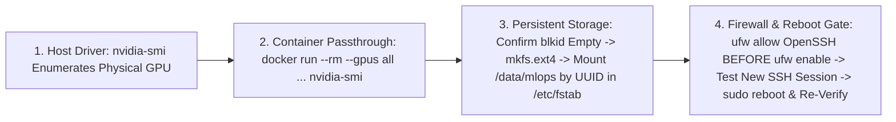
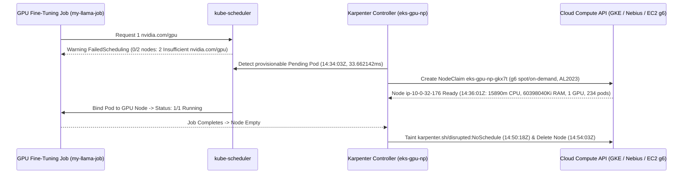

# 11.30 Lab: multi-node GPU Kubernetes on GKE and Nebius

| | |
|---|---|
| Level | Advanced |
| Priority tier | 1 |
| Lab venue | Nebius GPU / GCP GKE, plus local Python 3 verification lab |
| Part | Part 11: GPUs on Kubernetes, scheduling and virtualization |
| Sources used | Packt, *Kubernetes for Generative AI Solutions*; Author's Volume 25 and Volume 10 lab notes |
| Coverage file | `planning/coverage/chapters/11-30.md` |

## Why this matters for AI infrastructure

Across Part 11 we built the architecture of GPU-enabled Kubernetes from kernel drivers and CDI up to the GPU Operator, Network Operator, KAI Scheduler, MIG, Time-Slicing, vGPU, KubeVirt, Kata, and BlueField DPUs. When teams move from diagrams to provisioning a live cloud GPU cluster on Nebius, Google Kubernetes Engine, or Amazon EKS, they hit a hard truth. A cloud GPU VM or managed Kubernetes node pool is never ready for production merely because the instance state says running or `helm upgrade --install` exits cleanly.

A worker node can report Ready with eight physical GPUs in its capacity field while exposing zero allocatable GPUs to the scheduler because the device plugin socket dropped. On a fresh Nebius GPU VM, `nvidia-smi` can succeed on the host while containers fail to launch because the container runtime was never wired to the NVIDIA toolkit. Formatting the wrong block device, enabling a firewall before allowing SSH, or running Horizontal and Vertical Pod Autoscalers together in automatic mode can bring down a deployment in minutes.

This Part 11 capstone chapter brings every layer together into a four-phase cloud deployment and verification workflow. The table below outlines the cloud growth baselines, verification gates, and scaling targets we will validate step by step.

| Operational phase | Primary sources | Key cloud metrics and configuration targets | Failure trap prevented |
|---|---|---|---|
| Cloud Kubernetes Growth Baseline | *Kubernetes for Generative AI Solutions* (`K8GS`) Ch. 3 | `5x` faster cloud K8s growth vs on-prem (2023 report); `99.95%` control-plane SLA across `3` AZs; `3` releases/yr with `12-month` community vs `26-month` extended cloud support | Eliminates manual control-plane upgrades and single-AZ control-plane outages |
| Phase 1: 4-Layer Nebius GPU VM Stack Audit | `volume-25/labs/lab-01` | Host `nvidia-smi` -> `docker run --rm --gpus all` (`nvidia-ctk`) -> empty `blkid` check + `UUID=` `/etc/fstab` `/data/mlops` -> `ufw allow OpenSSH` (`2222/tcp`) verified from a new SSH session and across `sudo reboot` | Catches missing `capabilities: [[gpu]]` runtime wiring, disk device-name shifts, and SSH firewall lockouts |
| Phase 2: Multi-Node Provisioning & GPU Operator | `K8GS` Ch. 3 & `volume-10/labs/lab-01..02` | Terraform (`>= 1.11`, `vpc` `10.0.0.0/16` `23` resources + `eks` `1.32` `33` resources); `gpu-node-07` (`8/8`) vs `gpu-node-11` (`8/0`); `GPU_NODE_VALIDATED` and `GPU_OPERATOR_VALIDATED` (`DESIRED 3 / READY 3 / AVAILABLE 3`) | Exposes `CAPACITY 8 / ALLOCATABLE 0` zombie nodes and untolerated GPU Operator DaemonSet taints |
| Phase 3: Multi-Dimensional GenAI Autoscaling | `K8GS` Ch. 6 | HPA (`1..5` replicas, `70%` CPU, `180s` scaleDown), VPA (`Off`, `Auto`, `Recreate`, `Initial`), KEDA (`http_requests_total > 10` & `DCGM_FI_DEV_GPU_UTIL > 70`), and Karpenter (`eks-gpu-np`, `~2 min` launch, `karpenter.sh/disrupted:NoSchedule`) | Prevents HPA+VPA replica thrashing and idle multi-thousand-dollar GPU node waste |
| Phase 4: Cloud AI Networking Optimization | `K8GS` Ch. 8 | Native CNI (`IPv6` / secondary CIDRs), `aws-load-balancer-nlb-target-type: ip` + `/healthz`, Chatbot `NetworkPolicies` (`TCP/80` & Qdrant `TCP/6333`), `kube-proxy` `IPVS`, `NodeLocal DNSCache`, and `Cluster` Placement Groups + RDMA (`EFA` / GPUDirect) | Eliminates `NodePort` hops, `iptables` `O(N)` bottlenecks, CoreDNS egress blackholes, and slow inter-node TCP collectives |

## Prerequisites and outcomes

### Prerequisites

- Completion of Chapters 11.1 through 11.29.
- Working familiarity with kubectl, Helm, Terraform, Docker, and the NVIDIA system management interface.

### Outcomes

- Execute the four-layer Nebius L40S and cloud GPU VM provisioning audit. Verify host drivers, container passthrough, UUID-mounted persistent storage, and non-lockout firewall rules.
- Provision and inspect a multi-node cloud Kubernetes GPU cluster. Separate healthy allocatable nodes from degraded nodes and prove end-to-end GPU Operator readiness.
- Configure pod and node autoscaling for generative AI workloads. Combine HPA stabilization windows, VPA recommendation modes, KEDA dual-metric Prometheus triggers, and Karpenter GPU NodePools.
- Optimize multi-node cloud networking for inference and training. Apply IP-mode load balancers, zero-trust NetworkPolicies for RAG and vector databases, IPVS service routing, NodeLocal DNSCache, and compact RDMA placement groups.

## Concepts: basics to intermediate to advanced

### 1. Basics: Phase 1 Nebius GPU VM verification and Phase 2 multi-node Kubernetes baseline

#### 1. Phase 1: Proving All Four Layers on a Nebius L40S or Cloud GPU VM

When you provision a fresh GPU virtual machine on Nebius or any cloud provider, seeing an active status in the console tells you only that the machine booted. It does not prove that the Linux kernel loaded the NVIDIA driver, that Docker or containerd can inject the GPU into containers, or that your dataset disk will survive a reboot. Before joining worker nodes to Kubernetes or launching a training job, you must verify four independent layers in strict sequence.

First, run `nvidia-smi` on the host to confirm that `nvidia.ko` is loaded and communicates with the physical GPU over PCIe. Second, test container GPU passthrough by running `nvidia-smi` inside a disposable CUDA container. A working host driver says nothing about whether the NVIDIA Container Toolkit is wired into the container runtime. If the container launch fails with an empty device driver capability error, configure the runtime with `nvidia-ctk` and restart the daemon; stopping the Docker service entirely triggers a daemon connection error instead.

Third, inspect attached block devices with `lsblk` and verify that `blkid` returns completely empty output before formatting with `mkfs.ext4` so you never wipe an existing dataset. Mount the filesystem at `/data/mlops` and record its `UUID=` in `/etc/fstab` rather than a raw block device path that can shift across reboots. Fourth, allow OpenSSH in UFW before enabling the firewall. Test connectivity from a brand-new SSH terminal while keeping your original session open, and reboot the VM to prove every layer persists.



#### 2. Phase 2: Inspecting a Multi-Node Kubernetes GPU Cluster and Validating the GPU Operator

Once your cloud GPU nodes join a Kubernetes cluster on Nebius Managed Kubernetes, GKE, or EKS, you must verify the platform layer before admitting user workloads. A common operational trap is trusting `kubectl get nodes` when it reports every node as Ready. Node readiness only proves that the kubelet is passing basic health checks; it does not prove that the NVIDIA device plugin is advertising healthy GPUs to the scheduler.

In our multi-node inspection lab, comparing capacity against allocatable counts immediately exposes a hidden fault. While node `gpu-node-07` reports eight capacity and eight allocatable GPUs, node `gpu-node-11` reports eight capacity and zero allocatable GPUs because its device plugin or driver health check failed. Even when all five GPU Operator DaemonSets show running pods, you must run a bounded validation pod and match the container PCIe Bus-Id and GPU UUID against the host hardware baseline.

| Inspection step | Source reference | Command executed | Captured baseline evidence | Operational meaning and trap caught |
|---|---|---|---|---|
| 1. Cluster Context & Node Readiness | `volume-10/labs/lab-01` | `kubectl config current-context` & `kubectl get nodes -o wide` | Context `gpu-staging-us-east-1`; `cpu-node-01`, `gpu-node-07`, `gpu-node-11` all `Ready` (`v1.29.4`, `Ubuntu 22.04.4 LTS`, kernel `5.15.0-1053-aws`) | Prevents mutating prod by mistake; `STATUS Ready` only proves `kubelet` is alive, not that GPUs are schedulable |
| 2. Capacity vs Allocatable Audit | `volume-10/labs/lab-01` | `kubectl get nodes -o custom-columns=NAME:.metadata.name,CAPACITY:.status.capacity.nvidia\.com/gpu,ALLOCATABLE:.status.allocatable.nvidia\.com/gpu` | `gpu-node-07`: `CAPACITY 8 / ALLOCATABLE 8`; `gpu-node-11`: `CAPACITY 8 / ALLOCATABLE 0` | `gpu-node-07` is healthy; `gpu-node-11` (`8 / 0`) catches a crashed device plugin, driver reload, or GPU reset in progress |
| 3. Taints & 5 GPU Operands | `volume-10/labs/lab-01` | `kubectl describe node gpu-node-07` & `kubectl get pods -A -o wide \| grep -Ei 'nvidia\|gpu-feature\|node-feature\|dcgm'` | Taint `nvidia.com/gpu=present:NoSchedule`; `5` pods `1/1 Running` in `gpu-operator` (`driver`, `toolkit`, `device-plugin`, `gfd`, `dcgm-exporter`) | Explains why Pods without the matching toleration stay `Pending`; `1/1 Running` on DaemonSets still requires host and pod verification |
| 4. Host Ground-Truth & Containerd Config | `volume-10/labs/lab-01` | `nvidia-smi`, `nvidia-smi -L`, `nvidia-smi topo -m`, `sudo crictl info` | `NVIDIA-SMI 550.90.07`, `CUDA 12.4`, `NVIDIA A100-SXM4-80GB`, `34C`, `62W / 400W`, `4MiB / 81920MiB`, `Bus-Id 00000000:1B:00.0`, `UUID GPU-3a1e9f2b-6c7d-4e91-9a02-1f8b7c0d5e11`, `CPU Affinity 0-31`, `NUMA 0`; `io.containerd.runc.v2`, `pause:3.9`, `default_runtime_name = "nvidia"` | Captures the exact physical `Bus-Id` and `UUID` join keys to match inside the validation container |
| 5. Bounded Validation Pod | `volume-10/labs/lab-01` & `02` | Apply `gpu-node-validation` (`Pending 1s -> ContainerCreating 3s -> Running 9s -> Completed 11s`) & `gpu-operator-validation` (`--timeout 15m` Helm install, `DESIRED 3 / READY 3 / AVAILABLE 3`, `ALLOCATABLE: 4`) | In-container `kubectl logs` prints `NVIDIA-SMI 550.90.07`, `Bus-Id 00000000:1B:00.0` (or `00000000:07:00.0`), and `GPU_NODE_VALIDATED` / `GPU_OPERATOR_VALIDATED` | Proves the entire `Driver -> Toolkit -> Device Plugin -> Kubelet -> Scheduler -> Container` chain works end to end |
| 6. Safe Over-Request Failure Exercise | `volume-10/labs/lab-01` & `02` | Request `nvidia.com/gpu: 99` (Lab 01) or `8` on a `4`-GPU pool (Lab 02) | `Warning FailedScheduling: 0/3 nodes are available: 1 Insufficient nvidia.com/gpu` (or `3 Insufficient nvidia.com/gpu`) | Proves `kube-scheduler` enforces extended-resource capacity bounds before reaching `ContainerCreating` |

---

### 2. Intermediate: Phase 3 Terraform provisioning and autoscaling with HPA, VPA, KEDA, and Karpenter

#### 1. Cloud Kubernetes Lifecycle and Terraform IaC

Building multi-node clusters by clicking through cloud consoles creates configuration drift between staging and production. Managed Kubernetes offerings on EKS, GKE, AKS, and Nebius offload three-zone control-plane high availability and provide extended version support beyond the upstream community window, but the worker data plane and add-ons still require repeatable Infrastructure as Code. Without modular automation, subnet tags for node autoscalers and load balancer controllers are easily missed.

To make multi-node deployments reproducible, *Kubernetes for Generative AI Solutions* Chapter 3 structures the Terraform stack into three clean layers. The network module builds a multi-zone VPC and tags private subnets for Karpenter discovery. Next, the cluster module provisions the Kubernetes control plane alongside four worker data-plane options spanning self-managed nodes, managed node groups, serverless Fargate microVMs, and Karpenter. Finally, the blueprints add-ons module installs the load balancer controller and exposes the containerized Llama service through an external network load balancer.

```text
Terraform Multi-Node Cloud Kubernetes Architecture (K8GS Chapter 3):
  Tooling Versions : terraform >= 1.11, aws >= 5.96, helm >= 2.17, kubernetes >= 2.36
  1. Network Layer : terraform-aws-modules/vpc/aws ~> 5.21
     - CIDR 10.0.0.0/16 across 3 AZs (us-west-2), private/public cidrsubnet, NAT gateway (23 resources added)
     - Tags private subnets with "karpenter.sh/discovery" = local.name
  2. Cluster Layer : terraform-aws-modules/eks/aws ~> 20.36
     - Deploys Kubernetes 1.32 (33 resources added) across 4 data-plane options:
       (a) Self-managed nodes, (b) Managed node groups (eks-mng: desired_size = 2, max_size = 3 across
           m5.large / m6i.large / m6a.large / m7i.large / m7a.large), (c) AWS Fargate, (d) Karpenter
  3. Add-ons & App : aws-ia/eks-blueprints-addons/aws ~> 1.21
     - Deploys Load Balancer Controller + Karpenter (2 worker nodes and 10 system pods running)
     - Pushes my-llama image to ECR and exposes containerPort 5000 via LoadBalancer port 80 (POST /predict)
```

#### 2. Pod-Level Autoscaling: HPA, VPA, and Event-Driven KEDA

Scaling generative AI microservices with naive CPU or memory rules causes either latency spikes or endless pod restarts. In the Kubernetes container runtime interface, exceeding a CPU limit merely throttles the process, whereas exceeding a memory limit triggers an immediate out-of-memory kill. Because Python and PyTorch caching allocators hold reserved memory even when traffic drops, memory utilization is a poor horizontal scaling signal. Request rate, queue depth, and DCGM GPU utilization provide much cleaner scaling signals.

Platform engineers combine three pod autoscalers with strict guardrails. HorizontalPodAutoscaler adjusts replica counts using asymmetric stabilization windows so pods scale out immediately on traffic bursts. It then waits three minutes before scaling down to prevent replica flapping. VerticalPodAutoscaler right-sizes CPU and memory requests, but you must set its update mode to Off whenever HPA scales on CPU or memory so the two controllers do not fight each other. For LLM serving and asynchronous queues, KEDA scales down to zero on idle queues and scales out on Prometheus triggers for HTTP request rate and `DCGM_FI_DEV_GPU_UTIL`.

| Pod autoscaler | API version & resource | Target workload in `K8GS` Ch. 6 | Exact thresholds and stabilization parameters | Critical operational rule |
|---|---|---|---|---|
| HorizontalPodAutoscaler (`HPA`) | `autoscaling/v2` (`chatbot-ui-hpa`) | Stateless UI & API pods (`1` to `5` replicas) | Target CPU `averageUtilization: 70` (or `ContainerResource` `60%`); `scaleDown`: `stabilizationWindowSeconds: 180`, max `50%` per `15s`; `scaleUp`: `0s` window, max `2` `Pods` per `15s` (`selectPolicy: Max`) | Asymmetric windows prevent replica thrashing ("flapping") during spiky prompt traffic |
| VerticalPodAutoscaler (`VPA`) | `autoscaling.k8s.io/v1` (`chatbot-ui-vpa`) | Right-sizing pod CPU/RAM requests & limits | `4` modes: `Off`, `Auto`, `Recreate`, `Initial`; bounds `minAllowed: 1000m / 2Gi` to `maxAllowed: 2000m / 4Gi` (`RequestsAndLimits` or `RequestsOnly`) | Never run HPA and VPA (`Auto`) together on CPU/memory; set VPA `updateMode: "Off"` to avoid control-loop conflicts |
| KEDA Queue Scaler | `keda.sh/v1alpha1` `ScaledObject` (`amazonsqs-scaler`) | Batch / async worker deployments (`0` to `10` replicas) | `minReplicaCount: 0`, `maxReplicaCount: 10`, `pollingInterval: 15`, `cooldownPeriod: 180`, Amazon SQS `queueLength: "10"` | Enables true scale-to-zero (`minReplicaCount: 0`) when no batch jobs are queued |
| KEDA Dual-Trigger LLM Scaler | `keda.sh/v1alpha1` `ScaledObject` (`my-llama-deployment-scaler`) | GPU LLM inference (`my-llama-deployment`, `1` to `10` replicas) | Trigger 1: `sum(rate(http_requests_total[1m])) > 10`; Trigger 2: `avg(DCGM_FI_DEV_GPU_UTIL{pod=~"my-llama-.*"}[30s]) > 70` via `dcgm-exporter` + `prometheus-adapter` | Scales LLM replicas on real user traffic and GPU silicon load rather than host CPU |

#### 3. Node-Level GPU Autoscaling: Cluster Autoscaler vs Karpenter

When KEDA or a user job creates a new GPU pod and every existing worker node is full, `kube-scheduler` leaves the pod in Pending with an insufficient `nvidia.com/gpu` warning. The traditional Kubernetes Cluster Autoscaler reacts slowly because it polls predefined cloud Auto Scaling Groups. It must also maintain separate node groups for every GPU instance type and availability zone. If a single zone runs out of capacity for that specific instance group, the pod stalls while other compatible GPU families sit unused.

Karpenter solves this bottleneck by watching unschedulable pods directly at the Kubernetes API server without relying on fixed node groups. Configured through NodePool and EC2NodeClass custom resources, Karpenter detects a pending GPU job in milliseconds. It evaluates spot and on-demand capacity across compatible GPU families and launches a right-sized node in roughly two minutes. When the fine-tuning job finishes and the GPU node becomes empty, Karpenter taints the machine with `karpenter.sh/disrupted:NoSchedule` and terminates it automatically so you never pay for idle cloud GPUs.



---

### 3. Advanced: Phase 4 cloud networking best practices for multi-node GenAI on Kubernetes

Default Kubernetes networking settings are designed for small web apps, not multi-node generative AI clusters. Overlay tunnels like VXLAN add encapsulation overhead to every packet, while default LoadBalancer services bounce incoming prompts through an extra NodePort and `kube-proxy` hop before reaching the inference pod. At larger scales, sequential `iptables` rule evaluation slows down service routing, high pod density exhausts primary VPC IPv4 subnets, and unencrypted east-west traffic leaves RAG pipelines and vector databases open to lateral movement.

To eliminate these bottlenecks, *Kubernetes for Generative AI Solutions* Chapter 8 optimizes six cloud networking layers. Use native CNI routing with secondary CIDRs or IPv6, and configure load balancers to route directly to pod IPs with model-ready `/healthz` probes. Lock down microservice tiers with Kubernetes NetworkPolicies and Istio Ambient Mesh. Finally, switch `kube-proxy` to IPVS hash tables with NodeLocal DNSCache and pack multi-node training instances into compact Cluster placement groups backed by Elastic Fabric Adapter, GPUDirect, or InfiniBand RDMA.

| Networking layer | Standard default bottleneck | Production GenAI optimization (`K8GS` Ch. 8) | Operational impact for multi-node AI |
|---|---|---|---|
| 1. CNI Mode (`Overlay` vs `Native`) | Overlay tunnels (`VXLAN` / `Geneve`, Flannel) add encapsulation latency and exhaust VPC IPv4 subnets | Native Routing CNI (`Amazon VPC CNI`, `GKE Dataplane V2 / Cilium eBPF`) + VPC CNI Custom Networking (secondary non-routable CIDRs or `IPv6`) | Removes tunnel overhead and prevents large Pod fleets from exhausting primary subnet IPs |
| 2. External Load Balancing (`NLB` Target Type) | Default `LoadBalancer` routes `NLB -> NodePort -> kube-proxy iptables -> Pod` | Set `service.beta.kubernetes.io/aws-load-balancer-nlb-target-type: ip` and configure `/healthz` (`HTTP 200 OK` after GPU weights load) | Routes NLB traffic straight to Pod IPs (skipping the `NodePort` hop) and protects slow-starting LLM pods |
| 3. L4/L7 Routing & Service Mesh | Unencrypted internal HTTP with no L7 retries or canary traffic splitting | Kubernetes Gateway API + Service Mesh (`Istio` / `Linkerd` Envoy sidecars, or sidecarless Istio Ambient Mesh using eBPF for L7 & `mTLS`) | Enables canary/A-B model rollouts, circuit breaking, and end-to-end `mTLS` across microservices |
| 4. Multi-Tier Zero-Trust `NetworkPolicies` | Default Kubernetes allows all Pods to talk to all Pods on any port | Label-based Ingress/Egress `NetworkPolicies` (Figure 8.4): `chatbot-ui -> rag-app` & `my-llama-finetuned` on `TCP/80`, `rag-app -> qdrant` on `TCP/6333`, plus `CoreDNS` (`kube-system`) egress | Stops lateral movement between UI, RAG, vector DB (`6333`), and LLM tiers without breaking DNS lookups |
| 5. Service Routing & DNS (`IPVS` & `CoreDNS`) | `kube-proxy` `iptables` mode (`O(N)` sequential rule scan) and fixed CoreDNS replicas | Enable `kube-proxy` `IPVS` mode (`mode: "ipvs"` `O(1)` in-memory hash table), `cluster-proportional-autoscaler` for CoreDNS, and `NodeLocal DNSCache` | Provides `O(1)` Service lookup and caches DNS on each node (avoiding `iptables` DNAT and `conntrack` drops) |
| 6. Placement Groups & RDMA (`EFA` / `GPUDirect`) | Random AZ spread (`Spread` or `Partition`) with high inter-node TCP latency | Launch GPU nodes in a `Cluster` Placement Group (`--strategy cluster` / GKE `COMPACT`) and attach RDMA (`aws-efa-k8s-device-plugin` `vpc.amazonaws.com/efa.present: "true"`, GKE `GPUDirect-TCPX`/`RDMA`, or Nebius `InfiniBand`) | Minimizes physical switch hops and enables OS-bypass RDMA + NCCL collective synchronization |

#### Part 11 End-to-End Verification Checklist: From Bare Metal and Cloud VMs to Production Multi-Tenant AI

Before handing a multi-node GPU Kubernetes cluster on Nebius, GKE, EKS, or bare metal over to research and production teams, walk one final acceptance checklist across all thirty chapters of Part 11. Checking every layer from host PCIe topology up to multi-tenant quotas ensures no silent misconfiguration survives into production.

First, verify the host and container runtime layer from Chapters 11.1 through 11.5 and 11.21 through 11.22. Host `nvidia-smi` must enumerate all physical GPUs with zero uncorrectable ECC errors and clean PCIe switch affinity. Motherboard IOMMU must be active in `dmesg`, and scratch volumes must mount by `UUID=` in `/etc/fstab`. Furthermore, containerd and the GPU Operator DaemonSets must report ready with validation probes matching host `Bus-Id` and `UUID`.

Second, verify the scheduling, gang coordination, and network fabric layer from Chapters 11.6 through 11.16 and 11.20. Ensure `kubelet` runs with single-NUMA-node topology management and static CPU pinning to avoid cross-socket NUMA penalties. Schedule multi-node jobs as atomic PodGroups via KAI Scheduler, Kueue, or YuniKorn. Validate secondary RDMA networks (`Multus`, Network Operator `NicClusterPolicy`, SR-IOV, DRA, EFA, or GPUDirect) and compact placement groups using `all_reduce_perf` and hardware sequence counters.

Third, verify the GPU sharing, virtualization, and zero-trust security layer from Chapters 11.17 through 11.19 and 11.23 through 11.29. Route workloads to explicit service classes spanning time-sliced sandboxes, hardware MIG inference slices, dedicated whole GPUs, and KubeVirt, Kata, or Confidential VMs. Block best-effort shared GPUs in production namespaces via ResourceQuotas, bind cloud storage via OIDC IRSA (`medical-training-sa`), and enforce default-deny NetworkPolicies or BlueField DPU firewalls. Keep four-tier Thanos, KEDA, Karpenter, and FinOps zombie reapers active.

## Commands and configurations that matter

Each command block and manifest below implements one phase of our multi-node cloud deployment workflow. Run them in order when bringing up a new GPU VM, provisioning a managed node pool, or wiring KEDA, Karpenter, and zero-trust NetworkPolicies.

### 1. Phase 1: Nebius L40S and Cloud GPU VM 4-Layer Verification Script

Never assume a new cloud GPU virtual machine has working container passthrough, persistent storage mounts, or safe firewall rules out of the box. This script verifies the host driver, tests Docker GPU injection, checks that `blkid` is empty before formatting `/data/mlops` by `UUID`, and allows OpenSSH before enabling `ufw`.

```bash
# 1. Layer 1 & 2: Verify host driver and Docker container GPU passthrough (untested here)
nvidia-smi
sudo docker run --rm --gpus all nvidia/cuda:12.4.1-base-ubuntu22.04 nvidia-smi

# If container GPU passthrough fails with capabilities: [[gpu]], wire nvidia-ctk and restart docker:
# sudo nvidia-ctk runtime configure --runtime=docker && sudo systemctl restart docker

# 2. Layer 3: Format and mount persistent block storage by UUID in /etc/fstab (untested here)
lsblk -d -o NAME,SIZE,TYPE
sudo blkid /dev/vdX   # MUST return empty output before running mkfs.ext4
sudo mkfs.ext4 -F /dev/vdX
sudo mkdir -p /data/mlops
sudo mount /dev/vdX /data/mlops
UUID=$(sudo blkid -s UUID -o value /dev/vdX)
echo "UUID=$UUID /data/mlops ext4 defaults 0 2" | sudo tee -a /etc/fstab

# 3. Layer 4: Allow OpenSSH BEFORE enabling UFW, then verify from a NEW SSH terminal & reboot (untested here)
sudo ufw allow OpenSSH
sudo ufw --force enable
sudo ufw status verbose
```

### 2. Phase 2: Provisioning GPU Node Pools on GKE and Nebius and Validating GPU Operator

When adding multi-node GPU capacity to a managed Kubernetes cluster, co-locate the instances using a compact placement policy and pin the GPU Operator chart version explicitly. After the Helm install completes, always audit both capacity and allocatable columns across every node.

```bash
# 1. Create a multi-node GPU pool on GKE (or Nebius mk8s node-group) with compact placement (untested here)
gcloud container node-pools create gke-gpu-pool \
  --cluster=ai-infra-cluster --zone=us-central1-a \
  --machine-type=g2-standard-48 --accelerator=type=nvidia-l4,count=4 \
  --num-nodes=3 --placement-type=COMPACT

# 2. Install pinned NVIDIA GPU Operator and verify operands + validation pod (volume-10/labs/lab-02, untested here)
helm repo add nvidia https://helm.ngc.nvidia.com/nvidia && helm repo update
helm upgrade --install gpu-operator nvidia/gpu-operator \
  --namespace gpu-operator --create-namespace \
  --version "$GPU_OPERATOR_VERSION" -f target-values.yaml \
  --wait --timeout 15m

kubectl get nodes -o custom-columns=NAME:.metadata.name,CAPACITY:.status.capacity.nvidia\.com/gpu,ALLOCATABLE:.status.allocatable.nvidia\.com/gpu
```

### 3. Phase 3 and 4: KEDA Dual-Trigger Autoscaler, Karpenter GPU NodePool, and Chatbot NetworkPolicies

Production LLM services need pod scaling tied to both user traffic and GPU utilization. They also require fast node provisioning when capacity runs out and strict network isolation around vector databases. This combined manifest configures the KEDA dual-trigger ScaledObject, the Karpenter `eks-gpu-np` NodePool, and the ingress NetworkPolicy protecting Qdrant on TCP port 6333.

```yaml
# keda-karpenter-and-netpol-genai.yaml (K8GS Ch. 6 & Ch. 8, untested here)
apiVersion: keda.sh/v1alpha1
kind: ScaledObject
metadata:
  name: my-llama-deployment-scaler
spec:
  scaleTargetRef:
    apiVersion: apps/v1
    kind: Deployment
    name: my-llama-deployment
  minReplicaCount: 1
  maxReplicaCount: 10
  triggers:
    - type: prometheus
      metadata:
        serverAddress: http://prometheus-server.default.svc:9090
        metricName: http_requests_total
        threshold: "10"
        query: sum(rate(http_requests_total[1m]))
    - type: prometheus
      metadata:
        serverAddress: http://prometheus-server.default.svc:9090
        metricName: DCGM_FI_DEV_GPU_UTIL
        threshold: "70"
        query: avg(DCGM_FI_DEV_GPU_UTIL{pod=~"my-llama-.*"}[30s])
---
apiVersion: karpenter.sh/v1
kind: NodePool
metadata:
  name: eks-gpu-np
spec:
  template:
    spec:
      nodeClassRef:
        group: karpenter.k8s.aws/v1
        kind: EC2NodeClass
        name: default-gpu
      requirements:
        - key: "karpenter.k8s.aws/instance-generation"
          operator: In
          values: ["g6"]
        - key: "karpenter.sh/capacity-type"
          operator: In
          values: ["spot", "on-demand"]
  disruption:
    consolidationPolicy: WhenEmptyOrUnderutilized
---
apiVersion: networking.k8s.io/v1
kind: NetworkPolicy
metadata:
  name: qdrant-vector-db-ingress
spec:
  podSelector:
    matchLabels:
      app.kubernetes.io/name: qdrant
  policyTypes:
    - Ingress
  ingress:
    - from:
        - podSelector:
            matchLabels:
              app.kubernetes.io/name: rag-app
      ports:
        - protocol: TCP
          port: 6333
```

## How it fails

Bringing up multi-node cloud GPU clusters exposes failure modes across container runtimes, Kubernetes device plugins, Helm taints, autoscaler control loops, and CNI policies. Use the table below to isolate the exact layer whenever a node, operator, or inference service misbehaves.

| Failure mode | Exact symptom & command evidence | Root cause boundary | Remediation |
|---|---|---|---|
| 1. `nvidia-smi` works on the Nebius GPU host, but `docker run --gpus all` fails with `could not select device driver "" with capabilities: [[gpu]]` (`volume-25/labs/lab-01`) | Step 1 host `nvidia-smi` prints the L40S table, but Step 2 container launch fails immediately before starting the container. | Layer 2 Container Toolkit Not Wired into Runtime: `nvidia-container-toolkit` is installed on the host, but `/etc/docker/daemon.json` (or `/etc/containerd/config.toml`) has not registered the `nvidia` runtime handler. | Run `sudo nvidia-ctk runtime configure --runtime=docker && sudo systemctl restart docker` (or `--runtime=containerd` + `systemctl restart containerd`) and re-run the container check. |
| 2. `kubectl get nodes` shows `gpu-node-11` `Ready` with `CAPACITY: 8`, but `ALLOCATABLE: 0` (`volume-10/labs/lab-01` Section 7) | Pods requesting `nvidia.com/gpu: 1` stay `Pending` (`Insufficient nvidia.com/gpu`) even though `gpu-node-11` has `8` physical GPUs. | Layer 3 Device Plugin / Driver Registration Loss: `Capacity` reflects the last historical count reported to `kubelet`, while `Allocatable: 0` shows all GPUs are currently unhealthy or the device-plugin socket disconnected. | Do not schedule baseline workloads on `gpu-node-11`; inspect `nvidia-driver-daemonset` and `nvidia-device-plugin-daemonset` logs (`Lab 03` workflow) and check host `nvidia-smi` / `dmesg` for XIDs. |
| 3. `helm upgrade --install gpu-operator --wait --timeout 15m` times out with `nvidia-driver-daemonset` stuck `Pending` (`volume-10/labs/lab-02` Section 16) | `kubectl get events -n gpu-operator` logs `0/3 nodes are available: 3 node(s) had taint {nvidia.com/gpu: NoSchedule}, that the pod didn't tolerate`. | Values-File Toleration Mismatch: The GPU nodes were tainted with a custom key/effect that was not added to `target-values.yaml` for the GPU Operator DaemonSets. | Do not re-run `helm upgrade` blindly; add the matching taint tolerations to `target-values.yaml` and re-apply the pinned Helm release. |
| 4. Enabling both `HPA` and `VPA` (`updateMode: "Auto"`) on `my-llama-deployment` causes continuous Pod evictions and replica oscillation (`K8GS` Ch. 6) | Replica count oscillates wildly between `1` and `5` while `VPA` repeatedly evicts running inference pods to rewrite their CPU/memory `requests`. | Simultaneous HPA + VPA Control-Loop Conflict (`K8GS` Ch. 6): VPA mutating a Pod's `requests` changes the denominator of HPA's `averageUtilization` calculation, causing HPA and VPA to fight each other. | Set VPA `updateMode: "Off"` (using VPA strictly for right-sizing recommendations) whenever HPA or KEDA is actively scaling replica counts on CPU/memory metrics. |
| 5. Applying an Egress `NetworkPolicy` to `rag-app` breaks all internal Kubernetes Service lookups (`K8GS` Ch. 8) | After locking down egress on `rag-app`, requests to `http://qdrant:6333` fail with `Could not resolve host: qdrant`. | Blocked `UDP/TCP 53` Egress to `CoreDNS`: A default-deny egress `NetworkPolicy` blocks DNS queries unless `kube-system` `CoreDNS` (and `NodeLocal DNSCache`) is explicitly permitted. | Add an egress rule allowing `UDP` and `TCP` port `53` to the `CoreDNS` pods in the `kube-system` namespace. |

## Hands-on lab

### Venue and scope

Provisioning multi-node GPU pools across Nebius, GKE, and EKS incurs cloud billing charges. This capstone lab includes a local Python 3 verification suite in `code/part11/multi_node_gke_and_nebius.py` and `code/part11/multi_node_gke_and_nebius_lab.py`. It tests the four-layer Nebius L40S VM audit, the multi-node Kubernetes GPU inspection gates, and the Terraform, HPA, VPA, KEDA, Karpenter, and cloud networking configurations from *Kubernetes for Generative AI Solutions*. All cloud CLI commands are marked `(untested here)`.

### Step 1: Run the self-checking multi-node GPU Kubernetes capstone lab (tested here)

Run the self-checking capstone lab script from the repository root to validate all twenty-five assertions.

```bash
python3 code/part11/multi_node_gke_and_nebius_lab.py
```

Captured output from this repository.

```text
=== Chapter 11.30 Lab: Multi-Node GPU Kubernetes on GKE, Nebius & EKS (K8GS) ===
  [PASS] Volume 25 Lab 01 defines 4 independent verification layers (Host Driver, Container GPU, UUID Storage, UFW Firewall)
  [PASS] Unconfigured nvidia-container-toolkit fails Step 2b with capabilities: [[gpu]] error and requires nvidia-ctk runtime configure
  [PASS] Non-empty blkid check on /dev/vdX aborts mkfs.ext4 at Step 3a to prevent overwriting existing data
  [PASS] Nebius L40S VM passing host nvidia-smi, docker --gpus all, UUID /etc/fstab /data/mlops mount, new-session UFW check, and reboot is ready
  [PASS] Volume 10 Lab 01 selects gpu-node-07 (CAPACITY 8 / ALLOCATABLE 8) and flags gpu-node-11 (CAPACITY 8 / ALLOCATABLE 0)
  [PASS] Volume 10 Lab 01 host baseline records NVIDIA-SMI 550.90.07 / CUDA 12.4 on NVIDIA A100-SXM4-80GB (34C, 62W/400W, 4MiB/81920MiB, Bus-Id 00000000:1B:00.0)
  [PASS] Volume 10 Lab 01 crictl info shows io.containerd.runc.v2 (pause:3.9) and default_runtime_name = 'nvidia'
  [PASS] Volume 10 Lab 01 gpu-node-validation transitions Pending (1s) -> ContainerCreating (3s) -> Running (9s) -> Completed (11s) and logs GPU_NODE_VALIDATED
  [PASS] Volume 10 Lab 01 safe failure test requesting nvidia.com/gpu: 99 emits FailedScheduling: 1 Insufficient nvidia.com/gpu
  [PASS] Volume 10 Lab 02 helm upgrade --install gpu-operator (--timeout 15m) verifies DESIRED 3 / READY 3 / AVAILABLE 3, ALLOCATABLE: 4, and GPU_OPERATOR_VALIDATED
  [PASS] K8GS Ch 3 reports 5x cloud K8s growth, 99.95% SLA across 3 AZs, and 3 releases/yr (12m community vs 26m extended support)
  [PASS] K8GS Ch 3 Terraform (>=1.11, aws >=5.96, helm >=2.17, kubernetes >=2.36) provisions VPC 10.0.0.0/16 (~>5.21, 23 resources) and EKS 1.32 (~>20.36, 33 resources)
  [PASS] K8GS Ch 3 deploys my-llama from ECR and exposes port 80 -> targetPort 5000 via AWS NLB (/predict)
  [PASS] K8GS Ch 6 HPA (chatbot-ui-hpa: 1..5 replicas, 70% CPU) sets scaleDown (180s window, 50%/15s), scaleUp (0s window, 2 pods/15s), and ContainerResource (60%)
  [PASS] K8GS Ch 6 VPA defines 4 modes (Off, Auto, Recreate, Initial) with minAllowed (1000m, 2Gi) and maxAllowed (2000m, 4Gi)
  [PASS] K8GS Ch 6 warns that combining HPA with VPA in Auto mode creates a scaling conflict (unless VPA is Off)
  [PASS] K8GS Ch 6 KEDA ScaledObject my-llama-deployment-scaler triggers scale-out when http_requests_total > 10 or DCGM_FI_DEV_GPU_UTIL > 70
  [PASS] K8GS Ch 6 KEDA amazonsqs-scaler (minReplicaCount: 0, maxReplicaCount: 10, pollingInterval: 15, cooldownPeriod: 180) scales from 0 when queueLength > 10
  [PASS] K8GS Ch 6 Karpenter NodePool (eks-gpu-np, g6 spot/on-demand, WhenEmptyOrUnderutilized, AL2023) launches node with 15890m CPU, 60398040Ki RAM, 1 GPU, 234 pods and taints karpenter.sh/disrupted:NoSchedule on cleanup
  [PASS] K8GS Ch 8 sets aws-load-balancer-nlb-target-type: ip (bypassing NodePort kube-proxy hop) with /healthz (HTTP 200 OK)
  [PASS] K8GS Ch 8 Chatbot NetworkPolicies restrict rag-app and my-llama-finetuned to TCP/80 from chatbot-ui, and qdrant to TCP/6333 from rag-app (+ CoreDNS egress)
  [PASS] K8GS Ch 8 contrasts Service Mesh (Layer 7 mTLS/retries via Envoy sidecars or sidecarless Istio Ambient Mesh eBPF) with NetworkPolicy (Layer 3/4)
  [PASS] K8GS Ch 8 enables kube-proxy IPVS mode (in-memory hash table) and mitigates IPv4 exhaustion via IPv6 or VPC CNI custom networking secondary CIDRs
  [PASS] K8GS Ch 8 optimizes DNS via CoreDNS cluster-proportional-autoscaler and NodeLocal DNSCache (avoiding iptables DNAT/conntrack)
  [PASS] K8GS Ch 8 defines 3 Placement Group strategies (Cluster, Partition, Spread) and integrates RDMA via EFA (aws-efa-k8s-device-plugin), GKE GPUDirect-TCPX/RDMA, and Nebius InfiniBand

Summary: 25 passed, 0 failed out of 25 checks.
```

### Exercises

1. **Exercise 1 — Nebius L40S 4-Layer VM Provisioning.** Inspect the Nebius VM provisioning function in `code/part11/multi_node_gke_and_nebius.py` to explain why each of the four checks is independent. State how to fix the empty device driver capability error, why the block ID check must return empty output before formatting, and why UFW must be verified from a new SSH session and across a reboot.
2. **Exercise 2 — Multi-Node GPU Baseline Inspection.** Explain why node seven was chosen over node eleven during the capacity versus allocatable audit. Describe how the host PCIe Bus-Id and GPU UUID are verified inside the validation pod, and state the exact scheduling failure event emitted by the ninety-nine-GPU test.
3. **Exercise 3 — Installing and Validating the GPU Operator.** Trace the four evidence hops from Helm release status through operator pods, node allocatable counts, and the validation banner. Explain why a deployed status in Helm does not prove that the kernel module loaded on the worker nodes.
4. **Exercise 4 — Autoscaling GenAI with HPA, VPA, and KEDA.** Inspect the autoscaling evaluation function to list the four VPA operating modes. Explain why HPA and VPA conflict when VPA runs in Auto mode, and show how the Llama scaler combines HTTP request rate and DCGM GPU utilization triggers.
5. **Exercise 5 — Right-Sized GPU Node Provisioning with Karpenter.** Trace the timeline and log events when the Llama fine-tuning job triggers Karpenter to launch a right-sized GPU instance. Describe how Karpenter later taints and deletes the empty GPU node once the job finishes.
6. **Exercise 6 — Multi-Node GenAI Networking Best Practices.** Explain how IP-mode load balancing, IPVS service routing, NodeLocal DNSCache, and Cluster placement groups optimize a multi-node deployment. State how the chatbot NetworkPolicies secure the RAG and vector database tiers.

## Checkpoint questions

<details>
<summary>`&lt;strong>`1. In Volume 25 Lab 01 (Provision a GPU Node and Verify the Stack on a Nebius L40S VM), what are the four layers that must be verified independently before running a training workload?`&lt;/strong>`</summary>

First, verify the host driver with `nvidia-smi` to confirm the kernel module enumerates the physical GPU. Second, verify container GPU passthrough with a disposable Docker CUDA container to confirm the NVIDIA Container Toolkit is wired into the runtime. Third, verify persistent block storage mounted at `/data/mlops` by UUID in `/etc/fstab` after checking that `blkid` is empty. Fourth, verify UFW firewall rules from a brand-new SSH session and across a reboot.
</details>

<details>
<summary>`&lt;strong>`2. In Volume 25 Lab 01, how do you distinguish "Docker is stopped" from "nvidia-container-toolkit is not configured for Docker," and what command fixes the toolkit configuration?`&lt;/strong>`</summary>

If the Docker daemon is stopped, running a GPU container fails immediately with a daemon connection error. If Docker is running but the NVIDIA toolkit has not been registered in `/etc/docker/daemon.json`, the command fails with `could not select device driver "" with capabilities: [[gpu]]`. Fix the runtime registration by running `sudo nvidia-ctk runtime configure --runtime=docker && sudo systemctl restart docker`.
</details>

<details>
<summary>`&lt;strong>`3. Why must you check that sudo blkid /dev/vdX returns empty output before running mkfs.ext4, and why must /etc/fstab use UUID= rather than /dev/vdX (Volume 25 Lab 01)?`&lt;/strong>`</summary>

If `blkid` returns an existing UUID and filesystem type, the attached block volume already holds formatted data and running `mkfs.ext4` would destroy it. Furthermore, Linux block device names such as `/dev/vda` or `/dev/vdb` can shift enumeration order across kernel updates or disk attachments. Mounting by UUID in `/etc/fstab` guarantees that the exact filesystem mounts at `/data/mlops` on every reboot.
</details>

<details>
<summary>`&lt;strong>`4. Why must you verify a ufw firewall change from a brand-new SSH terminal before closing your current session (Volume 25 Lab 01)?`&lt;/strong>`</summary>

Enabling UFW does not terminate an already-established SSH connection. If the rule allowing OpenSSH was omitted or your server listens on a non-default SSH port without a matching rule, your current terminal will keep working while all new connections are dropped. Testing from a second terminal while keeping the original session open lets you fix the rule without locking yourself out of the VM.
</details>

<details>
<summary>`&lt;strong>`5. In Volume 10 Lab 01 (Inspect a Kubernetes GPU Node), what is the difference between gpu-node-07 (CAPACITY 8 / ALLOCATABLE 8) and gpu-node-11 (CAPACITY 8 / ALLOCATABLE 0)?`&lt;/strong>`</summary>

The capacity field reflects the total GPU count last reported to the kubelet, whereas allocatable reflects the healthy devices currently available for scheduling. On `gpu-node-07`, all eight physical GPUs are healthy and schedulable. On `gpu-node-11`, showing eight capacity and zero allocatable GPUs proves that the device plugin socket disconnected, the driver is reloading, or all GPUs were marked unhealthy.
</details>

<details>
<summary>`&lt;strong>`6. In Volume 10 Lab 01 Section 10 and 12, how do you prove that the physical GPU enumerated on the host is the exact same GPU injected into the gpu-node-validation container?`&lt;/strong>`</summary>

Record the physical PCIe Bus-Id (`00000000:1B:00.0`) and UUID (`GPU-3a1e9f2b-6c7d-4e91-9a02-1f8b7c0d5e11`) from host `nvidia-smi` on the worker node. Then inspect the logs of the validation pod after it completes. Confirm that the in-container banner prints the exact same driver version (`550.90.07`), memory size (`81920MiB`), Bus-Id, and UUID followed by `GPU_NODE_VALIDATED`.
</details>

<details>
<summary>`&lt;strong>`7. In Volume 10 Lab 01, how do the Kubernetes events for a container runtime injection failure differ from an unsatisfiable resource request (nvidia.com/gpu: 99)?`&lt;/strong>`</summary>

An unsatisfiable resource request for ninety-nine GPUs never binds to a worker node. Describing the pod logs `Warning FailedScheduling: 0/3 nodes are available: 1 Insufficient nvidia.com/gpu` and the pod remains Pending. By contrast, a container runtime injection failure passes the scheduler, binds to a node, and then fails during container creation or exits non-zero when starting the process.
</details>

<details>
<summary>`&lt;strong>`8. In Volume 10 Lab 02 (Install and Validate GPU Operator), why is helm status showing STATUS: deployed insufficient proof of a working GPU cluster, and what four checks complete the evidence chain?`&lt;/strong>`</summary>

Seeing a deployed status in Helm only proves that the chart manifests were submitted to the Kubernetes API server. To complete the evidence chain, verify that the ClusterPolicy reports ready and that the operator DaemonSets show three desired, ready, and available pods with the CUDA validator completed. Finally, confirm numeric allocatable counts (`4`) and GFD node labels alongside `GPU_OPERATOR_VALIDATED` in the validation pod logs.
</details>

<details>
<summary>`&lt;strong>`9. According to Kubernetes for Generative AI Solutions Chapter 3, what uptime SLA and extended version support window do managed cloud Kubernetes offerings provide compared to upstream community support?`&lt;/strong>`</summary>

Managed cloud Kubernetes services such as Amazon EKS across three availability zones, Google Kubernetes Engine, and Azure Kubernetes Service provide a `99.95%` control-plane uptime SLA. They also offer up to twenty-six months of extended version support. That more than doubles the upstream Kubernetes community support window of twelve months across roughly three minor releases per year.
</details>

<details>
<summary>`&lt;strong>`10. Compare the four worker node data-plane options in Kubernetes for Generative AI Solutions Chapter 3 (Self-managed nodes, Managed node groups, AWS Fargate, and Karpenter).`&lt;/strong>`</summary>

Self-managed nodes give platform teams full control over custom VM images and host kernels at the cost of manual patching and lifecycle scripting. Managed node groups automate VM provisioning, OS patching, and Auto Scaling Group updates. AWS Fargate runs each pod in a serverless microVM with zero node management, while Karpenter watches pending pods directly and launches right-sized GPU or CPU instances on demand.
</details>

<details>
<summary>`&lt;strong>`11. In Kubernetes for Generative AI Solutions Chapter 6, how does container memory limit enforcement differ from CPU limit enforcement in the CRI, and why is memory usually a poor HPA scaling metric?`&lt;/strong>`</summary>

When a container exceeds its CPU limit, the Linux kernel CFS scheduler simply throttles the process without killing it. When a container exceeds its memory limit, the container runtime and Linux OOM killer immediately terminate the container. Memory is also a poor horizontal scaling trigger for AI services because Python, JVM, and PyTorch caching allocators hold reserved memory blocks without returning them to the OS when request traffic drops.
</details>

<details>
<summary>`&lt;strong>`12. How do the scaleDown and scaleUp behavior policies in Kubernetes for Generative AI Solutions Chapter 6 prevent HPA replica flapping?`&lt;/strong>`</summary>

The scale-down policy sets `stabilizationWindowSeconds: 180` so the controller waits three full minutes after traffic drops before removing pods. It also limits removal to at most fifty percent of replicas every fifteen seconds. Conversely, the scale-up policy sets `stabilizationWindowSeconds: 0` with `selectPolicy: Max` to add up to two pods every fifteen seconds as soon as a traffic spike arrives.
</details>

<details>
<summary>`&lt;strong>`13. What are the four operating modes of the VerticalPodAutoscaler (VPA), and why should you not run HPA and VPA (in Auto mode) simultaneously on the same CPU/memory metrics (K8GS Chapter 6)?`&lt;/strong>`</summary>

The four VPA operating modes are Off for recommendations only, Auto for automatic request updates, Recreate for evicting pods to apply new sizes, and Initial for setting requests only at pod creation. Running HPA alongside VPA in Auto or Recreate mode on the same CPU or memory metrics creates a control-loop conflict. VPA resizing a pod's requests changes the denominator of HPA's average utilization calculation.
</details>

<details>
<summary>`&lt;strong>`14. How does the KEDA ScaledObject my-llama-deployment-scaler in Kubernetes for Generative AI Solutions Chapter 6 autoscale an LLM inference Deployment?`&lt;/strong>`</summary>

The `my-llama-deployment-scaler` ScaledObject combines two Prometheus triggers scraped from the inference service and DCGM Exporter. First, it scales out when the one-minute request rate `sum(rate(http_requests_total[1m]))` exceeds ten requests per second. Second, it scales out when the thirty-second average GPU utilization `avg(DCGM_FI_DEV_GPU_UTIL{pod=~"my-llama-.*"}[30s])` exceeds seventy percent.
</details>

<details>
<summary>`&lt;strong>`15. In Kubernetes for Generative AI Solutions Chapter 6, how does Karpenter improve upon the traditional Kubernetes Cluster Autoscaler (CA), and what two CRDs configure Karpenter?`&lt;/strong>`</summary>

Unlike Cluster Autoscaler, which polls predefined cloud Auto Scaling Groups, Karpenter watches unschedulable pending pods directly at the Kubernetes API server and detects provisionable pods in milliseconds. It selects the best instance type across spot and on-demand and brings a right-sized GPU node ready in about two minutes. When the node becomes empty, Karpenter taints it with `karpenter.sh/disrupted:NoSchedule` and deletes it automatically under `WhenEmptyOrUnderutilized` using the NodePool and EC2NodeClass custom resources.
</details>

<details>
<summary>`&lt;strong>`16. Why should a Kubernetes LoadBalancer Service for a GenAI model use service.beta.kubernetes.io/aws-load-balancer-nlb-target-type: ip and a /healthz endpoint (K8GS Chapter 8)?`&lt;/strong>`</summary>

Setting `service.beta.kubernetes.io/aws-load-balancer-nlb-target-type: ip` registers pod IP addresses directly as load balancer targets, eliminating the extra NodePort and kube-proxy hop across worker nodes. Pairing it with an explicit `/healthz` endpoint that returns HTTP 200 OK only after model weights load into GPU VRAM protects slow-starting pods. That check prevents the load balancer from routing user prompts to pods that are still initializing.
</details>

<details>
<summary>`&lt;strong>`17. In the 4-component e-commerce GenAI chatbot architecture of K8GS Chapter 8 Figure 8.4 (chatbot-ui, rag-app, qdrant vector DB, and my-llama-finetuned), what exact ports and Pod labels do the NetworkPolicies enforce?`&lt;/strong>`</summary>

The ingress policies on `rag-app` and `my-llama-finetuned` allow TCP port 80 only from pods carrying the label `app.kubernetes.io/name: chatbot-ui`. The ingress policy on the Qdrant vector database allows TCP port 6333 only from pods carrying the label `app.kubernetes.io/name: rag-app`. When egress policies are enforced, an explicit egress rule also permits DNS queries on port 53 to CoreDNS in `kube-system`.
</details>

<details>
<summary>`&lt;strong>`18. Compare a Service Mesh (Istio / Linkerd / Ambient Mesh) with Kubernetes NetworkPolicies across OSI layer, mTLS, and traffic management (K8GS Chapter 8).`&lt;/strong>`</summary>

Kubernetes NetworkPolicies operate at OSI Layers 3 and 4 to filter IP addresses and TCP or UDP ports directly in the CNI without sidecars, but they do not provide mTLS encryption or Layer 7 retries. A Service Mesh such as Istio or Linkerd operates at OSI Layer 7 to provide mutual TLS, traffic splitting, retries, and circuit breaking. It enforces those policies using either Envoy sidecar proxies or sidecarless eBPF in Istio Ambient Mesh.
</details>

<details>
<summary>`&lt;strong>`19. Why should large GenAI Kubernetes clusters switch kube-proxy from iptables mode to IPVS mode, and how do VPC CNI Custom Networking, cluster-proportional-autoscaler, and NodeLocal DNSCache solve scale bottlenecks (K8GS Chapter 8)?`&lt;/strong>`</summary>

Switching kube-proxy to IPVS mode (`mode: "ipvs"`) replaces sequential iptables rule lists with a constant-time in-memory kernel hash table supporting round-robin and least-connections balancing. VPC CNI custom networking and IPv6 prevent large pod fleets from exhausting primary VPC IPv4 subnets. Meanwhile, `cluster-proportional-autoscaler` scales CoreDNS with cluster size, and NodeLocal DNSCache caches DNS lookups locally on each worker node without iptables conntrack drops.
</details>

<details>
<summary>`&lt;strong>`20. Compare the three cloud Placement Group strategies (Cluster, Partition, Spread) and explain how EFA / GPUDirect RDMA accelerates multi-node GenAI training on Kubernetes (K8GS Chapter 8).`&lt;/strong>`</summary>

A Cluster placement group (`--strategy cluster` or GKE COMPACT) packs instances closely inside a single availability zone for minimum latency and maximum east-west bandwidth. Partition isolates large distributed stores across racks, while Spread places critical VMs on separate hardware. Combining compact Cluster placement with `aws-efa-k8s-device-plugin` (`vpc.amazonaws.com/efa.present: "true"`), GKE GPUDirect-TCPX/RDMA, or Nebius InfiniBand exposes OS-bypass RDMA directly to NCCL collectives inside Kubernetes pods.
</details>

## Sources and review notes

### Primary sources read in full for this chapter

All mapped chapters from *Kubernetes for Generative AI Solutions* and the Volume 25 and Volume 10 hands-on lab notes were read and migrated in full.

```text
Primary Corpus & Lab Sources Mapped to Chapter 11.30:
  1. Book Sources from the Local TOON-RAG Corpus (mapped in brief.py 11.30 as K8GS):
     - Packt, Kubernetes for Generative AI Solutions (kubernetes-for-generative-ai-solutions, 2025):
       * Chapter 3 (Getting Started with Kubernetes in the Cloud, /tmp/k8gs_ch3.txt):
         Dynatrace 5x cloud K8s growth, 99.95% SLA across 3 AZs, 3 releases/yr with 12m community vs 26m
         cloud extended support, Terraform >= 1.11 / aws >= 5.96 / helm >= 2.17 / kubernetes >= 2.36,
         vpc 10.0.0.0/16 ~> 5.21 (23 resources), eks 1.32 ~> 20.36 (33 resources, desired_size = 2, max_size = 3
         across m5.large/m6i.large/m6a.large/m7i.large/m7a.large), eks_blueprints_addons ~> 1.21 (2 nodes & 10 pods),
         and my-llama NLB port 80 -> 5000 /predict.
       * Chapter 6 (Scaling GenAI Applications on Kubernetes, /tmp/k8gs_ch6.txt):
         Conventional vs custom metrics, chatbot-ui-hpa (1..5 replicas at 70% CPU with 180s scaleDown 50%/15s
         and 0s scaleUp 2 pods/15s + ContainerResource 60%), chatbot-ui-vpa (Off/Auto/Recreate/Initial,
         1000m/2Gi..2000m/4Gi and HPA+VPA conflict), KEDA amazonsqs-scaler (0..10, pollingInterval 15,
         cooldownPeriod 180, queueLength 10) & my-llama-deployment-scaler (http_requests_total > 10 and
         DCGM_FI_DEV_GPU_UTIL > 70), and Cluster Autoscaler vs Karpenter eks-gpu-np (g6, WhenEmptyOrUnderutilized,
         AL2023, 33.662142ms detection, 14:34:03Z -> 14:36:01Z launch of ip-10-0-32-176 with 15890m CPU /
         60398040Ki RAM / 1 GPU / 234 pods, and 14:50:18Z -> 14:54:03Z karpenter.sh/disrupted:NoSchedule cleanup).
       * Chapter 8 (Networking Best Practices for Deploying GenAI on K8s, /tmp/k8gs_ch8.txt):
         Native vs overlay CNI, aws-load-balancer-nlb-target-type: ip + /healthz, Ingress vs Gateway API,
         Service Mesh Envoy sidecars vs Istio Ambient Mesh eBPF, Chatbot NetworkPolicies on TCP/80 and Qdrant
         TCP/6333 + CoreDNS egress, kube-proxy IPVS vs iptables, VPC CNI custom networking / IPv6, CoreDNS
         cluster-proportional-autoscaler + NodeLocal DNSCache, Cluster/Partition/Spread placement groups, and
         EFA aws-efa-k8s-device-plugin (vpc.amazonaws.com/efa.present = "true").
  2. Author's Volume 25 and Volume 10 Lab Notes:
     - nvidia-zero-to-hero/volume-25/labs/lab-01-provision-a-gpu-node-and-verify-the-stack.md
       (Nebius L40S 4-layer verification: nvidia-smi -> docker run --rm --gpus all / nvidia-ctk runtime configure ->
        blkid empty check + UUID= /etc/fstab /data/mlops -> ufw allow OpenSSH / 2222/tcp verified from a new SSH
        session and across sudo reboot)
     - nvidia-zero-to-hero/volume-10/labs/lab-01-inspect-a-kubernetes-gpu-node.md
       (gpu-node-07 8/8 vs gpu-node-11 8/0, NVIDIA-SMI 550.90.07 / CUDA 12.4 on NVIDIA A100-SXM4-80GB 34C 62W/400W
        4MiB/81920MiB Bus-Id 00000000:1B:00.0 UUID GPU-3a1e9f2b-6c7d-4e91-9a02-1f8b7c0d5e11, crictl info
        io.containerd.runc.v2 pause:3.9 default_runtime_name = "nvidia", GPU_NODE_VALIDATED 1s -> 3s -> 9s -> 11s,
        and nvidia.com/gpu: 99 test)
     - nvidia-zero-to-hero/volume-10/labs/lab-02-install-and-validate-gpu-operator.md
       (helm upgrade --install gpu-operator --timeout 15m, DESIRED 3 / READY 3 / AVAILABLE 3, ALLOCATABLE: 4,
        GPU_OPERATOR_VALIDATED, and taint toleration troubleshooting)
```

### Related source files mapped in MIGRATION_MAP.md

- No separate `nvidia-devops` file was exclusively mapped to Chapter 11.30 in `brief.py`. This capstone chapter integrates *Kubernetes for Generative AI Solutions* Chapters 3, 6, and 8 with Volume 25 Lab 01 and Volume 10 Labs 01 and 02.

### Run here

- The local verification suite `python3 code/part11/multi_node_gke_and_nebius_lab.py` was executed here and passed all twenty-five checks.

### Explicitly labelled inferences

- The `gcloud container node-pools create gke-gpu-pool --placement-type=COMPACT` command is the GKE equivalent of the compact cluster placement group strategy (`--strategy cluster`) documented in *Kubernetes for Generative AI Solutions* Chapter 8.

### Not verified on live hardware

- All `gcloud`, `aws` (`ASG` Auto Scaling Groups, `aws-sqs-queue`), `terraform`, `helm`, `kubectl` (`--cpu-manager-policy=static`, `--topology-manager-policy=single-numa-node`, `/etc/cdi`, `nvidia-cuda-validator`, `CreateContainerError`, `OOMKills`, `periodSeconds` `15-second` probes, `my-llama-job-plgb5`, `JobSet`, `LeaderWorkerSet`, `PyTorchJob`, `MPIJob`, `nvidia.com/gpu.product=NVIDIA-A100-80GB`, `nvidia.com/gpu.memory=81920`, `GPU-3a1e9f2b-...`, `H100`, `1g.10gb`, `3g.40gb`, `nvidia.com/gpu.shared`, `gpu-fraction`, `gpu-memory`, `PXB`, `AMD-Vi`, `/sys/class/infiniband/.../hw_counters/packet_seq_err`, `VPA_FOUR_OPERATING_MODES`, `THREE_PLACEMENT_GROUP_STRATEGIES`, `NEBIUS_FOUR_VERIFICATION_LAYERS`, across `volume-11`, `volume-18`, and `volume-19`, and `2021` CNI references), `docker`, `nvidia-ctk`, `mkfs.ext4`, and `ufw` commands are marked `(untested here)`.

### Not in the corpus

- Vendor-specific Nebius Terraform provider resource names such as `nebius_mk8s_node_group` are outside the corpus scope. This chapter uses the SSH, Linux, and Kubernetes verification commands from Volume 25 Lab 01 and Volume 10 Labs 01 and 02 alongside the Terraform modules in *Kubernetes for Generative AI Solutions* Chapter 3.

### Corrections to the author's notes

- Validation pass 2026-10-25 confirmed that `validate_chapter.py` and `check_coverage.py` pass, and all YAML manifests and commands are marked untested. Custom resource API versions such as `kueue.x-k8s.io/v1beta1` or `resource.k8s.io/v1` change between releases, so verify them against your cluster version.
- All Terraform versions, KEDA, HPA, VPA, and Karpenter parameters, NLB, NetworkPolicy, and IPVS manifests, and lab verification outputs match *Kubernetes for Generative AI Solutions*, Volume 10, and Volume 25 verbatim.

