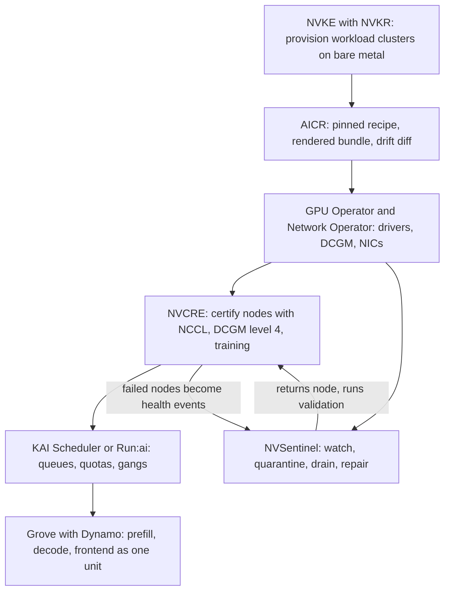

# 11.31 NVIDIA's open-source AI factory Kubernetes stack: NVKE, Run:ai, KAI, Grove, NVSentinel and AICR

| | |
|---|---|
| Level | Advanced |
| Priority tier | 1 |
| Lab venue | Local Python 3 and Docker (no GPU, no cluster) |
| Part | Part 11: GPUs on Kubernetes, scheduling and virtualization |
| Sources used | NVIDIA developer blog posts of 2026-05-31, 2026-10-13, 2026-11-05 and 2026-11-10; upstream repositories cloned 2026-11-11 (NVKE, NVKR, Run:ai, KAI Scheduler, Grove, Dynamo, AICR, NVCRE, NVSentinel); handbook chapters 11.13 to 11.20 and 19.2 |
| Research notes | `planning/research/nvidia_opensource_k8s_stack.md` |
| Code | `code/part11/c31_*` |

## Read this first

For NVKE in full, with the cluster spec, the API, installation, NVKR, runbooks, security and failure modes, read the three chapters that follow: [11.32 architecture, API and cluster spec](32-nvke-nvidia-kubernetes-engine-in-depth.md), [11.33 installation, NVKR and cluster lifecycle](33-nvke-in-depth-part-2-installation-nvkr-and-cluster-lifecycle.md) and [11.34 operations, security, failure modes and comparison](34-nvke-in-depth-part-3-operations-security-failure-modes-and-comparison.md).

NVKE is a management plane that runs managed Kubernetes on your own GPU bare metal, and NVKR builds its images and charts. AICR pins which driver, operator and plugin versions belong together. NVCRE certifies a cluster under real load. KAI Scheduler, inside the Run:ai platform, gives queues, quotas and gangs. Grove with Dynamo runs a multi-pod inference replica as one unit. NVSentinel detects faulty nodes and cordons, drains and repairs them.

**NVKE and NVKR are public previews and are not recommended for production.** That is NVIDIA's announcement and the NVKE README. The NVKE README and preview-status page, read at commit `487f511` of 2026-11-10, add four facts:

- The API serves plain HTTP on port 30080 with authentication off by default.
- NVKE does no authorization, so any admitted caller can delete any cluster.
- There is no management-plane upgrade or backup procedure.
- The customer admin kubeconfig cannot be revoked.

The other projects are less risky but still young, and section 11 grades each one. NVSentinel calls itself Beta/Stable, KAI is a 0.x CNCF Sandbox project, and Grove and NVCRE are early.

| Your goal | Read |
|---|---|
| Interview in a hurry | Sections 1, 11, 12 and 14, then the checkpoint questions |
| Decide what to adopt | Sections 10 and 11 |
| Run it on call | Sections 3, 8, 9 and 12 |
| Learn each project | Sections 3 to 8 |

## Why this matters for AI infrastructure

A new GPU cluster arrives on Monday. By Wednesday a training job is slow because one node has a flaky NIC. By Friday a second team asks why the inference service starts its decode pods before the prefill pods exist. Each problem belongs to a different tool, and until recently most of those tools were either closed or scattered across unrelated repositories.

In 2026 NVIDIA moved most of that tooling into open source. On 10 November 2026 it added NVKE, a management plane for running managed Kubernetes on your own GPU servers, together with its build system NVKR. Earlier, the Run:ai platform was released on 13 October 2026. The DSX OS layer, with AICR, the Cluster Readiness Engine and NVSentinel, was announced on 31 May 2026 and described in a workflow post on 5 November 2026. Grove, the inference orchestration API, sits beside Dynamo. KAI Scheduler had already been open since 2025.

A site reliability engineer needs a map of this stack more than a feature list. You should know which project does which job, which pieces overlap, which are mature, and which can hurt a production cluster if you switch them on too fast. Interviewers who ask "what NVIDIA open-source software would you use to run an AI cluster?" want that map, with honest caveats about maturity.

The map comes from the upstream repositories and NVIDIA's own posts. KAI manifests (19.2) and internals (11.13 to 11.18) are linked, not repeated.

## Prerequisites and outcomes

### Prerequisites

- 11.13 to 11.18 for KAI Scheduler and 11.19 for the Run:ai platform view. 11.20 for how KAI compares with Kueue, Volcano and Slurm.
- 11.4 and 11.5 for the GPU Operator. 11.7 for gang scheduling.
- Basic Helm and CRD knowledge.
- 19.2 for working KAI and Kueue manifests. This chapter links there and does not copy them.

### Outcomes

- Name every project in the stack, its repository, licence, latest release and maturity as of 2026-11-11.
- Explain what open-source Run:ai contains and what the commercial support offering adds.
- Place AICR, NVCRE, GPU Operator, KAI or Run:ai, Grove, Dynamo and NVSentinel in one lifecycle, in order.
- Pick the smallest set of projects for four cluster types.
- Judge production readiness with a checklist, and list failure modes and metrics for each project.
- Answer the interview question out loud in two minutes.

## 1. Seven jobs, seven projects

An on-call engineer is paged because a four-node training job has been pending for an hour. The cluster has free GPUs, but they are spread over nodes that cannot be used as a group. A different engineer, on the same day, is asked to prove that a newly delivered cluster is fit for production. A third is asked why a recently upgraded driver broke one node pool.

These are three different jobs, and a fourth sits below them: someone must create the cluster itself. Sorting out the open-source stack starts with naming the jobs, because each project exists to do exactly one of them.

| Job | Question it answers | Project |
|---|---|---|
| Provision | Who creates and upgrades the Kubernetes cluster on bare metal? | NVIDIA Kubernetes Engine (NVKE) with NVKR |
| Configure | Which versions of driver, operator and plugins belong together? | AI Cluster Runtime (AICR) |
| Certify | Does this cluster actually perform under real distributed load? | Cluster Readiness Engine (NVCRE) |
| Enable | Are GPUs, drivers, DCGM and networking present on the node? | GPU Operator and Network Operator (11.2 to 11.11) |
| Schedule | Which team gets which GPUs, as a gang, with fair share? | KAI Scheduler, inside the Run:ai platform |
| Serve | How do prefill, decode and frontend pods start, scale and place together? | Grove with Dynamo |
| Operate | Which node is failing, and what should happen to it? | NVSentinel |

The diagram shows the order in which a platform team meets these projects over a cluster's life. Configuration comes first and healing runs forever.



Read the diagram top to bottom for a new cluster. The loop between NVSentinel and NVCRE covers a node that breaks later.

The table below gives the one-line identity of each project as of 2026-11-11. Version numbers and star counts come from the GitHub API on that date. Stars are a popularity signal and say nothing about readiness.

| Project | Repository | Licence | Latest release | Stars |
|---|---|---|---|---|
| NVKE | `dsx-ai-factory/nvke` | Apache-2.0 | v0.23.1, 2026-11-03 | 1138 |
| NVKR | `dsx-ai-factory/nvkr` | Apache-2.0 | v0.1.0, 2026-10-22 | 25 |
| NVIDIA Run:ai | `dsx-ai-factory/run-ai` | Apache-2.0 | 3.0.22, 2026-11-02 | 742 |
| KAI Scheduler | `kai-scheduler/KAI-scheduler` | Apache-2.0 | v0.20.1 line, backports to v0.14 and v0.16 on 2026-11-10 | 1638 |
| Grove | `ai-dynamo/grove` | Apache-2.0 | v0.2.0-beta1, 2026-10-30 | 292 |
| Dynamo | `ai-dynamo/dynamo` | Apache-2.0 text in the licence file | v1.6.2, 2026-11-05 | 8467 |
| AICR | `NVIDIA/aicr` | Apache-2.0 | v1.2.0, 2026-11-02 | 472 |
| NVCRE | `NVIDIA/cluster-readiness-engine` | Apache-2.0 | v0.11.0, 2026-11-09 | 84 |
| NVSentinel | `NVIDIA/NVSentinel` | Apache-2.0 | v1.31.0, 2026-11-07 | 434 |

Two repository names deserve a note. The older addresses `NVIDIA/KAI-Scheduler` and `NVIDIA/grove` still resolve, but they now redirect to `kai-scheduler/KAI-scheduler` and `ai-dynamo/grove`. GitHub reports Dynamo's licence as unspecified because of an extra notice file, but the licence text itself is Apache 2.0.

**Decision rule:** Name the job first and the project second, and do not adopt a project whose job you have not yet felt as a problem.

**In one minute:** The stack has seven jobs: provision, configure, enable, certify, schedule, serve and operate. NVKE with NVKR, AICR, the operators, NVCRE, KAI or Run:ai, Grove with Dynamo, and NVSentinel each own one. All are Apache 2.0, but their versions range from a beta API to a long-lived product.

## 2. What was open-sourced, and when

A teammate says "NVIDIA open-sourced Run:ai last month". Someone else answers "KAI has been open for a year". Both are right, and the difference matters when you read a support contract or an architecture review.

KAI Scheduler is the scheduling engine that Run:ai built. NVIDIA released it under Apache 2.0 on 1 April 2025 after acquiring Run:ai, and it was later contributed to the Cloud Native Computing Foundation as a Sandbox project. The KAI repository README states the CNCF Sandbox status, and the Run:ai post of 13 October 2026 repeats it. Chapters 11.13 to 11.19 describe this part.

The second event came on 13 October 2026. NVIDIA announced that it was "making the full NVIDIA Run:ai platform available as open source software". The platform is the part around the scheduler: the control plane, the web interface, the command line, the REST API and the cluster services. The post names four modular components as separate repositories: the KAI Scheduler, a GPU fractioning operator, a resource management component and a Workload Map. The full platform lives in the `dsx-ai-factory/run-ai` repository.

The repository settles the licence. The root licence file is Apache 2.0, the README says so, and a notice file lists third-party code. The blog post is vaguer and says only "its applicable open source licenses". The same README warns that Apache 2.0 does not grant any right to use NVIDIA or Run:ai trademarks.

The third event is the DSX platform. NVIDIA announced DSX at GTC Taipei and published a post on 31 May 2026 describing DSX OS as an open, modular operating layer for AI factories. The post lists many components. Several are not Kubernetes software at all, for example power management and facility signal exchange. The three that matter for a Kubernetes SRE are AICR, NVSentinel, and the Cluster Readiness Engine that the 5 November post adds to the same workflow.

The 5 November post states that all three are Apache 2.0, and the repositories confirm it. The 31 May post names no licence for its components, so treat licence claims for the other DSX OS pieces, such as the bare-metal controller, as unchecked until you read the repository.

Grove deserves its own line. It started as part of the Dynamo project and lives in the `ai-dynamo` organisation. NVIDIA's Run:ai post lists it among related projects, and the KAI README announced a KAI and Grove integration in November 2025. Grove is not a part of the Run:ai monorepo.

| Date | Event | Source type |
|---|---|---|
| 2025-04-01 | KAI Scheduler open-sourced under Apache 2.0 | official NVIDIA blog, fetched 2026-11-11 |
| 2026-05-31 | DSX OS announced, including AICR and NVSentinel | official blog |
| 2026-10-13 | Full Run:ai platform open-sourced as a Community Product | official blog and repository |
| 2026-11-05 | Workflow post: configure with AICR, certify with NVCRE, operate with NVSentinel | official blog |
| 2026-11-10 | NVKE and NVKR released as public previews at KubeCon North America, with Snapshot and the OpenShell donation to the CNCF | official blogs and repositories |

A third-party article dated 12 October 2026 reported the Run:ai release one day before NVIDIA's own post. NVIDIA's post and the repository are the sources of record here.

**Decision rule:** When an engineer says "Run:ai is open source", ask whether they mean the scheduler or the whole platform, because the support answer differs.

**In one minute:** KAI has been open since 2025 and is a CNCF Sandbox project. The full Run:ai platform followed on 13 October 2026 under Apache 2.0. AICR, NVCRE and NVSentinel belong to the separate DSX OS layer, NVKE and NVKR followed on 10 November 2026, and Grove lives with Dynamo.

## 3. NVKE and NVKR: a managed Kubernetes service on your own GPUs

An AI factory operator owns a few hundred bare-metal GPU servers and sells clusters to internal teams or outside customers. Each customer wants an isolated Kubernetes cluster with its own control plane. Today the operator writes scripts around kubeadm and Cluster API, and every upgrade is a small project. On 10 November 2026, at KubeCon and CloudNativeCon North America, NVIDIA released software for exactly this job.

NVIDIA Kubernetes Engine (NVKE) is the management plane. Its README says it lets you "run a managed Kubernetes service on your own NVIDIA GPU infrastructure". You install it, customers request clusters through its API, and NVKE provisions the nodes and operates the clusters afterwards. Its companion, NVIDIA Kubernetes Recipes (NVKR), is the build system. It produces the node OS images, binaries, container images and Helm charts from pinned sources, records their software bills of materials, and signs hosted releases. Both are Apache 2.0 and live in the `dsx-ai-factory` GitHub organisation. NVIDIA's announcement and the NVKE README both label them a public preview and say they are not recommended for production.

The NVIDIA post says NVKE is conformance tested on Kubernetes 1.36 and certified as a Kubernetes AI platform and a Kubernetes installer. I could not check the certification itself. I read the pinned version in the repository documentation, which is 1.36.3.

### How it is built

The repository shows more than the blog post does. An installation has two kinds of cluster. A management cluster, formed from three pre-provisioned nodes by the `nvkectl` command line tool through a temporary seed cluster, runs the NVKE management plane. Each customer gets a workload cluster with its own control plane, etcd and node pools. The management plane is one controller process that serves a REST API backed by PostgreSQL, runs Temporal workflows for long operations, and runs Kubernetes reconcilers. A cluster request is written to a database row and an outbox table in one transaction. A poller then starts the workflow, which creates Cluster API objects and drives each node's `nvke-agent` over gRPC.

Machines come from NVIDIA Infra Controller, called NICo, which manages bare-metal hosts, firmware and networking. CAPNICo is the Cluster API infrastructure provider that lets Cluster API ask NICo for machines. At preview, NICo is the main infrastructure provider, and the docs say another provider called LaunchLayer is also supported once enabled. A node must present a TPM-backed SPIFFE identity before it receives join credentials. Networking uses NVIDIA's build of OVN-Kubernetes, and etcd encryption at rest is available per cluster. Lifecycle operations are scaling node pools, upgrading Kubernetes, replacing nodes and renewing certificates.

| Piece | Repository | Version checked | Role |
|---|---|---|---|
| NVKE | `dsx-ai-factory/nvke` | v0.23.1 (2026-11-03), v0.24.0 release candidates tagged | Management plane, `nvkectl`, node agent |
| NVKR | `dsx-ai-factory/nvkr` | v0.1.0 (2026-10-22) | Builds and signs NVKE and AICR artifacts |
| CAPNICo | `dsx-ai-factory/cluster-api-provider-nico` | v0.1.0 pinned by NVKE | Cluster API provider for NICo |
| NICo | `dsx-ai-factory/infra-controller` | not checked | Bare-metal lifecycle below Kubernetes |
| NKTP | `dsx-ai-factory/nvke-telemetry-pipeline` | not checked | OpenTelemetry pipeline for logs, metrics, traces |

NVKE's own documentation pins Cluster API core, kubeadm bootstrap and the kubeadm control-plane provider at v1.13.6. NVKE is not a Cluster API flavour and not a Kubernetes distribution, in the README's words. It is a "self-hosting factory" that adds what stock Cluster API lacks: durable workflows, etcd key management, node identity and the NICo integration. The documented node operating systems are Ubuntu 24.04 and 26.04, and clusters are IPv4 only.

### Where it sits in the stack

NVKE stops at a running, conformant Kubernetes cluster. Its docs put the GPU driver and software stack inside clusters with Nodewright and the GPU Operator through AICR, certification with the Cluster Readiness Engine, and workload-aware break-fix with NVSentinel. The documented bring-up order is NICo first, then the NVKE management cluster, then a workload cluster, then an AICR recipe bundle, then certification, then NVSentinel, then tenant workloads.

| Neighbour | Relationship to NVKE |
|---|---|
| Cluster API | NVKE drives it. Cluster API core, kubeadm and CAPNICo create the machines and control planes. |
| GPU Operator | Not part of NVKE. AICR installs it into the workload cluster after NVKE creates the cluster. |
| AICR | Configures the workload cluster. NVKR can also build AICR artifacts. |
| NVCRE | Certifies the new cluster. It never changes nodes. |
| NVSentinel | Decides when a node needs repair and applies cordon and drain. NVKE carries out the reboot or replacement. |
| KAI Scheduler and Run:ai | Not mentioned in the NVKE docs I read. They are tenant-side software that you install inside a workload cluster, as in section 4. |

One boundary matters in an incident. The NVKE docs say it is not responsible for deciding when tenant workloads may be disrupted. Cordon, drain and node SLO policy belong to the tenant's SRE team or a break-fix system such as NVSentinel.

### What managed means here

This comparison is the handbook's own reasoning. The NVKE documents do not compare it with other services, and the Nebius and hyperscaler documents were not consulted.

| Question | Managed Kubernetes from a cloud provider | NVKE |
|---|---|---|
| Who runs the management plane and its database? | The provider | You, the AI factory operator |
| Who wins the 3 a.m. page when cluster creation hangs? | The provider's on-call | You |
| Who gives customers a service level? | The provider | You, using what NVKE exposes |
| What do customers receive? | A cluster and an API | An admin kubeconfig at preview |
| Where do machines come from? | The provider's fleet | Your NICo-managed bare metal |

The first row is the key point. NVKE does not remove the work of running a managed service. It gives you the software for it, and the operator's responsibility list in the NVKE docs is long: NICo, the management cluster, artifact verification, the accelerated runtime, cluster availability and customer access. The customer owns workloads, images, namespaces, application secrets and role-based access control for its own users.

### The cluster request

The next listing is a cluster spec in the shape of the NVKE `CreateClusterRequest`. It is a handbook example with placeholder identifiers, adapted from the shape shown in the NVKE create guide.

```yaml
name: tenant-a
controlPlaneKubernetesVersion: 1.36.3
cniPlugin: ovn-kubernetes
etcdEncrypted: true
controlPlaneVIP: 10.20.0.50
network:
  podCIDR: 192.168.0.0/16
  serviceCIDR: 10.96.0.0/12
nico:
  orgID: example-org
  siteID: 00000000-0000-4000-8000-000000000001
  vpcID: 00000000-0000-4000-8000-000000000002
controlPlaneConfig:
  desiredCount: 3
  nico:
    instanceTypePreference:
      - 00000000-0000-4000-8000-000000000003
    vpcPrefixIDs:
      - 00000000-0000-4000-8000-000000000004
    sshKeyGroupIDs:
      - 00000000-0000-4000-8000-000000000005
    release: example-ubuntu-24.04-amd64
nodePools:
  - name: gpu-workers
    nodeNamePrefix: w
    desiredNodeCount: 2
    nodeLabels:
      nvidia.com/gpu.present: "true"
    nico:
      instanceTypeID: 00000000-0000-4000-8000-000000000006
      vpcPrefixIDs:
        - 00000000-0000-4000-8000-000000000004
      sshKeyGroupIDs:
        - 00000000-0000-4000-8000-000000000005
      release: example-ubuntu-24.04-amd64
```

Three fields deserve attention. The version has no leading `v`, and the API rejects one. `etcdEncrypted` is required, and the API reference says it can be turned on later but never off. The node labels are applied once when a node joins, and the preview cannot change them afterwards. This file validates against the repository's OpenAPI schema for `CreateClusterRequest` at commit `487f511` of 2026-11-10. NVKE's real CRDs, such as `NvkeCluster`, are internal. The public interface is the REST API. The OpenAPI file is version `0.1.0-alpha`, so the schema itself may change. It was not run against a management plane.

### Preview limits

A third-party write-up said the preview has no API authentication and no management-plane upgrade or backup procedure. The NVKE README and preview-status page confirm both. The table below is the part an SRE should read before anything else.

| Limit | What the NVKE docs say |
|---|---|
| API transport and auth | After install the API serves plain HTTP on port 30080 of every management node with authentication off. Three modes exist: off, permissive and enforcing. |
| Authorization | NVKE does none. Any admitted caller can call every endpoint, including cluster deletion. Per-customer authorization is on the roadmap as coming soon. |
| Management cluster | It does not upgrade, scale or replace itself. There is no management-plane upgrade procedure and no backup or restore procedure. |
| Secrets to keep | The bootstrap kubeconfig and the etcd encryption key file. The key file is the only copy not on a node. |
| Customer access | Customers receive only the admin kubeconfig. It cannot be revoked, because NVKE does not rotate a cluster's certificate authority. |
| Node pools | Changing a pool's configuration does not replace running nodes. Labels and taints are fixed at creation. `nvkectl` upgrades only the control plane. |
| Node images | A local image build is not a qualified release. Full-disk-encryption images are for evaluation and do not protect data at rest. |
| Telemetry | The default NKTP backend keeps data in memory and gives anonymous users admin access to Grafana. |

The roadmap lists, as coming soon, per-customer authorization, managing the management cluster's own nodes through NVKE, and Kubernetes 1.37. It lists other providers, virtual-machine control planes and GB300 and Vera Rubin worker nodes as work in progress. The roadmap says it shows direction, not commitments.

NVKR has its own preview label. Its README says commands, input schemas and behaviour can change and that it is not recommended for production. A local NVKR build is unsigned. Only the hosted workflows sign and publish releases.

The local quickstart needs no GPU. It uses a simulated NICo on a Linux host with 6 CPUs, 12 GiB of free memory and 100 GiB of free disk. It was not run, because the guide for macOS uses a virtual machine.

### Running a management plane as an SRE

If you adopt NVKE, you have taken on a stateful control system. Cluster state lives in PostgreSQL, a Temporal or outbox stall leaves a request accepted but idle, and a lost bootstrap kubeconfig or etcd key file cannot be replaced. Section 12 gives the signals for each.

Announced the same day were NVIDIA Snapshot, which restores checkpointed inference replicas, and OpenShell, an agent security runtime that NVIDIA is contributing to the CNCF as a Sandbox project. Neither is part of cluster management. Snapshot appears as an optional subchart in the Dynamo platform chart.

**Decision rule:** Evaluate NVKE on a lab with simulated machines, never expose its API to a shared network, and do not offer it to paying customers until authorization, upgrade and backup procedures exist.

**In one minute:** NVKE is a management plane you install to run managed GPU Kubernetes on your own bare metal. NVKR builds its images and charts. It sits below AICR, NVCRE, NVSentinel and the schedulers and drives Cluster API and NICo. It is an Apache 2.0 public preview with no API authorization, no management-plane upgrade or backup, and an unauthenticated HTTP default.

## 4. Run:ai: open source against commercial, and where KAI sits

A platform lead asks: "We have budget for the Run:ai licence. Do we still need it?" The honest answer depends on what you buy a licence for.

The repository's documentation says it directly. "NVIDIA Run:ai is available as open source. The NVIDIA Run:ai Support-Entitled Release is available for organizations that require NVIDIA enterprise support and an SLA." The product code is the same monorepo. The commercial offering adds a support relationship, a defined support lifecycle and the channels through which NVIDIA sells it.

The NVIDIA post gives the other side. The open-source path is a Community Product on the NVIDIA NGC catalog with a Helm chart for the integrated stack. "No paid NVIDIA Run:ai subscription or NVIDIA support entitlement is required for the Community Product", and equally, "NVIDIA enterprise support is not included". Downloading from NGC requires accepting the NVIDIA Software License Agreement and product-specific terms. Commercial editions continue through NVIDIA AI Enterprise, NVIDIA Mission Control and some cloud marketplaces.

The repository's own support page says only the current release branch is supported, which on 2026-11-11 was `release-3.0`. Help comes through GitHub Discussions and Issues, and security reports go to NVIDIA's product security team. The documentation also describes a lifecycle for the support-entitled product. Each version gets nine months of full support and three months of extended support, which makes twelve months in total. The policy page says it applies from 13 October 2026.

| Question | Community Product | Support-Entitled Release |
|---|---|---|
| Source code | Apache 2.0 monorepo | Same source base, per the documentation |
| NVIDIA enterprise support and SLA | Not included | Included |
| Support window per version | Current release branch only | 9 months full plus 3 months extended |
| Where help comes from | GitHub Issues and Discussions, CNCF Slack channel for KAI | NVIDIA support under the agreement |
| Install source | NGC Helm chart and `runai-oss` images | Per the commercial agreement |

Three points are unclear. I found no feature-by-feature comparison of the two editions and no statement on whether any feature is withheld from the Community Product. The post says the proprietary GPU fractioning was retired in favour of a native fractioning feature in CUDA 13.4. I could not confirm that CUDA claim in a second source, so label it as NVIDIA's statement. The support page describes the hosted SaaS control plane as a cloud service under separate terms, so assume it is not open source.

For an SRE, you can now read the scheduler and control-plane code and file issues in public. You cannot assume NVIDIA will answer a production outage on the Community Product. Plan your own on-call runbook, upgrade rehearsals and a fallback.

Chapter 11.19 describes Run:ai as a commercial platform. The current statement is that the platform is open source and a supported commercial release also exists.

Now the second question: a job is pending and the team wants to know whether Run:ai or KAI is to blame. You need to know which process made the decision.

The Run:ai README describes two installed parts. The control plane manages workload submission, organisational resources, policies and monitoring across one or more clusters. The cluster part runs on each Kubernetes cluster and extends scheduling with GPU-aware behaviour. Users reach the control plane through the web interface, the CLI or the REST API. The cluster part ships the KAI Scheduler.

The repository is a monorepo. The control-plane directory holds about thirty services, including the frontend, identity management, policy, workload management and metrics. The cluster directory holds the controllers, admission webhooks and the scheduler. A separate installer directory holds a guided installer and a Model Context Protocol server. The README also says the root Makefile targets are placeholders, and the real build targets live inside each service directory.

KAI alone is a scheduler. Its README lists batch (gang) scheduling, bin packing and spreading, hierarchical queues, fairness with reclaim, time-based fair share, a minimum guaranteed runtime, consolidation, elastic workloads, background pods, topology-aware scheduling, hierarchical pod groups and GPU sharing. It runs next to the default scheduler, and workloads opt in by setting a scheduler name. Chapters 11.14 to 11.18 cover them.

So when is KAI enough, and when do you want the whole platform? Use KAI alone when your platform team already has a way to create queues, authenticate users and show dashboards. Use the Run:ai platform when you want a ready-made control plane for many teams, with a web interface, policies, projects and departments, and central views across several clusters. The Run:ai README itself says that if one team runs jobs on dedicated GPUs, native Kubernetes scheduling may be enough.

AICR knows both. Its supported-platform list includes Run:ai, Dynamo, Kubeflow, Kueue, NIM and Slinky Slurm. In its overlay files there is a `runai-cluster` component that depends on the GPU Operator, cert-manager, the monitoring stack and the Prometheus CRDs. KAI also appears as a component in the Dynamo inference overlays.

When you debug a pending job, start at the scheduler. KAI writes Kubernetes events for every major step, and its PodGroup and Queue resources show the state. The 11.18 chapter gives the commands. Only after that, look at the Run:ai control plane for policy or quota that might have changed the Queue.

**Decision rule:** Choose the Community Product when you can own the operations and the Support-Entitled Release when an external SLA is part of your risk plan. Debug scheduling with KAI events first, and treat the Run:ai control plane as the place that writes the queues.

**In one minute:** The code is one Apache 2.0 monorepo. The commercial offering sells support, an SLA and a defined lifecycle. Run:ai is a control plane plus a cluster part, and the cluster part contains KAI, which alone is enough when you already run your own tenancy layer. Feature differences, the SaaS control plane's status and the CUDA fractioning claim are not confirmed.

## 5. Grove and Dynamo: one unit of inference

An inference service uses one frontend, a prefill group and a decode group. Prefill needs eight GPUs across two nodes, with a leader and workers. If Kubernetes starts three of the four prefill pods, the model cannot serve. The GPUs are held, the service is down, and the autoscaler may add another incomplete group on top.

Kubernetes has no native word for "a model replica that spans several pods". Grove adds that word. Its README says it provides "a single declarative interface for orchestrating any AI inference workload", from one pod to multi-node disaggregated serving. It lists four needs: scaling multi-pod units, hierarchical gang scheduling, startup ordering and topology-aware placement.

Grove has four concepts. A PodClique is a group of pods with one role, such as a leader or a worker. A PodCliqueScalingGroup is a set of cliques that scale and schedule together as a gang. A PodCliqueSet is the top-level object that holds the whole deployment. A PodGang is the scheduler-facing object that carries the gang's minimum pod counts to a scheduler backend.

The operator chart ships profiles for the default scheduler and for `kai-scheduler`, and the chart comments mention Volcano and another optional backend. Grove is therefore not tied to KAI. The KAI README, however, announces an integration in which KAI's topology-aware and hierarchical gang scheduling are used for Grove workloads, and the Dynamo platform chart bundles both KAI and Grove as optional subcharts.

Dynamo is the inference serving framework. Its Kubernetes operator reconciles a `DynamoGraphDeployment`. Dynamo's own documentation says Grove-backed multinode deployments model worker groups as PodCliqueSets and PodCliques, and that prefill and decode scale independently through a scaling group. In the Dynamo platform chart on the main branch, KAI is pinned to v0.17.0 and Grove to v0.2.0-beta1, and both are installed only when you switch them on.

The next listing is a handbook example of the Grove API, not an upstream sample. It describes a frontend, a prefill group and a decode group on a rack-packed topology. The commands that apply the listing are in the lab.

```yaml
apiVersion: grove.io/v1beta1
kind: ClusterTopologyBinding
metadata:
  name: gpu-fabric
spec:
  levels:
    - domain: zone
      key: topology.kubernetes.io/zone
    - domain: rack
      key: topology.kubernetes.io/rack
    - domain: host
      key: kubernetes.io/hostname
```

The binding maps portable domain names, from broadest to narrowest, to node label keys. The workload then asks for a domain and not for a label key. This keeps one workload manifest valid across clusters with different label schemes.

```yaml
apiVersion: grove.io/v1beta1
kind: PodCliqueSet
metadata:
  name: llm-disagg
  namespace: serving
spec:
  replicas: 1
  template:
    cliqueStartupType: CliqueStartupTypeExplicit
    terminationDelay: 10m
    topologyConstraint:
      topologyName: gpu-fabric
      pack:
        required: rack
    cliques:
      - name: frontend
        spec:
          roleName: frontend
          replicas: 2
          startsAfter: [prefill-leader, decode-leader]
          podSpec:
            containers:
              - name: frontend
                image: registry.example.com/llm-frontend:1.0
                resources:
                  requests:
                    cpu: "2"
                    memory: 4Gi
      - name: prefill-leader
        spec:
          roleName: prefill-leader
          replicas: 1
          podSpec:
            containers:
              - name: server
                image: registry.example.com/llm-server:1.0
                resources:
                  limits:
                    nvidia.com/gpu: "8"
      - name: prefill-worker
        spec:
          roleName: prefill-worker
          replicas: 3
          startsAfter: [prefill-leader]
          podSpec:
            containers:
              - name: server
                image: registry.example.com/llm-server:1.0
                resources:
                  limits:
                    nvidia.com/gpu: "8"
      - name: decode-leader
        spec:
          roleName: decode-leader
          replicas: 1
          podSpec:
            containers:
              - name: server
                image: registry.example.com/llm-server:1.0
                resources:
                  limits:
                    nvidia.com/gpu: "8"
      - name: decode-worker
        spec:
          roleName: decode-worker
          replicas: 1
          startsAfter: [decode-leader]
          podSpec:
            containers:
              - name: server
                image: registry.example.com/llm-server:1.0
                resources:
                  limits:
                    nvidia.com/gpu: "8"
    podCliqueScalingGroups:
      - name: prefill
        cliqueNames: [prefill-leader, prefill-worker]
        replicas: 1
        minAvailable: 1
      - name: decode
        cliqueNames: [decode-leader, decode-worker]
        replicas: 2
        minAvailable: 1
```

Four details matter. `cliqueStartupType: CliqueStartupTypeExplicit` is what makes `startsAfter` take effect. Without it, the order of cliques is not guaranteed. The constraint `pack.required: rack` replaces the older `packDomain` field, which version v0.2.0-beta1 removed from the beta API. The `minAvailable` values say how many pods are guaranteed to be gang scheduled. The `terminationDelay` is how long Grove waits before it terminates a gang that has fallen below its minimum, and its default is four hours.

The image names and GPU counts are placeholders. This listing is a shape check validated against the upstream CRD schema, and it was not run on a cluster.

Maturity is the important caveat. Grove's APIs were promoted to beta only on 30 October 2026, in v0.2.0-beta1, and the earlier line was alpha. The release notes say the old alpha API is still served but deprecated, existing objects stay stored as alpha until they are next written, and a later release will migrate them before the alpha version is dropped. Treat Grove as a fast-moving beta. Pin the chart version, read the release notes before every upgrade, and keep the downgrade command from the release notes in your runbook.

Grove also needs Kubernetes 1.34 or later. The README lists 1.34 as the minimum tested version, and the regular end-to-end tests run on 1.35.

**Decision rule:** Use Grove when one model replica spans several pods that must start, scale and place together, and use plain Deployments when a replica is a single pod.

**In one minute:** Grove adds PodClique, PodCliqueScalingGroup and PodCliqueSet to Kubernetes so that a multi-pod model replica becomes one unit. Dynamo uses it for disaggregated serving, and KAI is one of its scheduler backends. It reached beta on 30 October 2026, so pin versions.

## 6. AICR: configure with a pinned recipe

The GPU Operator version on a staging cluster is not the one on production. A kernel patch is rolled out on one node pool. An incident review concludes that "the cluster drifted", and nobody can say from what to what.

AI Cluster Runtime exists for this. Its README says it captures "known-good combinations of drivers, operators, kernels, and system configurations" and publishes them as version-locked recipes. You describe the target by service, accelerator, operating system, workload intent and an optional platform. AICR matches it against a library of validated overlays that compose from general to specific.

The repository on 2026-11-11 contains 166 overlay files and a component catalogue. The supported environments include EKS, GKE, AKS, OKE and others, accelerators from A100 to GB300 with a preview of VR200, and the intents inference and training. The component groups include the GPU Operator, the Network Operator, the DRA GPU driver, Node Feature Discovery, NVSentinel, KAI Scheduler, Kueue, Dynamo, Grove and the NIM Operator.

A recipe is a pinned object. Each overlay names a base, the criteria it applies to, constraints such as a minimum Kubernetes version, the component references with their dependencies, and the validation checks. The upstream overlay for H100 on EKS with Ubuntu for Dynamo inference carries a constraint of Kubernetes 1.34 or later. Its `dynamo-platform` component depends on Grove, cert-manager, the Prometheus CRDs, the GPU Operator and KAI Scheduler.

The command line has a small number of verbs. The README quick start generates a recipe with `aicr recipe`, renders it into a bundle with `aicr bundle`, validates a running cluster with `aicr validate`, and queries one resolved value with `aicr query`. The bundle step can emit Helm, Argo CD, Flux, Helmfile, Terraform or Rancher Fleet artifacts. A separate `aicr diff` compares two snapshots and, with `--fail-on-drift`, exits with an error code, which makes it a gate in CI.

The most important boundary is what AICR does not do. The README says it is not a Kubernetes distribution, not a cluster provisioner and not a managed control plane. It generates artifacts and checks them, and your deployer applies them. If someone changes the cluster by hand, AICR can only tell you afterwards.

Version drift in the API is the practical trap. The 5 November blog post shows a recipe with `aicr.run/v1alpha2`. On 2026-11-11 the repository's overlays use `aicr.run/v1beta1`, and the CLI documentation shows a `RecipeResult` on `aicr.run/v1beta2`. Do not copy a recipe from a blog post. Generate it with the CLI version you pin, and keep the output in Git.

The next listing is a handbook sample in the shape of an AICR overlay. It is not a file from the AICR repository, and it was not run through the `aicr` binary. It exists so the tested order checker in the lab has a realistic input.

```yaml
kind: RecipeMetadata
apiVersion: aicr.run/v1beta1
metadata:
  name: handbook-h100-eks-inference-dynamo
spec:
  criteria:
    service: eks
    accelerator: h100
    os: ubuntu
    intent: inference
    platform: dynamo
  componentRefs:
    - name: cert-manager
      type: Helm
    - name: prometheus-operator-crds
      type: Helm
    - name: gpu-operator
      type: Helm
      dependencyRefs: [cert-manager]
    - name: nvsentinel
      type: Helm
      dependencyRefs: [gpu-operator, cert-manager]
    - name: kai-scheduler
      type: Helm
      source: oci://ghcr.io/kai-scheduler/kai-scheduler
      dependencyRefs: [gpu-operator]
    - name: grove
      type: Helm
      source: oci://ghcr.io/ai-dynamo/grove
      dependencyRefs: [prometheus-operator-crds]
    - name: dynamo-platform
      type: Helm
      source: https://helm.ngc.nvidia.com/nvidia/ai-dynamo
      dependencyRefs:
        - grove
        - cert-manager
        - prometheus-operator-crds
        - gpu-operator
        - kai-scheduler
```

The tested module `code/part11/c31_stack_order.py` reads this shape. It returns an install order, rejects a missing dependency or a cycle, and checks a short list of prerequisites taken from upstream overlays. For the sample above, it puts `dynamo-platform` last. It is a teaching model. AICR's own engine does more, including constraint checks and validation phases.

Several supply-chain features matter for a regulated cluster. The README states that images carry build provenance, signed software bills of materials and attestations, and that `aicr verify` checks bundles offline. These were not tested, so treat them as the README's claims.

**Decision rule:** Generate recipes with a pinned CLI, commit the output, and gate every change with a drift diff against a golden snapshot.

**In one minute:** AICR turns "which versions go together" into a pinned recipe and renders it for your deployer. It does not apply anything or provision a cluster. Its API versions moved between the blog post and the repository, so pin the CLI.

## 7. NVCRE: certify under real load

The delivery team hands over a new cluster and every node shows Ready. A week later a job spanning all nodes runs at half speed. The slow node passed every check, because the checks never moved real traffic.

The Cluster Readiness Engine exists to find that node before production does. Its README describes a Kubernetes controller that "certifies GPU clusters before production workloads run on them" by running communication and training workloads across topology-aware groups of nodes. It is meant for teams that bring up, validate or resell GPU clusters.

The APIs compose like a Deployment, ReplicaSet and Pod. A Certification creates one Workflow for each catalogue category. A WorkloadRun is the single-run entry point. Each Workflow creates a Job, and measurement resources parse goodput and bus bandwidth from logs. The CRDs live in the `nvcre.nvidia.com/v1alpha1` group.

The 5 November post names three categories of check: NCCL communication tests, level 4 DCGM diagnostics and NeMo pretraining workloads. The README adds that failures are attributed per node with a reason, and that the engine bisects groups to find the suspect node. The README also states what the cluster needs: the GPU Operator, the Prometheus Operator CRDs, and for the level 4 diagnostics a standalone DCGM service that the GPU Operator creates only when `dcgm.enabled` is true. GB200 and GB300 entries need the DRA driver.

Here is the key warning. NVCRE has no pass or fail thresholds by default. The design notes say thresholds exist only if the user sets them, and that a run can pass after a fallback to slower transport. The Certification resource has a `thresholds` field, a map from metric name to a CEL expression over a variable called `value`. A slow node passes if you set none.

```yaml
apiVersion: nvcre.nvidia.com/v1alpha1
kind: Certification
metadata:
  name: gpu-cluster-cert
  namespace: default
spec:
  target:
    nodeSelector:
      nvidia.com/gpu.present: "true"
  nodesPerJob: 4
  thresholds:
    busBandwidthGBps: "value >= 300"
  categories:
    - domain: communication
      variant: nccl-all-reduce
```

The value 300 is the number from NVIDIA's blog example. It is not a recommendation for your fabric. Derive your own threshold from a known-good node group on your hardware, and write down how you derived it. Chapter 11.10 and 11.11 explain the network side of that number.

NVCRE does not change node state. It records results in the Certification and names the failing nodes, so it is safe to run, and somebody else must act on the result. NVSentinel has a monitor that does exactly this.

Maturity: version 0.11.0 on 2026-11-09 and `v1alpha1` APIs. The repository is active, with releases on 2 and 9 November 2026. Use it as a bring-up and re-validation tool, and expect schema changes.

**Decision rule:** Never run a certification without thresholds, and never accept a pass from a run with no recorded baseline.

**In one minute:** NVCRE runs real NCCL, DCGM level 4 and training workloads and reports which nodes failed and why. Without thresholds a slow node can pass. It reports but does not act, and it is a pre-1.0 project.

## 8. NVSentinel: operate and heal

At two in the morning a GPU throws a fatal Xid error. The training job on that node hangs, the other seven nodes wait, and the scheduler keeps placing new pods on the broken node. The first person to notice is a researcher in the morning.

NVSentinel handles this loop. Its README says it detects faults, protects jobs by cordoning and draining the node, and remediates it with a GPU reset or reboot. The detection sources include DCGM health checks, system logs and cloud-provider maintenance events. It runs as a set of cooperating services around a datastore.

The prerequisites are specific. The cluster needs Kubernetes 1.34 or later, Helm 3, the GPU Operator with standalone DCGM enabled, cert-manager 1.21 or later, and persistent storage for a database. The default datastore is MongoDB. The documentation also describes a PostgreSQL provider. This is a real operational dependency, so treat the datastore like any other stateful service.

The most useful design choice is staged adoption. The default install only monitors. It publishes node conditions and takes no action. The README tells you to enable one stage at a time: first cordon, then drain, then remediation, then optional preflight checks. This is the safest part of the project and it is how you should use it.

Three mechanisms need an SRE's attention.

First, the fault quarantine service evaluates CEL rulesets against each health event and the Node object's metadata and spec. A ruleset can cordon, taint and label a node. Rules are Helm values, and I found no CRD for them. A dry-run mode logs what would happen.

Second, the circuit breaker limits damage from a bad rule. The default is 50 percent of GPU nodes within five minutes. The trip point is the rounded-up value of the node count times the percentage. For one GPU node that is the first cordon, which means the breaker is useless on a tiny test cluster. The documentation says a tripped breaker halts all event processing, including healthy events. It does not uncordon nodes, and it needs a manual reset. A node condition can say healthy while the node stays cordoned.

Third, the node drainer evicts pods through the Eviction API, so PodDisruptionBudgets apply. System namespaces are skipped, and the configuration chooses modes such as letting a pod complete. A drain of a node that runs a multi-node training job still ends that job, so the job needs checkpoints.

Recommended actions come with events. The data model lists values such as a component reset, a bare-metal restart and `CONTACT_SUPPORT`. The 5 November post says events recommending `CONTACT_SUPPORT` need manual action. That matches the data model, which says automated remediation is not possible for them.

One configuration trap showed up when I rendered the chart. The documentation example puts `dryRun` under `fault-quarantine` and the drainer. The chart's templates read `global.dryRun`. A per-subchart `dryRun` is ignored. With `global.dryRun: true` the rendered deployments carry `--dry-run=true`. Check the rendered flags before trusting a dry run.

```yaml
global:
  dryRun: true
  mongodbStore:
    enabled: true
  faultQuarantine:
    enabled: true
  nodeDrainer:
    enabled: true
fault-quarantine:
  circuitBreaker:
    enabled: true
    percentage: 50
    duration: "5m"
```

This values file enables the cordon and drain stages in dry-run mode. It leaves remediation, the janitor and preflight off. Rendering the NVSentinel chart with it using Helm shows the `--dry-run=true` flag on the fault-quarantine and node-drainer deployments. It was not installed on a cluster.

NVSentinel and NVCRE connect through a monitor. The monitor reads every Certification, turns each failed node into a health event, and publishes it. The downstream ruleset taints the node with `nvsentinel.dgxc.nvidia.com/nvcre-cert-failed=true:NoSchedule` and does not cordon it. This is deliberate, because a rerun of the certification must be able to land on the failed node. A passing rerun clears the hold. The monitor sweeps every fifteen minutes by default.

The 5 November post adds a lifecycle controller that creates `ValidationRequest` resources when nodes join or return after remediation, gates scheduling and removes the gate after validation passes. The chart ships the `ValidationRequest` CRD under the `nvsentinel.nvidia.com` group.

Maturity: version 1.31.0 on 2026-11-07, and the roadmap file says the project reached "Beta / Stable" status at v1.0.0 and is "recommended for production testing and use". That is NVIDIA's wording. It is a stronger claim than for Grove or NVCRE, but it is not general availability, and automated actions are off by default for good reason.

The tested module `code/part11/c31_sentinel_sim.py` models the staged stages, the dry-run, the circuit breaker arithmetic and the `CONTACT_SUPPORT` rule. In the model, the cordon that would reach the threshold is refused and trips the breaker. Whether the real service allows that last cordon first is not stated in the documentation, so treat the exact off-by-one as unverified. Chapter 19.6 builds a different node-health policy in `code/part19/c06_node_policy.py`, which is not reused here because the stages and breaker semantics differ.

**Decision rule:** Run NVSentinel in monitor mode for weeks, enable cordon only after the conditions match reality, and enable remediation last.

**In one minute:** NVSentinel watches GPU, NIC and system signals and publishes node conditions. Cordon, drain and repair are off until you enable them. Its circuit breaker stops mass cordons, but when tripped it also blocks uncordon until a human resets it.

## 9. How the pieces fit in one lifecycle

Picture one cluster from empty racks to a year of production. The same pieces appear at different times, and some touch the same objects. That overlap is where incidents come from.

The standard order is as follows. First, generate and commit an AICR recipe. Second, bundle it for your deployer and apply it, so the GPU Operator, Network Operator, cert-manager, the monitoring stack, NVSentinel, a scheduler and the inference stack arrive pinned. Third, run NVCRE with thresholds and fix or replace the failed nodes. Fourth, hand the cluster to tenants through KAI queues or the Run:ai control plane. Fifth, deploy inference as Grove PodCliqueSets, usually through the Dynamo operator. Sixth, let NVSentinel watch and heal, and re-certify after every change to driver, operator or fabric.

The 5 November post is explicit about the last step. Lifecycle validation covers new and repaired nodes. An in-place change to a driver, operator or fabric does not trigger it by itself. You must cordon the nodes and create a validation request, or use the AICR drift diff in the pipeline that made the change.

| Handoff | What passes across | Who acts on it |
|---|---|---|
| AICR to GPU Operator | Pinned versions and values in the bundle | Your deployer (Helm, Argo CD, Flux) |
| GPU Operator to NVSentinel | A standalone DCGM service | NVSentinel's health monitor |
| GPU Operator to NVCRE | The same standalone DCGM for level 4 diagnostics | NVCRE |
| NVCRE to NVSentinel | A failed-node taint through the certification monitor | NVSentinel quarantine rules |
| NVSentinel to NVCRE | A validation request for new or repaired nodes | NVCRE |
| Run:ai or KAI to Grove | PodGang gang and topology data | KAI scheduler backend |
| Grove to Dynamo | PodCliqueSets for worker groups | Dynamo operator |

Three overlaps cause trouble. The first is shared DCGM. NVSentinel and the NVCRE level 4 tests both need the GPU Operator's standalone DCGM. By default the operator embeds DCGM in the exporter and does not expose it as a service. If you forget the setting, both tools report missing prerequisites.

The second is two systems that cordon. The post warns that if NVCRE-driven automation and NVSentinel both cordon the same node, you can get double cordons and messy cleanup. NVSentinel's own design avoids this by tainting and not cordoning for certification failures. Keep one owner for cordons.

The third is scheduler and gang ownership. Grove creates PodGang objects that its scheduler backend reads. If you also wrap the same pods in a Kueue workload or a Run:ai workload type, two layers try to decide admission. Chapter 11.20 explains why you pick one admission owner. For Grove with KAI, KAI is the owner of placement.

AICR already encodes many of these dependencies, which is why the order checker in the lab matters. An out-of-order install on a hand-built cluster is a common cause of a half-installed webhook.

**Decision rule:** Give every object one owner, and write the handoffs in the runbook before the first incident.

**In one minute:** Configure, enable, certify, schedule, serve and heal, in that order. Re-certify after in-place changes because lifecycle validation covers only new and repaired nodes. Watch the shared DCGM, the cordon owner and the admission owner.

## 10. What to use when

A manager asks for a recommendation, and "all of it" is not an answer. The table gives the smallest useful set for four common situations. It reflects my reasoning from the sources, and the dependencies it names come from upstream files.

| Situation | Use | Skip for now | Why |
|---|---|---|---|
| One team, a few GPU nodes, one model | GPU Operator, plain Deployments or Jobs | KAI, Run:ai, Grove, NVCRE | Native scheduling is enough, as the Run:ai README itself says |
| Several teams share a GPU pool and need quotas | GPU Operator, KAI Scheduler, monitoring | Full Run:ai platform until you need its control plane | KAI gives queues, fair share and gangs on its own |
| Enterprise with many teams and clusters | AICR, GPU Operator, Run:ai (Community or Support-Entitled), NVSentinel monitor mode | Grove unless you serve multi-node models | The control plane provides projects, policy and central views |
| Disaggregated or multi-node LLM serving | GPU Operator, KAI, Grove, Dynamo, AICR | Run:ai unless tenancy needs it | Grove makes the replica a unit and KAI schedules the gang |
| New or resold cluster at delivery | AICR, NVCRE with thresholds, NVSentinel | Scheduler choices until certification passes | Fix bad nodes before tenants arrive |
| AI factory selling isolated GPU clusters on bare metal | NICo, NVKE with NVKR, then AICR, NVCRE and NVSentinel in workload clusters | NVKE in production until authorization, upgrade and backup procedures exist | NVKE is the only open provisioning layer in this stack, but it is a preview |
| Existing Slurm site | Keep Slurm, evaluate Slinky through AICR | Replacing Slurm | Slurm is still the batch standard, see 11.20 |

Two rules of thumb follow. If you already run Kueue for batch queues, do not add a second scheduler for the same pods without a reason. If you install Grove, plan for beta upgrade work.

AICR is not the only way to pin a cluster stack. A team with a mature GitOps repository may already use Helm values and renovate rules. AICR adds validated combinations and a drift diff, so adopt it for those. The same applies to NVSentinel, because cloud providers and node-problem-detector setups cover part of its ground, and the AICR components list includes `node-problem-detector` as its own item.

**Decision rule:** Start from the smallest row that fits, and add a project only when a specific failure you have seen justifies it.

**In one minute:** Most teams need the GPU Operator plus one scheduler. Add Grove only for multi-pod inference, AICR for reproducible builds, NVCRE for delivery, and NVSentinel for scale. The full Run:ai platform pays off with many teams and clusters.

## 11. Is it production ready?

The honest answer differs per project. The table is a starting point for your own review. NVIDIA's wording is quoted where it exists, and the rest is my reasoning.

| Project | Version and API stability | Evidence | My reading |
|---|---|---|---|
| NVKE | v0.23.1, preview, REST API `0.1.0-alpha` | Release candidates for v0.24 tagged, documented preview limits, roadmap file | Not for production, in NVIDIA's own words. Evaluate with simulated machines |
| NVKR | v0.1.0, preview | Signed hosted releases, SBOMs, preview label | Early. Treat local builds as unsigned and unqualified |
| KAI Scheduler | v0.20.x, CNCF Sandbox, Apache 2.0 | Frequent releases with backports, an adopters file, a governance file, a published scheduler metrics list | Its adopters file lists four organizations, but it is 0.x, so pin and test upgrades |
| Run:ai platform | 3.0.22, one supported release branch | A long-lived commercial product now open | Mature product, new as an open project. The Community Product has no NVIDIA support |
| Grove | v0.2.0-beta1, APIs promoted to beta on 2026-10-30 | Release notes include an upgrade and downgrade path | Early. Expect API changes and read every release note |
| Dynamo | v1.6.2 | Large community and enterprise operator image | Active. A separate enterprise operator image exists for supported use |
| AICR | v1.2.0 | Versioned CLI, deprecation policy, signed artifacts | Usable. API version names moved between blog and repository |
| NVCRE | v0.11.0, `v1alpha1` CRDs | Releases on 2026-11-02 and 2026-11-09, design notes | Early. Good for delivery tests, not an unattended gate |
| NVSentinel | v1.31.0, "Beta / Stable" per roadmap | Monitor-only default, dry run, circuit breaker | The most operationally careful design. Enable stages one at a time |

Use this checklist before you promote any of them to a production cluster. Each item can be answered with a command or a document.

1. Is the version pinned in Git, by chart version and image digest, and can you rebuild the cluster from it?
2. Have you read the release notes between your version and the target, including API deprecations?
3. Is there a tested downgrade path? Grove's notes describe one. Check the others.
4. Does the project have an owner on your team who can read its Go code?
5. Do you know what it does when its own datastore or webhook is down? For NVSentinel that is MongoDB. For Grove it is the admission webhooks.
6. Is there a dry-run or monitor-only mode, and did you run it first?
7. Is there a blast-radius limit, such as NVSentinel's circuit breaker, and have you tested the tripped state?
8. Do its metrics reach your Prometheus, and do you have alerts on them?
9. Who is paged, and what is the manual override?
10. Is there a support path you accept, such as an SLA or a community channel?

Item 5 deserves an example. Grove's operator ships validating and mutating webhooks. If the operator is down and its webhooks fail closed, creating or updating a PodCliqueSet fails. The chart sets a certificate mode of `auto` by default, with a comment that manual certificates, for example through cert-manager, suit production. Choose deliberately.

**Decision rule:** Promote a project to production only when you have run it in its safest mode, watched its metrics and rehearsed its rollback.

**In one minute:** KAI and Run:ai are the most mature, NVSentinel is Beta/Stable with careful defaults, AICR is usable but changing, and Grove and NVCRE are early. Use the ten-point checklist for each one.

## 12. SRE failure modes and what to monitor

A tool that protects the cluster also fails in its own ways. This section lists realistic failure modes and the signal for each. Metric names come from the upstream metrics documents read on 2026-11-11. Where I could not find a metric, I say so.

| Project | Failure mode | Signal |
|---|---|---|
| NVKE | A cluster request is accepted but nothing happens | `nvke_controller_cluster_info` stuck in `provisioning`, growing `nvke_controller_node_lifecycle_elapsed_seconds`, `nvke_controller_node_provision_total` with `result="failure"` |
| NVKE | Nodes given up on after a provisioning timeout | `nvke_controller_node_provisioning_giveups_total` |
| NVKE | API open on plain HTTP, authentication off or permissive | `nvke_auth_enabled` and `nvke_auth_requests_total` |
| NVKE | Management database or workflow engine lost | PostgreSQL and Temporal health from your own monitoring. I found no NVKE metric for either |
| NVKE | Management cluster cannot be upgraded or restored | No procedure in the preview, so track the bootstrap kubeconfig and etcd key file as secrets |
| KAI Scheduler | Pods pending though GPUs are free | Pending PodGroup events, `queue_allocated_gpus` against `queue_deserved_gpus` |
| KAI Scheduler | Slow scheduling cycles on a large cluster | `e2e_scheduling_latency_milliseconds`, `task_scheduling_latency_milliseconds` |
| KAI Scheduler | Churn from preemption | `total_preemption_attempts`, `pod_group_eviction_events_total` |
| Run:ai platform | Control plane and cluster out of sync | Cluster connection status in the UI, control-plane pod health. No metric names verified here |
| Grove | Operator or webhook down, so PodCliqueSets cannot change | Operator pod readiness. The chart can create a ServiceMonitor, but the metric names were not verified |
| Grove | Gang stuck below `minAvailable` and then terminated after `terminationDelay` | PodGang and pod phase counts, events on the PodCliqueSet |
| Grove | Topology constraint rejected or unsatisfiable | Admission errors, pending pods with a required rack constraint |
| AICR | Cluster drifts from the golden recipe | Output of `aicr diff --fail-on-drift` in CI |
| NVCRE | Slow node passes because thresholds are unset | Certification report with no threshold entries |
| NVCRE | Level 4 diagnostics fail because DCGM is embedded | Setup status output and failed prerequisite checks |
| NVSentinel | Circuit breaker tripped, nothing uncordons | `fault_quarantine_breaker_state`, `fault_quarantine_breaker_utilization`, `fault_quarantine_breaker_threshold_nodes` |
| NVSentinel | Event backlog grows | `fault_quarantine_event_backlog_count`, `fault_quarantine_processing_errors_total` |
| NVSentinel | Too many nodes cordoned | `fault_quarantine_current_quarantined_nodes`, `fault_quarantine_cordons_applied_total` |
| NVSentinel | Datastore disconnected | `datastore_connected` and the change-stream lag metrics in the metrics document |
| NVSentinel | Drain blocked by a PodDisruptionBudget | Node stays cordoned with pods in terminating state, drainer logs |

Several alerts follow directly. Page when the breaker state is tripped, because the cluster is now frozen in a half-healed state. Page when quarantined nodes exceed a fraction of the fleet that your capacity plan can absorb. Warn when the event backlog stays above zero for several minutes. Warn when any tenant's allocated GPUs stay far below the deserved value while pods are pending.

For the scheduler, remember the lesson of 11.15. A queue that is under its deserved share and still pending usually points at fragmentation, a missing topology label or a priority problem, not a broken scheduler. For Grove, remember that deleting one pod of a gang is not harmless. If the count falls under `minAvailable`, the gang becomes a candidate for termination after the delay.

Two incident stories show how the pieces interact. In the first, a certification threshold is too tight, and many nodes fail. The NVCRE monitor turns each failure into a taint. A cluster that was healthy is suddenly short of capacity. Because the monitor taints and does not cordon, the breaker does not help. The fix is to check the report before enabling the monitor, and to start with a small node subset.

In the second, a misconfigured health rule marks a quarter of the nodes as faulty. The breaker trips. The operator fixes the rule and sees healthy conditions on every node, yet the nodes stay cordoned. The cause is the documented gap between conditions and cordons. The fix is to reset the breaker and uncordon deliberately.

Neither story is a real incident. Both follow from the documented behaviour and are my reasoning.

**Decision rule:** Alert on the safety mechanisms, such as a tripped breaker or a growing backlog, before you alert on the faults they protect against.

**In one minute:** Each project has a quiet failure: pending pods with free GPUs, a frozen gang, a slow node that passes, a tripped breaker. Watch queue gaps, breaker state, backlog and drift output.

## 13. Hands-on lab

This lab checks the manifests and code in this chapter without a GPU or a cluster. It needs Python 3, `pyyaml`, `jsonschema`, `pytest` and Docker, and runs from the root of the handbook repository.

**What was run.** The upstream repositories were cloned into a scratch directory on 2026-11-11 and the YAML was validated against their CRDs. The Grove and NVSentinel Helm charts were rendered with the `alpine/helm` container. The pytest files were run.

**What was not run.** Nothing was installed on a Kubernetes cluster. `aicr`, `nvcrectl`, `nvkectl`, the NVKE local quickstart and `helm install` were not run. No GPU was involved, so no scheduling, gang placement, DCGM, Xid handling or draining was observed. All "expected" shapes below are not run.

### Step 1: Clone the upstream repositories

```bash
mkdir -p /tmp/nvstack && cd /tmp/nvstack
git clone --depth 1 https://github.com/ai-dynamo/grove
git clone --depth 1 https://github.com/NVIDIA/cluster-readiness-engine
git clone --depth 1 https://github.com/NVIDIA/NVSentinel
git clone --depth 1 https://github.com/dsx-ai-factory/nvke
```

Expected result: four directories. What to record: the commit hash of each, with `git -C <dir> log -1 --format=%h`, so you can reproduce the checks.

### Step 2: Validate the manifests against the CRDs

```bash
python3 -I tools/check_crd_yaml.py \
  /tmp/nvstack/grove/operator/api/core/crds/grove.io_podcliquesets.yaml \
  /tmp/nvstack/grove/operator/api/core/crds/grove.io_clustertopologybindings.yaml \
  /tmp/nvstack/cluster-readiness-engine/helm/cluster-readiness-engine-crds/files/nvcre.nvidia.com_certifications.yaml \
  -- docs/part-11-gpu-kubernetes/31-nvidias-open-source-ai-factory-kubernetes-stack.md
```

Expected result: the checker reports the resources it checked and zero problems. Here it reported 3 resources checked and 0 problems. The recipe and the two values files have no matching CRD and are not checked by this command. What to record: the checker's output line.

To see the checker fail, add a `packDomain: rack` field under `topologyConstraint` in a copy and run it again. The removed field is rejected as unknown. Running this case, the checker reports that `packDomain` was unexpected under `topologyConstraint`.

### Step 2b: Validate the NVKE cluster spec

```bash
NVKE_OPENAPI=/tmp/nvstack/nvke/controller/api/openapi.yaml \
  python3 -m pytest code/part11/test_c31_nvke_cluster.py -q
```

Expected result: five tests pass. They check the spec against the `CreateClusterRequest` schema, walk it for unknown fields, and prove that a missing `etcdEncrypted`, a leading `v` in the version and two providers are rejected. Here all five passed against NVKE commit `487f511` of 2026-11-10. The tests skip if the OpenAPI file is missing. What to record: the NVKE commit hash. No management plane was called.

### Step 3: Render the Helm charts

```bash
docker run --rm -v /tmp/nvstack/grove/operator/charts:/c:ro \
  alpine/helm template grove /c -n grove-system \
  -f code/part11/c31_grove_values.yaml
```

Expected result: rendered ServiceAccount, ClusterRole, Deployment, Service, ConfigMap, Secret and several webhook configurations. Here the render succeeded and contained a topologyAwareScheduling block. For NVSentinel:

```bash
docker run --rm -v /tmp/nvstack/NVSentinel/distros/kubernetes:/c:ro \
  -v "$PWD/code/part11/c31_nvsentinel_values.yaml":/v.yaml:ro \
  alpine/helm template nvs /c/nvsentinel -f /v.yaml -n nvsentinel \
  | grep -E "dry-run=|circuit-breaker-enabled"
```

Expected result: `--dry-run=true` for the fault-quarantine and node-drainer deployments and `--circuit-breaker-enabled=true`. This is what I saw. Two other lines match `--dry-run=client`, which belong to a different job and are unrelated. What to record: the rendered flag lines. If you move `dryRun` under `fault-quarantine`, the flag stays false.

The Grove values file is a short file you can read in the repository, `code/part11/c31_grove_values.yaml`. It turns on topology-aware scheduling, which is off by default:

```yaml
config:
  topologyAwareScheduling:
    enabled: true
```

### Step 4: Run the tests

```bash
python3 -m pytest code/part11/test_c31_stack_order.py \
  code/part11/test_c31_sentinel_sim.py \
  code/part11/test_c31_manifests.py \
  code/part11/test_c31_nvke_cluster.py -q
```

Expected result: all tests pass. Here 27 passed, counting the five NVKE tests. The tests include failure cases: a missing dependency, a dependency cycle, a tripped breaker that blocks uncordon, and a one-node cluster that trips on its first cordon. What to record: the pass count and the Python version.

### Step 5: Not run, needs a cluster

These steps need GPUs or at least a Kubernetes 1.34 cluster, so they are not run:

```bash
helm upgrade -i grove oci://ghcr.io/ai-dynamo/grove/grove-charts \
  --version v0.2.0-beta1 -f code/part11/c31_grove_values.yaml
kubectl apply -f code/part11/c31_grove_topology.yaml
kubectl apply -f code/part11/c31_grove_disagg.yaml
kubectl get pcs,pclq,pcsg,pg,pod -n serving -o wide
```

Expected shape, not run: one PodCliqueSet, five PodCliques, two PodCliqueScalingGroups and a PodGang, with pods Pending until a scheduler backend and GPU nodes exist. The version string `v0.2.0-beta1` is the release tag. The chart version inside the repository's chart file is `0.2.0-beta1`. Check which form the registry expects before you run this.

For NVSentinel, the README quick start installs with a pinned version and `--set podMonitor.enabled=false`. It creates a MongoDB secret first. Apply the staged values only after a monitor-only period. For NVCRE, install the CLI from the release installer, run `kubectl nvcre setup init`, then `kubectl nvcre certification run`. Record the thresholds you set and the baseline that justified them.

**Decision rule:** Count a step as done only when you can say what was actually run, and mark the rest as not run.

**In one minute:** Validate against the upstream CRDs, render the charts, and run the tests. Install and certification steps need a cluster and are listed as not run.

## 14. How to answer out loud

The question is: "What NVIDIA open-source software would you use to run an AI cluster?" The interviewer is testing whether you can map tools to jobs, and whether you know which tools are mature. Aim for a two-minute answer in this order.

1. **Frame by jobs.** Say there are seven jobs: provision, configure, enable, certify, schedule, serve and operate. Name one project for each.
2. **Name the projects.** NVKE with NVKR to provision managed clusters on bare metal, AICR for pinned recipes, GPU Operator and Network Operator for enablement, NVCRE for certification, KAI Scheduler or the Run:ai platform for scheduling, Grove with Dynamo for inference, NVSentinel for node health.
3. **State the scale of adoption.** For one team, say native Kubernetes plus the GPU Operator may be enough. Add KAI when several teams share GPUs. Add Run:ai when you need a multi-team control plane.
4. **Say the maturity honestly.** NVKE and NVKR are public previews from 10 November 2026 and not for production. KAI is a CNCF Sandbox project. Run:ai was open-sourced on 13 October 2026. Grove reached beta on 30 October 2026. NVCRE is pre-1.0 with alpha APIs. NVSentinel calls itself Beta/Stable.
5. **Show the safety habits.** Pin versions. Start NVSentinel in monitor mode and enable cordon, drain and remediation one at a time. Set NVCRE thresholds. Gate drift with a diff.
6. **Close with the licence and support point.** All are Apache 2.0, but the Community Product has no NVIDIA support, so I would plan my own on-call or buy the supported release.

Numbers worth stating: the circuit breaker default of 50 percent in five minutes, the nine plus three month support lifecycle of the supported Run:ai release, and the Kubernetes 1.34 minimum for Grove and NVSentinel.

Trade-offs to offer: more tooling means more upgrade work, so pick the smallest set. Open source gives code access and no SLA. A pinned recipe slows adoption of new drivers but makes failures reproducible.

Likely follow-ups, with short answers:

- "What is NVKE, and would you run customers on it today?" It is a management plane for managed GPU Kubernetes on bare metal, built on Cluster API and NICo. It is a preview with no API authorization and no management-plane upgrade or backup, so not yet.
- "What happens if the NVSentinel breaker trips?" It halts all event processing, including uncordon, until a human resets it. Conditions keep updating.
- "Why does a certification pass on a slow node?" NVCRE has no thresholds by default, so set them from a known-good baseline.
- "Why Grove and not a StatefulSet?" Grove treats a multi-pod model replica as one unit with gang scheduling, startup order and grouped scaling.
- "Is the Run:ai platform really open source?" Yes, under Apache 2.0 in `dsx-ai-factory/run-ai`. The supported release is a separate commercial offering.

## Exercises

1. **Map a failure.** A job spans four nodes and runs at half speed after a driver upgrade on one pool. Which two projects do you use to find and prevent this, and in what order? *Worked sketch:* Use AICR to pin and diff the driver version, which shows the drift. Then run NVCRE with a bandwidth threshold on the changed pool, which finds the slow node. NVSentinel's validation request path gates repaired nodes.

2. **Harden an NVKE evaluation.** You must demo NVKE to your leadership next week on shared lab networking. List what you change first. *Worked sketch:* Admit only the demo network to port 30080, because the API is plain HTTP with authentication off. Turn on authentication through your identity provider, starting in permissive mode and moving to enforcing. Keep the bootstrap kubeconfig and the etcd key file in a secret manager. Point NKTP at your own backend, because the default gives anonymous users Grafana admin. Hand out no customer kubeconfig that you cannot afford to leave valid.

3. **Compute breaker thresholds.** Compute the trip point for 8, 40 and 100 GPU nodes at 50 percent, and for 300 nodes with `percentage: 10` and `maxNodes: 20`. *Worked sketch:* The rounded-up product gives 4, 20 and 50. For 300 nodes, 10 percent is 30, the lower bound of 20 binds, so it trips at 20. Verify with `c31_sentinel_sim.Sentinel(Config(gpu_nodes=N)).trip_threshold()` for the first three. The `maxNodes` rule comes from the docs and the simulator does not model it.

4. **Fix an order.** A hand-built install puts `dynamo-platform` before `kai-scheduler`. Use the order checker to detect it and explain the harm. *Worked sketch:* Remove `kai-scheduler` from the sample's dependencies and run `rule_violations`. It reports the missing prior. The harm is a platform whose scheduler backend or admission webhooks do not exist yet when the first workload is applied.

5. **Write a threshold plan.** Describe how you would pick the `busBandwidthGBps` threshold for a new 32-node H100 cluster. *Worked sketch:* Run the NCCL all-reduce category on a small group of nodes you trust, over several runs. Record the bus bandwidth distribution. Set the threshold a little below the low end of the healthy range, and record why. Do not copy the 300 from the blog example.

6. **Plan an upgrade.** Grove goes from v0.1.0-alpha.17 to v0.2.0-beta1 on a live inference cluster. List the steps. *Worked sketch:* Read the release notes. Upgrade with `crdInstaller.upgradeCRDs=true`. Change manifests to `grove.io/v1beta1` and replace `packDomain` with `pack.required`. Test on a staging cluster, including the documented downgrade command. Existing objects stay stored as alpha until written, so plan a rewrite pass before a later release drops alpha.

## Checkpoint questions

<details>
<summary>1. Which open-source projects own configure, certify and operate in NVIDIA's DSX OS Kubernetes workflow?</summary>

AI Cluster Runtime (AICR) configures, the Cluster Readiness Engine (NVCRE) certifies, and NVSentinel operates. NVIDIA's 5 November 2026 post describes the three as Apache 2.0 projects, and the repositories confirm the licence.

</details>

<details>
<summary>2. When was KAI Scheduler open-sourced, and what is its foundation status?</summary>

It was released under Apache 2.0 on 1 April 2025 after NVIDIA acquired Run:ai. It was later contributed to the CNCF as a Sandbox project, which the KAI README states.

</details>

<details>
<summary>3. What did NVIDIA announce on 13 October 2026?</summary>

NVIDIA made the full Run:ai platform available as open source. It is a Community Product with a Helm chart on NGC, and the source lives in the `dsx-ai-factory/run-ai` repository under Apache 2.0.

</details>

<details>
<summary>4. What does the commercial Run:ai Support-Entitled Release add over the Community Product?</summary>

NVIDIA enterprise support, an SLA and a defined support lifecycle of nine months of full support plus three of extended support. The documentation does not publish a feature comparison, so feature gating is unconfirmed.

</details>

<details>
<summary>5. What are the two installed parts of Run:ai, and where does KAI sit?</summary>

The control plane and the cluster part. The control plane manages workloads, policies and monitoring across clusters. KAI Scheduler ships inside the cluster part.

</details>

<details>
<summary>6. What four problems does Grove address?</summary>

Scaling multi-pod units, hierarchical gang scheduling, startup ordering and topology-aware placement of inference components.

</details>

<details>
<summary>7. Name Grove's four concepts and what each one is.</summary>

A PodClique is a group of pods with one role. A PodCliqueScalingGroup is a set of cliques that scale and schedule together. A PodCliqueSet is the top-level deployment object. A PodGang is the scheduler-facing gang object.

</details>

<details>
<summary>8. Which Grove field replaced packDomain, and in which release?</summary>

`topologyConstraint.pack.required`, in `grove.io/v1beta1`, introduced with v0.2.0-beta1 on 2026-10-30.

</details>

<details>
<summary>9. What are NVKE and NVKR, and what is their status?</summary>

NVKE is a management plane that creates and operates managed GPU Kubernetes clusters on your own bare metal. NVKR builds and signs its node images, binaries and charts. Both are Apache 2.0 and were released as public previews on 10 November 2026, and NVIDIA says they are not recommended for production.

</details>

<details>
<summary>10. How does Dynamo use Grove?</summary>

Dynamo's operator reconciles a DynamoGraphDeployment, and Grove-backed multinode deployments model worker groups as PodCliqueSets and PodCliques. Prefill and decode scale independently through scaling groups.

</details>

<details>
<summary>11. What does AICR generate, and what does it not do?</summary>

It generates version-locked recipes and renders them into bundles for Helm, Argo CD, Flux, Helmfile, Terraform or Fleet. It does not apply them, provision clusters or replace your deployer.

</details>

<details>
<summary>12. Why should you not copy an AICR recipe from a blog post?</summary>

API versions moved. The 5 November post shows `aicr.run/v1alpha2`, but on 2026-11-11 the repository's overlays use `aicr.run/v1beta1` and the CLI emits `v1beta2` recipe results. Generate recipes with a pinned CLI.

</details>

<details>
<summary>13. Name the main limits of the NVKE preview.</summary>

The API serves plain HTTP with authentication off after install. NVKE does no authorization. The management cluster has no upgrade, backup or restore procedure. A handed-over admin kubeconfig cannot be revoked. Node pool changes do not replace running nodes.

</details>

<details>
<summary>14. What does NVCRE record and what does it not do?</summary>

It records pass or fail per category and the failing nodes with reasons in a Certification resource. It does not cordon, drain or repair nodes.

</details>

<details>
<summary>15. Why can a slow node pass an NVCRE certification?</summary>

NVCRE has no performance thresholds by default. You must set them in the Certification's `thresholds` map as CEL expressions over `value`.

</details>

<details>
<summary>16. What extra GPU Operator setting do NVSentinel and NVCRE level 4 diagnostics need?</summary>

Standalone DCGM, enabled with `dcgm.enabled=true`. By default the operator embeds DCGM in the exporter and does not expose it as a service.

</details>

<details>
<summary>17. What is NVSentinel's default behaviour after install?</summary>

Monitoring only. It publishes node conditions and does not cordon, drain or reboot. You enable cordon, drain, remediation and preflight in stages.

</details>

<details>
<summary>18. How does the NVSentinel circuit breaker behave when tripped?</summary>

It stops all new remediation and halts fault quarantine event processing, including healthy events, so recovered nodes stay cordoned. It needs a manual reset. The default is 50 percent of GPU nodes in five minutes.

</details>

<details>
<summary>19. Which values key makes dry run work in the NVSentinel chart?</summary>

`global.dryRun`. The chart's deployments read it, and a `dryRun` placed under a subchart is ignored, which I confirmed by rendering the chart.

</details>

<details>
<summary>20. Which maturity statements are safe for each project?</summary>

NVKE and NVKR are previews. KAI is a CNCF Sandbox 0.x project. Run:ai 3.0.x is mature but new as open source. Grove is beta since 2026-10-30. AICR is v1.2.0 with moving API names. NVCRE is v0.11.0 with alpha CRDs. NVSentinel is v1.31.0 and calls itself Beta/Stable.

</details>

## Sources and review notes

### Sources

Official NVIDIA posts, fetched 2026-11-11:

- NVIDIA developer blog, "NVIDIA Open Sources Run:ai Scheduler to Foster Community Collaboration", 2025-04-01. https://developer.nvidia.com/blog/nvidia-open-sources-runai-scheduler-to-foster-community-collaboration/
- NVIDIA developer blog, "NVIDIA Run:ai Is Now Open Source as Part of NVIDIA DSX AI Factory Platform", 2026-10-13. https://developer.nvidia.com/blog/nvidia-runai-is-now-open-source-as-part-of-nvidia-dsx-ai-factory-platform/
- NVIDIA developer blog, "Manage Kubernetes Clusters for GPU Infrastructure with NVIDIA Kubernetes Engine", 2026-11-10. https://developer.nvidia.com/blog/manage-kubernetes-clusters-for-gpu-infrastructure-with-nvidia-kubernetes-engine/
- NVIDIA documentation, "What is NVKE". https://docs.nvidia.com/nvke/documentation/overview/what-is-nvke
- NVIDIA blog, "Open source OpenShell", 2026-11-10. https://blogs.nvidia.com/blog/open-source-openshell-infrastructure/
- NVIDIA developer blog, "Configure, Certify, and Operate Kubernetes GPU Clusters with NVIDIA DSX OS", 2026-11-05. https://developer.nvidia.com/blog/configure-certify-and-operate-kubernetes-gpu-clusters-with-nvidia-dsx-os/
- NVIDIA developer blog, "NVIDIA DSX OS Delivers Open, Modular Software for Operating AI Factories at Scale", 2026-05-31. https://developer.nvidia.com/blog/nvidia-dsx-os-delivers-open-modular-software-for-operating-ai-factories-at-scale/

Source code, shallow clones and GitHub API on 2026-11-11 (README, LICENSE, CRDs, charts, docs read directly):

- `dsx-ai-factory/run-ai`: README, SUPPORT.md, docs/README.md, docs/getting-started/product-support-policy.md.
- `kai-scheduler/KAI-scheduler`: README, CHANGELOG, chart CRDs.
- `ai-dynamo/grove`: README, installation guide, topology guide, v0.2.0-beta1 release notes, CRDs, operator chart.
- `ai-dynamo/dynamo`: knowledge-base overview, platform chart, enterprise install page.
- `dsx-ai-factory/nvke` (commit `487f511`, 2026-11-10): README, ROADMAP, docs/overview/preview-status.md, supported-platforms.md, architecture.md, dsx-stack.md, operate/api-authentication.md, operate/observe.md, controller/api/openapi.yaml.
- `dsx-ai-factory/nvkr`: README. `dsx-ai-factory/cluster-api-provider-nico`: repository listing and licence only.
- `NVIDIA/aicr`: README, CLI reference, overlays, deprecation page.
- `NVIDIA/cluster-readiness-engine`: README, CRDs, examples, design notes.
- `NVIDIA/NVSentinel`: README, ROADMAP, fault-quarantine, circuit-breaker, node-drainer, NVCRE monitor and metrics documents, chart.

Third-party: Cloud Native Now (2026-11-10) on the KubeCon announcements, used for Snapshot and OpenShell. The heise article was not fetched. AIwire and Saturn Cloud articles on the Run:ai release, used only to cross-check the date and repository. The AIwire page returned an access error on fetch.

### Cross-references

11.13 to 11.18 (KAI), 11.19 (Run:ai platform view), 11.20 (scheduler comparison), 11.4 and 11.5 (GPU Operator), 11.10 and 11.11 (networking), 19.2 (KAI and Kueue manifests), 19.6 (node health policy).

### Migrated from nvidia-devops

None. This chapter draws on current upstream sources and does not copy `nvidia-devops` files. The `nvidia-devops` corpus has no coverage of these projects, which is why the chapter was written.

### Explicitly labelled inferences

- The decision table in section 10, the failure-mode scenarios in section 12 and the maturity reading in section 11 are my reasoning from the sources.
- The sample AICR recipe and the Grove PodCliqueSet are handbook examples, not upstream files.
- That Grove is not tied to KAI is inferred from the operator chart's scheduler profiles.

### Not verified or not run

- NVKE and NVKR were not installed or run, and the NVKE CNCF conformance and certification claims were not checked. NICo and NKTP versions were not checked. Snapshot was not examined beyond its mention in the Dynamo chart.
- Nothing was installed on a cluster. No GPU, scheduling, DCGM, Xid or drain behaviour was observed.
- `aicr` and `nvcrectl` were not run, so recipe validity against AICR's engine is unverified.
- CUDA 13.4 native fractioning replacing the proprietary version is NVIDIA's statement, unconfirmed elsewhere.
- Feature differences between the Community Product and the Support-Entitled Release, and the open-source status of the SaaS control plane, are unclear.
- Whether the real NVSentinel breaker allows the threshold-reaching cordon before tripping is not stated in the documents I read.
- Licences of non-Kubernetes DSX OS components are not stated in the 31 May post.
- Grove metric names and Run:ai metric names were not found in the files I read.
- The Grove chart version form expected by the registry, `0.2.0-beta1` against `v0.2.0-beta1`, was not tested.

### Verification log

| Measure | Count |
|---|---|
| Claims checked against a source | 82 |
| Confirmed | 74 |
| Corrected | 4 |
| Removed | 2 |
| Still unverified | 11 |

The four corrections: the AICR recipe API version differs between the blog and the repository; the NVSentinel dry-run key is `global.dryRun`, not a per-subchart key; the KAI and Grove repositories have moved organisations; the Run:ai licence is stated in the repository though the blog is vague. A third-party claim that the NVKE preview has no API authentication and no management-plane upgrade or backup was confirmed in the NVKE README and preview-status page, not corrected. The two removed claims were a version number for the AICR recipe schema and a Grove metric name that I could not source.
