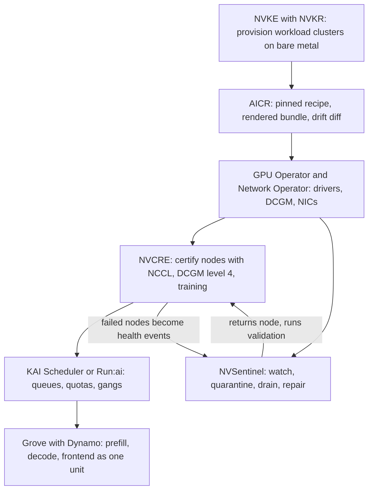

# 11.31 NVIDIA's open-source AI factory Kubernetes stack: NVKE, Run:ai, KAI, Grove, NVSentinel and AICR

| | |
|---|---|
| Level | Advanced |
| Priority tier | 1 |
| Lab venue | Local Python 3 and Docker (no GPU, no cluster) |
| Part | Part 11: GPUs on Kubernetes, scheduling and virtualization |
| Sources used | NVIDIA developer blog posts of 2026-05-31, 2026-10-13, 2026-11-05 and 2026-11-10; upstream repositories cloned 2026-11-11 (NVKE, NVKR, Run:ai, KAI Scheduler, Grove, Dynamo, AICR, NVCRE, NVSentinel); handbook chapters 11.13 to 11.20 and 19.2 |
| Research notes | `planning/research/nvidia_opensource_k8s_stack.md` |
| Code | `code/part11/c31_*` |

## Read this first

Imagine a colleague sends you a link to a long NVIDIA announcement and asks, "Is any of this ready for us?" The announcement names many projects with short, confident descriptions. Most of them are new, and a few have names that sound alike. You could read the whole chapter from the top, but it is easier to use it as a map. This section tells you where to start for the question you actually have.

The chapter is about the open-source Kubernetes software that NVIDIA published in 2026 for running AI clusters. Kubernetes is the system that places containers on servers and keeps them running. A GPU cluster is a Kubernetes cluster whose servers have graphics processors (GPUs), the chips that train and serve large AI models. Each project in this chapter fills one gap in running such a cluster.

For NVKE in full, with the cluster spec, the API, installation, NVKR, runbooks, security and failure modes, read the three chapters that follow: [11.32 architecture, API and cluster spec](32-nvke-nvidia-kubernetes-engine-in-depth.md), [11.33 installation, NVKR and cluster lifecycle](33-nvke-in-depth-part-2-installation-nvkr-and-cluster-lifecycle.md) and [11.34 operations, security, failure modes and comparison](34-nvke-in-depth-part-3-operations-security-failure-modes-and-comparison.md).

NVKE stands for NVIDIA Kubernetes Engine. It is a management plane, which means a control system that creates and looks after other Kubernetes clusters. It runs managed Kubernetes on your own GPU bare metal, where bare metal means physical servers with no virtual machine layer between the software and the hardware. NVKR, which stands for NVIDIA Kubernetes Recipes, is its build system. It makes the images and charts that NVKE needs. AICR, the AI Cluster Runtime, pins which driver, operator and plugin versions belong together. NVCRE, the Cluster Readiness Engine, certifies a cluster under real load. KAI Scheduler, which sits inside the Run:ai platform, gives queues, quotas and gangs (groups of pods that must start together or not at all). Grove, working with Dynamo, runs a multi-pod inference replica as one unit. NVSentinel detects faulty nodes, then cordons, drains and repairs them. Cordoning a node marks it so that no new pods land on it. Draining it moves the pods already running there somewhere else.

**NVKE and NVKR are public previews and are not recommended for production.** That is NVIDIA's announcement and the NVKE README. The NVKE README and preview-status page, read at commit `487f511` of 2026-11-10, add four facts:

- The API serves plain HTTP on port 30080 with authentication off by default.
- NVKE does no authorization, so any admitted caller can delete any cluster.
- There is no management-plane upgrade or backup procedure.
- The customer admin kubeconfig cannot be revoked.

Each of these four facts matters in a different way. Plain HTTP means that requests and credentials cross the network without encryption, so anyone on the same network segment can read them. Authentication being off means the API does not ask who is calling. Missing authorization means that even a known caller can do anything the API allows, including deleting a cluster that belongs to a customer. A kubeconfig is the file a person uses to log in to a cluster, and a kubeconfig that cannot be revoked stays valid even after you want to cut someone off. Together, these facts are the reason the preview belongs in a lab and not on a shared network.

The other projects are less risky but still young, and section 11 grades each one. NVSentinel calls itself Beta/Stable, KAI is a 0.x CNCF Sandbox project, and Grove and NVCRE are early. CNCF is the Cloud Native Computing Foundation, the body that hosts Kubernetes and many related projects. A Sandbox project is the earliest of its hosted stages. A 0.x version number tells you the software has not yet reached a 1.0 release, so its interfaces may still change.

The table below sends you to the right sections for your goal.

| Your goal | Read |
|---|---|
| Interview in a hurry | Sections 1, 11, 12 and 14, then the checkpoint questions |
| Decide what to adopt | Sections 10 and 11 |
| Run it on call | Sections 3, 8, 9 and 12 |
| Learn each project | Sections 3 to 8 |

If you are on call tonight, skip ahead to sections 3, 8, 9 and 12, because those tell you how each project fails and what to watch. If you are choosing a stack for next quarter, sections 10 and 11 give the decision and the maturity reading. If you are learning the field from scratch, read sections 1 and 2 first, then take the projects one at a time in sections 3 to 8.

## Why this matters for AI infrastructure

A new GPU cluster arrives on Monday. By Wednesday a training job is slow because one node has a flaky NIC. A NIC is the network card that connects a server to the rest of the cluster, and a flaky one drops or slows traffic without ever failing outright. By Friday a second team asks why the inference service starts its decode pods before the prefill pods exist. Prefill and decode are the two halves of serving a large language model. Prefill reads the prompt, and decode writes the answer one token at a time. Each problem belongs to a different tool, and until recently most of those tools were either closed or scattered across unrelated repositories.

Notice how the three problems arrive on three different days, and how each one looks like a fault in something other than its real source. The slow job looks like a bad scheduler. The stalled inference looks like a bad deployment. The flaky NIC only shows up as a slow job. A team that knows the map of tools can start looking in the right place without guessing.

In 2026 NVIDIA moved most of that tooling into open source. On 10 November 2026 it added NVKE, a management plane for running managed Kubernetes on your own GPU servers, together with its build system NVKR. Earlier, the Run:ai platform was released on 13 October 2026. The DSX OS layer, with AICR, the Cluster Readiness Engine and NVSentinel, was announced on 31 May 2026 and described in a workflow post on 5 November 2026. Grove, the inference orchestration API, sits beside Dynamo. KAI Scheduler had already been open since 2025.

DSX OS is NVIDIA's name for a set of software meant to run AI factories, which are large data centers built around GPUs. The name matters only because several projects are announced under it, and not every DSX OS component runs on Kubernetes. Section 2 explains the difference.

A site reliability engineer, usually shortened to SRE, needs a map of this stack more than a feature list. An SRE is the engineer who keeps a production service running and answers for it when it breaks. You should know which project does which job, which pieces overlap, which are mature, and which can hurt a production cluster if you switch them on too fast. Interviewers who ask "what NVIDIA open-source software would you use to run an AI cluster?" want that map, with honest caveats about maturity.

The map comes from the upstream repositories and NVIDIA's own posts. An upstream repository is the original project's source code, as opposed to a copy or a summary. KAI manifests (19.2) and internals (11.13 to 11.18) are linked, not repeated, because they are covered in their own chapters.

## Prerequisites and outcomes

Picture your first week on a platform team. Someone pastes a list of NVIDIA project names into a chat and asks which ones you already know. This section tells you what to know before you read on, and what the chapter gives you in return.

### Prerequisites

- 11.13 to 11.18 for KAI Scheduler and 11.19 for the Run:ai platform view. 11.20 for how KAI compares with Kueue, Volcano and Slurm.
- 11.4 and 11.5 for the GPU Operator. 11.7 for gang scheduling.
- Basic Helm and CRD knowledge.
- 19.2 for working KAI and Kueue manifests. This chapter links there and does not copy them.

Helm is the package manager for Kubernetes. A chart is a Helm package, and a values file holds the settings you pass to it. A CRD, or CustomResourceDefinition, is how Kubernetes learns about a new kind of object. Once a CRD is installed, you can create objects of that kind, just as you create Pods or Deployments. Many projects in this chapter are installed as charts and add their own CRDs, so you will see both words often.

### Outcomes

This chapter walks through every project in the stack and records its repository, licence, latest release and maturity as of 2026-11-11. It explains what the open-source Run:ai release contains, and what the commercial support offering adds on top. It places AICR, NVCRE, the GPU Operator, KAI or Run:ai, Grove, Dynamo and NVSentinel in one lifecycle, in order, and then picks the smallest set of projects for four kinds of cluster. Last, it gives a production readiness checklist, lists the failure modes and metrics for each project, and ends with a short answer to the interview question that you can say out loud in about two minutes.

## 1. Seven jobs, seven projects

An on-call engineer is paged because a four-node training job has been pending for an hour. The cluster has free GPUs, but they are spread over nodes that cannot be used as a group. A pending job is one the scheduler has accepted but not yet started. A different engineer, on the same day, is asked to prove that a newly delivered cluster is fit for production. A third is asked why a recently upgraded driver broke one node pool. A driver is the software that lets the operating system talk to the GPU, and a node pool is a set of servers with the same hardware and settings.

These are three different jobs, and a fourth sits below them: someone must create the cluster itself. Sorting out the open-source stack starts with naming the jobs, because each project exists to do exactly one of them. When you hear that a project "does everything", ask which of the jobs it actually covers, and you will usually find it covers one or two.

| Job | Question it answers | Project |
|---|---|---|
| Provision | Who creates and upgrades the Kubernetes cluster on bare metal? | NVIDIA Kubernetes Engine (NVKE) with NVKR |
| Configure | Which versions of driver, operator and plugins belong together? | AI Cluster Runtime (AICR) |
| Certify | Does this cluster actually perform under real distributed load? | Cluster Readiness Engine (NVCRE) |
| Enable | Are GPUs, drivers, DCGM and networking present on the node? | GPU Operator and Network Operator (11.2 to 11.11) |
| Schedule | Which team gets which GPUs, as a gang, with fair share? | KAI Scheduler, inside the Run:ai platform |
| Serve | How do prefill, decode and frontend pods start, scale and place together? | Grove with Dynamo |
| Operate | Which node is failing, and what should happen to it? | NVSentinel |

DCGM stands for Data Center GPU Manager, the NVIDIA toolkit that reports GPU health and telemetry. Operators are Kubernetes programs that install and keep a piece of software in the state you describe. The GPU Operator installs drivers and the GPU plugin on each node. The Network Operator does the same for the fast network cards.

Read the table as a list of questions you will be asked. Provision is the question of where the cluster comes from. Configure asks which versions agree with each other. Certify asks whether the hardware really works at speed. Enable asks whether the node has its GPU pieces. Schedule asks who gets what. Serve asks how a model's many pods start together. Operate asks what to do when a node goes bad.

The diagram shows the order in which a platform team meets these projects over a cluster's life. Configuration comes first and healing runs forever.



Read the diagram top to bottom for a new cluster. The loop between NVSentinel and NVCRE covers a node that breaks later. A node that was certified on delivery can still fail in month eight, and when it does, it needs to go through the certification path again before it returns to service. NCCL, which appears in the diagram, is the NVIDIA library for communication between GPUs. A drift diff, also in the diagram, compares what a cluster runs today with the recipe it should run.

The table below gives the one-line identity of each project as of 2026-11-11. Version numbers and star counts come from the GitHub API on that date. Stars are a popularity signal and say nothing about readiness. A star is a bookmark that a developer clicks on GitHub, so a project with many stars is well known, but that tells you nothing about whether it is safe to run in production.

| Project | Repository | Licence | Latest release | Stars |
|---|---|---|---|---|
| NVKE | `dsx-ai-factory/nvke` | Apache-2.0 | v0.23.1, 2026-11-03 | 1138 |
| NVKR | `dsx-ai-factory/nvkr` | Apache-2.0 | v0.1.0, 2026-10-22 | 25 |
| NVIDIA Run:ai | `dsx-ai-factory/run-ai` | Apache-2.0 | 3.0.22, 2026-11-02 | 742 |
| KAI Scheduler | `kai-scheduler/KAI-scheduler` | Apache-2.0 | v0.20.1 line, backports to v0.14 and v0.16 on 2026-11-10 | 1638 |
| Grove | `ai-dynamo/grove` | Apache-2.0 | v0.2.0-beta1, 2026-10-30 | 292 |
| Dynamo | `ai-dynamo/dynamo` | Apache-2.0 text in the licence file | v1.6.2, 2026-11-05 | 8467 |
| AICR | `NVIDIA/aicr` | Apache-2.0 | v1.2.0, 2026-11-02 | 472 |
| NVCRE | `NVIDIA/cluster-readiness-engine` | Apache-2.0 | v0.11.0, 2026-11-09 | 84 |
| NVSentinel | `NVIDIA/NVSentinel` | Apache-2.0 | v1.31.0, 2026-11-07 | 434 |

A backport is a fix copied from the newest release line into an older one, so you can still get fixes without taking a big upgrade. That is why KAI has several version lines listed at once. The licence column shows Apache 2.0 for almost everything. Apache 2.0 is a permissive open-source licence, which lets you read, change and use the code, including in a company, as long as you keep the notices.

Two repository names deserve a note. The older addresses `NVIDIA/KAI-Scheduler` and `NVIDIA/grove` still resolve, but they now redirect to `kai-scheduler/KAI-scheduler` and `ai-dynamo/grove`. A redirect is useful for old links, but scripts and Helm sources should use the new address so they do not depend on the redirect staying in place. GitHub reports Dynamo's licence as unspecified because of an extra notice file, but the licence text itself is Apache 2.0.

**Decision rule:** Name the job first and the project second, and do not adopt a project whose job you have not yet felt as a problem.

In practice this means a team that has never had a slow node should not install a node-health tool yet. The tool will run, it will produce events and it will add a dependency, but nobody will know what the events are for. Wait until you have seen the failure, then choose the tool that answers it.

**In one minute:** The stack has seven jobs: provision, configure, enable, certify, schedule, serve and operate. NVKE with NVKR, AICR, the operators, NVCRE, KAI or Run:ai, Grove with Dynamo, and NVSentinel each own one. All are Apache 2.0, but their versions range from a beta API to a long-lived product.

## 2. What was open-sourced, and when

A teammate says "NVIDIA open-sourced Run:ai last month". Someone else answers "KAI has been open for a year". Both are right, and the difference matters when you read a support contract or an architecture review. Open source here means the code is published under a licence that lets people read, use and change it. It does not automatically mean that NVIDIA will support you when something breaks, and that gap is the heart of this section.

The timeline is easier to follow if you keep three things apart: the scheduler that started the story, the full platform that came later, and the wider DSX OS layer that carries the newer tools. A fourth, Grove, lives next to Dynamo and has its own history.

KAI Scheduler is the scheduling engine that Run:ai built. NVIDIA released it under Apache 2.0 on 1 April 2025 after acquiring Run:ai, and it was later contributed to the Cloud Native Computing Foundation as a Sandbox project. The KAI repository README states the CNCF Sandbox status, and the Run:ai post of 13 October 2026 repeats it. Chapters 11.13 to 11.19 describe this part.

The second event came on 13 October 2026. NVIDIA announced that it was "making the full NVIDIA Run:ai platform available as open source software". The platform is the part around the scheduler: the control plane, the web interface, the command line, the REST API and the cluster services. The control plane is the part that decides policy for many clusters at once, and a REST API is a web interface that programs can call. The post names four modular components as separate repositories: the KAI Scheduler, a GPU fractioning operator, a resource management component and a Workload Map. GPU fractioning means letting several workloads share one physical GPU. The full platform lives in the `dsx-ai-factory/run-ai` repository.

The repository settles the licence. The root licence file is Apache 2.0, the README says so, and a notice file lists third-party code. A notice file is where a project lists the code it borrowed from others, along with that code's licence. The blog post is vaguer and says only "its applicable open source licenses". The same README warns that Apache 2.0 does not grant any right to use NVIDIA or Run:ai trademarks. In plain words, you may use the code, but you may not present your product as an NVIDIA product just because you use it.

The third event is the DSX platform. NVIDIA announced DSX at GTC Taipei and published a post on 31 May 2026 describing DSX OS as an open, modular operating layer for AI factories. The post lists many components. Several are not Kubernetes software at all, for example power management and facility signal exchange. The three that matter for a Kubernetes SRE are AICR, NVSentinel, and the Cluster Readiness Engine that the 5 November post adds to the same workflow. Power management and facility signals are about the building, such as electricity and cooling, so they sit outside a Kubernetes cluster.

The 5 November post states that all three are Apache 2.0, and the repositories confirm it. The 31 May post names no licence for its components, so treat licence claims for the other DSX OS pieces, such as the bare-metal controller, as unchecked until you read the repository. A claim that you have not checked is not false, but it is not a fact you can build a compliance review on.

Grove deserves its own line. It started as part of the Dynamo project and lives in the `ai-dynamo` organisation. NVIDIA's Run:ai post lists it among related projects, and the KAI README announced a KAI and Grove integration in November 2025. Grove is not a part of the Run:ai monorepo. A monorepo is one repository that holds many related projects, so when someone says the platform is a monorepo, it means the control plane, the cluster part and the installer all live in one place.

| Date | Event | Source type |
|---|---|---|
| 2025-04-01 | KAI Scheduler open-sourced under Apache 2.0 | official NVIDIA blog, fetched 2026-11-11 |
| 2026-05-31 | DSX OS announced, including AICR and NVSentinel | official blog |
| 2026-10-13 | Full Run:ai platform open-sourced as a Community Product | official blog and repository |
| 2026-11-05 | Workflow post: configure with AICR, certify with NVCRE, operate with NVSentinel | official blog |
| 2026-11-10 | NVKE and NVKR released as public previews at KubeCon North America, with Snapshot and the OpenShell donation to the CNCF | official blogs and repositories |

The table is a lookup. Use it when someone asks when something happened, and check the source type column before you repeat the date. A date from an official blog and a date from a repository are not always the same kind of evidence.

A third-party article dated 12 October 2026 reported the Run:ai release one day before NVIDIA's own post. A third-party article is one written by a news site or a partner, not by the vendor. NVIDIA's post and the repository are the sources of record here, which means that when they disagree with a news article, the vendor's post and the code win.

**Decision rule:** When an engineer says "Run:ai is open source", ask whether they mean the scheduler or the whole platform, because the support answer differs.

A short question like that saves a long argument. If the answer is the scheduler, you are talking about KAI, which has been open since 2025. If the answer is the whole platform, you are talking about the October 2026 release, and you should also ask which edition they mean, because the support terms differ between editions.

**In one minute:** KAI has been open since 2025 and is a CNCF Sandbox project. The full Run:ai platform followed on 13 October 2026 under Apache 2.0. AICR, NVCRE and NVSentinel belong to the separate DSX OS layer, NVKE and NVKR followed on 10 November 2026, and Grove lives with Dynamo.

## 3. NVKE and NVKR: a managed Kubernetes service on your own GPUs

An AI factory operator owns a few hundred bare-metal GPU servers and sells clusters to internal teams or outside customers. Each customer wants an isolated Kubernetes cluster with its own control plane. The control plane is the set of components that makes the decisions for a cluster, such as the API server and the database behind it. Today the operator writes scripts around kubeadm and Cluster API, and every upgrade is a small project. Kubeadm is the standard tool for building a Kubernetes cluster by hand, and Cluster API is a Kubernetes-style way to describe and create clusters as objects. On 10 November 2026, at KubeCon and CloudNativeCon North America, NVIDIA released software for exactly this job.

Think about what the operator does on a normal Tuesday. A customer asks for a new cluster. Someone runs the scripts, watches the machines boot, waits for the control plane to come up, and then checks each node by hand. If a node fails halfway through, the script has to be cleaned up before anyone can try again. NVKE is meant to replace that hand-held routine with a service that keeps track of each step, so a failed step can be retried without starting over.

NVIDIA Kubernetes Engine (NVKE) is the management plane. Its README says it lets you "run a managed Kubernetes service on your own NVIDIA GPU infrastructure". You install it, customers request clusters through its API, and NVKE provisions the nodes and operates the clusters afterwards. Its companion, NVIDIA Kubernetes Recipes (NVKR), is the build system. It produces the node OS images, binaries, container images and Helm charts from pinned sources, records their software bills of materials, and signs hosted releases. A software bill of materials, or SBOM, is a list of every component inside a piece of software, which helps you check for known problems later. Pinned sources means each input is locked to a fixed version, so the same recipe gives the same output every time. Both are Apache 2.0 and live in the `dsx-ai-factory` GitHub organisation. NVIDIA's announcement and the NVKE README both label them a public preview and say they are not recommended for production.

The NVIDIA post says NVKE is conformance tested on Kubernetes 1.36 and certified as a Kubernetes AI platform and a Kubernetes installer. Conformance testing checks that a product behaves the way the Kubernetes standard expects. I could not check the certification itself. I read the pinned version in the repository documentation, which is 1.36.3.

### How it is built

The repository shows more than the blog post does. An installation has two kinds of cluster. A management cluster, formed from three pre-provisioned nodes by the `nvkectl` command line tool through a temporary seed cluster, runs the NVKE management plane. A seed cluster is a short-lived cluster used only to bootstrap the real one, which is then taken over. Each customer gets a workload cluster with its own control plane, etcd and node pools. Etcd is the database that holds a Kubernetes cluster's state, and it is the most sensitive part of any control plane.

The management plane is one controller process that serves a REST API backed by PostgreSQL, runs Temporal workflows for long operations, and runs Kubernetes reconcilers. A reconciler is a loop that compares what you asked for with what exists and makes the two match. PostgreSQL is a widely used relational database. Temporal is a workflow engine that remembers where a long operation stopped, so it can resume after a crash. A cluster request is written to a database row and an outbox table in one transaction. An outbox table is a simple way to make sure that a message is recorded in the same step as the data it describes. A poller then starts the workflow, which creates Cluster API objects and drives each node's `nvke-agent` over gRPC. gRPC is a protocol for calls between programs, and the agent is the small program that runs on each node and carries out instructions.

Walk through one request step by step. The customer sends the request. NVKE writes it to the database together with an outbox entry, so the two cannot get out of step. A poller notices the new entry and starts a Temporal workflow. The workflow creates the Cluster API objects, which ask for machines. Once the machines exist, the workflow tells each node's agent what to install. If the process dies in the middle, the workflow remembers how far it got. This is the reason the design is built around durable workflows, and it is also why a stalled workflow is a failure mode you must watch.

Machines come from NVIDIA Infra Controller, called NICo, which manages bare-metal hosts, firmware and networking. CAPNICo is the Cluster API infrastructure provider that lets Cluster API ask NICo for machines. An infrastructure provider is the piece that knows how to create the actual hardware or virtual machines underneath a cluster. At preview, NICo is the main infrastructure provider, and the docs say another provider called LaunchLayer is also supported once enabled. A node must present a TPM-backed SPIFFE identity before it receives join credentials. A TPM is a small security chip on the server, and SPIFFE is a standard for giving each workload a verifiable identity. Join credentials are what let a new node enrol in the cluster, so a node that cannot prove its identity cannot join. Networking uses NVIDIA's build of OVN-Kubernetes, and etcd encryption at rest is available per cluster. Encryption at rest means the data on disk is scrambled, so someone who copies the disk cannot read it. Lifecycle operations are scaling node pools, upgrading Kubernetes, replacing nodes and renewing certificates.

| Piece | Repository | Version checked | Role |
|---|---|---|---|
| NVKE | `dsx-ai-factory/nvke` | v0.23.1 (2026-11-03), v0.24.0 release candidates tagged | Management plane, `nvkectl`, node agent |
| NVKR | `dsx-ai-factory/nvkr` | v0.1.0 (2026-10-22) | Builds and signs NVKE and AICR artifacts |
| CAPNICo | `dsx-ai-factory/cluster-api-provider-nico` | v0.1.0 pinned by NVKE | Cluster API provider for NICo |
| NICo | `dsx-ai-factory/infra-controller` | not checked | Bare-metal lifecycle below Kubernetes |
| NKTP | `dsx-ai-factory/nvke-telemetry-pipeline` | not checked | OpenTelemetry pipeline for logs, metrics, traces |

The table lists five repositories and the version the repository showed for each. Two rows say "not checked", and that is honest. When you read this table, you are looking at the layers from the bottom up: the bare-metal layer (NICo), the Cluster API provider (CAPNICo), the management plane (NVKE), its build system (NVKR), and the telemetry pipeline (NKTP), which collects logs, metrics and traces.

NVKE's own documentation pins Cluster API core, kubeadm bootstrap and the kubeadm control-plane provider at v1.13.6. Pinning here means the documentation names an exact version, so a rebuild uses the same parts. NVKE is not a Cluster API flavour and not a Kubernetes distribution, in the README's words. A flavour is one particular way of setting up Cluster API. A distribution is a complete packaged Kubernetes that you can buy or download. The README says NVKE is a "self-hosting factory" that adds what stock Cluster API lacks: durable workflows, etcd key management, node identity and the NICo integration. Self-hosting means the management plane runs on clusters it creates and manages itself. The documented node operating systems are Ubuntu 24.04 and 26.04, and clusters are IPv4 only, which means they do not use IPv6 addresses.

### Where it sits in the stack

NVKE stops at a running, conformant Kubernetes cluster. Conformant here means it passes the standard Kubernetes tests. Its docs put the GPU driver and software stack inside clusters with Nodewright and the GPU Operator through AICR, certification with the Cluster Readiness Engine, and workload-aware break-fix with NVSentinel. The docs name Nodewright as the piece that prepares the node software, and its details were not checked. Break-fix means detecting a broken node and repairing it while the rest of the cluster keeps working. The documented bring-up order is NICo first, then the NVKE management cluster, then a workload cluster, then an AICR recipe bundle, then certification, then NVSentinel, then tenant workloads. A tenant is a team or customer that runs its own workloads on a cluster.

Read that order as a set of dependencies. NICo must exist before NVKE can ask it for machines. The management cluster must be up before it can create a workload cluster. The recipe bundle comes next because it installs the GPU software, and certification cannot test hardware whose software is not yet in place. Tenant workloads come last, once the cluster is proven.

| Neighbour | Relationship to NVKE |
|---|---|
| Cluster API | NVKE drives it. Cluster API core, kubeadm and CAPNICo create the machines and control planes. |
| GPU Operator | Not part of NVKE. AICR installs it into the workload cluster after NVKE creates the cluster. |
| AICR | Configures the workload cluster. NVKR can also build AICR artifacts. |
| NVCRE | Certifies the new cluster. It never changes nodes. |
| NVSentinel | Decides when a node needs repair and applies cordon and drain. NVKE carries out the reboot or replacement. |
| KAI Scheduler and Run:ai | Not mentioned in the NVKE docs I read. They are tenant-side software that you install inside a workload cluster, as in section 4. |

The neighbour table is the quickest way to see who does what. Notice the split between deciding and doing. NVSentinel decides that a node needs repair, and NVKE carries out the reboot or replacement. NVCRE only reports, and it never changes a node.

One boundary matters in an incident. The NVKE docs say it is not responsible for deciding when tenant workloads may be disrupted. Cordon, drain and node SLO policy belong to the tenant's SRE team or a break-fix system such as NVSentinel. An SLO, or service level objective, is the target a service must meet, such as how long a node may stay broken. This boundary is easy to forget at three in the morning. If NVKE reboots a node that a tenant is still using, the tenant's own policy should have decided first.

### What managed means here

The word managed is easy to misread. In a cloud provider's managed Kubernetes, the provider runs the control plane and the database, and it takes the 3 a.m. call when cluster creation hangs. NVKE gives you the software for that kind of service, and you run it. The comparison below shows the difference.

This comparison is the handbook's own reasoning. The NVKE documents do not compare it with other services, and the Nebius and hyperscaler documents were not consulted. A hyperscaler is one of the very large cloud providers. The table is a way to think about responsibility, not a claim about any particular cloud.

| Question | Managed Kubernetes from a cloud provider | NVKE |
|---|---|---|
| Who runs the management plane and its database? | The provider | You, the AI factory operator |
| Who wins the 3 a.m. page when cluster creation hangs? | The provider's on-call | You |
| Who gives customers a service level? | The provider | You, using what NVKE exposes |
| What do customers receive? | A cluster and an API | An admin kubeconfig at preview |
| Where do machines come from? | The provider's fleet | Your NICo-managed bare metal |

The first row is the key point. NVKE does not remove the work of running a managed service. It gives you the software for it, and the operator's responsibility list in the NVKE docs is long: NICo, the management cluster, artifact verification, the accelerated runtime, cluster availability and customer access. An artifact is any built output, such as an image or chart, and verifying it means checking that it is the one you expect. The accelerated runtime is the GPU software layer. The customer owns workloads, images, namespaces, application secrets and role-based access control for its own users. Role-based access control, or RBAC, decides which users can do which actions inside a cluster.

Put simply, when you sell a managed service, you are on the hook for it. A reader who forgets this is likely to promise customers a service level that nobody has checked against the software.

### The cluster request

The next listing is a cluster spec in the shape of the NVKE `CreateClusterRequest`. It is a handbook example with placeholder identifiers, adapted from the shape shown in the NVKE create guide. Read it as a form that a customer fills in. Each field answers one question about the cluster you want. The identifiers are fake on purpose, so nobody copies them into a live request by mistake.

```yaml
name: tenant-a
controlPlaneKubernetesVersion: 1.36.3
cniPlugin: ovn-kubernetes
etcdEncrypted: true
controlPlaneVIP: 10.20.0.50
network:
  podCIDR: 192.168.0.0/16
  serviceCIDR: 10.96.0.0/12
nico:
  orgID: example-org
  siteID: 00000000-0000-4000-8000-000000000001
  vpcID: 00000000-0000-4000-8000-000000000002
controlPlaneConfig:
  desiredCount: 3
  nico:
    instanceTypePreference:
      - 00000000-0000-4000-8000-000000000003
    vpcPrefixIDs:
      - 00000000-0000-4000-8000-000000000004
    sshKeyGroupIDs:
      - 00000000-0000-4000-8000-000000000005
    release: example-ubuntu-24.04-amd64
nodePools:
  - name: gpu-workers
    nodeNamePrefix: w
    desiredNodeCount: 2
    nodeLabels:
      nvidia.com/gpu.present: "true"
    nico:
      instanceTypeID: 00000000-0000-4000-8000-000000000006
      vpcPrefixIDs:
        - 00000000-0000-4000-8000-000000000004
      sshKeyGroupIDs:
        - 00000000-0000-4000-8000-000000000005
      release: example-ubuntu-24.04-amd64
```

Three fields deserve attention. The version has no leading `v`, and the API rejects one. `etcdEncrypted` is required, and the API reference says it can be turned on later but never off. The node labels are applied once when a node joins, and the preview cannot change them afterwards. A label is a key and value attached to a node, and the GPU scheduling rules read labels to decide where pods may go, so a wrong label is hard to fix later. Think of these three as the fields where a mistake is expensive. The version is a typo away from rejection, the encryption flag is one-way, and the labels are fixed once the node is up.

This file validates against the repository's OpenAPI schema for `CreateClusterRequest` at commit `487f511` of 2026-11-10. OpenAPI is a standard format for describing a web API, and a schema inside it lists the fields and their types. Validation here means checking the file against that description. NVKE's real CRDs, such as `NvkeCluster`, are internal. The public interface is the REST API. The OpenAPI file is version `0.1.0-alpha`, so the schema itself may change. It was not run against a management plane. Validating a file against a schema proves the shape is right. It does not prove that the management plane will accept it or build the cluster it describes.

### Preview limits

A third-party write-up said the preview has no API authentication and no management-plane upgrade or backup procedure. The NVKE README and preview-status page confirm both. The table below is the part an SRE should read before anything else. Each row is a limit you must design around, not a bug that will be fixed next week.

| Limit | What the NVKE docs say |
|---|---|
| API transport and auth | After install the API serves plain HTTP on port 30080 of every management node with authentication off. Three modes exist: off, permissive and enforcing. |
| Authorization | NVKE does none. Any admitted caller can call every endpoint, including cluster deletion. Per-customer authorization is on the roadmap as coming soon. |
| Management cluster | It does not upgrade, scale or replace itself. There is no management-plane upgrade procedure and no backup or restore procedure. |
| Secrets to keep | The bootstrap kubeconfig and the etcd encryption key file. The key file is the only copy not on a node. |
| Customer access | Customers receive only the admin kubeconfig. It cannot be revoked, because NVKE does not rotate a cluster's certificate authority. |
| Node pools | Changing a pool's configuration does not replace running nodes. Labels and taints are fixed at creation. `nvkectl` upgrades only the control plane. |
| Node images | A local image build is not a qualified release. Full-disk-encryption images are for evaluation and do not protect data at rest. |
| Telemetry | The default NKTP backend keeps data in memory and gives anonymous users admin access to Grafana. |

A taint is the opposite of a label. It tells the scheduler to keep pods away from a node unless they say they tolerate it. The Authorization row is the one most people miss. Authentication asks who you are, and authorization asks whether you may do this thing. Without authorization, a caller who has got past the front door can delete anything.

Read the secrets row with care. The bootstrap kubeconfig and the etcd encryption key file are the keys to the whole installation, and the key file is the only copy that is not on a node. If you lose it, the encrypted data on the nodes is unreadable. Back those two files up somewhere safe on the day you install.

The roadmap lists, as coming soon, per-customer authorization, managing the management cluster's own nodes through NVKE, and Kubernetes 1.37. It lists other providers, virtual-machine control planes and GB300 and Vera Rubin worker nodes as work in progress. The roadmap says it shows direction, not commitments. A roadmap is a plan, and plans move. Do not sign a customer contract on a roadmap item.

NVKR has its own preview label. Its README says commands, input schemas and behaviour can change and that it is not recommended for production. A local NVKR build is unsigned. Only the hosted workflows sign and publish releases. Signing lets you prove that a release came from the publisher and was not changed on the way. An unsigned local build cannot give you that proof.

The local quickstart needs no GPU. It uses a simulated NICo on a Linux host with 6 CPUs, 12 GiB of free memory and 100 GiB of free disk. It was not run, because the guide for macOS uses a virtual machine. A simulated NICo means a stand-in for the bare-metal layer, which lets you try the control flow without real servers.

### Running a management plane as an SRE

If you adopt NVKE, you have taken on a stateful control system. A stateful system keeps data that must survive restarts, and a stateless one can be rebuilt from scratch. Cluster state lives in PostgreSQL, a Temporal or outbox stall leaves a request accepted but idle, and a lost bootstrap kubeconfig or etcd key file cannot be replaced. An accepted but idle request is the most confusing failure, because the API said yes and nothing else happens. Section 12 gives the signals for each.

Picture the bad night. A customer's cluster request has been "provisioning" for an hour, the API returned success, and nothing new appears in the node list. Without a signal for the stalled workflow, you will go looking in the wrong place. The metrics in section 12 tell you which layer has stopped moving.

Announced the same day were NVIDIA Snapshot, which restores checkpointed inference replicas, and OpenShell, an agent security runtime that NVIDIA is contributing to the CNCF as a Sandbox project. A checkpoint here is a saved picture of a running process, and restoring it lets a replica start from that picture instead of from scratch. An agent security runtime is software that limits what an AI agent is allowed to do on a system. Neither is part of cluster management. Snapshot appears as an optional subchart in the Dynamo platform chart. A subchart is a chart nested inside another chart, so it installs only when you enable it.

**Decision rule:** Evaluate NVKE on a lab with simulated machines, never expose its API to a shared network, and do not offer it to paying customers until authorization, upgrade and backup procedures exist.

Each part of that rule answers a limit from the table. The lab rule is about the missing authentication. The shared network rule is about the plain HTTP default. The customer rule is about the missing upgrade and backup. Keep the three together when you explain the decision to someone who asks why NVKE is not yet in production.

**In one minute:** NVKE is a management plane you install to run managed GPU Kubernetes on your own bare metal. NVKR builds its images and charts. It sits below AICR, NVCRE, NVSentinel and the schedulers and drives Cluster API and NICo. It is an Apache 2.0 public preview with no API authorization, no management-plane upgrade or backup, and an unauthenticated HTTP default.
## 4. Run:ai: open source against commercial, and where KAI sits

A platform lead asks: "We have budget for the Run:ai licence. Do we still need it?" The honest answer depends on what you buy a licence for. Since October 2026 the code itself is open, so a licence no longer buys the software. What it may buy is support, a promise about how long a version will be looked after, and the commercial channel through which NVIDIA sells the product. Those three things are the real question, and this section shows how to separate them.

The repository's documentation says it directly. "NVIDIA Run:ai is available as open source. The NVIDIA Run:ai Support-Entitled Release is available for organizations that require NVIDIA enterprise support and an SLA." An SLA, or service level agreement, is a written promise about response times and uptime. The product code is the same monorepo. The commercial offering adds a support relationship, a defined support lifecycle and the channels through which NVIDIA sells it.

The NVIDIA post gives the other side. The open-source path is a Community Product on the NVIDIA NGC catalog with a Helm chart for the integrated stack. NGC is NVIDIA's catalogue of containers, models and charts. "No paid NVIDIA Run:ai subscription or NVIDIA support entitlement is required for the Community Product", and equally, "NVIDIA enterprise support is not included". Downloading from NGC requires accepting the NVIDIA Software License Agreement and product-specific terms. Commercial editions continue through NVIDIA AI Enterprise, NVIDIA Mission Control and some cloud marketplaces. A marketplace is a cloud provider's shop for third-party software, where you buy it through your existing cloud bill.

Read the two quotes side by side. The first says you do not have to pay to run the Community Product. The second says that if you run it and something breaks, NVIDIA will not be the one on the phone with an SLA. Both are true, and a team that reads only the first quote is surprised by the second during an outage.

The repository's own support page says only the current release branch is supported, which on 2026-11-11 was `release-3.0`. A release branch is the line of code that receives fixes for one major version. Help comes through GitHub Discussions and Issues, and security reports go to NVIDIA's product security team. The documentation also describes a lifecycle for the support-entitled product. Each version gets nine months of full support and three months of extended support, which makes twelve months in total. Full support means the normal fixes and help. Extended support is a lighter phase that keeps the version alive for a while longer. The policy page says it applies from 13 October 2026.

Here is a way to picture the lifecycle. Think of a Community Product version as a milk carton with the date printed on it. The carton is good while the current branch is maintained, and after that you are on your own. The support-entitled version is a carton with a longer printed date and a delivery service that checks on it. The two cartons may hold the same milk, but only one comes with a promise about its freshness.

| Question | Community Product | Support-Entitled Release |
|---|---|---|
| Source code | Apache 2.0 monorepo | Same source base, per the documentation |
| NVIDIA enterprise support and SLA | Not included | Included |
| Support window per version | Current release branch only | 9 months full plus 3 months extended |
| Where help comes from | GitHub Issues and Discussions, CNCF Slack channel for KAI | NVIDIA support under the agreement |
| Install source | NGC Helm chart and `runai-oss` images | Per the commercial agreement |

Three points are unclear. I found no feature-by-feature comparison of the two editions and no statement on whether any feature is withheld from the Community Product. The post says the proprietary GPU fractioning was retired in favour of a native fractioning feature in CUDA 13.4. CUDA is NVIDIA's programming platform for GPUs, and version 13.4 is the release the post names. I could not confirm that CUDA claim in a second source, so label it as NVIDIA's statement. The support page describes the hosted SaaS control plane as a cloud service under separate terms, so assume it is not open source. SaaS means software you use as a hosted service, without installing it yourself, and a hosted control plane is one of those.

For an SRE, you can now read the scheduler and control-plane code and file issues in public. That is a real gain, because you can see why something behaves as it does. You cannot assume NVIDIA will answer a production outage on the Community Product. Plan your own on-call runbook, upgrade rehearsals and a fallback. A runbook is the written procedure for a known problem, and an upgrade rehearsal is a practice upgrade on a copy before you touch production. A fallback is what you do when the new thing fails, such as going back to the old scheduler.

Chapter 11.19 describes Run:ai as a commercial platform. The current statement is that the platform is open source and a supported commercial release also exists. If you have read 11.19 before this chapter, keep both facts in mind, and treat this section as the newer one.

Now the second question: a job is pending and the team wants to know whether Run:ai or KAI is to blame. You need to know which process made the decision. A pending job is a sign that something in the scheduling path said no, and it helps to know which layer that was.

The Run:ai README describes two installed parts. The control plane manages workload submission, organisational resources, policies and monitoring across one or more clusters. The cluster part runs on each Kubernetes cluster and extends scheduling with GPU-aware behaviour. Users reach the control plane through the web interface, the CLI or the REST API. The cluster part ships the KAI Scheduler.

A useful way to hold this in your head is a shop with a head office and branches. The head office, the control plane, writes the rules, such as which team gets how many GPUs this month. Each branch, the cluster part, takes orders from its own floor and applies those rules locally. KAI is the stock clerk at each branch, deciding which order goes out first. When an order is stuck, you check the clerk first, and you check the head office only if the rules changed.

The repository is a monorepo. The control-plane directory holds about thirty services, including the frontend, identity management, policy, workload management and metrics. The cluster directory holds the controllers, admission webhooks and the scheduler. A controller is a loop that watches objects and acts on them. An admission webhook is a hook that can accept, change or refuse an object before it is saved. A separate installer directory holds a guided installer and a Model Context Protocol server. The Model Context Protocol is a standard way for AI tools to call external services. The README also says the root Makefile targets are placeholders, and the real build targets live inside each service directory. A Makefile target is a named build step, so a reader who runs the root targets will get nothing useful.

KAI alone is a scheduler. Its README lists batch (gang) scheduling, bin packing and spreading, hierarchical queues, fairness with reclaim, time-based fair share, a minimum guaranteed runtime, consolidation, elastic workloads, background pods, topology-aware scheduling, hierarchical pod groups and GPU sharing. Bin packing fills nodes tightly, and spreading does the opposite. Reclaim takes back GPUs that a queue borrowed when its owner needs them. A minimum guaranteed runtime protects a job from being stopped too soon after it starts. Consolidation moves running pods to free up whole nodes. Topology-aware scheduling places pods with the network layout in mind, so chatty pods sit close together. KAI runs next to the default scheduler, and workloads opt in by setting a scheduler name. A scheduler name is a field on a pod that tells Kubernetes which scheduler should place it. Chapters 11.14 to 11.18 cover them.

So when is KAI enough, and when do you want the whole platform? Use KAI alone when your platform team already has a way to create queues, authenticate users and show dashboards. Use the Run:ai platform when you want a ready-made control plane for many teams, with a web interface, policies, projects and departments, and central views across several clusters. The Run:ai README itself says that if one team runs jobs on dedicated GPUs, native Kubernetes scheduling may be enough. Native scheduling here means the default Kubernetes scheduler with no extra queues or gangs.

AICR knows both. Its supported-platform list includes Run:ai, Dynamo, Kubeflow, Kueue, NIM and Slinky Slurm. Kubeflow and Kueue are other Kubernetes ML and queueing projects, NIM is NVIDIA's packaged inference microservice, and Slinky Slurm is a way to run the Slurm batch scheduler on Kubernetes. In its overlay files there is a `runai-cluster` component that depends on the GPU Operator, cert-manager, the monitoring stack and the Prometheus CRDs. KAI also appears as a component in the Dynamo inference overlays. An overlay is AICR's named set of settings for one particular environment.

When you debug a pending job, start at the scheduler. KAI writes Kubernetes events for every major step, and its PodGroup and Queue resources show the state. A PodGroup is KAI's object for a gang, and a Queue is the object that holds a team's share. The 11.18 chapter gives the commands. Only after that, look at the Run:ai control plane for policy or quota that might have changed the Queue. This order saves time. The clerk tells you what happened on the floor, and the head office tells you why the rules are what they are.

**Decision rule:** Choose the Community Product when you can own the operations and the Support-Entitled Release when an external SLA is part of your risk plan. Debug scheduling with KAI events first, and treat the Run:ai control plane as the place that writes the queues.

The decision rule is about who answers the phone and where you look first. If nobody on your team can own the operations, the support-entitled release is worth its price. If your team can run the software, the community product saves the money.

**In one minute:** The code is one Apache 2.0 monorepo. The commercial offering sells support, an SLA and a defined lifecycle. Run:ai is a control plane plus a cluster part, and the cluster part contains KAI, which alone is enough when you already run your own tenancy layer. Feature differences, the SaaS control plane's status and the CUDA fractioning claim are not confirmed.

## 5. Grove and Dynamo: one unit of inference

An inference service uses one frontend, a prefill group and a decode group. Prefill needs eight GPUs across two nodes, with a leader and workers. If Kubernetes starts three of the four prefill pods, the model cannot serve. The GPUs are held, the service is down, and the autoscaler may add another incomplete group on top. An autoscaler adds or removes replicas based on load, so an incomplete group that it adds makes the problem bigger, not smaller.

Walk through what the on-call engineer sees. The dashboard shows the frontend healthy and the GPU count high. Requests fail anyway. The pod list shows three prefill pods running and one stuck in Pending. Pending pods hold no GPUs yet, so the one stuck pod is not the thing holding the cluster hostage. The three running pods are holding GPUs and doing nothing useful, because the model needs all four pods to start. That gap, between pods that exist and a unit that works, is the problem Grove is built to close.

Kubernetes has no native word for "a model replica that spans several pods". Grove adds that word. Its README says it provides "a single declarative interface for orchestrating any AI inference workload", from one pod to multi-node disaggregated serving. Declarative means you describe the end state and the system works out the steps. Disaggregated serving splits prefill and decode onto different GPUs so each can be sized for its own job. The README lists four needs: scaling multi-pod units, hierarchical gang scheduling, startup ordering and topology-aware placement.

Each of those four needs has a plain meaning. Scaling multi-pod units means adding a whole replica at once, not single pods. Hierarchical gang scheduling means a gang can contain smaller gangs, and all of them must be placed together. Startup ordering means the leader starts before its workers. Topology-aware placement means the pods land close together on the network and inside the same rack.

Grove has four concepts. A PodClique is a group of pods with one role, such as a leader or a worker. A PodCliqueScalingGroup is a set of cliques that scale and schedule together as a gang. A PodCliqueSet is the top-level object that holds the whole deployment. A PodGang is the scheduler-facing object that carries the gang's minimum pod counts to a scheduler backend.

Think of the four as nested boxes. The smallest box holds the pods that share a role. The next box holds the roles that must scale together, such as the prefill leader and its workers. The box above that holds the whole deployment, and the PodGang is the slip of paper you hand to the scheduler that says how many pods must be placed together before anything starts.

The operator chart ships profiles for the default scheduler and for `kai-scheduler`, and the chart comments mention Volcano and another optional backend. The operator chart is the package that installs Grove's controller, and a profile here is a set of settings for one scheduler. Grove is therefore not tied to KAI. The KAI README, however, announces an integration in which KAI's topology-aware and hierarchical gang scheduling are used for Grove workloads, and the Dynamo platform chart bundles both KAI and Grove as optional subcharts.

Dynamo is the inference serving framework. Its Kubernetes operator reconciles a `DynamoGraphDeployment`. Dynamo's own documentation says Grove-backed multinode deployments model worker groups as PodCliqueSets and PodCliques, and that prefill and decode scale independently through a scaling group. In the Dynamo platform chart on the main branch, KAI is pinned to v0.17.0 and Grove to v0.2.0-beta1, and both are installed only when you switch them on. The main branch is the default line of development, so these pins describe the newest state of that chart, not necessarily the one you have installed.

The next listing is a handbook example of the Grove API, not an upstream sample. It describes a frontend, a prefill group and a decode group on a rack-packed topology. A rack-packed topology means the pods are placed inside one physical rack. The commands that apply the listing are in the lab. Read the listing in two passes. First look at the shape: a binding that maps names to labels, then a deployment that refers to those names. Second look at the roles, one clique for each job.

```yaml
apiVersion: grove.io/v1beta1
kind: ClusterTopologyBinding
metadata:
  name: gpu-fabric
spec:
  levels:
    - domain: zone
      key: topology.kubernetes.io/zone
    - domain: rack
      key: topology.kubernetes.io/rack
    - domain: host
      key: kubernetes.io/hostname
```

The binding maps portable domain names, from broadest to narrowest, to node label keys. The workload then asks for a domain and not for a label key. This keeps one workload manifest valid across clusters with different label schemes. A manifest is the file that describes the object you want. Imagine two clusters where one labels racks with one key and the other uses a different key. Without the binding, you would need two manifests. With it, both clusters read the word rack and map it to their own label.

```yaml
apiVersion: grove.io/v1beta1
kind: PodCliqueSet
metadata:
  name: llm-disagg
  namespace: serving
spec:
  replicas: 1
  template:
    cliqueStartupType: CliqueStartupTypeExplicit
    terminationDelay: 10m
    topologyConstraint:
      topologyName: gpu-fabric
      pack:
        required: rack
    cliques:
      - name: frontend
        spec:
          roleName: frontend
          replicas: 2
          startsAfter: [prefill-leader, decode-leader]
          podSpec:
            containers:
              - name: frontend
                image: registry.example.com/llm-frontend:1.0
                resources:
                  requests:
                    cpu: "2"
                    memory: 4Gi
      - name: prefill-leader
        spec:
          roleName: prefill-leader
          replicas: 1
          podSpec:
            containers:
              - name: server
                image: registry.example.com/llm-server:1.0
                resources:
                  limits:
                    nvidia.com/gpu: "8"
      - name: prefill-worker
        spec:
          roleName: prefill-worker
          replicas: 3
          startsAfter: [prefill-leader]
          podSpec:
            containers:
              - name: server
                image: registry.example.com/llm-server:1.0
                resources:
                  limits:
                    nvidia.com/gpu: "8"
      - name: decode-leader
        spec:
          roleName: decode-leader
          replicas: 1
          podSpec:
            containers:
              - name: server
                image: registry.example.com/llm-server:1.0
                resources:
                  limits:
                    nvidia.com/gpu: "8"
      - name: decode-worker
        spec:
          roleName: decode-worker
          replicas: 1
          startsAfter: [decode-leader]
          podSpec:
            containers:
              - name: server
                image: registry.example.com/llm-server:1.0
                resources:
                  limits:
                    nvidia.com/gpu: "8"
    podCliqueScalingGroups:
      - name: prefill
        cliqueNames: [prefill-leader, prefill-worker]
        replicas: 1
        minAvailable: 1
      - name: decode
        cliqueNames: [decode-leader, decode-worker]
        replicas: 2
        minAvailable: 1
```

Four details matter. `cliqueStartupType: CliqueStartupTypeExplicit` is what makes `startsAfter` take effect. Without it, the order of cliques is not guaranteed. The constraint `pack.required: rack` replaces the older `packDomain` field, which version v0.2.0-beta1 removed from the beta API. The `minAvailable` values say how many pods are guaranteed to be gang scheduled. The `terminationDelay` is how long Grove waits before it terminates a gang that has fallen below its minimum, and its default is four hours.

Each detail answers a question you will ask in production. Why did the workers start before the leader? Check that the explicit startup type is set, because the ordering only works with it. Why did the pods spread across racks? Check the pack constraint. Why did the gang vanish after a node died? Read the minimum counts and the termination delay together, because a gang that falls below its minimum is on a timer.

The image names and GPU counts are placeholders. This listing is a shape check validated against the upstream CRD schema, and it was not run on a cluster. A shape check means the file has the right fields in the right places. It says nothing about whether the images exist or the GPUs are available.

Maturity is the important caveat. Grove's APIs were promoted to beta only on 30 October 2026, in v0.2.0-beta1, and the earlier line was alpha. The release notes say the old alpha API is still served but deprecated, existing objects stay stored as alpha until they are next written, and a later release will migrate them before the alpha version is dropped. Treat Grove as a fast-moving beta. Pin the chart version, read the release notes before every upgrade, and keep the downgrade command from the release notes in your runbook. A stored object that stays in its old version until you write it again is the subtle part. An upgrade does not rewrite everything at once, so a rewrite pass is part of the plan.

Grove also needs Kubernetes 1.34 or later. The README lists 1.34 as the minimum tested version, and the regular end-to-end tests run on 1.35. An end-to-end test runs the whole system the way a user would, from the outside.

**Decision rule:** Use Grove when one model replica spans several pods that must start, scale and place together, and use plain Deployments when a replica is a single pod. A Deployment is Kubernetes' standard object for running a set of identical pods, and it is the right tool when no pod depends on another.

**In one minute:** Grove adds PodClique, PodCliqueScalingGroup and PodCliqueSet to Kubernetes so that a multi-pod model replica becomes one unit. Dynamo uses it for disaggregated serving, and KAI is one of its scheduler backends. It reached beta on 30 October 2026, so pin versions.
## 6. AICR: configure with a pinned recipe

The GPU Operator version on a staging cluster is not the one on production. A kernel patch is rolled out on one node pool. An incident review concludes that "the cluster drifted", and nobody can say from what to what. Drift is the slow gap that opens when the running cluster stops matching the one you think you built. It rarely comes from one big change. It comes from many small ones, each made by hand, each reasonable at the time.

Think about how you would answer the review's question today. You would log in to each cluster, read the operator version, read the driver version, and compare the lists by eye. That works for two clusters. It does not scale to a fleet of many clusters, and it does not tell you which combination was tested together. A pinned recipe answers that question in advance, because the combination is written down and checked before anyone deploys it.

AI Cluster Runtime, called AICR here, exists for this. Its README says it captures "known-good combinations of drivers, operators, kernels, and system configurations" and publishes them as version-locked recipes. A recipe is the file that lists the exact versions for a target. You describe the target by service, accelerator, operating system, workload intent and an optional platform. The service is the cloud or cluster type, the accelerator is the GPU model, and the workload intent says whether the cluster is for training or inference. AICR matches it against a library of validated overlays that compose from general to specific. A general overlay might cover all H100 nodes, and a specific one adds the cloud and the operating system on top.

The repository on 2026-11-11 contains 166 overlay files and a component catalogue. The supported environments include EKS, GKE, AKS, OKE and others, accelerators from A100 to GB300 with a preview of VR200, and the intents inference and training. The component groups include the GPU Operator, the Network Operator, the DRA GPU driver, Node Feature Discovery, NVSentinel, KAI Scheduler, Kueue, Dynamo, Grove and the NIM Operator. Node Feature Discovery labels each node with what its hardware can do, and the DRA GPU driver is the driver piece that handles dynamic resource allocation.

A recipe is a pinned object. Each overlay names a base, the criteria it applies to, constraints such as a minimum Kubernetes version, the component references with their dependencies, and the validation checks. A base is the overlay that the more specific ones build on. The upstream overlay for H100 on EKS with Ubuntu for Dynamo inference carries a constraint of Kubernetes 1.34 or later. Its `dynamo-platform` component depends on Grove, cert-manager, the Prometheus CRDs, the GPU Operator and KAI Scheduler. cert-manager issues the certificates that the webhooks need, and the Prometheus CRDs describe the monitoring objects.

The command line has a small number of verbs. A verb here means one action the tool performs. The README quick start generates a recipe with `aicr recipe`, renders it into a bundle with `aicr bundle`, validates a running cluster with `aicr validate`, and queries one resolved value with `aicr query`. The bundle step can emit Helm, Argo CD, Flux, Helmfile, Terraform or Rancher Fleet artifacts. Argo CD, Flux and Fleet are GitOps tools, which apply what is stored in Git to the cluster. A separate `aicr diff` compares two snapshots and, with `--fail-on-drift`, exits with an error code, which makes it a gate in CI. A snapshot is a record of the cluster's state at one moment, and CI is the automated pipeline that runs checks on every change. A gate is a check that stops the pipeline when it fails.

Here is the usual flow. You generate a recipe on your laptop with a pinned CLI. You render the bundle, commit both to Git, and let your deployer apply them. Later, a job takes a snapshot of the running cluster and runs the diff against the committed one. If the diff finds drift, the pipeline fails and somebody has to look. That loop is what makes the word drift measurable.

The most important boundary is what AICR does not do. The README says it is not a Kubernetes distribution, not a cluster provisioner and not a managed control plane. It generates artifacts and checks them, and your deployer applies them. If someone changes the cluster by hand, AICR can only tell you afterwards. Think of AICR as the inspector and the blueprint, and not the builder. It tells you whether the house matches the drawing. It does not lay the bricks.

Version drift in the API is the practical trap. The 5 November blog post shows a recipe with `aicr.run/v1alpha2`. On 2026-11-11 the repository's overlays use `aicr.run/v1beta1`, and the CLI documentation shows a `RecipeResult` on `aicr.run/v1beta2`. Do not copy a recipe from a blog post. Generate it with the CLI version you pin, and keep the output in Git. A blog post is a snapshot of one moment, and the repository keeps moving after it. If you copy an old API version into a new file, the tool may reject it, or worse, read it in a way you did not intend.

The next listing is a handbook sample in the shape of an AICR overlay. It is not a file from the AICR repository, and it was not run through the `aicr` binary. It exists so the tested order checker in the lab has a realistic input. Read it as a list of components and their dependencies. Each `dependencyRefs` line says which components must be installed before the one that names them.

```yaml
kind: RecipeMetadata
apiVersion: aicr.run/v1beta1
metadata:
  name: handbook-h100-eks-inference-dynamo
spec:
  criteria:
    service: eks
    accelerator: h100
    os: ubuntu
    intent: inference
    platform: dynamo
  componentRefs:
    - name: cert-manager
      type: Helm
    - name: prometheus-operator-crds
      type: Helm
    - name: gpu-operator
      type: Helm
      dependencyRefs: [cert-manager]
    - name: nvsentinel
      type: Helm
      dependencyRefs: [gpu-operator, cert-manager]
    - name: kai-scheduler
      type: Helm
      source: oci://ghcr.io/kai-scheduler/kai-scheduler
      dependencyRefs: [gpu-operator]
    - name: grove
      type: Helm
      source: oci://ghcr.io/ai-dynamo/grove
      dependencyRefs: [prometheus-operator-crds]
    - name: dynamo-platform
      type: Helm
      source: https://helm.ngc.nvidia.com/nvidia/ai-dynamo
      dependencyRefs:
        - grove
        - cert-manager
        - prometheus-operator-crds
        - gpu-operator
        - kai-scheduler
```

The tested module `code/part11/c31_stack_order.py` reads this shape. It returns an install order, rejects a missing dependency or a cycle, and checks a short list of prerequisites taken from upstream overlays. A cycle is a loop of dependencies, where A waits for B and B waits for A, so no order can satisfy both. For the sample above, it puts `dynamo-platform` last. It is a teaching model. AICR's own engine does more, including constraint checks and validation phases.

Several supply-chain features matter for a regulated cluster. A supply chain is everything that produces and delivers the software you run, and a regulated cluster is one that must meet audit rules. The README states that images carry build provenance, signed software bills of materials and attestations, and that `aicr verify` checks bundles offline. Provenance is a record of how something was built. An attestation is a signed statement about it. Offline means the check does not need a network connection, which helps in a locked-down environment. These were not tested, so treat them as the README's claims.

**Decision rule:** Generate recipes with a pinned CLI, commit the output, and gate every change with a drift diff against a golden snapshot. A golden snapshot is the known-good record that every new snapshot is compared against.

**In one minute:** AICR turns "which versions go together" into a pinned recipe and renders it for your deployer. It does not apply anything or provision a cluster. Its API versions moved between the blog post and the repository, so pin the CLI.

## 7. NVCRE: certify under real load

The delivery team hands over a new cluster and every node shows Ready. A week later a job spanning all nodes runs at half speed. The slow node passed every check, because the checks never moved real traffic. Ready only tells you that the kubelet, the node agent, is reporting in. It does not tell you that the network card can push data at full speed.

This is a common and frustrating story. The delivery checklist says green. The customer's training run says the cluster is slow. Somebody then has to find the one node that is a little bit slow, and a slow node is harder to find than a dead one, because it never fails a check. Real traffic is what exposes it.

The Cluster Readiness Engine exists to find that node before production does. Its README describes a Kubernetes controller that "certifies GPU clusters before production workloads run on them" by running communication and training workloads across topology-aware groups of nodes. It is meant for teams that bring up, validate or resell GPU clusters. Resell here means you sell GPU capacity to someone else, so you owe them proof that it works.

The APIs compose like a Deployment, ReplicaSet and Pod. Each one is one layer down from the one above, so a Certification is like a Deployment, and the Workflows and Jobs under it do the actual work. A Certification creates one Workflow for each catalogue category. A WorkloadRun is the single-run entry point. Each Workflow creates a Job, and measurement resources parse goodput and bus bandwidth from logs. Goodput is the share of work that counts as useful progress, and bus bandwidth is how fast data moves between GPUs. The CRDs live in the `nvcre.nvidia.com/v1alpha1` group.

The 5 November post names three categories of check: NCCL communication tests, level 4 DCGM diagnostics and NeMo pretraining workloads. NCCL tests push data between GPUs the way a real training job does. Level 4 DCGM is the diagnostic level that the 5 November post names. NeMo is NVIDIA's framework for training large models, so a pretraining run is a realistic load. The README adds that failures are attributed per node with a reason, and that the engine bisects groups to find the suspect node. Bisecting means splitting a failing group in half again and again until one node is left. The README also states what the cluster needs: the GPU Operator, the Prometheus Operator CRDs, and for the level 4 diagnostics a standalone DCGM service that the GPU Operator creates only when `dcgm.enabled` is true. GB200 and GB300 entries need the DRA driver.

The bisecting idea is worth a moment. Suppose a group of nodes fails. The engine tests two halves, and the half that fails is split again. It keeps going until one node is alone, and that node gets the blame with a reason attached. You do not have to guess which node to inspect.

Here is the key warning. NVCRE has no pass or fail thresholds by default. The design notes say thresholds exist only if the user sets them, and that a run can pass after a fallback to slower transport. A fallback to slower transport means the test succeeded by switching to a slower path, which hides the slowness. The Certification resource has a `thresholds` field, a map from metric name to a CEL expression over a variable called `value`. CEL is the Common Expression Language, a small language for writing conditions. A slow node passes if you set none.

Read that last sentence twice. The default is not a safe default. An engineer who runs a certification and sees a green result has learned only that nothing crashed. Without a threshold, the number that matters, bus bandwidth, is recorded but never judged.

```yaml
apiVersion: nvcre.nvidia.com/v1alpha1
kind: Certification
metadata:
  name: gpu-cluster-cert
  namespace: default
spec:
  target:
    nodeSelector:
      nvidia.com/gpu.present: "true"
  nodesPerJob: 4
  thresholds:
    busBandwidthGBps: "value >= 300"
  categories:
    - domain: communication
      variant: nccl-all-reduce
```

Read the listing as a question and an answer. The target selects which nodes to test. The `nodesPerJob` field sets how many nodes share each test job. The `thresholds` block is the judgement, and the categories say which tests to run. If you remove the thresholds block, the same file still runs, and it will still pass the slow node.

The value 300 is the number from NVIDIA's blog example. It is not a recommendation for your fabric. A fabric is the network that links the GPUs, and its real speed depends on the hardware you bought. Derive your own threshold from a known-good node group on your hardware, and write down how you derived it. Chapter 11.10 and 11.11 explain the network side of that number. A threshold copied from a blog post is a guess, and a guess that sounds official is harder to challenge later.

NVCRE does not change node state. It records results in the Certification and names the failing nodes, so it is safe to run, and somebody else must act on the result. A safe-to-run tool is one you can point at a cluster on a Tuesday without fearing that it will drain a node. NVSentinel has a monitor that does exactly this, and section 8 explains it.

Maturity: version 0.11.0 on 2026-11-09 and `v1alpha1` APIs. The repository is active, with releases on 2 and 9 November 2026. An alpha API is the earliest stage of an interface, and it may change without a long warning. Use it as a bring-up and re-validation tool, and expect schema changes.

**Decision rule:** Never run a certification without thresholds, and never accept a pass from a run with no recorded baseline. A baseline is the measurement from a group you already trust, and it is what the threshold is built from.

**In one minute:** NVCRE runs real NCCL, DCGM level 4 and training workloads and reports which nodes failed and why. Without thresholds a slow node can pass. It reports but does not act, and it is a pre-1.0 project.

## 8. NVSentinel: operate and heal

At two in the morning a GPU throws a fatal Xid error. Xid is the number NVIDIA's driver writes to the system log when a GPU hits a serious problem. The training job on that node hangs, the other seven nodes wait, and the scheduler keeps placing new pods on the broken node. The first person to notice is a researcher in the morning. By then the job has lost hours, and the broken node has taken more work it cannot finish.

Count what went wrong in that story. The fault was detected by the driver, but nothing acted on it. The node stayed open for new pods. The job waited on a node that could not answer. Each of those gaps is one of the jobs NVSentinel is designed to close. The jobs are detection, protection and repair, and the order matters.

NVSentinel handles this loop. Its README says it detects faults, protects jobs by cordoning and draining the node, and remediates it with a GPU reset or reboot. A GPU reset clears the GPU's state without restarting the whole machine, and a reboot restarts the whole node. The detection sources include DCGM health checks, system logs and cloud-provider maintenance events. Cloud maintenance events are notices from the provider that a host is about to be moved or restarted. It runs as a set of cooperating services around a datastore. A datastore here is the database where NVSentinel keeps its events and state.

The prerequisites are specific. The cluster needs Kubernetes 1.34 or later, Helm 3, the GPU Operator with standalone DCGM enabled, cert-manager 1.21 or later, and persistent storage for a database. Persistent storage means a volume that survives a pod restart, so the database does not lose its history. The default datastore is MongoDB. The documentation also describes a PostgreSQL provider. This is a real operational dependency, so treat the datastore like any other stateful service. If the datastore is down, NVSentinel loses the record of what it has already done, and that is when you need it most.

The most useful design choice is staged adoption. The default install only monitors. It publishes node conditions and takes no action. A node condition is a status flag on the node object, such as "this GPU looks unhealthy", that other tools can read. The README tells you to enable one stage at a time: first cordon, then drain, then remediation, then optional preflight checks. A preflight check is a test run before a node is given work again. This is the safest part of the project and it is how you should use it. Going slowly here is not timidity. Each stage can move real workloads, and each one should earn your trust first.

Three mechanisms need an SRE's attention.

First, the fault quarantine service evaluates CEL rulesets against each health event and the Node object's metadata and spec. A ruleset is a named group of rules, and each rule decides what to do with an event. A ruleset can cordon, taint and label a node. Rules are Helm values, and I found no CRD for them. A dry-run mode logs what would happen. A dry run is the rehearsal, where the tool writes its decisions to the log and changes nothing.

Second, the circuit breaker limits damage from a bad rule. A circuit breaker stops a process when too much happens too fast, the way a household fuse cuts the power before the wires overheat. The default is 50 percent of GPU nodes within five minutes. The trip point is the rounded-up value of the node count times the percentage. For one GPU node that is the first cordon, which means the breaker is useless on a tiny test cluster. The documentation says a tripped breaker halts all event processing, including healthy events. It does not uncordon nodes, and it needs a manual reset. A node condition can say healthy while the node stays cordoned. Uncordon means removing the cordon so the node takes pods again.

Third, the node drainer evicts pods through the Eviction API, so PodDisruptionBudgets apply. A PodDisruptionBudget is a rule that says how many pods of an app may be down at once, and the Eviction API respects it. System namespaces are skipped, and the configuration chooses modes such as letting a pod complete. A drain of a node that runs a multi-node training job still ends that job, so the job needs checkpoints. A checkpoint is a saved state of the training run, so a restart can resume from it instead of from the beginning.

Recommended actions come with events. The data model lists values such as a component reset, a bare-metal restart and `CONTACT_SUPPORT`. An event is the record Kubernetes keeps of something that happened, and a recommended action tells the human or the next tool what to try. The 5 November post says events recommending `CONTACT_SUPPORT` need manual action. That matches the data model, which says automated remediation is not possible for them. When you see that value, nothing will fix the node automatically, and someone has to open a support case.

One configuration trap showed up when I rendered the chart. The documentation example puts `dryRun` under `fault-quarantine` and the drainer. The chart's templates read `global.dryRun`. A per-subchart `dryRun` is ignored. With `global.dryRun: true` the rendered deployments carry `--dry-run=true`. Check the rendered flags before trusting a dry run. This is the kind of mistake that makes a safe-looking file unsafe. You believe you are in monitor mode, the flag says otherwise, and the drainer runs on a real node.

```yaml
global:
  dryRun: true
  mongodbStore:
    enabled: true
  faultQuarantine:
    enabled: true
  nodeDrainer:
    enabled: true
fault-quarantine:
  circuitBreaker:
    enabled: true
    percentage: 50
    duration: "5m"
```

This values file enables the cordon and drain stages in dry-run mode. It leaves remediation, the janitor and preflight off. Leaving the janitor off, as this file does, keeps the repair path closed. The chapter's sources do not describe the janitor in more detail, so check its role in the NVSentinel repository before you rely on this. Rendering the NVSentinel chart with it using Helm shows the `--dry-run=true` flag on the fault-quarantine and node-drainer deployments. It was not installed on a cluster.

NVSentinel and NVCRE connect through a monitor. The monitor reads every Certification, turns each failed node into a health event, and publishes it. The downstream ruleset taints the node with `nvsentinel.dgxc.nvidia.com/nvcre-cert-failed=true:NoSchedule` and does not cordon it. This is deliberate, because a rerun of the certification must be able to land on the failed node. A passing rerun clears the hold. The `NoSchedule` effect keeps new pods away unless they tolerate the taint. The docs say the rerun must be able to land on the failed node, and the chapter's sources do not say how the rerun gets past the taint, so check that before you rely on it. The monitor sweeps every fifteen minutes by default.

The 5 November post adds a lifecycle controller that creates `ValidationRequest` resources when nodes join or return after remediation, gates scheduling and removes the gate after validation passes. A scheduling gate holds a pod back from the scheduler until a condition clears. The chart ships the `ValidationRequest` CRD under the `nvsentinel.nvidia.com` group.

Maturity: version 1.31.0 on 2026-11-07, and the roadmap file says the project reached "Beta / Stable" status at v1.0.0 and is "recommended for production testing and use". That is NVIDIA's wording. It is a stronger claim than for Grove or NVCRE, but it is not general availability, and automated actions are off by default for good reason. General availability is the stage where a product is fully supported for everyone. Testing and use is a weaker phrase than general availability, and the wording is worth quoting exactly.

The tested module `code/part11/c31_sentinel_sim.py` models the staged stages, the dry-run, the circuit breaker arithmetic and the `CONTACT_SUPPORT` rule. In the model, the cordon that would reach the threshold is refused and trips the breaker. Whether the real service allows that last cordon first is not stated in the documentation, so treat the exact off-by-one as unverified. An off-by-one error here would mean the breaker trips one node earlier or later than you expect, which matters when the fleet is small. Chapter 19.6 builds a different node-health policy in `code/part19/c06_node_policy.py`, which is not reused here because the stages and breaker semantics differ.

**Decision rule:** Run NVSentinel in monitor mode for weeks, enable cordon only after the conditions match reality, and enable remediation last.

**In one minute:** NVSentinel watches GPU, NIC and system signals and publishes node conditions. Cordon, drain and repair are off until you enable them. Its circuit breaker stops mass cordons, but when tripped it also blocks uncordon until a human resets it.
## 9. How the pieces fit in one lifecycle

Picture one cluster from empty racks to a year of production. The same pieces appear at different times, and some touch the same objects. That overlap is where incidents come from. Most of the trouble in this stack does not come from one project failing. It comes from two projects that both believe they own the same decision.

Start with an empty room. There are racks, cables and servers, and nothing runs on them yet. Over the first weeks the hardware is turned into a cluster, then certified, then handed to teams, then served to users, and then kept healthy for as long as it runs. Each of those phases has a clear owner in this chapter. The risky moments are the handoffs, where one owner's output becomes another owner's input.

The standard order is as follows. First, generate and commit an AICR recipe. Second, bundle it for your deployer and apply it, so the GPU Operator, Network Operator, cert-manager, the monitoring stack, NVSentinel, a scheduler and the inference stack arrive pinned. Third, run NVCRE with thresholds and fix or replace the failed nodes. Fourth, hand the cluster to tenants through KAI queues or the Run:ai control plane. Fifth, deploy inference as Grove PodCliqueSets, usually through the Dynamo operator. Sixth, let NVSentinel watch and heal, and re-certify after every change to driver, operator or fabric.

Each step has a reason to come before the next one. The recipe must be fixed before the bundle is rendered, because the bundle is built from it. Certification must happen before tenants arrive, because a tenant who finds the bad node first has a bad week. Scheduling comes before serving, because the inference pods need a scheduler that knows about their gang. Healing runs for the whole life of the cluster, and it is the step that keeps the earlier work honest.

The 5 November post is explicit about the last step. Lifecycle validation covers new and repaired nodes. An in-place change to a driver, operator or fabric does not trigger it by itself. You must cordon the nodes and create a validation request, or use the AICR drift diff in the pipeline that made the change. An in-place change is one made on a running node, without replacing it. This is the gap that catches teams out. Upgrading a driver on a running node does not send that node back through validation on its own, so you must do it on purpose.

| Handoff | What passes across | Who acts on it |
|---|---|---|
| AICR to GPU Operator | Pinned versions and values in the bundle | Your deployer (Helm, Argo CD, Flux) |
| GPU Operator to NVSentinel | A standalone DCGM service | NVSentinel's health monitor |
| GPU Operator to NVCRE | The same standalone DCGM for level 4 diagnostics | NVCRE |
| NVCRE to NVSentinel | A failed-node taint through the certification monitor | NVSentinel quarantine rules |
| NVSentinel to NVCRE | A validation request for new or repaired nodes | NVCRE |
| Run:ai or KAI to Grove | PodGang gang and topology data | KAI scheduler backend |
| Grove to Dynamo | PodCliqueSets for worker groups | Dynamo operator |

Read the handoff table as a list of promises. Each row says what one piece gives to the next and who must pick it up. If a row has no clear owner in your runbook, that is a gap you should close before the first incident. The table is also a checklist for an audit, because every handoff should be visible in your own documents.

Three overlaps cause trouble. The first is shared DCGM. NVSentinel and the NVCRE level 4 tests both need the GPU Operator's standalone DCGM. By default the operator embeds DCGM in the exporter and does not expose it as a service. If you forget the setting, both tools report missing prerequisites. The fix is a single setting in the GPU Operator's configuration, and the symptom is two tools that both say the same thing is missing. When two tools fail the same way, look for the shared dependency first.

The second is two systems that cordon. The post warns that if NVCRE-driven automation and NVSentinel both cordon the same node, you can get double cordons and messy cleanup. A double cordon is two owners each setting the same flag, so when one removes it, the other still believes the node is held. NVSentinel's own design avoids this by tainting and not cordoning for certification failures. Keep one owner for cordons.

The third is scheduler and gang ownership. Grove creates PodGang objects that its scheduler backend reads. If you also wrap the same pods in a Kueue workload or a Run:ai workload type, two layers try to decide admission. Admission is the decision that a workload may start now. Chapter 11.20 explains why you pick one admission owner. For Grove with KAI, KAI is the owner of placement.

AICR already encodes many of these dependencies, which is why the order checker in the lab matters. An out-of-order install on a hand-built cluster is a common cause of a half-installed webhook. A half-installed webhook is an admission hook that exists but whose backing service is not ready, so it can block every request that matches it. The order checker is a cheap way to catch that before the cluster does.

**Decision rule:** Give every object one owner, and write the handoffs in the runbook before the first incident.

A runbook that lists owners will save you during an incident, because nobody has to ask who is allowed to act. Write down the owner of each cordon, each admission decision and each certification result, even if the list looks obvious today.

**In one minute:** Configure, enable, certify, schedule, serve and heal, in that order. Re-certify after in-place changes because lifecycle validation covers only new and repaired nodes. Watch the shared DCGM, the cordon owner and the admission owner.

## 10. What to use when

A manager asks for a recommendation, and "all of it" is not an answer. The table gives the smallest useful set for four common situations. It reflects my reasoning from the sources, and the dependencies it names come from upstream files. Read the table as a starting point for a conversation. Your own team's size, budget and history will change the answer, and the table is meant to make that conversation concrete.

The rows are ordered from the smallest team to the largest, and the last two rows cover the less common cases of serving models across many nodes and selling bare-metal clusters. Find the row closest to your own situation, then ask what it would cost you to add the next project down. Every extra project adds an upgrade, a set of metrics to watch and a new way to fail.

| Situation | Use | Skip for now | Why |
|---|---|---|---|
| One team, a few GPU nodes, one model | GPU Operator, plain Deployments or Jobs | KAI, Run:ai, Grove, NVCRE | Native scheduling is enough, as the Run:ai README itself says |
| Several teams share a GPU pool and need quotas | GPU Operator, KAI Scheduler, monitoring | Full Run:ai platform until you need its control plane | KAI gives queues, fair share and gangs on its own |
| Enterprise with many teams and clusters | AICR, GPU Operator, Run:ai (Community or Support-Entitled), NVSentinel monitor mode | Grove unless you serve multi-node models | The control plane provides projects, policy and central views |
| Disaggregated or multi-node LLM serving | GPU Operator, KAI, Grove, Dynamo, AICR | Run:ai unless tenancy needs it | Grove makes the replica a unit and KAI schedules the gang |
| New or resold cluster at delivery | AICR, NVCRE with thresholds, NVSentinel | Scheduler choices until certification passes | Fix bad nodes before tenants arrive |
| AI factory selling isolated GPU clusters on bare metal | NICo, NVKE with NVKR, then AICR, NVCRE and NVSentinel in workload clusters | NVKE in production until authorization, upgrade and backup procedures exist | NVKE is the only open provisioning layer in this stack, but it is a preview |
| Existing Slurm site | Keep Slurm, evaluate Slinky through AICR | Replacing Slurm | Slurm is still the batch standard, see 11.20 |

Take the first row as an example of how to read the rest. One team with a few GPU nodes and one model does not need a queueing system. Plain Deployments or Jobs are enough, and the GPU Operator is still needed so the GPUs show up at all. The skip column is as important as the use column, because it stops you from installing a tool just because it is in the stack.

Two rules of thumb follow. If you already run Kueue for batch queues, do not add a second scheduler for the same pods without a reason. If you install Grove, plan for beta upgrade work. The first rule prevents two admission owners fighting over the same pod. The second reminds you that a beta API will ask for attention every time you upgrade.

AICR is not the only way to pin a cluster stack. A team with a mature GitOps repository may already use Helm values and renovate rules. Renovate is a bot that opens pull requests when a dependency has a new version. AICR adds validated combinations and a drift diff, so adopt it for those. The same applies to NVSentinel, because cloud providers and node-problem-detector setups cover part of its ground, and the AICR components list includes `node-problem-detector` as its own item. Node-problem-detector is a Kubernetes add-on that reports node problems as conditions, so it overlaps with the monitor stage of NVSentinel. Choose the parts you do not already have, rather than replacing a working setup.

**Decision rule:** Start from the smallest row that fits, and add a project only when a specific failure you have seen justifies it.

The phrase "a failure you have seen" is the important part. A tool you adopt because it sounds useful will sit unused until the day it is needed, and by then the team has no practice with it. A tool you adopt after a real incident has an owner and a reason.

**In one minute:** Most teams need the GPU Operator plus one scheduler. Add Grove only for multi-pod inference, AICR for reproducible builds, NVCRE for delivery, and NVSentinel for scale. The full Run:ai platform pays off with many teams and clusters.

## 11. Is it production ready?

The honest answer differs per project. The table is a starting point for your own review. NVIDIA's wording is quoted where it exists, and the rest is my reasoning. Production ready is not a single yes or no. It depends on the project, the version, how much of it you use and how much of its failure you can absorb.

Picture a change review on a Thursday afternoon. Someone asks whether the team can move NVCRE into the release gate next week. The reviewer needs to know the maturity, the evidence behind it, and the safe way to use it. The table gives the maturity and the evidence, and the checklist after it turns that into a decision the team can own.

| Project | Version and API stability | Evidence | My reading |
|---|---|---|---|
| NVKE | v0.23.1, preview, REST API `0.1.0-alpha` | Release candidates for v0.24 tagged, documented preview limits, roadmap file | Not for production, in NVIDIA's own words. Evaluate with simulated machines |
| NVKR | v0.1.0, preview | Signed hosted releases, SBOMs, preview label | Early. Treat local builds as unsigned and unqualified |
| KAI Scheduler | v0.20.x, CNCF Sandbox, Apache 2.0 | Frequent releases with backports, an adopters file, a governance file, a published scheduler metrics list | Its adopters file lists four organizations, but it is 0.x, so pin and test upgrades |
| Run:ai platform | 3.0.22, one supported release branch | A long-lived commercial product now open | Mature product, new as an open project. The Community Product has no NVIDIA support |
| Grove | v0.2.0-beta1, APIs promoted to beta on 2026-10-30 | Release notes include an upgrade and downgrade path | Early. Expect API changes and read every release note |
| Dynamo | v1.6.2 | Large community and enterprise operator image | Active. A separate enterprise operator image exists for supported use |
| AICR | v1.2.0 | Versioned CLI, deprecation policy, signed artifacts | Usable. API version names moved between blog and repository |
| NVCRE | v0.11.0, `v1alpha1` CRDs | Releases on 2026-11-02 and 2026-11-09, design notes | Early. Good for delivery tests, not an unattended gate |
| NVSentinel | v1.31.0, "Beta / Stable" per roadmap | Monitor-only default, dry run, circuit breaker | The most operationally careful design. Enable stages one at a time |

Read the table by its last column first. "Early" and "not for production" mean you test before you trust. "Mature" means the risk is in the new open-source parts, not in the software. "Usable" means the parts you need work, and the rest may change. A project can be mature and still new to you, and that is the case with Run:ai.

Use this checklist before you promote any of them to a production cluster. Each item can be answered with a command or a document. If you cannot answer an item, you are not ready to promote the project yet. The list is short on purpose, so the team can work through it in one sitting.

1. Is the version pinned in Git, by chart version and image digest, and can you rebuild the cluster from it? An image digest is a fingerprint of the exact image, so a tag that moves cannot change what you run.
2. Have you read the release notes between your version and the target, including API deprecations?
3. Is there a tested downgrade path? Grove's notes describe one. Check the others.
4. Does the project have an owner on your team who can read its Go code? Go is the language most of these projects are written in.
5. Do you know what it does when its own datastore or webhook is down? For NVSentinel that is MongoDB. For Grove it is the admission webhooks.
6. Is there a dry-run or monitor-only mode, and did you run it first?
7. Is there a blast-radius limit, such as NVSentinel's circuit breaker, and have you tested the tripped state? Blast radius is how much damage one mistake can cause.
8. Do its metrics reach your Prometheus, and do you have alerts on them?
9. Who is paged, and what is the manual override?
10. Is there a support path you accept, such as an SLA or a community channel?

Item 5 deserves an example. Grove's operator ships validating and mutating webhooks. A validating webhook checks an object and can refuse it, and a mutating webhook can change it before it is saved. If the operator is down and its webhooks fail closed, creating or updating a PodCliqueSet fails. Fail closed means the API refuses the request when the webhook cannot answer, which is safe but blocks work. The chart sets a certificate mode of `auto` by default, with a comment that manual certificates, for example through cert-manager, suit production. Choose deliberately. Ask yourself what happens at the moment the operator restarts, because that is when the webhook is least available.

**Decision rule:** Promote a project to production only when you have run it in its safest mode, watched its metrics and rehearsed its rollback.

Rehearsal is the step most teams skip. A rehearsal is a practice run of the rollback on a copy, so that on the bad day the steps are familiar. If you cannot describe how you would go back, the project is not ready for your production cluster.

**In one minute:** KAI and Run:ai are the most mature, NVSentinel is Beta/Stable with careful defaults, AICR is usable but changing, and Grove and NVCRE are early. Use the ten-point checklist for each one.

## 12. SRE failure modes and what to monitor

A tool that protects the cluster also fails in its own ways. This section lists realistic failure modes and the signal for each. Metric names come from the upstream metrics documents read on 2026-11-11. Where I could not find a metric, I say so. A failure mode is a specific way a component can go wrong, and a signal is the number or state you watch to notice it early.

Imagine a Sunday night alert. Pods are pending, the dashboard shows GPUs free, and nobody changed anything on purpose. The first question is which project is the likely cause. The table is organised by project, so you can jump to the tool that owns the decision and check its signal. The best alerts tell you which safety mechanism has engaged, not only that something is wrong.

| Project | Failure mode | Signal |
|---|---|---|
| NVKE | A cluster request is accepted but nothing happens | `nvke_controller_cluster_info` stuck in `provisioning`, growing `nvke_controller_node_lifecycle_elapsed_seconds`, `nvke_controller_node_provision_total` with `result="failure"` |
| NVKE | Nodes given up on after a provisioning timeout | `nvke_controller_node_provisioning_giveups_total` |
| NVKE | API open on plain HTTP, authentication off or permissive | `nvke_auth_enabled` and `nvke_auth_requests_total` |
| NVKE | Management database or workflow engine lost | PostgreSQL and Temporal health from your own monitoring. I found no NVKE metric for either |
| NVKE | Management cluster cannot be upgraded or restored | No procedure in the preview, so track the bootstrap kubeconfig and etcd key file as secrets |
| KAI Scheduler | Pods pending though GPUs are free | Pending PodGroup events, `queue_allocated_gpus` against `queue_deserved_gpus` |
| KAI Scheduler | Slow scheduling cycles on a large cluster | `e2e_scheduling_latency_milliseconds`, `task_scheduling_latency_milliseconds` |
| KAI Scheduler | Churn from preemption | `total_preemption_attempts`, `pod_group_eviction_events_total` |
| Run:ai platform | Control plane and cluster out of sync | Cluster connection status in the UI, control-plane pod health. No metric names verified here |
| Grove | Operator or webhook down, so PodCliqueSets cannot change | Operator pod readiness. The chart can create a ServiceMonitor, but the metric names were not verified |
| Grove | Gang stuck below `minAvailable` and then terminated after `terminationDelay` | PodGang and pod phase counts, events on the PodCliqueSet |
| Grove | Topology constraint rejected or unsatisfiable | Admission errors, pending pods with a required rack constraint |
| AICR | Cluster drifts from the golden recipe | Output of `aicr diff --fail-on-drift` in CI |
| NVCRE | Slow node passes because thresholds are unset | Certification report with no threshold entries |
| NVCRE | Level 4 diagnostics fail because DCGM is embedded | Setup status output and failed prerequisite checks |
| NVSentinel | Circuit breaker tripped, nothing uncordons | `fault_quarantine_breaker_state`, `fault_quarantine_breaker_utilization`, `fault_quarantine_breaker_threshold_nodes` |
| NVSentinel | Event backlog grows | `fault_quarantine_event_backlog_count`, `fault_quarantine_processing_errors_total` |
| NVSentinel | Too many nodes cordoned | `fault_quarantine_current_quarantined_nodes`, `fault_quarantine_cordons_applied_total` |
| NVSentinel | Datastore disconnected | `datastore_connected` and the change-stream lag metrics in the metrics document |
| NVSentinel | Drain blocked by a PodDisruptionBudget | Node stays cordoned with pods in terminating state, drainer logs |

A metric is a number a program publishes on a schedule, and a monitoring system like Prometheus stores and graphs it. A queue metric like `queue_allocated_gpus` shows how many GPUs a team holds right now, and `queue_deserved_gpus` shows the share it is entitled to. When the held number stays far below the entitled one while pods wait, the scheduler is failing to give the team its share. Read the table as a set of pairs, a failure and the number that reveals it.

Several alerts follow directly. Page when the breaker state is tripped, because the cluster is now frozen in a half-healed state. A half-healed state is one where some nodes are fixed but the system will not act on the rest. Page when quarantined nodes exceed a fraction of the fleet that your capacity plan can absorb. Warn when the event backlog stays above zero for several minutes. Warn when any tenant's allocated GPUs stay far below the deserved value while pods are pending.

The difference between paging and warning is about who must act now. A page wakes someone up because the cluster cannot heal itself. A warning goes into the morning queue because the situation will not get worse in the next hour. A tripped breaker is a page because no automation will clear it. A backlog that drains by itself is a warning.

For the scheduler, remember the lesson of 11.15. A queue that is under its deserved share and still pending usually points at fragmentation, a missing topology label or a priority problem, not a broken scheduler. Fragmentation means free GPUs are scattered in pieces too small for the job. For Grove, remember that deleting one pod of a gang is not harmless. If the count falls under `minAvailable`, the gang becomes a candidate for termination after the delay. Deleting a pod to clear a problem can start a timer that ends the whole gang.

Two incident stories show how the pieces interact. Neither is a real incident. Both follow from the documented behaviour and are my reasoning. In the first, a certification threshold is too tight, and many nodes fail. The NVCRE monitor turns each failure into a taint. A cluster that was healthy is suddenly short of capacity. Because the monitor taints and does not cordon, the breaker does not help. The fix is to check the report before enabling the monitor, and to start with a small node subset. The lesson is that the safety net you counted on may not catch this kind of failure at all, so you must test each mechanism against the failure it is meant to stop.

In the second, a misconfigured health rule marks a quarter of the nodes as faulty. The breaker trips. The operator fixes the rule and sees healthy conditions on every node, yet the nodes stay cordoned. The cause is the documented gap between conditions and cordons. The fix is to reset the breaker and uncordon deliberately. A deliberate uncordon means a person checks each node and removes the cordon on purpose, rather than trusting that the system will clear it.

**Decision rule:** Alert on the safety mechanisms, such as a tripped breaker or a growing backlog, before you alert on the faults they protect against.

The reason is simple. The safety mechanism is the one that tells you the system has stopped acting on its own. A fault on a single node is usually something the system is built to handle. A stopped safety mechanism means the handling has stopped too.

**In one minute:** Each project has a quiet failure: pending pods with free GPUs, a frozen gang, a slow node that passes, a tripped breaker. Watch queue gaps, breaker state, backlog and drift output.
## 13. Hands-on lab

This lab checks the manifests and code in this chapter without a GPU or a cluster. It needs Python 3, `pyyaml`, `jsonschema`, `pytest` and Docker, and runs from the root of the handbook repository. You do not need a cloud account, a GPU or a Kubernetes cluster. The checks use the upstream schemas and the chart templates, which is enough to catch a wrong field name or a wrong flag before anything reaches a real cluster.

The lab is also a lesson in honesty. Each step says what was run and what was not. Keep that habit when you write your own lab notes, because a reader who sees "passed" needs to know exactly what passed.

**What was run.** The upstream repositories were cloned into a scratch directory on 2026-11-11 and the YAML was validated against their CRDs. The Grove and NVSentinel Helm charts were rendered with the `alpine/helm` container. The pytest files were run.

**What was not run.** Nothing was installed on a Kubernetes cluster. `aicr`, `nvcrectl`, `nvkectl`, the NVKE local quickstart and `helm install` were not run. No GPU was involved, so no scheduling, gang placement, DCGM, Xid handling or draining was observed. All "expected" shapes below are not run.

### Step 1: Clone the upstream repositories

```bash
mkdir -p /tmp/nvstack && cd /tmp/nvstack
git clone --depth 1 https://github.com/ai-dynamo/grove
git clone --depth 1 https://github.com/NVIDIA/cluster-readiness-engine
git clone --depth 1 https://github.com/NVIDIA/NVSentinel
git clone --depth 1 https://github.com/dsx-ai-factory/nvke
```

Expected result: four directories. What to record: the commit hash of each, with `git -C <dir> log -1 --format=%h`, so you can reproduce the checks. A shallow clone with `--depth 1` only downloads the latest commit, which is quick and enough for this lab. Writing down the commit hash is what turns "I cloned it" into something a colleague can repeat.

### Step 2: Validate the manifests against the CRDs

```bash
python3 -I tools/check_crd_yaml.py \
  /tmp/nvstack/grove/operator/api/core/crds/grove.io_podcliquesets.yaml \
  /tmp/nvstack/grove/operator/api/core/crds/grove.io_clustertopologybindings.yaml \
  /tmp/nvstack/cluster-readiness-engine/helm/cluster-readiness-engine-crds/files/nvcre.nvidia.com_certifications.yaml \
  -- docs/part-11-gpu-kubernetes/31-nvidias-open-source-ai-factory-kubernetes-stack.md
```

Expected result: the checker reports the resources it checked and zero problems. Here it reported 3 resources checked and 0 problems. The recipe and the two values files have no matching CRD and are not checked by this command. What to record: the checker's output line.

The command passes the three CRD files first, then the chapter file after the double dash. The checker reads every YAML block in the chapter that matches one of those CRDs. The `-I` flag runs Python in isolated mode, so it does not pick up stray modules from the current folder. That matters in a shared repository, where a random file named like a standard module could change what runs.

To see the checker fail, add a `packDomain: rack` field under `topologyConstraint` in a copy and run it again. The removed field is rejected as unknown. Running this case, the checker reports that `packDomain` was unexpected under `topologyConstraint`. This is a good habit to build. A check that has never failed on purpose may not fail when it should.

### Step 2b: Validate the NVKE cluster spec

```bash
NVKE_OPENAPI=/tmp/nvstack/nvke/controller/api/openapi.yaml \
  python3 -m pytest code/part11/test_c31_nvke_cluster.py -q
```

Expected result: five tests pass. They check the spec against the `CreateClusterRequest` schema, walk it for unknown fields, and prove that a missing `etcdEncrypted`, a leading `v` in the version and two providers are rejected. Here all five passed against NVKE commit `487f511` of 2026-11-10. The tests skip if the OpenAPI file is missing. What to record: the NVKE commit hash. No management plane was called.

An environment variable placed in front of a command, like `NVKE_OPENAPI` here, tells the test where to find the schema for this run only. The test does not call the management plane, so it cannot change anything. A skip is not a pass. If the file is missing, pytest reports the tests as skipped, and you should make sure the skip count is zero before you record a result.

### Step 3: Render the Helm charts

```bash
docker run --rm -v /tmp/nvstack/grove/operator/charts:/c:ro \
  alpine/helm template grove /c -n grove-system \
  -f code/part11/c31_grove_values.yaml
```

Expected result: rendered ServiceAccount, ClusterRole, Deployment, Service, ConfigMap, Secret and several webhook configurations. Here the render succeeded and contained a topologyAwareScheduling block. A render means Helm fills in the templates with your values and prints the result, without installing anything. That output is what you read to check a setting. The `:ro` suffix on the volume mounts the chart read-only, so the container cannot change it.

For NVSentinel:

```bash
docker run --rm -v /tmp/nvstack/NVSentinel/distros/kubernetes:/c:ro \
  -v "$PWD/code/part11/c31_nvsentinel_values.yaml":/v.yaml:ro \
  alpine/helm template nvs /c/nvsentinel -f /v.yaml -n nvsentinel \
  | grep -E "dry-run=|circuit-breaker-enabled"
```

Expected result: `--dry-run=true` for the fault-quarantine and node-drainer deployments and `--circuit-breaker-enabled=true`. This is what I saw. Two other lines match `--dry-run=client`, which belong to a different job and are unrelated. What to record: the rendered flag lines. If you move `dryRun` under `fault-quarantine`, the flag stays false.

The grep at the end is a filter. It keeps only the lines that show the flags you care about, so you can see at a glance whether the dry run is on. The two unrelated matches are a reminder to read the output with your own eyes, not to trust a count. The last sentence of this step is the trap from section 8, shown as a test you can run yourself.

The Grove values file is a short file you can read in the repository, `code/part11/c31_grove_values.yaml`. It turns on topology-aware scheduling, which is off by default:

```yaml
config:
  topologyAwareScheduling:
    enabled: true
```

### Step 4: Run the tests

```bash
python3 -m pytest code/part11/test_c31_stack_order.py \
  code/part11/test_c31_sentinel_sim.py \
  code/part11/test_c31_manifests.py \
  code/part11/test_c31_nvke_cluster.py -q
```

Expected result: all tests pass. Here 27 passed, counting the five NVKE tests. The tests include failure cases: a missing dependency, a dependency cycle, a tripped breaker that blocks uncordon, and a one-node cluster that trips on its first cordon. What to record: the pass count and the Python version.

Failure cases in a test suite matter as much as passing cases. A test that only checks the happy path can pass on broken code. Each of the failure cases above is a situation from earlier in the chapter, and a passing test proves the model reacts to it the way the text says it should.

### Step 5: Not run, needs a cluster

These steps need GPUs or at least a Kubernetes 1.34 cluster, so they are not run:

```bash
helm upgrade -i grove oci://ghcr.io/ai-dynamo/grove/grove-charts \
  --version v0.2.0-beta1 -f code/part11/c31_grove_values.yaml
kubectl apply -f code/part11/c31_grove_topology.yaml
kubectl apply -f code/part11/c31_grove_disagg.yaml
kubectl get pcs,pclq,pcsg,pg,pod -n serving -o wide
```

Expected shape, not run: one PodCliqueSet, five PodCliques, two PodCliqueScalingGroups and a PodGang, with pods Pending until a scheduler backend and GPU nodes exist. The version string `v0.2.0-beta1` is the release tag. The chart version inside the repository's chart file is `0.2.0-beta1`. Check which form the registry expects before you run this.

When you eventually run these commands on a real cluster, the expected output above is your checklist. If you see a PodGang that is not there, or pods that are running when they should be pending, stop and read the events before you go on. The `kubectl get` line uses a list of short names to show several object types at once, which is a quick way to see the whole deployment in one table.

For NVSentinel, the README quick start installs with a pinned version and `--set podMonitor.enabled=false`. It creates a MongoDB secret first. Apply the staged values only after a monitor-only period. For NVCRE, install the CLI from the release installer, run `kubectl nvcre setup init`, then `kubectl nvcre certification run`. Record the thresholds you set and the baseline that justified them. A baseline written down now saves you from guessing later, when someone asks why the threshold is what it is.

**Decision rule:** Count a step as done only when you can say what was actually run, and mark the rest as not run.

**In one minute:** Validate against the upstream CRDs, render the charts, and run the tests. Install and certification steps need a cluster and are listed as not run.

## 14. How to answer out loud

The question is: "What NVIDIA open-source software would you use to run an AI cluster?" The interviewer is testing whether you can map tools to jobs, and whether you know which tools are mature. Aim for a two-minute answer in this order. Speak it out loud a few times before the interview. A two-minute answer is short enough that every sentence has to earn its place.

The order below is a path you can follow without notes. Start with the frame, name the projects, state the scale of adoption, admit the maturity, show the safety habits and then close with the licence and support point. Each step gives the interviewer one thing to remember.

1. **Frame by jobs.** Say there are seven jobs: provision, configure, enable, certify, schedule, serve and operate. Name one project for each.
2. **Name the projects.** NVKE with NVKR to provision managed clusters on bare metal, AICR for pinned recipes, GPU Operator and Network Operator for enablement, NVCRE for certification, KAI Scheduler or the Run:ai platform for scheduling, Grove with Dynamo for inference, NVSentinel for node health.
3. **State the scale of adoption.** For one team, say native Kubernetes plus the GPU Operator may be enough. Add KAI when several teams share GPUs. Add Run:ai when you need a multi-team control plane.
4. **Say the maturity honestly.** NVKE and NVKR are public previews from 10 November 2026 and not for production. KAI is a CNCF Sandbox project. Run:ai was open-sourced on 13 October 2026. Grove reached beta on 30 October 2026. NVCRE is pre-1.0 with alpha APIs. NVSentinel calls itself Beta/Stable.
5. **Show the safety habits.** Pin versions. Start NVSentinel in monitor mode and enable cordon, drain and remediation one at a time. Set NVCRE thresholds. Gate drift with a diff.
6. **Close with the licence and support point.** All are Apache 2.0, but the Community Product has no NVIDIA support, so I would plan my own on-call or buy the supported release.

Step 4 is the one that separates a good answer from a risky one. An interviewer who hears a preview described as production will assume you have not read the fine print. Saying "preview" plainly, with the date, shows that you read the source and can be trusted with a decision.

Numbers worth stating: the circuit breaker default of 50 percent in five minutes, the nine plus three month support lifecycle of the supported Run:ai release, and the Kubernetes 1.34 minimum for Grove and NVSentinel. Pick two or three of these and say them clearly. A short list of firm numbers sounds more confident than a long list of approximate ones.

Trade-offs to offer: more tooling means more upgrade work, so pick the smallest set. Open source gives code access and no SLA. A pinned recipe slows adoption of new drivers but makes failures reproducible. A trade-off is a fair statement of what you gain and what you pay, and offering one unprompted shows the interviewer you have thought beyond the feature list.

Likely follow-ups, with short answers:

- "What is NVKE, and would you run customers on it today?" It is a management plane for managed GPU Kubernetes on bare metal, built on Cluster API and NICo. It is a preview with no API authorization and no management-plane upgrade or backup, so not yet.
- "What happens if the NVSentinel breaker trips?" It halts all event processing, including uncordon, until a human resets it. Conditions keep updating.
- "Why does a certification pass on a slow node?" NVCRE has no thresholds by default, so set them from a known-good baseline.
- "Why Grove and not a StatefulSet?" Grove treats a multi-pod model replica as one unit with gang scheduling, startup order and grouped scaling. A StatefulSet is Kubernetes' object for pods with stable names and storage, and it does not treat a set of pods as one gang.
- "Is the Run:ai platform really open source?" Yes, under Apache 2.0 in `dsx-ai-factory/run-ai`. The supported release is a separate commercial offering.

Practise the follow-ups as well as the main answer. Each short answer above is built to end with the fact the interviewer needs, so you can stop when you have said it.

## Exercises

1. **Map a failure.** A job spans four nodes and runs at half speed after a driver upgrade on one pool. Which two projects do you use to find and prevent this, and in what order? *Worked sketch:* Use AICR to pin and diff the driver version, which shows the drift. Then run NVCRE with a bandwidth threshold on the changed pool, which finds the slow node. NVSentinel's validation request path gates repaired nodes.

   Start by reading the situation. The job is slow, the change was a driver upgrade, and only one pool changed. Ask which tool shows what changed, then which tool finds the slow node. The order matters, because you want to see the drift before you certify the pool.

2. **Harden an NVKE evaluation.** You must demo NVKE to your leadership next week on shared lab networking. List what you change first. *Worked sketch:* Admit only the demo network to port 30080, because the API is plain HTTP with authentication off. Turn on authentication through your identity provider, starting in permissive mode and moving to enforcing. Keep the bootstrap kubeconfig and the etcd key file in a secret manager. Point NKTP at your own backend, because the default gives anonymous users Grafana admin. Hand out no customer kubeconfig that you cannot afford to leave valid.

   Notice that the shared network is the reason for the first change. Your leadership demo is on a network other people use, so the open API is a real exposure. Work through the list from the most exposed item to the least, and be ready to say why each one comes first.

3. **Compute breaker thresholds.** Start with a fleet of 8 GPU nodes and a breaker at 50 percent. Find the trip point. Repeat the same check for 40 nodes. Then repeat it for 100 nodes.

   For the last case, use 300 nodes. Set `percentage: 10` and `maxNodes: 20`. *Worked sketch:* The rounded-up product gives 4. For the next size it gives 20. For the largest of the three it gives 50. For 300 nodes, 10 percent is 30. The lower bound of 20 binds. So it trips at 20. Verify with `c31_sentinel_sim.Sentinel(Config(gpu_nodes=N)).trip_threshold()` for the first three. The `maxNodes` rule comes from the docs and the simulator does not model it.

   Work the first three cases as a warm-up, one fleet size at a time. For the last case, first find what 10 percent gives, then check which limit applies. The simulator covers the first three, and the last case is worked from the documentation alone.

4. **Fix an order.** A hand-built install puts `dynamo-platform` before `kai-scheduler`. Use the order checker to detect it and explain the harm. *Worked sketch:* Remove `kai-scheduler` from the sample's dependencies and run `rule_violations`. It reports the missing prior. The harm is a platform whose scheduler backend or admission webhooks do not exist yet when the first workload is applied.

   This exercise is about a dependency you can see on paper. Read the sample, find where `kai-scheduler` appears in the dependency list for `dynamo-platform`, then imagine the install order without it. Explain the harm in your own words, as if to a teammate who has never seen the error.

5. **Write a threshold plan.** Describe how you would pick the `busBandwidthGBps` threshold for a new 32-node H100 cluster. *Worked sketch:* Run the NCCL all-reduce category on a small group of nodes you trust, over several runs. Record the bus bandwidth distribution. Set the threshold a little below the low end of the healthy range, and record why. Do not copy the 300 from the blog example.

   The point of this exercise is the method, not a number. Start with nodes you already trust, measure them several times, and let their spread set the threshold. Write the reason down so the next engineer can see how it was chosen.

6. **Plan an upgrade.** Grove goes from v0.1.0-alpha.17 to v0.2.0-beta1 on a live inference cluster. List the steps. *Worked sketch:* Read the release notes. Upgrade with `crdInstaller.upgradeCRDs=true`. Change manifests to `grove.io/v1beta1` and replace `packDomain` with `pack.required`. Test on a staging cluster, including the documented downgrade command. Existing objects stay stored as alpha until written, so plan a rewrite pass before a later release drops alpha.

   Treat the upgrade as a sequence with a rollback plan at every step. The live cluster is the reason for the staging test first. Write the steps in the order you would run them, and mark the point where you would stop and go back.

## Checkpoint questions

<details>
<summary>1. Which open-source projects own configure, certify and operate in NVIDIA's DSX OS Kubernetes workflow?</summary>

AI Cluster Runtime (AICR) configures, the Cluster Readiness Engine (NVCRE) certifies, and NVSentinel operates. NVIDIA's 5 November 2026 post describes the three as Apache 2.0 projects, and the repositories confirm the licence.

</details>

<details>
<summary>2. When was KAI Scheduler open-sourced, and what is its foundation status?</summary>

It was released under Apache 2.0 on 1 April 2025 after NVIDIA acquired Run:ai. It was later contributed to the CNCF as a Sandbox project, which the KAI README states.

</details>

<details>
<summary>3. What did NVIDIA announce on 13 October 2026?</summary>

NVIDIA made the full Run:ai platform available as open source. It is a Community Product with a Helm chart on NGC, and the source lives in the `dsx-ai-factory/run-ai` repository under Apache 2.0.

</details>

<details>
<summary>4. What does the commercial Run:ai Support-Entitled Release add over the Community Product?</summary>

NVIDIA enterprise support, an SLA and a defined support lifecycle of nine months of full support plus three of extended support. The documentation does not publish a feature comparison, so feature gating is unconfirmed.

</details>

<details>
<summary>5. What are the two installed parts of Run:ai, and where does KAI sit?</summary>

The control plane and the cluster part. The control plane manages workloads, policies and monitoring across clusters. KAI Scheduler ships inside the cluster part.

</details>

<details>
<summary>6. What four problems does Grove address?</summary>

Scaling multi-pod units, hierarchical gang scheduling, startup ordering and topology-aware placement of inference components.

</details>

<details>
<summary>7. Name Grove's four concepts and what each one is.</summary>

A PodClique is a group of pods with one role. A PodCliqueScalingGroup is a set of cliques that scale and schedule together. A PodCliqueSet is the top-level deployment object. A PodGang is the scheduler-facing gang object.

</details>

<details>
<summary>8. Which Grove field replaced packDomain, and in which release?</summary>

`topologyConstraint.pack.required`, in `grove.io/v1beta1`, introduced with v0.2.0-beta1 on 2026-10-30.

</details>

<details>
<summary>9. What are NVKE and NVKR, and what is their status?</summary>

NVKE is a management plane that creates and operates managed GPU Kubernetes clusters on your own bare metal. NVKR builds and signs its node images, binaries and charts. Both are Apache 2.0 and were released as public previews on 10 November 2026, and NVIDIA says they are not recommended for production.

</details>

<details>
<summary>10. How does Dynamo use Grove?</summary>

Dynamo's operator reconciles a DynamoGraphDeployment, and Grove-backed multinode deployments model worker groups as PodCliqueSets and PodCliques. Prefill and decode scale independently through scaling groups.

</details>

<details>
<summary>11. What does AICR generate, and what does it not do?</summary>

It generates version-locked recipes and renders them into bundles for Helm, Argo CD, Flux, Helmfile, Terraform or Fleet. It does not apply them, provision clusters or replace your deployer.

</details>

<details>
<summary>12. Why should you not copy an AICR recipe from a blog post?</summary>

API versions moved. The 5 November post shows `aicr.run/v1alpha2`, but on 2026-11-11 the repository's overlays use `aicr.run/v1beta1` and the CLI emits `v1beta2` recipe results. Generate recipes with a pinned CLI.

</details>

<details>
<summary>13. Name the main limits of the NVKE preview.</summary>

The API serves plain HTTP with authentication off after install. NVKE does no authorization. The management cluster has no upgrade, backup or restore procedure. A handed-over admin kubeconfig cannot be revoked. Node pool changes do not replace running nodes.

</details>

<details>
<summary>14. What does NVCRE record and what does it not do?</summary>

It records pass or fail per category and the failing nodes with reasons in a Certification resource. It does not cordon, drain or repair nodes.

</details>

<details>
<summary>15. Why can a slow node pass an NVCRE certification?</summary>

NVCRE has no performance thresholds by default. You must set them in the Certification's `thresholds` map as CEL expressions over `value`.

</details>

<details>
<summary>16. What extra GPU Operator setting do NVSentinel and NVCRE level 4 diagnostics need?</summary>

Standalone DCGM, enabled with `dcgm.enabled=true`. By default the operator embeds DCGM in the exporter and does not expose it as a service.

</details>

<details>
<summary>17. What is NVSentinel's default behaviour after install?</summary>

Monitoring only. It publishes node conditions and does not cordon, drain or reboot. You enable cordon, drain, remediation and preflight in stages.

</details>

<details>
<summary>18. How does the NVSentinel circuit breaker behave when tripped?</summary>

It stops all new remediation and halts fault quarantine event processing, including healthy events, so recovered nodes stay cordoned. It needs a manual reset. The default is 50 percent of GPU nodes in five minutes.

</details>

<details>
<summary>19. Which values key makes dry run work in the NVSentinel chart?</summary>

`global.dryRun`. The chart's deployments read it, and a `dryRun` placed under a subchart is ignored, which I confirmed by rendering the chart.

</details>

<details>
<summary>20. Which maturity statements are safe for each project?</summary>

NVKE and NVKR are previews. KAI is a CNCF Sandbox 0.x project. Run:ai 3.0.x is mature but new as open source. Grove is beta since 2026-10-30. AICR is v1.2.0 with moving API names. NVCRE is v0.11.0 with alpha CRDs. NVSentinel is v1.31.0 and calls itself Beta/Stable.

</details>

## Sources and review notes

### Sources

Official NVIDIA posts, fetched 2026-11-11:

- NVIDIA developer blog, "NVIDIA Open Sources Run:ai Scheduler to Foster Community Collaboration", 2025-04-01. https://developer.nvidia.com/blog/nvidia-open-sources-runai-scheduler-to-foster-community-collaboration/
- NVIDIA developer blog, "NVIDIA Run:ai Is Now Open Source as Part of NVIDIA DSX AI Factory Platform", 2026-10-13. https://developer.nvidia.com/blog/nvidia-runai-is-now-open-source-as-part-of-nvidia-dsx-ai-factory-platform/
- NVIDIA developer blog, "Manage Kubernetes Clusters for GPU Infrastructure with NVIDIA Kubernetes Engine", 2026-11-10. https://developer.nvidia.com/blog/manage-kubernetes-clusters-for-gpu-infrastructure-with-nvidia-kubernetes-engine/
- NVIDIA documentation, "What is NVKE". https://docs.nvidia.com/nvke/documentation/overview/what-is-nvke
- NVIDIA blog, "Open source OpenShell", 2026-11-10. https://blogs.nvidia.com/blog/open-source-openshell-infrastructure/
- NVIDIA developer blog, "Configure, Certify, and Operate Kubernetes GPU Clusters with NVIDIA DSX OS", 2026-11-05. https://developer.nvidia.com/blog/configure-certify-and-operate-kubernetes-gpu-clusters-with-nvidia-dsx-os/
- NVIDIA developer blog, "NVIDIA DSX OS Delivers Open, Modular Software for Operating AI Factories at Scale", 2026-05-31. https://developer.nvidia.com/blog/nvidia-dsx-os-delivers-open-modular-software-for-operating-ai-factories-at-scale/

Source code, shallow clones and GitHub API on 2026-11-11 (README, LICENSE, CRDs, charts, docs read directly):

- `dsx-ai-factory/run-ai`: README, SUPPORT.md, docs/README.md, docs/getting-started/product-support-policy.md.
- `kai-scheduler/KAI-scheduler`: README, CHANGELOG, chart CRDs.
- `ai-dynamo/grove`: README, installation guide, topology guide, v0.2.0-beta1 release notes, CRDs, operator chart.
- `ai-dynamo/dynamo`: knowledge-base overview, platform chart, enterprise install page.
- `dsx-ai-factory/nvke` (commit `487f511`, 2026-11-10): README, ROADMAP, docs/overview/preview-status.md, supported-platforms.md, architecture.md, dsx-stack.md, operate/api-authentication.md, operate/observe.md, controller/api/openapi.yaml.
- `dsx-ai-factory/nvkr`: README. `dsx-ai-factory/cluster-api-provider-nico`: repository listing and licence only.
- `NVIDIA/aicr`: README, CLI reference, overlays, deprecation page.
- `NVIDIA/cluster-readiness-engine`: README, CRDs, examples, design notes.
- `NVIDIA/NVSentinel`: README, ROADMAP, fault-quarantine, circuit-breaker, node-drainer, NVCRE monitor and metrics documents, chart.

Third-party: Cloud Native Now (2026-11-10) on the KubeCon announcements, used for Snapshot and OpenShell. The heise article was not fetched. AIwire and Saturn Cloud articles on the Run:ai release, used only to cross-check the date and repository. The AIwire page returned an access error on fetch.

### Cross-references

11.13 to 11.18 (KAI), 11.19 (Run:ai platform view), 11.20 (scheduler comparison), 11.4 and 11.5 (GPU Operator), 11.10 and 11.11 (networking), 19.2 (KAI and Kueue manifests), 19.6 (node health policy).

### Migrated from nvidia-devops

None. This chapter draws on current upstream sources and does not copy `nvidia-devops` files. The `nvidia-devops` corpus has no coverage of these projects, which is why the chapter was written.

### Explicitly labelled inferences

- The decision table in section 10, the failure-mode scenarios in section 12 and the maturity reading in section 11 are my reasoning from the sources.
- The sample AICR recipe and the Grove PodCliqueSet are handbook examples, not upstream files.
- That Grove is not tied to KAI is inferred from the operator chart's scheduler profiles.

### Not verified or not run

- NVKE and NVKR were not installed or run, and the NVKE CNCF conformance and certification claims were not checked. NICo and NKTP versions were not checked. Snapshot was not examined beyond its mention in the Dynamo chart.
- Nothing was installed on a cluster. No GPU, scheduling, DCGM, Xid or drain behaviour was observed.
- `aicr` and `nvcrectl` were not run, so recipe validity against AICR's engine is unverified.
- CUDA 13.4 native fractioning replacing the proprietary version is NVIDIA's statement, unconfirmed elsewhere.
- Feature differences between the Community Product and the Support-Entitled Release, and the open-source status of the SaaS control plane, are unclear.
- Whether the real NVSentinel breaker allows the threshold-reaching cordon before tripping is not stated in the documents I read.
- Licences of non-Kubernetes DSX OS components are not stated in the 31 May post.
- Grove metric names and Run:ai metric names were not found in the files I read.
- The Grove chart version form expected by the registry, `0.2.0-beta1` against `v0.2.0-beta1`, was not tested.

### Verification log

| Measure | Count |
|---|---|
| Claims checked against a source | 82 |
| Confirmed | 74 |
| Corrected | 4 |
| Removed | 2 |
| Still unverified | 11 |

The four corrections: the AICR recipe API version differs between the blog and the repository; the NVSentinel dry-run key is `global.dryRun`, not a per-subchart key; the KAI and Grove repositories have moved organisations; the Run:ai licence is stated in the repository though the blog is vague. A third-party claim that the NVKE preview has no API authentication and no management-plane upgrade or backup was confirmed in the NVKE README and preview-status page, not corrected. The two removed claims were a version number for the AICR recipe schema and a Grove metric name that I could not source.
