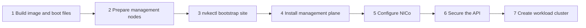

# 11.33 NVKE in depth, part 2: installation, NVKR builds, NICo and CAPNICo, and the cluster lifecycle runbooks

| | |
|---|---|
| Level | Advanced |
| Priority tier | 1 |
| Lab venue | `nvkectl`, `nvkr`, Helm in a container and a kind cluster on macOS arm64. No GPU, no NICo, no bare metal. |
| Part | Part 11: GPUs on Kubernetes, scheduling and virtualization |
| Sources used | NVKE repository at commit 487f511, NVKR at commit 616c308, CAPNICo at commit 41351eb, NICo README, NVIDIA blog of 2026-11-10. Fetched 2026-11-11. |
| Series | Part 2 of 3. Part 1 is [11.32](32-nvke-nvidia-kubernetes-engine-in-depth.md). Part 3 is [11.34](34-nvke-in-depth-part-3-operations-security-failure-modes-and-comparison.md). |

Tags are the same as in 11.32: **[official]**, **[source-code]**, **[ran]**, **[vendor]**, **[third-party]**, **[inference]**. Read the tag before you trust the claim next to it. An **[official]** tag means the vendor said it, and a **[ran]** tag means I saw it happen on my own machine.

## Why this matters for AI infrastructure

You have approval to pilot NVKE and ten working days. On day one a colleague asks which machines you need, which images to build, where the boot files live, and what happens when the third control plane node refuses to join. The documentation answers each question, but the answers are spread across a dozen pages. A pilot that stalls on day two often stalls on a question nobody wrote down. This chapter puts the path in one place, and it marks what I could check without bare metal.

Part 1 explained the architecture and the API. This part walks the installation from the first image build to the first tenant cluster. It explains NVKR, the build system that produces what you install. It also explains NICo and its Cluster API provider CAPNICo, which supply the machines. It ends with the day-two runbooks, the step-by-step procedures you follow after the cluster exists: add a pool, roll an upgrade, replace a failed GPU node.

## Prerequisites and outcomes

### Prerequisites

- 11.32 for the architecture, the API and the cluster spec.
- Linux basics for systemd, cloud-init and TPMs (Part 1). Redfish and BMC background is in Part 7.
- 11.31 for the layers that come after a cluster exists.

### Outcomes

This chapter lays out the seven-step installation, with its hosts, ports and fixed decisions. It then explains NVKR's Definition, Run and Release model and walks a dry-run build. Next come the site spec, the release set and the stack config, each validated on a laptop. After that it separates what NICo and CAPNICo do from what their repositories leave out. It finishes with the lifecycle runbooks, where the upgrade is planned with version-skew arithmetic. Skew is the gap between two version numbers, and a small gap is what keeps the parts working together.

## 1. The installation path in seven steps

A change request asks for the installation plan. The first question is how many machines you need, and that answer comes from one table. Start with the shape of the whole job, so the table makes sense when you reach it. The documentation lays out seven steps **[official]**.



The diagram shows the order. Each step depends on the one before it. You cannot bootstrap nodes that have no image, and you cannot secure an API that is not installed yet. The table below says what runs where, so you know which machine to log into for each step.

| Step | What you do | Where it runs |
|---|---|---|
| 1. Build | Build the node OS image and host its boot files over HTTP(S) | Linux build host with KVM and Docker |
| 2. Prepare nodes | Boot management nodes from the image with cloud-init data and record each TPM thumbprint | Management nodes |
| 3. Bootstrap | `nvkectl bootstrap site` forms the management cluster | Bootstrap host |
| 4. Install | Install Cluster API, CAPNICo, SPIRE, telemetry, PostgreSQL, Temporal and the controller. Admit networks to the API. | Install host |
| 5. Configure NICo | Confirm CAPNICo runs and collect the NICo identifiers | Install host |
| 6. Secure the API | Put a token requirement in front of the API | Install host |
| 7. Create clusters | Create the first workload cluster | API workstation |

### 1.1 What you need

Before you book the racks, list the machines and services the pilot needs. The blog's walkthrough lists six CPU servers, three for the management cluster and three for a workload control plane. It adds a bootstrap host, a pool of GPU servers, an existing NICo installation with enrolled capacity, and a Linux build host with Docker and KVM **[official]**. The build host is the machine that assembles the node image, so it needs virtualization support.

Management nodes must be an odd number, each with a TPM 2.0 device. The node image uses DHCP, which means each node asks the network for its address when it boots. So you reserve each node's address in advance, and the node always gets the same one. The management cluster needs a default StorageClass from a CSI driver you provide, because the bootstrap installs none. A StorageClass tells Kubernetes how to create disks, and CSI is the plug-in standard for storage drivers. The database claims a 40 GiB volume, and the telemetry pipeline claims four more of 1 GiB each **[official]**.

Every control plane VIP needs BGP peering. A VIP is a shared address that moves between control plane nodes. BGP is the routing protocol that tells the network where that address lives. Each control plane node advertises the VIP from local AS 65100 to its default gateway, with peer AS 4294967000 unless NICo metadata provides another **[official]**. Your network team must accept that route. This is the item most likely to delay a pilot, so start that conversation on day one.

### 1.2 Ports

A port is a numbered door on a machine, and a firewall rule decides which callers may knock. Every connection in this table is TCP. The management address is the management cluster's API VIP or, for a single node, its IP **[official]**.

| Source | Destination | Port | Purpose |
|---|---|---|---|
| Machines being provisioned | Boot-artifact HTTP(S) endpoint | 80 or 443 | iPXE scripts, EFI imagers, OS images |
| Bootstrap host | Each management node | 15005 | `nvke-agent` |
| Each management node | Bootstrap host | 30081 | SPIRE server during bootstrap |
| Install host | Management cluster API | 6443 | Kubernetes API |
| Control plane nodes with a VIP | Default gateway | 179 | BGP |
| API callers | Management address | 30080 | NVKE API, plain HTTP |
| Workload nodes | Management address | 30440 | SPIRE attestation |
| Management cluster | Workload nodes | 15005 | `nvke-agent` |
| Management cluster | Workload API addresses | 6443 | Lifecycle operations |
| Management cluster | NICo API | URL port | Requesting machines |
| Management cluster | Identity provider keys URL | URL port | Token signing keys |

Read the table by asking who knocks on whom. Most rules are one machine calling another machine on a single port. When a firewall blocks a step, this table tells you which rule is missing.

### 1.2.1 Decisions you cannot undo

Plan these before anything else **[official]**. Some choices are permanent, and it is far cheaper to decide them on paper than to rebuild later. The management cluster node count is fixed at bootstrap because the cluster cannot add or replace its own nodes. Etcd encryption for the management cluster is chosen at bootstrap and stays as chosen. The SPIFFE trust domain appears in the node data, the site spec and the install values, and it must match in all three places. For workload clusters, the CNI, pod and service ranges, the VIP and the NICo identifiers are fixed at creation. Release objects are immutable, so a changed image needs a new release name.

**Decision rule:** Write the fixed decisions on one page and get them signed off before you boot a single machine.

**In one minute:** Seven steps, an odd number of TPM-equipped management nodes, BGP for each VIP and a short list of choices you cannot reverse.

## 2. NVKR: where the artifacts come from

An auditor asks where the controller image running in your management cluster came from. If you built it by hand on a laptop, the honest answer is "a laptop", and that answer will not pass review. NVKR exists to give a better answer. The name is NVIDIA Kubernetes Recipes. The repository describes it as a way to build NVKE and AICR artifacts from pinned inputs and trace releases back to their sources **[official]**. An artifact is any file the install consumes, such as an image, a chart or a binary. AICR is NVIDIA's companion project for GPU software recipes, covered in 11.31.

A caution about the name. In NVKE documentation NVKR is a build and release system. It is not a catalogue of cluster recipes in the AICR sense. AICR recipes pick GPU software versions for a running cluster. NVKR picks the sources and tools that build the images, charts and binaries that NVKE installs. The blog's phrase "recipes define validated combinations of software versions and GPU generations" fits the catalogs NVKR holds, and I read it as marketing for the catalog idea rather than a runtime object **[inference]**. If you hear "recipe" in a meeting, ask which kind the speaker means.

### 2.1 Definition, Run and Release

The public lifecycle has three steps **[official]**. Think of them as a recipe card, a cooking session and a labelled jar on the shelf.

1. A **Definition** selects named outputs, their components, platforms and formats. Catalogs supply pinned sources and tools. An Environment supplies execution, registry and signing settings.
2. A **Run** generates a plan and dependency graph, then builds locally or through a generated GitHub Actions workflow. It records outputs, evidence and failures.
3. A **Release** is a digest-pinned OCI reference that connects outputs to their SBOMs and provenance. Consumers choose a Verification Policy and verify before use. A digest is a fingerprint of the exact bytes, and an SBOM is a list of the software inside an artifact. Provenance is the record of how the artifact was built.

Local runs are unsigned and sit in the `unqualified-local-execution` evidence lane. A lane is a label that says how much trust the run has earned. Only the generated GitHub Actions workflows produce signed, `pipeline-attested` releases. NVKR's own preview page says no NVKR release is qualified at preview, and verification does not prove byte-for-byte reproduction or deployment readiness **[official]**. Verification proves who signed a thing. It does not prove the thing will work in your data center.

### 2.2 A Definition, validated

This is the repository's tutorial Definition for arm64. It selects three outputs: the controller image, the Helm chart bound to that image, and the `nvkectl` executable. The `catalog.base` paths are relative, so the file only works inside an `nvkr` checkout. A relative path is resolved from the file's own location, so moving the file breaks it.

```yaml
apiVersion: nvkr.dev/definition/v5
kind: Definition
metadata:
  name: nvke-tutorial-arm64
  description: Build the Linux arm64 NVKE CLI, controller image and image-bound controller chart from pinned source.
catalog:
  base: ../../../inputs/catalogs/tools/sbom-arm64
sbomTool: syft
outputs:
  - name: nvke-controller
    catalog:
      base: ../../../inputs/catalogs/nvke/release
    platform: linux/arm64
    format: oci
    components: [nvke-controller]
  - name: nvke-controller-chart
    catalog:
      base: ../../../inputs/catalogs/nvke/release
    platform: linux/arm64
    format: helm-oci
    components: [nvke-controller-chart]
    helm:
      images:
        controller: nvke-controller
  - name: nvkectl
    catalog:
      base: ../../../inputs/catalogs/nvke/release
    platform: linux/arm64
    format: executable
    components: [nvkectl]
```

I built `nvkr` from commit 616c308 and ran three commands against this exact file, placed in the tutorial directory of the clone **[ran]**. Validation is the cheapest check you have. It reads the file, resolves the references and reports a digest, and it touches no build tool.

```text
$ nvkr definition validate --definition docs/examples/nvke-tutorial/definition-arm64.yaml
definition: nvke-tutorial-arm64
digest: sha256:7c694c4d124688197e3eac904c2f8844bb4e494235769c0e14673342b2efed7a
outputs: 3

$ nvkr run local --definition ...definition-arm64.yaml --environment ...environment-local-arm64.yaml --attempt c32-preview --dry-run
[dry-run] nvke-controller/fetch-source-32433f31... (fetch)
[dry-run] nvke-controller/build-nvke-controller (build)
[dry-run] nvkectl/build-nvkectl (build)
[dry-run] package/release (package)
[skipped] publish/release (publish)
[skipped] sign/release (sign)
[skipped] verify-publication/release (verify-publication)
attempt: c32-preview
lane: static-unqualified
status: pending
observed outputs: 0
```

A dry run builds nothing and reports lane `static-unqualified`. Read the output as a plan. Each line is a step that would run, and the three skipped lines are the publish, sign and verify steps that a real run would add. A deliberately broken copy with `format: bogus` failed with `NVKR-E-INVALID-CATALOG ... unsupported format "bogus"`, so the validator does reject bad input **[ran]**. I did not run a real build or any signing, which need Docker builds, network pulls and for signing a Linux host.

### 2.3 What NVKR can build for NVKE

A build system is only useful if it covers the parts you install. The maintained NVKE Definitions split into five families plus a composite **[source-code]**. A composite is one Definition that pulls in the others, so a single run can produce everything for a site.

| Definition | Produces |
|---|---|
| Core | `nvkectl`, operator tools, controller image and chart, `controller-profiles`, CAPNICo, Cluster API and cert-manager images |
| Services | SPIRE, PostgreSQL, Temporal and local-path-provisioner charts and images |
| Telemetry | The telemetry pipeline (NKTP) chart and images |
| Disks | Ubuntu 26.04 node images and FDE images for amd64 and arm64 |
| Disks Ubuntu 24 | The same for Ubuntu 24.04 |
| GPU site composite | 83 outputs from all of the above plus a GB200 AICR bundle, in one release |

FDE stands for full-disk encryption, which means the whole disk is encrypted. NKTP is the telemetry pipeline that ships metrics and events. The README says no hosted release is recorded for these bundles yet **[source-code]**. That means the supply chain story is designed and generated, and not yet proven end to end. Plan your pilot around that gap, and do not describe the chain as finished to anyone who asks.

### 2.4 Browsing, pulling and verifying a release

Once a release exists, consumers use four verbs: `release browse`, `release export`, `release pull` and `release verify`. Each verb answers a different question. Browsing inspects metadata only, so it answers what is in the release. Pulling checks payload integrity but not signatures, so it answers whether the bytes arrived intact. Verifying under your policy authenticates signatures, so it answers whether you trust who signed it. Verification needs Linux, so macOS users run it inside Docker **[official]**. The `export` command writes `release.json`, which the NVKE install can consume to pull every chart and image by digest **[official]**. Pulling by digest is the safest choice, because a tag can be moved to point at different bytes, and a digest cannot.

**Decision rule:** Build and verify the node image and controller from a pinned NVKR release when you can, and write down any artifact you built by hand.

**In one minute:** NVKR is the supply chain, not a runtime recipe object. Definitions describe outputs, runs build them, releases carry signed evidence. The preview qualifies nothing yet.

## 3. Node images and releases

The first machine boots and shows a blank screen. The most common cause in an iPXE flow is an image that was never reachable from the provisioning network. iPXE is a network boot program, and it fetches its files over HTTP. If the machine cannot reach the address, it has nothing to boot. NVKE does not host your boot files. It passes boot instructions to NICo **[official]**. So the place to look first is the network path between the new machine and your file server.

### 3.1 Build and host

Building the image is the first real work of a pilot. The reference build is `make -C os-image image-native ARCH=amd64 VARIANT=non-fde` on a Linux host with KVM. KVM is the Linux virtualization feature the build uses to run an isolated machine. A smoke test is `make -C os-image boot-smoke REQUIRE_ACCELERATION=1` **[official]**. A smoke test is a quick check that the image starts at all, before anyone trusts it. The default image is Ubuntu 26.04.1 with the `linux-nvidia` kernel on amd64 and a 64k-page variant on arm64.

Two limits matter. A local image build is not a qualified release, because the smoke test does not validate a real NICo boot, disk selection or first-boot configuration. A QCOW2 image needs a site-specific EFI imager and script that you validate with your NICo site, because the repository ships only an end-to-end test template **[official]**. QCOW2 is a disk image format, and an EFI imager is the small program that prepares the image for the firmware's boot path. iPXE has no OCI pull support, so you extract artifacts from a registry and host them on a plain HTTP(S) endpoint. OCI is the standard format for container images, and a registry is where those images live.

The full-disk-encryption variant is for evaluation only. Every node built from one FDE image shares its volume key, and a public bootstrap passphrase remains in the GRUB configuration **[official]**. GRUB is the boot loader, the first program the machine runs. A passphrase that everyone can read protects nothing. Do not rely on it for data at rest, which means data stored on disk and not moving across a network.

### 3.2 Three release objects

Registering an image creates three Kubernetes objects on the management cluster **[official]**. Each one holds a different piece of the boot story, and a cluster request points at them by name. A **MachineImage** holds metadata and the iPXE script. A **ClusterRelease** names a MachineImage and a cloud-init template for control plane nodes. A **NodePoolRelease** does the same for workers. Cloud-init is the standard tool that configures a machine on first boot, and the template is the text it runs. A cluster request names a ClusterRelease for the control plane and a NodePoolRelease for each pool. Customers pick a named release and never touch OS images or cloud-init directly **[official]**. That keeps the customer away from the messy parts.

This release set uses the repository's example structure with generic URLs. I applied it to a kind cluster that had the real CRDs, first as a server-side dry run and then for real, after which the API listed the release **[ran]**. A server-side dry run asks the API server to check the object without storing it, so it catches schema errors safely.

```yaml
apiVersion: internal.nvke.nvidia.com/v1
kind: MachineImage
metadata:
  name: example-ubuntu-24.04-amd64
spec:
  operatingSystem:
    family: ubuntu
    version: "24.04"
  architecture: amd64
  buildDate: "2026-03-23"
  nico:
    ipxeScript: |
      #!ipxe
      set boot_assets https://boot.example.com/ubuntu-24.04-amd64
      kernel ${boot_assets}/vmlinuz console=tty0 console=ttyS0,115200 ip=dhcp url=https://releases.example.com/ubuntu-24.04-live-server-amd64.iso autoinstall ds=nocloud-net;s=${cloudinit-url} initrd=initrd
      initrd ${boot_assets}/initrd
      boot
---
apiVersion: internal.nvke.nvidia.com/v1
kind: ClusterRelease
metadata:
  name: example-ubuntu-24.04-amd64
  annotations:
    internal.nvke.nvidia.com/machine-init-kubernetes-version: ""
    internal.nvke.nvidia.com/machine-init-kubernetes-version-injected: "true"
spec:
  machineImageRef:
    name: example-ubuntu-24.04-amd64
  machineInit:
    userDataTemplate: |
      #cloud-config
      hostname: {{ .Hostname }}
      preserve_hostname: false
---
apiVersion: internal.nvke.nvidia.com/v1
kind: NodePoolRelease
metadata:
  name: example-ubuntu-24.04-amd64
  annotations:
    internal.nvke.nvidia.com/machine-init-kubernetes-version: ""
    internal.nvke.nvidia.com/machine-init-kubernetes-version-injected: "true"
spec:
  machineImageRef:
    name: example-ubuntu-24.04-amd64
  machineInit:
    userDataTemplate: |
      #cloud-config
      hostname: {{ .Hostname }}
      preserve_hostname: false
```

The result was:

```text
machineimage.internal.nvke.nvidia.com/example-ubuntu-24.04-amd64 created
clusterrelease.internal.nvke.nvidia.com/example-ubuntu-24.04-amd64 created
nodepoolrelease.internal.nvke.nvidia.com/example-ubuntu-24.04-amd64 created
$ curl -s localhost:8080/api/releases
{"releases":[{"name":"example-ubuntu-24.04-amd64"},{"name":"test-fixture-amd64"}]}
```

The iPXE script is a boot instruction and nothing here proves the image boots. The `boot.example.com` host is a placeholder. Treat every URL in the example as a stand-in for your own file server.

**Decision rule:** Host boot files on an endpoint you operate and test a full boot on the target hardware before you touch the management plane.

**In one minute:** Three immutable objects tie an image and cloud-init to a name. The API lists the names. NVKE hosts no files.

## 4. Bootstrap: forming the management cluster

The bootstrap host runs one long command in `tmux`, and the engineer worries about a dropped session. The bootstrap is where the management cluster comes from, so it deserves care. Run it inside tmux, a terminal multiplexer that keeps a session alive when your connection drops. Losing the session halfway through is not a disaster by itself, but it makes the next steps harder to reason about.

`nvkectl bootstrap site` creates a temporary kind cluster on the bootstrap host, which the docs call the seed cluster. Kind is a tool that runs a small Kubernetes cluster inside containers. The seed cluster does the first job. It uses the seed cluster to drive `kubeadm init` and `kubeadm join` on your nodes through `nvke-agent`, then deletes the seed when it succeeds. Kubeadm init starts the first control plane node, and kubeadm join adds the others. You are left with a kubeconfig and an etcd encryption key file. Move the key file off the bootstrap host immediately. It is the only copy not on a node **[official]**. Think of the seed as scaffolding. The building stands on its own afterwards, and the scaffolding is taken down.

### 4.1 The site spec

A site spec lists the nodes and the management cluster's Kubernetes settings. `nvkectl generate sitespec` writes one from a CSV of nodes, which is a spreadsheet saved as plain text. This spec is the repository's provisioned-nodes example with a trust domain added. The TPM thumbprints are placeholder patterns. A thumbprint is a short fingerprint of a TPM's endorsement key, and the real values come from your hardware.

```yaml
clusterName: nvke-site
cluster:
  nodes:
    - name: node1
      ip: 10.0.0.1
      tpmEkThumbprint: "0000000000000000000000000000000000000000000000000000000000000000"
    - name: node2
      ip: 10.0.0.2
      tpmEkThumbprint: "1111111111111111111111111111111111111111111111111111111111111111"
    - name: node3
      ip: 10.0.0.3
      tpmEkThumbprint: "2222222222222222222222222222222222222222222222222222222222222222"
  k8sVersion: 1.36.3
  cniName: ovn-kubernetes
  podCidr: 192.168.0.0/16
  serviceCidr: 10.96.0.0/12
  controlPlaneVIP: 10.0.0.100
  kubeletConfig:
    systemReservedMemory: 16Gi
spire:
  trustDomain: mgmt.example.com
```

I ran the real `nvkectl` built from commit 487f511 on this file **[ran]**. A validation step is worth running even before you have hardware, because it catches a typo while the file is still on your laptop.

```text
$ nvkectl validate sitespec -f c32_sitespec_provisioned.yaml
valid
```

Two negative cases show what validation catches. Reusing an IP gave `node ip "10.0.0.1" is used 2 times; IPs must be unique`. Two nodes gave `cluster.nodes must contain an odd number of nodes`. A negative case is a deliberately broken input, used to prove the check works. `nvkectl bootstrap site -f ... --dry-run` loaded the file, printed the resolved inventory and touched no node.

Generating the file from a CSV also worked:

```text
$ nvkectl generate sitespec example-mgmt --nodes hosts.csv --set cluster.k8sVersion=1.36.3 --set cluster.controlPlaneVIP=10.0.10.100 --set spire.trustDomain=mgmt.example.com
```

The output was a complete, commented site spec with all three nodes.

One discrepancy deserves a warning. A site spec with `infra.provider: nico` is refused by this build of `nvkectl` with `infra.provider "nico" is a work in progress and not available yet; set NVKECTL_ENABLE_NICO=1 to enable it`. With the variable set, validation moved on to missing credentials **[ran]**. The site-bootstrap docs describe that provider without mentioning the flag **[source-code]**. The docs and the binary disagree, and the binary is what runs. Use pre-provisioned nodes for a pilot unless NVIDIA tells you otherwise.

### 4.2 Fields that matter

Each field in the site spec has a rule, and most of the rules are checked before any node is touched. This table is the lookup you will return to when validation complains.

| Field | Rule |
|---|---|
| `cluster.nodes` | Odd count, unique names and IPs. Not used with `infra.provider: nico`. |
| `cluster.controlPlaneVIP` | Required with more than one node. IPv4, routable over BGP, outside the pod and service CIDRs. |
| `cluster.k8sVersion` | Plain semver, no leading `v` |
| `cluster.etcdEncryption` | Defaults to true. A cluster built without it can never be encrypted. |
| `cluster.kubeletConfig.systemReservedMemory` | On a node with 16Gi or less, the default leaves nothing allocatable. Set it to fit. |
| `spire.upstreamCA` | True when SPIRE chains to your own CA. Then `NVKECTL_SPIRE_CA_CERT_FILE` and `NVKECTL_SPIRE_CA_KEY_FILE` are required. |
| `spire.trustDomain` | One value shared by node data, site spec and install. If unset, `nvkectl-bootstrap.nke.local` is used and will not match your nodes. |

The systemReservedMemory row is the one that surprises people. Allocatable memory is what the scheduler can hand to pods. On a small node, a generous reservation can leave none at all. The spire.trustDomain row is the one that causes silent trouble. If the default is used, the nodes and the install disagree, and that mismatch is hard to trace.

The bootstrap host needs rootful `nerdctl` with containerd, plus `kind`, `helm`, `kubectl` and clusterctl. Rootful means the tool runs with full system rights, and containerd is the container runtime underneath. `clusterctl` is the Cluster API command-line tool. Docker is not supported there. Only `nerdctl` is checked before the run starts, so a missing `helm` fails part-way through **[official]**. Check each tool by hand before you start the long command.

**Decision rule:** Validate the site spec on a laptop, run the bootstrap dry run on the bootstrap host, and only then run the real command inside tmux.

**In one minute:** A temporary seed cluster forms the management cluster and disappears. The key file must leave the host. Validation catches duplicate IPs and even node counts before any node is touched.

## 5. Installing the management plane

The management cluster is a bare kubeadm cluster. Nothing in it knows about tenants yet. The install turns it into an NVKE site. Picture a new office building. The bootstrap gave you the bare structure, and the install adds the wiring, the reception desk and the locks.

### 5.1 Inputs

The install reads three things: the site spec, a stack config for what only the management plane needs, and credentials from `NVKECTL_*` environment variables. No file holds a credential **[official]**. Keeping secrets out of files is the rule that keeps them out of your git history. This stack config uses the example structure with generic values. The two image names are the ones the docs tell you to stage on each node.

```json
{
  "nico": {
    "endpoint": "https://nico.example.internal",
    "orgID": "example-org",
    "apiName": "forge"
  },
  "images": {
    "controller": "nvke.local/nke-controller:site",
    "profiles": "nvke.local/controller-profiles:site"
  },
  "mirror": ""
}
```

Without a release description, the controller and profile images are not pullable without a credential. You tag them locally and import them into every management node's containerd under the `k8s.io` namespace. A namespace in containerd keeps one set of images apart from another, and Kubernetes looks in k8s.io. A release description from `nvkr release export` replaces that step **[official]**. Importing by hand works, but it is a step you will forget on the third node.

Credentials come from `NVKECTL_NICO_TOKEN`, `NVKECTL_NODE_USER`, `NVKECTL_NODE_PASSWORD` and `NVKECTL_DATABASE_PASSWORD`. Read secrets with `read -rs` so they never echo, which means the characters stay off the screen and out of your shell history. Keep the database password in your secret manager, because every later install of the same site needs the same value. A changed database password on the second install is a common way to break a working site.

### 5.2 The sequence

The install runs in a fixed order, and each step assumes the previous one finished. Run the first step as a rehearsal, because it changes nothing.

1. Run `deploy/check-site.sh --sitespec ... --stack-config ... --kubeconfig ...`. It changes nothing and prints PASS, WARN, SKIP or FAIL per finding.
2. Run `clusterctl init` at v1.13.6 with the kubeadm bootstrap and control plane providers. It also installs cert-manager and reads GitHub release data, which allows 60 anonymous requests an hour. cert-manager is the component that issues and renews certificates inside the cluster. If you run the install often, authenticate to GitHub so the anonymous limit does not get in the way.
3. Run `deploy/nvke-deploy.sh install --deploy-path deploy/nico ...`. Add `--dry-run` first to print every command.
4. Patch the Cluster API controllers with `controller/hack/apply-capi-spiffe-exec-auth.sh`, and repeat it after every `clusterctl init` or Cluster API upgrade. The patch lets the Cluster API controllers authenticate with SPIFFE identities. Every upgrade of Cluster API can overwrite it, so put it in your runbook.
5. Admit your networks to the API with a NetworkPolicy.
6. Register the site with `nvkectl config set-site`.

The deploy path applies items in this order **[source-code]**: `nvke-base-config`, `spire-tpm-pubhashes`, `spire-server-nodeport`, `spire-oidc-provider-nodeport`, `capnico`, `nktp`, `postgresql`, `spire-crds`, `temporal`, `spire` and `controller`. Each Helm item waits up to 15 minutes. Helm is the package manager for Kubernetes, and each item is a chart. Running the install again upgrades items in place, but a values file you leave out stops applying. That is how a forgotten `--values-for controller=auth-values.yaml` silently turns authentication off. The install does not warn you. It simply stops applying the setting you forgot to pass.

### 5.3 Admitting networks

The controller chart admits the API only from pods inside the cluster. So callers outside the cluster need a NetworkPolicy, which is a Kubernetes rule that allows some source addresses and blocks the rest. You add one for the networks that call it. The policy is validated with a server-side dry run on a cluster that had the API server's real schema **[ran]**. The CIDRs here are examples, so replace them with your operator networks.

```yaml
apiVersion: networking.k8s.io/v1
kind: NetworkPolicy
metadata:
  name: nvke-api-clients
  namespace: nvke-controller
spec:
  podSelector:
    matchLabels:
      app.kubernetes.io/name: nvke-controller
  policyTypes:
    - Ingress
  ingress:
    - from:
        - ipBlock:
            cidr: 10.0.10.0/24
        - ipBlock:
            cidr: 10.0.20.0/24
      ports:
        - port: 8080
          protocol: TCP
```

A request can reach the controller from a management node's address, because the NodePort forwards it. The NodePort is the port opened on each node that passes traffic to the controller. Admit the node network, and filter port 30080 at your network edge as well. If a host still times out, the request may arrive from the OVN-Kubernetes join network `100.64.0.0/16`, which needs its own `ipBlock` **[official]**. A timeout with no error message is the usual sign of a missing rule like this one.

### 5.4 Verifying the install

Verify the install from the outside, the same way a caller would reach it. A check from inside the cluster can pass while the outside path is still blocked.

```bash
curl -sS --max-time 10 http://<MANAGEMENT_ADDRESS>:30080/healthz
```

The expected body is `{"status":"ok"}`. Then `nvkectl get providers` should show the `nico` row as `CONFIGURED`, and `nvkectl get clusters` lists nothing and prints no error. The `/readyz` endpoint adds a database and Temporal check, and I saw `{"status":"ok","checks":{"database":"ok","temporal":"ok"}}` from the real controller **[ran]**. Use /readyz when you want to know the whole service works, and /healthz when you only want to know the process is up.

### 5.5 Rendering the controller chart

A chart is a package of Kubernetes templates, and rendering it shows you the objects it would create without creating any of them. That makes rendering a safe place to catch mistakes. The chart is a Helm chart in the NVKE repository with one dependency on a CRD chart. Helm v4 is required by the docs, and the container I used reported v4.3.1 **[ran]**. After `helm dependency build`, a values file for authentication in permissive mode rendered 19 objects. The file is below. Its issuer and audience are examples, so swap in your own identity provider.

```yaml
apiAuth:
  enabled: true
  permissive: true
  configMap:
    create: true
  config:
    audiences: ["https://nvke.example.internal"]
    issuers:
      - name: example-idp
        issuer: "https://idp.example.com/realms/example"
        jwks:
          uri: "https://idp.example.com/realms/example/protocol/openid-connect/certs"
        algorithms: [RS256]
        admit:
          groups:
            - nvke-operators
```

```text
$ docker run --rm -v $PWD/chart:/w:ro -v $PWD/c32_auth_values.yaml:/v.yaml:ro alpine/helm template nvke-controller /w/controller -n nvke-controller -f /v.yaml
```

The render contained one ClusterRole, two ClusterRoleBindings, two ConfigMaps, three CRDs, a Deployment, a NetworkPolicy, a ServiceMonitor and more **[ran]**. A ClusterRole is a set of permissions across the whole cluster, and a Deployment runs the pods. A mistake is caught at render time. Setting `apiAuth.config` without `configMap.create` fails with `apiAuth.config is set but would not be rendered: it is only used when apiAuth.enabled and apiAuth.configMap.create are both true` **[ran]**. Other mistakes only appear when the pod starts, because the chart does not copy the controller's own validation rules **[source-code]**. So a render that succeeds is good news, but it is not the end of the story.

**Decision rule:** Run the site check and a dry run first, keep every `--values-for` flag in a script under version control, and test authentication in permissive mode before enforcing.

**In one minute:** Check, Cluster API, deploy path, SPIFFE patch, network policy, set-site. Each install re-applies everything, so a missing values file silently reverts settings.

## 6. NICo and CAPNICo

The cluster is stuck with machines pending. Someone asks whether the problem is NVKE or NICo. You need a map of the boundary before you can answer, and this section draws that map. A wrong guess here sends the team to the wrong dashboard for an afternoon.

### 6.1 NICo in two paragraphs

NICo is the NVIDIA Infra Controller, a Rust suite of microservices that manage the bare-metal lifecycle. Rust is the programming language, and a microservice is a small program that does one job and talks to the others over the network. The lifecycle covers hardware discovery, firmware validation, BlueField DPU provisioning, network isolation, tenant provisioning and sanitization between tenants. A BlueField DPU is a network card with its own processor, and sanitization means wiping a machine so the next tenant gets clean hardware. Its README says it discovers BMCs over the out-of-band network with Redfish, and that it boots any iPXE-installable OS **[official, NICo README]**. A BMC is the small controller inside a server that lets you manage it remotely, and Redfish is the standard web API for that controller.

None of that is in the NVKE, NVKR or CAPNICo repositories. I searched all three clones for Redfish and found a match only in an issue template **[ran]**. So NVKE never talks to a BMC. NVKE asks NICo for an instance of an instance type with an iPXE script, and NICo does the BMC and boot work. This is a clean split, and it is the reason a pending machine so often points at NICo rather than at NVKE.

### 6.2 CAPNICo

CAPNICo is a Cluster API infrastructure provider and does one job: give Cluster API the machines it asks for. An infrastructure provider is the piece of Cluster API that knows how to create machines on a particular platform. CAPNICo does not install Kubernetes and does not join nodes. It defines five kinds **[source-code]**. Each kind is a custom object type that the controller reads and writes.

| Kind | Holds |
|---|---|
| `NicoCluster` | The site ID and an optional identity reference |
| `NicoMachine` | One NICo instance and its VPC. The spec freezes after the provider ID is assigned. |
| `NicoMachineTemplate` | Template used by control plane and machine deployments |
| `NicoClusterTemplate` | Exists, but nothing consumes it yet |
| `NicoIdentity` | A credential Secret reference and a health check of it |

CAPNICo reads the kubeadm bootstrap Secret and sends its cloud-config to NICo as user data on the create request. User data is the configuration text the new machine receives at boot. Its README rates it Experimental, and its release series 0.0.x targets contract v1beta2 **[source-code]**. A contract is the set of fields and behaviours that Cluster API expects from a provider, and the version names that agreement. Each stall has a named reason such as `WaitingForBootstrapData`, `InstanceTypeUnavailable`, `WaitingForIdentitySecret`, `ControlPlanePriorityDeferred` and `InstanceNotReady`. A stall reason is a short label that says why a machine is waiting. `InstanceTypeUnavailable` usually means your organization has no allocation for that instance type. An allocation is the share of hardware your organization is permitted to use.

### 6.3 Credentials

CAPNICo authenticates with a bearer token from the Secret `nico-credentials` in `capnico-system`. The four keys are `endpoint`, `orgID`, `token` and `apiName` **[official]**. The manifest below uses placeholder values. The real token comes from `NVKECTL_NICO_TOKEN` at install time. If you rotate the token with `kubectl apply`, also update the install inputs, or the next install overwrites your change. That is the most common surprise in credential rotation here. A change made by hand lasts only until the next run of the install.

```yaml
apiVersion: v1
kind: Secret
metadata:
  name: nico-credentials
  namespace: capnico-system
type: Opaque
stringData:
  endpoint: https://nico.example.internal
  orgID: example-org
  token: REDACTED
  apiName: forge
```

A server-side dry run accepted it **[ran]**. Keep the real file out of version control, set its mode to 0600 on disk, and delete it after applying. A mode of 0600 means only the file's owner can read or write it. Once the Secret exists in the cluster, the file on disk is a leak waiting to happen.

### 6.4 Repair and reboot through annotations

Two operations are contracts on the Cluster API `Machine` rather than fields **[source-code]**. An annotation is a note attached to an object, and a controller reads it as an instruction. Setting `nico.nvidia.com/machine-health-issue` with a JSON value such as `{"category": "Thermal", "summary": "over temperature"}` forwards the issue to NICo as context on the delete request. Setting `nico.nvidia.com/reboot` requests a graceful restart with a hard instance reboot fallback after 30 minutes. A graceful restart asks the operating system to shut down cleanly first. The variants `reboot-soft` and `reboot-hard` pick one action. This is how NVKE's `machineHealthIssue` field in the node delete body reaches NICo **[inference, from the two sources]**. The link is my reading of two separate sources, so verify it on your own site before you rely on it.

**Decision rule:** Treat NICo capacity, allocations and boot files as the first suspects for any pending machine, and read CAPNICo's condition reasons before reading NVKE logs.

**In one minute:** NICo owns BMCs, Redfish, DPUs and iPXE. CAPNICo translates Cluster API machines into NICo instances. NVKE sits above both and never touches a BMC.

## 7. Lifecycle runbooks

A runbook is a written procedure that a person follows under pressure. Each runbook here states what to check first, the command, the expected result and what NVKE does not do. Commands marked as run used the local controller. Anything that needs machines did not run. Read each runbook before you start it, so you know the goal and the warning signs before the first command.

### 7.1 Create a cluster

A new tenant wants a cluster on Monday, and the create runbook is the one you will use most. Work through the steps in order, and stop at the first step that surprises you.

1. Lint the spec: `python3 -I code/part11/c32_spec_lint.py spec.yaml`. Fix every ERROR.
2. Confirm the releases exist: `nvkectl get clusterreleases` and `nvkectl get nodepoolreleases`, or `GET /api/releases`.
3. Create it: `nvkectl create cluster -f spec.yaml`. The command prints `Cluster "<name>" created (id: <id>)` and returns.
4. Watch it: `nvkectl get clusters <name>`. Status runs `Provisioning` then `Provisioned`.
5. If it stays in `Provisioning`, read `nvkectl get clusters <name> -o yaml`. Each condition has a message. The node messages in the troubleshooting table of the docs tell you whether the machine is undelivered, unbooted or failing preflight. Preflight is the set of checks a node runs before it joins.
6. Fetch the kubeconfig and verify with `kubectl get nodes`.

What ran: steps 1 and 3 against the local controller, which returned `Cluster "demo-e" created`. What did not: steps 4 to 6, which need machines **[ran]**. The lint step is the cheapest one, so never skip it.

The kubeconfig belongs to the user `nvke:breakglass:<cluster>` in group `nvke:breakglass`, which is bound to `cluster-admin`. Break-glass means an emergency login kept for the rare case when normal access fails. Cluster-admin is the highest permission a cluster offers. The credential cannot be revoked. Hand it only to administrators **[official]**.

### 7.2 Add a pool and scale

A pool is added when a tenant needs a new kind of machine, and scaled when they need more of the same kind. Add a pool with the body in section 6.6 of part 1. The pool starts at the cluster's Kubernetes version. Scale with `nvkectl patch nodepool <pool> --cluster <cluster> --patch 'desiredNodeCount: 8'`. Raising the count provisions nodes when NICo has capacity. Lowering it removes only pending nodes that have not started provisioning. To remove running nodes, delete each one, as in 7.4. NVKE does not replace a deleted node while the pool still holds at least the desired count **[official]**. Scaling down is therefore a deliberate act, not something the controller does on its own.

I raised a pool from 4 to 6 and from 2 to 3 on the local controller and saw the pending count follow the desired count in the metrics **[ran]**. The pending count is the number of nodes that are asked for but not yet present, so watching it is the simplest check that a scale request took effect.

### 7.3 Roll a Kubernetes upgrade

An upgrade is two separate acts. First the control plane moves, then each pool moves on its own, and nothing recycles nodes automatically. Recycling means replacing a node with a fresh one on the new version. The rules come from the controller source **[source-code]** and the supported-platforms page **[official]**. Read them as questions and answers, because each rule is the answer to a question an operator will ask:

- Can the control plane go down a version? No. It moves up only, and a downgrade or the same version is refused.
- How far can one request jump? One minor version per request. Any patch bump is fine. A minor version is the middle number, so 1.36 to 1.37 is one minor step.
- How far behind may a worker pool be? Every worker pool must remain within three minor versions behind the new control plane.
- What must exist first? The cluster needs a `controlPlaneVIP`, and only one upgrade runs at a time.
- What must the release look like? The target must have a registered release that matches architecture, variant and Ubuntu version, or the upgrade fails.
- Which command touches which part? `nvkectl patch cluster` changes only the control plane. Pools use the REST API.

The API does not stop a pool version newer than the control plane. `c32_upgrade_planner.py` adds that rule and prints the ordered requests. A planner like this turns a set of rules into a list of calls, so you can review the list before anyone runs it. Here is the planner's output for three situations **[ran]**.

```text
$ c32_upgrade_planner.py 1.36.3 1.37.2 gpu=1.36.3 cpu=1.35.3
patch-cluster 1.37.2
patch-nodepool cpu 1.37.2
patch-nodepool gpu 1.37.2

$ c32_upgrade_planner.py 1.34.2 1.37.2 gpu=1.34.2
patch-cluster 1.35.0
patch-cluster 1.36.0
patch-cluster 1.37.2
patch-nodepool gpu 1.37.2

$ c32_upgrade_planner.py 1.33.0 1.37.2 gpu=1.33.0
REFUSED: pool gpu at 1.33.0 is more than 3 minor versions behind 1.37.2
```

Read the three outputs as three stories. In the first, the control plane and both pools are close enough to jump straight to the target. In the second, the control plane is too far behind to jump, so the planner walks it one minor step at a time. In the third, the GPU pool is so far behind that no plan can fix it within the rules, so the planner refuses and tells you why.

The `.0` patch values in the middle of the second plan are placeholders. A real site substitutes a version its node images carry. The node image stages 1.34.2, 1.35.3 and 1.37.2 but supports only 1.36.3 at preview **[official]**, so a real upgrade also depends on you building and registering a release first. Stage means the image carries the version, and support means NVIDIA stands behind it. Those are two different things at preview.

The pool upgrade call is the second patch body from part 1:

```bash
curl -X PATCH "$API/nodePools/$POOL_ID" -H 'Content-Type: application/json' -d '{"kubernetesVersion": "1.37.2", "recycleBudget": 2}'
```

After that, nodes created earlier are outdated. Auto mode marks them with the condition `nvke.nvidia.com/NeedsRecycle`, at most `recycleBudget` minus the pool's shortfall at a time. A shortfall is the gap between the nodes you want and the nodes that are available right now. NVKE does not cordon, drain or delete them. Cordoning means marking a node so no new pods land on it. You or NVSentinel delete each one, and NVKE provisions a replacement on the new configuration **[official]**. NVSentinel is NVIDIA's node health project, which is covered in 11.31. Recycling in small batches keeps the pool working while the swap happens.

#### Worked arithmetic

The shortfall is the desired count minus the nodes that are available. A node is unavailable when it is not Ready, is cordoned, is being deleted or is already marked. The number of new marks is `recycleBudget` minus the shortfall, never below zero. The documentation's example is a pool of 4 with budget 2 and one NotReady node, which allows one mark. The tested planner gives these results for a pool of 8 with budget 2 **[ran]**.

| Available nodes | Shortfall | New marks |
|---|---|---|
| 8 | 0 | 2 |
| 7 | 1 | 1 |
| 6 | 2 | 0 |

With budget 1 the number is 1 and with budget 0 it is 0, which is why auto mode is off until you set a budget. If all 8 nodes are outdated and each round finishes before the next, a budget of 2 needs 4 rounds. Work the arithmetic on paper before you set the budget, because a budget that is too high can take a pool below its desired count at a bad moment.

For the control plane, `maxSurge` is 0 or 1. Surge means an extra node joins before an old one leaves. With three nodes and surge 0, a replacement leaves two voters, which is exactly the quorum of two and no spare. Quorum is the majority etcd needs to keep working. With surge 1, a fourth node joins before the old one leaves. A single node cannot be replaced safely at surge 0. Control plane replacement happens automatically only when `enableCPNodeRecycling` is true. Otherwise nodes that need replacement are reported as pending **[official]**. The quorum arithmetic is mine **[inference]**, so check it against your own cluster before you plan a maintenance window around it.

### 7.4 Replace a failed GPU node

A node reports seven of eight GPUs. One GPU has failed, and the node is quietly running at reduced capacity. Do the steps in this order, because the order keeps the tenant informed and the hardware recoverable.

1. List the pool's nodes: `curl -s "$API/nodes?nodePoolID=$POOL_ID"`. Pick the node's ID.
2. Let your break-fix policy decide when the tenant can be disrupted. NVKE does not decide that. A break-fix policy is your own rule for when to stop a node for repair, and it may involve the tenant's approval.
3. Delete the node with the machine health issue in the body, the file `c32_delete_node.yaml` from part 1.

```bash
curl -X DELETE "$API/nodes/$NODE_ID" -H 'Content-Type: application/json' -d '{"machineHealthIssue": {"category": "Hardware", "summary": "Node reports 7 of 8 GPUs"}}'
```

The API returns `202`. NVKE cordons the node and evicts its pods through the Eviction API, which respects PodDisruptionBudgets. A PodDisruptionBudget is a rule that limits how many pods of an app may be down at once, and the Eviction API obeys it. It does not evict DaemonSet pods, static pods or finished pods. Static pods are started directly by the kubelet, and finished pods have already stopped. After 100 seconds it deletes remaining pods without a grace period. A grace period is the time a pod gets to shut down cleanly, so skipping it is a hard stop. If the node is gone, add `"forceUnreachable": true` **[official]**. Use that flag only when the node cannot answer at all.

4. NVKE releases the machine to NICo, flags it for repair if you sent the health issue, and provisions a replacement when the pool has fewer nodes than desired and capacity exists.
5. Verify with `kubectl get nodes` that the new node is Ready.

What ran: I sent the delete with a health issue and got `202`, and the node's `deleting` condition turned `True` **[ran]**. Draining, NICo and the replacement did not run. NVSentinel can drive reboot and replacement automatically and NVKE carries them out. Without it, reboot is not available through the NVKE API at preview **[official]**. So at preview, a reboot is a job for you or for NVSentinel, not for the API.

### 7.5 Delete a cluster

Deleting a cluster is the one action that cannot be taken back, so the runbook is short and the warning is clear. `nvkectl delete cluster <name>` asks no confirmation. It returns at once and the cluster shows `Deleting` until every machine is released. Deletion works in any state. On the local controller a deleted cluster stayed in `Deleting` because no Cluster API controller ran to finish it, and the condition read "Waiting for node pools to be deleted" **[ran]**. On a real site a stuck delete is a reason to read the Cluster API objects, not to delete them by hand. Deleting the objects by hand can skip the cleanup that releases machines back to NICo, and that can leave hardware stranded.

**Decision rule:** For every runbook, write the check that tells you it worked before you run the command, and keep the planner and linter in the same repository as your cluster specs.

**In one minute:** Create, scale, upgrade, replace and delete are API calls with documented guard rails. Upgrades are two stages with no automatic node replacement. The planner adds the pool-version rule the API lacks.

## 8. Hands-on lab: validate everything you can without hardware

This lab uses what can run on a laptop. Most of the installation inputs can be checked without a single server, so start here before you order hardware. **What ran here:** `nvkectl validate sitespec`, `nvkectl generate sitespec`, `nvkectl bootstrap site --dry-run`, `nvkr definition validate`, `nvkr run local --dry-run`, `helm template` in the `alpine/helm` container, server-side dry runs of three manifests on kind, the planner and the linter. **What did not run:** `nvkectl bootstrap site` for real, the install scripts, `clusterctl init`, anything with NICo, SPIRE, a TPM, BGP, an image boot or a GPU.

1. Validate the site spec. Run `nvkectl validate sitespec -f code/part11/c32_sitespec_provisioned.yaml`. Expected: `valid`. Record the trust-domain warning if you omit `spire.trustDomain`.
2. Break it. Change one IP to match another. Expected: `IPs must be unique`.
3. Dry-run the bootstrap. Run `nvkectl bootstrap site -f ... --dry-run`. Expected: the resolved inventory, no node touched.
4. Validate the NVKR Definition inside an `nvkr` checkout. Expected: `outputs: 3`.
5. Render the chart with the authentication values and with a bad values file. Expected: 19 objects, and the `apiAuth.config is set but would not be rendered` error for the bad one.
6. Apply the three manifests with `kubectl apply --dry-run=server` on a cluster that has the NVKE release CRDs. Expected: three `created (server dry run)` lines per file group.
7. Run `python3 -B code/part11/c32_nvke_lab.py` and `pytest code/part11 -q -k c32`. Expected: `16 passed, 0 failed` and all tests pass.

**What to record:** every expected line you saw, and every difference. A difference is the most useful result in the lab, because it tells you the docs and the binary disagree.

**Decision rule:** Run this lab on every NVKE release you adopt, because it catches schema and chart changes for free.

**In one minute:** Most of the installation inputs can be validated offline. The first thing that needs hardware is the boot.

## Exercises

1. **Port planning.** A firewall between the management cluster and a workload cluster blocks everything. Which ports must you open? Worked solution: 15005 to each node for `nvke-agent` and 6443 to the workload API address, plus NICo's API port outbound.
2. **Fixed decisions.** Name five choices you cannot change after bootstrap or creation. Worked solution: management node count, management etcd encryption, SPIFFE trust domain, workload CIDRs and VIP, and a pool's instance type.
3. **Upgrade plan.** A cluster runs 1.34.2 and its GPU pool also runs 1.34.2. Plan an upgrade to 1.37.2. Worked solution: three control plane requests, one per minor version, then the pool. The pool stays within three minors of the control plane at each step, since 1.34 is not below 1.37 minus 3.
4. **Recycle budget.** A pool of 12 has budget 3 and 2 nodes NotReady. How many marks now? Worked solution: shortfall 2, so 3 minus 2 equals 1.
5. **Failure triage.** A cluster stays `Provisioning` with a node message "Waiting for infrastructure allocation". Where do you look? Worked solution: NICo capacity and allocation for the instance type, then CAPNICo conditions such as `InstanceTypeUnavailable`.
6. **Supply chain.** An auditor asks for evidence of your controller image. What do you show? Worked solution: the NVKR release reference, the `release verify` result under your policy and the SBOM, with the preview caveat that no release is qualified.

## Checkpoint questions

<details>
<summary>1. How many steps does the documented installation have, and which is first?</summary>

Seven. Build the node image and host its boot files is first.

</details>

<details>
<summary>2. Why must the management cluster node count be chosen carefully?</summary>

The management cluster cannot add, upgrade or replace its own nodes at preview, so you size it for the life of the installation.

</details>

<details>
<summary>3. What does each control plane VIP need from the network?</summary>

BGP peering. Each control plane node advertises the VIP from local AS 65100 to its default gateway.

</details>

<details>
<summary>4. What is NVKR, and what is it not?</summary>

A build and release system that produces NVKE and AICR artifacts from pinned inputs with SBOMs and provenance. It is not a runtime recipe object and not a cluster recipe in the AICR sense.

</details>

<details>
<summary>5. What are the three NVKR lifecycle steps?</summary>

Definition, Run and Release.

</details>

<details>
<summary>6. What does a local NVKR run lack compared with a hosted one?</summary>

Signatures and build provenance. It sits in the unqualified local execution lane.

</details>

<details>
<summary>7. What are the three release objects?</summary>

MachineImage, ClusterRelease and NodePoolRelease.

</details>

<details>
<summary>8. Why can a QCOW2 node image fail to provision with the repository alone?</summary>

It needs a site-specific EFI imager and iPXE script validated with your NICo site. The repository ships only an end-to-end test template.

</details>

<details>
<summary>9. Why must you not trust the FDE node image for confidentiality?</summary>

Every node built from one image shares its volume key, and the bootstrap passphrase stays in the GRUB configuration.

</details>

<details>
<summary>10. What does the bootstrap leave behind, and what must you do with it?</summary>

A kubeconfig and an etcd encryption key file. Move the key file off the bootstrap host to secure storage.

</details>

<details>
<summary>11. What does `nvkectl validate sitespec` reject?</summary>

Duplicate IPs, an even node count, unknown fields and bad values, among other things. It reported both of the first two in the lab.

</details>

<details>
<summary>12. Why is `infra.provider: nico` in a site spec risky for a pilot?</summary>

This `nvkectl` build refuses it unless `NVKECTL_ENABLE_NICO=1` is set, and the site-bootstrap docs do not mention the flag.

</details>

<details>
<summary>13. Why must you keep every `--values-for` flag when re-running the install?</summary>

The install re-applies each item, and a values file you leave out stops applying, for example the one that enables API authentication.

</details>

<details>
<summary>14. What does NICo do that NVKE never does?</summary>

Discovers BMCs over Redfish, manages firmware, DPUs and network isolation, and boots machines through iPXE. NVKE only requests instances.

</details>

<details>
<summary>15. What does CAPNICo do with the kubeadm bootstrap data?</summary>

It reads the bootstrap Secret and sends its cloud-config to NICo as user data on the instance create request.

</details>

<details>
<summary>16. What does `InstanceTypeUnavailable` usually mean?</summary>

The instance type has no allocation for your organization, or no capacity.

</details>

<details>
<summary>17. State the control plane upgrade rules.</summary>

Up only, one minor version per request, any patch bump allowed, worker pools within three minors behind, a VIP required, and one upgrade at a time.

</details>

<details>
<summary>18. What does auto mode do to outdated nodes?</summary>

It marks them with `nvke.nvidia.com/NeedsRecycle`, up to `recycleBudget` minus the pool shortfall. It does not drain or delete them.

</details>

<details>
<summary>19. How do you replace a failed GPU node?</summary>

Delete the node through the API with a machine health issue. NVKE drains it, releases the machine to NICo and provisions a replacement if the pool is below its desired count.

</details>

<details>
<summary>20. What could this chapter's lab not prove?</summary>

Bootstrap, the real install, NICo, SPIRE, an image boot, BGP and any GPU behaviour.

</details>

## Sources and review notes

### Sources

- NVKE repository at commit 487f511: `docs/operate/plan-installation.md`, `build-node-images.md`, `bootstrap-management-cluster.md`, `install-management-plane.md`, `provider-nico.md`, `docs/site-bootstrap/configuration.md`, `docs/workload-clusters/create.md`, `node-pools.md`, `docs/tenant-clusters/node-lifecycle.md`, `docs/overview/supported-platforms.md`, `preview-status.md`, `deploy/nico/nvke-deploy.yaml`, `deploy/examples/stack-config.json`, `deploy/examples/local-site/nvke-api-clients.yaml`, `cli/examples/*`, `controller/internal/server/clusters.go`, `controller/deploy/charts/controller`. Fetched 2026-11-11.
- NVKR repository at commit 616c308: `README.md`, `docs/overview/preview-status.md`, `docs/node-images.md`, `docs/release-quickstart.md`, `docs/examples/nvke-tutorial/*`, `inputs/definitions/nvke/README.md`.
- CAPNICo at commit 41351eb: `README.md`, `docs/architecture.md`, `docs/getting-started.md`.
- NICo README from `dsx-ai-factory/infra-controller`. NVIDIA blog of 2026-11-10.

### Cross-references

- [11.32](32-nvke-nvidia-kubernetes-engine-in-depth.md) for architecture, API and cluster spec. [11.34](34-nvke-in-depth-part-3-operations-security-failure-modes-and-comparison.md) for security and operations. [11.31](31-nvidias-open-source-ai-factory-kubernetes-stack.md) for AICR, NVCRE and NVSentinel. [11.4](04-gpu-operator-architecture-and-operands.md) for the GPU Operator that follows a cluster.
- Code: `code/part11/c32_upgrade_planner.py`, `c32_spec_lint.py`, `c32_validate.py`, tests `test_c32_*.py`, and the example files named above.

### Migrated from `nvidia-devops`

None.

### Explicitly labelled inferences

- NVKR "recipes" are catalogs for builds, not runtime objects.
- The control plane quorum arithmetic for surge 0 and 1.
- That the node-delete health issue travels to NICo through the CAPNICo repair annotation.

### Not verified or not run

- The real bootstrap, install, NICo, SPIRE, boot, BGP and GPU steps did not run.
- A real NVKR build, signing and release verification did not run.
- The claim that the node image stages versions 1.34.2, 1.35.3 and 1.37.2 comes from the documentation and I did not inspect an image.
- `nvkectl get providers` did not run because it downloads kubectl on first use.

### Verification log

| Measure | Count |
|---|---|
| Claims checked against a source | 66 |
| Confirmed | 60 |
| Corrected | 2 |
| Removed | 1 |
| Still unverified | 5 |

Corrected: `infra.provider: nico` needs an enable flag in this build, and the NVKR name does not mean AICR-style recipes.
