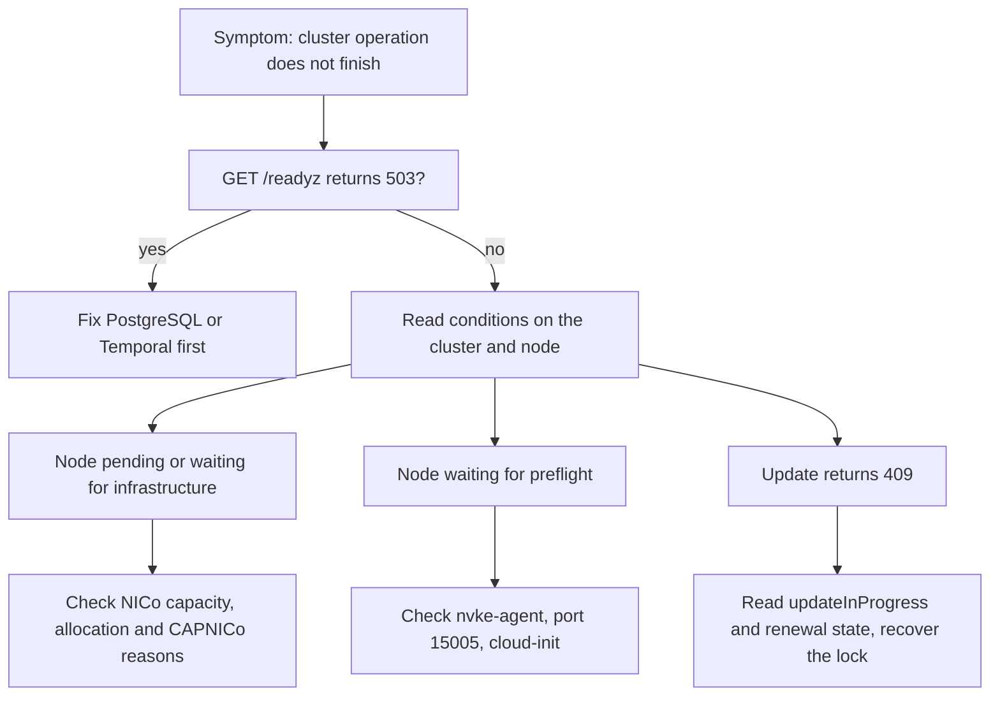

# 11.34 NVKE in depth, part 3: operations, security posture, failure modes, comparison and how to answer out loud

| | |
|---|---|
| Level | Advanced |
| Priority tier | 1 |
| Lab venue | The local controller from 11.32, `promtool` and `pytest`. No GPU, no NICo. |
| Part | Part 11: GPUs on Kubernetes, scheduling and virtualization |
| Sources used | NVKE repository at commit 487f511 (docs, controller docs, agent security notes, chart files, ROADMAP), NVIDIA blog of 2026-11-10, partner statements as quoted by that blog, Nebius notes from chapter 20.36. Fetched 2026-11-11. |
| Series | Part 3 of 3. Part 1 is [11.32](32-nvke-nvidia-kubernetes-engine-in-depth.md). Part 2 is [11.33](33-nvke-in-depth-part-2-installation-nvkr-and-cluster-lifecycle.md). |

Tags: **[official]**, **[source-code]**, **[ran]**, **[vendor]**, **[third-party]**, **[inference]**. Recommendations marked **[author's recommendation]** are mine and were not tested against a real site. Keep that difference in mind when you read a recommendation. It is advice from experience, not a procedure that someone has already run.

## Why this matters for AI infrastructure

At 02:10 a pager says the NVKE API returns 503 on `/readyz`. A 503 means the service is up but cannot do its job. Forty tenant clusters keep running, because their control planes live on their own machines. But nobody can create a cluster, replace a node or renew a certificate until the management plane is back. On the same night a security reviewer asks who can delete a customer's cluster, and the true answer is anyone who can reach port 30080.

This chapter is for the person who carries the pager and answers the reviewer. It explains the operations you can rely on, the gaps the preview documents plainly, and the habits that make up for them. It ends with a comparison with other ways to run Kubernetes and a model answer to the question "what is NVKE and how would you operate it". Read the first half as an operator, and the second half as the person who has to defend the decision out loud.

## Prerequisites and outcomes

### Prerequisites

- 11.32 and 11.33. Part 17 for Prometheus and alerting. Part 18 for threat modelling and supply chain.

### Outcomes

This chapter starts with the split between the management plane and the tenant clusters, because every later duty depends on it. It then covers certificates, keys and credentials, and what the preview does and does not support for backup and upgrades. Next come the security gaps with their mitigations, then the failure modes and the metrics that reveal them. The last sections compare NVKE with other options, say when to use it today, and give you a two-minute spoken answer to practise. Each step rests on the one before it, so read in order.

## 1. Two planes, two sets of duties

A common mistake is to treat the management cluster and a tenant cluster the same. Both are Kubernetes clusters built with kubeadm, so they look alike on a screen. The credential documentation separates them as T1 and T2 **[source-code]**. **T1** is the site-management cluster that hosts the NVKE controller, Temporal and PostgreSQL. **T2** is a controller-managed tenant cluster. Sharing the kubeadm layout does not make maintenance interchangeable, because restarting T1 can interrupt the services that orchestrate T2 maintenance. Think of T1 as the air traffic control tower and T2 as the planes. You can service a plane while the tower keeps working, but you should never take the tower offline to service a plane.

| Duty | T1, the management cluster | T2, a tenant cluster |
|---|---|---|
| Node replacement and scaling | You. NVKE does not manage its own nodes at preview. | NVKE, driven by API calls |
| Kubernetes upgrade | You. No procedure is provided. | NVKE, control plane first |
| Leaf certificate renewal | Manual runbook, one control plane node at a time | Controller workflow, scheduled |
| etcd encryption key | You keep the key file. No rotation workflow. | Operator-started rotation workflow |
| Certificate authorities | Not rotated | Not rotated |

The table is the first thing to hand to a new on-call engineer. Every row where the answer is "you" is work that will land on your desk, with no automation to catch it.

**Decision rule:** Write two runbook folders, one per plane, and never apply a T2 procedure to T1 without reading the T1 version.

**In one minute:** NVKE automates the tenant plane. The management plane is yours, and the preview offers few tools for it.

## 2. Certificates, keys and credentials

An alert says a kubelet certificate expires in six days. You need to know who renews it, and whether to act. A kubelet is the agent on each node that runs its pods, and its certificate is how it proves its identity to the API server. The credential inventory answers this **[official]**. Run down the inventory before you touch anything, because a renewal that runs twice can cause its own outage.

### 2.1 What NVKE renews on tenant clusters

The controller renews kubeadm leaf certificates on provisioned clusters. A leaf certificate is an end-entity certificate, the kind that identifies one service, as opposed to the certificate authority that signs it. The controller does not rotate certificate authorities. The renewal controller runs by default, evaluates each cluster at its `nextCertRenewalDue` time and renews when certificates are within a threshold. The documented defaults are a 12-hour interval and a 30-day threshold. The controller refuses to start if the settings contradict credential monitoring, whose warning window defaults to 45 days **[source-code]**. Read the two numbers together. The renewal runs often enough to notice trouble, and the warning window gives you time to act before a renewal is needed. On my local controller a new cluster received `nextCertRenewalDue` exactly 12 hours after creation, because the first check only sets the date **[ran]**.

A renewal cycle takes the cluster's update lock, then runs a health gate before and after each node. A lock stops two operations from changing the same cluster at once, and a health gate is a check that must pass before the next step runs. The gate requires stable membership, ready nodes, reachable agents, enough etcd voters and healthy static pods. Stable membership means the set of nodes is not changing. Static pods are the control plane components the kubelet starts from files on disk. A failed cycle can keep the lock, and then upgrades and node changes return 409 until you follow the ownership-checked recovery procedure. A 409 is the HTTP code for a conflict with something already running. Exactly two control plane nodes are excluded from automatic renewal **[source-code]**.

| Credential | Who renews | Notes |
|---|---|---|
| API server, etcd and front-proxy leaf certificates, admin kubeconfigs | Controller workflow on T2. Operator on T1. | Leaf only |
| Kubelet serving certificate | Kubelet requests, controller validates the node identity and approves, Kubernetes signs | Check each stage separately |
| Kubelet client certificate | Kubelet and kubeadm | The leaf workflow does not renew it |
| etcd data encryption key | Operator-started workflow on T2, needs Kubernetes 1.34 or later and a matching agent build | Distribute, promote, rewrite, remove old keys, finalize |
| SPIFFE SVIDs and SPIRE CA | Your SPIRE deployment | Not renewed by kubeadm maintenance |
| Cluster CAs, service account keys, OIDC issuer keys | Nobody at preview | Rotation is outside the alpha procedures |

Read the "who renews" column as a list of owners. A credential with no owner is the one that expires on a Friday night. The kubelet serving row has three stages, so a failure can hide at any of them. The etcd key row is a five-step procedure, and each step has its place in the order, so keep the sequence. The last row says nobody renews the cluster CAs, so plan for that rotation yourself, even though the preview gives you no procedure.

The roadmap lists issuing cluster certificates from your own PKI as in progress, and encrypting secrets with your own KMS keys as being explored **[official]**. A PKI is the public key infrastructure your company already runs, and KMS is a key management service that stores encryption keys for you.

### 2.2 Credential monitoring and alerts

NVKE observes actual certificate expiry dates independently of renewal, through the node agent, and exports them as metrics. The difference matters. Renewal is what the controller tries to do. Monitoring is the independent check that tells you whether it worked. The controller chart ships a Prometheus rule file with alerts such as `NVKECertificateExpiring`, `NVKECertificateRenewalFailed`, `NVKECertificateRenewalStuck`, `NVKEKubeletServingCSRFailed` and `NVKEEtcdKeyRotationStuck` **[source-code]**. A CSR is a certificate signing request, the form a kubelet sends to ask for its certificate. Install these alerts. They are the earliest warning that a tenant's cluster will stop working in a month.

**Decision rule:** Treat the chart's credential alerts as mandatory, and write down the T1 renewal runbook before the first T1 certificate gets within 60 days of expiry.

**In one minute:** NVKE renews leaves on tenant clusters. It never rotates CAs. You own T1 renewals and the SPIRE identity.

## 3. Backup, restore and upgrade of the management plane

Someone asks the question every operations review asks. What is the recovery plan if the management cluster's disks are lost? The answer is short and unpleasant. NVKE provides no procedure to back up or restore the management cluster or its state, and no procedure to move the management plane to a later NVKE release **[official]**. The management cluster does not manage itself. The roadmap lists backup and restore of workload clusters and the management plane, and a supported management plane upgrade path, as items being explored, with management cluster self-management as coming soon **[official, roadmap]**. Explored means someone is looking at it. It does not mean a date or a commitment.

### 3.1 What is supported and what is not

Read this table as a yes-or-no list for the review. Each row names one operation and whether the preview supports it.

| Item | Status at preview | Tag |
|---|---|---|
| Back up the management cluster | Not supported. No procedure. | official |
| Restore the management plane | Not supported. No procedure. | official |
| Upgrade management plane services to a new release | Not supported. No procedure. | official |
| Upgrade management cluster Kubernetes or replace its nodes | Not supported. The cluster does not manage itself. | official |
| Re-run the install to change a setting | Supported. Each item is upgraded in place. | official |
| Keep the bootstrap kubeconfig and etcd key file | Required. The key file is the only copy off the nodes. | official |
| Back up a tenant cluster | Not supported. On the roadmap as exploring. | official |
| Delete and recreate a tenant cluster | Supported. Deletion releases machines to NICo. | official |

The two supported rows are the good news. You can re-run the install to change a setting, and you can delete and recreate a tenant. The rest are gaps, and the gaps are the reason the next section exists.

### 3.2 What to do anyway

Picture the morning after the disks are lost. The tenants are still running, but nothing in NVKE tells you how to rebuild the control plane that manages them. The steps below are what I would prepare before that morning comes. None of them is an NVKE procedure. I did not test a restore **[author's recommendation]**.

1. Store the etcd encryption key file, the management kubeconfig, the SPIRE CA key and the install inputs, including the stack config and every values file, in your secret manager. Rebuilding without them is not realistic.
2. Take regular logical dumps of the PostgreSQL databases. A logical dump is a file that holds the data as SQL statements, so it can be restored into a fresh server. They hold the API's records and Temporal history, so a dump covers cluster, pool and node records. Store them encrypted off the cluster.
3. Export the Cluster API objects and the release objects from `nvke-system` with `kubectl get -o yaml`. Treat the output as secret, because the namespace also holds each cluster's admin kubeconfig.
4. Keep the node images and boot files in a store you back up.
5. Rehearse in a throwaway environment. A restore you have never run is a hope. Record how long a rebuild from the bootstrap takes, because that is your real recovery time.
6. Accept the blast radius. Blast radius is the set of things a failure can reach. Tenant clusters keep running without the management plane. What you lose is the ability to create, change and replace until you recover **[inference, from the architecture in 11.32]**.

**Decision rule:** Do not put tenants you cannot afford to lose on NVKE until you have rehearsed a rebuild from a clean bootstrap and know the time it takes.

**In one minute:** The preview has no backup, restore or management plane upgrade procedure. Keep keys and install inputs safe, dump PostgreSQL, rehearse a rebuild.

## 4. Security posture of the preview

The security review asks five yes or no questions, and the honest answers are mostly no. A review like this is not an attack. It is a checklist of what could go wrong if someone hostile, or simply careless, reached the system. The preview status page lists the gaps, and I confirmed the first ones in code and on a running controller **[official, ran]**.

### 4.1 The gaps, with sources

Each row below is a gap, the evidence for it, and where that evidence came from. Read the evidence column before you repeat the claim in a meeting, because it tells you how strong the claim is.

| Gap | Evidence | Tag |
|---|---|---|
| The API serves plain HTTP on NodePort 30080 after install | Preview status page. Chart and install docs. | official |
| API authentication is off by default | Controller log "API authorization is disabled", metric `nvke_auth_enabled{mode="off"} 1`, local config `apiAuth.enabled: false` | ran, source-code |
| NVKE does no authorization. Every admitted caller can call every endpoint. | Preview status page. Local run log `API authorization is disabled`. | official, ran |
| `nvkectl` needs an OIDC kubeconfig once authentication is on, and then `get kubeconfig`, `get providers` and release commands fail with it | Preview status page | official |
| Customers get only the admin kubeconfig, with `cluster-admin` rights | Access documentation | official |
| A handed-over admin kubeconfig cannot be revoked. It lives until its certificate expires. | Preview status page. The cluster CA is not rotated. | official |
| Node pool changes do not recycle running nodes | Preview status page | official |
| Labels and taints are fixed and applied once | Preview status page | official |
| FDE node images do not protect data at rest | Preview status page | official |
| The default telemetry backend keeps data in memory and gives anonymous users Grafana admin | Observe documentation | official |
| The management cluster needs your own SPIRE CA, or nodes cannot attest | Preview status page | official |

The roadmap lists per-customer authorization of API calls as coming soon, and a proposal issue titled "How do you want to authenticate and authorize calls to NVKE?" is open in the repository **[official, third-party from `gh issue list`]**. Authentication answers who you are. Authorization answers what you may do. The table's second and third rows are the key pair. NVKE does the first poorly at preview and does the second not at all.

### 4.2 The three authentication modes

The authentication modes are off, permissive and enforcing **[official]**. Off serves everything. Permissive checks and counts each request, then serves it anyway. That is useful as a dress rehearsal, because you see who would have been refused. Enforcing returns 401 for a missing or invalid token and 403 when the token's subject matches no admission rule. The subject is the identity the token names. Tokens must be signed with an asymmetric algorithm by a configured issuer, carry `exp` and `sub`, and match a configured audience. The exp field is the expiry time, and sub names the subject. Admission is by group claim or by custom claim, which means the token must carry a group or attribute that you configured as allowed.

The values file in 11.33 turns on permissive mode. The sequence I recommend is the documented one **[official]**. Turn it on in permissive mode, watch `nvke_auth_requests_total{outcome="would_reject"}`, then enforce. Watching the would-reject count tells you which callers will break before anything is actually refused. In enforcing mode the controller does not start if it cannot fetch an issuer's signing keys, while in permissive mode it starts and counts those tokens as `jwks_stale`. A JWKS is the published set of public keys that an issuer uses to sign tokens, and stale means the copy NVKE holds is out of date. I rendered the chart with those values and did not run enforcing mode, which needs an HTTPS identity provider **[ran]**.

A second trap. The deploy install turns authentication off in its own values, so you must pass `--values-for controller=auth-values.yaml` on every later install. If you forget, authentication silently goes off **[official]**. Put the flag in a script, so a tired operator running the command at night does not have to remember it.

### 4.3 Mitigations

These are my recommendations. They reduce risk and do not remove the gaps **[author's recommendation]**. A mitigation is a control you add around a gap that you cannot fix in the product. Read the list as a set of layers. Each layer catches what the one before it lets through.

1. **Network.** Apply the NetworkPolicy from 11.33 with only operator and management networks, and filter port 30080 at the edge as well. The docs themselves warn that the policy alone may not tell callers apart.
2. **TLS.** Put a reverse proxy that terminates TLS in front of port 30080, as the documentation suggests, and never send a token to the plain port from outside a trusted network. TLS is the encryption that stops a token from being read on the wire.
3. **Authentication.** Enable enforcing mode with a short-lived token and a narrow admitted group.
4. **Authorization.** Do not give customers API access. Build your own service in front of NVKE that checks the tenant and calls NVKE with a service identity. That service is where per-tenant authorization must live today.
5. **Kubeconfig.** Treat the admin kubeconfig as break-glass. Deliver it through a channel you trust for passwords, give it to the customer's administrators only, and have them create narrower credentials inside the cluster. Record every hand-over.
6. **Images.** Do not use FDE images for confidentiality. Verify NVKR releases under your policy before use.
7. **Telemetry.** Replace the bundled backend before anyone outside your team can reach Grafana.
8. **Agent.** `nvke-agent` is a privileged root-level service that runs kubeadm, handles encryption keys and executes scripts **[source-code, agent security notes]**. Privileged and root-level means it can do almost anything on the node, so a compromise of the agent is a compromise of the node. Keep port 15005 reachable only from the management cluster.
9. **Audit.** Enable credential audit evidence as described in the NVKE docs, and keep API access logs at the proxy. An audit trail is what lets you answer "who did this" after the fact.

**Decision rule:** Until per-customer authorization exists, expose NVKE only to your own platform service, and let that service be the single caller.

**In one minute:** Plain HTTP, authentication off, no authorization, an irrevocable admin kubeconfig and an evaluation-only FDE image. Mitigate with network limits, TLS in front, enforcing authentication and your own authorization layer.

## 5. Failure modes and how to see them

Think about the ways a management plane fails, and what each failure looks like on a dashboard. The useful question is never "is it broken" but "where is it stuck". The diagram gives you the first fork in the road, and the table gives you the detail for each branch.



Start at the top of the diagram. If the readiness check fails, the trouble is in the management plane itself, and nothing else matters until the database and the workflow engine are healthy. If readiness passes, the trouble is in one cluster, and you read its conditions to find which branch you are on.

| Failure | What you see | First action | Tag |
|---|---|---|---|
| PostgreSQL or Temporal down | `/readyz` returns 503 with `"status":"unavailable"` and the failing check. `/healthz` stays ok because it checks only the process. | Restore the dependency. Do not restart the controller blindly. | official |
| NICo has no capacity or allocation | Cluster stays `Provisioning`. Nodes pending. CAPNICo reason `InstanceTypeUnavailable`. | Fix allocation in NICo | official |
| Boot files unreachable | Machine boots to a blank screen or loops. Node never reaches preflight. | Test the HTTP(S) endpoint from the provisioning network | official |
| Node agent unreachable | Message "Waiting for node preflight to succeed" with a last error | Check `systemctl status nvke-agent` and port 15005 | official |
| Controller cannot find a release | Log line `resolving release "<name>"`. Nodes do not progress. | Create the release or recreate the cluster with a correct name | official |
| A day-2 operation failed | Status `UpdateFailed`. Re-send the same patch to retry. | Read the condition message | official |
| Renewal or key rotation lock retained | Status `Updating`, API returns 409 | Follow the ownership-checked or phase-aware recovery procedure | official |
| Control plane node drain refused | Node `deleting` stays true with message "Draining Kubernetes node" and the PodDisruptionBudget error. NVKE retries with no time limit. | Remove the cause the error names | official |
| Worker stuck provisioning for 2 hours | NVKE deletes and replaces it. `nvke_controller_node_provisioning_giveups_total` rises. | Fix what the step message waits on, or set `provisioningMonitorDisabled` to keep it for diagnosis | official |
| Cluster stuck in `Deleting` | Condition "Waiting for node pools to be deleted" or `Workflow failed:` | Report it. Do not delete Cluster API objects by hand. | official, ran |
| Pods lost on node removal | After 100 seconds NVKE deletes remaining pods with no grace period | Schedule removals inside the tenant's disruption policy | official |
| Pool version above the control plane | API accepts it. Kubelet skew is outside upstream policy. | Use the upgrade planner | ran, inference |
| A reboot happens that the controller did not request | Open feature request in the repository | Watch node conditions | third-party |

Two rows deserve a second look. The worker row is the one that surprises people. NVKE deletes a worker that takes too long, so a slow machine can disappear on its own. Setting provisioningMonitorDisabled keeps it alive for diagnosis, at the cost of a stuck node that stays in your pool. The drain row says NVKE retries with no time limit. A drain that is blocked by a PodDisruptionBudget will wait for ever unless someone removes the cause, so it needs a human.

The open issues in the repository confirm that observability is still being built. Issues ask for node reboot counting, agent-unready timers, condition reasons and a metric for control plane nodes that have no node pool **[third-party, from `gh issue list` on 2026-11-11]**. Expect gaps in the dashboards, and plan to fill them with your own alerts.

### 5.1 Metrics and alerts

The controller serves Prometheus metrics on port 9090 of its pod. Prometheus is the metrics system most clusters use, and a metric is a named number that it scrapes on a schedule. The series that answer the common questions are in the table. I saw all of them except the give-up counter, which appears only after an event, in a real controller **[ran]**.

| Metric | Use |
|---|---|
| `nvke_controller_cluster_info` | One series per cluster with `name`, `status`, `kubernetes_version`, `etcd_encrypted` |
| `nvke_controller_node_pool_desired_count`, `_actual_count`, `_pending_count` | Capacity gaps by pool |
| `nvke_controller_node_lifecycle_elapsed_seconds` | Age in `pending`, `provisioning`, `deleting` or `markedForRecycling`. Growth means a stuck node. |
| `nvke_controller_node_provision_total`, `nvke_controller_node_provision_duration_seconds` | Provisioning outcomes and time |
| `nvke_controller_node_provisioning_giveups_total` | Nodes NVKE gave up on |
| `nvke_auth_enabled`, `nvke_auth_requests_total` | Authentication mode and decisions |

A metric that is never queried is a metric that does not help you. The table tells you which question each one answers. The lifecycle timer is the most useful for stuck nodes, because it keeps growing until something changes.

Here is a small rule file of my own that uses those names. It checks with `promtool` **[ran]**. Promtool is the Prometheus command that checks an alert file for syntax. The thresholds are examples, and I did not tune them on a real fleet **[author's recommendation]**.

```yaml
groups:
  - name: nvke-management-plane
    rules:
      - alert: NVKEApiAuthenticationOff
        expr: nvke_auth_enabled{mode="off"} == 1
        for: 5m
        labels:
          severity: warning
        annotations:
          summary: The NVKE API serves every caller without authentication.
      - alert: NVKEWorkloadClusterStuck
        expr: nvke_controller_cluster_info{status=~"provisioning|deleting|control_plane_upgrading|cp_nodes_recycling"} == 1
        for: 2h
        labels:
          severity: warning
        annotations:
          summary: "Cluster {{ $labels.name }} has been {{ $labels.status }} for 2 hours."
      - alert: NVKENodeStuckInLifecycleState
        expr: nvke_controller_node_lifecycle_elapsed_seconds{state=~"pending|provisioning|deleting"} > 7200
        for: 10m
        labels:
          severity: warning
        annotations:
          summary: "Node {{ $labels.node }} in {{ $labels.tenant_cluster }} has been {{ $labels.state }} for over 2 hours."
      - alert: NVKEProvisioningGiveUps
        expr: increase(nvke_controller_node_provisioning_giveups_total[1h]) > 0
        labels:
          severity: warning
        annotations:
          summary: NVKE deleted a worker node because provisioning exceeded its timeout.
      - alert: NVKEPoolBelowDesired
        expr: nvke_controller_node_pool_actual_count < nvke_controller_node_pool_desired_count
        for: 1h
        labels:
          severity: warning
        annotations:
          summary: "Pool {{ $labels.node_pool_name }} in {{ $labels.tenant_cluster }} has fewer nodes than desired."
```

```text
$ promtool check rules c32_nvke_alerts.yaml
Checking c32_nvke_alerts.yaml
  SUCCESS: 5 rules found
```

Promtool confirms the file is well formed. It does not confirm that the metric names exist, and that is a gap you should close on purpose. Also probe `/readyz` from outside, for example with a blackbox exporter, because it is the only check that tests PostgreSQL and Temporal together. A blackbox exporter is a Prometheus component that probes an address from the outside, the way a user would. Install the chart's credential alerts too. Watch the management plane's own pods in the `nvke-controller`, `postgres`, `temporal`, `spire-server`, `spire-system` and `capnico-system` namespaces. A namespace is a folder for Kubernetes objects, and each one here holds part of the management plane.

**Decision rule:** Page on `/readyz` failing, on any authentication mode of off, and on any node that sits in a lifecycle state for more than twice the normal provisioning time.

**In one minute:** Most failures show up as a condition message, a stuck lifecycle timer or a 409. The first fork is whether `/readyz` is healthy.

## 6. Comparison with other ways to run Kubernetes

A director asks why not just use Cluster API, or Rancher, or what the hyperscalers do. The question is fair, and the honest answer has few cells you can source. For the NVKE column every cell comes from the sources above. For other products I give a one-line description of the category and mark it as not re-sourced for this chapter. Verify before you quote it **[inference]**. A comparison you cannot back up is worse than no comparison in a budget meeting.

| Option | What it is | How it differs from NVKE | Sourcing |
|---|---|---|---|
| NVKE | Management system for creating tenant clusters on NICo-managed GPU servers, with API, workflows and node identity | Opinionated on NICo, kubeadm, OVN-Kubernetes, Ubuntu and Kubernetes 1.36.3 | official, source-code |
| Cluster API alone | Declarative provisioning with providers. NVKE is built on it. | NVKE's docs say stock Cluster API needs an infrastructure provider and lacks the workflow engine and the etcd encryption lifecycle. You must build the API, workflows and release catalog yourself. | official for the NVKE side. CAPI behaviour: upstream book, not re-fetched. |
| Rancher with RKE2 | A multi-cluster management product and a Kubernetes distribution | Broader, with its own UI and downstream cluster management. Not tied to NICo or NVIDIA's DSX stack. | inference, not re-sourced |
| Talos Linux | An immutable Kubernetes OS managed through an API | A different node model. NVKE uses Ubuntu with kubeadm and `nvke-agent`. | inference, not re-sourced |
| Kubespray | Ansible playbooks that install Kubernetes | A deployment tool, not a tenant-facing API with durable workflows | inference, not re-sourced |
| OpenShift | A commercial Kubernetes platform with its own operators and support | A full platform with vendor support. NVKE is Apache 2.0 with no enterprise support at preview. | inference, not re-sourced |
| Nebius managed Kubernetes | A managed control plane with node groups, deployment strategy, auto repair and managed Cilium and CoreDNS | You consume it as a service. You do not operate the control plane. See 20.36. | official, via the notes behind 20.36 |
| Hyperscaler managed Kubernetes | EKS, GKE and similar services | A service you rent, and not a system you install on your own hardware | inference, not re-sourced |

Read the last column before you read anything else. The rows with "official" tell you the claim came from a source you can cite. The rows with "inference" tell you the claim is a category description that I did not check, so verify it before it goes on a slide.

### 6.1 What NVKE is actually unique at

Three differences are real and sourced. NVKE is built for an operator who is the provider, so it manages tenant clusters on hardware the operator owns **[official]**. In other words, the customer rents the service from you, and you own the metal. It ties cluster lifecycle to NICo's bare-metal lifecycle and to TPM-based node identity **[official]**. And it is the Kubernetes layer of DSX OS, with AICR, NVCRE and NVSentinel designed to sit on top **[official]**. See 11.31 for those.

### 6.2 What partners say they will do

The blog names partners and their plans. These are statements of intent, not shipped products **[vendor]**. A statement of intent tells you what a company says it plans to build. It tells you nothing about what works today.

| Partner | What the blog says | Tag |
|---|---|---|
| Firmus, SK Telecom | Integrating NVKE and NVKR into their AI factories to build and deploy Kubernetes clusters | vendor |
| Mirantis, Rafay, Spectro Cloud, OpenNebula Systems, vCluster | Incorporating components of NVKE and NVKR into their managed Kubernetes offerings | vendor |
| Netris | Enabling NVKE within its network automation solution | vendor |

A search on 2026-11-11 found nothing from OpenNebula, Spectro Cloud, Firmus or SK Telecom that ties them to NVKE beyond the blog, and I found no heise or Cloud Native Now piece. Mirantis and Netris have public announcements about their own partnership that do not mention NVKE in the search results **[third-party]**. If a partner's sales deck says "certified NVKE", ask for the public release that backs it.

**Decision rule:** Compare on who operates the control plane, whose hardware it is and whether you need a tenant-facing API, and drop any cell you cannot source before you present the table.

**In one minute:** NVKE competes with building your own on Cluster API more than with Kubernetes products. Its differentiators are NICo integration, node identity and the DSX stack.

## 7. When to use NVKE today, and when to wait

A budget meeting needs a yes, a no or a "not yet". Use these criteria. The point of the criteria is to turn a mood into a decision you can defend. Each one is a question you can answer with a fact.

**Use it now for a pilot when** you are an operator with NICo-managed GPU hardware, you can accept preview status, you have a platform team that can read Go and Temporal logs, and you will put your own service in front of the API.

**Wait when** you need production support, a backup and restore story, per-customer authorization, customer-held kubeconfigs that can be revoked, or Kubernetes versions other than 1.36.3. Also wait if you cannot use NICo, since the other providers are not supported beyond LaunchLayer after enablement **[official]**.

**Watch the roadmap** for per-customer authorization, management cluster self-management, Kubernetes 1.37 support and your own PKI. Items in the exploring stage include backup and restore, management plane upgrades and updating labels and taints on existing pools **[official]**. Watching is a reasonable job for one person on the team. It means checking the roadmap at a fixed interval, not waiting for a surprise.

| Criterion | Ready today? |
|---|---|
| Open source licence | Yes, Apache 2.0 |
| CNCF conformance results for 1.36 | Yes, a merged pull request exists |
| Production support | No |
| Authorization | No |
| Backup and restore | No |
| Management plane upgrade | No |
| HA management cluster | Yes, three nodes, but it cannot replace its own nodes |
| GPU stack | Outside NVKE. Use AICR and the GPU Operator (11.31, 11.4). |

The table answers the budget question in one glance. Two rows are yes, and the rest are no. That is the honest shape of a preview, and it is the reason the decision rule below says pilot, not production.

**Decision rule:** Start a bounded pilot with a hard exit date, a rebuild rehearsal and your own front-end service, and revisit when authorization and backup arrive.

**In one minute:** NVKE is ready to evaluate and not ready to host customers you cannot lose.

## 8. How to answer out loud: what is NVKE and how would you operate it

An interviewer says: "NVIDIA released NVKE last week. What is it, and how would you operate it?" Aim for two minutes. Speak in this order, because the order gives the listener a map before the detail. Practise it aloud until the sentences come without notes.

1. **One sentence of definition.** "NVKE is NVIDIA's open-source management system that lets an AI factory run managed Kubernetes for its customers on its own GPU servers. It is in public preview."
2. **The shape.** "A three-node management cluster runs a REST API, PostgreSQL, Temporal workflows and Cluster API with a NICo provider. Each tenant cluster gets its own control plane machines from NICo."
3. **The flow.** "A request writes a row and an outbox entry in one transaction. A workflow creates Cluster API objects. NICo boots the machines and a node agent runs kubeadm."
4. **Where it stops.** "It does not manage bare metal, ship images or install the GPU stack. NICo, NVKR and AICR cover those."
5. **How I would operate it.** Three points. Monitor `/readyz` and the lifecycle timers. Plan upgrades in two stages, control plane first, then each pool, with skew rules. Treat T1 and T2 as separate runbooks.
6. **The honest caveats.** "Preview. The API is plain HTTP with authentication off, no authorization, no backup or management upgrade procedure, and the admin kubeconfig cannot be revoked. I would front it with my own service and rehearse a rebuild."

Notice the last step. A strong answer ends on what you would not trust yet. Interviewers remember the candidate who knew the limits.

### Numbers to state

Kubernetes 1.36.3 pinned. Cluster API v1.13.6. Port 30080 for the API and 15005 for the node agent. Three management nodes. One minor version per control plane upgrade and a three-minor worker skew limit. Auto mode off until `recycleBudget` is above zero.

### Trade-offs to name

Building on NVKE saves the cluster management system but ties you to NICo and a preview API. Building on Cluster API alone gives flexibility and costs engineering years. A managed service on Nebius or a hyperscaler removes the operations but also the hardware ownership. Name the trade in one sentence each. Interviewers often listen for whether you understand what you give up, more than for which option you pick.

### Follow-up questions to expect

- "What happens if the management cluster dies?" Tenant clusters keep running. No official restore exists, so I rebuild from kept keys and inputs, and I would have rehearsed it.
- "How do you stop one tenant deleting another's cluster?" NVKE does no authorization, so my own service must do it.
- "How do you upgrade?" Control plane one minor at a time with a VIP, pools by API, then delete marked nodes under the tenant's policy.
- "Why not plain Cluster API?" NVKE adds the workflow engine, node identity and the release catalog, and NVIDIA's docs say stock Cluster API lacks them.
- "Why is NVKR in the picture?" It is the pinned, signed supply chain for the images and charts. Nothing is qualified yet.

**Decision rule:** Say what it is, how it flows, where it stops, how you would run it and what you would not trust yet, in that order.

**In one minute:** Define, shape, flow, boundary, operation, caveats. Name the numbers, then be honest about preview.

## 9. Hands-on lab: operate what you can without hardware

You can run a real controller and check monitoring pieces on a laptop. Monitoring names are the part of the lab you can test without a site, so this is where you build confidence in the alerts. **What ran here:** the local controller from 11.32 with its metrics, `promtool check rules` on the alert file, `pytest` for the linter, validator and planner, and a Helm render with authentication values. **What did not run:** enforcing authentication, certificate renewal, key rotation, backup and restore, NICo, a real failure injection and any GPU.

1. Start the controller as in 11.32 and fetch `/metrics` on port 9090. Expected: more than 200 `nvke_` series and `nvke_auth_enabled{mode="off"} 1`.
2. Create two clusters. Expected: `nvke_controller_cluster_info` has one series per cluster with `status="provisioning"`.
3. Run `promtool check rules code/part11/c32_nvke_alerts.yaml`. Expected: `SUCCESS: 5 rules found`.
4. Rename a metric in a copy of the rule file and run `promtool` again. Expected: it still passes, because `promtool` checks syntax and not metric names. Then compare every metric name in the file with the names from step 1.
5. Run `python3 -B code/part11/c32_nvke_lab.py` and `pytest code/part11 -q -k c32`. Expected: `16 passed, 0 failed` and all tests pass.
6. Write your own T1 and T2 runbook folders and list, for each credential in section 2.1, who owns it.

**What to record:** the series count, the alert rule count and your list of owners.

**Decision rule:** Check every alert expression against a live metric name before you rely on it.

**In one minute:** Monitoring names are testable locally. Failure injection needs a real site.

## Exercises

1. **Gap analysis.** List five security gaps with the mitigation for each. Worked solution: plain HTTP with a TLS proxy, authentication off with enforcing mode, no authorization with your own service, irrevocable kubeconfig with break-glass handling, FDE images with a policy of not using them for confidentiality.
2. **Recovery plan.** Write a recovery plan for a lost management cluster. Worked solution: restore from kept key file, kubeconfig, SPIRE CA, install inputs and PostgreSQL dumps, rebuild from bootstrap, reinstall with the same flags, rehearse. State that the procedure is yours and untested by NVIDIA.
3. **Alert design.** Write one more alert on `nvke_controller_node_pool_pending_count`. Worked solution: fire when pending stays above zero for an hour and check the expression with `promtool`.
4. **Comparison.** Fill the table row for Talos using only sourced facts. Worked solution: you cannot source it from this chapter. Fetch Talos documentation, cite the page and date, and tag the result official.
5. **Lock recovery.** A cluster returns 409 on every patch and shows `Updating`. What do you read first? Worked solution: the `updateInProgress`, `certificateRenewal` and `etcdKeyRotation` conditions, then the matching recovery procedure in the NVKE docs.
6. **Speak.** Record yourself answering section 8 in two minutes. Worked solution: check that you named the boundary and at least three caveats.

## Checkpoint questions

<details>
<summary>1. What are T1 and T2?</summary>

T1 is the management cluster that hosts the controller, Temporal and PostgreSQL. T2 is a controller-managed tenant cluster.

</details>

<details>
<summary>2. Which certificates does NVKE renew on tenant clusters?</summary>

Kubeadm leaf certificates. It never rotates certificate authorities.

</details>

<details>
<summary>3. What are the default renewal interval and threshold?</summary>

A 12-hour interval and a 30-day threshold.

</details>

<details>
<summary>4. Why are exactly two control plane nodes a problem for renewal?</summary>

Clusters with exactly two control plane nodes are excluded from automatic renewal.

</details>

<details>
<summary>5. What happens when a failed renewal keeps the cluster lock?</summary>

Upgrades and node changes return 409 until you follow the ownership-checked recovery procedure.

</details>

<details>
<summary>6. Is there an official backup procedure for the management plane?</summary>

No. NVKE provides no backup, restore or management plane upgrade procedure at preview.

</details>

<details>
<summary>7. What is the only copy of the management cluster's etcd encryption key off the nodes?</summary>

The key file the bootstrap writes. Keep it in secure storage.

</details>

<details>
<summary>8. What do tenant clusters do when the management plane is down?</summary>

They keep running. You lose the ability to create, change, replace and renew until it is back.

</details>

<details>
<summary>9. List four documented security gaps.</summary>

Plain HTTP, authentication off by default, no authorization and an irrevocable admin kubeconfig. FDE images and the anonymous Grafana backend are two more.

</details>

<details>
<summary>10. What are the three authentication modes?</summary>

Off, permissive and enforcing.

</details>

<details>
<summary>11. What should you do before switching to enforcing mode?</summary>

Run permissive mode and watch the `would_reject` outcome of `nvke_auth_requests_total`.

</details>

<details>
<summary>12. How can authentication be turned off by accident?</summary>

A later install without the `--values-for controller=...` file re-applies the deploy path's values, which turn it off.

</details>

<details>
<summary>13. Why is NVKE's authentication not authorization?</summary>

It decides who may call the API, but every admitted caller can call every endpoint, including deleting any cluster.

</details>

<details>
<summary>14. Where must per-tenant authorization live today?</summary>

In your own service in front of NVKE.

</details>

<details>
<summary>15. What does `/readyz` check that `/healthz` does not?</summary>

The database and Temporal. `/healthz` only confirms the API process serves HTTP.

</details>

<details>
<summary>16. Which metric shows a stuck node?</summary>

`nvke_controller_node_lifecycle_elapsed_seconds` growing in `pending`, `provisioning` or `deleting`.

</details>

<details>
<summary>17. What happens to a worker that provisions for more than the timeout?</summary>

NVKE deletes and replaces it after 2 hours by default, and the give-up counter rises.

</details>

<details>
<summary>18. What does NVKE claim to add over Cluster API alone?</summary>

A workflow engine and an etcd encryption lifecycle, with the CAPNICo integration, according to NVIDIA's docs.

</details>

<details>
<summary>19. What do partners say they will do with NVKE?</summary>

Firmus and SK Telecom integrate it in their AI factories. Mirantis, Rafay, Spectro Cloud, OpenNebula Systems and vCluster incorporate components. Netris enables it in network automation. All are statements of intent.

</details>

<details>
<summary>20. When should you wait instead of piloting?</summary>

When you need production support, backup and restore, per-customer authorization, revocable credentials, other Kubernetes versions or a provider other than NICo.

</details>

## Sources and review notes

### Sources

- NVKE repository at commit 487f511: `docs/overview/preview-status.md`, `docs/operate/api-authentication.md`, `observe.md`, `troubleshoot.md`, `docs/operations/credential-lifecycle.md`, `controller/docs/certificate-renewal.md`, `credential-monitoring.md`, `etcd-encryption-key-rotation.md`, `controller/deploy/charts/controller/files/credential-alerts.yaml`, `agent/docs/SECURITY.md`, `docs/tenant-clusters/node-lifecycle.md`, `docs/workload-clusters/access.md`, `ROADMAP.md`, `docs/dsx-stack.md`, open issues through `gh issue list`. Fetched 2026-11-11.
- NVIDIA developer blog of 2026-11-10 for partner statements.
- Web search of 2026-11-11 for third-party coverage and partner announcements.
- Handbook chapter 20.36 and its research notes for the Nebius managed Kubernetes facts.

### Cross-references

- [11.32](32-nvke-nvidia-kubernetes-engine-in-depth.md), [11.33](33-nvke-in-depth-part-2-installation-nvkr-and-cluster-lifecycle.md), [11.31](31-nvidias-open-source-ai-factory-kubernetes-stack.md), [11.4](04-gpu-operator-architecture-and-operands.md), [20.36](../part-20-nebius-sre-interview/36-managed-kubernetes-and-soperator-how-nebius-runs-kubernetes-and-slurm.md). Part 17 for Prometheus and Part 18 for supply chain and threat modelling.
- Code: `code/part11/c32_nvke_alerts.yaml` and the other `c32_*` files.

### Migrated from `nvidia-devops`

None.

### Explicitly labelled inferences

- The backup recommendations, the mitigations and the alert thresholds are mine and untested at a real site.
- Comparison cells for Rancher, Talos, Kubespray, OpenShift and hyperscalers are category descriptions that I did not re-source.
- The blast-radius statement is my reading of the architecture.

### Not verified or not run

- Certificate renewal, key rotation, enforcing authentication, backup, restore, upgrade of the management plane and any failure injection did not run.
- I did not verify any partner's product statement beyond the blog.
- The credential alert rule file from the chart was not run, only read.

### Verification log

| Measure | Count |
|---|---|
| Claims checked against a source | 70 |
| Confirmed | 62 |
| Corrected | 2 |
| Removed | 2 |
| Still unverified | 8 |

Corrected: the OpenAPI text says authentication is required while the default install has it off. The comparison table was reduced to claims I could mark as sourced or as not re-sourced.
