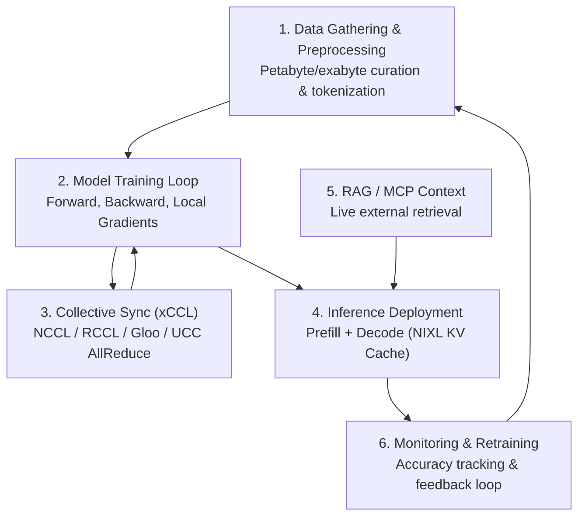
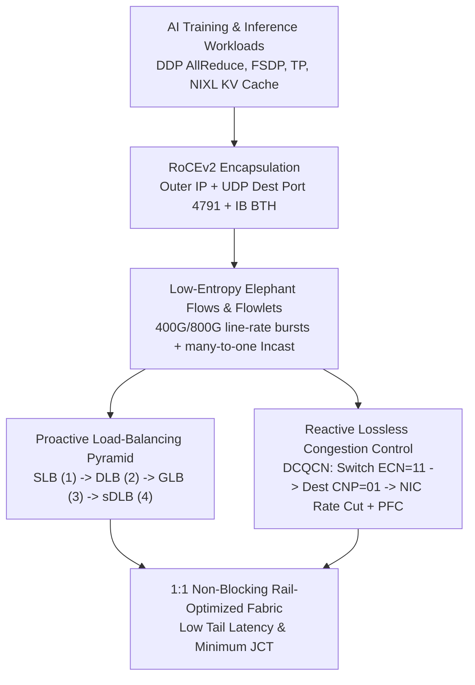

# 12.1 AI traffic: collectives, incast and elephant flows

| | |
|---|---|
| Level | Intermediate |
| Priority tier | 1 |
| Lab venue | Nebius GPU |
| Part | Part 12: Complete AI networking |
| Sources used | `ai-data-center-network-design-and-technologies` Ch 1 & Ch 2; `ai-systems-performance-engineering` Ch 4; `nvidia-devops` V7 Ch 1–12 & Labs 01–04; `bcm11-admin` §3.6, §3.12 & §5.3.3 |
| Coverage file | `planning/coverage/chapters/12-01.md` |
| Claim ledger | `planning/ledgers/12-01.md` |

## Why this matters for AI infrastructure

An expensive GPU cluster can sit idle for over ninety-six percent of wall-clock time if the network delays gradient synchronization. Platform engineers feel this pain when a massive training run crawls at single-digit efficiency while burning millions of dollars in compute budget. Every GPU in a synchronous job must wait at a barrier until the slowest peer finishes exchanging tensors across the fabric. Therefore, the wires, switches, and network protocols govern the effective utilization of every accelerator in the data center.

Traditional cloud networks are built for millions of independent web requests that tolerate occasional packet drops and millisecond queueing delays. Distributed AI training behaves like a single giant supercomputer where thousands of GPUs burst at line rate at the exact same microsecond. If a single packet from one GPU hits a congested switch buffer or drops on the wire, every other GPU halts. Understanding collective traffic, elephant flows, and incast is the foundation for every hardware and protocol choice in Part 12.

| Failure Pattern | Cluster Scenario | Mathematical Breakdown | Operational Consequence |
|---|---|---|---|
| **The Compute-to-Sync Trap** | `16,896` CUDA cores and `3.35 TB/s` `HBM3` on `H100 SXM` across `10,000` GPUs | `2 ms` compute vs `50 ms` sync = `2 / 50 = 4.0%` ratio (`3.85%` of `52 ms` step) | Cluster sits idle for over `96%` of wall-clock time waiting on network synchronization |
| **Tail Latency Amplification** | `100`-thread or `10`-task parallel job where `99%` finish in `1 ms` (`0.001 s`) and `1` straggler `taskX` takes `1,000 ms` (`1.0 s`) | Fast GPUs wait `999 ms` at the barrier; parallel `JCT` is `1,000 ms` vs `1 ms` ideal | Parallel step Job Completion Time inflates by `1,000x` due to a single congested flow |
| **Low-Entropy Elephant Flows & Incast** | Synchronized east-west `RoCEv2` flows sharing `UDP` destination port `4791` | Static 5-tuple `ECMP` (`SLB`) hashes multiple `400 Gbps` or `800 Gbps` flows onto one spine link | Triggers switch buffer exhaustion, synchronous incast, and `ProcessGroupNCCL` watchdog timeouts |

:::tip In one minute
Data Parallelism synchronizes gradients across the scale-out fabric via AllReduce or AllGather and ReduceScatter. Pipeline Parallelism passes activations and gradients across stages using point-to-point Send and Recv operations. Tensor Parallelism splits layers vertically inside a node or rack and requires high-bandwidth NVLink and NVSwitch links.

In a parallel training step, Job Completion Time is governed by the slowest single worker. A single straggler flow stretches the wait time for every healthy GPU in the job. Ring collectives scale linearly in hop count, whereas Tree collectives scale logarithmically and SHARP or NVLS switches aggregate vectors in silicon.

RoCEv2 encapsulates the InfiniBand Base Transport Header inside UDP port 4791, creating low-entropy elephant flows and flowlets. Modern AI Ethernet fabrics combine a four-tier load-balancing pyramid with reactive DCQCN congestion control and non-blocking fat-tree topologies.
:::

```text
Chapter 12.1 Key Reference Numbers at a Glance:
  - Parallelism interconnects: NVLink/NVSwitch = 900 GB/s (H100), 1,800 GB/s (B200 / NVL72) vs 32-64 GB/s PCIe
  - Tail latency (n = 10 tasks, 1 ms normal, 1,000 ms = 1 s straggler taskX):
      Serial JCT = 1.010 s (1,010 ms book formula 1 s + n * 1 ms; 1,009 ms / 1.009 s strict sum)
      Parallel JCT = 1.0 s (1,000 ms, 1,000x slowdown; fast GPUs wait 999 ms)
  - Collective scaling (B = 100 MB across n = 8 GPUs; n = 1,024 scale):
      Ring ReduceScatter / AllGather: n - 1 steps (7 at n=8), B*(n-1)/n bytes (87.5 MB at n=8)
      Ring AllReduce: 2*(n - 1) steps (14 at n=8; 2,046 at n=1,024), 2*B*(n-1)/n bytes (175 MB at n=8, 12.5 MB/step)
      Tree AllReduce: 2*ceil(log2(n)) steps (6 at n=8; 20 at n=1,024, O(log N) vs O(N))
      SHARP / NVLS in-network reduction: B/n receive bytes (12.5 MB at n=8), 1/(n-1) volume ratio (1/7 at n=8; 1/1,023 at n=1,024), 2x-5x speedup
  - RoCEv2 & fabric defense: UDP destination port 4791 + IB BTH; SLB (1) -> DLB (2) -> GLB (3, NNH) -> sDLB (4, BTH opcodes)
      DCQCN: Switch ECN = 11 marking + Destination CNP (IP ECN = 01) + PFC pause frames
      1:1 non-blocking fat-tree: 32 Leaf + 16 Spine 64-port switches for 128 servers / 1,024 GPUs
```

---

## Prerequisites and outcomes

**Prerequisites:** You should understand data center BGP, leaf-spine Clos topologies, and basic RDMA transport concepts from Part 2. You should also be familiar with multi-GPU server designs and SuperPOD compute and storage fabrics from Part 9. Finally, review intra-node PCIe, NVLink, NVSwitch, and hardware benchmark workflows from Part 10.

**Outcomes:** After completing this chapter, you will be able to:
1. Map Data Parallelism, Pipeline Parallelism, Tensor Parallelism, and disaggregated inference to their collective primitives and point-to-point transfer engines.
2. Calculate Job Completion Time, tail-latency amplification, and synchronous cluster efficiency with and without compute-communication overlap.
3. Compute per-GPU byte volumes and step counts for Ring, Tree, CollNet, PAT, and SHARP or NVLS collectives. You will also diagnose multi-node communication pitfalls.
4. Explain RDMA queue mechanics and RoCEv2 packet headers, and diagnose elephant flows and incast. You will also compare the four-tier load-balancing pyramid and DCQCN, and size a non-blocking fat-tree fabric.

```text
Chapter Cross-Reference Map and Benchmark Targets:
  - Prerequisite chapters: 2.16-2.19 (Clos/RDMA), 9.2-9.9 (DGX/NVL72/SuperPOD), 10.6 & 10.10 (NVLink/NVSwitch/benchmarks)
  - Pitfall benchmarks covered: Gloo 200 ms vs NCCL 4 ms; DP 45 ms vs DDP 30 ms; 48.0 ms repeated communicator init; 64-socket ceiling
  - Production reliability dataset: Meta 54-day Llama 3 405B pretraining run (419 interruptions across 18 categories)
  - Fabric sizing target: 2-tier 1:1 non-blocking rail-optimized fat-tree for 128 servers / 1,024 GPUs
```

---

## 1. AI Workloads, 3D Parallelism, Job Completion Time (JCT), and Tail Latency

### 1.1 The AI model lifecycle and the training iteration loop

When engineers design a network for web services, they optimize for independent client requests flowing north-south between users and servers. Applying that same mental model to an AI cluster causes immediate congestion when petabyte-scale training pipelines start running. Infrastructure teams feel this mismatch when storage ingest stalls or east-west collective synchronization saturates spine switches. A generative AI factory operates as a continuous five-stage lifecycle. It moves massive datasets through preprocessing, training, deployment, retrieval, and retraining.

During the first stage, raw text, image, audio, and video datasets are collected, deduplicated, cleaned, labeled, and tokenized at petabyte scale. The second stage runs iterative model training across batches of tokens using supervised, unsupervised, or reinforcement learning. Once trained, the third stage deploys the model for live inference, measured by Time to First Token and inter-token latency. At inference time, the fourth stage uses Retrieval-Augmented Generation and the Model Context Protocol to fetch live context. Finally, the fifth stage monitors production accuracy and drift, feeding new data back into training.

Inside the model training stage, every single iteration executes a strict seven-step loop. First, the dataset is partitioned into mini-batches across the participating GPUs. Second, forward propagation multiplies inputs by layer weights, adds biases, and applies activation functions to generate predictions. Third, the loss function calculates the error between the predicted output and the ground-truth target. Fourth, backward propagation uses the chain rule to propagate errors backward through the network layers.

Fifth, each GPU computes local gradient tensors that represent the weight updates for its local mini-batch. Sixth, before weights update, all GPUs synchronize gradients over the network using a collective library like NCCL, RCCL, Gloo, or UCC. Seventh, every GPU applies the synchronized gradients through its optimizer. That step updates model parameters identically and starts the next iteration.



| Stage | Primary Operation | Network & Compute Impact |
|---|---|---|
| **1. Data Gathering & Preprocessing** | Collect, deduplicate, label, and tokenize petabyte-scale datasets | High storage ingest throughput from object/file stores |
| **2. Model Training Loop** | Forward propagation, loss calculation, and backward propagation | Intensive GPU Tensor Core math (`FP8`/`BF16`) and HBM bandwidth |
| **3. Collective Sync (`xCCL`)** | Synchronize gradients across GPUs via `NCCL`, `RCCL`, `Gloo`, or `UCC` | Synchronous east-west elephant flows; tail latency directly governs `JCT` |
| **4. Inference Deployment** | Serve live user queries (`TTFT` and inter-token decode latency) | Disaggregated Prefill-to-Decode `KV` cache transfers via `NIXL` |
| **5. `RAG` / `MCP` Context** | Retrieve up-to-date facts from vector/relational stores at inference time | Low-latency frontend/storage queries prior to prompt prefill |
| **6. Monitoring & Retraining** | Track production accuracy and feed new data back into training | Closes the continuous AI factory feedback loop |

### 1.2 3D Parallelism: Data, Pipeline, and Tensor Parallelism traffic profiles

A frontier model with hundreds of billions of parameters cannot fit into the memory of a single GPU. If an engineer places the wrong parallelism dimension across slow inter-node links, communication overhead stalls every forward and backward pass. Training teams experience this mistake when scaling a job from one server to two servers cuts per-GPU throughput ten-fold. Modern clusters combine Data Parallelism, Pipeline Parallelism, and Tensor Parallelism into 3D Parallelism. Each dimension demands a specific interconnect tier.

Data Parallelism splits the training dataset into mini-batches across GPUs that hold full replicas under DDP or shards under FSDP. During or after backward propagation, Data Parallelism fires periodic, high-bandwidth AllReduce or AllGather and ReduceScatter bursts across the scale-out fabric. Pipeline Parallelism slices neural network layers horizontally across sequential GPUs or nodes. It sends activations forward and gradients backward using point-to-point Send and Recv operations. This sequential handoff makes it sensitive to pipeline bubble latency.

Tensor Parallelism slices individual weight matrices vertically across GPUs so they compute every layer together. It runs AllReduce, AllGather, and ReduceScatter inside every single transformer layer during both forward and backward passes. Therefore, it requires sub-microsecond latency and massive bandwidth. It must stay inside the scale-up NVLink and NVSwitch domain, because running it across PCIe or scale-out Ethernet creates a severe bottleneck. At ultrascale, clusters also add Expert Parallelism and Context Parallelism to partition mixture-of-experts layers and long token sequences.

| Parallelism Dimension | What Is Partitioned | Primary Collective / Transfer Primitive | Target Interconnect Domain | Network Traffic Signature & Bottleneck |
|---|---|---|---|---|
| **Data Parallelism (`DP` / `DDP` / `FSDP`)** | Training dataset split into mini-batches across GPUs holding replicas (`DDP`) or shards (`FSDP`) of the model | `AllReduce` (`DDP`), `AllGather` + `ReduceScatter` (`FSDP`), or `AllToAll` | Scale-out fabric (`400G`/`800G` InfiniBand or RoCEv2 Ethernet) + intra-node NVLink | Periodic, synchronous, high-bandwidth east-west **elephant flows** bursts at the end of (or overlapped with) backward propagation |
| **Pipeline Parallelism (`PP`)** | Neural network layers sliced **horizontally** across sequential GPUs or nodes (e.g., Layers `1–10` on GPU 1, `11–20` on GPU 2) | Point-to-point `Send` / `Recv` (or `NIXL` / `UCX` stage transfers; book also notes ring-style layer passing) | Scale-out fabric across nodes or intra-rack NVLink | Sequential activation handoffs forward (`GPU k -> GPU k+1`) and gradient handoffs in reverse; sensitive to pipeline bubble latency |
| **Tensor Parallelism (`TP`)** | Individual layer weight matrices sliced **vertically** across GPUs within a server or rack | `AllReduce`, `AllGather`, and `ReduceScatter` inside **every** transformer layer (forward and backward) | Scale-up **`NVLink` / `NVSwitch`** (`900 GB/s` `H100`, `1,800 GB/s` `B200` / `NVL72`) | Ultra-frequent, sub-microsecond transfers; **catastrophically bottlenecks on `32–64 GB/s` `PCIe`** if run across non-NVLink PCIe cards (`L40S`) or across standard scale-out Ethernet |

### 1.3 Job Completion Time (JCT), tail latency, and synchronous efficiency math

In a traditional web service, a single slow database query affects only the one user waiting on that page load. In a synchronous AI training job, a single slow network packet halts every GPU in the cluster at the collective barrier. Cluster operators feel this pain directly because the North Star metric for AI infrastructure is Job Completion Time. Job Completion Time equals job end time minus job start time. Average network latency is almost irrelevant when every step is gated by the slowest rank.

Tail latency measures the completion time of the slowest one percent, or one in a million, of flows. If ninety-nine percent of requests finish in under 100 milliseconds while one percent take seconds, tail latency is measured in seconds. Suppose a system experiences a slow stall only once in a million tasks. A distributed job that executes one million parallel tasks across a cluster will hit that stall on every single iteration.

Consider a job modeled in `compute_tail_latency_jct()` in `code/part12/ai_traffic_collectives.py` with ten tasks. Nine normal tasks take 1 millisecond each, and one straggler task takes 1 second. In serial execution, the ten tasks run one after another, so the straggler adds roughly 1 second to the total time. In parallel execution across ten or a hundred GPUs, all tasks launch simultaneously at time zero. Every healthy GPU finishes at 1 millisecond and then sits idle for 999 milliseconds waiting for the straggler.

This barrier physics also explains why deep-buffer enterprise Ethernet switches fail in AI training clusters. Enterprise core switches use deep packet buffers to absorb bursty web traffic without dropping TCP connections. Those deep queues routinely delay packets by 10 milliseconds under load. If one GPU's collective packet sits in a deep switch buffer for 10 milliseconds, all ten thousand GPUs halt for 10 milliseconds. Trying to save money by running AI traffic on a shared enterprise VLAN with QoS queues still exposes collectives to microburst jitter.

$$\text`{JCT}` = t_\{\text`{job\_end}`} - t_\{\text`{job\_start}`}$$

```text
Tail Latency and Synchronous Cluster Efficiency Math (compute_tail_latency_jct & compute_synchronous_efficiency):
  1. Serial Execution (n = 10 tasks, t_normal = 1 ms = 0.001 s, t_straggler taskX = 1 s = 1,000 ms):
     - Book formula: JCT_serial,book = 1 s + (n * 1 ms) = 1.010 s (1,010 ms for n = 10)
     - Strict sum:   JCT_serial,strict = (n - 1) * 1 ms + 1,000 ms = 1,009 ms = 1.009 s
  2. Parallel Execution (n = 10 or n = 100 GPUs, 9 of 10 or 99 of 100 healthy):
     - Wait Time_fast_GPUs = t_straggler - t_normal = 1,000 ms - 1 ms = 999 ms
     - JCT_parallel        = max(t_i) = 1,000 ms = 1.0 s (1,000x inflation over the 1 ms ideal step)
  3. 10,000-GPU Synchronous Efficiency (t_compute = 2.0 ms, t_comm = 50.0 ms without overlap):
     - Compute-to-comm ratio = 2.0 ms / 50.0 ms = 4.0%
     - Serial step time      = 2.0 + 50.0 = 52.0 ms (compute share = 2.0 / 52.0 = 3.85%)
  4. Enterprise Switch Trap:
     - 10 ms deep-buffer jitter on 1 rank stalls all 9,999 fast GPUs
     - Saving $2 Million on 500 H100 servers via a shared 400G enterprise VLAN with QoS fails under microburst jitter
```

---

## 2. RDMA, RoCEv2 (UDP 4791), Elephant Flows, Flowlets, and Incast

### 2.1 Host TCP/IP vs RDMA and transport headers

If you run distributed training over the standard Linux kernel TCP/IP stack, host CPU cores saturate long before links reach line rate. Infrastructure engineers see this bottleneck when a hundred-node cluster on 100 Gigabit Ethernet cards plateaus at 30 Gbps. Meanwhile, CPU interrupt queues peg at one hundred percent. Every kernel TCP message copies data into kernel socket buffers, computes software checksums, fires OS interrupts, and copies data across PCIe. At 400 or 800 Gbps, the host operating system simply cannot copy bytes fast enough.

Remote Direct Memory Access solves this bottleneck by bypassing the OS kernel and host CPU on both sender and receiver. With RDMA and GPUDirect RDMA, the NIC reads and writes application memory or GPU HBM directly across PCIe via `nvidia-peermem`. The application posts a Work Queue Element containing a virtual memory address, byte length, and memory keys. That descriptor goes through the Verbs API directly to the NIC hardware.

The RDMA driver manages three hardware-backed queues on the network adapter. The Send Queue holds outbound work requests, and the Receive Queue holds pre-posted buffers for inbound messages. Together, a Send Queue and a Receive Queue form a Queue Pair. When the NIC hardware finishes transferring a request, it writes an entry to the Completion Queue. RDMA Read, RDMA Write, and Atomic operations are unidirectional one-sided verbs, whereas Send and Receive are bidirectional two-sided verbs.

Four transport protocols carry RDMA semantics across data center links. Native InfiniBand runs over a dedicated lossless fabric that uses link-layer credit flow control so switches never drop packets from buffer exhaustion. RoCEv1 encapsulates InfiniBand transport headers directly inside Ethernet Layer 2 frames, restricting it to a single broadcast domain. RoCEv2 wraps the InfiniBand Base Transport Header inside standard IP and UDP packets using destination port 4791. That UDP encapsulation makes it routable across Layer 3 spine-leaf networks. Finally, iWARP layers RDMA over TCP, which avoids lossless Ethernet requirements but adds latency and NIC complexity.

| RDMA Dimension | Mechanism or Header Stack | Key Operational Properties |
|---|---|---|
| **Kernel TCP/IP Bottleneck** | App buffer -> Kernel socket copy -> TCP/IP stack & interrupts -> NIC | Saturates host CPUs; caps a `100`-node Ray cluster on `100GbE` `ConnectX-5` NICs at **`30 Gbps`** |
| **RDMA Queue Architecture** | `WQE` posted via Verbs API to `SQ` + `RQ` (`QP`) and `CQ` (`CQE`); `GPUDirect RDMA` via PCIe `BAR1` and `nvidia-peermem` | Bypasses OS kernel; `RDMA Read`, `RDMA Write`, and `Atomic` are **unidirectional** (one-sided); `Send`/`Receive` are **bidirectional** |
| **1. InfiniBand (`IB`)** | `IB LRH` -> `IB GRH` -> `IB BTH` -> `IB Payload` -> `ICRC` / `VCRC` | Native lossless channel fabric standardized by `IBTA` using link-layer credit flow control |
| **2. `RoCEv1`** | Ethernet L2 (`EtherType 0x8915`) -> `IB GRH` -> `IB BTH` -> `IB Payload` -> `FCS` | Non-routable across L3 IP subnets; limited to a single L2 broadcast domain |
| **3. `RoCEv2`** | Ethernet L2 -> `IP` (IPv4/IPv6) -> `UDP` (dest port `4791`) -> `IB BTH` -> `IB Payload` -> `ICRC` (`32-bit`) -> Ethernet `FCS` | L3-routable across leaf-spine Clos fabrics; requires lossless Ethernet (`PFC` + `ECN` / `DCQCN`) |
| **4. `iWARP`** | Ethernet -> `IP` -> `TCP` -> `MPA` / `DDP` / `RDMAP` | Works over lossy TCP/IP but incurs higher latency and RNIC complexity; rare in AI training clusters |

### 2.2 Inside the RoCEv2 packet and the 11/13-step RDMA state machines

When a network engineer captures traffic on a RoCEv2 fabric without a protocol dissector, every flow looks like opaque UDP traffic on port 4791. That outer encapsulation hides the queue pair identifiers, memory addresses, and sequence numbers that control reliability and congestion. To debug dropped packets, out-of-order delivery, or selective dynamic load balancing, you must inspect the InfiniBand headers behind the UDP header.

Every RoCEv2 frame sets its outer UDP destination port to 4791. That port tells the receiving NIC to parse the next bytes as an InfiniBand Base Transport Header. Meanwhile, the sender hashes the Queue Pair number into the outer UDP source port. Inside the Base Transport Header, the Opcode field identifies the exact RDMA operation, such as an RDMA Read request, response, or acknowledgement. The header also carries the Partition Key, the Destination Queue Pair number, an Acknowledge Request flag, and a 24-bit Packet Sequence Number. The receiving NIC uses that sequence number to detect missing or out-of-order packets over connectionless UDP.

On RDMA Read and Write requests, an RDMA Extended Transport Header immediately follows the Base Transport Header. This extended header supplies the 64-bit remote Virtual Address, the Remote Key that authorizes memory access, and the DMA byte length. On acknowledgement frames, an ACK Extended Transport Header follows the Base Transport Header instead. It carries a Syndrome field that indicates an ACK or NACK alongside credit counts and the Message Sequence Number. Before any data frames cross the wire, the RDMA Connection Manager completes a three-step setup handshake and later closes with a four-step disconnect.

```text
RoCEv2 Inner Header Fields and Connection Manager State Machines (ADC Ch 1 Figs 1-11 to 1-16):
  1. Outer Encapsulation:
     - Ethernet L2 + IPv4/IPv6 (e.g., client 20.0.0.2 <-> server 60.0.0.2) + UDP (Destination Port = 4791)
  2. IB Base Transport Header (BTH):
     - Opcode: 12 = RC RDMA READ Request | 14 = RC RDMA READ response Middle | 17 = RC Acknowledge
     - Flags & Keys: Solicited Event, MigReq, Pad Count, Header Version, Partition Key (P_Key = 65535, mapped to VLAN ID)
     - Routing & Ordering: Destination QP (Dest QP = 0x0000fe1, 0x00007b, 0x000123), Ack Request (True/False), 24-bit PSN (16548361, 16543980, 2592248)
  3. RDMA Extended Transport Header (RETH - follows BTH on Opcode 12 Read / Write requests):
     - Virtual Address = 0x00007ff9de5f4000 (64-bit) | Remote Key (R_Key) = 0x00207100 | DMA Length = 65536 bytes (0x00010000; 1024 bytes per middle response packet)
  4. ACK Extended Transport Header (AETH - follows BTH on Opcode 17 Acknowledge):
     - Syndrome = 0 (Ack vs NACK code + Credit Count) | Message Sequence Number (MSN) = 1
  5. Connection Manager (CM) State Machines:
     - 3-step CM connect handshake: Step 1 CM Connect Request (client QPN) -> Step 2 CM Connect Reply (server QPN) -> Step 3 CM Ready to Use
     - 13-step RDMA Write flow: Steps 1-3 connect, Steps 4-9 size/VA/R_Key/data/ACK exchange, Steps 10-13 4-step disconnect
     - 11-step RDMA Read flow:  Steps 1-3 connect, Steps 4-7 Read request/ACK/data/ACK, Steps 8-11 4-step disconnect
```

### 2.3 Why AI traffic breaks traditional Ethernet: low entropy, elephant flows, flowlets, and incast

In a traditional enterprise data center, thousands of servers talk to thousands of clients over short TCP connections with randomized source ports. Standard Equal-Cost Multi-Path routing hashes the five-tuple of each packet and spreads traffic evenly across all spine links. When you run a RoCEv2 GPU collective over that same static ECMP fabric, half of your spine links sit idle. Meanwhile, the other half suffer severe congestion and packet drops. Network operators see this failure as sudden latency spikes, PFC pause storms, and hung training jobs.

This breakdown happens because AI training traffic combines five adversarial properties on the Ethernet fabric. First, it has low entropy at Layer 3 because each GPU communicates repeatedly with a fixed peer in a ring or small subgroup. Second, it has low entropy at Layer 4 because every RoCEv2 packet uses UDP destination port 4791 and reuses long-lived source ports. A traditional switch hashing on the outer five-tuple sees only a handful of distinct combinations.

Third, because standard switches do not inspect the inner InfiniBand Base Transport Header, distinct RDMA transfers collapse into the same hash bucket as flowlets. Simultaneous flowlets occur when concurrent Queue Pair transfers between the same two GPUs differ only inside the inner BTH fields. A traditional switch pins all of them onto the same physical uplink. Sequential flowlets occur when one job finishes between two GPUs and a second job immediately starts between the same pair. Identical outer headers trick the switch into pinning both jobs onto the same path.

Fourth, every GPU NIC drives massive line-rate elephant flows at 400 Gbps or 800 Gbps for megabytes or gigabytes per step. Fifth, all ranks fire their collectives or storage checkpoints at the exact same microsecond. When multiple senders drive line-rate elephant flows toward a single egress switch port simultaneously, the arrival rate exceeds the port speed. That collision creates many-to-one incast that rapidly overflows shallow switch buffers.



| Architectural Stage | Mechanism | Operational Role in the AI Fabric |
|---|---|---|
| **1. Workload Layer** | `NCCL` collectives (`AllReduce`, `AllGather`, `ReduceScatter`) & `NIXL` P2P transfers | Generates synchronized bursts across `8` to `64,000+` GPUs |
| **2. RoCEv2 Transport** | Outer `IP` + `UDP 4791` + inner `IB BTH` (`Opcode`, `Dest QP`, `PSN`) + `RETH`/`AETH` | Bypasses OS kernel (`GPUDirect RDMA`), but hides QP/opcode entropy inside `BTH` |
| **3. Traffic Hazard** | Low-entropy **elephant flows**, **flowlets**, and synchronous **incast** | Causes hash collisions on static 5-tuple ECMP and microburst buffer overflow (`ConnectX-7` `400 Gbps` = `50 GB/s`, `ConnectX-8` `800 Gbps` = `100 GB/s`, `Protocol 17`) |
| **4. Proactive Defense** | 4-tier load-balancing pyramid (`SLB` → `DLB` → `GLB` → `sDLB`) | Spreads elephant flows and flowlets across all equal-cost leaf-to-spine links |
| **5. Reactive Defense** | **`DCQCN`** (`ECN = 11` + `CNP` with `IP ECN = 01` + link-level `PFC` pause) | Throttles offending sender NICs per-flow and pauses queues before any packet drops |
| **6. Physical Topology** | `1:1` non-blocking rail-optimized fat-tree + isolated storage fabric | Eliminates bandwidth oversubscription and storage checkpoint buffer collisions |

---

## 3. Proactive and Reactive Fabric Defense: Load-Balancing Pyramid, DCQCN, and Fat-Tree Sizing

### 3.1 The four-tier load-balancing pyramid (SLB, DLB, GLB, sDLB)

When two 400 Gbps elephant flows collide on a single leaf uplink under static hashing, the switch buffer fills in microseconds while neighboring uplinks sit empty. Waiting for reactive congestion control to throttle the senders still sacrifices half of your bisection bandwidth. To prevent hash collisions proactively before buffers fill, AI Ethernet switches progress up a four-tier load-balancing pyramid. That hierarchy is modeled in `LOAD_BALANCING_PYRAMID` in `code/part12/ai_traffic_collectives.py`.

At Level 1 of the pyramid, Static Load Balancing hashes only the outer five-tuple and is completely blind to link utilization. While static hashing guarantees zero packet reordering, low RoCEv2 entropy causes severe collisions that leave parallel links idle. At Level 2, Dynamic Load Balancing monitors real-time local member-link bandwidth and local egress queue depth on the leaf switch. It assigns new flows and reassigns existing flowlets when local link quality shifts, resolving leaf-uplink imbalance with minimal reordering.

However, a leaf switch running local Dynamic Load Balancing cannot see congestion one hop downstream on a spine-to-leaf link. At Level 3, Global Load Balancing solves this blind spot by having spine switches advertise Next-to-Next-Hop downstream path quality back to upstream leaves. That visibility lets the upstream leaf route around downstream spine-to-leaf hotspots across the entire Clos fabric.

At Level 4, the apex of the pyramid, Selective Dynamic Load Balancing performs deep packet inspection on the inner RoCEv2 InfiniBand Base Transport Header. By inspecting BTH Read and Write opcodes, the switch distinguishes control messages from massive RDMA elephant flows and sprays packets across all available paths. Because spraying packets across paths causes out-of-order arrivals, Level 4 relies on modern NICs such as ConnectX-7, ConnectX-8, and BlueField-3 to reorder sequence numbers in hardware. Switches can also apply round-robin flow pinning across outgoing interfaces so concurrent GPU rails never collide on the same uplink.

| Pyramid Level | Code & Name | Path Selection Inputs | Reordering & Hardware Requirements | Suitability for AI Training Fabrics |
|---:|---|---|---|---|
| **Level 1 (Base)** | **`SLB`** — Static Load Balancing (5-tuple ECMP) | Static hash of outer 5-tuple (`Src IP`, `Dst IP`, `Proto`, `Src Port`, `Dst Port 4791`) only; blind to link load | Zero reordering (all packets of a 5-tuple pinned to one path); standard L3 switch (`Chapter 12.14` covers ASIC CRC32 details) | **Poor:** Low RoCEv2 entropy causes severe hash collisions where two `400G` elephant flows collide on one link while others sit at `0%` |
| **Level 2** | **`DLB`** — Dynamic Load Balancing | Real-time **local member-link bandwidth utilization** and **local egress queue buffer depth** on the leaf switch | Low reordering (assigns new flows and reassigns existing flowlets when local link quality changes) | **Moderate:** Resolves local leaf-uplink imbalance, but is blind to congestion one hop downstream on spine-to-leaf links |
| **3** | **`GLB`** — Global Load Balancing | Local link/buffer state **plus Next-to-Next-Hop (`NNH`) downstream path quality** advertised by spine switches | Low reordering; upstream leaf avoids downstream spine-to-leaf congestion hotspots | **High:** End-to-end congestion avoidance across multi-stage leaf-spine Clos fabrics |
| **Level 4 (Apex)** | **`sDLB`** — Selective Dynamic Load Balancing | Deep inspection of **`RoCEv2` `IB BTH` Read/Write opcodes** to detect RDMA elephant flows and enable **per-packet spraying** | Requires destination NIC out-of-order **`PSN`** handling (supported on `ConnectX-6/7/8` and `BlueField-3`) | **Highest:** Near-`100%` bisection utilization for massive RDMA Read/Write elephant collectives |

### 3.2 Reactive congestion management: DCQCN (ECN, CNP, and PFC)

Even with perfect load balancing, synchronized AllReduce bursts or many-to-one incast can momentarily exceed an egress port's drain rate. Standard RDMA network adapters treat a single dropped packet as a fatal sequence error that triggers costly go-back-N retransmissions or timeouts. Therefore, a RoCEv2 fabric must pair proactive load balancing with reactive lossless congestion management to slow senders down and pause links before buffers overflow.

Data Center Quantized Congestion Notification combines end-to-end Explicit Congestion Notification rate control with hop-by-hop Priority Flow Control pause frames. When an egress queue on a spine switch crosses its Random Early Detection marking threshold, the switch does not drop the packet. Instead, it sets the two ECN bits in the IP header to binary 11, indicating Congestion Experienced, and forwards the frame to the destination server.

When the destination RDMA NIC receives a RoCEv2 packet marked with ECN 11, it immediately generates a Congestion Notification Packet. That notification packet sets the IP ECN bits to 01 and travels back toward the source server. Once the source RDMA NIC receives that notification, it cuts the hardware transmission rate of the specific offending Queue Pair. If a sudden microburst fills the switch headroom buffer faster than ECN can react, the switch fires an IEEE 802.1Qbb Priority Flow Control pause frame upstream. That pause frame carries a pause quanta timer for the specific lossless priority queue, halting upstream transmission before a single packet is dropped.

```text
Reactive DCQCN Loop and PFC Safety Net (ADC Ch 2 Figs 2-4 & 2-5, Chapter 12.4):
  1. End-to-End ECN Rate Control (5-Step Loop):
     - Steps 1 & 2: Source GPU server under Leaf A sends RoCEv2 frames through Spine A / Spine B toward destination under Leaf D
     - Step 3 (Switch ECN = 11 marking): Congested Spine B queue crosses RED/WRED threshold and sets IP ECN bits to 11 (CE)
     - Step 4 (CNP return with IP ECN = 01): Destination RNIC sees ECN = 11 and returns a Congestion Notification Packet (CNP, IP ECN = 01)
     - Step 5 (Per-flow NIC rate cut): Source RNIC throttles the specific offending Queue Pair (QP) rate in hardware
  2. Hop-by-Hop PFC Link Pause Safety Net:
     - Standard: IEEE 802.1Qbb Priority Flow Control on lossless DSCP/priority class (e.g., priority 3)
     - Action: Spine B sends PFC pause frame with pause quanta upstream to Spine A -> Leaf A before ingress/headroom buffers overflow
```

### 3.3 Sizing a 1:1 non-blocking rail-optimized fat-tree and isolating storage planes

No load-balancing algorithm or congestion control loop can rescue a fabric that lacks physical spine bandwidth or mixes bulk storage onto compute switches. If a network architect applies traditional 2:1 leaf-to-spine oversubscription to save switch ports, multi-node AllReduce jobs saturate the uplinks and stall at half speed. Even worse, sharing compute switches with parallel file system storage injects massive latency jitter into collective barriers whenever a job writes a checkpoint.

To eliminate bandwidth bottlenecks, production GPU clusters use a 1:1 non-blocking rail-optimized fat-tree topology, as modeled in `size_two_tier_nonblocking_fattree()` in `code/part12/ai_traffic_collectives.py`. On a 64-port switch, 32 ports connect down to server NICs and 32 ports connect up to spine switches. That split matches downlink and uplink capacity one-to-one. Under a Rail-Optimized Design, NIC 0 of 32 servers connects to Leaf 0, NIC 1 connects to Leaf 1, and so on across eight leaves per Leaf Group.

Even if a cluster is split between two separate departments, 2:1 spine oversubscription fails because a single multi-rack job bursts across all GPUs simultaneously. In rare shallow-buffer Ethernet designs, architects even use undersubscription by provisioning more uplinks to spines than downlinks to servers. That extra uplink capacity provides additional spine egress buffer and packet-spraying headroom. Finally, production designs isolate storage onto a dedicated Storage Fabric using BlueField-3 DPUs so bulk checkpoint writes never queue ahead of collective packets.

```text
Worked 1,024-GPU Non-Blocking Fat-Tree Sizing & Isolation Rules (size_two_tier_nonblocking_fattree):
  1. Cluster Target: 128 DGX H100 servers * 8 GPUs & 8 ConnectX-7 400G NICs/server = 1,024 GPUs (1,024 compute ports)
     (Scales to 32,000 and 64,000 GPU clusters using multi-tier fat-trees and Rail-Optimized ROD vs Rail-Unified RUD layouts)
  2. Switch Building Block: 64-port Quantum-2 400G NDR switch -> 32 downlinks (32 * 400G) + 32 uplinks (32 * 400G) for 1:1 non-blocking
  3. Leaf Group (SU / Pod): 8 rail-aligned Leaf switches (NIC 0..7 -> Leaf 0..7) serve 32 servers = 256 GPUs
  4. Total Leaf Switches: 128 servers / 32 servers per group = 4 Leaf Groups -> 4 * 8 = 32 Leaf switches (1,024 downlinks, 1,024 uplinks)
  5. Total Spine Switches: 1,024 spine uplinks / 64 ports per Spine switch = 16 Spine switches
  6. Why 2:1 Oversubscription Fails: 16 uplinks per 32-server Leaf stalls any 512-GPU job firing simultaneous 400 Gbps AllReduce bursts
  7. Why Storage Must Be Isolated: Writing a 100 GB model checkpoint over compute switches packs lossless queues (IB credits / PFC) and stalls AllReduce
```

---

## 4. Overlapping Communication with Computation and Collective Algorithms (NCCL, SHARP, NVLS)

### 4.1 Hiding network latency: CUDA streams, DDP bucketing, gradient accumulation, and DP vs DDP

Even on a non-blocking 400G or 800G fabric, waiting until the backward pass finishes before starting gradient synchronization wastes valuable GPU compute cycles. During that communication window, every Streaming Multiprocessor sits idle waiting for network transfers to complete. Engineers solve this inefficiency by pipelining communication on a dedicated background CUDA stream while backpropagation is still computing earlier layers.

This technique, known as Wait-Free Backpropagation and implemented in PyTorch DistributedDataParallel, groups layer gradients into fixed-size buckets. As backward propagation walks from the output layer toward the input layer, gradients fill these buckets. As soon as a bucket fills up, PyTorch launches an asynchronous NCCL AllReduce kernel on a background communication stream. Meanwhile, the compute stream continues calculating gradients for earlier layers. Ideally, total step time drops from the sum of compute and communication time down to whichever of the two is larger.

However, bucket size tuning and Python code hygiene strongly affect real-world overlap. If a model has thousands of tiny layers that trigger small collective calls, handshake latency dominates even when raw network benchmarks pass at line rate. Increasing the DDP bucket cap coalesces those small transfers into bandwidth-efficient chunks. Conversely, calling `.item()`, `.cpu()`, `print(tensor)`, or `torch.cuda.synchronize()` inside the training loop forces a host synchronization barrier that destroys stream overlap. Finally, teams must always use multi-process DistributedDataParallel rather than single-process DataParallel, which contends on the Python Global Interpreter Lock and bottlenecks on GPU 0.

$$t_\{\text`{serial}`} = t_\{\text`{compute}`} + t_\{\text`{comm}`}, \qquad t_\{\text`{ideal\_overlap}`} = \max(t_\{\text`{compute}`}, t_\{\text`{comm}`})$$

```text
Compute-Communication Overlap, Bucketing, and DP vs DDP Benchmarks (ASP Ch 4 & V7 Ch 10):
  1. Ideal Full Overlap Math (t_compute = 10.0 ms, t_comm = 12.0 ms):
     - Serial step time:        10.0 ms + 12.0 ms = 22.0 ms
     - Ideal full overlap time: max(10.0 ms, 12.0 ms) = 12.0 ms (45.45% step-time reduction)
  2. Measured DDP Overlap (ASP Ch 4 Tables 4-1 & 4-2, 40 ms compute + 60 ms comm = 100 ms serial baseline):
     - With 50% comm overlap: step time drops from 100 ms to 70 ms (30.0% / 30% faster); GPU SM utilization rises from 60% to 90%
  3. DDP Bucketing & Small-Layer Tuning:
     - Default DDP bucket size: bucket_cap_mb = 25 MB (25 MiB)
     - Small-layer pathology: microscopic 256 KB AllReduce calls run 40% slower despite ~390 Gbps ib_write_bw; raise bucket_cap_mb from 25 MB to 50 MB
  4. Gradient Accumulation:
     - Accumulating gradients locally over 4 minibatches cuts network sync frequency by 4x
  5. Single-Process nn.DataParallel (DP) vs Multi-Process DistributedDataParallel (DDP) (512 batch = 2 * 256 on 2 GPUs):
     - DP step time:  45.00 ms (45 ms; Python GIL contention + GPU 0 master gather bottleneck)
     - DDP step time: 30.00 ms (30 ms; 33.33% reduction = 1.5x speedup)
```

### 4.2 NCCL collective algorithms (Ring, Tree, CollNet, PAT) and SHARP / NVLS in-network math

When a collective runs across a thousand GPUs, choosing the wrong communication algorithm can turn a bandwidth-optimal job into a latency-bound crawl. A ring algorithm maximizes link utilization on eight GPUs, but on a thousand GPUs every chunk must hop through more than two thousand sequential steps. Engineers need to know how NCCL selects between Ring, Tree, CollNet, Parallel Aggregated Tree, and switch-assisted SHARP or NVLS algorithms based on tensor size and cluster scale.

In a standard Ring AllReduce across $n$ GPUs, the tensor of size $B$ bytes is sliced into $n$ chunks of size $B / n$. During the first phase, ReduceScatter passes chunks around the logical ring over $n - 1$ steps so every GPU holds one fully summed shard. During the second phase, AllGather circulates those completed shards around the ring over another $n - 1$ steps. While Ring AllReduce is bandwidth-optimal for large payloads, its total latency grows linearly with the number of GPUs.

To avoid linear hop latency on large node counts or small messages, NCCL switches to a binary Tree algorithm whose step count grows logarithmically with rank count. On InfiniBand fabrics with switch aggregation, CollNet combines intra-node rings or trees with an inter-node leader tree. Furthermore, the Parallel Aggregated Tree algorithm interleaves chunked tree reductions in round-robin order, preserving near-Ring bandwidth while bounding startup latency logarithmically.

Switch-assisted in-network computing changes the math entirely by moving arithmetic into the switch silicon. Quantum InfiniBand switches implement SHARP via the SHARP Aggregation Manager, while third- and fourth-generation NVSwitch domains implement NVLink SHARP. Instead of passing chunks peer-to-peer around a ring, every GPU sends its data into the switch fabric once. The switch ASIC sums the vectors in hardware and returns the result.

Similarly, during an AllGather, NVLS hardware multicast lets each GPU transmit its shard once while the switch replicates the data to all peers simultaneously. When an NVLS multicast AllGather is overlapped with an in-network ReduceScatter, the wall time of a sharded exchange drops by roughly half. Furthermore, registering persistent user buffers via `ncclCommRegister()` and `ncclCommDeregister()` allows zero-copy NVLS and SHARP execution without internal staging buffers.

| Algorithm (`NCCL_ALGO`) | Step Count (`AllReduce`) | Per-GPU Bytes Transferred | Latency vs Bandwidth Scaling | Ideal Regime & Hardware Support |
|---|---:|---:|---|---|
| **Ring (`ReduceScatter` or `AllGather`)** | $n - 1$ steps (`7` at $n=8$) | $B \times \frac`{n - 1}``{n}`$ (`87.5 MB` for $B=100\text`{ MB}`, n=8$) | $O(N)$ latency hops; `100%` link-balanced bandwidth | Building block of Ring `AllReduce` and `FSDP` |
| **Ring `AllReduce`** (`RS` + `AG`) | $2(n - 1)$ steps (`14` at $n=8$; `2,046` at $n=1,024$) | $2 B \times \frac`{n - 1}``{n}`$ (`175 MB` at $n=8$, chunk $B/n = 12.5\text`{ MB}`$/step) | **Bandwidth-optimal** for large tensors, but $O(N)$ hop latency hurts at `1,000+` GPUs | Large messages (`> 10s of MB`) on small-to-medium rank counts |
| **Tree `AllReduce`** | $2 \lceil \log_2 n \rceil$ steps (`6` at $n=8$; `20` at $n=1,024$) | Hierarchical reduce to root + broadcast down | **$O(\log N)$ latency** (`20` steps vs `2,046` for Ring at $n=1,024$) | Small/medium latency-bound messages or massive node counts |
| **`CollNet`** (`Direct` / `Chain`) | Local intra-node ring/tree + cross-node leader tree | Offloads inter-group reduction to switch fabric | Combines intra-node NVLink bandwidth with inter-node `SHARP` | Multi-node clusters with InfiniBand `SHARP` (`NCCL_COLLNET_ENABLE=1`) |
| **`PAT`** (Parallel Aggregated Tree) | Interleaved round-robin chunked trees | Near-Ring bandwidth (`2B(n-1)/n`) | Bounds per-segment startup latency to **$O(\log N)$** while keeping links saturated | Medium-to-large messages across multi-node topologies (up to `~7.6x` small/medium speedup with symmetric memory) |
| **`SHARP` / `NVLS` (`NVLSTree`)** | Switch-assisted in-network reduction + multicast | **`ReduceScatter` receive: $B / n$** (`12.5 MB` at $n=8$)<br/>**Volume ratio: $\frac`{1}``{n - 1}`$** (`1/7` at $n=8$; `1/1,023` at $n=1,024$) | Cuts endpoint traffic by $1/(n-1)$, drops overlapped `RS`+`AG` phase time by **`~1/2`**, and yields **`2x–5x` `AllReduce` speedup** | Intra-rack `NVSwitch` (`NVLS`, `72`-GPU `NVL72` at `~130 TB/s`) and `Quantum` InfiniBand switches (`SHARP`) |

---

## 5. Multi-Node Pitfalls, NCCL Lifecycle Gotchas, and Disaggregated Inference (NIXL)

### 5.1 Six multi-node pitfalls, six NCCL lifecycle gotchas, and Meta's 54-day Llama 3 405B failure data

A distributed training script that runs cleanly on a single eight-GPU server can fail or run fifty times slower when launched across a hundred nodes. Engineers encounter mysterious socket timeouts, silent fallbacks to CPU bounce buffers, out-of-memory errors in the RDMA registration pool, or multi-minute startup hangs. These failures stem from six common multi-node communication pitfalls and six NCCL communicator lifecycle mistakes cataloged in `evaluate_multinode_pitfalls()` in `code/part12/ai_traffic_collectives.py`.

First, accidentally initializing PyTorch distributed with the CPU-bound Gloo backend instead of NCCL stages tensors through host RAM and TCP sockets, slowing collectives by fifty-fold. You must also set `NCCL_SOCKET_IFNAME` to the high-speed interface so bootstrap handshakes do not traverse a slow management network. Second, mixing PyTorch's bundled NCCL with an incompatible system library causes silent transport fallbacks or hangs. Third, large jobs can exhaust ephemeral TCP ports during bootstrap unless the host port range is widened.

Fourth, multi-rail servers require proper channel tuning or GPU-initiated InfiniBand GPUDirect Async to saturate multiple NICs, and socket transport configurations must never exceed the 64-connection ceiling per communicator. Fifth, hardware stragglers must be isolated with DCGM, `ibstat`, and monitored barriers. Sixth, PyTorch's caching allocator retains freed temporary blocks inside reserved memory, which can starve UCX RDMA memory registration pools even when allocated tensor memory appears low.

Equally destructive are communicator lifecycle mistakes inside the training script. Creating and destroying an NCCL process group inside the training loop adds tens of milliseconds of all-to-all handshake overhead to every single step. Instead, initialize communicators once outside the loop and batch sub-communicator creation inside `ncclGroupStart()` and `ncclGroupEnd()`. Never leave troubleshooting overrides like `NCCL_P2P_DISABLE=1`, `NCCL_SHM_DISABLE=1`, or verbose debug logging enabled in production, and set `NCCL_IGNORE_CPU_AFFINITY=1` so proxy threads do not collapse onto a single CPU core.

Finally, production clusters at scale experience constant hardware faults, as shown by Meta's 54-day pretraining run of Llama 3 405B in `summarize_llama3_405b_interruptions()`. Across 419 unexpected interruptions, faulty GPUs and HBM3 memory were the largest single categories, while network switches, cables, NICs, and NCCL watchdog timeouts together accounted for 49 interruptions. Production jobs must enable `TORCH_NCCL_ASYNC_ERROR_HANDLING=1` and attach the NCCL Profiler Plugin API to identify the exact rank and link where a collective stalls.

```text
Six Multi-Node Pitfalls, Six NCCL Lifecycle Gotchas, and Llama 3 405B Interruptions (ASP Ch 4, Chapters 2.24 & 6.12):
  A. Six Multi-Node Communication Pitfalls:
     1. Gloo vs NCCL (400.0 MB = 100M float32 AllReduce on 800 Gb/s = 100 GB/s IB):
        - backend="gloo": 200.00 ms (2.0 GB/s) via CPU RAM/TCP | backend="nccl": 4.00 ms (100.0 GB/s, 50.0x / 50x faster); set NCCL_SOCKET_IFNAME=ib0
     2. Mismatched NCCL versions: bundled PyTorch NCCL vs system libnccl causes hangs/fallbacks
     3. Ephemeral TCP port exhaustion: widen /proc/sys/net/ipv4/ip_local_port_range to "50000 51000"
     4. Multi-rail scaling & 64-socket cap: dual 800 Gbps NICs = 1.6 Tbps (~3.2 Tbps quad-rail) + IBGDA;
        NCCL_SOCKET_NTHREADS * NCCL_NSOCKS_PERTHREAD <= 64 (2 * 2 = 4 is valid; 16 * 8 = 128 violates the 64-connection ceiling)
     5. Straggler nodes/links: isolate with DCGM, ibstat, and torch.distributed.monitored_barrier
     6. GPU memory fragmentation under UCX/RDMA: 40 MB + 200 MB temporaries on top of a 0.800 GB buffer grow memory_reserved()
        from 0.800 GB (Iter 00) -> 1.040 GB (Iter 01) -> 1.240 GB (Iter 02..10) while memory_allocated() is 0.000 GB
  B. Six NCCL Communicator Lifecycle Gotchas:
     1 & 2. Repeated init_process_group + destroy_process_group inside loop (Table 4-3):
            48.0 ms init + 0.5 ms 1-element all_reduce = 48.5 ms -> 0.5 ms when initialized once outside loop (98.97% > 98% reduction);
            creating 32 separate communicators on 32 GPUs takes 2-3 minutes vs 2-3 seconds with ncclGroupStart() / ncclGroupEnd()
     3. Debug flags in production: NCCL_P2P_DISABLE=1 or NCCL_SHM_DISABLE=1 drops intra-node bandwidth from hundreds of GB/s to tens of GB/s;
        use NCCL_DEBUG=WARN or VERSION in prod; start NCCL_BUFFSIZE tuning at 4 MB
     4. Collapsed CPU affinity: set NCCL_IGNORE_CPU_AFFINITY=1 with NUMA-aligned numactl / --cpu-bind
     5. Ignoring fallback logs: watch for "unable to enable P2P, falling back to copy" or "NCCL INFO NET/Socket: using Ethernet interface eth0"
     6. Meta 54-day Llama 3 405B Pretraining Interruptions (Table 4-4: 419 total across 18 categories):
        - Faulty GPU: 148 (30.1%) | GPU HBM3 memory: 72 (17.2%) | Software bug: 54 (12.9%) | Network switch/cable: 35 (8.4%)
        - Host maintenance: 32 (7.6%) | GPU SRAM memory: 19 (4.5%) | GPU system processor: 17 (4.1%) | NIC: 7 (1.7%) | NCCL watchdog: 7 (1.7%)
        - Silent data corruption: 6 (1.4%) | GPU thermal interface/sensor: 6 (1.4%) | SSD: 3 (0.7%) | Power supply: 3 (0.7%)
        - Server chassis, IO expansion board, Dependency, CPU, System memory: 2 each (0.5% each)
        - Combined Network switch/cable (35) + NIC (7) + NCCL watchdog timeouts (7) = 49 interruptions (11.7%)
        - Always set TORCH_NCCL_ASYNC_ERROR_HANDLING=1 and use NCCL_PROFILER_PLUGIN (32-bit event mask, 5 callbacks: init, startEvent, stopEvent, recordEventState, finalize)
```

### 5.2 Disaggregated inference and NIXL (Prefill vs Decode KV cache routing)

While distributed training is dominated by barrier-synchronized collectives, running large language model inference on a single monolithic GPU pool creates a severe resource mismatch. Transformer inference splits into two phases with opposite hardware requirements: a compute-bound Prefill phase that processes the input prompt in parallel. A memory-bandwidth-bound Decode phase that generates output tokens one by one. Running both phases on the same GPUs causes long prompt prefills to stall ongoing token decoding and inflates inter-token latency.

To solve this interference, modern inference frameworks such as NVIDIA Dynamo, vLLM, SGLang, and TensorRT-LLM disaggregate Prefill workers and Decode workers onto separate GPU pools. However, disaggregation introduces a new networking challenge. As soon as a Prefill worker finishes ingesting a long prompt. It must transfer gigabytes of attention Key-Value cache state to a Decode worker. Offload inactive caches to host DRAM, local NVMe drives, or network storage without blocking token generation.

Group collective libraries like NCCL are poorly suited for this workload because they require synchronous participation from a fixed group of GPU ranks. Instead, NVIDIA introduced the NVIDIA Inference Xfer Library as the point-to-point data movement engine inside NVIDIA Dynamo. NIXL provides a non-blocking, one-sided C++ and Python agent API that routes KV cache blocks asynchronously. GPU HBM, CPU DRAM over NVLink-C2C, local NVMe SSDs via GPUDirect Storage. Remote object storage over UCX, GPUDirect RDMA, and IBGDA.

| Dimension | `NCCL` (Collective Communication) | `NIXL` (Point-to-Point Inference Transfer, Released Early `2025`) |
|---|---|---|
| **Primary Workload** | Synchronized many-to-many collectives (`AllReduce`, `AllGather`, `ReduceScatter`) in distributed training and `TP` | Asynchronous `1:1` or `1:few` transfers (e.g., `1 GB`–`100 GB` `KV` cache handoff between Prefill and Decode or tiered storage offload) |
| **Execution Semantics** | Barrier-style group collective (all participating ranks must invoke the call) | Non-blocking one-sided initiator (`nixlAgent`: `registerMem` → `trim` → `prepXfer` → `postXfer` → poll `checkXfer` → `releaseReqH`) |
| **Interconnect & Memory Tiers** | `NVLink`, `NVSwitch`, `PCIe`, `InfiniBand` / `RoCEv2` (`GPUDirect RDMA`), TCP sockets across GPU memory | Unified routing across **`GPU HBM` (`VRAM_SEG`)**, **`CPU DRAM` (`900 GB/s NVLink-C2C` on Grace Hopper/Blackwell)**, **`NVMe SSD` (`GDS`)**, and **Object Store (`S3`)** via `UCX`, `GPUDirect RDMA`, and **`IBGDA`** |
| **Measured Impact** | `100 GB/s` (`4.00 ms` for `400 MB`) on `800G` IB; `2x–5x` speedup with `SHARP` | **`14x` `TTFT` speedup** offloading KV cache on `x86 + H100` vs recomputing; **`2x` faster `TTFT`** on `Grace Hopper` (`900 GB/s NVLink-C2C`) vs `x86 H100`; up to **`30x` higher inference throughput** with NVIDIA Dynamo on a `~680B` LLM across a `72`-GPU `Blackwell NVL72` rack |

---

## Commands and configurations that matter

When a multi-node training job runs slower than expected, guessing at NCCL environment variables wastes hours of cluster time. You need a disciplined, bottom-up command sequence that verifies intra-node topology, kernel-bypass drivers, raw wire throughput, collective scaling, and cluster-wide cable health in order. All multi-node InfiniBand, RoCEv2, and Base Command Manager commands below are marked as untested here when referencing cluster hardware not attached to this build environment.

### 1. Inspecting GPU/NIC topology, RoCEv2 / InfiniBand state, and kernel bypass (untested here)

Before launching any distributed job, verify that every GPU shares a local PCIe switch with its paired network adapter and that the GPUDirect RDMA kernel module is loaded. You should also inspect the InfiniBand or RoCEv2 port state and hardware error counters on every node.

```bash
# (untested here) 1. Verify intra-node NVLink/NVSwitch & GPU-to-NIC PCIe switch locality (PIX vs SYS)
nvidia-smi topo -m
nvidia-smi nvlink --status

# (untested here) 2. Confirm GPUDirect RDMA kernel module is loaded
lsmod | grep nvidia_peermem

# (untested here) 3. Inspect HCA link state (must be State: Active + Physical state: LinkUp) and error counters
ibstat mlx5_0
grep . /sys/class/infiniband/mlx5_0/ports/1/counters/{symbol_error,link_error_recovery,port_rcv_errors,port_xmit_discards,VL15_dropped}

# (untested here) 4. Widen ephemeral TCP port range for large-scale NCCL bootstrap and enable MTU 9000 on RoCEv2
sudo sysctl -w net.ipv4.ip_local_port_range="50000 51000"
ip link show dev eth0
```

### 2. Running the 3-step hardware isolation hierarchy (nvbandwidth -> ib_write_bw -> nccl-tests) (untested here)

Never debug a slow PyTorch job before isolating the hardware layer by layer. First, run `nvbandwidth` to confirm local PCIe Gen5 x16 host-to-device bandwidth and rule out an x8 link downtrain. Second, run `ib_write_bw` with GPUDirect RDMA enabled to verify raw 400G wire and optics throughput without using `iperf3`. Third, run `all_reduce_perf` from `nccl-tests` across nodes to validate collective scaling.

```bash
# (untested here) Step 1: Intra-node PCIe Gen5 x16 check (expect ~50-60 GB/s; ~25-30 GB/s indicates x8 downtrain)
nvbandwidth -t device_to_host_memcpy_ce

# (untested here) Step 2: Raw RDMA wire & optics check on 400G NDR / RoCEv2 (expect ~390 Gbps; never use iperf3)
# On Server A (listener):
ib_write_bw -d mlx5_0 --report_gbits
# On Server B (sender, with --use_cuda=0 to test GPUDirect RDMA directly from GPU 0 HBM):
ib_write_bw -d mlx5_0 --use_cuda=0 --report_gbits <Server_A_IP>

# (untested here) Step 3: Multi-node NCCL collective verification with explicit RDMA & SHARP/NVLS logging
export NCCL_DEBUG=INFO
export NCCL_ASYNC_ERROR_HANDLING=1
export TORCH_NCCL_ASYNC_ERROR_HANDLING=1
export NCCL_SOCKET_IFNAME=ib0
export NCCL_IGNORE_CPU_AFFINITY=1
mpirun -np 16 -H node01:8,node02:8 \
  -x NCCL_DEBUG -x NCCL_ASYNC_ERROR_HANDLING -x NCCL_SOCKET_IFNAME \
  all_reduce_perf -b 8M -e 1G -f 2 -g 1
```

### 3. Base Command Manager (bcm11-admin) fabric health checks (ibnetdiscover, ibdiagnet, cablecheck) (untested here)

In NVIDIA Base Command Manager 11, administrators validate cluster-wide InfiniBand and RoCEv2 cable wiring and run automated pre-job node checks directly from the head node and `cmsh`.

```text
# (untested here) Run BCM cluster-wide cable verification and InfiniBand fabric diagnostics (bcm11-admin Sections 3.6, 3.12, 5.3.3)
[root@headnode ~]# cablecheck -f
[root@headnode ~]# ibnetdiscover
[root@headnode ~]# ibdiagnet

# (untested here) Trigger pre-job health checks in cmsh (device mode -> burn / check)
[headnode]% device
[headnode->device]% foreach -n node001..node128 (check)
```

---

## How it fails

Even well-designed fabrics fail in production when container mounts drop `/dev/infiniband`, switches revert to static hashing, or user code introduces per-step synchronizations. The table below maps the five most common operational failure modes to their observable symptoms, root causes, and exact remediation steps.

| Failure Mode | Observable Symptom | Root Cause | Diagnostic Command & Remediation |
|---|---|---|---|
| **1. Silent fallback from `NCCL` GPUDirect RDMA to `Gloo` or `NET/Socket` TCP** | `400 MB` `AllReduce` jumps from `4.00 ms` (`100 GB/s`) to `200.00 ms` (`2.0 GB/s`) or `~50 Gbps` on a `400G` fabric; host CPU cores peg at `100%` while GPU SMs sit idle | Container missing `/dev/infiniband`, `nvidia_peermem` not loaded, mismatched container GID, or `backend="gloo"` used instead of `backend="nccl"` | Run with `NCCL_DEBUG=INFO` and check for `NET/Socket` vs `NET/IB` (`GPU Direct RDMA`); load `nvidia_peermem`, expose `/dev/infiniband`, and set `NCCL_SOCKET_IFNAME=ib0`. |
| **2. RoCEv2 static 5-tuple ECMP (`SLB`) elephant-flow collision & incast** | Certain leaf-to-spine uplinks saturate at `100%` with rising `PFC` pauses and `ECN = 11` marks while parallel spine uplinks carry `< 10%` traffic; `JCT` tail latency spikes | All RoCEv2 flows share outer `UDP` destination port `4791` and low-entropy GPU IP pairs, causing static 5-tuple `SLB` to hash multiple `400G`/`800G` elephant flows onto one link | Upgrade switch load balancing from `SLB` to **`DLB`**, **`GLB`** (`NNH` spine awareness), or **`sDLB`** (`BTH` Read/Write opcode packet spraying) and verify `DCQCN` (`ECN` + `PFC`) thresholds. |
| **3. `ProcessGroupNCCL` watchdog timeout after `48.0 ms` per-step init or straggler stall** | Training hangs and aborts with `ProcessGroupNCCL` watchdog timeout (`7` occurrences in Meta's `54`-day Llama 3 405B run), or tiny steps take `48.5 ms` instead of `0.5 ms` | Either a rank/cable degraded (`35` network switch/cable + `7` NIC faults in Llama 3 405B) or code calls `init_process_group` (`48.0 ms`) inside the iteration loop | Inspect the *first* failing rank with `TORCH_NCCL_ASYNC_ERROR_HANDLING=1` and `NCCL_PROFILER_PLUGIN`; move `init_process_group` outside the loop (`98.97%` step-time reduction). |
| **4. `40%` slow PyTorch `DDP` job despite `~390 Gbps` `ib_write_bw` and healthy `nccl-tests`** | `nvbandwidth` (`50–60 GB/s`), `ib_write_bw` (`~390 Gbps`), and `nccl-tests` (`1 GB` buffers) all pass at line rate, yet real PyTorch training is `40%` slower than expected | Model has thousands of small layers generating `256 KB` latency-bound `AllReduce` calls, or `nn.DataParallel` (`45 ms`) / accidental `.item()` host syncs prevent overlap | Profile with Nsight Systems; switch from `DP` to `DDP` (`30 ms`, `33.33%` faster), remove in-loop `.item()`/`torch.cuda.synchronize()`, and raise `DDP` `bucket_cap_mb` from `25 MB` to `50 MB`. |
| **5. `2:1` spine oversubscription or `100 GB` storage checkpoint buffer collision** | Multi-node scaling efficiency collapses whenever two jobs run or whenever a job writes a `100 GB` checkpoint to parallel storage | `2:1` leaf-to-spine uplink oversubscription (`16` uplinks for `32` servers) or routing storage traffic over compute switches fills switch buffers and delays synchronous `AllReduce` packets | Enforce a **`1:1` non-blocking fat-tree** (`32` downlinks / `32` uplinks on `64`-port switches) and physically isolate storage onto a dedicated Storage Fabric (`BlueField-3` DPUs). |

---

## Hands-on lab

This verification lab runs locally on any CPU or GPU machine, including Nebius GPU instances, using the self-contained model in `code/part12/ai_traffic_collectives.py` and `code/part12/ai_traffic_collectives_lab.py`. It validates all twenty-seven mathematical claims, collective byte and step formulas, multi-node pitfall benchmarks, and non-blocking fat-tree port calculations covered in this chapter.

### Run the Chapter 12.1 verification lab (tested here)

```bash
python3 code/part12/ai_traffic_collectives_lab.py
```

Expected output:

```text
=== Chapter 12.1 Lab: AI Traffic, Collectives, Incast, and Elephant Flows ===
  [PASS] ADC Ch1 & V7 Ch1: Data, Pipeline, and Tensor parallelism traffic profiles are modeled
  [INFO] ADC Ch1 n=10 tasks (1 ms normal, 1000 ms straggler): serial_book_formula=1.01s (1010.0 ms), serial_strict=1009.0 ms, parallel_wait=999.0 ms, parallel_JCT=1000.0 ms (1000.0x)
  [PASS] ADC Ch1 Fig 1-5: Serial tail latency for n=10 tasks (1 ms normal, 1 s taskX) yields 1.010 s (1010 ms) book formula and 1009 ms strict sum
  [PASS] ADC Ch1 Fig 1-6: Parallel tail latency for n=10 tasks (1 ms normal, 1000 ms taskX) makes fast tasks wait 999 ms for a 1000 ms (1 s) JCT
  [PASS] ADC Ch1 Fig 1-4: In a 100-thread parallel job where 99 finish in 1 ms and 1 straggles at 1000 ms, JCT is governed by the worst thread (1000 ms)
  [INFO] V7 Ch1 10,000-GPU example (2 ms compute, 50 ms sync): compute_to_comm_ratio=4.0%, serial_step=52.0 ms, compute_share=3.85%
  [PASS] V7 Ch1 §1: 2 ms compute vs 50 ms network sync yields 4.0% compute-to-sync ratio (3.85% of 52 ms step)
  [INFO] ASP Ch4 manual sync vs full overlap (10 ms compute, 12 ms all-reduce): serial=22.0 ms, ideal_full_overlap=12.0 ms (45.45% reduction)
  [PASS] ASP Ch4 p.86: 10 ms compute + 12 ms all-reduce takes 22 ms without overlap vs 12 ms with full overlap (45.45% reduction)
  [INFO] ASP Ch4 Tables 4-1 & 4-2 (100 ms no-overlap -> 70 ms with 50% comm overlap): overlapped_step=70.0 ms, reduction=30.0%
  [PASS] ASP Ch4 Tables 4-1 & 4-2: 50% communication overlap cuts 100 ms iteration time to 70 ms (30.0% faster)
  [INFO] ASP Ch4 8-GPU 100 MB collective: chunk=12.50 MB, ring_RS=87.50 MB, ring_AR=175.00 MB (14 steps), tree_AR_steps=6, SHARP_RS=12.50 MB (1/7 of ring)
  [PASS] ASP Ch4 p.394: 8-GPU Ring All-Reduce of 100 MB transfers 2*B*(n-1)/n = 175 MB in 14 steps (12.5 MB per step, 87.5 MB per RS/AG phase)
  [PASS] ASP Ch4 p.736: On 8 GPUs, SHARP / NVLS in-network Reduce-Scatter cuts per-endpoint receive volume to B/n = 12.5 MB, which is 1/(n-1) = 1/7 of full-ring (87.5 MB)
  [INFO] 1024-GPU 1 GiB collective: ring_AR_steps=2046, tree_AR_steps=20, SHARP_factor=1/1023
  [PASS] ASP Ch4 & V7 Ch9: At 1,024 GPUs, Ring All-Reduce requires 2,046 steps O(N) vs 20 steps O(log N) for a binary Tree, and SHARP cuts endpoint RS volume by 1/1023
  [INFO] ASP Ch4 pitfalls: Gloo=2.0 GB/s vs NCCL=100.0 GB/s (50.0x); DP->DDP saving=33.33%; Repeated init=48.5 ms -> 0.5 ms (98.97% reduction)
  [PASS] ASP Ch4 pp.274-281: 400 MB All-Reduce on Gloo (CPU/TCP) takes 200 ms (2.0 GB/s) vs 4 ms (100.0 GB/s, 50x faster) on NCCL over 800 Gb/s IB
  [PASS] ASP Ch4 pp.521-525: Switching from nn.DataParallel (45 ms) to DistributedDataParallel (30 ms) reduces step time by 33.33% (~33%)
  [PASS] ASP Ch4 Table 4-3: Moving init_process_group (48.0 ms) outside the loop cuts per-iteration time from 48.5 ms to 0.5 ms (98.97% > 98% reduction)
  [PASS] ASP Ch4 p.299 & p.617: NCCL_SOCKET_NTHREADS=2 * NCCL_NSOCKS_PERTHREAD=2 = 4 connections (<= 64 limit)
  [PASS] ASP Ch4 p.617: NCCL_SOCKET_NTHREADS=16 * NCCL_NSOCKS_PERTHREAD=8 = 128 connections violates the 64-connection ceiling
  [INFO] ASP Ch4 Table 4-4 (Llama 3 405B 54-day run): total=419 interruptions across 18 categories; network+NIC+watchdog=49
  [PASS] ASP Ch4 Table 4-4: Meta 54-day Llama 3 405B run recorded 419 total interruptions across 18 categories (148 Faulty GPU = 30.1%, 72 HBM3 = 17.2%)
  [PASS] ASP Ch4 Table 4-4: Network switches/cables caused 35 interruptions (8.4%), NICs 7 (1.7%), and NCCL watchdog timeouts 7 (1.7%), totaling 49 events
  [PASS] ADC Ch2 Fig 2-3: Four-tier load-balancing pyramid orders SLB (1) < DLB (2) < GLB (3) < sDLB (4)
  [PASS] ADC Ch1/Ch2 & V7 Ch11: RoCEv2 port 4791 + GLB/sDLB + DCQCN (ECN+PFC) + 1:1 non-blocking + isolated storage plane passes audit
  [PASS] ADC Ch2 & V7 Ch1/Ch11: Flags SLB 5-tuple collisions, missing ECN/PFC, 2:1 spine oversubscription, and storage/compute switch sharing
  [INFO] V7 Ch11 128-server (1,024-GPU) fat-tree on 64-port Quantum-2: leaf_groups=4, leaves=32, spines=16, uplinks=1024
  [PASS] V7 Ch11 Scenario 1: 128 DGX H100 servers (1,024 GPUs) on 64-port switches require 4 leaf groups (32 leaves, 32 down / 32 up) and 16 spines (1:1 non-blocking)
  [PASS] compute_tail_latency_jct rejects num_tasks < 2
  [PASS] compute_synchronous_efficiency rejects overlapped_comm_fraction outside [0, 1]
  [PASS] compute_collective_bytes_and_steps rejects non-positive data_size_bytes
  [PASS] audit_rocev2_and_fabric_design rejects unknown load-balancing mode
  [PASS] size_two_tier_nonblocking_fattree rejects server counts not divisible by downlinks_per_leaf
  [PASS] evaluate_multinode_pitfalls rejects non-positive tensor_mb

Summary: 27 passed, 0 failed (total 27)
```

---

## Common first mistakes

1. **Benchmarking a high-speed InfiniBand or RoCEv2 link with `iperf3`:** The `iperf3` utility tests the Linux kernel TCP/IP socket path. Saturates a single CPU core around 20 to 30 Gbps and completely bypasses RDMA Verbs. Always benchmark raw fabric links with `ib_write_bw` and `ib_write_lat`, and pass `--use_cuda` to verify GPUDirect RDMA from GPU memory.
2. **Assuming static 5-tuple ECMP balances RoCEv2 traffic. Spine links:** Because RoCEv2 uses UDP destination port 4791 on every packet. Keeps long-lived Queue Pairs between fixed GPU IP pairs, static hashing pins multiple elephant flows onto one uplink. Production AI Ethernet fabrics require DLB, GLB, or sDLB packet spraying.
3. **Leaving debug overrides in production job manifests:** Troubleshooting variables such as `NCCL_P2P_DISABLE=1`. `NCCL_SHM_DISABLE=1`, and `NCCL_DEBUG=DEBUG` silently disable NVLink peer-to-peer and shared memory, forcing intra-node traffic through slow CPU bounce buffers.
4. **Calling `.item()` or `print(loss_tensor)` on every training step:** Copying a scalar loss from GPU HBM to host CPU memory mid-step forces an implicit stream synchronization barrier that destroys DistributedDataParallel compute-communication overlap.
5. **Oversubscribing leaf-to-spine uplinks or sharing compute switches with parallel storage:** Synchronous AllReduce collectives and bulk storage checkpoints burst across all nodes simultaneously. Any spine oversubscription or shared storage buffer queue translates directly into tail-latency jitter.

---

## Exercises

1. **Exercise 1 — Serial vs Parallel Tail-Latency & JCT Math:** Use `compute_tail_latency_jct()` and `compute_synchronous_efficiency()` to evaluate a ten-task job with one straggler and a ten-thousand-GPU synchronous training step. Calculate the serial JCT under both the book formula and the strict task sum, the parallel fast-GPU wait time and slowdown factor, and the compute-to-sync efficiency.
2. **Exercise 2 — Compute-Communication Overlap & DP vs DDP Math:** Calculate the serial. Ideal overlapped step times for a manual training loop. The new step time and SM utilization when half of communication is overlapped under DDP, and the percentage speedup of DDP over single-process DataParallel.
3. **Exercise 3 — Ring, Tree, and SHARP / NVLS Collective Byte & Step Scaling:** Use `compute_collective_bytes_and_steps()` to compute the per-GPU byte volumes. Step counts for Ring ReduceScatter, Ring AllReduce, Tree AllReduce, and SHARP or NVLS in-network reduction at eight GPUs and at one thousand twenty-four GPUs.
4. **Exercise 4 — Multi-Node Pitfalls & Meta's Llama 3 405B Interruption Audit:** Use `evaluate_multinode_pitfalls()`. `summarize_llama3_405b_interruptions()` to compare Gloo versus NCCL throughput, quantify the penalty of calling `init_process_group` inside the training loop, check the 64-socket connection limit, and summarize Meta's 54-day interruption dataset.
5. **Exercise 5 — RoCEv2 Packet Headers, the 4-Tier Load-Balancing Pyramid. DCQCN:** Explain why static five-tuple SLB fails on RoCEv2 traffic, compare SLB, DLB, GLB, and sDLB, and trace the five-step DCQCN rate-control loop alongside hop-by-hop PFC pause frames.
6. **Exercise 6 — 1,024-GPU Non-Blocking Rail-Optimized Fat-Tree Sizing:** Use `size_two_tier_nonblocking_fattree(128. 8, 64)` to calculate the downlinks, uplinks, servers per Leaf Group, total Leaf Groups, total Leaf switches, and total Spine switches required for a non-blocking 1,024-GPU cluster.

```text
Exercise Input Parameters and Verification Targets:
  - Ex 1: n = 10 tasks, t_normal = 1.0 ms (0.001 s), straggler taskX = 1,000.0 ms (1.0 s) -> book serial = 1.010 s (1,010.0 ms), strict = 1,009.0 ms (1.009 s), parallel wait = 999.0 ms, JCT = 1,000.0 ms (1,000.0x); 10,000 GPUs at 2.0 ms compute / 50.0 ms sync -> 4.0% ratio (3.85% of 52.0 ms step)
  - Ex 2: 10.0 ms compute + 12.0 ms all_reduce -> 22.0 ms serial vs 12.0 ms ideal overlap (45.45% reduction); 100.0 ms step (40.0 ms compute + 60.0 ms comm) at 50% overlap (25 MB buckets) -> 70.0 ms (30.0% faster), SM busy 60% -> 90%; DDP (30.00 ms) vs DP (45.00 ms) on 512 batch (2 x 256) -> 33.33% faster (1.5x)
  - Ex 3: B = 100 MB (100,000,000 bytes) across n = 8 GPUs -> chunk B/n = 12.5 MB, Ring RS = 87.5 MB (7 steps), Ring AR = 175.0 MB (14 steps), SHARP/NVLS RS = 12.5 MB (1/7 of Ring); at n = 1,024 GPUs (1 GiB tensor), Ring AR = 2,046 steps O(N) vs Tree AR = 20 steps O(log N) (102.3x fewer), SHARP factor = 1/1,023
  - Ex 4: 400.0 MB AllReduce on 800 Gb/s IB -> Gloo = 200.00 ms (2.0 GB/s) vs NCCL = 4.00 ms (100.0 GB/s, 50.0x speedup); 48.0 ms init + 0.5 ms all_reduce = 48.5 ms -> 0.5 ms (98.97% reduction); NCCL_SOCKET_NTHREADS=16 * NCCL_NSOCKS_PERTHREAD=8 = 128 (> 64 limit, invalid); Llama 3 405B 54-day run = 419 total across 18 categories, 148 Faulty GPU (30.1%), 35 switch/cable + 7 NIC + 7 watchdog = 49 (11.7%)
  - Ex 5: RoCEv2 UDP port 4791 + IB BTH; SLB (1) -> DLB (2) -> GLB (3, NNH) -> sDLB (4, BTH Read/Write opcodes); DCQCN ECN = 11 -> CNP (IP ECN = 01) -> NIC rate cut + PFC pause quanta
  - Ex 6: 128 DGX H100 servers (8 NICs/server = 1,024 GPUs) on 64-port Quantum-2 NDR switches -> 32 downlinks / 32 uplinks per Leaf, 32 servers (256 GPUs) per 8-Leaf Group, 4 Leaf Groups = 32 Leaf switches (1,024 downlinks, 1,024 uplinks) + 16 Spine switches (1:1 non-blocking)
```

---

## Interview angles

1. **Why is switch buffer jitter much more destructive to a ten-thousand-GPU training job than to a web microservice?** Distributed training relies on barrier-synchronized collectives such as AllReduce, AllGather, and ReduceScatter. If nine thousand nine hundred ninety-nine GPUs finish their local step in a few milliseconds. A single GPU's packet sits delayed inside a deep switch buffer, every healthy GPU in the cluster stalls at the barrier waiting for that slowest flow.
2. **Why does traditional five-tuple ECMP fail on RoCEv2 AI training traffic. How do DLB, GLB, and sDLB fix it?** RoCEv2 encapsulates the InfiniBand Base Transport Header inside UDP destination port 4791 between a small set of fixed GPU IP pairs. Creating low-entropy elephant flows and flowlets that collide onto the same uplink under static hashing. DLB rebalances flows using local link utilization and queue depth, GLB adds downstream Next-to-Next-Hop spine path quality. SDLB inspects inner BTH Read and Write opcodes to spray elephant flow packets across all paths while the destination NIC reorders Packet Sequence Numbers in hardware.
3. **When should an architect use NCCL versus NIXL?** Use NCCL for synchronous many-to-many group collectives in training and intra-stage tensor parallelism where all ranks participate at a barrier. Use NIXL for asynchronous point-to-point transfers in disaggregated inference. `nixlAgent` moves massive attention KV caches between Prefill. Decode GPU pools or offloads them across GPU HBM, CPU DRAM over NVLink-C2C, NVMe SSDs via GPUDirect Storage, and object storage.

---

## Checkpoint questions (20)

<details>
<summary>`&lt;strong>`1. Name the five lifecycle stages of an AI workload and the seven iterative steps inside the model training stage.`&lt;/strong>`</summary>

The five AI lifecycle stages are data gathering and preprocessing, model training across supervised, unsupervised. Reinforcement paradigms, inference deployment, Retrieval-Augmented Generation or Model Context Protocol context lookup, and continuous monitoring and retraining. Inside the training stage, each iteration executes seven steps: batching data. Forward propagation, error or loss calculation, backward propagation. Local gradient calculation, collective communication via xCCL libraries such as NCCL, RCCL, Gloo, or UCC, and parameter updates for the next iteration.
</details>

<details>
<summary>`&lt;strong>`2. Compare Data Parallelism, Pipeline Parallelism, and Tensor Parallelism in terms of what is split, which communication primitives run, and which interconnect domain each requires.`&lt;/strong>`</summary>

Data Parallelism splits the training dataset into batches. GPUs holding model replicas under DDP or shards under FSDP, synchronizing gradients via AllReduce or AllGather and ReduceScatter across the scale-out InfiniBand or RoCEv2 fabric. Pipeline Parallelism slices neural network layers horizontally across sequential GPUs and passes activations forward and gradients backward via point-to-point Send and Recv calls. Tensor Parallelism slices individual layer weight matrices vertically across GPUs inside a node or rack, running collectives inside every single layer over high-speed NVLink and NVSwitch links.
</details>

<details>
<summary>`&lt;strong>`3. In a ten-task job where normal tasks take 1 ms and one straggler takes 1,000 ms, what is the serial JCT versus the parallel JCT, and how long do the fast parallel tasks wait?`&lt;/strong>`</summary>

```text
Serial vs Parallel JCT (n = 10 tasks, t_normal = 1 ms = 0.001 s, straggler taskX = 1,000 ms = 1.0 s):
  - Serial JCT (book formula): 1 s + (10 * 1 ms) = 1.010 seconds (1,010 ms)
  - Serial JCT (strict sum):   9 * 1 ms + 1,000 ms = 1,009 ms (1.009 s)
  - Parallel fast-GPU wait:    1,000 ms - 1 ms = 999 ms
  - Parallel JCT:              1.0 second (1,000 ms, a 1,000x slowdown over the 1 ms ideal step)
```
</details>

<details>
<summary>`&lt;strong>`4. If ten thousand GPUs finish local forward and backward compute in 2 ms but spend 50 ms synchronizing gradients over the network without overlap, what is the cluster efficiency?`&lt;/strong>`</summary>

```text
10,000-GPU Synchronous Efficiency (t_compute = 2 ms, t_comm = 50 ms):
  - Compute-to-sync ratio: 2 ms / 50 ms = 4.0%
  - Total serial step:     2 ms + 50 ms = 52 ms
  - Compute wall share:    2 ms / 52 ms = 3.85% (over 96% of wall time spent idle waiting on the network)
```
</details>

<details>
<summary>`&lt;strong>`5. Why is a standard enterprise Ethernet switch with deep buffers and VLAN QoS unsuitable for synchronous GPU training?`&lt;/strong>`</summary>

Enterprise core switches use deep packet buffers to absorb bursty web traffic without dropping TCP sessions, which introduces millisecond-scale queueing jitter such as a 10 ms delay. Because distributed training collectives are barrier-synchronized, a 10 ms buffer delay on a single GPU's packet stalls all four thousand GPUs across five hundred H100 servers. Without dedicated lossless RDMA transport using RoCEv2, PFC, and ECN rate control, microburst packet drops trigger costly retransmissions and watchdog timeouts.
</details>

<details>
<summary>`&lt;strong>`6. What three queues does the RDMA driver manage on an RNIC, what is a WQE, and which RDMA operations are unidirectional versus bidirectional?`&lt;/strong>`</summary>

A Work Queue Element is a request descriptor containing a virtual address pointer, byte length, and memory keys posted via the Verbs API. The RDMA driver manages three hardware queues on the NIC: the Send Queue for outbound work requests, the Receive Queue for inbound buffers. Together form a Queue Pair, and the Completion Queue where completed requests are reported. RDMA Read, RDMA Write, and Atomic operations are unidirectional one-sided operations that bypass the remote CPU completely after setup, whereas RDMA Send and Receive are bidirectional two-sided operations.
</details>

<details>
<summary>`&lt;strong>`7. Compare InfiniBand, RoCEv1, RoCEv2, and iWARP header stacks, and state the UDP destination port used by RoCEv2.`&lt;/strong>`</summary>

Native InfiniBand uses a lossless channel stack consisting of the Local Routing Header, Global Routing Header, Base Transport Header, payload, and CRC fields. RoCEv1 places the InfiniBand Global Routing Header and Base Transport Header directly inside an Ethernet Layer 2 frame, making it non-routable across IP subnets. RoCEv2 encapsulates the InfiniBand Base Transport Header and payload inside standard Ethernet, IP, and UDP headers using UDP destination port 4791. Finally, iWARP runs RDMA over TCP/IP, avoiding lossless Ethernet requirements at the cost of higher latency and NIC complexity.
</details>

<details>
<summary>`&lt;strong>`8. What fields are carried inside the RoCEv2 BTH, RETH, and AETH headers, and how many steps are in the RDMA Write versus RDMA Read state machines?`&lt;/strong>`</summary>

```text
RoCEv2 Inner Headers and RDMA State Machines:
  - BTH (Base Transport Header): Opcode (12 = Read Req, 14 = Read Resp Middle, 17 = ACK), Solicited Event, MigReq, Pad Count, Header Version, P_Key (65535 = VLAN ID), Dest QP, Ack Request, 24-bit PSN
  - RETH (RDMA Extended Transport Header): 64-bit Virtual Address, Remote Key (R_Key), DMA Length (e.g., 65536 bytes)
  - AETH (ACK Extended Transport Header): Syndrome (0 = ACK vs NACK + Credit Count), Message Sequence Number (MSN)
  - RDMA Write state machine: 13 steps (Steps 1-3 CM connect, Steps 4-9 size/VA/R_Key/data/ACK, Steps 10-13 CM disconnect)
  - RDMA Read state machine:  11 steps (Steps 1-3 CM connect, Steps 4-7 Read req/ACK/data/ACK, Steps 8-11 CM disconnect)
```
</details>

<details>
<summary>`&lt;strong>`9. Why do RoCEv2 AI collectives suffer from low entropy at both Layer 3 and Layer 4, and what are the two types of flowlets that result?`&lt;/strong>`</summary>

At Layer 3, east-west GPU collectives communicate repeatedly between fixed one-to-one or small-group GPU IP addresses. At Layer 4, every RoCEv2 packet uses UDP destination port 4791. Hiding the real Queue Pair and Packet Sequence Number entropy inside the inner InfiniBand Base Transport Header. This produces simultaneous flowlets when concurrent QP transfers between the same GPU pair get hashed onto the same link. Sequential flowlets when a new job's transfer between the same GPU pair immediately follows a completed job and gets pinned to the same path.
</details>

<details>
<summary>`&lt;strong>`10. Compare the four levels of the AI fabric load-balancing pyramid (SLB, DLB, GLB, sDLB).`&lt;/strong>`</summary>

Level 1 Static Load Balancing hashes only the outer five-tuple, preserving packet order but suffering severe elephant-flow collisions on RoCEv2. Level 2 Dynamic Load Balancing selects paths and reassigns flowlets using local member-link bandwidth and local queue buffer depth on the leaf switch. Level 3 Global Load Balancing adds Next-to-Next-Hop downstream path quality advertised by spine switches so leaves avoid downstream spine-to-leaf congestion. Level 4 Selective Dynamic Load Balancing inspects inner RoCEv2 BTH Read. Write opcodes to detect RDMA elephant flows and spray packets across all links, relying on destination NIC out-of-order PSN reassembly.
</details>

<details>
<summary>`&lt;strong>`11. Trace how DCQCN coordinates ECN and PFC across a leaf-spine RoCEv2 fabric when a spine link congests.`&lt;/strong>`</summary>

```text
DCQCN End-to-End ECN Rate Control and Hop-by-Hop PFC Pause:
  - Step 3 (Switch ECN marking): Congested spine queue crosses RED threshold and sets IP ECN bits to 11 (Congestion Experienced)
  - Step 4 (CNP feedback):       Destination GPU server sees ECN = 11 and sends a Congestion Notification Packet (CNP) with IP ECN = 01 back to source
  - Step 5 (NIC rate cut):       Source RNIC throttles the transmission rate of that specific offending Queue Pair
  - PFC safety net:              If buffers still approach saturation, switch sends IEEE 802.1Qbb PFC pause frame with pause quanta upstream on that priority queue
```
</details>

<details>
<summary>`&lt;strong>`12. How many Leaf Groups, Leaf switches, and Spine switches are required to build a 1:1 non-blocking 2-tier rail-optimized fat-tree for 128 DGX H100 servers using 64-port Quantum-2 NDR switches?`&lt;/strong>`</summary>

```text
1,024-GPU (128-Server) 1:1 Non-Blocking Fat-Tree on 64-Port Switches:
  - Per-Leaf port split: 32 downlinks to servers + 32 uplinks to spines (1:1 non-blocking)
  - Per-Leaf Group:      8 rail-aligned Leaf switches serve 32 servers (256 GPUs)
  - Total Leaf switches: 4 Leaf Groups * 8 Leaves = 32 Leaf switches (1,024 downlinks, 1,024 uplinks)
  - Total Spine switches: 1,024 uplinks / 64 ports per Spine = 16 Spine switches
```
</details>

<details>
<summary>`&lt;strong>`13. Compare serial step time versus ideal overlapped step time for 10 ms compute and 12 ms AllReduce, and state the measured DDP overlap gains from ASP Chapter 4 Tables 4-1 and 4-2.`&lt;/strong>`</summary>

```text
Compute-Communication Overlap Results:
  - 10 ms compute + 12 ms AllReduce: serial = 10 + 12 = 22 ms vs ideal full overlap = max(10, 12) = 12 ms (45.45% reduction)
  - ASP Ch 4 Tables 4-1 & 4-2 (50% comm overlap with 25 MB DDP buckets): step time drops from 100 ms to 70 ms (30% faster); SM busy rises from 60% to 90%
```
</details>

<details>
<summary>`&lt;strong>`14. State the per-GPU byte volume and step count formulas for Ring ReduceScatter, Ring AllReduce, and Tree AllReduce, and evaluate them for 100 MB across 8 GPUs and 1,024 GPUs.`&lt;/strong>`</summary>

```text
Collective Byte Volume and Step Scaling (B = 100 MB, n = 8 GPUs and n = 1,024 GPUs):
  - Ring ReduceScatter / AllGather: n - 1 = 7 steps at n=8; transfers B*(n-1)/n = 87.5 MB per GPU (12.5 MB/step)
  - Ring AllReduce:                 2*(n - 1) = 14 steps at n=8 (2,046 steps at n=1,024); transfers 2*B*(n-1)/n = 175 MB per GPU
  - Tree AllReduce:                 2*ceil(log2(n)) = 6 steps at n=8 (20 steps at n=1,024, O(log N) vs O(N))
```
</details>

<details>
<summary>`&lt;strong>`15. How do CollNet, PAT, and SHARP or NVLS improve collective performance, and what is the SHARP or NVLS endpoint volume reduction formula?`&lt;/strong>`</summary>

CollNet combines intra-node NVLink ring or tree aggregation with an inter-node leader tree that offloads reductions to switch-level SHARP. Parallel Aggregated Tree splits large tensors into chunks and pipelines staggered tree reductions in round-robin order, achieving near-Ring bandwidth with logarithmic startup latency. With SHARP or NVLS in-network reduction, switch silicon sums vectors in hardware. Returns only $B / n$ bytes instead of $B(n - 1)/n$. Cutting endpoint receive traffic to $1 / (n - 1)$, halving overlapped ReduceScatter and multicast AllGather time, and delivering two-fold to five-fold AllReduce speedups.
</details>

<details>
<summary>`&lt;strong>`16. Why is PyTorch DistributedDataParallel faster than single-process DataParallel on multi-GPU training?`&lt;/strong>`</summary>

Single-process `nn.DataParallel` uses multi-threading inside one Python interpreter. Serializes kernel launches behind the Python Global Interpreter Lock, gathers all outputs and gradients onto GPU 0, and executes synchronous non-overlapped reductions. By contrast, `DistributedDataParallel` spawns one independent process per GPU to eliminate GIL contention, overlaps bucketed NCCL AllReduce kernels on a background CUDA stream during backward propagation. Balances reduction work symmetrically across all GPUs, cutting a 45.00 ms step down to 30.00 ms for a 33.33 percent reduction.
</details>

<details>
<summary>`&lt;strong>`17. What are the measured performance penalties of using Gloo instead of NCCL on 800 Gb/s InfiniBand and calling init_process_group inside the training loop?`&lt;/strong>`</summary>

```text
Gloo vs NCCL and Repeated Communicator Init Benchmarks (ASP Ch 4):
  - 400.0 MB AllReduce on 800 Gb/s (100 GB/s) IB: Gloo (CPU/TCP) = 200.00 ms (2.0 GB/s) vs NCCL (GPUDirect RDMA) = 4.00 ms (100.0 GB/s, 50x speedup)
  - Repeated init_process_group + destroy_process_group (Table 4-3): 48.0 ms init + 0.5 ms all_reduce = 48.5 ms -> 0.5 ms when initialized once outside loop (98.97% > 98% reduction)
```
</details>

<details>
<summary>`&lt;strong>`18. What is the maximum allowed product of NCCL_SOCKET_NTHREADS and NCCL_NSOCKS_PERTHREAD, and why should NCCL_IGNORE_CPU_AFFINITY=1 be set?`&lt;/strong>`</summary>

The product of `NCCL_SOCKET_NTHREADS` and `NCCL_NSOCKS_PERTHREAD` must never exceed 64 TCP connections per communicator. Two threads with two sockets each is valid at 4 connections whereas sixteen threads with eight sockets each violates the ceiling at 128 connections. Setting `NCCL_IGNORE_CPU_AFFINITY=1` prevents NCCL background proxy and polling threads from collapsing onto a single inherited CPU core when processes are pinned with `numactl` or `taskset`. Them to spread cleanly across the local NUMA node.
</details>

<details>
<summary>`&lt;strong>`19. During Meta's 54-day Llama 3 405B pretraining run, how many total unexpected interruptions occurred across how many categories, and what were the top four root causes?`&lt;/strong>`</summary>

```text
Meta 54-Day Llama 3 405B Interruption Summary (ASP Ch 4 Table 4-4):
  - Total: 419 unexpected interruptions across 18 root-cause categories
  - Top 4 causes: Faulty GPU = 148 (30.1%), GPU HBM3 memory = 72 (17.2%), Software bug = 54 (12.9%), Network switch/cable = 35 (8.4%)
  - Combined network/fabric share: 35 switch/cable + 7 NIC (1.7%) + 7 NCCL watchdog timeouts (1.7%) = 49 events (11.7%)
```
</details>

<details>
<summary>`&lt;strong>`20. How does NIXL accelerate disaggregated LLM inference in NVIDIA Dynamo, what are its six core C++ API calls on nixlAgent, and what speedups were measured?`&lt;/strong>`</summary>

In disaggregated serving, NIXL asynchronously transfers attention KV cache blocks between Prefill GPUs, Decode GPUs, CPU DRAM, NVMe SSDs via GPUDirect Storage. Object storage using UCX, GPUDirect RDMA, and IBGDA. Two `nixlAgent` endpoints execute six core calls in sequence: `registerMem`, `trim`, `prepXfer`, `postXfer`, non-blocking poll `checkXfer`, and `releaseReqH` or `deregisterMem`. Offloading KV cache with NIXL yields a 14x Time to First Token speedup on x86 H100 servers over recomputation. A 2x faster TTFT on Grace Hopper over x86 H100 via 900 GB/s NVLink-C2C. Up to 30x higher inference throughput with NVIDIA Dynamo on a 680B model across a 72-GPU Blackwell NVL72 rack.
</details>

---

## Sources and review notes

The primary book chapters, vendor manuals, and technical notes read in full for this chapter are cataloged below.

```text
Primary Sources Read in Full for Chapter 12.1:
  1. AI Data Center Network Design and Technologies (ai-data-center-network-design-and-technologies), Ch 1 & Ch 2:
     - Ch 1 (Wonders in the Workload): 5-stage AI lifecycle (data gathering/preprocessing, supervised/unsupervised/reinforcement training, inference, RAG/MCP, monitoring);
       7 training stages (Table 1-1: batching, forward prop, error calculation, backward prop, local gradients, collective sync via xCCLs NCCL/RCCL/Gloo/UCC, iteration);
       Data Parallelism (AllReduce, AllGather, AllToAll) vs Model Parallelism (Pipeline + Tensor Parallelism);
       Job Completion Time (JCT = job end minus job start across 100 threads where 99 finish and 1 lags);
       Tail Latency serial (Fig 1-5: n = 10 tasks at 1 ms + 1 s taskX = 1.010 seconds book formula / 1,009 ms strict) vs parallel (Fig 1-6: 999 ms wait, 1 second = 1,000 ms JCT; 1 in 1,000,000 bad task rate);
       RDMA queues (WQE, Send Queue, Receive Queue, Completion Queue, unidirectional Read/Write/Atomic vs bidirectional Send/Receive, Verbs API);
       RDMA transports (InfiniBand LRH/GRH/BTH/ICRC, RoCEv1, RoCEv2 UDP 4791 + IB BTH + ICRC + FCS, iWARP);
       13-step RDMA Write (Fig 1-12) and 11-step RDMA Read (Fig 1-13: client 20.0.0.2, server 60.0.0.2);
       Packet decodes (Figs 1-14 to 1-16: Opcode 12 RC RDMA READ Request P_Key 65535, Dest QP 0x0000fe1, PSN 16548361, RETH VA 0x00007ff9de5f4000, R_Key 0x00207100, DMA Length 65536;
       Opcode 14 READ response Middle Dest QP 0x00007b, PSN 16543980, 1024 bytes; Opcode 17 Acknowledge Dest QP 0x000123, PSN 2592248, AETH Syndrome 0 Ack, MSN 1); Table 1-2 IB vs Ethernet (SDR-NDR vs 10 Mbps-1.6 Tbps).
     - Ch 2 ("The Common-Man View" of AI Data Center Fabrics): Training (petabytes/exabytes, hours to months) vs Inference (TTFT, milliseconds to seconds, 100G/200G switches, EVPN VXLAN);
       RoCEv2 low L3/L4 entropy (UDP 4791), simultaneous and sequential flowlets, high-bandwidth elephant flows, synchronous burstiness;
       32,000 and 64,000 GPU clusters (8 GPUs/server, Rail-Optimized ROD vs Rail-Unified RUD);
       Proactive 4-tier load-balancing pyramid (Fig 2-3: SLB 5-tuple ECMP -> DLB local bandwidth/queue -> GLB Next-to-Next-Hop NNH -> sDLB BTH Read/Write opcode packet spraying + flow pinning);
       Reactive DCQCN (Figs 2-4, 2-5: ECN = 11 switch marking + destination CNP with IP ECN = 01 + hop-by-hop PFC pause quanta + RED); oversubscription vs undersubscription.
  2. AI Systems Performance Engineering (ai-systems-performance-engineering), Ch 4 (Tuning Distributed Networking Communication):
     - CUDA stream overlap (WFBP, 10 ms compute + 12 ms all-reduce = 22 ms serial vs 12 ms ideal full overlap = 45.45% reduction; Tables 4-1 & 4-2: 100 ms -> 70 ms with 50% overlap = 30% faster, SM busy 60% -> 90%; DDP 25 MB / 25 MiB default buckets; 4x gradient accumulation);
     - NVIDIA Magnum IO stack (GDS, BlueField SNAP, GPUDirect RDMA, NCCL, NVSHMEM, UCX, HPC-X, SHARP, NVLS, NetQ, UFM); GB200/GB300 NVL72 (72 GPUs, 18 NVLink 5 links * 100 GB/s = 1.8 TB/s per GPU vs 900 GB/s H100, ~130 TB/s rack bisection, < 1 us latency, 900 GB/s NVLink-C2C); 800 Gb/s Quantum IB, dual 800G (1.6 Tbps) & quad 800G (~3.2 Tbps) NICs, IBGDA;
     - Six multi-node pitfalls (Gloo 200.00 ms / 2.0 GB/s vs NCCL 4.00 ms / 100.0 GB/s = 50x faster for 400.0 MB on 800 Gb/s IB + NCCL_SOCKET_IFNAME=ib0; version mismatch; port range 50000 51000; socket product <= 64; monitored_barrier; UCX allocator fragmentation 0.800 GB -> 1.040 GB -> 1.240 GB);
     - NCCL algorithms (Ring, Tree/NVLSTree, CollNet Direct/Chain, PAT ~7.6x speedup); DP (45.00 ms) vs DDP (30.00 ms, 33.33% faster on batch 512 = 2 * 256);
     - Six NCCL lifecycle gotchas (Table 4-3: 48.0 ms init + 0.5 ms = 48.5 ms -> 0.5 ms = 98.97% > 98% reduction; 32 comms taking 2-3 min vs 2-3 s; NCCL_P2P_DISABLE=1 / NCCL_SHM_DISABLE=1 / NCCL_BUFFSIZE=4 MB; NCCL_IGNORE_CPU_AFFINITY=1; fallback logs; Table 4-4 Meta 54-day Llama 3 405B 419 interruptions across 18 categories + NCCL_PROFILER_PLUGIN);
     - SHARP & NVLS (Ring RS B(n-1)/n vs in-network B/n = 1/(n-1) volume ratio, ~1/2 overlapped RS+AG time, 2x-5x AllReduce speedup, ncclCommRegister/ncclCommDeregister);
     - NIXL & disaggregated inference (Prefill vs Decode in NVIDIA Dynamo, 0.5.x C++ API nixlAgent, 14x x86 H100 TTFT speedup, 2x Grace Hopper TTFT speedup, 30x Dynamo throughput on ~680B LLM on 72-GPU NVL72, Table 4-5 NCCL vs NIXL).
  3. nvidia-devops Volume 07 (all 17 mapped files) & NVIDIA Base Command Manager 11 Administrator Manual (bcm11-admin §3.6, §3.12, §5.3.3):
     - nvidia-zero-to-hero/volume-07/index.md
     - nvidia-zero-to-hero/volume-07/chapter-01-why-gpu-networking-exists.md (16,896 CUDA cores, 3.35 TB/s HBM, 2 ms compute vs 50 ms sync = 4% efficiency, 10 ms deep-buffer jitter, $2 Million / 500 H100 enterprise VLAN scenario)
     - nvidia-zero-to-hero/volume-07/chapter-02-pcie-numa-and-host-data-paths.md
     - nvidia-zero-to-hero/volume-07/chapter-03-nvlink-and-nvswitch.md
     - nvidia-zero-to-hero/volume-07/chapter-04-dma-rdma-and-peer-to-peer.md (100-node Ray 100GbE 30 Gbps TCP cap)
     - nvidia-zero-to-hero/volume-07/chapter-05-gpudirect-rdma.md (~50 Gbps Host Bounce Buffer fallback on 400G)
     - nvidia-zero-to-hero/volume-07/chapter-06-gpudirect-storage.md (GDS cuFileRead / NVMe-oF)
     - nvidia-zero-to-hero/volume-07/chapter-07-connectx-and-gpu-network-adapters.md (ConnectX-6 200G, ConnectX-7 400G = 50 GB/s on PCIe Gen5 64 GB/s, ConnectX-8 800G = 100 GB/s on PCIe Gen6 128 GB/s)
     - nvidia-zero-to-hero/volume-07/chapter-08-topology-aware-placement.md (single-numa-node)
     - nvidia-zero-to-hero/volume-07/chapter-09-multi-node-collectives-and-nccl-paths.md (AllReduce vs AllGather, Ring vs Tree, SHARP, ProcessGroupNCCL watchdog timeout, NCCL_TOPO_FILE, NCCL_DEBUG=INFO)
     - nvidia-zero-to-hero/volume-07/chapter-10-performance-bottlenecks-and-benchmarking.md (nvbandwidth 50-60 GB/s vs 25-30 GB/s x8 downtrain -> ib_write_bw ~390 Gbps -> nccl-tests; 40% slowdown from 256 KB AllReduce fixed by raising DDP bucket_cap_mb from 25 MB to 50 MB)
     - nvidia-zero-to-hero/volume-07/chapter-11-production-design-scenarios.md (128 DGX H100 = 1,024 GPUs on 64-port Quantum-2: 4 Leaf Groups = 32 Leaves + 16 Spines at 1:1 non-blocking; 512-GPU 2:1 oversubscription trap; 100 GB checkpoint storage collision)
     - nvidia-zero-to-hero/volume-07/chapter-12-volume-07-summary.md (4 network planes: Compute, Storage, In-Band Management, Out-of-Band OOB)
     - nvidia-zero-to-hero/volume-07/labs/lab-01-inspect-pcie-numa-and-gpu-topology.md
     - nvidia-zero-to-hero/volume-07/labs/lab-02-validate-peer-access-and-nvlink.md
     - nvidia-zero-to-hero/volume-07/labs/lab-03-benchmark-rdma-and-gpudirect-paths.md
     - nvidia-zero-to-hero/volume-07/labs/lab-04-troubleshoot-a-multi-gpu-data-path.md
     - bcm11-admin §3.6, §3.12, and §5.3.3 (cablecheck, ibnetdiscover, ibdiagnet, and cmsh device -> check / burn).
```

### Run here

- `code/part12/ai_traffic_collectives_lab.py` was executed locally and passed all 27 verification checks with zero failures.

### Explicitly labelled inferences

- Combining the serial and parallel tail-latency JCT calculator, synchronous overlap calculator, Ring, Tree. SHARP byte-and-step model, multi-node pitfall verifier, RoCEv2 fabric auditor, and non-blocking fat-tree port sizer into `code/part12/ai_traffic_collectives.py` is **my inference** synthesizing the three primary sources above.

### Not verified on live hardware

- Multi-node InfiniBand and RoCEv2 switches were not attached during this build, so all `ibstat`, `nvbandwidth`, `ib_write_bw`, `all_reduce_perf`, and `cmsh` commands in `Commands and configurations that matter` are marked `(untested here)`.

