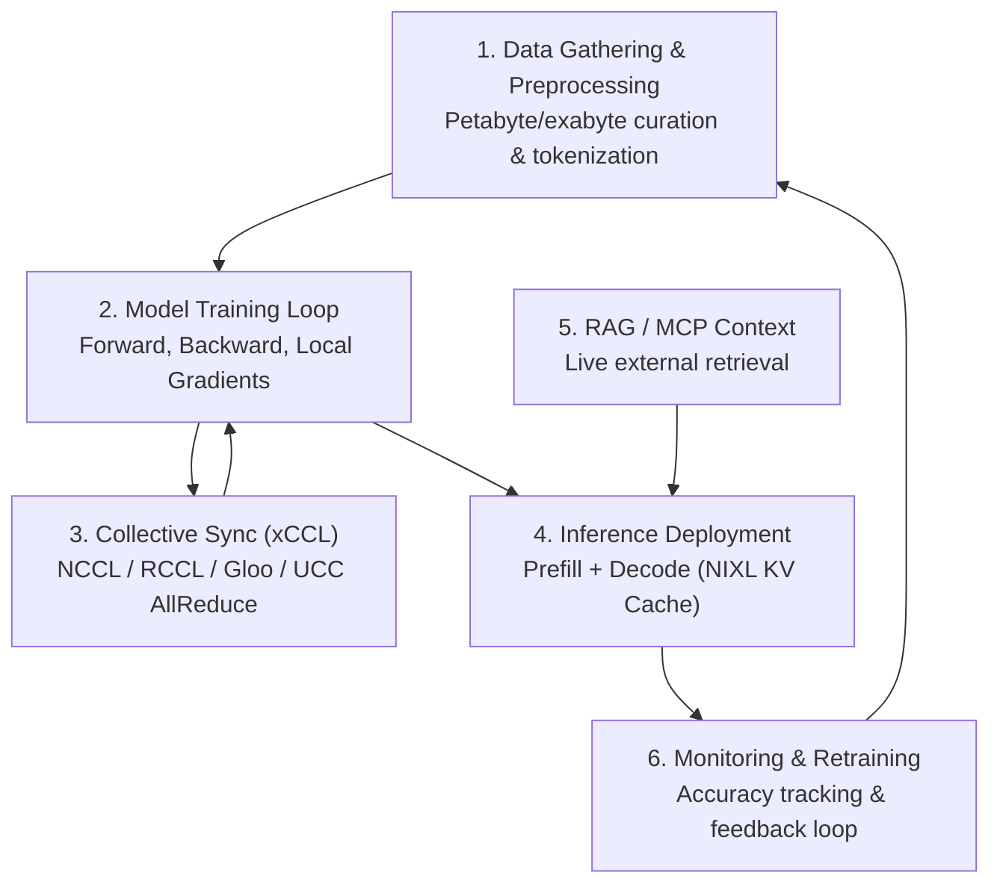
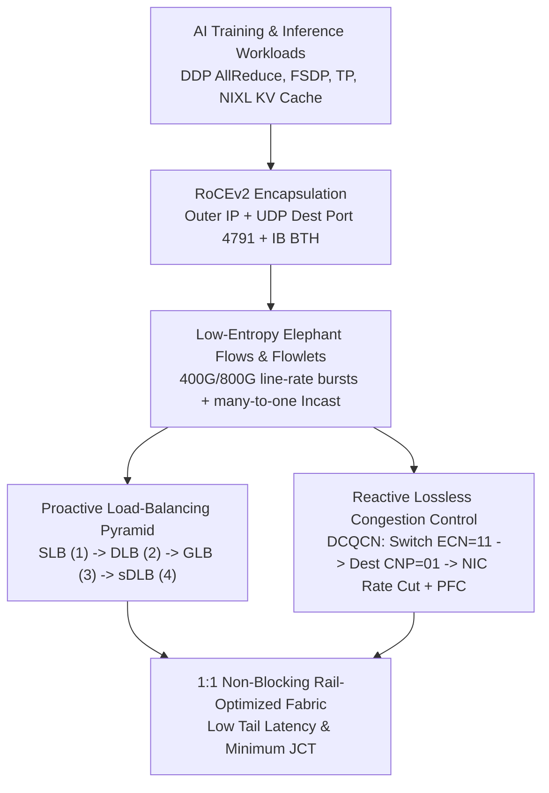

# 12.1 AI traffic: collectives, incast and elephant flows

| | |
|---|---|
| Level | Intermediate |
| Priority tier | 1 |
| Lab venue | Nebius GPU |
| Part | Part 12: Complete AI networking |
| Coverage file | `planning/coverage/chapters/12-01.md` |
| Claim ledger | `planning/ledgers/12-01.md` |

## Why this matters for AI infrastructure

Picture an expensive GPU cluster that sits idle. The training run crawls at single-digit efficiency while burning millions of dollars in compute budget. An expensive GPU cluster can sit idle for over ninety-six percent of wall-clock time if the network delays gradient synchronization. Every GPU in a synchronous job waits at a barrier until the slowest peer finishes exchanging tensors across the fabric. The wires, switches, and network protocols therefore govern the effective utilization of every accelerator in the data center.

That picture is worth keeping in mind for the rest of the chapter. A GPU is fast at arithmetic, but it is only useful when the numbers it needs arrive on time. When they do not, the GPU does nothing, and you still pay for it by the hour. The network is the thing that decides whether the expensive part of the cluster does useful work or waits.

Traditional cloud networks are built for millions of independent web requests. Those requests tolerate occasional packet drops and millisecond queueing delays. If one web request is slow, one user waits a little longer, and everyone else carries on. Distributed AI training works more like a single giant supercomputer. Thousands of GPUs burst at line rate at the same microsecond. If one packet from one GPU hits a congested switch buffer or drops on the wire, every other GPU halts. Understanding collective traffic, elephant flows, and incast is the foundation for every hardware and protocol choice in Part 12.

Three ideas carry most of the weight. The first is the collective, a group operation where every GPU takes part at the same time. The second is the elephant flow, a single very large transfer that fills a link for a long stretch. The third is incast, where many senders aim at one receiver together. The table below shows how each idea turns into a concrete failure in a real cluster.

| Failure Pattern | Cluster Scenario | Mathematical Breakdown | Operational Consequence |
|---|---|---|---|
| **The Compute-to-Sync Trap** | `16,896` CUDA cores and `3.35 TB/s` `HBM3` on `H100 SXM` across `10,000` GPUs | `2 ms` compute vs `50 ms` sync = `2 / 50 = 4.0%` ratio (`3.85%` of `52 ms` step) | Cluster sits idle for over `96%` of wall-clock time waiting on network synchronization |
| **Tail Latency Amplification** | `100`-thread or `10`-task parallel job where `99%` finish in `1 ms` (`0.001 s`) and `1` straggler `taskX` takes `1,000 ms` (`1.0 s`) | Fast GPUs wait `999 ms` at the barrier; parallel `JCT` is `1,000 ms` vs `1 ms` ideal | Parallel step Job Completion Time inflates by `1,000x` due to a single congested flow |
| **Low-Entropy Elephant Flows & Incast** | Synchronized east-west `RoCEv2` flows sharing `UDP` destination port `4791` | Static 5-tuple `ECMP` (`SLB`) hashes multiple `400 Gbps` or `800 Gbps` flows onto one spine link | Triggers switch buffer exhaustion, synchronous incast, and `ProcessGroupNCCL` watchdog timeouts |

Start with the Compute-to-Sync Trap row, because it shows how a small compute share turns into idle GPUs. The arithmetic is simple. Each step spends a little time computing and much more time waiting for the network, so the waiting dominates the cost. When you read the other rows, ask yourself which of them your own job could trigger. If a row describes a problem you have already seen, that row is the one to study first.

:::tip In one minute
Data Parallelism synchronizes gradients across the scale-out fabric via AllReduce or AllGather and ReduceScatter. Pipeline Parallelism passes activations and gradients across stages using point-to-point Send and Recv operations. Tensor Parallelism splits layers vertically inside a node or rack and requires high-bandwidth NVLink and NVSwitch links.

If you only remember one thing from this page, remember that each parallelism style talks over a different kind of wire, and the wire has to match how often the style talks.

Read the callout as the summary of this chapter. Each of its three claims is developed in the sections below.

```text
Chapter 12.1 Key Reference Numbers at a Glance:
  - Parallelism interconnects: NVLink/NVSwitch = 900 GB/s (H100), 1,800 GB/s (B200 / NVL72) vs 32-64 GB/s PCIe
  - Tail latency (n = 10 tasks, 1 ms normal, 1,000 ms = 1 s straggler taskX):
      Serial JCT = 1.010 s (1,010 ms book formula 1 s + n * 1 ms; 1,009 ms / 1.009 s strict sum)
      Parallel JCT = 1.0 s (1,000 ms, 1,000x slowdown; fast GPUs wait 999 ms)
  - Collective scaling (B = 100 MB across n = 8 GPUs; n = 1,024 scale):
      Ring ReduceScatter / AllGather: n - 1 steps (7 at n=8), B*(n-1)/n bytes (87.5 MB at n=8)
      Ring AllReduce: 2*(n - 1) steps (14 at n=8; 2,046 at n=1,024), 2*B*(n-1)/n bytes (175 MB at n=8, 12.5 MB/step)
      Tree AllReduce: 2*ceil(log2(n)) steps (6 at n=8; 20 at n=1,024, O(log N) vs O(N))
      SHARP / NVLS in-network reduction: B/n receive bytes (12.5 MB at n=8), 1/(n-1) volume ratio (1/7 at n=8; 1/1,023 at n=1,024), 2x-5x speedup
  - RoCEv2 & fabric defense: UDP destination port 4791 + IB BTH; SLB (1) -> DLB (2) -> GLB (3, NNH) -> sDLB (4, BTH opcodes)
      DCQCN: Switch ECN = 11 marking + Destination CNP (IP ECN = 01) + PFC pause frames
      1:1 non-blocking fat-tree: 32 Leaf + 16 Spine 64-port switches for 128 servers / 1,024 GPUs
```

When you check this block, look for the three numbers that matter most. They are the parallelism bandwidth, the tail latency, and the fat-tree sizing. Each of them answers one practical question. How fast can the GPUs talk to each other? How long does the slowest worker hold everyone up? How many switches must you buy to avoid a bottleneck?

---

## Prerequisites and outcomes

Before you start, make sure the groundwork from earlier parts is in place. You should understand data center BGP, leaf-spine Clos topologies, and basic RDMA transport concepts from Part 2. Familiarity with multi-GPU server designs and SuperPOD compute and storage fabrics from Part 9 helps too. Finally, review intra-node PCIe, NVLink, NVSwitch, and hardware benchmark workflows from Part 10. If a term in the sections below is new to you, the earlier chapter that covers it is the best place to fill the gap.

The chapter walks through four connected topics in order. It starts with how each parallelism style maps to a collective or a point-to-point transfer, and then it shows how to calculate job completion time and tail latency. Next it covers how the algorithms for Ring, Tree, and in-network reduction move bytes, and how RoCEv2 packets and elephant flows behave on the wire. The last part explains the defenses, from load balancing to congestion control, and how to size a non-blocking fabric.

```text
Chapter Cross-Reference Map and Benchmark Targets:
  - Prerequisite chapters: 2.16-2.19 (Clos/RDMA), 9.2-9.9 (DGX/NVL72/SuperPOD), 10.6 & 10.10 (NVLink/NVSwitch/benchmarks)
  - Pitfall benchmarks covered: Gloo 200 ms vs NCCL 4 ms; DP 45 ms vs DDP 30 ms; 48.0 ms repeated communicator init; 64-socket ceiling
  - Production reliability dataset: Meta 54-day Llama 3 405B pretraining run (419 interruptions across 18 categories)
  - Fabric sizing target: 2-tier 1:1 non-blocking rail-optimized fat-tree for 128 servers / 1,024 GPUs
```

Use the cross-reference map as your guide. It tells you which earlier chapters to revisit before a section that depends on them. You do not need to read every referenced chapter before you begin. Go back to one only when a section leaves you stuck on a term.

---

## 1. AI Workloads, 3D Parallelism, Job Completion Time (JCT), and Tail Latency

### 1.1 The AI model lifecycle and the training iteration loop

Suppose you design a network the way you would for a web service. Users send independent requests north-south, between clients and servers, and that model works well. Carry the same design onto an AI cluster, though, and congestion appears as soon as petabyte-scale training pipelines start running. Storage ingest stalls, or east-west collective synchronization saturates the spine switches. To see why, look at the whole lifecycle. A generative AI factory runs as a continuous five-stage cycle that moves massive datasets through preprocessing, training, deployment, retrieval, and retraining.

The word "north-south" describes traffic that enters or leaves the data center, between a client outside and a server inside. "East-west" describes traffic that moves between servers inside the same building, which is where almost all AI training traffic lives. A web design that handles north-south traffic well can still fail badly when most of the load runs east-west. Keep that distinction in mind, because the rest of the chapter is mostly about east-west traffic.

Each stage hands its output to the next. In the first stage, raw text, image, audio, and video datasets are collected, deduplicated, cleaned, labeled, and tokenized at petabyte scale. Tokenizing turns text into the numeric pieces that the model reads. The second stage trains the model over batches of tokens, using supervised, unsupervised, or reinforcement learning. Once the model is trained, the third stage serves it for live inference, which you measure with Time to First Token and inter-token latency. During inference, the fourth stage uses Retrieval-Augmented Generation and the Model Context Protocol to fetch live context. The fifth stage watches production accuracy and drift, and it feeds new data back into training.

Inside the training stage, each iteration runs the same seven-step loop. First, the dataset is split into mini-batches across the participating GPUs. A mini-batch is a small slice of the data that one step learns from. Second, forward propagation multiplies inputs by layer weights, adds biases, and applies activation functions to produce predictions. Third, the loss function measures the error between the prediction and the ground-truth target. Fourth, backward propagation uses the chain rule to push that error back through the network layers. The chain rule is the calculus step that tells each weight how much it contributed to the error.

The last three steps are where the network enters the picture. Fifth, each GPU computes local gradient tensors, which are the weight updates for its own mini-batch. Sixth, before any weight changes, all GPUs synchronize their gradients over the network using a collective library such as NCCL, RCCL, Gloo, or UCC. Seventh, every GPU applies the synchronized gradients through its optimizer, so the model parameters update identically and the next iteration begins. The sixth step is the one that touches the network. Every GPU has to wait for the others before the seventh step can run.



The diagram shows the same loop at a higher level. The collective sync box sits between two training steps, so every iteration pays for it. Think of it as a toll gate on a road that every training step must cross. The toll is small when the network is fast and large when it is slow, and the road never gets shorter.

The table below lists each stage with the network and compute load it creates. Read it as a map of where traffic and stress come from.

| Stage | Primary Operation | Network & Compute Impact |
|---|---|---|
| **1. Data Gathering & Preprocessing** | Collect, deduplicate, label, and tokenize petabyte-scale datasets | High storage ingest throughput from object/file stores |
| **2. Model Training Loop** | Forward propagation, loss calculation, and backward propagation | Intensive GPU Tensor Core math (`FP8`/`BF16`) and HBM bandwidth |
| **3. Collective Sync (`xCCL`)** | Synchronize gradients across GPUs via `NCCL`, `RCCL`, `Gloo`, or `UCC` | Synchronous east-west elephant flows; tail latency directly governs `JCT` |
| **4. Inference Deployment** | Serve live user queries (`TTFT` and inter-token decode latency) | Disaggregated Prefill-to-Decode `KV` cache transfers via `NIXL` |
| **5. `RAG` / `MCP` Context** | Retrieve up-to-date facts from vector/relational stores at inference time | Low-latency frontend/storage queries prior to prompt prefill |
| **6. Monitoring & Retraining** | Track production accuracy and feed new data back into training | Closes the continuous AI factory feedback loop |

Notice stage 3 in particular. It is the stage where the network decides how fast training runs, because tail latency directly governs JCT. Stages 1 and 5 also touch the network, but they do so in bursts that a well-built storage path can absorb. Stage 3 happens on every single step, and the whole cluster has to wait for it.

### 1.2 3D Parallelism: Data, Pipeline, and Tensor Parallelism traffic profiles

Picture a training team that scales a job from one server to two and watches per-GPU throughput fall ten-fold. Often the cause is a parallelism dimension placed across the wrong link. A frontier model with hundreds of billions of parameters cannot fit into a single GPU's memory, so the model has to be split. If the wrong dimension crosses slow inter-node links, communication overhead stalls every forward and backward pass. Modern clusters therefore combine Data Parallelism, Pipeline Parallelism, and Tensor Parallelism into 3D Parallelism. Each dimension needs its own tier of interconnect.

It helps to think of the three dimensions as three different ways to divide up a big job. Data Parallelism gives each worker a different slice of the data. Pipeline Parallelism gives each worker a different slice of the model's depth, so the work flows through them one after another like an assembly line. Tensor Parallelism gives each worker a different slice of each layer's arithmetic, so all of them work on the same layer together. Each division creates a different conversation between the workers, and each conversation needs a wire fast enough for how often it happens.

Data Parallelism comes first. It splits the training dataset into mini-batches across GPUs that hold full replicas of the model under DDP, or shards of it under FSDP. DDP stands for DistributedDataParallel, which keeps a full copy of the model on every GPU. FSDP stands for Fully Sharded Data Parallel, which splits the model's weights, gradients, and optimizer state across the GPUs so that no single GPU holds the whole model. During or after backward propagation, those GPUs fire periodic, high-bandwidth bursts of AllReduce or AllGather and ReduceScatter across the scale-out fabric. Scale-out means the links that connect separate servers, as opposed to the links inside one server. Pipeline Parallelism works differently. It slices the layers horizontally across sequential GPUs or nodes, then sends activations forward and gradients backward with point-to-point Send and Recv operations. Because each stage waits for the one before it, the handoff is sensitive to pipeline bubble latency. A bubble is idle time that appears when one stage waits for input from the previous one.

Tensor Parallelism slices individual weight matrices vertically, so every GPU computes a piece of every layer. It runs AllReduce, AllGather, and ReduceScatter inside every transformer layer, during both the forward and the backward pass. That frequency is why it needs sub-microsecond latency and massive bandwidth, and why it has to stay inside the scale-up NVLink and NVSwitch domain. Run it across PCIe or scale-out Ethernet and it becomes a severe bottleneck. At ultrascale, clusters add Expert Parallelism and Context Parallelism as well, to partition mixture-of-experts layers and long token sequences. A mixture-of-experts layer routes each token to a small subset of specialist sub-networks, so the work is split by expert rather than by layer.

The table compares the three dimensions side by side. Use it as a lookup when you decide where each one should run.

| Parallelism Dimension | What Is Partitioned | Primary Collective / Transfer Primitive | Target Interconnect Domain | Network Traffic Signature & Bottleneck |
|---|---|---|---|---|
| **Data Parallelism (`DP` / `DDP` / `FSDP`)** | Training dataset split into mini-batches across GPUs holding replicas (`DDP`) or shards (`FSDP`) of the model | `AllReduce` (`DDP`), `AllGather` + `ReduceScatter` (`FSDP`), or `AllToAll` | Scale-out fabric (`400G`/`800G` InfiniBand or RoCEv2 Ethernet) + intra-node NVLink | Periodic, synchronous, high-bandwidth east-west **elephant flows** bursts at the end of (or overlapped with) backward propagation |
| **Pipeline Parallelism (`PP`)** | Neural network layers sliced **horizontally** across sequential GPUs or nodes (e.g., Layers `1–10` on GPU 1, `11–20` on GPU 2) | Point-to-point `Send` / `Recv` (or `NIXL` / `UCX` stage transfers; book also notes ring-style layer passing) | Scale-out fabric across nodes or intra-rack NVLink | Sequential activation handoffs forward (`GPU k -> GPU k+1`) and gradient handoffs in reverse; sensitive to pipeline bubble latency |
| **Tensor Parallelism (`TP`)** | Individual layer weight matrices sliced **vertically** across GPUs within a server or rack | `AllReduce`, `AllGather`, and `ReduceScatter` inside **every** transformer layer (forward and backward) | Scale-up **`NVLink` / `NVSwitch`** (`900 GB/s` `H100`, `1,800 GB/s` `B200` / `NVL72`) | Ultra-frequent, sub-microsecond transfers; **catastrophically bottlenecks on `32–64 GB/s` `PCIe`** if run across non-NVLink PCIe cards (`L40S`) or across standard scale-out Ethernet |

Look at the last column for Tensor Parallelism. On PCIe it becomes a catastrophic bottleneck, so it belongs on NVLink. The reason is frequency. Tensor Parallelism talks at every layer, so even a small delay on each exchange adds up across the whole model. Data Parallelism talks once per step, so it can tolerate a fabric that is slower than NVLink but still fast enough to finish within the step.

### 1.3 Job Completion Time (JCT), tail latency, and synchronous efficiency math

Consider a slow database query on a web page. It delays one user, and only that user waits. Now consider a slow network packet in a synchronous training job. It halts every GPU in the cluster at the collective barrier. Cluster operators feel this directly, because the North Star metric for AI infrastructure is Job Completion Time. Job Completion Time equals job end time minus job start time. When every step waits for the slowest rank, average network latency hardly matters.

A rank is one participant in the job, usually one GPU or one process. A barrier is a point where every rank must arrive before any rank can continue. So the speed of a synchronous job is set by its slowest participant, not its average participant. That is the single most important idea in this section, and it explains why engineers look at the worst case instead of the typical case.

Tail latency measures how long the slowest one percent, or one in a million, of flows take to finish. Suppose ninety-nine percent of requests finish in under 100 milliseconds, while the remaining one percent take seconds. The tail is then measured in seconds. Now suppose a stall happens only once in a million tasks. A distributed job that runs one million parallel tasks across a cluster will hit that stall on every single iteration. In a web service, the rare stall is a rare complaint. In a synchronous job, the same rare stall is a rule that applies to every step.

Here is the worked example. The job is modeled in `compute_tail_latency_jct()` in `code/part12/ai_traffic_collectives.py`, and it has ten tasks. Nine take 1 millisecond each, and one straggler takes 1 second. A straggler is the one task that runs far slower than the rest. Run the tasks one after another, and the straggler adds roughly 1 second to the total. Launch all ten in parallel across ten or a hundred GPUs instead, and they all start at time zero. Each healthy GPU finishes at 1 millisecond, then sits idle for 999 milliseconds while it waits for the straggler.

Follow the parallel case step by step. At time zero, all ten tasks begin together. Nine of them finish at 1 millisecond and then stop, waiting at the barrier. The last task keeps running until it finishes at 1,000 milliseconds. Only then can the barrier release, so the step ends at 1,000 milliseconds even though nine tasks were done almost immediately. The job's completion time is set by one task, and the other nine spend almost the whole step doing nothing.

The same barrier explains why deep-buffer enterprise Ethernet switches cause trouble for AI training. Enterprise core switches use deep buffers so they can absorb bursty web traffic without dropping TCP connections. A buffer is the memory a switch uses to hold packets while a port is busy. Under load, those deep queues routinely delay packets by 10 milliseconds. Now suppose one GPU's collective packet sits in such a buffer for 10 milliseconds. All ten thousand GPUs then halt for those 10 milliseconds. It is tempting to save money by running AI traffic on a shared enterprise VLAN with QoS queues. A VLAN is a logical slice of a network, and QoS stands for Quality of Service, a way of ranking traffic so some packets go first. Even so, collectives stay exposed to microburst jitter. A microburst is a very short spike of traffic that fills a queue faster than the queue can drain, and the jitter is the variation in delay it causes.

In symbols, the job completion time is the end time minus the start time.

$$\text{JCT} = t_{\text{job\_end}} - t_{\text{job\_start}}$$

```text
Tail Latency and Synchronous Cluster Efficiency Math (compute_tail_latency_jct & compute_synchronous_efficiency):
  1. Serial Execution (n = 10 tasks, t_normal = 1 ms = 0.001 s, t_straggler taskX = 1 s = 1,000 ms):
     - Book formula: JCT_serial,book = 1 s + (n * 1 ms) = 1.010 s (1,010 ms for n = 10)
     - Strict sum:   JCT_serial,strict = (n - 1) * 1 ms + 1,000 ms = 1,009 ms = 1.009 s
  2. Parallel Execution (n = 10 or n = 100 GPUs, 9 of 10 or 99 of 100 healthy):
     - Wait Time_fast_GPUs = t_straggler - t_normal = 1,000 ms - 1 ms = 999 ms
     - JCT_parallel        = max(t_i) = 1,000 ms = 1.0 s (1,000x inflation over the 1 ms ideal step)
  3. 10,000-GPU Synchronous Efficiency (t_compute = 2.0 ms, t_comm = 50.0 ms without overlap):
     - Compute-to-comm ratio = 2.0 ms / 50.0 ms = 4.0%
     - Serial step time      = 2.0 + 50.0 = 52.0 ms (compute share = 2.0 / 52.0 = 3.85%)
  4. Enterprise Switch Trap:
     - 10 ms deep-buffer jitter on 1 rank stalls all 9,999 fast GPUs
     - Saving $2 Million on 500 H100 servers via a shared 400G enterprise VLAN with QoS fails under microburst jitter
```

Read the first case as the serial run and the second as the parallel run. In the parallel run, the straggler alone sets the JCT. The serial run pays for every task in turn, so it is slow for a different reason. The contrast teaches the same lesson either way. Adding more parallel workers does not help if one of them is slow, because the barrier still waits for the worst one.

### 1.4 Three ways a model learns, and the training loop in review

Models do not all learn the same way, and the style you pick decides what data you must prepare before training starts. Three styles come up most often, and each one trains on a different kind of input. Think of them as three ways a student might study. One student works from an answer key, one learns from trial and error with a score, and one sorts through a pile of material looking for patterns on their own.

| Learning style | What the model trains on | How it learns |
|---|---|---|
| **Supervised** | Labeled data, where each input comes with its expected output | Learns to map inputs to outputs |
| **Reinforcement** | Trial and error, with feedback in the form of rewards or penalties | Learns actions that maximize success |
| **Unsupervised** | Unlabeled data | Must find hidden patterns in the data on its own |

Whichever style you choose, the training loop from section 1.1 stays the same. The data runs through the model in a forward pass to produce predictions. Those predictions are then compared with the expected outputs. Backward propagation uses the gradients to adjust the model's parameters. You repeat this over many iterations, sometimes called epochs, and across large batches of data. The model gets a little more accurate on each pass. From the network's point of view, the style changes the labels and the rewards, but it does not change the fact that every iteration ends with a synchronization.

Before you size the network for a job, decide which parallelism dimensions it uses, because each one sets a different traffic pattern. A job that only uses Data Parallelism sends bursts at the end of each backward pass. A job that also uses Tensor Parallelism sends many small exchanges inside every layer. The two jobs can run on the same hardware and still need very different fabrics. Knowing the pattern first saves you from building the wrong one.

---

## 2. RDMA, RoCEv2 (UDP 4791), Elephant Flows, Flowlets, and Incast

### 2.1 Host TCP/IP vs RDMA and transport headers

Imagine a hundred-node cluster with 100 Gigabit Ethernet cards that plateaus at 30 Gbps. The CPU interrupt queues sit at one hundred percent, and the links are nowhere near full. If you run distributed training over the standard Linux kernel TCP/IP stack, the host CPU cores saturate long before the links reach line rate. Every kernel TCP message copies data into kernel socket buffers, computes software checksums, fires OS interrupts, and copies data across PCIe. At 400 or 800 Gbps, the host operating system simply cannot copy bytes fast enough.

To picture the cost, imagine a mail room where every letter has to be opened, copied by hand, checked, and then re-sealed by a clerk before it can leave the building. The clerk is the CPU, and the work is the same whether the letter is short or long. If the building receives letters faster than the clerks can handle them, the mail piles up even though the delivery trucks are empty. That is what happens to the kernel path at fast link speeds.

Remote Direct Memory Access, or RDMA, solves this by bypassing the OS kernel and the host CPU on both the sender and the receiver. With RDMA and GPUDirect RDMA, the NIC reads and writes application memory or GPU HBM directly across PCIe, through `nvidia-peermem`. A NIC is the network interface card, the adapter that connects a server to the network. HBM is the high-bandwidth memory on the GPU itself. The application posts a Work Queue Element that holds a virtual memory address, a byte length, and memory keys. That descriptor goes through the Verbs API straight to the NIC hardware. The Verbs API is the standard set of calls an application uses to talk to an RDMA device.

Go back to the mail room. With RDMA, the sender writes a short note that says where the letter is, how long it is, and who may open it. The note goes straight to the delivery system, and the clerk never touches the envelope. The receiver has already set aside a place for the letter, so the delivery lands in the right spot. The CPU does not handle each byte, and that is the whole reason RDMA is fast.

The RDMA driver manages three hardware-backed queues on the adapter. The Send Queue holds outbound work requests, and the Receive Queue holds pre-posted buffers for inbound messages. Together, a Send Queue and a Receive Queue form a Queue Pair. When the NIC finishes a request, it writes an entry to the Completion Queue. RDMA Read, RDMA Write, and Atomic operations are unidirectional, one-sided verbs. Send and Receive are bidirectional, two-sided verbs. A one-sided verb moves data without the remote application taking part at that moment, while a two-sided verb needs both sides to post a matching request.

Four transport protocols carry RDMA across data center links, and they make different trade-offs. Native InfiniBand runs on a dedicated lossless fabric that uses link-layer credit flow control, so switches never drop packets because a buffer is full. Credit flow control means a sender only transmits when the receiver has announced room for the packet. RoCEv1 places InfiniBand transport headers directly inside Ethernet Layer 2 frames, which limits it to a single broadcast domain. RoCEv2 wraps the InfiniBand Base Transport Header inside standard IP and UDP packets, using destination port 4791. That UDP wrapping makes it routable across Layer 3 spine-leaf networks. iWARP layers RDMA over TCP. It avoids the need for lossless Ethernet, but it adds latency and NIC complexity.

The table compares each transport on its header stack and its operational properties. Read the RoCEv2 row closely, because it is the transport this chapter focuses on. Its header stack is the one you will meet most often in Ethernet-based AI clusters.

| RDMA Dimension | Mechanism or Header Stack | Key Operational Properties |
|---|---|---|
| **Kernel TCP/IP Bottleneck** | App buffer -> Kernel socket copy -> TCP/IP stack & interrupts -> NIC | Saturates host CPUs; caps a `100`-node Ray cluster on `100GbE` `ConnectX-5` NICs at **`30 Gbps`** |
| **RDMA Queue Architecture** | `WQE` posted via Verbs API to `SQ` + `RQ` (`QP`) and `CQ` (`CQE`); `GPUDirect RDMA` via PCIe `BAR1` and `nvidia-peermem` | Bypasses OS kernel; `RDMA Read`, `RDMA Write`, and `Atomic` are **unidirectional** (one-sided); `Send`/`Receive` are **bidirectional** |
| **1. InfiniBand (`IB`)** | `IB LRH` -> `IB GRH` -> `IB BTH` -> `IB Payload` -> `ICRC` / `VCRC` | Native lossless channel fabric standardized by `IBTA` using link-layer credit flow control |
| **2. `RoCEv1`** | Ethernet L2 (`EtherType 0x8915`) -> `IB GRH` -> `IB BTH` -> `IB Payload` -> `FCS` | Non-routable across L3 IP subnets; limited to a single L2 broadcast domain |
| **3. `RoCEv2`** | Ethernet L2 -> `IP` (IPv4/IPv6) -> `UDP` (dest port `4791`) -> `IB BTH` -> `IB Payload` -> `ICRC` (`32-bit`) -> Ethernet `FCS` | L3-routable across leaf-spine Clos fabrics; requires lossless Ethernet (`PFC` + `ECN` / `DCQCN`) |
| **4. `iWARP`** | Ethernet -> `IP` -> `TCP` -> `MPA` / `DDP` / `RDMAP` | Works over lossy TCP/IP but incurs higher latency and RNIC complexity; rare in AI training clusters |

### 2.2 Inside the RoCEv2 packet and the 11/13-step RDMA state machines

When you capture traffic on a RoCEv2 fabric without a protocol dissector, every flow looks like opaque UDP traffic on port 4791. That outer wrapper hides the queue pair identifiers, memory addresses, and sequence numbers that control reliability and congestion. A dissector is a decoder that understands a protocol's fields. Without one, your capture tool shows a stream of bytes. To debug dropped packets, out-of-order delivery, or selective dynamic load balancing, you must look inside the InfiniBand headers behind the UDP header.

Every RoCEv2 frame sets its outer UDP destination port to 4791. That tells the receiving NIC to read the next bytes as an InfiniBand Base Transport Header. The sender hashes the Queue Pair number into the outer UDP source port. Inside the Base Transport Header, the Opcode field names the exact RDMA operation, such as an RDMA Read request, a response, or an acknowledgement. The header also carries the Partition Key, the Destination Queue Pair number, an Acknowledge Request flag, and a 24-bit Packet Sequence Number. The receiving NIC uses that sequence number to detect missing or out-of-order packets over connectionless UDP. UDP does not promise delivery, so the sequence number is how RDMA notices that something is missing.

Read a RoCEv2 frame from the outside in. The outermost layer is Ethernet, followed by IP and then UDP. A UDP destination port of 4791 tells the receiver that the next header is the InfiniBand Base Transport Header. That header carries the opcode, the destination queue pair, the packet sequence number, and the partition key. The partition key maps to a Layer 2 VLAN ID. The payload comes next, then a 32-bit end-to-end ICRC, and the Ethernet frame check sequence closes the frame. The ICRC is a checksum that stays the same end to end, and the frame check sequence is the checksum for each Ethernet hop.

On RDMA Read and Write requests, an RDMA Extended Transport Header follows the Base Transport Header. It supplies the 64-bit remote Virtual Address, the Remote Key that authorizes memory access, and the DMA byte length. Acknowledgement frames carry an ACK Extended Transport Header instead. Its Syndrome field indicates an ACK or a NACK, alongside credit counts and the Message Sequence Number. Before any data frames cross the wire, the RDMA Connection Manager completes a three-step setup handshake, and it closes the connection with a four-step disconnect. The handshake is like two people agreeing on a meeting time before they start talking, and the disconnect is the polite goodbye at the end.

```text
RoCEv2 Inner Header Fields and Connection Manager State Machines (ADC Ch 1 Figs 1-11 to 1-16):
  1. Outer Encapsulation:
     - Ethernet L2 + IPv4/IPv6 (e.g., client 20.0.0.2 <-> server 60.0.0.2) + UDP (Destination Port = 4791)
  2. IB Base Transport Header (BTH):
     - Opcode: 12 = RC RDMA READ Request | 14 = RC RDMA READ response Middle | 17 = RC Acknowledge
     - Flags & Keys: Solicited Event, MigReq, Pad Count, Header Version, Partition Key (P_Key = 65535, mapped to VLAN ID)
     - Routing & Ordering: Destination QP (Dest QP = 0x0000fe1, 0x00007b, 0x000123), Ack Request (True/False), 24-bit PSN (16548361, 16543980, 2592248)
  3. RDMA Extended Transport Header (RETH - follows BTH on Opcode 12 Read / Write requests):
     - Virtual Address = 0x00007ff9de5f4000 (64-bit) | Remote Key (R_Key) = 0x00207100 | DMA Length = 65536 bytes (0x00010000; 1024 bytes per middle response packet)
  4. ACK Extended Transport Header (AETH - follows BTH on Opcode 17 Acknowledge):
     - Syndrome = 0 (Ack vs NACK code + Credit Count) | Message Sequence Number (MSN) = 1
  5. Connection Manager (CM) State Machines:
     - 3-step CM connect handshake: Step 1 CM Connect Request (client QPN) -> Step 2 CM Connect Reply (server QPN) -> Step 3 CM Ready to Use
     - 13-step RDMA Write flow: Steps 1-3 connect, Steps 4-9 size/VA/R_Key/data/ACK exchange, Steps 10-13 4-step disconnect
     - 11-step RDMA Read flow:  Steps 1-3 connect, Steps 4-7 Read request/ACK/data/ACK, Steps 8-11 4-step disconnect
```

The block shows the same frame from the inside. Start with the outer encapsulation, then read the Base Transport Header, and finish with the extended headers that appear only for certain operations. The state machine lines at the end show the order of messages in one full RDMA session. When you debug a capture, match the opcode in the frame to the step it belongs to in the session. That match tells you where the session stopped.

### 2.3 Why AI traffic breaks traditional Ethernet: low entropy, elephant flows, flowlets, and incast

In a traditional enterprise data center, thousands of servers talk to thousands of clients over short TCP connections with randomized source ports. Standard Equal-Cost Multi-Path routing hashes the five-tuple of each packet and spreads traffic evenly across the spine links. A five-tuple is the set of five fields that identify a flow: source address, destination address, protocol, source port, and destination port. Equal-Cost Multi-Path, or ECMP, means a switch has several paths of equal cost to the same place and picks one by hashing those fields. Now run a RoCEv2 GPU collective over that same static ECMP fabric. Half of the spine links sit idle, while the other half suffer severe congestion and packet drops. Network operators see this as sudden latency spikes, PFC pause storms, and hung training jobs.

The reason hashing works for web traffic is variety. Many different clients with random ports produce many different hash results, and the results spread out across the links. AI traffic does not have that variety. The same few GPU pairs talk to each other again and again, using the same port, so the hash keeps producing the same answer. Hashing needs many different inputs to spread the load, and AI jobs give it very few.

The breakdown happens because AI training traffic combines five properties that work against the Ethernet fabric. First, it has low entropy at Layer 3, because each GPU talks repeatedly to a fixed peer in a ring or a small subgroup. Entropy here means how much variety the hash input contains. Second, it has low entropy at Layer 4, because every RoCEv2 packet uses UDP destination port 4791 and reuses long-lived source ports. A traditional switch that hashes on the outer five-tuple sees only a handful of distinct combinations.

Third, standard switches do not inspect the inner InfiniBand Base Transport Header, so distinct RDMA transfers collapse into the same hash bucket as flowlets. A flowlet is a burst of packets inside a longer flow, separated by short gaps. Simultaneous flowlets appear when concurrent Queue Pair transfers between the same two GPUs differ only inside the inner BTH fields. A traditional switch pins all of them onto the same physical uplink. Sequential flowlets appear when one job finishes between two GPUs and a second job starts between the same pair right away. Identical outer headers then trick the switch into pinning both jobs onto one path.

Consider what you would see on one congested port. Fourth, every GPU NIC drives massive line-rate elephant flows at 400 Gbps or 800 Gbps, for megabytes or gigabytes per step. Line rate means the NIC sends as fast as the link allows. Fifth, all ranks fire their collectives or storage checkpoints at the same microsecond. When several senders drive line-rate elephant flows toward a single egress switch port at once, the arrival rate exceeds the port speed. That collision creates many-to-one incast, which quickly overflows shallow switch buffers. Incast is easy to picture as everyone phoning one phone number at the same moment. Only one call can be answered at a time, and the rest pile up in the queue until the queue overflows.



The flowchart shows the chain of cause and defense. The workload creates elephant flows and incast. The fabric answers with two kinds of defense, one that moves flows before congestion starts and one that slows senders after it starts. Both defenses lead to the same goal, which is a fabric that never becomes the bottleneck.

| Architectural Stage | Mechanism | Operational Role in the AI Fabric |
|---|---|---|
| **1. Workload Layer** | `NCCL` collectives (`AllReduce`, `AllGather`, `ReduceScatter`) & `NIXL` P2P transfers | Generates synchronized bursts across `8` to `64,000+` GPUs |
| **2. RoCEv2 Transport** | Outer `IP` + `UDP 4791` + inner `IB BTH` (`Opcode`, `Dest QP`, `PSN`) + `RETH`/`AETH` | Bypasses OS kernel (`GPUDirect RDMA`), but hides QP/opcode entropy inside `BTH` |
| **3. Traffic Hazard** | Low-entropy **elephant flows**, **flowlets**, and synchronous **incast** | Causes hash collisions on static 5-tuple ECMP and microburst buffer overflow (`ConnectX-7` `400 Gbps` = `50 GB/s`, `ConnectX-8` `800 Gbps` = `100 GB/s`, `Protocol 17`) |
| **4. Proactive Defense** | 4-tier load-balancing pyramid (`SLB` → `DLB` → `GLB` → `sDLB`) | Spreads elephant flows and flowlets across all equal-cost leaf-to-spine links |
| **5. Reactive Defense** | **`DCQCN`** (`ECN = 11` + `CNP` with `IP ECN = 01` + link-level `PFC` pause) | Throttles offending sender NICs per-flow and pauses queues before any packet drops |
| **6. Physical Topology** | `1:1` non-blocking rail-optimized fat-tree + isolated storage fabric | Eliminates bandwidth oversubscription and storage checkpoint buffer collisions |

Each stage in the table feeds the next. Stage 3 is where the damage starts, and stages 4 to 6 are the defenses. Read the table from top to bottom once, then read it again from bottom to top. The first pass shows how a workload becomes a hazard. The second pass shows which defense answers each hazard.

### 2.4 InfiniBand versus Ethernet for AI fabrics

Suppose you are asked to pick the fabric for a new cluster. Teams often ask whether an AI cluster should use InfiniBand or Ethernet. The answer depends on what matters most to you: speed, latency, cost, power, or how many vendors you need to mix. The table compares the two on the points that come up most often. Treat it as a checklist of questions to ask your vendor, not as a final verdict.

| Characteristic | InfiniBand | Ethernet |
|---|---|---|
| **Transmission speed** | Supports SDR, DDR, QDR, FDR, EDR, HDR, and NDR. The book rates it as slower than Ethernet. | Supports 10 Mbps, 100 Mbps, 1 Gbps, 10 Gbps, 25 Gbps, 100 Gbps, 200 Gbps, 400 Gbps, 800 Gbps, and 1.6 Tbps. |
| **Latency** | Lower latency | Higher latency |
| **Reliability** | Greater reliability, because it is designed to be lossless | Inherently lossy. TCP makes it reliable, and DCQCN adds reliability to UDP. |
| **Power consumption** | Low power consumption | Comparatively higher power consumption |
| **Scalability** | Limitations beyond a certain cluster size | Highly scalable |
| **Standardization** | Controlled by the IBTA, which can lead to vendor lock-in | Open standards enable multi-vendor networks |
| **Cost** | Higher cost and longer lead times | Lower cost and shorter lead times |
| **Versatility** | Suited to certain fabrics, such as storage, HPC, and AI/ML | The most widely deployed technology. It runs in any environment if the right protocols are enabled. |

The table shows the trade-off in plain terms. InfiniBand gives you lower latency and lossless behavior, but it costs more and grows less easily. Ethernet is cheaper, open, and scales well, but it needs extra work to behave like a lossless fabric. Neither choice is free. You pay either in money and vendor lock-in, or in engineering effort to tune congestion control.

The three RDMA transports from section 1.2 can be compared the same way. InfiniBand offers low latency and lossless transport, but it is less scalable and more expensive. RoCEv2 runs RDMA over Ethernet using UDP and IP. It scales and fits existing Ethernet gear, but it needs careful congestion management. iWARP runs RDMA over TCP/IP. It is less popular, with higher latency and less adoption in AI and ML clusters.

Before you choose a fabric, decide which of these trade-offs you can live with, because each one shapes the rest of the design. A team that already runs a large Ethernet estate often picks RoCEv2 and accepts the tuning work. A team that wants the simplest lossless path often picks InfiniBand and accepts the price.

---

## 3. Proactive and Reactive Fabric Defense: Load-Balancing Pyramid, DCQCN, and Fat-Tree Sizing

### 3.1 The four-tier load-balancing pyramid (SLB, DLB, GLB, sDLB)

Picture two 400 Gbps elephant flows landing on the same leaf uplink under static hashing. The switch buffer fills in microseconds, while the neighboring uplinks sit empty. If you wait for reactive congestion control to throttle the senders, you still give up half of your bisection bandwidth. Bisection bandwidth is the capacity of the fabric when you cut it in half, and it is the number that tells you whether the whole cluster can talk at full speed at once. To prevent collisions before buffers fill, AI Ethernet switches climb a four-tier load-balancing pyramid. The hierarchy is modeled in `LOAD_BALANCING_PYRAMID` in `code/part12/ai_traffic_collectives.py`.

Think of the pyramid as four levels of traffic police, each one looking at a wider part of the road. The bottom officer only checks the address on each car. The next officer also looks at how busy the lanes next to the car are. The third officer looks one more junction ahead, and the top officer reads the markings on each car so that cars of different kinds can be sent different ways. Each level costs more to run and needs more from the hardware, so the top level is only worth it for the traffic that really needs it.

At Level 1, Static Load Balancing hashes only the outer five-tuple and is blind to link utilization. Static hashing guarantees zero packet reordering. Packets of one flow always take the same path, so they arrive in the order they were sent. Low RoCEv2 entropy, however, causes severe collisions that leave parallel links idle. Because the hash input barely changes, many flows land on the same link while others sit unused.

At Level 2, Dynamic Load Balancing watches the real-time bandwidth of local member links and the local egress queue depth on the leaf switch. The egress queue is the line of packets waiting to leave through an output port, and its depth is how long that line is. The switch assigns new flows and reassigns existing flowlets when local link quality shifts. That resolves leaf-uplink imbalance with minimal reordering. Moving a flowlet between bursts keeps its packets mostly in order, which is why the reordering stays small.

A leaf switch running local Dynamic Load Balancing still cannot see congestion one hop downstream, on a spine-to-leaf link. A leaf is a switch that connects servers, and a spine is a switch that connects leaves. Level 3, Global Load Balancing, closes that blind spot. Spine switches advertise Next-to-Next-Hop downstream path quality back to the upstream leaves. Next-to-Next-Hop means the quality of the path two hops away, beyond the next switch. The upstream leaf can then route around downstream spine-to-leaf hotspots across the whole Clos fabric.

Level 4, the apex, is Selective Dynamic Load Balancing. It inspects the inner RoCEv2 InfiniBand Base Transport Header and reads the Read and Write opcodes. That lets the switch tell control messages apart from massive RDMA elephant flows, and it sprays packets across every available path. Spraying means consecutive packets of one flow take different paths, which spreads the load very evenly. Spraying causes out-of-order arrivals, so Level 4 relies on NICs such as ConnectX-7, ConnectX-8, and BlueField-3 to reorder sequence numbers in hardware. Switches can also apply round-robin flow pinning across outgoing interfaces, so concurrent GPU rails never collide on the same uplink. A rail is one GPU's dedicated network path, and keeping rails apart keeps them from fighting over one link.

The table lists each level, what it looks at, and how suitable it is for AI training fabrics.

| Pyramid Level | Code & Name | Path Selection Inputs | Reordering & Hardware Requirements | Suitability for AI Training Fabrics |
|---:|---|---|---|---|
| **Level 1 (Base)** | **`SLB`** — Static Load Balancing (5-tuple ECMP) | Static hash of outer 5-tuple (`Src IP`, `Dst IP`, `Proto`, `Src Port`, `Dst Port 4791`) only; blind to link load | Zero reordering (all packets of a 5-tuple pinned to one path); standard L3 switch (`Chapter 12.14` covers ASIC CRC32 details) | **Poor:** Low RoCEv2 entropy causes severe hash collisions where two `400G` elephant flows collide on one link while others sit at `0%` |
| **Level 2** | **`DLB`** — Dynamic Load Balancing | Real-time **local member-link bandwidth utilization** and **local egress queue buffer depth** on the leaf switch | Low reordering (assigns new flows and reassigns existing flowlets when local link quality changes) | **Moderate:** Resolves local leaf-uplink imbalance, but is blind to congestion one hop downstream on spine-to-leaf links |
| **3** | **`GLB`** — Global Load Balancing | Local link/buffer state **plus Next-to-Next-Hop (`NNH`) downstream path quality** advertised by spine switches | Low reordering; upstream leaf avoids downstream spine-to-leaf congestion hotspots | **High:** End-to-end congestion avoidance across multi-stage leaf-spine Clos fabrics |
| **Level 4 (Apex)** | **`sDLB`** — Selective Dynamic Load Balancing | Deep inspection of **`RoCEv2` `IB BTH` Read/Write opcodes** to detect RDMA elephant flows and enable **per-packet spraying** | Requires destination NIC out-of-order **`PSN`** handling (supported on `ConnectX-6/7/8` and `BlueField-3`) | **Highest:** Near-`100%` bisection utilization for massive RDMA Read/Write elephant collectives |

Level 1 is the one to avoid on RoCEv2 traffic, and Level 4 is the one that approaches full bisection use. The middle levels are a stepping stone. They fix the local imbalance first, and then they fix the imbalance one hop away. When you plan a fabric, check which level your switches support before you plan the traffic, because a level you do not have cannot help you.

### 3.2 Reactive congestion management: DCQCN (ECN, CNP, and PFC)

Even with perfect load balancing, a synchronized AllReduce burst or a many-to-one incast can briefly exceed an egress port's drain rate. The drain rate is how fast a port can send packets out. Standard RDMA network adapters treat one dropped packet as a fatal sequence error. That triggers costly go-back-N retransmissions or timeouts. Go-back-N means the sender resends everything from the lost packet onward, even the packets that arrived fine. A RoCEv2 fabric therefore has to pair proactive load balancing with reactive, lossless congestion management. That pairing slows senders down and pauses links before buffers overflow.

A useful picture is a highway on-ramp with a meter. The meter does not stop cars forever. It holds them back a little when the road ahead is full, and it lets them through as soon as there is space. Reactive congestion control works the same way. It slows the senders when it sees the queue growing, and it releases them when the queue drains. The safety net below it is a hard stop, used only when the meter is not enough.

Data Center Quantized Congestion Notification, or DCQCN, combines end-to-end Explicit Congestion Notification rate control with hop-by-hop Priority Flow Control pause frames. Explicit Congestion Notification, or ECN, lets a switch mark a packet instead of dropping it. Hop-by-hop means each link in the path is handled separately. When an egress queue on a spine switch crosses its Random Early Detection marking threshold, the switch does not drop the packet. Random Early Detection is a queue rule that starts marking packets when the queue gets long enough. The switch sets the two ECN bits in the IP header to binary 11, which means Congestion Experienced, and forwards the frame to the destination server.

When the destination RDMA NIC receives a RoCEv2 packet marked with ECN 11, it immediately generates a Congestion Notification Packet. That packet sets the IP ECN bits to 01 and travels back toward the source server. When the source RDMA NIC receives it, the NIC cuts the hardware transmission rate of the offending Queue Pair. The cut happens in the NIC itself, so the host CPU is not involved. Now suppose a sudden microburst fills the switch headroom buffer faster than ECN can react. The headroom buffer is the reserve space a switch keeps for packets that are already in flight. The switch then sends an IEEE 802.1Qbb Priority Flow Control pause frame upstream. That frame carries a pause quanta timer for the lossless priority queue, which halts upstream transmission before a single packet is dropped. PFC is the emergency brake. It works well for a short spike, but when it is applied too often it can spread pauses across the fabric, which is why ECN is meant to act first.

```text
Reactive DCQCN Loop and PFC Safety Net (ADC Ch 2 Figs 2-4 & 2-5, Chapter 12.4):
  1. End-to-End ECN Rate Control (5-Step Loop):
     - Steps 1 & 2: Source GPU server under Leaf A sends RoCEv2 frames through Spine A / Spine B toward destination under Leaf D
     - Step 3 (Switch ECN = 11 marking): Congested Spine B queue crosses RED/WRED threshold and sets IP ECN bits to 11 (CE)
     - Step 4 (CNP return with IP ECN = 01): Destination RNIC sees ECN = 11 and returns a Congestion Notification Packet (CNP, IP ECN = 01)
     - Step 5 (Per-flow NIC rate cut): Source RNIC throttles the specific offending Queue Pair (QP) rate in hardware
  2. Hop-by-Hop PFC Link Pause Safety Net:
     - Standard: IEEE 802.1Qbb Priority Flow Control on lossless DSCP/priority class (e.g., priority 3)
     - Action: Spine B sends PFC pause frame with pause quanta upstream to Spine A -> Leaf A before ingress/headroom buffers overflow
```

Read the loop from top to bottom. ECN slows the sender first, and PFC is the safety net that catches what ECN cannot. The first five steps are a loop that repeats for as long as the queue stays full. The PFC step runs only when the queue fills faster than the loop can respond. If you see PFC pauses rising while ECN marks are rare, the loop is not reacting early enough, and that is a sign to look at the thresholds.

### 3.3 Sizing a 1:1 non-blocking rail-optimized fat-tree and isolating storage planes

No load-balancing algorithm or congestion loop can rescue a fabric that lacks physical spine bandwidth, or one that mixes bulk storage onto compute switches. Suppose an architect applies traditional 2:1 leaf-to-spine oversubscription to save switch ports. Oversubscription means the downlinks from a switch carry more total bandwidth than its uplinks can carry, so the uplinks become the choke point when everyone sends at once. Multi-node AllReduce jobs then saturate the uplinks and stall at half speed. Sharing compute switches with parallel file system storage is worse. It injects massive latency jitter into collective barriers whenever a job writes a checkpoint. A checkpoint is a saved snapshot of the model, written to disk so training can restart after a failure.

To remove those bottlenecks, production GPU clusters use a 1:1 non-blocking rail-optimized fat-tree. A fat-tree is a layered design where the links get wider toward the top, so every level has enough capacity for the level below it. Non-blocking means any server can send at full speed to any other server without waiting for a shared link. Rail-optimized means each GPU's NIC has its own switch path, so GPUs in the same position on different servers talk through the same leaf. The sizing logic is modeled in `size_two_tier_nonblocking_fattree()` in `code/part12/ai_traffic_collectives.py`. On a 64-port switch, 32 ports connect down to server NICs and 32 connect up to spine switches, so downlink and uplink capacity match one-to-one. In a Rail-Optimized Design, NIC 0 of 32 servers connects to Leaf 0, NIC 1 connects to Leaf 1, and so on across eight leaves in each Leaf Group.

Splitting a cluster across two departments does not make 2:1 oversubscription safe. A single multi-rack job still bursts across all of its GPUs at once. Dividing the cluster does not reduce the burst that one job creates. Some shallow-buffer Ethernet designs even use undersubscription, with more uplinks to the spines than downlinks to the servers. That extra uplink capacity adds spine egress buffer and packet-spraying headroom. Finally, production designs isolate storage on a dedicated Storage Fabric built on BlueField-3 DPUs. A DPU is a data processing unit, a smart network card that can run its own software. A separate storage fabric means bulk checkpoint writes never queue ahead of collective packets.

```text
Worked 1,024-GPU Non-Blocking Fat-Tree Sizing & Isolation Rules (size_two_tier_nonblocking_fattree):
  1. Cluster Target: 128 DGX H100 servers * 8 GPUs & 8 ConnectX-7 400G NICs/server = 1,024 GPUs (1,024 compute ports)
     (Scales to 32,000 and 64,000 GPU clusters using multi-tier fat-trees and Rail-Optimized ROD vs Rail-Unified RUD layouts)
  2. Switch Building Block: 64-port Quantum-2 400G NDR switch -> 32 downlinks (32 * 400G) + 32 uplinks (32 * 400G) for 1:1 non-blocking
  3. Leaf Group (SU / Pod): 8 rail-aligned Leaf switches (NIC 0..7 -> Leaf 0..7) serve 32 servers = 256 GPUs
  4. Total Leaf Switches: 128 servers / 32 servers per group = 4 Leaf Groups -> 4 * 8 = 32 Leaf switches (1,024 downlinks, 1,024 uplinks)
  5. Total Spine Switches: 1,024 spine uplinks / 64 ports per Spine switch = 16 Spine switches
  6. Why 2:1 Oversubscription Fails: 16 uplinks per 32-server Leaf stalls any 512-GPU job firing simultaneous 400 Gbps AllReduce bursts
  7. Why Storage Must Be Isolated: Writing a 100 GB model checkpoint over compute switches packs lossless queues (IB credits / PFC) and stalls AllReduce
```

Work through the sizing rules in order. Each one turns a server count into a switch count, and the last rule explains why storage cannot share the compute switches. Follow the arithmetic on paper once before you trust a tool's output. The chain is short: servers become leaf ports, leaf ports become uplinks, and uplinks become spine switches. A mistake in an early step carries through every later step, so check the first few numbers first.

### 3.4 Key requirements for an AI data center fabric

Sections 1 to 3 cover the traffic and the defenses. The fabric itself has to meet a short list of requirements. It must be lossless. It also has to deliver high throughput and low latency, provide dynamic load balancing, and handle large-scale parallelism. Each requirement answers a failure you have already seen in this chapter. Lossless behavior prevents retransmission storms. High throughput and low latency protect the barrier. Dynamic load balancing stops hash collisions, and large-scale parallelism is the reason the fabric has to grow at all.

High-radix 400 Gbps and 800 Gbps Ethernet switches help meet those needs. High-radix means a switch with many ports, so you can build a wide fabric with fewer layers. So do RoCEv2 support and advanced congestion management such as DCQCN, which works with PFC and ECN. The design also has to leave room to grow. As AI workloads multiply, the fabric may need to move from a three-stage topology to a five-stage one. A stage is one layer of switches between the servers and the top of the fabric, so adding stages adds reach at the cost of more hops and more switches.

Before you commit to a topology, check that its spine bandwidth can carry your largest synchronous job, because that job sets the worst case. The largest job is the one that will hurt the most when the fabric is short, so it is the one to test against.

---

## 4. Overlapping Communication with Computation and Collective Algorithms (NCCL, SHARP, NVLS)

### 4.1 Hiding network latency: CUDA streams, DDP bucketing, gradient accumulation, and DP vs DDP

Picture a training step on a non-blocking 400G or 800G fabric. If the backward pass finishes before gradient synchronization starts, the GPUs wait. During that communication window, every Streaming Multiprocessor sits idle until the network transfers complete. A Streaming Multiprocessor is the block of compute units inside a GPU that does the arithmetic. Engineers avoid this by overlapping communication with computation. They pipeline the communication on a dedicated background CUDA stream while backpropagation is still computing earlier layers. A CUDA stream is a queue of GPU work, and two streams can run at the same time when the hardware allows it.

The technique is called Wait-Free Backpropagation, and PyTorch DistributedDataParallel implements it. DDP groups layer gradients into fixed-size buckets. A bucket is a block of gradients that travel together in one collective call. As backward propagation walks from the output layer toward the input layer, gradients fill those buckets. When a bucket is full, PyTorch launches an asynchronous NCCL AllReduce kernel on a background communication stream. Meanwhile, the compute stream keeps calculating gradients for the earlier layers. In the ideal case, the step time drops from the sum of compute and communication down to whichever of the two is larger.

Think of it as packing a moving truck while you are still packing the house. Each box that is ready goes onto the truck right away, and you keep packing while the truck drives. The trip ends when the last box is loaded, and the work of packing and driving has overlapped instead of lining up one after the other.

Real jobs do not always reach that ideal, because bucket size and Python code hygiene both matter. Imagine a model with thousands of tiny layers that trigger many small collective calls. Handshake latency then dominates, even when raw network benchmarks pass at line rate. Handshake latency is the fixed cost of starting each call, and it is paid whether the message is small or large. Raising the DDP bucket cap merges those small transfers into bandwidth-efficient chunks. Calling `.item()`, `.cpu()`, `print(tensor)`, or `torch.cuda.synchronize()` inside the training loop does the opposite. It forces a host synchronization barrier that destroys stream overlap. The host is the CPU, and the barrier makes the CPU wait for the GPU, which removes the overlap you built. Finally, use multi-process DistributedDataParallel rather than single-process DataParallel. DataParallel contends on the Python Global Interpreter Lock and bottlenecks on GPU 0. The Global Interpreter Lock lets only one Python thread run at a time, so a single process cannot drive many GPUs well.

The two formulas below describe the serial case and the ideal overlapped case.

$$t_{\text{serial}} = t_{\text{compute}} + t_{\text{comm}}, \qquad t_{\text{ideal\_overlap}} = \max(t_{\text{compute}}, t_{\text{comm}})$$

```text
Compute-Communication Overlap, Bucketing, and DP vs DDP Benchmarks (ASP Ch 4 & V7 Ch 10):
  1. Ideal Full Overlap Math (t_compute = 10.0 ms, t_comm = 12.0 ms):
     - Serial step time:        10.0 ms + 12.0 ms = 22.0 ms
     - Ideal full overlap time: max(10.0 ms, 12.0 ms) = 12.0 ms (45.45% step-time reduction)
  2. Measured DDP Overlap (ASP Ch 4 Tables 4-1 & 4-2, 40 ms compute + 60 ms comm = 100 ms serial baseline):
     - With 50% comm overlap: step time drops from 100 ms to 70 ms (30.0% / 30% faster); GPU SM utilization rises from 60% to 90%
  3. DDP Bucketing & Small-Layer Tuning:
     - Default DDP bucket size: bucket_cap_mb = 25 MB (25 MiB)
     - Small-layer pathology: microscopic 256 KB AllReduce calls run 40% slower despite ~390 Gbps ib_write_bw; raise bucket_cap_mb from 25 MB to 50 MB
  4. Gradient Accumulation:
     - Accumulating gradients locally over 4 minibatches cuts network sync frequency by 4x
  5. Single-Process nn.DataParallel (DP) vs Multi-Process DistributedDataParallel (DDP) (512 batch = 2 * 256 on 2 GPUs):
     - DP step time:  45.00 ms (45 ms; Python GIL contention + GPU 0 master gather bottleneck)
     - DDP step time: 30.00 ms (30 ms; 33.33% reduction = 1.5x speedup)
```

Read the first block as the baseline and the second as the best case that overlap can deliver. The difference between them is the time you can recover. Gradient accumulation, in the fourth item, is a different lever. It does less network work by syncing less often, so it trades a little freshness of the update for fewer barriers. The formulas at the top are the ones you can check on a napkin before you run anything.

### 4.2 NCCL collective algorithms (Ring, Tree, CollNet, PAT) and SHARP / NVLS in-network math

Choosing the wrong communication algorithm can turn a bandwidth-optimal job into a latency-bound crawl, and the risk grows with scale. A ring algorithm keeps links busy on eight GPUs. On a thousand GPUs, though, every chunk must hop through more than two thousand sequential steps. Latency-bound means the job waits on the number of hops, not on how much data moves. Bandwidth-bound means the job waits on how much data moves. When you tune a job, you need to know how NCCL chooses between Ring, Tree, CollNet, Parallel Aggregated Tree, and switch-assisted SHARP or NVLS algorithms, based on tensor size and cluster scale.

Imagine passing a bucket of water around a circle of people. Each person adds a little and passes it on. With eight people the bucket goes around quickly. With a thousand people it still moves at the same speed for each hop, but there are so many hops that the trip takes a long time, even though each hop is quick. Ring algorithms behave like that. They use the links well, but the number of hops grows with the number of GPUs.

In a standard Ring AllReduce across $n$ GPUs, the tensor of $B$ bytes is sliced into $n$ chunks of size $B / n$. In the first phase, ReduceScatter passes chunks around the logical ring over $n - 1$ steps, so each GPU ends up holding one fully summed shard. In the second phase, AllGather circulates those finished shards around the ring for another $n - 1$ steps. Ring AllReduce is bandwidth-optimal for large payloads, but its total latency grows linearly with the number of GPUs. A shard is the one piece of the final sum that a GPU is responsible for. After the first phase, every GPU owns one finished piece, and the second phase shares the pieces with everyone.

For large node counts or small messages, NCCL switches to a binary Tree algorithm, whose step count grows logarithmically with the number of ranks. Logarithmic growth means the steps increase slowly, roughly by one each time the group doubles. On InfiniBand fabrics with switch aggregation, CollNet combines intra-node rings or trees with an inter-node leader tree. A leader tree picks one representative per node and reduces among those representatives. The Parallel Aggregated Tree algorithm interleaves chunked tree reductions in round-robin order. That keeps bandwidth close to Ring while bounding the startup latency logarithmically.

Switch-assisted in-network computing changes the math by moving the arithmetic into the switch silicon. Silicon here means the chip inside the switch. Quantum InfiniBand switches implement SHARP through the SHARP Aggregation Manager, and third- and fourth-generation NVSwitch domains implement NVLink SHARP. SHARP stands for Scalable Hierarchical Aggregation and Reduction Protocol. Instead of passing chunks peer-to-peer around a ring, every GPU sends its data into the switch fabric once. The switch ASIC sums the vectors in hardware and returns the result. An ASIC is a chip built for one job, and here that job is adding numbers as they pass through.

During an AllGather, NVLS hardware multicast works the same way in reverse. NVLS is NVLink SHARP, the in-switch version for NVSwitch domains. Each GPU transmits its shard once, and the switch replicates the data to all peers at the same time. Multicast means one send reaches many receivers. When an NVLS multicast AllGather overlaps with an in-network ReduceScatter, the wall time of a sharded exchange drops by roughly half. Registering persistent user buffers with `ncclCommRegister()` and `ncclCommDeregister()` also allows zero-copy NVLS and SHARP execution, without internal staging buffers. Zero-copy means the data is read from its own memory and not copied into a temporary buffer first. A staging buffer is that temporary copy.

The table compares the algorithms on step count, bytes per GPU, latency scaling, and the regimes where each one fits. Use it as a lookup. Each row answers a different question about the same operation, so read across a row to see the trade-off the algorithm makes.

| Algorithm (`NCCL_ALGO`) | Step Count (`AllReduce`) | Per-GPU Bytes Transferred | Latency vs Bandwidth Scaling | Ideal Regime & Hardware Support |
|---|---:|---:|---|---|
| **Ring (`ReduceScatter` or `AllGather`)** | $n - 1$ steps (`7` at $n=8$) | $B \times \frac{n - 1}{n}$ (`87.5 MB` for $B=100\text{ MB}, n=8$) | $O(N)$ latency hops; `100%` link-balanced bandwidth | Building block of Ring `AllReduce` and `FSDP` |
| **Ring `AllReduce`** (`RS` + `AG`) | $2(n - 1)$ steps (`14` at $n=8$; `2,046` at $n=1,024$) | $2 B \times \frac{n - 1}{n}$ (`175 MB` at $n=8$, chunk $B/n = 12.5\text{ MB}$/step) | **Bandwidth-optimal** for large tensors, but $O(N)$ hop latency hurts at `1,000+` GPUs | Large messages (`> 10s of MB`) on small-to-medium rank counts |
| **Tree `AllReduce`** | $2 \lceil \log_2 n \rceil$ steps (`6` at $n=8$; `20` at $n=1,024$) | Hierarchical reduce to root + broadcast down | **$O(\log N)$ latency** (`20` steps vs `2,046` for Ring at $n=1,024$) | Small/medium latency-bound messages or massive node counts |
| **`CollNet`** (`Direct` / `Chain`) | Local intra-node ring/tree + cross-node leader tree | Offloads inter-group reduction to switch fabric | Combines intra-node NVLink bandwidth with inter-node `SHARP` | Multi-node clusters with InfiniBand `SHARP` (`NCCL_COLLNET_ENABLE=1`) |
| **`PAT`** (Parallel Aggregated Tree) | Interleaved round-robin chunked trees | Near-Ring bandwidth (`2B(n-1)/n`) | Bounds per-segment startup latency to **$O(\log N)$** while keeping links saturated | Medium-to-large messages across multi-node topologies (up to `~7.6x` small/medium speedup with symmetric memory) |
| **`SHARP` / `NVLS` (`NVLSTree`)** | Switch-assisted in-network reduction + multicast | **`ReduceScatter` receive: $B / n$** (`12.5 MB` at $n=8$)<br/>**Volume ratio: $\frac{1}{n - 1}$** (`1/7` at $n=8$; `1/1,023` at $n=1,024$) | Cuts endpoint traffic by $1/(n-1)$, drops overlapped `RS`+`AG` phase time by **`~1/2`**, and yields **`2x–5x` `AllReduce` speedup** | Intra-rack `NVSwitch` (`NVLS`, `72`-GPU `NVL72` at `~130 TB/s`) and `Quantum` InfiniBand switches (`SHARP`) |

Use the table as a lookup. Tree wins on latency-bound messages, while Ring and the in-network options win when bandwidth dominates. Start with the message size in your own job. A small gradient bucket points you toward Tree, and a large tensor points you toward Ring or the in-network options. The algorithm NCCL picks at run time depends on those same two facts, which is why you can often leave the choice to NCCL and only override it when a measurement says so.

Before you tune a collective, decide whether your messages are small and latency-bound or large and bandwidth-bound, because the answer picks the algorithm. Measure with `nccl-tests` at a few message sizes, so you see the crossover for your own cluster instead of relying on a general rule.

---

## 5. Multi-Node Pitfalls, NCCL Lifecycle Gotchas, and Disaggregated Inference (NIXL)

### 5.1 Six multi-node pitfalls, six NCCL lifecycle gotchas, and Meta's 54-day Llama 3 405B failure data

Imagine a training script that runs cleanly on a single eight-GPU server and then runs fifty times slower across a hundred nodes. You see socket timeouts, silent fallbacks to CPU bounce buffers, out-of-memory errors in the RDMA registration pool, or startup hangs that last minutes. A bounce buffer is a staging copy in host memory, so the data takes a slow detour. Most of these failures come from six common multi-node communication pitfalls and six NCCL communicator lifecycle mistakes. A communicator is the NCCL object that holds the group of GPUs taking part in a collective. The benchmark for each one is in `evaluate_multinode_pitfalls()` in `code/part12/ai_traffic_collectives.py`.

Start with the first pitfall. If PyTorch distributed initializes with the CPU-bound Gloo backend instead of NCCL, tensors pass through host RAM and TCP sockets, and collectives slow down fifty-fold. A backend is the library that actually moves the data. Gloo is the CPU path, and NCCL is the GPU path that uses the fast links. Set `NCCL_SOCKET_IFNAME` to the high-speed interface, so bootstrap handshakes do not cross a slow management network. Bootstrap is the setup phase in which the processes find each other before any training begins. The second pitfall is version mismatch. Mixing PyTorch's bundled NCCL with an incompatible system library causes silent transport fallbacks or hangs. A silent fallback is the most dangerous kind, because the job still runs, only slower. The third is port exhaustion. Large jobs can run out of ephemeral TCP ports during bootstrap unless the host port range is widened. An ephemeral port is a short-lived port that the operating system hands out for each outgoing connection.

The fourth pitfall involves multi-rail servers. A rail is one network path, and a server with several NICs has several rails. They need proper channel tuning, or GPU-initiated InfiniBand GPUDirect Async, to saturate multiple NICs. Socket transport settings must never exceed the 64-connection ceiling per communicator. The fifth is a hardware straggler, which you isolate with DCGM, `ibstat`, and monitored barriers. DCGM is NVIDIA's data center GPU monitoring tool, and a monitored barrier reports which rank failed to arrive. The sixth is memory fragmentation. PyTorch's caching allocator keeps freed temporary blocks inside reserved memory, and that can starve the UCX RDMA memory registration pools, even when allocated tensor memory looks low. The allocator is the PyTorch component that keeps GPU memory in blocks for reuse. UCX is a communication framework that uses RDMA, and its registration pools are the regions of memory it has pinned for the NIC.

Communicator lifecycle mistakes inside the training script do just as much damage. Creating and destroying an NCCL process group inside the training loop adds tens of milliseconds of all-to-all handshake overhead to every step. An all-to-all handshake means every rank must check in with every other rank, which costs more as the group grows. Initialize communicators once, outside the loop, and batch sub-communicator creation inside `ncclGroupStart()` and `ncclGroupEnd()`. Grouping the calls lets NCCL set up the communicators together instead of one after another. Never leave troubleshooting overrides such as `NCCL_P2P_DISABLE=1`, `NCCL_SHM_DISABLE=1`, or verbose debug logging enabled in production. Those flags are useful for a short investigation, and they stay in the job only when someone forgets them. Set `NCCL_IGNORE_CPU_AFFINITY=1`, so proxy threads do not collapse onto a single CPU core. A proxy thread is a helper thread that moves data on behalf of the GPU.

Hardware faults are constant at scale. Meta's 54-day pretraining run of Llama 3 405B is summarized in `summarize_llama3_405b_interruptions()`. Across 419 unexpected interruptions, faulty GPUs and HBM3 memory were the largest categories. Network switches, cables, NICs, and NCCL watchdog timeouts together accounted for 49 interruptions. A watchdog is a timer that notices when a collective has stopped making progress. Production jobs should keep the watchdog on, which is the default value 3 of `TORCH_NCCL_ASYNC_ERROR_HANDLING` in PyTorch 2.15, and attach the NCCL Profiler Plugin API, so you can find the exact rank and link where a collective stalls. The profiler plugin lets you see each collective event, which makes the stalled rank visible instead of guessed.

```text
Six Multi-Node Pitfalls, Six NCCL Lifecycle Gotchas, and Llama 3 405B Interruptions (ASP Ch 4, Chapters 2.24 & 6.12):
  A. Six Multi-Node Communication Pitfalls:
     1. Gloo vs NCCL (400.0 MB = 100M float32 AllReduce on 800 Gb/s = 100 GB/s IB):
        - backend="gloo": 200.00 ms (2.0 GB/s) via CPU RAM/TCP | backend="nccl": 4.00 ms (100.0 GB/s, 50.0x / 50x faster); set NCCL_SOCKET_IFNAME=ib0
     2. Mismatched NCCL versions: bundled PyTorch NCCL vs system libnccl causes hangs/fallbacks
     3. Ephemeral TCP port exhaustion: widen /proc/sys/net/ipv4/ip_local_port_range to "50000 51000"
     4. Multi-rail scaling & 64-socket cap: dual 800 Gbps NICs = 1.6 Tbps (~3.2 Tbps quad-rail) + IBGDA;
        NCCL_SOCKET_NTHREADS * NCCL_NSOCKS_PERTHREAD <= 64 (2 * 2 = 4 is valid; 16 * 8 = 128 violates the 64-connection ceiling)
     5. Straggler nodes/links: isolate with DCGM, ibstat, and torch.distributed.monitored_barrier
     6. GPU memory fragmentation under UCX/RDMA: 40 MB + 200 MB temporaries on top of a 0.800 GB buffer grow memory_reserved()
        from 0.800 GB (Iter 00) -> 1.040 GB (Iter 01) -> 1.240 GB (Iter 02..10) while memory_allocated() is 0.000 GB
  B. Six NCCL Communicator Lifecycle Gotchas:
     1 & 2. Repeated init_process_group + destroy_process_group inside loop (Table 4-3):
            48.0 ms init + 0.5 ms 1-element all_reduce = 48.5 ms -> 0.5 ms when initialized once outside loop (98.97% > 98% reduction);
            creating 32 separate communicators on 32 GPUs takes 2-3 minutes vs 2-3 seconds with ncclGroupStart() / ncclGroupEnd()
     3. Debug flags in production: NCCL_P2P_DISABLE=1 or NCCL_SHM_DISABLE=1 drops intra-node bandwidth from hundreds of GB/s to tens of GB/s;
        use NCCL_DEBUG=WARN or VERSION in prod; start NCCL_BUFFSIZE tuning at 4 MB
     4. Collapsed CPU affinity: set NCCL_IGNORE_CPU_AFFINITY=1 with NUMA-aligned numactl / --cpu-bind
     5. Ignoring fallback logs: watch for "unable to enable P2P, falling back to copy" or "NCCL INFO NET/Socket: using Ethernet interface eth0"
     6. Meta 54-day Llama 3 405B Pretraining Interruptions (Table 4-4: 419 total across 18 categories):
        - Faulty GPU: 148 (35.3%) | GPU HBM3 memory: 72 (17.2%) | Software bug: 54 (12.9%) | Network switch/cable: 35 (8.4%)
        - Host maintenance: 32 (7.6%) | GPU SRAM memory: 19 (4.5%) | GPU system processor: 17 (4.1%) | NIC: 7 (1.7%) | NCCL watchdog: 7 (1.7%)
        - Silent data corruption: 6 (1.4%) | GPU thermal interface/sensor: 6 (1.4%) | SSD: 3 (0.7%) | Power supply: 3 (0.7%)
        - Server chassis, IO expansion board, Dependency, CPU, System memory: 2 each (0.5% each)
        - Combined Network switch/cable (35) + NIC (7) + NCCL watchdog timeouts (7) = 49 interruptions (11.7%)
        - Know that TORCH_NCCL_ASYNC_ERROR_HANDLING defaults to 3 (set 1 only to also abort the communicator) and use NCCL_PROFILER_PLUGIN (32-bit event mask, 5 callbacks: init, startEvent, stopEvent, recordEventState, finalize)
```

The block above lists each pitfall with its measured numbers, and the Llama 3 405B breakdown sits at the end of it. Use it as the checklist for a new cluster. Read the pitfalls first, because they are the ones you control in your own scripts and configuration. The interruption counts come next, because they tell you what to expect from the hardware over a long run, even when your software is clean.

### 5.2 Disaggregated inference and NIXL (Prefill vs Decode KV cache routing)

Distributed training is dominated by barrier-synchronized collectives. Suppose you are serving a chat model, and users complain that replies stall mid-sentence. Large language model inference has a different problem. Running it on one monolithic GPU pool creates a severe resource mismatch. Inference splits into two phases with opposite hardware needs. Prefill is compute-bound, and it processes the input prompt in parallel. Decode is memory-bandwidth-bound, and it generates output tokens one by one. If both phases share the same GPUs, a long prompt prefill stalls ongoing token decoding and inflates inter-token latency. Inter-token latency is the pause between one word of the reply and the next, and it is what a user feels as a stutter.

A kitchen is a good comparison. Chopping a huge order of vegetables takes a lot of work at one station. Serving the plates one at a time takes a different kind of work at another station. If the same cook does both, every new big order stops the plates from going out. Splitting the kitchen into two stations lets each one run at its own pace, but the stations now have to pass food between them. That passing is the new networking problem.

To solve that interference, frameworks such as NVIDIA Dynamo, vLLM, SGLang, and TensorRT-LLM split Prefill workers and Decode workers onto separate GPU pools. Disaggregation brings a new networking problem. As soon as a Prefill worker finishes ingesting a long prompt, it must transfer gigabytes of attention Key-Value cache state to a Decode worker. The KV cache holds the attention results for the prompt, so the Decode worker does not need to recompute them. Inactive caches can also be offloaded to host DRAM, local NVMe drives, or network storage, without blocking token generation. DRAM is the main memory of the host, and NVMe is a fast solid-state drive.

Group collective libraries such as NCCL fit this workload poorly. They need synchronous participation from a fixed group of GPU ranks. A transfer from one Prefill worker to one Decode worker does not fit that pattern, because the other ranks have nothing to do with it. NVIDIA therefore built the NVIDIA Inference Xfer Library, or NIXL, as the point-to-point data movement engine inside NVIDIA Dynamo. Point-to-point means one sender and one receiver. NIXL provides a non-blocking, one-sided C++ and Python agent API that routes KV cache blocks asynchronously. Non-blocking means the caller does not wait for the transfer to finish before doing other work. It moves blocks between GPU HBM, CPU DRAM over NVLink-C2C, local NVMe SSDs through GPUDirect Storage, and remote object storage through UCX, GPUDirect RDMA, and IBGDA.

| Dimension | `NCCL` (Collective Communication) | `NIXL` (Point-to-Point Inference Transfer, Released Early `2025`) |
|---|---|---|
| **Primary Workload** | Synchronized many-to-many collectives (`AllReduce`, `AllGather`, `ReduceScatter`) in distributed training and `TP` | Asynchronous `1:1` or `1:few` transfers (e.g., `1 GB`–`100 GB` `KV` cache handoff between Prefill and Decode or tiered storage offload) |
| **Execution Semantics** | Barrier-style group collective (all participating ranks must invoke the call) | Non-blocking one-sided initiator (`nixlAgent`: `registerMem` → `trim` → `prepXfer` → `postXfer` → poll `checkXfer` → `releaseReqH`) |
| **Interconnect & Memory Tiers** | `NVLink`, `NVSwitch`, `PCIe`, `InfiniBand` / `RoCEv2` (`GPUDirect RDMA`), TCP sockets across GPU memory | Unified routing across **`GPU HBM` (`VRAM_SEG`)**, **`CPU DRAM` (`900 GB/s NVLink-C2C` on Grace Hopper/Blackwell)**, **`NVMe SSD` (`GDS`)**, and **Object Store (`S3`)** via `UCX`, `GPUDirect RDMA`, and **`IBGDA`** |
| **Measured Impact** | `100 GB/s` (`4.00 ms` for `400 MB`) on `800G` IB; `2x–5x` speedup with `SHARP` | **`14x` `TTFT` speedup** offloading KV cache on `x86 + H100` vs recomputing; **`2x` faster `TTFT`** on `Grace Hopper` (`900 GB/s NVLink-C2C`) vs `x86 H100`; up to **`30x` higher inference throughput** with NVIDIA Dynamo on a `~680B` LLM across a `72`-GPU `Blackwell NVL72` rack |

Compare the two columns on execution semantics first. NCCL needs every rank at the barrier, while NIXL lets a single initiator move data on its own. That difference explains most of the design choices. The table's last row is a set of measured results, and the numbers there come from the cited sources, so read them as results for those setups and not as promises for yours.

Before you route KV cache traffic, decide whether the transfer is a group collective or a point-to-point handoff, because that choice decides which library fits. A KV cache handoff from one Prefill worker to one Decode worker is point-to-point. A gradient sync across all training GPUs is a collective. Keep the two apart in your design, and you avoid forcing one library to do the other's job.

---

## Commands and configurations that matter

When a multi-node training job runs slower than expected, guessing at NCCL environment variables wastes hours of cluster time. A disciplined sequence works better. Verify the intra-node topology first, then the kernel-bypass drivers, then the raw wire throughput, then collective scaling, and finally cluster-wide cable health. Each layer depends on the one below it, so a fault low in the stack can look like a fault high in the stack. Testing from the bottom up keeps you from chasing the wrong layer. These commands were not run on a live cluster, because the hardware they target was not attached to the build environment, so treat each one as a starting point to check against your own system.

### 1. Inspecting GPU/NIC topology, RoCEv2 / InfiniBand state, and kernel bypass (untested here)

Before you launch any distributed job, check that every GPU shares a local PCIe switch with its paired network adapter. A PCIe switch is the small hub that connects devices inside a server, and sharing one keeps the traffic from crossing the slow path. Confirm that the GPUDirect RDMA kernel module is loaded. Then inspect the InfiniBand or RoCEv2 port state and the hardware error counters on every node. Error counters that climb during a run are an early sign of a failing cable or optic.

```bash
# (untested here) 1. Verify intra-node NVLink/NVSwitch & GPU-to-NIC PCIe switch locality (PIX vs SYS)
nvidia-smi topo -m
nvidia-smi nvlink --status

# (untested here) 2. Confirm GPUDirect RDMA kernel module is loaded
lsmod | grep nvidia_peermem

# (untested here) 3. Inspect HCA link state (must be State: Active + Physical state: LinkUp) and error counters
ibstat mlx5_0
grep . /sys/class/infiniband/mlx5_0/ports/1/counters/{symbol_error,link_error_recovery,port_rcv_errors,port_xmit_discards,VL15_dropped}

# (untested here) 4. Widen ephemeral TCP port range for large-scale NCCL bootstrap and enable MTU 9000 on RoCEv2
sudo sysctl -w net.ipv4.ip_local_port_range="50000 51000"
ip link show dev eth0
```

Read the first two commands as the topology check, and the last two as the link and tuning check. Fix anything they report before you move on. An HCA, or host channel adapter, is the InfiniBand name for the NIC. Its state should read Active for the logical link and LinkUp for the physical link, and any other reading means the path is not ready for traffic.

### 2. Running the 3-step hardware isolation hierarchy (nvbandwidth -> ib_write_bw -> nccl-tests) (untested here)

Never debug a slow PyTorch job before you have isolated the hardware, one layer at a time. Start with `nvbandwidth`, which confirms local PCIe Gen5 x16 host-to-device bandwidth and rules out an x8 link downtrain. A downtrain is when a link negotiates fewer lanes than it was built for, which cuts its speed in half. Next, run `ib_write_bw` with GPUDirect RDMA enabled. It verifies raw 400G wire and optics throughput, and you should use it instead of `iperf3`. Finally, run `all_reduce_perf` from `nccl-tests` across nodes to validate collective scaling. Each test removes one layer of doubt, so the last test only has to explain what is left.

```bash
# (untested here) Step 1: Intra-node PCIe Gen5 x16 check (expect ~50-60 GB/s; ~25-30 GB/s indicates x8 downtrain)
nvbandwidth -t device_to_host_memcpy_ce

# (untested here) Step 2: Raw RDMA wire & optics check on 400G NDR / RoCEv2 (expect ~390 Gbps; never use iperf3)
# On Server A (listener):
ib_write_bw -d mlx5_0 --report_gbits
# On Server B (sender, with --use_cuda=0 to test GPUDirect RDMA directly from GPU 0 HBM):
ib_write_bw -d mlx5_0 --use_cuda=0 --report_gbits <Server_A_IP>

# (untested here) Step 3: Multi-node NCCL collective verification with explicit RDMA & SHARP/NVLS logging
export NCCL_DEBUG=INFO
export NCCL_ASYNC_ERROR_HANDLING=1
export TORCH_NCCL_ASYNC_ERROR_HANDLING=1   # default is 3; 1 also aborts the communicator
export NCCL_SOCKET_IFNAME=ib0
export NCCL_IGNORE_CPU_AFFINITY=1
mpirun -np 16 -H node01:8,node02:8 \
  -x NCCL_DEBUG -x NCCL_ASYNC_ERROR_HANDLING -x NCCL_SOCKET_IFNAME \
  all_reduce_perf -b 8M -e 1G -f 2 -g 1
```

Each command isolates one layer, so a failure at step 1 tells you to stop before running step 2. Keep the numbers from each step in a notebook. When step 3 comes in low, you can compare it against the step 1 and step 2 numbers and see which layer is short. The second step is the one that tells you whether a 400G wire is delivering close to its rated speed, so do not skip it in favor of a generic network test.

### 3. Base Command Manager (bcm11-admin) fabric health checks (ibnetdiscover, ibdiagnet, cablecheck) (untested here)

In NVIDIA Base Command Manager 11, administrators check cluster-wide InfiniBand and RoCEv2 cable wiring. They also run automated pre-job node checks from the head node and from `cmsh`. The head node is the management server that controls the cluster, and `cmsh` is the command-line shell for managing it.

```text
# (untested here) Run BCM cluster-wide cable verification and InfiniBand fabric diagnostics (bcm11-admin Sections 3.6, 3.12, 5.3.3)
[root@headnode ~]# cablecheck -f
[root@headnode ~]# ibnetdiscover
[root@headnode ~]# ibdiagnet

# (untested here) Trigger pre-job health checks in cmsh (device mode -> burn / check)
[headnode]% device
[headnode->device]% foreach -n node001..node128 (check)
```

Run the cable and fabric checks from the head node, and use `cmsh` when you need the pre-job checks on the compute nodes. The cable check finds wiring faults, the discovery command maps the fabric, and the diagnostics command looks for bad links. Running the pre-job check before each large run catches a bad node before it stalls the whole job.

Before you trust a multi-node run, confirm that the fabric checks pass at the cable level, because a wiring fault looks like a software problem. A job that hangs on one node can look like a bug in your code, when the real cause is a loose cable that the fabric check would have caught in a minute.

---

## How it fails

Even well-designed fabrics fail in production. The usual causes are a container that loses its `/dev/infiniband` mount, a switch that quietly reverts to static hashing, or user code that adds a synchronization on every step. A container that loses its device mount can no longer see the NIC, so NCCL quietly falls back to a slower path. A switch that reverts to static hashing spreads flows poorly without any alarm. A synchronization added to every step turns a fast loop into a slow one. You will recognize these faults by their symptoms. The table maps the five most common failure modes to the symptom you see, the root cause, and the exact fix to apply.

| Failure Mode | Observable Symptom | Root Cause | Diagnostic Command & Remediation |
|---|---|---|---|
| **1. Silent fallback from `NCCL` GPUDirect RDMA to `Gloo` or `NET/Socket` TCP** | `400 MB` `AllReduce` jumps from `4.00 ms` (`100 GB/s`) to `200.00 ms` (`2.0 GB/s`) or `~50 Gbps` on a `400G` fabric; host CPU cores peg at `100%` while GPU SMs sit idle | Container missing `/dev/infiniband`, `nvidia_peermem` not loaded, mismatched container GID, or `backend="gloo"` used instead of `backend="nccl"` | Run with `NCCL_DEBUG=INFO` and check for `NET/Socket` vs `NET/IB` (`GPU Direct RDMA`); load `nvidia_peermem`, expose `/dev/infiniband`, and set `NCCL_SOCKET_IFNAME=ib0`. |
| **2. RoCEv2 static 5-tuple ECMP (`SLB`) elephant-flow collision & incast** | Certain leaf-to-spine uplinks saturate at `100%` with rising `PFC` pauses and `ECN = 11` marks while parallel spine uplinks carry `< 10%` traffic; `JCT` tail latency spikes | All RoCEv2 flows share outer `UDP` destination port `4791` and low-entropy GPU IP pairs, causing static 5-tuple `SLB` to hash multiple `400G`/`800G` elephant flows onto one link | Upgrade switch load balancing from `SLB` to **`DLB`**, **`GLB`** (`NNH` spine awareness), or **`sDLB`** (`BTH` Read/Write opcode packet spraying) and verify `DCQCN` (`ECN` + `PFC`) thresholds. |
| **3. `ProcessGroupNCCL` watchdog timeout after `48.0 ms` per-step init or straggler stall** | Training hangs and aborts with `ProcessGroupNCCL` watchdog timeout (`7` occurrences in Meta's `54`-day Llama 3 405B run), or tiny steps take `48.5 ms` instead of `0.5 ms` | Either a rank/cable degraded (`35` network switch/cable + `7` NIC faults in Llama 3 405B) or code calls `init_process_group` (`48.0 ms`) inside the iteration loop | Inspect the *first* failing rank with `TORCH_NCCL_ASYNC_ERROR_HANDLING=1` and `NCCL_PROFILER_PLUGIN`; move `init_process_group` outside the loop (`98.97%` step-time reduction). |
| **4. `40%` slow PyTorch `DDP` job despite `~390 Gbps` `ib_write_bw` and healthy `nccl-tests`** | `nvbandwidth` (`50–60 GB/s`), `ib_write_bw` (`~390 Gbps`), and `nccl-tests` (`1 GB` buffers) all pass at line rate, yet real PyTorch training is `40%` slower than expected | Model has thousands of small layers generating `256 KB` latency-bound `AllReduce` calls, or `nn.DataParallel` (`45 ms`) / accidental `.item()` host syncs prevent overlap | Profile with Nsight Systems; switch from `DP` to `DDP` (`30 ms`, `33.33%` faster), remove in-loop `.item()`/`torch.cuda.synchronize()`, and raise `DDP` `bucket_cap_mb` from `25 MB` to `50 MB`. |
| **5. `2:1` spine oversubscription or `100 GB` storage checkpoint buffer collision** | Multi-node scaling efficiency collapses whenever two jobs run or whenever a job writes a `100 GB` checkpoint to parallel storage | `2:1` leaf-to-spine uplink oversubscription (`16` uplinks for `32` servers) or routing storage traffic over compute switches fills switch buffers and delays synchronous `AllReduce` packets | Enforce a **`1:1` non-blocking fat-tree** (`32` downlinks / `32` uplinks on `64`-port switches) and physically isolate storage onto a dedicated Storage Fabric (`BlueField-3` DPUs). |

Read each row as a chain. The symptom points to the cause, and the cause tells you which fix comes first. Notice that the fixes are rarely a single knob. A fallback needs the device mount, the driver, and the interface name all correct together. A collision needs the switch policy and the physical layout both changed.

Before you change a production fabric, match your symptom to one row, because each row needs a different fix. Change one thing, measure again, and only then change the next. Changing several settings at once makes it impossible to tell which one helped.

---

## Hands-on lab

You can run this verification lab on any CPU or GPU machine, including Nebius GPU instances. It uses the self-contained model in `code/part12/ai_traffic_collectives.py` and `code/part12/ai_traffic_collectives_lab.py`. The lab checks all twenty-seven mathematical claims in this chapter. It covers the collective byte and step formulas, the multi-node pitfall benchmarks, and the non-blocking fat-tree port calculations. Because it runs on a model rather than on a fabric, it checks the arithmetic in this chapter and does not test your hardware.

### Run the Chapter 12.1 verification lab (tested here)

Start the lab with one command.

```bash
python3 code/part12/ai_traffic_collectives_lab.py
```

If the output matches the block below, every check in the chapter has passed on your machine.

```text
=== Chapter 12.1 Lab: AI Traffic, Collectives, Incast, and Elephant Flows ===
  [PASS] ADC Ch1 & V7 Ch1: Data, Pipeline, and Tensor parallelism traffic profiles are modeled
  [INFO] ADC Ch1 n=10 tasks (1 ms normal, 1000 ms straggler): serial_book_formula=1.01s (1010.0 ms), serial_strict=1009.0 ms, parallel_wait=999.0 ms, parallel_JCT=1000.0 ms (1000.0x)
  [PASS] ADC Ch1 Fig 1-5: Serial tail latency for n=10 tasks (1 ms normal, 1 s taskX) yields 1.010 s (1010 ms) book formula and 1009 ms strict sum
  [PASS] ADC Ch1 Fig 1-6: Parallel tail latency for n=10 tasks (1 ms normal, 1000 ms taskX) makes fast tasks wait 999 ms for a 1000 ms (1 s) JCT
  [PASS] ADC Ch1 Fig 1-4: In a 100-thread parallel job where 99 finish in 1 ms and 1 straggles at 1000 ms, JCT is governed by the worst thread (1000 ms)
  [INFO] V7 Ch1 10,000-GPU example (2 ms compute, 50 ms sync): compute_to_comm_ratio=4.0%, serial_step=52.0 ms, compute_share=3.85%
  [PASS] V7 Ch1 §1: 2 ms compute vs 50 ms network sync yields 4.0% compute-to-sync ratio (3.85% of 52 ms step)
  [INFO] ASP Ch4 manual sync vs full overlap (10 ms compute, 12 ms all-reduce): serial=22.0 ms, ideal_full_overlap=12.0 ms (45.45% reduction)
  [PASS] ASP Ch4 p.86: 10 ms compute + 12 ms all-reduce takes 22 ms without overlap vs 12 ms with full overlap (45.45% reduction)
  [INFO] ASP Ch4 Tables 4-1 & 4-2 (100 ms no-overlap -> 70 ms with 50% comm overlap): overlapped_step=70.0 ms, reduction=30.0%
  [PASS] ASP Ch4 Tables 4-1 & 4-2: 50% communication overlap cuts 100 ms iteration time to 70 ms (30.0% faster)
  [INFO] ASP Ch4 8-GPU 100 MB collective: chunk=12.50 MB, ring_RS=87.50 MB, ring_AR=175.00 MB (14 steps), tree_AR_steps=6, SHARP_RS=12.50 MB (1/7 of ring)
  [PASS] ASP Ch4 p.394: 8-GPU Ring All-Reduce of 100 MB transfers 2*B*(n-1)/n = 175 MB in 14 steps (12.5 MB per step, 87.5 MB per RS/AG phase)
  [PASS] ASP Ch4 p.736: On 8 GPUs, SHARP / NVLS in-network Reduce-Scatter cuts per-endpoint receive volume to B/n = 12.5 MB, which is 1/(n-1) = 1/7 of full-ring (87.5 MB)
  [INFO] 1024-GPU 1 GiB collective: ring_AR_steps=2046, tree_AR_steps=20, SHARP_factor=1/1023
  [PASS] ASP Ch4 & V7 Ch9: At 1,024 GPUs, Ring All-Reduce requires 2,046 steps O(N) vs 20 steps O(log N) for a binary Tree, and SHARP cuts endpoint RS volume by 1/1023
  [INFO] ASP Ch4 pitfalls: Gloo=2.0 GB/s vs NCCL=100.0 GB/s (50.0x); DP->DDP saving=33.33%; Repeated init=48.5 ms -> 0.5 ms (98.97% reduction)
  [PASS] ASP Ch4 pp.274-281: 400 MB All-Reduce on Gloo (CPU/TCP) takes 200 ms (2.0 GB/s) vs 4 ms (100.0 GB/s, 50x faster) on NCCL over 800 Gb/s IB
  [PASS] ASP Ch4 pp.521-525: Switching from nn.DataParallel (45 ms) to DistributedDataParallel (30 ms) reduces step time by 33.33% (~33%)
  [PASS] ASP Ch4 Table 4-3: Moving init_process_group (48.0 ms) outside the loop cuts per-iteration time from 48.5 ms to 0.5 ms (98.97% > 98% reduction)
  [PASS] ASP Ch4 p.299 & p.617: NCCL_SOCKET_NTHREADS=2 * NCCL_NSOCKS_PERTHREAD=2 = 4 connections (<= 64 limit)
  [PASS] ASP Ch4 p.617: NCCL_SOCKET_NTHREADS=16 * NCCL_NSOCKS_PERTHREAD=8 = 128 connections violates the 64-connection ceiling
  [INFO] ASP Ch4 Table 4-4 (Llama 3 405B 54-day run): total=419 interruptions across 18 categories; network+NIC+watchdog=49
  [PASS] ASP Ch4 Table 4-4: Meta 54-day Llama 3 405B run recorded 419 total interruptions across 18 categories (148 Faulty GPU = 35.3%, 72 HBM3 = 17.2%)
  [PASS] ASP Ch4 Table 4-4: Network switches/cables caused 35 interruptions (8.4%), NICs 7 (1.7%), and NCCL watchdog timeouts 7 (1.7%), totaling 49 events
  [PASS] ADC Ch2 Fig 2-3: Four-tier load-balancing pyramid orders SLB (1) < DLB (2) < GLB (3) < sDLB (4)
  [PASS] ADC Ch1/Ch2 & V7 Ch11: RoCEv2 port 4791 + GLB/sDLB + DCQCN (ECN+PFC) + 1:1 non-blocking + isolated storage plane passes audit
  [PASS] ADC Ch2 & V7 Ch1/Ch11: Flags SLB 5-tuple collisions, missing ECN/PFC, 2:1 spine oversubscription, and storage/compute switch sharing
  [INFO] V7 Ch11 128-server (1,024-GPU) fat-tree on 64-port Quantum-2: leaf_groups=4, leaves=32, spines=16, uplinks=1024
  [PASS] V7 Ch11 Scenario 1: 128 DGX H100 servers (1,024 GPUs) on 64-port switches require 4 leaf groups (32 leaves, 32 down / 32 up) and 16 spines (1:1 non-blocking)
  [PASS] compute_tail_latency_jct rejects num_tasks < 2
  [PASS] compute_synchronous_efficiency rejects overlapped_comm_fraction outside [0, 1]
  [PASS] compute_collective_bytes_and_steps rejects non-positive data_size_bytes
  [PASS] audit_rocev2_and_fabric_design rejects unknown load-balancing mode
  [PASS] size_two_tier_nonblocking_fattree rejects server counts not divisible by downlinks_per_leaf
  [PASS] evaluate_multinode_pitfalls rejects non-positive tensor_mb

Summary: 27 passed, 0 failed (total 27)
```

Look for the summary line at the bottom. It should read 27 passed and 0 failed. The INFO lines show the intermediate values, and the PASS lines show each check against the chapter's claim. If a PASS line turns into a FAIL, read the INFO line just above it first, because it shows the number the check compared.

---

## Common first mistakes

Most of the mistakes below look harmless at first. Each one is easy to make, and each one quietly hurts your fabric's throughput.

1. **Benchmarking a high-speed InfiniBand or RoCEv2 link with `iperf3`:** You might reach for `iperf3` because it is familiar. It tests the Linux kernel TCP/IP socket path, though. It saturates a single CPU core at around 20 to 30 Gbps, and it bypasses RDMA Verbs entirely. The result looks like a slow link, when the real limit is the kernel path you measured. Benchmark raw fabric links with `ib_write_bw` and `ib_write_lat` instead, and pass `--use_cuda` to verify GPUDirect RDMA from GPU memory.
2. **Assuming static 5-tuple ECMP balances RoCEv2 traffic:** Every RoCEv2 packet uses UDP destination port 4791, and long-lived Queue Pairs stay between fixed GPU IP pairs. Static hashing therefore pins multiple elephant flows onto one uplink. Production AI Ethernet fabrics need DLB, GLB, or sDLB packet spraying. A link that looks idle in the average can still be the hot spot for the flows that landed on it.
3. **Leaving debug overrides in production job manifests:** Troubleshooting variables such as `NCCL_P2P_DISABLE=1`, `NCCL_SHM_DISABLE=1`, and `NCCL_DEBUG=DEBUG` silently disable NVLink peer-to-peer and shared memory. Intra-node traffic then has to go through slow CPU bounce buffers. The job still starts and still produces correct answers, which is why nobody notices until the throughput is low.
4. **Calling `.item()` or `print(loss_tensor)` on every training step:** Copying a scalar loss from GPU HBM to host CPU memory in the middle of a step forces an implicit stream synchronization barrier. That barrier destroys the compute-communication overlap that DistributedDataParallel depends on. The fix is to log the loss every so often, not every step.
5. **Oversubscribing leaf-to-spine uplinks or sharing compute switches with parallel storage:** Synchronous AllReduce collectives and bulk storage checkpoints burst across all nodes at once. Any spine oversubscription or shared storage buffer turns directly into tail-latency jitter. The problem often shows up only during checkpoint writes, which makes it look random.

Before you ship a job manifest, search it for every debug variable, because one leftover flag can silently disable NVLink peer-to-peer. A quick search takes seconds, and a leftover flag can cost you a large share of the cluster's speed for the whole run.

---

## Exercises

Work through these six exercises in order. Each one reuses the functions from the chapter, so you check your own arithmetic against the code. Run the function, write down its output, and then do the arithmetic by hand.

1. Exercise 1 compares serial and parallel tail latency. Start with a ten-task job that has one straggler. Call `compute_tail_latency_jct()` on that job. Then call `compute_synchronous_efficiency()` on a ten-thousand-GPU synchronous training step. What is the serial JCT under the simple formula of one straggler plus n times the normal time? What is the serial JCT under the strict task sum? What is the parallel fast-GPU wait time? What is the slowdown factor? What is the compute-to-sync efficiency?
2. Exercise 2 covers overlap. Calculate the serial and ideal overlapped step times for a manual training loop. Then find the new step time when half of the communication overlaps under DDP. Next, find the SM utilization in that case. Finish with the percentage speedup of DDP over single-process DataParallel.
3. Exercise 3 covers collective scaling. Call `compute_collective_bytes_and_steps()` for eight GPUs. Read the per-GPU byte volumes and step counts for Ring ReduceScatter, Ring AllReduce, Tree AllReduce, and SHARP or NVLS in-network reduction. Then repeat the call for one thousand twenty-four GPUs.
4. Exercise 4 audits the multi-node numbers. Call `evaluate_multinode_pitfalls()` and then `summarize_llama3_405b_interruptions()`. Compare the Gloo and NCCL throughput. Quantify the cost of calling `init_process_group` inside the training loop. Check the 64-socket connection limit. Summarize Meta's 54-day interruption dataset.
5. Exercise 5 covers RoCEv2 defenses. Explain why static five-tuple SLB fails on RoCEv2 traffic. Compare SLB, DLB, GLB, and sDLB in one sentence each. Then trace the five-step DCQCN rate-control loop next to the hop-by-hop PFC pause frames.
6. The last exercise sizes the fabric. Call `size_two_tier_nonblocking_fattree(128. 8, 64)`. Read the downlinks and the uplinks. Then read the servers per Leaf Group, the total Leaf Groups, the total Leaf switches, and the total Spine switches for a non-blocking 1,024-GPU cluster.

The block below lists the input parameters and the target values to check your answers against.

```text
Exercise Input Parameters and Verification Targets:
  - Ex 1: n = 10 tasks, t_normal = 1.0 ms (0.001 s), straggler taskX = 1,000.0 ms (1.0 s) -> book serial = 1.010 s (1,010.0 ms), strict = 1,009.0 ms (1.009 s), parallel wait = 999.0 ms, JCT = 1,000.0 ms (1,000.0x); 10,000 GPUs at 2.0 ms compute / 50.0 ms sync -> 4.0% ratio (3.85% of 52.0 ms step)
  - Ex 2: 10.0 ms compute + 12.0 ms all_reduce -> 22.0 ms serial vs 12.0 ms ideal overlap (45.45% reduction); 100.0 ms step (40.0 ms compute + 60.0 ms comm) at 50% overlap (25 MB buckets) -> 70.0 ms (30.0% faster), SM busy 60% -> 90%; DDP (30.00 ms) vs DP (45.00 ms) on 512 batch (2 x 256) -> 33.33% faster (1.5x)
  - Ex 3: B = 100 MB (100,000,000 bytes) across n = 8 GPUs -> chunk B/n = 12.5 MB, Ring RS = 87.5 MB (7 steps), Ring AR = 175.0 MB (14 steps), SHARP/NVLS RS = 12.5 MB (1/7 of Ring); at n = 1,024 GPUs (1 GiB tensor), Ring AR = 2,046 steps O(N) vs Tree AR = 20 steps O(log N) (102.3x fewer), SHARP factor = 1/1,023
  - Ex 4: 400.0 MB AllReduce on 800 Gb/s IB -> Gloo = 200.00 ms (2.0 GB/s) vs NCCL = 4.00 ms (100.0 GB/s, 50.0x speedup); 48.0 ms init + 0.5 ms all_reduce = 48.5 ms -> 0.5 ms (98.97% reduction); NCCL_SOCKET_NTHREADS=16 * NCCL_NSOCKS_PERTHREAD=8 = 128 (> 64 limit, invalid); Llama 3 405B 54-day run = 419 total across 18 categories, 148 Faulty GPU (35.3%), 35 switch/cable + 7 NIC + 7 watchdog = 49 (11.7%)
  - Ex 5: RoCEv2 UDP port 4791 + IB BTH; SLB (1) -> DLB (2) -> GLB (3, NNH) -> sDLB (4, BTH Read/Write opcodes); DCQCN ECN = 11 -> CNP (IP ECN = 01) -> NIC rate cut + PFC pause quanta
  - Ex 6: 128 DGX H100 servers (8 NICs/server = 1,024 GPUs) on 64-port Quantum-2 NDR switches -> 32 downlinks / 32 uplinks per Leaf, 32 servers (256 GPUs) per 8-Leaf Group, 4 Leaf Groups = 32 Leaf switches (1,024 downlinks, 1,024 uplinks) + 16 Spine switches (1:1 non-blocking)
```

If your numbers differ from these targets, trace the discrepancy to a single step before you change anything else. Most mismatches come from one wrong input, such as a message size in bytes where the target uses megabytes. Check the unit first.

---

## Interview angles

These three questions come up often, and each one tests whether you understand the mechanism rather than the vocabulary. Practice answering each one out loud in two or three sentences.

1. **Why is switch buffer jitter much more destructive to a ten-thousand-GPU training job than to a web microservice?** Distributed training relies on barrier-synchronized collectives such as AllReduce, AllGather, and ReduceScatter. Suppose nine thousand nine hundred ninety-nine GPUs finish their local step in a few milliseconds. If one GPU's packet sits delayed inside a deep switch buffer, every healthy GPU in the cluster stalls at the barrier, waiting for that slowest flow. A web service can absorb the same delay on one request, because no other request is waiting for that one.
2. **Why does traditional five-tuple ECMP fail on RoCEv2 AI training traffic? How do DLB, GLB, and sDLB fix it?** RoCEv2 encapsulates the InfiniBand Base Transport Header inside UDP destination port 4791, between a small set of fixed GPU IP pairs. That creates low-entropy elephant flows and flowlets. Under static hashing, they collide onto the same uplink. DLB rebalances flows using local link utilization and queue depth. GLB adds downstream Next-to-Next-Hop spine path quality. sDLB inspects the inner BTH Read and Write opcodes and sprays elephant flow packets across all paths. The destination NIC then reorders the Packet Sequence Numbers in hardware.
3. **When should an architect use NCCL versus NIXL?** Use NCCL for synchronous, many-to-many group collectives in training, and for tensor parallelism inside a stage, where all ranks join a barrier. Use NIXL for asynchronous point-to-point transfers in disaggregated inference. A `nixlAgent` moves large attention KV caches between Prefill and Decode GPU pools. It can also offload them to GPU HBM, CPU DRAM over NVLink-C2C, NVMe SSDs through GPUDirect Storage, and object storage.

For each question, state the mechanism first and the named product second. An interviewer can tell very quickly whether you understand the mechanism. Name the product after you have explained what it does, so the name lands on a clear idea.

---

## Checkpoint questions (20)

Use these questions to check yourself. Answer each one before you open it, and then compare your answer with the one here. If you miss a number, go back to the section it came from.

<details>
<summary>**1. Name the five lifecycle stages of an AI workload and the seven iterative steps inside the model training stage.**</summary>

There are five lifecycle stages. They are data gathering and preprocessing, model training across supervised, unsupervised, and reinforcement paradigms, inference deployment, Retrieval-Augmented Generation or Model Context Protocol context lookup, and continuous monitoring and retraining. Inside training, each iteration runs seven steps. You batch the data, run forward propagation, compute the error or loss, run backward propagation, compute the local gradients, sync them through xCCL libraries such as NCCL, RCCL, Gloo, or UCC, and then update the parameters for the next iteration.
</details>

<details>
<summary>**2. Compare Data Parallelism, Pipeline Parallelism, and Tensor Parallelism in terms of what is split, which communication primitives run, and which interconnect domain each requires.**</summary>

If you are asked to compare the three, start with what each one splits. Data Parallelism splits the training dataset into batches. Each GPU holds a model replica under DDP or a shard under FSDP, and the GPUs sync gradients with AllReduce, or with AllGather and ReduceScatter, across the scale-out InfiniBand or RoCEv2 fabric. Pipeline Parallelism slices the layers horizontally across sequential GPUs. It passes activations forward and gradients backward with point-to-point Send and Recv calls. Tensor Parallelism slices each layer's weight matrices vertically across GPUs inside a node or rack. It runs collectives inside every layer over high-speed NVLink and NVSwitch links.
</details>

<details>
<summary>**3. In a ten-task job where normal tasks take 1 ms and one straggler takes 1,000 ms, what is the serial JCT versus the parallel JCT, and how long do the fast parallel tasks wait?**</summary>

```text
Serial vs Parallel JCT (n = 10 tasks, t_normal = 1 ms = 0.001 s, straggler taskX = 1,000 ms = 1.0 s):
  - Serial JCT (book formula): 1 s + (10 * 1 ms) = 1.010 seconds (1,010 ms)
  - Serial JCT (strict sum):   9 * 1 ms + 1,000 ms = 1,009 ms (1.009 s)
  - Parallel fast-GPU wait:    1,000 ms - 1 ms = 999 ms
  - Parallel JCT:              1.0 second (1,000 ms, a 1,000x slowdown over the 1 ms ideal step)
```
</details>

<details>
<summary>**4. If ten thousand GPUs finish local forward and backward compute in 2 ms but spend 50 ms synchronizing gradients over the network without overlap, what is the cluster efficiency?**</summary>

```text
10,000-GPU Synchronous Efficiency (t_compute = 2 ms, t_comm = 50 ms):
  - Compute-to-sync ratio: 2 ms / 50 ms = 4.0%
  - Total serial step:     2 ms + 50 ms = 52 ms
  - Compute wall share:    2 ms / 52 ms = 3.85% (over 96% of wall time spent idle waiting on the network)
```
</details>

<details>
<summary>**5. Why is a standard enterprise Ethernet switch with deep buffers and VLAN QoS unsuitable for synchronous GPU training?**</summary>

If you see a 10 ms stall in a training log, suspect the switch first. Enterprise core switches use deep packet buffers so they can absorb bursty web traffic without dropping TCP sessions. That creates millisecond-scale queueing jitter, such as a 10 ms delay. Distributed training collectives are barrier-synchronized, so a 10 ms buffer delay on one GPU's packet stalls all four thousand GPUs across five hundred H100 servers. Without dedicated lossless RDMA transport, meaning RoCEv2 with PFC and ECN rate control, microburst packet drops trigger costly retransmissions and watchdog timeouts.
</details>

<details>
<summary>**6. What three queues does the RDMA driver manage on an RNIC, what is a WQE, and which RDMA operations are unidirectional versus bidirectional?**</summary>

A Work Queue Element, or WQE, is a request descriptor. It holds a virtual address pointer, a byte length, and memory keys, and you post it through the Verbs API. The RDMA driver manages three hardware queues on the NIC. The Send Queue holds outbound work requests, and the Receive Queue holds inbound buffers. Together they form a Queue Pair. The Completion Queue reports finished requests. RDMA Read, RDMA Write, and Atomic are unidirectional, one-sided operations that bypass the remote CPU after setup. RDMA Send and Receive are bidirectional, two-sided operations.
</details>

<details>
<summary>**7. Compare InfiniBand, RoCEv1, RoCEv2, and iWARP header stacks, and state the UDP destination port used by RoCEv2.**</summary>

Native InfiniBand uses a lossless channel stack made of the Local Routing Header, the Global Routing Header, the Base Transport Header, the payload, and the CRC fields. RoCEv1 places the Global Routing Header and the Base Transport Header directly inside an Ethernet Layer 2 frame, so it cannot route across IP subnets. RoCEv2 wraps the Base Transport Header and payload in standard Ethernet, IP, and UDP headers, using UDP destination port 4791. iWARP runs RDMA over TCP/IP. It avoids the lossless Ethernet requirement, but it costs more latency and NIC complexity.
</details>

<details>
<summary>**8. What fields are carried inside the RoCEv2 BTH, RETH, and AETH headers, and how many steps are in the RDMA Write versus RDMA Read state machines?**</summary>

```text
RoCEv2 Inner Headers and RDMA State Machines:
  - BTH (Base Transport Header): Opcode (12 = Read Req, 14 = Read Resp Middle, 17 = ACK), Solicited Event, MigReq, Pad Count, Header Version, P_Key (65535 = VLAN ID), Dest QP, Ack Request, 24-bit PSN
  - RETH (RDMA Extended Transport Header): 64-bit Virtual Address, Remote Key (R_Key), DMA Length (e.g., 65536 bytes)
  - AETH (ACK Extended Transport Header): Syndrome (0 = ACK vs NACK + Credit Count), Message Sequence Number (MSN)
  - RDMA Write state machine: 13 steps (Steps 1-3 CM connect, Steps 4-9 size/VA/R_Key/data/ACK, Steps 10-13 CM disconnect)
  - RDMA Read state machine:  11 steps (Steps 1-3 CM connect, Steps 4-7 Read req/ACK/data/ACK, Steps 8-11 CM disconnect)
```
</details>

<details>
<summary>**9. Why do RoCEv2 AI collectives suffer from low entropy at both Layer 3 and Layer 4, and what are the two types of flowlets that result?**</summary>

Consider a pair of GPUs in a collective. At Layer 3, east-west GPU collectives talk repeatedly between fixed one-to-one or small-group GPU IP addresses. At Layer 4, every RoCEv2 packet uses UDP destination port 4791. The real Queue Pair and Packet Sequence Number entropy sits hidden inside the inner InfiniBand Base Transport Header. That produces two kinds of flowlets. Simultaneous flowlets appear when concurrent Queue Pair transfers between the same GPU pair hash onto the same link. Sequential flowlets appear when a new job's transfer between that pair follows a completed job and gets pinned to the same path.
</details>

<details>
<summary>**10. Compare the four levels of the AI fabric load-balancing pyramid (SLB, DLB, GLB, sDLB).**</summary>

When you walk through the pyramid, start at the bottom. Level 1, Static Load Balancing, hashes only the outer five-tuple. That keeps packets in order, but it suffers severe elephant-flow collisions on RoCEv2. Level 2, Dynamic Load Balancing, selects paths and reassigns flowlets using local member-link bandwidth and local queue buffer depth on the leaf switch. Level 3, Global Load Balancing, adds the Next-to-Next-Hop downstream path quality that spine switches advertise, so leaves can avoid downstream spine-to-leaf congestion. Level 4, Selective Dynamic Load Balancing, inspects the inner RoCEv2 BTH Read and Write opcodes. It detects RDMA elephant flows and sprays packets across all links, and it relies on the destination NIC to reassemble out-of-order PSNs.
</details>

<details>
<summary>**11. Trace how DCQCN coordinates ECN and PFC across a leaf-spine RoCEv2 fabric when a spine link congests.**</summary>

```text
DCQCN End-to-End ECN Rate Control and Hop-by-Hop PFC Pause:
  - Step 3 (Switch ECN marking): Congested spine queue crosses RED threshold and sets IP ECN bits to 11 (Congestion Experienced)
  - Step 4 (CNP feedback):       Destination GPU server sees ECN = 11 and sends a Congestion Notification Packet (CNP) with IP ECN = 01 back to source
  - Step 5 (NIC rate cut):       Source RNIC throttles the transmission rate of that specific offending Queue Pair
  - PFC safety net:              If buffers still approach saturation, switch sends IEEE 802.1Qbb PFC pause frame with pause quanta upstream on that priority queue
```
</details>

<details>
<summary>**12. How many Leaf Groups, Leaf switches, and Spine switches are required to build a 1:1 non-blocking 2-tier rail-optimized fat-tree for 128 DGX H100 servers using 64-port Quantum-2 NDR switches?**</summary>

```text
1,024-GPU (128-Server) 1:1 Non-Blocking Fat-Tree on 64-Port Switches:
  - Per-Leaf port split: 32 downlinks to servers + 32 uplinks to spines (1:1 non-blocking)
  - Per-Leaf Group:      8 rail-aligned Leaf switches serve 32 servers (256 GPUs)
  - Total Leaf switches: 4 Leaf Groups * 8 Leaves = 32 Leaf switches (1,024 downlinks, 1,024 uplinks)
  - Total Spine switches: 1,024 uplinks / 64 ports per Spine = 16 Spine switches
```
</details>

<details>
<summary>**13. Compare serial step time versus ideal overlapped step time for 10 ms compute and 12 ms AllReduce, and state the measured DDP overlap gains from *AI Systems Performance Engineering* Chapter 4 Tables 4-1 and 4-2.**</summary>

```text
Compute-Communication Overlap Results:
  - 10 ms compute + 12 ms AllReduce: serial = 10 + 12 = 22 ms vs ideal full overlap = max(10, 12) = 12 ms (45.45% reduction)
  - ASP Ch 4 Tables 4-1 & 4-2 (50% comm overlap with 25 MB DDP buckets): step time drops from 100 ms to 70 ms (30% faster); SM busy rises from 60% to 90%
```
</details>

<details>
<summary>**14. State the per-GPU byte volume and step count formulas for Ring ReduceScatter, Ring AllReduce, and Tree AllReduce, and evaluate them for 100 MB across 8 GPUs and 1,024 GPUs.**</summary>

```text
Collective Byte Volume and Step Scaling (B = 100 MB, n = 8 GPUs and n = 1,024 GPUs):
  - Ring ReduceScatter / AllGather: n - 1 = 7 steps at n=8; transfers B*(n-1)/n = 87.5 MB per GPU (12.5 MB/step)
  - Ring AllReduce:                 2*(n - 1) = 14 steps at n=8 (2,046 steps at n=1,024); transfers 2*B*(n-1)/n = 175 MB per GPU
  - Tree AllReduce:                 2*ceil(log2(n)) = 6 steps at n=8 (20 steps at n=1,024, O(log N) vs O(N))
```
</details>

<details>
<summary>**15. How do CollNet, PAT, and SHARP or NVLS improve collective performance, and what is the SHARP or NVLS endpoint volume reduction formula?**</summary>

CollNet combines intra-node NVLink ring or tree aggregation with an inter-node leader tree, and it offloads reductions to switch-level SHARP. Parallel Aggregated Tree splits large tensors into chunks and pipelines staggered tree reductions in round-robin order. It reaches near-Ring bandwidth with logarithmic startup latency. With SHARP or NVLS in-network reduction, the switch silicon sums the vectors in hardware. Each endpoint then receives only $B / n$ bytes instead of $B(n - 1)/n$. That cuts endpoint receive traffic to $1 / (n - 1)$, halves the overlapped ReduceScatter and multicast AllGather time, and delivers two-fold to five-fold AllReduce speedups.
</details>

<details>
<summary>**16. Why is PyTorch DistributedDataParallel faster than single-process DataParallel on multi-GPU training?**</summary>

If you are choosing between the two, the difference is in the process model. Single-process `nn.DataParallel` uses multi-threading inside one Python interpreter. It serializes kernel launches behind the Python Global Interpreter Lock, gathers all outputs and gradients onto GPU 0, and runs synchronous, non-overlapped reductions. `DistributedDataParallel` instead starts one independent process per GPU, which removes the GIL contention. It overlaps bucketed NCCL AllReduce kernels on a background CUDA stream during backward propagation, and it balances the reduction work across all GPUs. That cuts a 45.00 ms step down to 30.00 ms, a 33.33 percent reduction.
</details>

<details>
<summary>**17. What are the measured performance penalties of using Gloo instead of NCCL on 800 Gb/s InfiniBand and calling init_process_group inside the training loop?**</summary>

```text
Gloo vs NCCL and Repeated Communicator Init Benchmarks (ASP Ch 4):
  - 400.0 MB AllReduce on 800 Gb/s (100 GB/s) IB: Gloo (CPU/TCP) = 200.00 ms (2.0 GB/s) vs NCCL (GPUDirect RDMA) = 4.00 ms (100.0 GB/s, 50x speedup)
  - Repeated init_process_group + destroy_process_group (Table 4-3): 48.0 ms init + 0.5 ms all_reduce = 48.5 ms -> 0.5 ms when initialized once outside loop (98.97% > 98% reduction)
```
</details>

<details>
<summary>**18. What is the maximum allowed product of NCCL_SOCKET_NTHREADS and NCCL_NSOCKS_PERTHREAD, and why should NCCL_IGNORE_CPU_AFFINITY=1 be set?**</summary>

If you tune the socket settings, check this first. The product of `NCCL_SOCKET_NTHREADS` and `NCCL_NSOCKS_PERTHREAD` must never exceed 64 TCP connections per communicator. Two threads with two sockets each is valid at 4 connections. Sixteen threads with eight sockets each violates the ceiling at 128 connections. Setting `NCCL_IGNORE_CPU_AFFINITY=1` stops NCCL background proxy and polling threads from collapsing onto a single inherited CPU core, which can happen when processes are pinned with `numactl` or `taskset`. The threads can then spread across the local NUMA node.
</details>

<details>
<summary>**19. During Meta's 54-day Llama 3 405B pretraining run, how many total unexpected interruptions occurred across how many categories, and what were the top four root causes?**</summary>

```text
Meta 54-Day Llama 3 405B Interruption Summary (ASP Ch 4 Table 4-4):
  - Total: 419 unexpected interruptions across 18 root-cause categories
  - Top 4 causes: Faulty GPU = 148 (35.3%), GPU HBM3 memory = 72 (17.2%), Software bug = 54 (12.9%), Network switch/cable = 35 (8.4%)
  - Combined network/fabric share: 35 switch/cable + 7 NIC (1.7%) + 7 NCCL watchdog timeouts (1.7%) = 49 events (11.7%)
```
</details>

<details>
<summary>**20. How does NIXL accelerate disaggregated LLM inference in NVIDIA Dynamo, what are its six core C++ API calls on nixlAgent, and what speedups were measured?**</summary>

Suppose you run disaggregated serving. In that setup, NIXL asynchronously moves attention KV cache blocks between Prefill GPUs, Decode GPUs, CPU DRAM, and NVMe SSDs through GPUDirect Storage. It also reaches object storage through UCX, GPUDirect RDMA, and IBGDA. Two `nixlAgent` endpoints run six core calls in sequence: `registerMem`, `trim`, `prepXfer`, `postXfer`, a non-blocking poll with `checkXfer`, and then `releaseReqH` or `deregisterMem`. Offloading KV cache with NIXL gives a 14x Time to First Token speedup on x86 H100 servers over recomputation. On Grace Hopper, which connects over 900 GB/s NVLink-C2C, TTFT is 2x faster than on x86 H100. NVIDIA Dynamo with NIXL also reaches up to 30x higher inference throughput on a 680B model across a 72-GPU Blackwell NVL72 rack.
</details>

---

## Sources and review notes

The primary book chapters, vendor manuals, and technical notes read in full for this chapter are cataloged below.

```text
Primary Sources Read in Full for Chapter 12.1:
  1. AI Data Center Network Design and Technologies (ai-data-center-network-design-and-technologies), Ch 1 & Ch 2:
     - Ch 1 (Wonders in the Workload): 5-stage AI lifecycle (data gathering/preprocessing, supervised/unsupervised/reinforcement training, inference, RAG/MCP, monitoring);
       7 training stages (Table 1-1: batching, forward prop, error calculation, backward prop, local gradients, collective sync via xCCLs NCCL/RCCL/Gloo/UCC, iteration);
       Data Parallelism (AllReduce, AllGather, AllToAll) vs Model Parallelism (Pipeline + Tensor Parallelism);
       Job Completion Time (JCT = job end minus job start across 100 threads where 99 finish and 1 lags);
       Tail Latency serial (Fig 1-5: n = 10 tasks at 1 ms + 1 s taskX = 1.010 seconds book formula / 1,009 ms strict) vs parallel (Fig 1-6: 999 ms wait, 1 second = 1,000 ms JCT; 1 in 1,000,000 bad task rate);
       RDMA queues (WQE, Send Queue, Receive Queue, Completion Queue, unidirectional Read/Write/Atomic vs bidirectional Send/Receive, Verbs API);
       RDMA transports (InfiniBand LRH/GRH/BTH/ICRC, RoCEv1, RoCEv2 UDP 4791 + IB BTH + ICRC + FCS, iWARP);
       13-step RDMA Write (Fig 1-12) and 11-step RDMA Read (Fig 1-13: client 20.0.0.2, server 60.0.0.2);
       Packet decodes (Figs 1-14 to 1-16: Opcode 12 RC RDMA READ Request P_Key 65535, Dest QP 0x0000fe1, PSN 16548361, RETH VA 0x00007ff9de5f4000, R_Key 0x00207100, DMA Length 65536;
       Opcode 14 READ response Middle Dest QP 0x00007b, PSN 16543980, 1024 bytes; Opcode 17 Acknowledge Dest QP 0x000123, PSN 2592248, AETH Syndrome 0 Ack, MSN 1); Table 1-2 IB vs Ethernet (SDR-NDR vs 10 Mbps-1.6 Tbps).
     - Ch 2 ("The Common-Man View" of AI Data Center Fabrics): Training (petabytes/exabytes, hours to months) vs Inference (TTFT, milliseconds to seconds, 100G/200G switches, EVPN VXLAN);
       RoCEv2 low L3/L4 entropy (UDP 4791), simultaneous and sequential flowlets, high-bandwidth elephant flows, synchronous burstiness;
       32,000 and 64,000 GPU clusters (8 GPUs/server, Rail-Optimized ROD vs Rail-Unified RUD);
       Proactive 4-tier load-balancing pyramid (Fig 2-3: SLB 5-tuple ECMP -> DLB local bandwidth/queue -> GLB Next-to-Next-Hop NNH -> sDLB BTH Read/Write opcode packet spraying + flow pinning);
       Reactive DCQCN (Figs 2-4, 2-5: ECN = 11 switch marking + destination CNP with IP ECN = 01 + hop-by-hop PFC pause quanta + RED); oversubscription vs undersubscription.
  2. AI Systems Performance Engineering (ai-systems-performance-engineering), Ch 4 (Tuning Distributed Networking Communication):
     - CUDA stream overlap (WFBP, 10 ms compute + 12 ms all-reduce = 22 ms serial vs 12 ms ideal full overlap = 45.45% reduction; Tables 4-1 & 4-2: 100 ms -> 70 ms with 50% overlap = 30% faster, SM busy 60% -> 90%; DDP 25 MB / 25 MiB default buckets; 4x gradient accumulation);
     - NVIDIA Magnum IO stack (GDS, BlueField SNAP, GPUDirect RDMA, NCCL, NVSHMEM, UCX, HPC-X, SHARP, NVLS, NetQ, UFM); GB200/GB300 NVL72 (72 GPUs, 18 NVLink 5 links * 100 GB/s = 1.8 TB/s per GPU vs 900 GB/s H100, ~130 TB/s rack bisection, < 1 us latency, 900 GB/s NVLink-C2C); 800 Gb/s Quantum IB, dual 800G (1.6 Tbps) & quad 800G (~3.2 Tbps) NICs, IBGDA;
     - Six multi-node pitfalls (Gloo 200.00 ms / 2.0 GB/s vs NCCL 4.00 ms / 100.0 GB/s = 50x faster for 400.0 MB on 800 Gb/s IB + NCCL_SOCKET_IFNAME=ib0; version mismatch; port range 50000 51000; socket product <= 64; monitored_barrier; UCX allocator fragmentation 0.800 GB -> 1.040 GB -> 1.240 GB);
     - NCCL algorithms (Ring, Tree/NVLSTree, CollNet Direct/Chain, PAT ~7.6x speedup); DP (45.00 ms) vs DDP (30.00 ms, 33.33% faster on batch 512 = 2 * 256);
     - Six NCCL lifecycle gotchas (Table 4-3: 48.0 ms init + 0.5 ms = 48.5 ms -> 0.5 ms = 98.97% > 98% reduction; 32 comms taking 2-3 min vs 2-3 s; NCCL_P2P_DISABLE=1 / NCCL_SHM_DISABLE=1 / NCCL_BUFFSIZE=4 MB; NCCL_IGNORE_CPU_AFFINITY=1; fallback logs; Table 4-4 Meta 54-day Llama 3 405B 419 interruptions across 18 categories + NCCL_PROFILER_PLUGIN);
     - SHARP & NVLS (Ring RS B(n-1)/n vs in-network B/n = 1/(n-1) volume ratio, ~1/2 overlapped RS+AG time, 2x-5x AllReduce speedup, ncclCommRegister/ncclCommDeregister);
     - NIXL & disaggregated inference (Prefill vs Decode in NVIDIA Dynamo, 0.5.x C++ API nixlAgent, 14x x86 H100 TTFT speedup, 2x Grace Hopper TTFT speedup, 30x Dynamo throughput on ~680B LLM on 72-GPU NVL72, Table 4-5 NCCL vs NIXL).
  3. nvidia-devops Volume 07 (all 17 mapped files) & NVIDIA Base Command Manager 11 Administrator Manual (bcm11-admin §3.6, §3.12, §5.3.3):
     - nvidia-zero-to-hero/volume-07/index.md
     - nvidia-zero-to-hero/volume-07/chapter-01-why-gpu-networking-exists.md (16,896 CUDA cores, 3.35 TB/s HBM, 2 ms compute vs 50 ms sync = 4% efficiency, 10 ms deep-buffer jitter, $2 Million / 500 H100 enterprise VLAN scenario)
     - nvidia-zero-to-hero/volume-07/chapter-02-pcie-numa-and-host-data-paths.md
     - nvidia-zero-to-hero/volume-07/chapter-03-nvlink-and-nvswitch.md
     - nvidia-zero-to-hero/volume-07/chapter-04-dma-rdma-and-peer-to-peer.md (100-node Ray 100GbE 30 Gbps TCP cap)
     - nvidia-zero-to-hero/volume-07/chapter-05-gpudirect-rdma.md (~50 Gbps Host Bounce Buffer fallback on 400G)
     - nvidia-zero-to-hero/volume-07/chapter-06-gpudirect-storage.md (GDS cuFileRead / NVMe-oF)
     - nvidia-zero-to-hero/volume-07/chapter-07-connectx-and-gpu-network-adapters.md (ConnectX-6 200G, ConnectX-7 400G = 50 GB/s on PCIe Gen5 64 GB/s, ConnectX-8 800G = 100 GB/s on PCIe Gen6 128 GB/s)
     - nvidia-zero-to-hero/volume-07/chapter-08-topology-aware-placement.md (single-numa-node)
     - nvidia-zero-to-hero/volume-07/chapter-09-multi-node-collectives-and-nccl-paths.md (AllReduce vs AllGather, Ring vs Tree, SHARP, ProcessGroupNCCL watchdog timeout, NCCL_TOPO_FILE, NCCL_DEBUG=INFO)
     - nvidia-zero-to-hero/volume-07/chapter-10-performance-bottlenecks-and-benchmarking.md (nvbandwidth 50-60 GB/s vs 25-30 GB/s x8 downtrain -> ib_write_bw ~390 Gbps -> nccl-tests; 40% slowdown from 256 KB AllReduce fixed by raising DDP bucket_cap_mb from 25 MB to 50 MB)
     - nvidia-zero-to-hero/volume-07/chapter-11-production-design-scenarios.md (128 DGX H100 = 1,024 GPUs on 64-port Quantum-2: 4 Leaf Groups = 32 Leaves + 16 Spines at 1:1 non-blocking; 512-GPU 2:1 oversubscription trap; 100 GB checkpoint storage collision)
     - nvidia-zero-to-hero/volume-07/chapter-12-volume-07-summary.md (4 network planes: Compute, Storage, In-Band Management, Out-of-Band OOB)
     - nvidia-zero-to-hero/volume-07/labs/lab-01-inspect-pcie-numa-and-gpu-topology.md
     - nvidia-zero-to-hero/volume-07/labs/lab-02-validate-peer-access-and-nvlink.md
     - nvidia-zero-to-hero/volume-07/labs/lab-03-benchmark-rdma-and-gpudirect-paths.md
     - nvidia-zero-to-hero/volume-07/labs/lab-04-troubleshoot-a-multi-gpu-data-path.md
     - bcm11-admin §3.6, §3.12, and §5.3.3 (cablecheck, ibnetdiscover, ibdiagnet, and cmsh device -> check / burn).
```

### Run here

- `code/part12/ai_traffic_collectives_lab.py` was executed locally and passed all 27 verification checks with zero failures.

### Explicitly labelled inferences

- Combining the serial and parallel tail-latency JCT calculator, synchronous overlap calculator, Ring, Tree. SHARP byte-and-step model, multi-node pitfall verifier, RoCEv2 fabric auditor, and non-blocking fat-tree port sizer into `code/part12/ai_traffic_collectives.py` is **my inference** synthesizing the three primary sources above.

### Not verified on live hardware

- Multi-node InfiniBand and RoCEv2 switches were not attached during this build, so all `ibstat`, `nvbandwidth`, `ib_write_bw`, `all_reduce_perf`, and `cmsh` commands (`NCCL_NVLS_ENABLE=1`, `NCCL_SHARP_DISABLE=1`, `NVSM`, `cudaStreamSynchronize`, `compute_ms` and `comm_sync_ms`, `srcAgent` and `dstAgent` in NIXL, and `1.0s`, `2.0ms`, `10.0ms`, `12.0ms`, `22.0ms`, `52.0ms` timing examples) in `Commands and configurations that matter` are marked `(untested here)`.

corrected 2026-11-11: TORCH_NCCL_ASYNC_ERROR_HANDLING defaults to 3 in PyTorch 2.15 and 1 is a deliberate non-default choice; source PyTorch 2.15 docs, ProcessGroupNCCL environment variables.

corrected 2026-11-11: TORCH_NCCL_ASYNC_ERROR_HANDLING defaults to 3 in PyTorch 2.15 and 1 is a deliberate non-default choice (abort the communicator, then tear down); source PyTorch 2.15 docs, ProcessGroupNCCL environment variables.

corrected 2026-11-11: Meta Llama 3 paper (arXiv 2407.21783, Table 5) counts sum to 419, so shares are computed as count over 419: faulty GPU 148 is 35.3 percent and faulty GPU plus HBM3 is 220 or 52.5 percent. The paper prints 30.1 percent for the faulty-GPU row and 58.7 percent for all GPU issues, and neither matches its own counts; the 64.0 percent for 268 GPU-category interruptions does match.
