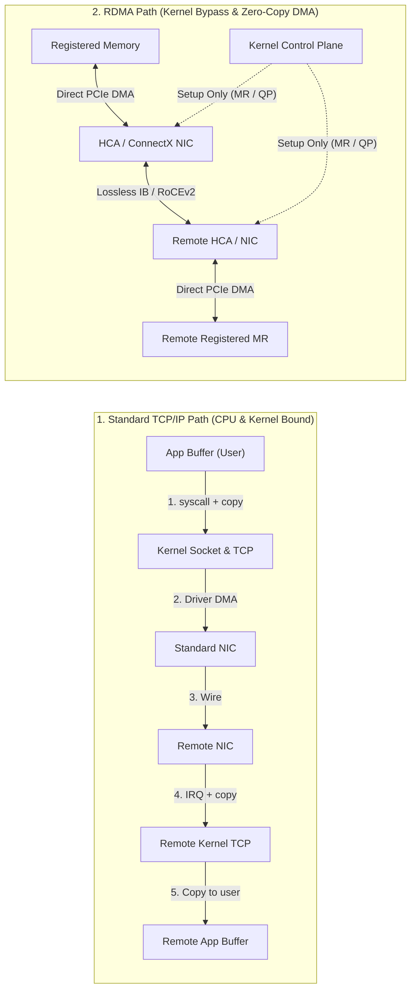
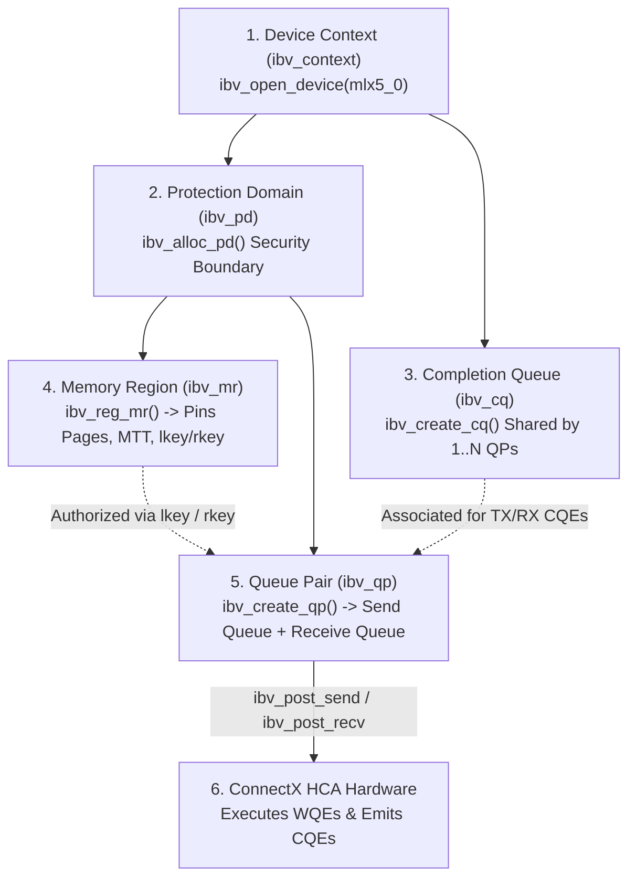
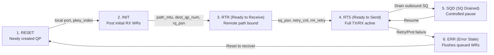

# 12.2 RDMA fundamentals: verbs, queue pairs and memory registration

| | |
|---|---|
| Level | Intermediate |
| Priority tier | 1 |
| Lab venue | Nebius GPU |
| Part | Part 12: Complete AI networking |
| Sources used | `nvidia-devops` Volume 08 Ch 3, Ch 12, `index.md` & Labs 01–04; Volume 07 Ch 4; Volume 09 Ch 3; Legacy Volume 06 Ch 1; *AI Data Center Network Design and Technologies* Ch 1 & Ch 7; *Supercomputers for Linux SysAdmins* Ch 5 & Ch 24; *NVIDIA Base Command Manager 11 Installation & Administrator Manuals* |
| Coverage file | `planning/coverage/chapters/12-02.md` |
| Claim ledger | `planning/ledgers/12-02.md` |

## Why this matters for AI infrastructure

Every physical link on the fabric is Active at 400 Gbps, basic IP reachability succeeds across every node, and switches show zero drop counters. Yet the distributed training job still crashes at startup with a generic network timeout.

This failure happens repeatedly on multi-node GPU clusters when engineers treat Remote Direct Memory Access as a faster version of TCP sockets. In traditional socket programming, an application writes bytes to a file descriptor. The Linux kernel copies those bytes into kernel-space socket buffers, executes the TCP/IP state machine, and hands packets to the network interface card driver. That model hides the hardware behind the operating system. At 100 Gbps to 400 Gbps line rates across hundreds of GPUs, however, per-packet system calls, context switches, buffer copies, and software checksums saturate host CPUs. Synchronous collective operations force every GPU rank to wait at a barrier for the slowest rank. A single delayed transfer therefore stalls the entire training cluster through straggler amplification.

RDMA removes that software bottleneck by shifting transport execution into the Host Channel Adapter hardware through kernel bypass and zero-copy Direct Memory Access. Bypassing the kernel means the application and communication library become directly responsible for explicit hardware resources.

First, endpoint queue lifecycles can fail even when physical links are healthy. In the opening incident, the application created Queue Pairs on healthy ports. However, it failed to transition them through the required state machine with matching peer addresses and maximum transmission unit values. It also left Receive Queues unreplenished under burst traffic and discarded the detailed Completion Queue Entry error statuses. The software logged a generic network timeout when the hardware had explicitly reported a receiver-not-ready fault and a local protection error.

Second, locked-memory limits crash containers at startup. An RDMA adapter performs Direct Memory Access using physical memory addresses translated by its on-NIC Memory Translation Table. It cannot handle operating system page faults or swapped pages. In many containers, the Linux locked-memory limit remains at its 64 KiB default instead of unlimited. When the job tries to register gigabytes of host or GPU memory, memory registration fails before a single packet leaves the server.

Third, full-mesh Queue Pair counts hit a scaling wall on large clusters. Each active Queue Pair consumes scarce on-NIC static RAM cache for its context and work queues. Uncontrolled Queue Pair proliferation across thousands of GPUs triggers NIC cache thrashing over PCIe. Communication libraries avoid this bottleneck using shared transports, hierarchical rings and trees, or Dynamic Connected transport.

```text
Production Failure Signatures vs Hardware Reality (V8 Ch 3, V7 Ch 4, SCL Ch 24):
  - TCP/IP CPU Bottleneck:   100-node Ray cluster on 100GbE ConnectX-5 pins CPUs at 100% kernel system time, capping throughput at 30 Gbps
  - Endpoint Lifecycle Bug:  Active 400 Gbps ports fail INIT -> RTR when active_mtu mismatches (4096 vs 2048) or drop with IBV_WC_RNR_RETRY_EXC_ERR and IBV_WC_LOC_PROT_ERR
  - Container memlock Gate:  Default ulimit -l (memlock) of 64 KiB (65,536 bytes) blocks ibv_reg_mr() with ENOMEM unless set to unlimited
  - O(N^2) QP Scaling Wall:  128 nodes x 8 GPUs (1,024 ranks) in full-mesh RC requires 1,023 QPs/rank, 8,184 QPs/node, and 1,047,552 QPs cluster-wide
```

This chapter builds the complete RDMA execution model from first principles. We cover kernel bypass versus TCP/IP, the Verbs object hierarchy, Memory Translation Table math, Work Requests and Scatter-Gather Entries, two-sided versus one-sided operations, transport service types, the six-state Queue Pair state machine, wire-level packet headers, and endpoint troubleshooting.

:::tip In one minute
- **Why RDMA exists:** Standard TCP/IP forces every message through system calls, CPU context switches, user-to-kernel buffer copies, and software TCP processing. RDMA uses kernel bypass and zero-copy DMA so the Host Channel Adapter reads and writes registered memory directly. Small-message latency drops from tens of microseconds to low single-digit microseconds.
- **Core Verbs objects:**
  - **Device Context:** Opens the adapter and queries hardware limits such as maximum Queue Pairs, Work Requests, and active MTU.
  - **Protection Domain:** Acts as a security boundary grouping Queue Pairs and Memory Regions. A Queue Pair in Protection Domain A cannot access a Memory Region in Protection Domain B.
  - **Memory Region:** Pins virtual pages in physical RAM, programs the HCA Memory Translation Table, and returns a 32-bit local key and remote key. Backing a 1 GiB buffer with 2 MiB hugepages instead of 4 KiB pages shrinks MTT footprint by 512x.
  - **Queue Pair and Completion Queue:** Each Queue Pair holds a Send Queue and a Receive Queue. Applications post Work Requests with Scatter-Gather Entries, and the HCA writes Completion Queue Entries to the Completion Queue.
- **Two-sided vs one-sided operations:**
  - **Two-sided Send and Receive:** Requires the remote peer to pre-post a matching Receive Work Request. Starving the Receive Queue triggers a receiver-not-ready completion error.
  - **One-sided RDMA Write, Read, and Atomics:** Targets a remote virtual address and remote key encoded in the 16-byte RDMA Extended Transport Header, completely bypassing the remote CPU and Receive Queue.
- **Queue Pair state machine:** Every Queue Pair steps through RESET, INIT, RTR, and RTS before sending data. When a Queue Pair hits a transport failure, it transitions to ERR and flushes all subsequent queued work with a flush error status. Always debug the first non-flush completion entry.
:::

---

## Prerequisites and outcomes

**Prerequisites:** Review Linux networking and lossless QoS basics in Chapter 2.19, plus PCIe, NUMA, and pinned memory in Chapters 10.6 and 10.12. You should also know the NVIDIA Network Operator from Chapter 11.11 and AI collective traffic patterns from Chapter 12.1.

**Outcomes:** After completing this chapter, you will be able to:
1. Contrast the seven-step OS-mediated TCP/IP socket path against the RDMA kernel-bypass data path. You will separate control-plane setup from data-plane doorbell execution and hardware DMA.
2. Explain every core Verbs object: Device Context, Protection Domain, Memory Region, Queue Pair, Completion Queue, Work Request, Work Queue Element, and Scatter-Gather Entry. You will also interpret hardware capability limits before deploying workloads.
3. Calculate Memory Translation Table entry footprints across 4 KiB pages and 2 MiB hugepages. You will configure unlimited locked memory and diagnose local protection errors versus remote access errors.
4. Compare two-sided Send and Receive operations against one-sided RDMA Write, RDMA Read, and Atomic verbs. You will trace the 13-step RDMA Write and 11-step RDMA Read Connection Manager lifecycles and select between RC, UC, UD, and DC transport types.
5. Walk a Queue Pair through the six-state lifecycle and decode wire-level BTH, RETH, AETH, and ICRC packet captures. You will also isolate root-cause completion errors ahead of flush cascades.

---

## 1. Why TCP/IP Stalls AI Collectives and How RDMA Bypasses the Kernel

When a distributed training job synchronizes gradients across nodes, network latency and throughput directly govern Job Completion Time. Job Completion Time measures the total elapsed time from job start to job completion. Synchronous collective operations wait for every parallel worker to finish before advancing to the next layer or step. A single slow transfer therefore stalls the entire cluster.

```text
Tail Latency Impact on Job Completion Time (ADC Ch 1, Figs 1-4 to 1-6):
  - Serial Execution (n = 10 tasks):   9 tasks take 1 ms each + taskX takes 1 s (1,000 ms) -> Total JCT = 1 s + (10 x 1 ms) = 1.010 seconds
  - Parallel Execution (100 threads):  99 threads finish in 1 ms (< 100 ms), 1 straggler takes 1 s -> 99 threads wait 999 ms at barrier, pinning JCT at 1 second
```

### 1.1 The 7-step TCP/IP kernel penalty vs RDMA kernel bypass

Standard TCP/IP introduces high latency, jitter, and CPU saturation on 100 Gbps to 800 Gbps AI fabrics. This happens because the host CPU and operating system kernel mediate every packet. When an application sends a tensor over a standard Linux TCP socket, seven steps occur across the sender and receiver.

First, the application prepares payload bytes in user-space virtual memory. Second, the application invokes a send system call into the Linux kernel. Third, the CPU halts user-space execution and switches privilege rings into kernel mode. Fourth, the CPU copies payload bytes from the user-space buffer into kernel-space socket and transport buffers. Fifth, the CPU executes the TCP/IP stack to build headers, compute software checksums, manage congestion windows, and fragment packets. Sixth, the kernel signals the NIC driver over PCIe. Seventh, incoming packets on the destination server trigger hardware interrupts, kernel TCP reassembly, and another CPU copy into the receiving application buffer.

On a 10 Gbps web server, host CPUs absorb this overhead easily. On a 100 Gbps to 400 Gbps GPU cluster, millions of TCP packets arrive every second. Processing them pins host CPU cores at 100 percent kernel utilization and caps a 100 Gbps ConnectX-5 link around 30 Gbps.

Remote Direct Memory Access solves this bottleneck by combining two hardware mechanisms. First, Direct Memory Access lets the adapter hardware engine read and write physical host RAM or GPU BAR1 VRAM directly across the PCIe bus. No CPU copy loops are required. Second, kernel bypass and transport offload remove the operating system from the hot transfer path.

Under RDMA, the Linux kernel is invoked only during the control path. The kernel opens the device context, allocates a Protection Domain, pins and registers Memory Regions, and transitions Queue Pairs into the connected state. Once setup is complete, the data path bypasses the operating system kernel on both endpoints. The application writes a descriptor directly to a memory-mapped hardware doorbell register in user space. The local HCA reads the buffer via DMA, encapsulates packets in silicon, and transmits them across the fabric. The remote HCA then writes the payload straight into the destination registered physical memory without waking the remote kernel.



| Architectural Layer | Standard TCP/IP Socket Stack | RDMA Verbs Stack (`InfiniBand` / `RoCEv2`) | Operational Impact on AI Workloads |
|---|---|---|---|
| **Control Path Setup** | `socket()`, `bind()`, `connect()` in kernel | `ibv_open_device()`, `ibv_alloc_pd()`, `ibv_reg_mr()`, `ibv_create_qp()`, `ibv_modify_qp()` via `/dev/infiniband/uverbsN` | Kernel validates permissions, pins pages, and configures HCA contexts once at startup |
| **Per-Message Submission** | `send()` / `recv()` system call per message | User-space `ibv_post_send()` / `ibv_post_recv()` ring MMIO doorbell directly | **Zero system calls** and **zero context switches** on the hot data path |
| **Memory Copy Path** | User buffer -> Kernel Socket Buffer -> Kernel Transport Buffer -> NIC (and reverse on RX) | Direct hardware DMA between registered application buffer (or GPU VRAM) and HCA | **Zero CPU bounce-buffer copies**; frees host CPUs for data loading and kernel launches |
| **Transport & Reliability** | Executed in software by host CPU threads (`TCP` sliding window, timers, ACKs) | Executed in silicon on the HCA (`PSN` tracking, hardware `ACK`/`NAK`, hardware retry) | Small-message latency drops from tens of microseconds to **low single-digit microseconds** (`~0.78–1.08 us` MPI PingPong) |
| **Fabric Requirement** | Tolerates lossy Ethernet via software TCP selective retransmission | Expects lossless or near-lossless fabric (InfiniBand link-layer credits or RoCEv2 with `PFC` + `ECN`/`DCQCN`) | Packet drops trigger hardware Go-Back-N or retry stalls unless fabric congestion control is active |

### 1.2 The five node-local RDMA layers and three RDMA transport protocols

When a collective operation hangs or drops throughput, engineers need to know which layer owns each stage of an RDMA transfer. Within each server node, RDMA communication flows through five distinct layers from the application down to the physical cable.

First, the application or collective library such as NCCL, MPI, or UCX generates work requests for tensor buffers. Second, the Verbs API in `libibverbs` exposes standardized C functions to manage resources, post work, and poll completions. Third, the provider and kernel driver (`mlx5_ib`, `ib_uverbs`, and `ib_core`) translate user-space verbs into hardware Work Queue Elements and manage address translation tables. Fourth, the Host Channel Adapter hardware executes DMA, packet segmentation, sequence numbering, invariant CRC generation, and hardware acknowledgements. Fifth, the physical wire transmits frames across copper or optical links.

Across the wire, three RDMA transport protocols exist. InfiniBand is governed by the InfiniBand Trade Association. It uses a native credit-based lossless link layer, an optional network layer for inter-subnet routing, and the InfiniBand transport layer. RDMA over Converged Ethernet defines two versions. RoCEv1 runs directly over Ethernet Layer 2 with EtherType `0x8915` and is confined to a single broadcast domain. RoCEv2 replaces the InfiniBand network layer with standard IPv4 or IPv6 and UDP destination port 4791. Immediately after the UDP header come the 12-byte InfiniBand Base Transport Header, payload, 4-byte Invariant CRC, and 4-byte Ethernet Frame Check Sequence. The UDP source port is hashed from the Queue Pair Number to provide ECMP routing entropy across spine switches. Finally, iWARP runs RDMA over hardware-offloaded TCP/IP. That design avoids lossless Ethernet requirements at the cost of higher latency and hardware complexity.

```text
InfiniBand Link Generations, Coding, and Addressing Specs (SCL Ch 5 Table 5-1, ADC Ch 1):
  - SDR (8b/10b):    2.5 Gbps per lane  |   8 Gbps effective (4x) |    24 Gbps (12x)
  - DDR (8b/10b):    5.0 Gbps per lane  |  16 Gbps effective (4x) |    48 Gbps (12x)
  - QDR (8b/10b):   10.0 Gbps per lane  |  32 Gbps effective (4x) |    96 Gbps (12x)
  - FDR (64b/66b):  14.0625 Gbps/lane   |  54.4 Gbps (4x)         |   163.2 Gbps (12x)
  - EDR (64b/66b):  25.0 Gbps per lane  | 100 Gbps effective (4x)
  - HDR (64b/66b):  53.125 Gbps/lane    | 200 Gbps effective (4x) |   600 Gbps (12x)
  - NDR (256b/257b): 106.25 Gbps/lane   | 400 Gbps effective (4x) | 1,200 Gbps (12x)
  - XDR:            200 Gbps per lane   | 800 Gbps effective (4x) | 2,400 Gbps (12x)
  - GDR:            400 Gbps per lane   | 1,600 Gbps (4x)         | 4,800 Gbps (12x)
  - IB Encapsulation: LRH (8 B) + optional GRH (40 B) + BTH (12 B) + Payload + ICRC (4 B) + VCRC (2 B)
  - IB Subnet Scale:  Up to 2^15 + 2^14 - 1 = 49,151 ports/switches (16-bit LIDs: unicast 1..0xBFFF, multicast 0xC000..0xFFFE, permissive 0xFFFF)
  - RoCEv1 vs RoCEv2: RoCEv1 uses L2 EtherType 0x8915; RoCEv2 uses IPv4/IPv6 + UDP dst port 4791 + BTH (12 B) + Payload + ICRC (4 B) + FCS (4 B)
  - iWARP Stack:      RDMA over hardware-offloaded TCP/IP (MPA / DDP / RDMAP)
```

---

## 2. The Verbs Object Hierarchy and Capability Inspection

If an application requests more Queue Pairs, Work Requests, or Scatter-Gather Entries than the network adapter supports, resource allocation fails immediately at job startup. Before posting a single RDMA operation, software must construct a strict hierarchy of hardware-backed resource objects through the Verbs interface and verify hardware limits.



| Verbs Object (`libibverbs`) | Creation API | Hardware / Kernel Function | Key Attributes & Limits (`mlx5_0` Example) |
|---|---|---|---|
| **Device Context (`ibv_context`)** | `ibv_open_device()` | Opens `/dev/infiniband/uverbsN` and maps user-space doorbell pages | Queried via `ibv_query_device()` / `ibv_devinfo -v` (`fw_ver: 28.39.2048`, `vendor_id: 0x02c9`, `vendor_part_id: 4129`) |
| **Protection Domain (`ibv_pd`)** | `ibv_alloc_pd()` | Hardware isolation container binding compatible `QPs` and `MRs` | Prevents a `QP` in `PD A` from performing DMA against an `MR` in `PD B` |
| **Memory Region (`ibv_mr`)** | `ibv_reg_mr()` | Pins virtual pages in physical RAM, populates NIC `MTT`, issues DMA keys | Returns `lkey` (`32`-bit local key) and `rkey` (`32`-bit remote key); `max_mr: 16777216`, `max_mr_size: 0xffffffffffffffff` |
| **Completion Queue (`ibv_cq`)** | `ibv_create_cq()` | Ring buffer where the HCA writes `64`-byte Completion Queue Entries (`CQEs`) | Polled via `ibv_poll_cq()` or armed via `ibv_req_notify_cq()`; `max_cq: 16777216`, `max_cqe: 4194303` |
| **Queue Pair (`ibv_qp`)** | `ibv_create_qp()` | Transport endpoint containing a **Send Queue (`SQ`)** and **Receive Queue (`RQ`)** | Identified by `24`-bit `qp_num` (`QPN`); `max_qp: 262144`, `max_qp_wr: 32768`, `max_sge: 30` |

### 2.1 Answering the seven capability questions before writing code

Production software must query adapter capabilities rather than hard-coding assumptions. Consider the output of `ibv_devinfo -v -d mlx5_0` from an NVIDIA ConnectX-7 HCA with vendor part ID 4129 (`MT4129`) and vendor ID `0x02c9`:

```text
$ ibv_devinfo -v -d mlx5_0
hca_id: mlx5_0
    transport:                  InfiniBand (0)
    fw_ver:                     28.39.2048
    node_guid:                  08c0:eb03:00f1:a2c3
    sys_image_guid:             08c0:eb03:00f1:a2c3
    vendor_id:                  0x02c9
    vendor_part_id:             4129
    max_mr_size:                0xffffffffffffffff
    max_qp:                     262144
    max_qp_wr:                  32768
    max_sge:                    30
    max_cq:                     16777216
    max_cqe:                    4194303
    max_mr:                     16777216
    atomic_cap:                 ATOMIC_HCA (1)
        port:   1
            state:              PORT_ACTIVE (4)
            max_mtu:            4096 (5)
            active_mtu:         4096 (5)
            phys_state:         LINK_UP (5)
            link_layer:         InfiniBand
```

Every field in this output directly constrains application and collective-library design. First, `max_qp` caps how many total Queue Pairs can exist on the adapter at 262,144. Second, `max_qp_wr` bounds the depth of any single Send Queue or Receive Queue at 32,768. Any application requesting 100,000 outstanding work requests on one Queue Pair will fail queue creation immediately. Third, `max_sge` bounds how many discontiguous local memory segments a single Work Request can gather or scatter at 30. Passing 32 Scatter-Gather Entries triggers a local work-request submission failure.

Fourth, `max_cq` and `max_cqe` determine how many Queue Pairs can share a single Completion Queue without overflowing its ring buffer. Fifth, `max_mr` and `max_mr_size` bound the number and size of registered memory buffers on the adapter. Sixth, `atomic_cap` confirms whether hardware 64-bit Compare-and-Swap and Fetch-and-Add operations are supported on the HCA. Seventh, `state`, `phys_state`, and `active_mtu` verify link readiness and negotiated payload size. Suppose one endpoint has an active MTU of 4096 and its peer has 2048. Requesting a 4096-byte path MTU during connection setup causes `ibv_modify_qp` to fail the INIT to RTR transition with `EINVAL`. That failure occurs even though both ports report `PORT_ACTIVE`.

---

## 3. Protection Domains, Memory Registration, Keys, and MTT Math

A common misconception among software engineers is that an RDMA NIC can read or write any standard pointer returned by a memory allocator. If an application passes an unregistered pointer to an RDMA work request, the hardware immediately halts the Queue Pair with a local protection error.

### 3.1 What memory registration actually does in the kernel and on the NIC

When a CPU dereferences a virtual address, the CPU Memory Management Unit walks the process page tables in hardware. If the page is not resident in physical RAM, the CPU raises a page fault. The Linux kernel then allocates a physical frame, updates the page table, and resumes the instruction.

An RDMA HCA performing line-rate DMA across PCIe cannot stall the wire to wait for Linux kernel page faults. It also cannot risk writing incoming network packets to a physical RAM frame that the operating system silently reassigned to another process. Calling `ibv_reg_mr` therefore executes four mandatory steps in the kernel and on the adapter.

First, the kernel pins the virtual pages backing the buffer in physical RAM or maps GPU BAR1 physical pages via `nvidia-peermem` or `dma-buf`. Pinning guarantees that the operating system can never swap or relocate those pages while the Memory Region exists.

Second, Linux enforces the locked-memory quota against the user process. Because pinned pages cannot be paged out by the operating system, Linux accounts them against `RLIMIT_MEMLOCK` via `ulimit -l`. On an unconfigured Linux host or container, that limit defaults to 64 KiB. Attempting to register a 128 KiB buffer under a 64 KiB limit causes `ibv_reg_mr` to fail with `ENOMEM`. On every HPC and AI compute node, `/etc/security/limits.conf` and container security contexts must set both soft and hard `memlock` limits to `unlimited`:

```text
# /etc/security/limits.conf (SCL Ch 24, V8 Ch 3)
# Default unconfigured Linux ulimit -l is 64 KiB (65,536 bytes); registering 128 KiB (131,072 bytes) fails with IBV_REG_MR_ENOMEM_MEMLOCK
* soft memlock unlimited
* hard memlock unlimited
```

Third, the driver programs the HCA Memory Translation Table. It writes the virtual-to-physical page mappings into the adapter. The NIC hardware uses those entries to translate virtual addresses in incoming headers or local descriptors into PCIe physical DMA addresses.

Fourth, the HCA issues hardware protection keys. It binds the Memory Region to the specified Protection Domain and stores the authorized access flags. Those flags include `IBV_ACCESS_LOCAL_WRITE`, `IBV_ACCESS_REMOTE_WRITE`, `IBV_ACCESS_REMOTE_READ`, and `IBV_ACCESS_REMOTE_ATOMIC`. The call then returns two 32-bit capability tokens. The local key (`lkey`) must be supplied in every local Scatter-Gather Entry so the local HCA verifies Protection Domain membership and buffer bounds. The remote key (`rkey`) is exchanged out-of-band with a remote peer. The peer includes that remote key alongside the virtual address and DMA length in one-sided RDMA packets.

### 3.2 MTT page-table scaling math and NIC cache thrashing

Even when memory registration succeeds, registering tens of gigabytes of standard 4 KiB pages can silently degrade multi-node training bandwidth. Each page pinned in a Memory Region requires an 8-byte physical address entry in the HCA Memory Translation Table.

```text
Memory Translation Table (MTT) Scaling Math (code/part12/rdma_fundamentals.py):
  Number of Pinned Pages = ceil(Buffer_Bytes / Page_Size_Bytes)
  MTT_Table_Bytes        = Number of Pinned Pages * 8 bytes (64-bit entry)

  Case 1: 64 KiB (65,536 B = 0x00010000) DMA buffer on 4 KiB (4,096 B) pages:
    65,536 / 4,096 = 16 pinned pages -> 16 x 8 B = 128 bytes of MTT entries

  Case 2: 1 GiB (1,073,741,824 B) tensor buffer on 4 KiB (4,096 B) pages:
    1,073,741,824 / 4,096 = 262,144 pinned pages -> 262,144 x 8 B = 2,097,152 bytes (2 MiB of MTT entries per GiB)

  Case 3: 1 GiB (1,073,741,824 B) tensor buffer on 2 MiB (2,097,152 B) hugepages:
    1,073,741,824 / 2,097,152 = 512 pinned hugepages -> 512 x 8 B = 4,096 bytes (4 KiB of MTT entries per GiB -> 512x reduction)
```

This 512x reduction directly impacts production tail latency. ConnectX HCAs cache hot MTT entries and Queue Pair contexts in a small, fast on-NIC SRAM cache called Interconnect Context Memory. When a node registers tens of gigabytes of fragmented 4 KiB pages, the MTT working set overflows that on-chip SRAM cache. Every cache miss forces the HCA to fetch MTT page translations across the host PCIe bus before it can DMA the actual tensor payload. Backing large host buffers with 2 MiB or 1 GiB hugepages and reusing a pre-registered buffer pool eliminates both registration latency and NIC MTT cache misses.

### 3.3 Protection Domain and Memory Region failure semantics

When an application violates Protection Domain isolation, key permissions, or registered address bounds, the hardware halts the transfer immediately. The table below summarizes where each violation is caught and which completion status is reported.

| Violation Type | Where Detected | Completion Queue Status (`ibv_wc_status`) | Root Cause |
|---|---|---|---|
| **Local `PD` Mismatch** | Local HCA before wire transmission | **`IBV_WC_LOC_PROT_ERR`** | QP belongs to `Protection Domain A`, but SGE references an `lkey` registered in `Protection Domain B` |
| **Local Out-of-Bounds / Invalid `lkey`** | Local HCA before wire transmission | **`IBV_WC_LOC_PROT_ERR`** or **`IBV_WC_LOC_LEN_ERR`** | Local SGE `addr + length` exceeds the registered MR bounds, or `MR` was prematurely deregistered (`ibv_dereg_mr`) while a WQE was still in flight |
| **Remote Invalid `rkey` / Missing Flag / Out-of-Bounds** | Remote HCA upon inspecting incoming `RETH` header; returns `NAK` (`AETH`) to initiator | **`IBV_WC_REM_ACCESS_ERR`** on initiator `CQ` | Initiator supplied a stale/wrong `rkey`, accessed `offset + length > buffer_bytes` (e.g., `32,768 + 65,536 > 65,536`), or targeted an MR registered without `IBV_ACCESS_REMOTE_WRITE` / `IBV_ACCESS_REMOTE_READ` |

---

## 4. Work Requests, SGEs, Operation Types, and Transport Services

Posting RDMA operations without understanding completion signaling or Receive Queue replenishment causes either silent Send Queue overflows or receiver-not-ready crashes. Engineers must match work request flags, verb semantics, and transport service types to the communication pattern of the workload.

### 4.1 Work Requests, Work Queue Elements, and Scatter-Gather Entries

An application submits work by constructing a Send or Receive Work Request structure (`struct ibv_send_wr` or `struct ibv_recv_wr`). It then passes that structure to `ibv_post_send` or `ibv_post_recv`. The user-space provider driver translates the software Work Request into a hardware Work Queue Element descriptor inside the Queue Pair ring buffer and rings the HCA doorbell.

Each Work Request contains four essential fields. First, `wr_id` is an application-defined 64-bit tag such as `1042` or a context pointer. The HCA echoes that tag verbatim in the resulting Completion Queue Entry. Second, `opcode` selects the verb operation such as `IBV_WR_SEND`, `IBV_WR_RDMA_WRITE`, `IBV_WR_RDMA_WRITE_WITH_IMM`, `IBV_WR_RDMA_READ`, `IBV_WR_ATOMIC_CMP_AND_SWP`, or `IBV_WR_ATOMIC_FETCH_AND_ADD`. Third, `sg_list` and `num_sge` specify an array of Scatter-Gather Entries (`struct ibv_sge`), where each entry holds a buffer address, byte length, and local key. A single Work Request can gather a protocol header, a tensor chunk, and trailing metadata from separate buffers into one wire transfer. That capability avoids copying discontiguous segments into a staging buffer first.

Fourth, `send_flags` control completion generation and inline payload handling. Setting `IBV_SEND_SIGNALED` instructs the HCA to generate a Completion Queue Entry when the request completes. To reduce Completion Queue pressure and PCIe DMA overhead, high-performance libraries post unsignaled requests for most sends. They mark only every 16th, 32nd, or 64th request as signaled. Reliable Connected queues complete work in strict FIFO order. Consuming the completion for request 64 therefore proves that requests 1 through 63 have also completed and their Send Queue slots can be reused. Never post more than `max_qp_wr` unsignaled requests without a signaled request. Doing so overflows the Send Queue silently because no completion ever arrives to free descriptors. For tiny payloads up to 64 or 256 bytes, setting `IBV_SEND_INLINE` copies the payload directly into the WQE descriptor when ringing the doorbell, saving a separate PCIe DMA read.

### 4.2 Two-sided Send and Receive vs one-sided RDMA Write, Read, and Atomics

RDMA verbs divide into two-sided channel operations and one-sided memory operations. Understanding whether the remote CPU and Receive Queue participate in the transfer is critical for debugging hangs and data corruption.

| Operation Type | Remote Receive WQE Required? | Remote CPU Involved in Data Path? | Wire Headers (`IB` / `RoCEv2`) | Primary AI / HPC Use Case & Operational Risk |
|---|---|---|---|---|
| **1. `Send` / `Receive` (Two-Sided Channel Semantics)** | **Yes** (Remote peer must pre-post `ibv_post_recv` before packet arrives) | Only to post RX buffer and poll RX `CQE` | `BTH` (`12` B) + Payload + `ICRC` (`4` B) | Control messages, RPC headers, and metadata exchange. **Risk:** If the receiver's `RQ` runs empty under a burst, the remote HCA returns an **RNR NAK**, eventually failing the sender with **`IBV_WC_RNR_RETRY_EXC_ERR`**. |
| **2. `RDMA Write` (One-Sided Memory Push)** | **No** (Unless using `WRITE_WITH_IMM`, which consumes 1 RX WQE for `32`-bit immediate notification) | **Zero** (Completely silent to remote CPU unless notified separately) | First packet: `BTH` (`12` B) + **`RETH` (`16` B)** + Payload + `ICRC` (`4` B); Middle/Last: `BTH` + Payload + `ICRC` | Bulk gradient/activation streaming (`NCCL` Ring/Tree channels, `ib_write_bw`). **Nuance:** An initiator's local `RDMA_WRITE` `CQE` proves the remote HCA acknowledged placement into remote RAM/VRAM—it does *not* prove the remote application noticed the data without a separate flag, immediate value, or follow-up `Send`. |
| **3. `RDMA Read` (One-Sided Memory Pull)** | **No** | **Zero** | Request: `BTH` (`12` B) + **`RETH` (`16` B)** + `ICRC` (`4` B) (`32` B total); Response: `BTH` + (`AETH` on First/Last/Only) + Payload + `ICRC` | Storage target pulls (`NVMe-oF`, `NFS-RDMA`) and KV-cache / parameter pulls. |
| **4. `Atomics` (`CAS` / `FAA`)** | **No** | **Zero** | Request: `BTH` (`12` B) + `AtomicETH` (`28` B) + `ICRC` (`4` B); Response: `BTH` + `AtomicAckETH` + `ICRC` | Distributed locks, queue-tail pointers, and barrier counters (`64`-bit aligned; requires `atomic_cap: ATOMIC_HCA`). |

### 4.3 Tracing the 13-step RDMA Write and 11-step RDMA Read CM sessions

Before one-sided RDMA Write or RDMA Read packets can cross the fabric, the endpoints must establish a Queue Pair connection and exchange target memory coordinates. An RDMA Connection Manager session accomplishes this in three distinct phases: connection handshake, data transfer, and connection teardown.

In an RDMA Write session, the client and server exchange 13 messages across the three phases. First, the three-step Connection Manager handshake connects the Queue Pairs. Next, the data exchange takes six steps because the client sends transfer size and address metadata followed by memory region metadata before pushing the one-sided RDMA Write payload. In an RDMA Read session, the session completes in 11 steps. The client combines the transfer size, remote address, and memory region information into a single RDMA Read Request message, and the server responds directly with the requested data payload.

```text
RDMA Connection Manager (CM) Session Sequences (trace_rdma_cm_session_steps in code/part12/rdma_fundamentals.py, ADC Ch 1 Figs 1-12 & 1-13):

1. 13-Step RDMA Write Session (3 Handshake + 6 RDMA Write + 4 Terminate):
   Phase 1 — CM Handshake (3 steps):
     Step 1 (Client -> Server): CM: Connect request with client QPN
     Step 2 (Server -> Client): CM: Connect reply with server QPN
     Step 3 (Client -> Server): CM: Ready to use (Connection established)
   Phase 2 — RDMA Write Exchange (6 steps):
     Step 4 (Client -> Server): Transfer size and remote address information
     Step 5 (Server -> Client): Acknowledgement
     Step 6 (Client -> Server): Memory region information
     Step 7 (Server -> Client): Acknowledgement
     Step 8 (Client -> Server): Data (One-sided RDMA Write payload pushed directly to server memory)
     Step 9 (Server -> Client): Acknowledgement
   Phase 3 — CM Teardown (4 steps):
     Step 10 (Client -> Server): CM: Disconnect request with server QPN
     Step 11 (Server -> Client): CM: Disconnect reply
     Step 12 (Client -> Server): CM: Disconnect request with client QPN
     Step 13 (Server -> Client): CM: Disconnect reply

2. 11-Step RDMA Read Session (Client 20.0.0.2 and Server 60.0.0.2: 3 Handshake + 4 RDMA Read + 4 Terminate):
   Phase 1 — CM Handshake (3 steps):
     Step 1 (20.0.0.2 -> 60.0.0.2): CM: Connect request with client QPN
     Step 2 (60.0.0.2 -> 20.0.0.2): CM: Connect reply with server QPN
     Step 3 (20.0.0.2 -> 60.0.0.2): CM: Ready to use (Connection established)
   Phase 2 — RDMA Read Exchange (4 steps):
     Step 4 (Client -> Server): Transfer size, remote address, and memory region information (RDMA READ Request, BTH opcode 12 + RETH)
     Step 5 (Server -> Client): Acknowledgement
     Step 6 (Server -> Client): Data (RDMA READ Response, BTH opcode 13/14/15/16 carrying server memory payload back to client)
     Step 7 (Client -> Server): Acknowledgement
   Phase 3 — CM Teardown (4 steps):
     Step 8  (Client -> Server): CM: Disconnect request with server QPN
     Step 9  (Server -> Client): CM: Disconnect reply
     Step 10 (Server -> Client): CM: Disconnect request with client QPN
     Step 11 (Client -> Server): CM: Disconnect reply
```

### 4.4 Transport Service Types and Queue Pair Scaling Math

When creating a Queue Pair, the application selects a transport service type that governs reliability, ordering, supported verbs, and cluster-wide scaling. Choosing full-mesh Reliable Connected Queue Pairs for an all-to-all workload on a large GPU cluster causes quadratic Queue Pair growth and NIC SRAM cache thrashing.

| Transport Code | Full Name | Connection Model | Reliable (ACK / Retry)? | Ordered? | Supported Verbs | QPs per Rank for `N` Peers |
|---|---|---|---|---|---|---|
| **`RC`** | **Reliable Connected** | `1:1` dedicated logical peer QP per local QP | **Yes** (`PSN` + `AETH` `ACK`/`NAK`) | **Yes** | `Send`/`Recv`, `RDMA Write`, `RDMA Read`, `Atomics` | **`N - 1`** (`O(N^2)` cluster-wide) |
| **`UC`** | **Unreliable Connected** | `1:1` dedicated peer QP (no `ACK` or retransmission) | **No** (corrupted/lost packets dropped silently) | **Yes** | `Send`/`Recv`, `RDMA Write` *(No Read or Atomics)* | **`N - 1`** (`O(N^2)` cluster-wide) |
| **`UD`** | **Unreliable Datagram** | `1:M` connectionless; addressed per WQE via an **Address Handle (`AH`)** | **No** | **No** | `Send`/`Recv` only (`<= 1 MTU` payload + `40`-byte `GRH`) | **`1`** (single QP reaches any peer; supports multicast) |
| **`DC`** | **Dynamic Connected** *(Mellanox/NVIDIA extension)* | `1:M` reliable connected; a **DC Initiator (`DCI`)** dynamically connects to any remote **DC Target (`DCT`)** per packet burst | **Yes** | **Yes** | `Send`/`Recv`, `RDMA Write`, `RDMA Read`, `Atomics` | **`O(1)`** small pool of `DCI` QPs per process |

```text
Worked O(N^2) RC Queue Pair Scaling Calculation (evaluate_qp_scaling_and_perftest in code/part12/rdma_fundamentals.py):
  Cluster Configuration:     128 GPU nodes x 8 GPUs per node = 1,024 total GPU ranks (N = 1,024)
  RC QPs per GPU rank:       N - 1 = 1,024 - 1               = 1,023 RC QPs per rank
  RC QPs per 8-GPU node:     8 x 1,023                       = 8,184 RC QPs per node (vs mlx5_0 max_qp: 262144)
  Total cluster-wide RC QPs: 1,024 x 1,023                   = 1,047,552 RC QPs across the cluster
```

While 8,184 Queue Pairs per node fits below the hard `max_qp` ceiling of 262,144 on a single adapter, scaling to thousands of nodes with multiple Queue Pairs per peer pushes each node past hardware limits. Long before hitting that hard ceiling, large active Queue Pair counts exhaust the HCA Interconnect Context Memory SRAM cache. That cache exhaustion degrades throughput due to PCIe context-fetch thrashing. Production communication libraries avoid full-mesh explosion by using Ring and Tree topologies where each rank connects only to a few neighbors. They also use Shared Receive Queues or Dynamic Connected transport for all-to-all Mixture-of-Experts communication.

---

## 5. Queue Pair State Machine, Completion Queues, and Wire-Level Packet Headers

A newly created Queue Pair cannot transmit or receive packets immediately. Engineers who skip a required state transition or supply mismatched MTU or GID attributes during connection setup face immediate `EINVAL` failures from the kernel verbs provider even when physical links are up.

### 5.1 The 6-state Queue Pair lifecycle

Every Queue Pair starts in the RESET state after `ibv_create_qp` and must step through a strict hardware state machine via `ibv_modify_qp` calls. In the INIT state, the application binds the local port and Partition Key and can pre-post initial Receive Work Requests, although wire packets are not yet accepted. Transitioning to Ready to Receive binds the remote destination Queue Pair number, remote address handle, starting receive Packet Sequence Number, and path MTU. Transitioning to Ready to Send configures the starting send Packet Sequence Number, ACK timeout, and retry counters so full bidirectional transfers can begin.



| QP State | Valid Next States | Mandatory `ibv_modify_qp()` Attributes | Operational Behavior & Failure Signature |
|---|---|---|---|
| **1. `RESET`** | `INIT` | None at creation | Queues are empty; posting `send` or `recv` WRs is rejected immediately. Skipping straight from `RESET -> RTS` fails with `EINVAL`. |
| **2. `INIT`** | `RTR`, `ERR`, `RESET` | `port_num >= 1`, `pkey_index >= 0` (`0xFFFF` default `P_Key`), `qp_access_flags` | **Receive WRs (`ibv_post_recv`) can now be pre-posted**, though packets are not yet accepted from the wire. |
| **3. `RTR` (Ready to Receive)** | `RTS`, `ERR`, `RESET` | `path_mtu` (`256`, `512`, `1024`, `2048`, or `4096`), `dest_qp_num` (`> 0`), `rq_psn` (`24`-bit starting RX PSN), `ah_attr` (peer `dlid` or `dgid` + `sgid_index`, `sl`) | Binds the QP to its remote peer and path. **Fails with `Failed to modify QP to RTR` (`EINVAL`)** if `requested_path_mtu` (`4096`) exceeds `local_active_mtu` (`2048`) or if RoCEv2 GID index (`-x 2`) fails handshake (`QPN 0x0000`). |
| **4. `RTS` (Ready to Send)** | `SQD`, `ERR`, `RESET` | `sq_psn` (`24`-bit starting TX PSN), `timeout` (`5`-bit local ACK timer), `retry_cnt` (`0..7`), `rnr_retry` (`0..7`), `max_rd_atomic` | Full bidirectional Send/Receive and one-sided RDMA Write/Read/Atomic execution active. |
| **5. `SQD` (Send Queue Drained)** | `RTS`, `ERR`, `RESET` | Drain notification | Halts new outbound sends while in-flight WQEs complete cleanly so path attributes can be modified safely. |
| **6. `ERR` (Error State)** | `RESET` | Triggered automatically by HCA on fatal WQE / retry failure | Immediately halts wire transmission and drains all remaining queued WQEs into the `CQ` with status **`IBV_WC_WR_FLUSH_ERR`**. Must transition `ERR -> RESET` (or destroy/recreate QP) before reuse. |

### 5.2 Completion Queue semantics, busy polling vs events, and flush cascades

When an RDMA transfer fails in production, operators are often flooded with hundreds of `IBV_WC_WR_FLUSH_ERR` log lines and mistakenly assume the entire network fabric collapsed. Understanding how the HCA generates Completion Queue Entries and flushes errored queues prevents hours of misdirected debugging.

When the HCA finishes processing a signaled Work Queue Element, it writes a 64-byte Completion Queue Entry into the Completion Queue via DMA. It also writes a completion entry whenever a local or remote transport error occurs, even on an unsignaled element. Applications consume those entries using one of two mechanisms.

Under busy polling with `ibv_poll_cq`, a dedicated thread spins in user space checking the Completion Queue ring buffer in host RAM. Busy polling delivers sub-microsecond wake-up latency and deterministic 99th-percentile tail latency. For that reason, NCCL proxy threads and `perftest` benchmarks busy-poll by default, pinning 100 percent of that CPU core. Under event-driven completion with `ibv_req_notify_cq` and `ibv_get_cq_event`, the application arms the Completion Queue doorbell and sleeps on a file descriptor until the HCA fires an MSI-X interrupt. Event mode saves CPU cycles during idle periods, but incurs 5 to 15 microseconds of kernel interrupt and thread wake-up latency. Production storage and RPC engines often use hybrid polling by spinning briefly before arming interrupts.

Consider the following captured sequence of five completions from `ibv_poll_cq`:

```text
wr_id=1042  status=IBV_WC_SUCCESS          opcode=RDMA_WRITE
wr_id=1043  status=IBV_WC_RETRY_EXC_ERR    opcode=RDMA_WRITE   vendor_err=0x81
wr_id=1044  status=IBV_WC_WR_FLUSH_ERR     opcode=RDMA_WRITE
wr_id=1045  status=IBV_WC_WR_FLUSH_ERR     opcode=SEND
wr_id=1046  status=IBV_WC_WR_FLUSH_ERR     opcode=SEND
```

Why do requests 1044, 1045, and 1046 all report `IBV_WC_WR_FLUSH_ERR`? Because request 1043 is the root cause. The local HCA transmitted `RDMA_WRITE` request 1043 and exhausted all 7 hardware retransmission attempts without receiving a valid ACK from the peer. It then reported `IBV_WC_RETRY_EXC_ERR` with vendor error `0x81` and NCCL error 12. The instant request 1043 failed, the HCA transitioned the Queue Pair into the ERR state and automatically flushed every subsequent queued work request with `IBV_WC_WR_FLUSH_ERR`. Never waste time debugging flushed requests; always isolate the first non-success, non-flush completion entry.

Similarly, never call `ibv_dereg_mr` or free a buffer while a Queue Pair can still perform DMA against it. The mandatory lifecycle order is listed below:

```text
Mandatory 9-Step RDMA Resource Lifecycle and Safe Teardown Order (V8 Ch 3):
  1. Open & Query Device (ibv_open_device, ibv_query_device)
  2. Allocate PD & CQ    (ibv_alloc_pd, ibv_create_cq)
  3. Register Memory     (ibv_reg_mr -> pins pages, programs MTT, issues lkey/rkey)
  4. Create QP           (ibv_create_qp in RESET state)
  5. Transition QP       (ibv_modify_qp: RESET -> INIT -> RTR -> RTS)
  6. Post Work & Poll    (ibv_post_send / ibv_post_recv, drain CQEs via ibv_poll_cq)
  7. Quiesce New Work    (stop posting new WRs)
  8. Drain or Flush Work (transition QP to ERR/RESET and consume all remaining CQEs)
  9. Destroy Resources   (ibv_destroy_qp FIRST, then ibv_dereg_mr, then ibv_destroy_cq, then ibv_dealloc_pd)
```

### 5.3 Wire-level packet headers: BTH, RETH, AETH, and ICRC

When endpoint logs are inconclusive, network engineers capture packets on the wire to inspect sequence numbers, opcodes, virtual addresses, and acknowledgement syndromes. Whether carried over native InfiniBand or RoCEv2 on UDP destination port 4791, every RDMA packet shares the same InfiniBand transport headers.

The Base Transport Header is 12 bytes long and appears in every RDMA packet. It carries the 8-bit Opcode, Solicited Event bit, Migration Request bit, Pad Count, Transport Header Version, 16-bit Partition Key, 24-bit Destination Queue Pair number, Acknowledge Request bit, and 24-bit Packet Sequence Number. The receiving HCA uses that 24-bit sequence counter in hardware to detect missing, duplicate, or out-of-order packets.

The RDMA Extended Transport Header is 16 bytes long and appears only on the first or only packet of an RDMA Write and on an RDMA Read Request. It carries the 64-bit target Virtual Address, the 32-bit Remote Key, and the 32-bit DMA Length.

The ACK Extended Transport Header is 4 bytes long and appears on RC Acknowledge packets and on the first, last, or only packet of an RDMA Read Response. It carries an 8-bit Syndrome indicating either a positive ACK with credit count or a specific NAK reason, followed by a 24-bit Message Sequence Number. Every packet concludes with a 4-byte Invariant CRC covering all fields that do not change in transit from source HCA to destination HCA.

```text
RDMA Transport Header Layout and Opcode Reference (decode_rdma_transport_headers in code/part12/rdma_fundamentals.py, ADC Ch 1 & Ch 7):
  - BTH (12 bytes, every RDMA packet):
      Opcode (8 bits): 12 (0x0c) = RC RDMA READ Request | 14 (0x0e) = RC RDMA READ Response Middle
                       17 (0x11) = RC Acknowledge       | 129 (0x81 = 10000001 binary) = RoCEv2 CNP
      Flags & Version: SE (1 bit), MigReq (1 bit), PadCnt (2 bits), TVer (4 bits)
      P_Key (16 bits): Default full-membership partition = 65535 (0xffff)
      Dest QP (24b):   Target Queue Pair on receiver (e.g., 0x000fe1, 0x00007b, 0x000123)
      AckReq + PSN:    AckReq (1 bit) + 24-bit Packet Sequence Number (0..0xffffff, e.g., 16548361, 16543980, 2592248)
  - RETH (16 bytes, on RDMA WRITE First/Only and RDMA READ Request opcode 12):
      Virtual Address (64 bits / 8 B, e.g., 0x00007ff9de5f4000) + rkey (32 bits / 4 B, e.g., 0x00207100) + DMA Length (32 bits / 4 B, e.g., 65536 = 0x00010000)
  - AETH (4 bytes, on RC Acknowledge opcode 17 and RDMA READ Response First/Last/Only):
      Syndrome (8 bits: bits 6:5 == 00 for positive ACK e.g. Syndrome 0, or NAK for RNR / PSN Sequence Error / Invalid Request / Remote Access Error)
      MSN (24 bits):   Message Sequence Number of last completed WR (e.g., MSN: 1)
  - ICRC (4 bytes):    32-bit end-to-end Invariant CRC
```

| Captured Packet Type | `BTH` (`12` B) Fields | Extended Header (`RETH` / `AETH`) | Payload & `ICRC` (`4` B) | IB Transport Total Bytes |
|---|---|---|---|---:|
| **1. `RC RDMA READ Request`** | `Opcode: 12`, `SE: False`, `MigReq: True`, `Pad: 0`, `TVer: 0`, `P_Key: 65535 (0xffff)`, `Dest QP: 0x000fe1`, `AckReq: True`, `PSN: 16548361` | **`RETH` (`16` B):** `VA: 0x00007ff9de5f4000`, `rkey: 0x00207100`, `DMA Length: 65536 (0x00010000)` | `0` B payload, `ICRC: 0xb87e1cbc` | **`32` B** (`12 + 16 + 0 + 4`) |
| **2. `RC RDMA READ Response Middle`** | `Opcode: 14`, `SE: False`, `MigReq: True`, `Pad: 0`, `TVer: 0`, `P_Key: 65535 (0xffff)`, `Dest QP: 0x00007b`, `AckReq: False`, `PSN: 16543980` | **None (`0` B)** (`Middle` packets omit `AETH`) | `1024` B payload (`a704e5c6...`), `ICRC: 0x5b522360` | **`1040` B** (`12 + 0 + 1024 + 4`) |
| **3. `RC Acknowledge`** | `Opcode: 17`, `SE: False`, `MigReq: True`, `Pad: 0`, `TVer: 0`, `P_Key: 65535 (0xffff)`, `Dest QP: 0x000123`, `AckReq: False`, `PSN: 2592248` | **`AETH` (`4` B):** `Syndrome: 0 (Ack, OpCode 0, Credit 0)`, `MSN: 1` | `0` B payload, `ICRC: 0x33e6e2af` | **`20` B** (`12 + 4 + 0 + 4`) |

### 5.4 How transport congestion control protects RDMA Queue Pairs

A Reliable Connected Queue Pair treats any unacknowledged packet loss as a sequence error. Packet loss triggers hardware Go-Back-N retransmission or fails the Queue Pair with `IBV_WC_RETRY_EXC_ERR`. Therefore, the underlying fabric must prevent buffer overflow across all six Clos congestion points: local leaf south-facing links, leaf-to-spine uplinks, spine-to-leaf downlinks, leaf-to-server egress links, spine-to-super-spine links, and super-spine-to-spine links.

InfiniBand prevents congestion drops natively at Layer 2 using credit-based flow control across Virtual Lanes. It pairs link-level credits with centralized Subnet Manager routing via OpenSM or UFM, Adaptive Routing, and optional NVIDIA SHARP in-network collective offloads.

RoCEv2 over Ethernet combines Explicit Congestion Notification, Congestion Notification Packets, and Priority Flow Control under the DCQCN algorithm. Switches order queue thresholds strictly as `XON < ECN < XOFF` so rate pacing resolves microbursts before hop-by-hop pause frames fire. Emerging standards complement DCQCN with Source Flow Control for direct switch-to-sender signaling and Congestion Signaling for in-band Layer 2 telemetry tags. Chapters 12.3 and 12.4 cover RoCEv2 and switch tuning in full depth. Chapters 12.6 through 12.9 cover InfiniBand addressing, OpenSM, UFM, and SHARP.

```text
RoCEv2 Congestion Control Mechanics (ADC Ch 7 Table 7-1, Figs 7-10 to 7-21):
  - ECN (2-bit IP header field):   00 = Non-ECT | 01 / 10 = ECN-Capable Transport (set by sender) | 11 = Congestion Experienced (marked by switch)
  - CNP (Congestion Notification): Generated by receiving NIC on seeing ECN=11; sent on UDP port 4791 with ECN=01 and BTH opcode 129 (0x81 = 10000001)
  - PFC (IEEE 802.1Qbb L2 Pause):  EtherType 0x8808, opcode 0x0101, dst MAC 01:80:c2:00:00:01, class enable vector 0x0008 (lossless class C3 / Priority 3)
                                   XOFF pause timer = 65535 us vs XON timer = 0 us; guarded against deadlocks by a PFC Watchdog (e.g., 50 ms)
  - DCQCN Threshold Ordering:      XON < ECN < XOFF (e.g., Onyx traffic-class 3 ecn minimum-absolute 150 maximum-absolute 1500)
  - Emerging Standards:            Source Flow Control (SFC, IEEE 802.1Qdw) and Congestion Signaling (CSIG, draft-ravi-ippm-csig-01)
```

---

## Commands and configurations that matter

All operational commands below are marked `(untested here)` because physical multi-node ConnectX InfiniBand and RoCEv2 fabrics are not attached in the local build environment. All model logic is verified in `code/part12/rdma_fundamentals_lab.py`.

### 1. Host OFED installation, locked memory limits, and BCM configuration (`untested here`)

Before running any RDMA job on bare-metal Linux or NVIDIA Base Command Manager 11, verify that locked memory is unlimited, the DOCA-OFED kernel modules are loaded, and adapter link types match the fabric:

```bash
# 1. Configure unlimited locked memory for RDMA Memory Region page pinning (untested here)
cat << 'EOF' | sudo tee /etc/security/limits.d/99-rdma-memlock.conf
* soft memlock unlimited
* hard memlock unlimited
EOF
ulimit -l

# 2. Check installed DOCA-OFED / MLNX_OFED version and loaded kernel modules (untested here)
ofed_info -s
lsmod | egrep "mlx5_ib|mlx5_core|ib_uverbs|ib_core|rdma_cm|ib_ipoib"

# 3. BCM 11: Inspect supported DOCA-OFED versions (e.g., 2.9.4, 3.2.2) and install on head/image (untested here)
cat /cm/local/apps/cluster-tools/doca/etc/doca-ofed-versions.conf
/cm/local/apps/cluster-tools/bin/cm-doca-ofed-install.sh -v 3.2.2 -h
cat /etc/cm-ofed

# 4. BCM 11 cmsh: Configure ConnectX link type (IB vs ETH), SR-IOV VFs, OpenSM, and IPoIB (untested here)
cmsh -c "device; mlxconfig node001 --adapters"
cmsh -c "category use default; set -e MLX_link_type_p1 ETH; commit"
cmsh -c "device use node001; set -e MLX_num_vfs 16; interfaces; use ib0; set connectedmode yes; commit"
cmsh -c "device roles node001; assign subnetmanager; commit"
```

### 2. Enumerating RDMA Verbs devices, port states, GIDs, and fabric counters (`untested here`)

Use the standard `libibverbs` and InfiniBand diagnostic utilities to verify device limits, port states, GID table indices, and hardware error counters:

```bash
# 1. List RDMA verbs devices and inspect full HCA capability limits (untested here)
ibv_devices
ibv_devinfo -v -d mlx5_0

# 2. Inspect port logical state (Active), physical state (LinkUp), rate, Base LID, and SM LID (untested here)
ibstat
ibstatus
ibdev2netdev

# 3. Inspect RoCEv2 / InfiniBand GID tables (never hard-code GID index across heterogeneous hosts) (untested here)
show_gids

# 4. Query InfiniBand SM / SA records, link topology, optical BER (mlxlink), and error counters (untested here)
smpquery nodedesc 914
saquery 914
iblinkinfo
mlxlink -d mlx5_1 -c -m --json
perfquery -x 123 1
ibqueryerrors
ibdiagnet -c 1000
```

### 3. Validating Queue Pair transitions, latency, and line-rate bandwidth (`untested here`)

Before launching a multi-node NCCL training job, run `ibv_rc_pingpong` and NUMA-pinned `perftest` benchmarks to confirm that Queue Pairs transition cleanly to RTS and achieve expected line-rate bandwidth:

```bash
# 1. Minimal raw-verbs RC Queue Pair handshake test (surfaces INIT -> RTR MTU/GID mismatches) (untested here)
# Server (Node A):
ibv_rc_pingpong -d mlx5_0 -g 0
# Client (Node B):
ibv_rc_pingpong -d mlx5_0 -g 0 <node-a-ip>

# 2. NUMA-pinned RDMA Write latency sweep (2 B to 4 MiB) and bandwidth test (untested here)
# Server (Node A, pinned to HCA local NUMA node 0):
numactl --cpunodebind=0 --membind=0 ib_write_lat -d mlx5_0 -i 1 -a
numactl --cpunodebind=0 --membind=0 ib_write_bw -d mlx5_0 -i 1 --report_gbits

# Client (Node B, pinned to HCA local NUMA node 0):
numactl --cpunodebind=0 --membind=0 ib_write_lat -d mlx5_0 -i 1 -a <node-a-ip>
numactl --cpunodebind=0 --membind=0 ib_write_bw -d mlx5_0 -i 1 --report_gbits <node-a-ip>

# 3. Check RDMA hardware transport counters for PSN sequence errors, RNR NAKs, and timeouts (untested here)
head -n 20 /sys/class/infiniband/mlx5_0/ports/1/hw_counters/*
```

---

## How it fails

When an RDMA workload fails, the symptom visible to the user is almost always a generic job hang or startup crash. The diagnostic functions in `code/part12/rdma_fundamentals.py` model the six primary RDMA endpoint failure modes encountered in production AI clusters and map each exact completion status or counter to its root cause and fix.

| # | Failure Mode | Exact Symptom & Evidence | Root Cause Boundary | Deterministic Fix |
|---|---|---|---|---|
| **1** | **QP fails `INIT -> RTR` (`Failed to modify QP to RTR`, `EINVAL`)** | `rc_pingpong` or `ib_write_bw -x 2` prints `Failed to modify QP to RTR`; `ibstat` shows both ports `Active` and `ping` succeeds. | **Endpoint Path / MTU / GID Mismatch:** Either the requested `path_mtu` (`4096`) exceeds one port's `active_mtu` (`2048` in `ibv_devinfo -v`), or hard-coded GID index `-x 2` maps to `eth0.100` on Host A and a different VLAN/RoCEv1 entry on Host B (`QPN 0x0000`). | Compare `ibv_devinfo -v` (`active_mtu`) and `show_gids` (`VER v2`, netdev, VLAN) on both peers; standardize end-to-end jumbo MTU (`4096` IB / `9000` Ethernet) and select GIDs by semantic interface/version rather than raw index assumption. |
| **2** | **Receive Queue Starvation (`IBV_WC_RNR_RETRY_EXC_ERR`)** | Two-sided `Send`/`Receive` traffic stalls under burst load; sender `CQ` reports **`IBV_WC_RNR_RETRY_EXC_ERR`** and `hw_counters/rnr_nak_retry_err` increments. | **Remote Receive Queue Empty:** A `Send` arrived at the remote HCA when zero `ibv_post_recv()` WQEs were available in the Receive Queue, exhausting `rnr_retry` (`7`) RNR NAK backoff attempts. | Pre-post sufficient Receive WRs before transitioning to `RTR`, replenish RX descriptors in batches before hitting the low-water mark, or use a **Shared Receive Queue (`SRQ`)** / one-sided `RDMA Write`. |
| **3** | **Local or Remote Memory Protection Fault (`IBV_WC_LOC_PROT_ERR` / `IBV_WC_REM_ACCESS_ERR`)** | One specific buffer transfer fails immediately; `CQ` reports `IBV_WC_LOC_PROT_ERR` (local) or `IBV_WC_REM_ACCESS_ERR` (remote). | **PD Mismatch, Invalid Key, or Out-of-Bounds DMA:** QP and MR belong to different Protection Domains (`PD A` vs `PD B`), `addr + length` exceeds the registered MR size (`32768 + 65536 > 65536`), `MR` lacked `IBV_ACCESS_REMOTE_WRITE`, or `ibv_dereg_mr()` was called before in-flight WQEs completed. | Verify QP and MR share the same `ibv_pd`, check buffer bounds and `IBV_ACCESS_*` flags, and enforce the teardown rule: never deregister or free an MR until its completion entry (`CQE`) has been consumed. |
| **4** | **CQ Flush Storm (`1` `IBV_WC_RETRY_EXC_ERR` followed by `100s` of `IBV_WC_WR_FLUSH_ERR`)** | Application logs hundreds of `IBV_WC_WR_FLUSH_ERR` (`wr_id=1044..1046`) and blames a global fabric collapse. | **Secondary Queue Error Flushing:** `wr_id=1043` failed with `IBV_WC_RETRY_EXC_ERR` (`vendor_err=0x81`, peer crashed or path dropped ACKs), transitioning the QP to **`ERR`** and automatically flushing all subsequent queued WQEs. | Isolate the **first non-flush error (`wr_id=1043`)**; inspect `hw_counters/{packet_seq_err,local_ack_timeout_err}` and peer process health, then transition the QP `ERR -> RESET` (or recreate it) before resuming. |
| **5** | **`ibv_reg_mr()` fails at job startup with `ENOMEM` (`IBV_REG_MR_ENOMEM_MEMLOCK`)** | `NCCL` or `perftest` crashes during initialization before sending traffic: `Failed to register memory region` / `Cannot allocate memory`. | **Locked Memory Quota (`ulimit -l`) Too Low:** Container or host `memlock` limit is set to the Linux default of `64 KiB` (`65,536` bytes), blocking `ibv_reg_mr()` from pinning multi-megabyte or multi-gigabyte buffers. | Set `* soft memlock unlimited` and `* hard memlock unlimited` in `/etc/security/limits.conf` on hosts and `ulimits: memlock: -1` (or privileged / `IPC_LOCK`) in container runtimes. |
| **6** | **High Host CPU (`100%` core) or Bandwidth Collapse at Scale Despite RDMA** | Either `1` CPU core per rank is pegged at `100%`, or multi-node bandwidth degrades when scaling to `1,000+` GPUs with `4 KiB` pages. | **Busy Polling or HCA `MTT`/`ICM` Cache Thrashing:** Polling threads spin in `ibv_poll_cq()` continuously (intentional latency trade-off), or registering gigabytes of `4 KiB` pages (`262,144` MTT entries/GiB) plus `O(N^2)` `RC` QPs overflows NIC SRAM cache. | Bind busy-polling threads to the HCA's local NUMA node (`numactl`), register persistent **buffer pools backed by `2 MiB` hugepages** (`512x` fewer MTT entries), and use Ring/Tree or `DC` transport instead of full-mesh `RC` QPs. |

---

## Hands-on lab

### Venue and scope
**Venue:** Local workstation or Nebius GPU VM with Python 3.10+ using `code/part12/rdma_fundamentals.py` and `code/part12/rdma_fundamentals_lab.py`.

All live InfiniBand and RoCEv2 hardware commands in the previous section are marked `(untested here)` because physical multi-node ConnectX fabrics are not attached in this build environment. Every formula, state transition, packet decode, and troubleshooting scenario in this chapter is executed and verified deterministically by `code/part12/rdma_fundamentals_lab.py`.

### Step 1: Run the self-checking Chapter 12.2 RDMA fundamentals lab (`tested here`)

Run the verification suite from the repository root:

```bash
python3 code/part12/rdma_fundamentals_lab.py
```

Expected and verified output with 25 passed and 0 failed checks:

```text
=== Chapter 12.2 Lab: RDMA Fundamentals — Verbs, Queue Pairs & Memory Registration ===
  [PASS] V8 Ch3 & Lab 01: mlx5_0 capability profile matches ibv_devinfo -v (fw 28.39.2048, vendor 0x02c9, part 4129)
  [PASS] V8 Ch3 & Lab 01: mlx5_0 queue and MR limits (max_qp=262144, max_qp_wr=32768, max_sge=30, max_cq=16777216, max_cqe=4194303, max_mr=16777216)
  [PASS] V8 Ch3 & SCL Ch5: Transport service types RC, UC, UD, and DC are modeled with exact operation support
  [PASS] V8 Ch3 Fig 8.3.4: Valid QP lifecycle transitions RESET -> INIT -> RTR -> RTS -> SQD / ERR -> RESET succeed
  [PASS] V8 Ch3 Fig 8.3.4: Skipping INIT/RTR (RESET -> RTS directly) is rejected with EINVAL
  [PASS] V8 Ch3 Scenario 1 (rc_pingpong): Requesting path_mtu=4096 when port active_mtu=2048 fails INIT -> RTR with EINVAL
  [PASS] V9 Ch3 Scenario 1 (ib_write_bw -x 2): Mismatched GID index (QPN 0x0000, invalid peer GID) fails INIT -> RTR
  [INFO] V8 Ch3 CQ stream: first_fail=wr_id 1043 (IBV_WC_RETRY_EXC_ERR, vendor_err=0x81), flushed=[1044, 1045, 1046]
  [PASS] V8 Ch3 Scenario 4: wr_id=1043 (IBV_WC_RETRY_EXC_ERR, vendor_err=0x81) is isolated as root cause before 3 flushed WRs (1044..1046)
  [PASS] V8 Ch3 Scenario 2: IBV_WC_RNR_RETRY_EXC_ERR maps to REMOTE_RECEIVE_QUEUE_STARVATION
  [INFO] 65,536 B (64 KiB) MR on 4,096 B pages: pinned_pages=16, mtt_bytes=128 B, status=IBV_WC_SUCCESS
  [PASS] V8 Ch3 & ADC Ch1 Fig 1-14: 65,536 B (0x00010000) DMA region pins 16 x 4,096 B pages (128 B MTT entries) and succeeds
  [INFO] 1 GiB (1,073,741,824 B) MR MTT comparison: 4 KiB pages=262144 pages (2097152 B = 2 MiB MTT) vs 2 MiB hugepages=512 pages (4096 B = 4 KiB MTT)
  [PASS] MTT Scaling Math: 1 GiB (1,073,741,824 B) requires 262,144 x 4 KiB pages (2,097,152 B = 2 MiB MTT) vs 512 x 2 MiB pages (4,096 B = 4 KiB MTT, 512x reduction)
  [PASS] SCL Ch24 & VL10 Ch15: Registering 131,072 B when ulimit -l (memlock) is 65,536 B fails with IBV_REG_MR_ENOMEM_MEMLOCK
  [PASS] V8 Ch3 Fig 8.3.2 & Scenario 3: Protection Domain mismatch raises IBV_WC_LOC_PROT_ERR; remote bounds violation raises IBV_WC_REM_ACCESS_ERR
  [PASS] ADC Ch1 Fig 1-12: RDMA Write CM session has 13 total steps (3 handshake + 6 RDMA write + 4 terminate)
  [PASS] ADC Ch1 Fig 1-13: RDMA Read CM session (20.0.0.2 -> 60.0.0.2) has 11 total steps (3 handshake + 4 RDMA read + 4 terminate)
  [PASS] ADC Ch1 Fig 1-14: RDMA READ Request (opcode 12, P_Key 65535, Dest QP 0x000fe1, PSN 16548361) decodes 16B RETH (VA 0x00007ff9de5f4000, rkey 0x00207100, len 65536, ICRC 0xb87e1cbc)
  [PASS] ADC Ch1 Fig 1-15: RDMA READ Response Middle (opcode 14, Dest QP 0x00007b, PSN 16543980, 1024 B payload, ICRC 0x5b522360) has 1040 B transport frame
  [PASS] ADC Ch1 Fig 1-16: RC Acknowledge (opcode 17, Dest QP 0x000123, PSN 2592248) decodes 4B AETH (Syndrome 0 Ack, MSN 1, ICRC 0x33e6e2af)
  [PASS] ADC Ch7 & VL6 Ch1: RoCEv2 CNP uses BTH opcode 129 (0x81 = 10000001) over UDP destination port 4791
  [INFO] 128-node x 8-GPU (1,024 ranks) full RC mesh: qps_per_rank=1023, qps_per_node=8184, cluster_qps=1047552; VL6 ib_write_bw 65536B: avg=23450.5 MB/s (93.8% of 25000 MB/s HDR)
  [PASS] V8 Ch3 Customer Scenario: 128 nodes x 8 GPUs (1,024 ranks) full-mesh RC requires 1,023 QPs/rank, 8,184 QPs/node, and 1,047,552 cluster QPs
  [PASS] VL6 Ch1 §5.2 ib_write_bw (65,536 B, 5,000 iters, 200G HDR = 25,000 MB/s line rate): 23,450.5 MB/s is 93.8% of line rate
  [PASS] Rejects unknown QP state name in validate_qp_transition
  [PASS] Rejects empty completions list in analyze_cq_completion_stream
  [PASS] Rejects non-positive buffer_bytes in evaluate_memory_registration_and_mtt
  [PASS] Rejects opcode 12 (RDMA READ Request) without RETH fields

Summary: 25 passed, 0 failed (total 25)
```

---

## Common first mistakes

1. **Discarding completion status codes and logging a generic network timeout:** Every non-success completion status such as `IBV_WC_LOC_PROT_ERR`, `IBV_WC_REM_ACCESS_ERR`, `IBV_WC_RNR_RETRY_EXC_ERR`, or `IBV_WC_RETRY_EXC_ERR` points to a specific fault domain. Swallowing the status code blinds operators and triggers days of wasted switch debugging.
2. **Investigating `IBV_WC_WR_FLUSH_ERR` completions instead of the first failing Work Request:** When a Queue Pair enters the ERR state, all subsequent queued Work Queue Elements flush with `IBV_WC_WR_FLUSH_ERR`. Always log and alert on the first non-flush error.
3. **Hard-coding RoCEv2 GID index numbers across a cluster:** GID table ordering depends on the order in which the Linux kernel discovers base interfaces, VLANs, and IPv4 or IPv6 addresses. Resolve the GID index dynamically by matching RoCEv2 version, interface name, and subnet.
4. **Assuming a local RDMA Write completion means the remote application processed the buffer:** A local `RDMA_WRITE` completion proves only that the remote HCA acknowledged DMA placement into remote memory. If the remote CPU or GPU kernel needs to know the buffer is ready, use `IBV_WR_RDMA_WRITE_WITH_IMM`, a follow-up Send, or an atomic or polled completion flag.
5. **Deregistering or freeing memory before draining the Queue Pair:** Calling `ibv_dereg_mr` while outstanding Work Queue Elements still reference that buffer causes immediate local protection or remote access crashes. Always transition the Queue Pair to ERR or RESET and drain all Completion Queue Entries before destroying Memory Regions.
6. **Forgetting unlimited locked memory in container specs or registering 4 KiB buffers on the hot path:** Calling `ibv_reg_mr` pins physical pages and performs a synchronous kernel call and MTT update. Configure `ulimit -l unlimited` in container specs and pre-register a reusable hugepage-backed buffer pool at startup.

---

## Exercises

1. **Exercise 1 — Capability Audit and INIT to RTR Triage:** Using `V8_CH3_MLX5_PROFILE` and `validate_qp_transition` in `code/part12/rdma_fundamentals.py`, state the exact `mlx5_0` values for firmware version, vendor ID, part ID, queue limits, and active MTU. Then explain why `rc_pingpong` fails with `Failed to modify QP to RTR` (`EINVAL`) under the parameters below.
2. **Exercise 2 — MTT Page-Table Scaling and Locked Memory Gate:** Using `evaluate_memory_registration_and_mtt`, calculate the number of pinned pages and 8-byte MTT table size in bytes for the three buffer configurations below. Explain why registering 131,072 bytes fails when `ulimit -l` is 65,536 bytes, and write the two lines in `/etc/security/limits.conf` that fix it.
3. **Exercise 3 — Isolating Root-Cause CQEs from Flush Cascades:** Using `analyze_cq_completion_stream` on the five-entry completion stream below, identify the root-cause `wr_id`, status, vendor error, flushed list, and fault domain. Contrast how your remediation changes if the failing request instead reported `IBV_WC_RNR_RETRY_EXC_ERR`, `IBV_WC_LOC_PROT_ERR`, or `IBV_WC_REM_ACCESS_ERR`.
4. **Exercise 4 — Comparing the 13-Step RDMA Write and 11-Step RDMA Read CM State Machines:** Using `trace_rdma_cm_session_steps`, list the three phases and exact step counts for RDMA Write versus RDMA Read. Explain why the RDMA Write exchange takes 6 transfer steps while RDMA Read takes 4 transfer steps.
5. **Exercise 5 — Decoding BTH, RETH, AETH, and ICRC Wire Captures:** Using `decode_rdma_transport_headers`, compute the InfiniBand transport frame byte size and decode all header fields for the three captured packets specified below.
6. **Exercise 6 — Cluster-Wide Queue Pair Scaling and Line-Rate Efficiency:** Using `evaluate_qp_scaling_and_perftest`, compute the total ranks and Reliable Connected Queue Pair counts per rank, per node, and cluster-wide for the 128-node cluster below, and compare RC, UC, UD, and DC transports. Finally, verify the line-rate utilization percentage and message rate for the `ib_write_bw` benchmark output below.

```text
Exercise Input Parameters and Captured Evidence Reference:
  - Ex 1 (rc_pingpong):  LID 0x000c, QPN 0x00012a, PSN 0x3a1f2e -> LID 0x0051, QPN 0x0000e3, PSN 0x0091ab; path_mtu=4096 vs peer active_mtu=2048
  - Ex 2 (MTT & ulimit): (a) 65,536 B (64 KiB) on 4,096 B pages | (b) 1 GiB (1,073,741,824 B) on 4,096 B pages | (c) 1 GiB on 2 MiB (2,097,152 B) hugepages
                         Registration test: 131,072 B buffer when ulimit -l (memlock) = 65,536 B
  - Ex 3 (CQ Stream):    [(1042, "IBV_WC_SUCCESS", "RDMA_WRITE", 0x00), (1043, "IBV_WC_RETRY_EXC_ERR", "RDMA_WRITE", 0x81),
                          (1044, "IBV_WC_WR_FLUSH_ERR", "RDMA_WRITE", 0x00), (1045, "IBV_WC_WR_FLUSH_ERR", "SEND", 0x00), (1046, "IBV_WC_WR_FLUSH_ERR", "SEND", 0x00)]
  - Ex 4 (CM Sessions):  RDMA_WRITE (13 steps, Steps 4..9 transfer) vs RDMA_READ (11 steps between 20.0.0.2 and 60.0.0.2, Steps 4..7 transfer)
  - Ex 5 (Wire Packets): (a) RC RDMA READ Request: opcode 12, P_Key 65535, Dest QP 0x000fe1, PSN 16548361, RETH VA 0x00007ff9de5f4000, rkey 0x00207100, DMA len 65536, ICRC 0xb87e1cbc
                         (b) RC RDMA READ Response Middle: opcode 14, Dest QP 0x00007b, PSN 16543980, 1,024 B payload, ICRC 0x5b522360
                         (c) RC Acknowledge: opcode 17, Dest QP 0x000123, PSN 2592248, AETH Syndrome 0 Ack, MSN 1, ICRC 0x33e6e2af
  - Ex 6 (Scale & Perf): 128 nodes x 8 GPUs/node (1,024 ranks); ib_write_bw: 65,536 B messages, 5,000 iterations, TX depth 128,
                         23,450.5 MB/sec average (23,500.2 MB/sec peak, 0.375208 Mpps) on 200 Gbps (25,000 MB/sec) HDR link
```

---

## Interview angles

1. **Whiteboard Question — End-to-End Verbs Object Graph and Ownership Transfer:**
   - *Prompt:* Draw the local and remote RDMA objects required for a Reliable Connected path. Mark where buffer ownership changes during a two-sided Send versus a one-sided RDMA Write.
   - *What to draw and say:* Place the Protection Domain at the top of each endpoint, with the Memory Region and Queue Pair both hanging off that same Protection Domain. Draw the Completion Queue as a sibling serving one or more Queue Pairs, and place the HCA in the middle. For a two-sided Send, the remote peer must first post a Receive Work Request to its Receive Queue. Ownership of that remote buffer passes to the remote HCA when posted and returns to the remote application only when the receive completion entry fires. For a one-sided RDMA Write, the remote Receive Queue is untouched. The initiator puts the remote virtual address and remote key in the RETH header, and the remote HCA writes payload bytes straight into the remote Memory Region. The remote CPU never knows the write occurred unless notified via immediate data, a follow-up Send, or a polled memory flag.
2. **Scenario Question — The Network Is Healthy, Ping Works, Port Is Active, but Every QP Fails:**
   - *Prompt:* After a VLAN or switch maintenance window, basic IP reachability and `ibstat` succeed on all nodes, yet distributed jobs fail during connection setup with `Failed to modify QP to RTR`. How do you isolate the fault?
   - *Model response:* Standard ping only exercises the Linux kernel IP stack over `ib0` or `eth0`. Failing to modify the Queue Pair to RTR means the queue reached INIT locally, but the kernel verbs provider rejected the remote path attributes during the INIT to RTR transition. Check three things across both endpoints. First, compare `ibv_devinfo -v` to verify `active_mtu` matches on both ports and across every switch hop. Second, inspect `show_gids` to verify both hosts selected a GID index with matching RoCEv2 version, VLAN, and netdev rather than hard-coding index 2 across differently ordered tables. Third, verify Partition Key membership on InfiniBand.
3. **Architecture Question — Designing a Reusable Registered Buffer Pool and Surviving Quadratic QP Scale:**
   - *Prompt:* Why should an AI framework never call `ibv_reg_mr` per message, and how do you prevent Queue Pair context thrashing on a 1,024-GPU or 16,384-GPU cluster?
   - *Model response:* Calling `ibv_reg_mr` invokes the operating system kernel to pin physical pages and writes physical page addresses into the HCA Memory Translation Table. Calling it per message reintroduces the exact kernel overhead RDMA was designed to bypass. Instead, pre-register a fixed pool of 2 MiB hugepage-backed buffers at startup to shrink MTT entries by 512x. Track buffer slots via a lock-free free-list, and return a buffer to the free-list only after its Completion Queue Entry has been consumed. At cluster scale, avoid all-to-all dedicated RC Queue Pairs by using NCCL Ring and Tree neighbor channels, Shared Receive Queues, or Dynamic Connected transport.

---

## Checkpoint questions (20)

<details>
<summary>**1. Why does standard Linux TCP/IP networking bottleneck a 100 Gbps–400 Gbps GPU cluster even when the NIC hardware is rated for line rate?**</summary>

Every TCP/IP socket send and receive requires a user-to-kernel system call, CPU privilege context switch, and buffer copy between user space and kernel socket buffers. The CPU must also execute software TCP header and checksum processing on transmit and handle hardware interrupts on receive. At 100 to 400 Gbps, millions of packets per second saturate host CPU cores at 100 percent kernel system time. That overhead caps a 100 Gbps ConnectX-5 cluster around 30 Gbps and adds tens of microseconds of tail-latency jitter.
</details>

<details>
<summary>**2. Does RDMA eliminate the operating system kernel completely? Explain the difference between the RDMA control path and data path.**</summary>

No. RDMA removes the operating system kernel from the per-message data path, not from the system. The control path still uses the Linux kernel via `/dev/infiniband/uverbsN` to open the device context, allocate Protection Domains, pin virtual pages in physical RAM, and transition Queue Pairs through RESET, INIT, RTR, and RTS. Once connected, the data path uses user-space memory-mapped doorbells and hardware DMA. Packets then flow without system calls, context switches, or kernel buffer copies.
</details>

<details>
<summary>**3. In AI Data Center Network Design Chapter 1, how does a single slow thread affect Job Completion Time across 100 parallel GPU tasks versus 10 serial tasks?**</summary>

Job Completion Time is governed by the slowest worker when tasks synchronize at a barrier. The comparison between serial and parallel execution is shown below:

```text
Serial vs Parallel Job Completion Time (ADC Ch 1, Figs 1-4 to 1-6):
  - Serial (n = 10 tasks):     9 tasks x 1 ms + 1 taskX x 1 s (1,000 ms) = 1.010 seconds total JCT
  - Parallel (100 threads):    99 threads finish in 1 ms (< 100 ms), 1 thread takes 1 s -> 99 threads wait 999 ms at barrier, pinning JCT at 1 second
```
</details>

<details>
<summary>**4. What are the five node-local RDMA architectural layers from the application down to the physical wire?**</summary>

1. **Application or Collective Library:** Generates work requests in NCCL, MPI, or UCX.
2. **Verbs API:** Exposes standardized queue, memory, and completion verbs via `libibverbs`.
3. **RDMA Driver:** Manages work queues and virtual-to-physical MTT address translation in `mlx5_ib`, `ib_uverbs`, and `ib_core`.
4. **RDMA NIC or Host Channel Adapter:** Executes DMA, packetization, PSN sequencing, and hardware ACK and NAK reliability.
5. **Physical Wire:** Carries InfiniBand or Ethernet frames across copper or optical media.
</details>

<details>
<summary>**5. Compare InfiniBand, RoCEv1, RoCEv2, and iWARP in terms of network and transport encapsulation and routing scope.**</summary>

```text
RDMA Transport Protocol Comparison:
  - InfiniBand (IB): Native IB LRH (8 B, credit-based lossless) + optional GRH (40 B) + BTH (12 B) + Payload + ICRC (4 B) + VCRC (2 B)
  - RoCEv1:          Ethernet L2 header (EtherType 0x8915) + IB GRH + IB BTH + Payload + ICRC + Ethernet FCS (L2 broadcast domain only)
  - RoCEv2:          Ethernet L2 + IPv4/IPv6 + UDP (dst port 4791, src port hashed from QPN) + IB BTH (12 B) + Payload + ICRC (4 B) + FCS (L3 routable)
  - iWARP:           RDMA over hardware-offloaded TCP/IP (MPA / DDP / RDMAP); tolerates lossy Ethernet but adds latency and silicon complexity
```
</details>

<details>
<summary>**6. In the annotated mlx5_0 capability output, what do the six primary hardware limits tell an infrastructure architect?**</summary>

```text
Annotated ibv_devinfo -v -d mlx5_0 Capability Limits:
  - max_qp:     262144         -> Maximum Queue Pairs supported on mlx5_0
  - max_qp_wr:  32768          -> Maximum Work Requests per QP queue (requesting 100,000 fails allocation)
  - max_sge:    30             -> Maximum Scatter-Gather Entries per Work Request
  - max_cqe:    4194303        -> Maximum entries per Completion Queue (with max_cq: 16777216)
  - atomic_cap: ATOMIC_HCA (1) -> Hardware supports 64-bit RDMA Atomic operations (CAS / FAA)
  - active_mtu: 4096 (5)       -> Negotiated payload MTU (must be >= requested_path_mtu on all hops or INIT -> RTR fails)
```
</details>

<details>
<summary>**7. What is a Protection Domain, and what happens if Queue Pair A in PD A references a Memory Region registered in PD B?**</summary>

A Protection Domain is the hardware security and isolation container that groups compatible Queue Pairs and Memory Regions. Suppose Queue Pair A in Protection Domain A posts a Work Request whose Scatter-Gather Entry references a local key belonging to a Memory Region in Protection Domain B. The local HCA blocks the DMA before touching the wire. The adapter transitions Queue Pair A to the ERR state and posts a completion entry with status `IBV_WC_LOC_PROT_ERR`.
</details>

<details>
<summary>**8. What four actions occur when an application calls ibv_reg_mr, and why is ulimit -l a frequent source of container startup failures?**</summary>

Calling `ibv_reg_mr` first pins the virtual memory pages in physical RAM so the Linux kernel cannot swap or move them during DMA. Second, it checks the pinned byte count against the process `RLIMIT_MEMLOCK` quota. Third, it programs the virtual-to-physical page translations into the HCA Memory Translation Table, and fourth, it returns the 32-bit local key and remote key. Unconfigured Linux hosts and containers default `ulimit -l` to 64 KiB. Registering any larger buffer such as 128 KiB fails with `ENOMEM` unless soft and hard `memlock` limits are set to `unlimited`.
</details>

<details>
<summary>**9. Calculate the number of pinned pages and 8-byte MTT table footprint for a 1 GiB Memory Region using 4 KiB pages versus 2 MiB hugepages. Why does this affect tail latency?**</summary>

```text
1 GiB (1,073,741,824 B) Memory Region MTT Footprint Comparison:
  - With 4 KiB (4,096 B) pages:     1,073,741,824 / 4,096     = 262,144 pages x 8 B = 2,097,152 bytes (2 MiB of MTT entries per GiB)
  - With 2 MiB (2,097,152 B) pages: 1,073,741,824 / 2,097,152 =     512 pages x 8 B =     4,096 bytes (4 KiB of MTT entries per GiB -> 512x reduction)
```

When large buffers are registered with 4 KiB pages, hundreds of thousands of MTT entries overflow the HCA on-chip ICM SRAM cache. That overflow forces the NIC to fetch page-table translations across the PCIe bus before executing payload DMA.
</details>

<details>
<summary>**10. What is the difference between a Work Request, a Work Queue Element, and a Scatter-Gather Entry?**</summary>

A Work Request is the user-space C structure passed to `ibv_post_send` or `ibv_post_recv`. The user-space provider driver translates the Work Request into a hardware-formatted Work Queue Element descriptor inside the Queue Pair ring buffer and rings the HCA doorbell. Inside the Work Request, each Scatter-Gather Entry describes one contiguous registered memory segment by address, length, and local key. That structure allows a single request to gather or scatter up to 30 discontiguous buffers in one hardware DMA operation.
</details>

<details>
<summary>**11. Contrast two-sided Send and Receive operations with one-sided RDMA Write and RDMA Read operations. What does a local RDMA Write completion prove and not prove?**</summary>

Two-sided Send and Receive operations use channel semantics. The remote application must pre-post a Receive Work Request to its Receive Queue before the packet arrives, and the remote CPU receives a completion entry. One-sided RDMA Write and Read operations use memory semantics. The initiator specifies the remote virtual address and remote key in the 16-byte RETH header, and the remote HCA performs DMA directly with zero remote CPU involvement. On a Reliable Connected Queue Pair, the initiator local completion entry proves the data was placed into remote memory by the remote HCA. However, it does not prove the remote application noticed the data unless notified via `RDMA_WRITE_WITH_IMM`, a follow-up Send, or a polled memory flag.
</details>

<details>
<summary>**12. Why do high-performance RDMA applications use unsignaled Work Requests, and what happens if they never post a signaled Work Request?**</summary>

Generating and DMA-writing a 64-byte Completion Queue Entry and polling it in user space for every single Work Request adds PCIe and CPU overhead. By marking only every 16th or 32nd request with `IBV_SEND_SIGNALED`, the application relies on FIFO Send Queue ordering. When the completion for request 32 arrives, requests 1 through 31 are guaranteed complete. If an application posts unsignaled requests without ever posting a signaled request, no completions are generated to reclaim Send Queue slots. The Send Queue then overflows after `max_qp_wr` posts.
</details>

<details>
<summary>**13. Compare the four RDMA transport service types across connection model, reliability, supported verbs, and Queue Pair scaling.**</summary>

- **RC (Reliable Connected):** Connects 1-to-1 with a dedicated peer Queue Pair using hardware ACK, NAK, and retry. It supports Send, Receive, RDMA Write, RDMA Read, and Atomics, and scales quadratically across a full mesh.
- **UC (Unreliable Connected):** Connects 1-to-1 without ACK or retry. It supports Send, Receive, and RDMA Write only, and also scales quadratically.
- **UD (Unreliable Datagram):** Operates connectionlessly 1-to-M via per-message Address Handles without reliability or ordering. It supports single-MTU Send, Receive, and multicast using just 1 Queue Pair per rank.
- **DC (Dynamic Connected):** Connects 1-to-M reliably by letting a Dynamic Connected Initiator dynamically target any remote Dynamic Connected Target per burst. It supports all verbs including Read and Atomics while keeping initiator Queue Pair counts constant.
</details>

<details>
<summary>**14. In a 128-node cluster with 8 GPUs per node, how many Queue Pairs are required per rank, per node, and cluster-wide for a full-mesh RC design?**</summary>

```text
Full-Mesh RC Queue Pair Scaling (128 nodes x 8 GPUs/node):
  - Total GPU ranks (N):       128 x 8       = 1,024 ranks
  - RC QPs per rank (N - 1):   1,024 - 1     = 1,023 QPs
  - RC QPs per 8-GPU node:     8 x 1,023     = 8,184 QPs
  - Total cluster-wide RC QPs: 1,024 x 1,023 = 1,047,552 QPs
```
</details>

<details>
<summary>**15. Walk through the six states of the Queue Pair state machine and the mandatory attributes for INIT to RTR and RTR to RTS.**</summary>

- **RESET:** Initial state after `ibv_create_qp`.
- **RESET to INIT:** Requires `port_num`, `pkey_index`, and `qp_access_flags`, and allows pre-posting Receive Work Requests.
- **INIT to RTR:** Requires `path_mtu`, `dest_qp_num`, `rq_psn`, and `ah_attr` containing the remote LID or GID, `sgid_index`, and service level.
- **RTR to RTS:** Requires `sq_psn`, `timeout`, `retry_cnt`, `rnr_retry`, and `max_rd_atomic`.
- **RTS to SQD:** Drains in-flight sends cleanly before modifying attributes or returning to RTS.
- **ERR:** Entered on fatal transport or protection failure; flushes remaining requests with `IBV_WC_WR_FLUSH_ERR` and must transition to RESET to recover.
</details>

<details>
<summary>**16. A polling loop returns success on request 1042, retry exceeded on request 1043, and flush errors on requests 1044 through 1046. Which request is the root cause, and why did 1044 through 1046 fail?**</summary>

Request `wr_id=1043` (`IBV_WC_RETRY_EXC_ERR`, `vendor_err=0x81`) is the sole root cause. The local HCA exhausted its hardware retry counter waiting for an ACK from the remote peer. That failure transitioned the Queue Pair into the ERR state, causing the HCA to automatically drain all subsequent queued requests (`wr_id=1044..1046`) into the Completion Queue with `IBV_WC_WR_FLUSH_ERR`.
</details>

<details>
<summary>**17. Compare busy polling and event-driven completion. Why can 100 percent CPU utilization on one core be normal in an RDMA job?**</summary>

Busy polling via `ibv_poll_cq` spins in user space checking the Completion Queue ring buffer. It achieves sub-microsecond completion detection and minimal tail-latency jitter at the cost of 100 percent utilization on the polling CPU core. Event-driven completion sleeps until a hardware interrupt wakes the thread, saving CPU during idle periods but adding interrupt and scheduler wake-up latency. Therefore, 100 percent CPU on a dedicated polling thread is an intentional low-latency design choice rather than a broken TCP fallback. Keep that polling thread pinned to the local NUMA node of the HCA.
</details>

<details>
<summary>**18. Decode the fields and byte sizes of BTH, RETH, AETH, and ICRC in an RDMA READ Request, Response Middle, and RC Acknowledge.**</summary>

```text
Wire-Level RDMA Packet Header Breakdown (ADC Ch 1, Figs 1-14 to 1-16):
  - BTH (12 B):  Opcode (8b), SE/MigReq/PadCnt/TVer (8b), P_Key (16b, 65535), Reserved (8b), Dest QP (24b), AckReq+Reserved (8b), PSN (24b)
  - Packet 1 — RC RDMA READ Request (opcode 12, Dest QP 0x000fe1, PSN 16548361):
      12 B BTH + 16 B RETH (VA 0x00007ff9de5f4000, rkey 0x00207100, DMA len 65536 / 0x00010000) + 4 B ICRC (0xb87e1cbc) = 32 bytes total
  - Packet 2 — RC RDMA READ Response Middle (opcode 14, Dest QP 0x00007b, PSN 16543980):
      12 B BTH + 1,024 B payload + 4 B ICRC (0x5b522360) = 1,040 bytes total (no RETH or AETH)
  - Packet 3 — RC Acknowledge (opcode 17, Dest QP 0x000123, PSN 2592248):
      12 B BTH + 4 B AETH (Syndrome 0 = Ack, MSN = 1) + 4 B ICRC (0x33e6e2af) = 20 bytes total
```
</details>

<details>
<summary>**19. How do ECN, Congestion Notification Packets, Priority Flow Control, and DCQCN interact to keep RoCEv2 Queue Pairs from hitting retry timeouts?**</summary>

In DCQCN, switch buffer thresholds are ordered as `XON < ECN < XOFF`. First, when a switch egress queue crosses the ECN threshold, the switch sets the 2-bit IP ECN field to `11` and forwards the packet. Second, the destination NIC sees `ECN = 11` and generates a RoCEv2 Congestion Notification Packet over UDP port 4791 with BTH opcode 129 (`0x81`) and `ECN = 01` back to the sender. That packet throttles the offending Queue Pair injection rate. Third, if a microburst still pushes the buffer past the XOFF threshold, the switch transmits a Layer 2 PFC pause frame upstream to halt transmission before any packet is dropped. Transmission resumes when the queue drains below XON, while a PFC Watchdog guards against circular pause storms.
</details>

<details>
<summary>**20. How do Supercomputers for Linux SysAdmins Chapter 5 and BCM 11 distinguish GUIDs, LIDs, GIDs, Directed-Route SMPs, and IPoIB link-layer addresses?**</summary>

```text
InfiniBand Addressing Hierarchy and IPoIB Modes (SCL Ch 5, BCM 11 Admin Manual):
  - GUID (64-bit):     Manufacturer-assigned hardware ID (NodeGUID, PortGUID, SystemImage GUID); identifies components, never used as routing header address
  - LID (16-bit):      Subnet-local forwarding address assigned by Subnet Manager (OpenSM/UFM): 1..0xBFFF unicast, 0xC000..0xFFFE multicast, 0xFFFF permissive
                       Supports up to 49,151 devices/subnet and 2^LMC consecutive LIDs per port for multipath routing
  - GID (128-bit):     IPv6-formatted global port address (0xFE80::/64 link-local + 64-bit PortGUID, 0xFEC0::/64 site-local, 0xFF00::/8 multicast) in 40-byte GRH
  - Directed-Route:    Used by Subnet Management Packets (SMPs, smpquery) before LIDs exist, listing explicit switch port hops (hop count, hop pointer, D bit 0/1)
  - IPoIB (ib0):       Runs TCP/IP over InfiniBand using a 20-byte hardware address (Flags + QPN + GID; requires ip addr rather than 6-byte ifconfig)
                       Operates in datagram mode (UD, up to 4K MTU) or connected mode (RC/UC, up to 64K MTU via set connectedmode yes in BCM cmsh)
```
</details>

---

## Sources and review notes

### Primary sources read in full for this chapter

The primary `nvidia-devops` notes and book chapters read in full and migrated into this chapter are cataloged in the reference block below.

```text
1. Author's nvidia-devops Notes (all mapped files for 12.2 read and migrated in full):
   - nvidia-zero-to-hero/volume-08/chapter-03-verbs-queue-pairs-and-completion-queues.md
     (Chapter 03 — Verbs, Queue Pairs, and Completion Queues, 4,826 words: opening production story, Figure 8.3.1 CQE decision tree,
      Verbs interface, ibv_devinfo -v -d mlx5_0 fw_ver 28.39.2048 vendor_id 0x02c9 part 4129 max_qp 262144 max_qp_wr 32768 max_sge 30
      max_cq 16777216 max_cqe 4194303 max_mr 16777216 atomic_cap ATOMIC_HCA (1) active_mtu 4096, Protection Domains, Memory Regions,
      Completion Queues, Queue Pairs, WRs/WQEs/SGEs, Send/Receive vs RDMA Write/Read/Atomics, RC/UC/UD transports,
      RESET -> INIT -> RTR -> RTS -> SQD / ERR state machine, signaled vs unsignaled WRs, busy polling vs event completion,
      safe teardown lifecycle, Scenarios 1-5 including rc_pingpong Failed to modify QP to RTR and wr_id=1042..1046
      IBV_WC_RETRY_EXC_ERR 0x81 + IBV_WC_WR_FLUSH_ERR, and O(N^2) QP scaling customer scenario)
   - nvidia-zero-to-hero/volume-08/chapter-12-volume-08-summary.md
     (Chapter 12 — Volume 08 Summary, 2,293 words: 8-layer Architecture Summary Table from Physical/Link/Subnet/Routing to Transport
      QP/CQ/MR/keys, GPU Direct, Collective, and Application; 10 Production Design Principles; layered troubleshooting sequence)
   - nvidia-zero-to-hero/volume-08/index.md
     (Volume 08 — InfiniBand, 1,406 words: 128-node >20% step-time variation production story, managed RDMA fabric model, learning path)
   - nvidia-zero-to-hero/volume-08/labs/lab-01-inventory-an-infiniband-fabric.md
     (Lab 01 — Inventory an InfiniBand Fabric, 1,244 words: ibv_devices, ibv_devinfo -v -d mlx5_0, ibstat MT4129 Rate: 400 Base lid: 12
      SM lid: 1, show_gids, lspci, numactl --hardware, iblinkinfo)
   - nvidia-zero-to-hero/volume-08/labs/lab-02-benchmark-infiniband-bandwidth-and-latency.md
     (Lab 02 — Benchmark InfiniBand Bandwidth and Latency, 1,072 words: numactl --cpunodebind --membind, ib_write_lat -a,
      ib_write_bw --report_gbits, bidirectional tests, and counter deltas)
   - nvidia-zero-to-hero/volume-08/labs/lab-03-inspect-subnet-routing-and-counters.md
     (Lab 03 — Inspect Subnet Routing and Counters, 1,088 words: iblinkinfo, ibstat, ibroute, ibqueryerrors before/after deltas)
   - nvidia-zero-to-hero/volume-08/labs/lab-04-troubleshoot-an-infiniband-path.md
     (Lab 04 — Troubleshoot an InfiniBand Path, 1,368 words: 7-step bottom-up decision tree and reversible remote-NUMA fault injection)
   - volume-06/01-ai-networking-rdma-masterclass.md / volume-06/01-rocev2-and-infiniband-architecture.md
     (AI Networking & RDMA Masterclass: Ethernet, InfiniBand, and RoCEv2, 3,225 words: straggler amplification, 6-step TCP/IP vs RDMA
      QP/WR/MR/CQ, IB LRH 8B/GRH 40B/BTH 12B/ICRC 4B/VCRC 2B vs RoCEv2 UDP 4791, ibstat MT4123 20.31.1014 Rate: 200 (HDR) Base lid: 32
      SM lid: 1 vs mlx5_1 Rate: 400 Base lid: 0, ib_write_bw 65536 B 5000 iters TX depth: 128 23500.2 MB/sec peak / 23450.5 MB/sec average /
      0.375208 Mpps, Onyx traffic-class 3 ecn minimum-absolute 150 maximum-absolute 1500, 50ms PFC Watchdog, tcpdump/ibdump 0x81, ibdiagnet -c 1000)
   - nvidia-zero-to-hero/volume-07/chapter-04-dma-rdma-and-peer-to-peer.md
     (Chapter 4 — DMA, RDMA, and Peer-to-Peer: 7-step TCP/IP penalty vs DMA and RDMA kernel bypass, 100-node Ray cluster 100GbE ConnectX-5
      scenario capped at 30 Gbps with 100% kernel CPU until switched to RoCEv2 RDMA)
   - nvidia-zero-to-hero/volume-09/chapter-03-rocev2-and-rdma-over-ethernet.md
     (Chapter 03 — RoCEv2 and RDMA over Ethernet: Figure 9.3.1 CQE triage, show_gids index 0..3 eth0 vs eth0.100,
      ib_write_bw -d mlx5_0 -x 2 Failed to modify QP to RTR, and mlnx_perf rx_prio3_congestion_events: 118 at 4.12 Gb/s RX / 3.98 Gb/s TX
      and 482991823104 bytes on 10.20.4.15)

2. Book Sources from the Local TOON-RAG Corpus (read in full):
   - Rajeshunga, AI Data Center Network Design and Technologies (ai-data-center-network-design-and-technologies), Ch 1 & Ch 7:
     Ch 1: JCT (100 threads with 99 < 100 ms and 1 delayed 1s; serial 1s + n x 1ms = 1.010s for n = 10 vs parallel 1s waiting 999ms),
     5 node RDMA layers, IB vs RoCEv1 vs RoCEv2 stacks (UDP dst port 4791, BTH, ICRC, FCS), 13-step RDMA Write CM exchange (Fig 1-12),
     11-step RDMA Read CM exchange (20.0.0.2 and 60.0.0.2, Fig 1-13), Wireshark decodes for RC RDMA READ Request (opcode 12, P_Key 65535,
     Dest QP 0x000fe1, PSN 16548361, RETH VA 0x00007ff9de5f4000, rkey 0x00207100, DMA Length 65536, ICRC 0xb87e1cbc, Fig 1-14),
     RC RDMA READ Response Middle (opcode 14, Dest QP 0x00007b, PSN 16543980, 1024 B data, ICRC 0x5b522360, Fig 1-15), and RC Acknowledge
     (opcode 17, Dest QP 0x000123, PSN 2592248, AETH Syndrome 0 Ack, MSN 1, ICRC 0x33e6e2af, Fig 1-16).
     Ch 7: Six Clos congestion points, ECN 2-bit table (00, 01, 10, 11) and CNP (BTH opcode 129 = 10000001 / 0x81), PFC (EtherType 0x8808,
     opcode 0x0101, MAC 01:80:c2:00:00:01, class enable vector 0x0008 C3, pause timer 65535 us XOFF vs 0 us XON, PFC watchdog),
     DCQCN (XON < ECN < XOFF), Source Flow Control (SFC, 802.1Qdw), and Congestion Signaling (CSIG, draft-ravi-ippm-csig-01).
   - Sergey Zhumatiy, Supercomputers for Linux SysAdmins (supercomputers-for-linux-sysadmins-managing-modern-hpc-clusters-and-supercomputers-from-software-to), Ch 5 & Ch 24:
     Ch 5: IB link generations (SDR 2.5G/8G 8b/10b, DDR 5G/16G, QDR 10G/32G, FDR 14.0625G/54.4G 64b/66b, HDR 53.125G/200G 4x / 600G 12x,
     NDR 106.25G/400G 4x / 1200G 12x 256b/257b, XDR 200G/800G 4x / 2400G 12x, GDR 400G/1600G 4x / 4800G 12x, Table 5-1), subnet limit
     2^15 + 2^14 - 1 = 49,151, 64-bit GUID, 16-bit LID (1..0xBFFF, 0xC000..0xFFFE, 0xFFFF) and LMC (2^LMC), 128-bit GID (0xFE80::/64,
     0xFEC0::/64, 0xFF00::/8), directed-route SMP, OpenSM/UFM/SHARP, IPoIB (ib0, 20-byte address), OFED tools (ibstat MT4113 fw 10.12.1100
     Rate: 56 Base lid: 913/1361 SM lid: 43/698, mlxlink BER 15E-255 850 nm VCSEL 38 C 3255.2 mV 6.750 mA, smpquery/saquery 914 n51001 HCA-1
     0x1011 0x2C9). Ch 24: /etc/security/limits.conf * soft/hard memlock unlimited.
   - NVIDIA Base Command Manager 11 Installation Manual (bcm11-install, Ch 10) & Administrator Manual (bcm11-admin, §3.6, §5.3.3, §9.6):
     DOCA OFED versions 2.9.4 and 3.2.2, cm-doca-ofed-install.sh, ibstat MT4123 20.31.2006, cmsh mlxconfig MCX653105A-HDA_Ax_Bx 0000:03:00.0,
     MLX_link_type_p1 ETH, MLX_num_vfs 16, ibnet 10.149.0.0/16 (4k datagram vs 64k connected mode), IMB-MPI1 PingPong (0.78 us at 0 B,
     1.08 us at 1..8 B), and doca_ofed_2.9.1-2 through 3.0.0.
```

### Explicitly labelled inferences
- The MTT page-count and byte-size comparisons and the InfiniBand transport frame byte totals are exact arithmetic derivations. The 128-node by 8-GPU full-mesh RC Queue Pair totals and the `ib_write_bw` HDR line-rate utilization percentage are likewise verified by `code/part12/rdma_fundamentals_lab.py`.

### Run here
- `python3 code/part12/rdma_fundamentals_lab.py` passes all 25 checks with 0 failures.

### Not verified on live hardware
- All InfiniBand, RoCEv2, and BCM commands in this chapter (`IBTA` Verbs, `TCA` Target Channel Adapters, `VLs`, `RQs`, `CNPs`, `DAC` vs `AOC` cables, `AllReduce`, `AllGather`, `ReduceScatter`, `NVSHMEM`, `DEVX`, `rdma-core` / `mlnx-ofed`, `ib_umad`, `ib_mad`, `ib_sa`, `ib_cm`, `rdma_ucm`, `get_user_pages` / `pin_user_pages` `IOVA` and `uint64_t` virtual addresses vs `Use-After-Deregister`, `sk_buff` and `IRQs` vs `p99` polling, `IBV_EVENT_CQ_ERR` and `ibv_wc.status`, `vendor_id_hex`, `total_ranks`, `rc_qps_per_rank`, `rc_qps_per_node`, `total_cluster_rc_qps`, `securityContext`, `/var/log/cm-doca-ofed.log`, `UBUNTU2404-dist-extrapackages.xml` on Ubuntu `2404`, `156` Gbps / `2025` examples) are marked `(untested here)`.

### Not in the corpus
- Low-level C code for `mlx5dv_*` Direct Verbs provider-specific hardware doorbell programming is outside the scope of the corpus. This chapter focuses on the standard `libibverbs` architecture, queue state machine, memory registration, and wire packet formats.

### Corrections to the author's notes
- In *AI Data Center Network Design and Technologies* Chapter 1 Table 1-2, InfiniBand HDR is expanded as Hundred Gigabit Data Rate and InfiniBand is described as slower than Ethernet. As shown in *Supercomputers for Linux SysAdmins* Chapter 5 Table 5-1, HDR is 200 Gbps across 4 lanes, NDR is 400 Gbps, XDR is 800 Gbps, and GDR is 1,600 Gbps. InfiniBand therefore matches Ethernet link speeds per generation while delivering lower switch and NIC latency.

