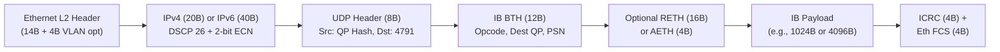
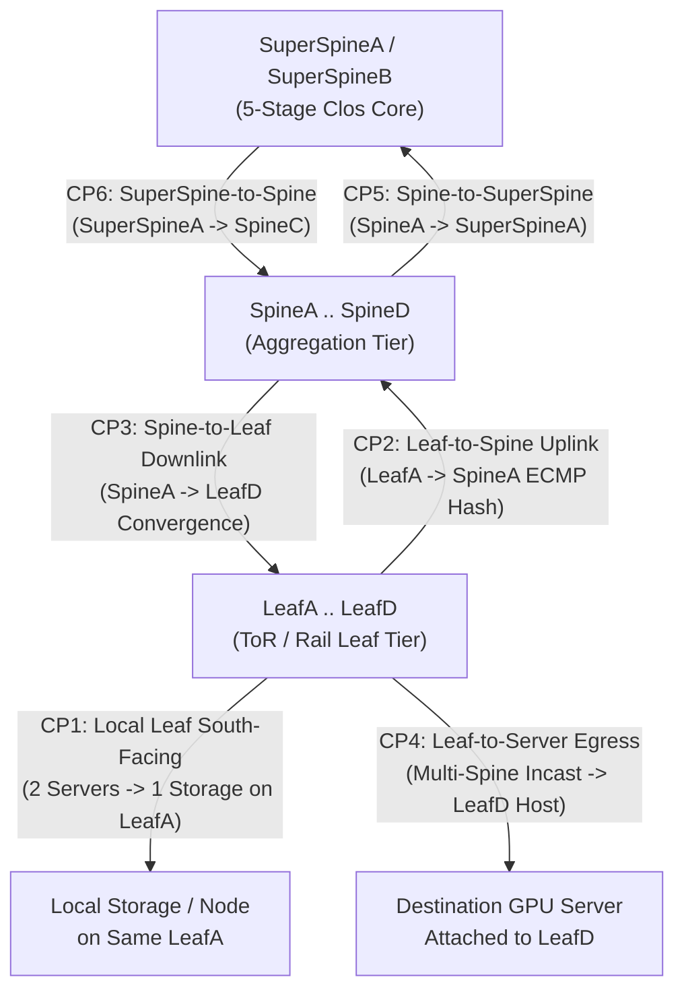
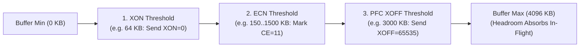
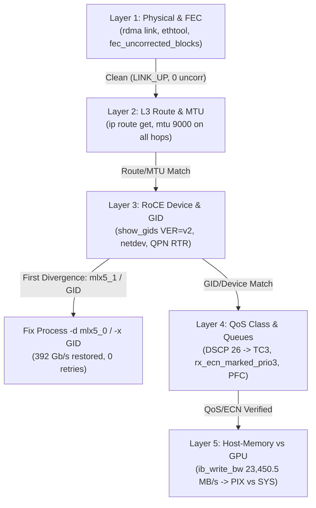

# 12.3 RoCEv2 transport and congestion management

| | |
|---|---|
| Level | Advanced |
| Priority tier | 1 |
| Lab venue | Nebius GPU (plus local Python 3 simulation lab) |
| Part | Part 12: Complete AI networking |
| Sources used | `ai-data-center-network-design-and-technologies` (Ch 1, Ch 7); `nvidia-zero-to-hero/volume-09/chapter-03-rocev2-and-rdma-over-ethernet.md`; `nvidia-zero-to-hero/volume-09/labs/lab-01-inventory-an-ai-ethernet-path.md` through `lab-04-troubleshoot-a-roce-path.md`; `volume-06/01-ai-networking-rdma-masterclass.md`; `bcm11-admin` |
| Coverage file | `planning/coverage/chapters/12-03.md` |

## Why this matters for AI infrastructure

RDMA over Converged Ethernet version 2 is the dominant transport protocol on Ethernet AI fabrics. It synchronizes gradient, activation, and weight buffers across distributed GPU servers at line rate. RoCEv2 encapsulates InfiniBand transport headers inside connectionless UDP and IP frames using UDP destination port 4791. It executes Direct Memory Access directly between GPU or host memory and the ConnectX or BlueField network adapter. Bypassing the server CPU and operating system kernel lets RoCEv2 scale to thousands of parallel collective sessions far better than TCP transports.

Putting a lossless RDMA transport atop standard lossy Ethernet creates four operational failure modes. Left unchecked, these four modes routinely stall multi-thousand-GPU training jobs. First, straggler amplification collapses overall Job Completion Time during synchronous collectives such as AllReduce, AllGather, ReduceScatter, and AllToAll. In a parallel collective, every worker waits at the barrier for the slowest thread. Even a single congested flow that stalls for 1 second forces all other GPU threads to sit idle for 999 ms.

Second, a wrong Global Identifier index breaks RDMA connections even when ICMP `ping` and SSH succeed over the kernel routing table. After a VLAN or interface change, hard-coded GID indices can bind one node to an untagged interface. At the same time, its peer may bind to a VLAN sub-interface. A GID index is a local table position discovered at boot rather than a portable cluster identity.

Third, synchronized elephant flows with low entropy collide at six distinct Clos fabric congestion points. This happens even when the switch topology has a 1:1 non-oversubscribed ratio. When a switch buffer overflows and drops a single packet on a high-bandwidth link, classic Go-Back-N error recovery discards the entire in-flight window. The sender must then retransmit hundreds of intact packets, multiplying fabric load during the worst moment of congestion.

Fourth, misordered congestion thresholds trigger Priority Flow Control pause storms and head-of-line blocking across innocent workloads. Explicit Congestion Notification marks packets end-to-end so the receiver returns a Congestion Notification Packet. However, the round-trip delay leaves an ECN-only queue lossy under microbursts. Priority Flow Control prevents drops via hop-by-hop pause frames, yet it freezes all flows sharing that traffic class. Without ordered DCQCN thresholds and a PFC Watchdog, a pause wave can deadlock the entire fabric.

| Operational Failure Mode | Mechanism & Protocol Identifiers | Quantitative Impact & Telemetry Evidence |
|---|---|---|
| **1. Straggler Amplification & JCT Collapse** | Synchronous collective barrier (`JCT = job end time - job start time`) across `AllReduce`, `AllGather`, `ReduceScatter`, `AllToAll` | If `99` of `100` flows finish in `1 ms` (`< 100 ms`), or `9` of `10` tasks take `1 ms` while `taskX` stalls for `1 second` (`1,000 ms`), serial `JCT = 1.010 seconds` (`1 s + 10 * 1 ms`) and parallel `JCT = 1.000 second` (`999 ms` barrier wait). Even a `1 in 1,000,000` slow event stalls every million-task step |
| **2. Wrong GID Index Selection** | Local `show_gids` table index (`-x 1` vs `-x 2`) binding to `eth0` vs VLAN `eth0.100` or link-local `RoCEv1` (`fe80::`) | `ping` and SSH work, but `ib_write_bw -d mlx5_0 -x 2` fails with `Failed to modify QP to RTR`, or drops from `392 Gb/s` (`2.1 s`) to `156 Gb/s` (`8.2 s`) with `24` `IBV_WC_RETRY_EXC_ERR` completions |
| **3. Clos Incast & Go-Back-N Amplification** | `6` Clos congestion points + classic `Go-Back-N` vs `Selective Repeat` on a `400 Gbps` link with `20.48 us` RTT (`1 MB` BDP = `250` packets of `4096 B`) | Dropping `1` packet forces `Go-Back-N` to discard and retransmit all `250` in-flight packets (`250x` retransmission amplification vs `1` packet under `Selective Repeat`) |
| **4. Misordered DCQCN, PFC Storms & HoL Blocking** | `ECN` + `CNP` (`IB BTH` opcode `129` / `0x81`) vs `PFC` (EtherType `0x8808`, opcode `0x0101`, MAC `01:80:c2:00:00:01`, `65,535` quanta) | Pauses all flows in Traffic Class `3` (`HoL` blocking) or cascades into a fabric-wide `PFC storm` unless `DCQCN` (`XON < ECN < XOFF`), `PFC Watchdog` (`Detection`, `Mitigation`, `Restoration`), `SFC` (`IEEE 802.1Qdw`), or `CSIG` (`draft-ravi-ippm-csig-01`) are active |

## Prerequisites and outcomes

### Prerequisites
- Completion of Chapter 12.1 on Ethernet architecture and Clos fabric topologies for AI. You should also have completed Chapter 12.2 on RDMA fundamentals, Verbs, Queue Pairs, Memory Regions, and Completion Queues.
- Familiarity with IPv4 and IPv6 headers, UDP ports, and IEEE 802.1Q VLAN tagging. Working knowledge of Linux networking tools including `iproute2`, `ethtool`, and `rdma-core` is also expected.

### Outcomes
After completing this chapter, you will be able to:
- Contrast InfiniBand, RoCEv1, RoCEv2, and iWARP wire headers. You will also trace the 13-step RDMA Write and 11-step RDMA Read connection and packet sequences.
- Audit per-port GID tables with `show_gids` and `ibv_devinfo` and resolve IPv4-mapped RoCEv2 GIDs. You will also enforce end-to-end jumbo MTU and DSCP-to-CoS QoS trust boundaries.
- Identify all six Clos congestion points in 3-stage and 5-stage AI fabrics. You will configure ECN, PFC, the PFC Watchdog, and DCQCN threshold ordering.
- Quantify Go-Back-N versus Selective Repeat retransmission amplification. You will also evaluate Source Flow Control and Congestion Signaling.
- Execute a 5-layer link-to-application evidence ladder to isolate silent congestion and endpoint-selection faults. This lets you fix node issues without blindly tuning live switch buffers.

---

## 1. RoCEv1 vs RoCEv2 encapsulation, wire headers, and RDMA session flows

When an engineer tries to route early RDMA traffic across a Layer 3 leaf-spine switch boundary, packets either fail to route or suffer from static hash polarization. Platform operators feel this immediately because non-routable Layer 2 domains cannot scale beyond a single pod without broadcast storms. RoCEv2 solves this by replacing the InfiniBand network layer with standard UDP and IP headers. That encapsulation lets RDMA cross Layer 3 routers and helps switches balance elephant flows.

### 1.1 Comparing InfiniBand, RoCEv1, RoCEv2, and iWARP

When a collective communication library such as NCCL, RCCL, Gloo, or OpenUCX initiates a transfer, it posts a Work Queue Element through the Verbs API. That Work Queue Element is a structure holding a pointer to a registered pinned memory buffer. The RDMA driver places the work request onto a Send Queue, Receive Queue, or Completion Queue. From there, the RDMA NIC handles segmentation and reliability directly in hardware across four transport variants.

Native InfiniBand is governed by the InfiniBand Trade Association and supports SDR, DDR, QDR, FDR, EDR, HDR, NDR, and XDR link rates. It uses credit-based link-layer flow control that is inherently lossless. It also relies on per-packet Adaptive Routing and a centralized Subnet Manager such as OpenSM or UFM. Its framing wraps the payload in a Local Routing Header, an optional Global Routing Header, a Base Transport Header, an Invariant CRC, and a Variant CRC.

RoCEv1 is also standardized by the InfiniBand Trade Association to run directly over Layer 2 Ethernet. It replaces the InfiniBand Local Routing Header with an Ethernet II header using EtherType 0x8915. However, it keeps the 40-byte InfiniBand Global Routing Header and 12-byte Base Transport Header. Because RoCEv1 lacks an IP header, it is strictly confined to a single Layer 2 broadcast domain and cannot traverse Layer 3 routers.

RoCEv2 replaces the 40-byte InfiniBand Global Routing Header with standard IPv4 or IPv6 Layer 3 headers and an 8-byte UDP header. The UDP destination port is fixed at 4791 to tell the receiver that an InfiniBand Base Transport Header follows immediately. Meanwhile, the sender hashes the Queue Pair state into the UDP source port to provide 5-tuple ECMP entropy across routed leaf-spine and super-spine fabrics. A fourth option, iWARP, carries RDMA over connection-oriented TCP/IP. That extra state adds latency and sees little adoption in GPU training clusters.



| Header / Trailer Layer | `InfiniBand` (Native, `HDR` `200 Gbps` `~25 GB/s`, `NDR` `400 Gbps` `~50 GB/s`) | `RoCEv1` (L2 Ethernet, `0x8915`) | `RoCEv2` (`UDP/IPv4`, Port `4791`) | `RoCEv2` (`UDP/IPv6`, Port `4791`) | Key Fields & Operational Role |
|---|---|---|---|---|---|
| **Data Link (`L2`)** | `IB LRH` (`8 B`) | `Ethernet II` (`14 B`, EtherType `0x8915`, `+4 B` VLAN opt) | `Ethernet II` (`14 B`, EtherType `0x0800`, `+4 B` VLAN opt) | `Ethernet II` (`14 B`, EtherType `0x86DD`, `+4 B` VLAN opt) | Carries source/destination MAC and `802.1p` Priority Code Point (`PCP` / `CoS 3`). |
| **Network (`L3`)** | `IB GRH` (`40 B`, optional across subnets) | `IB GRH` (`40 B`, non-IPv4 routable) | `IPv4 Header` (`20 B`) | `IPv6 Header` (`40 B`) | Carries source/destination IP, `6-bit` `DSCP` (`26` / `AF31` or `24` / `CS3`), and `2-bit` `ECN` (`00`, `01`, `10`, `11`). |
| **Outer Transport (`L4`)** | None | None | `UDP Header` (`8 B`, Dst Port `4791`) | `UDP Header` (`8 B`, Dst Port `4791`) | `UDP` Dst Port `4791` identifies `IB BTH`; `UDP` Src Port is derived from `QP` for ECMP hashing. |
| **RDMA Base Transport (`IB BTH`)** | `IB BTH` (`12 B`) | `IB BTH` (`12 B`) | `IB BTH` (`12 B`) | `IB BTH` (`12 B`) | `Opcode` (`12` Read Req, `14` Read Resp Mid, `17` ACK, `129` CNP), `PKey` (`65535` default), `Dest QP` (`24-bit`), `AckReq` (`1-bit`), `PSN` (`24-bit`). |
| **Extended Transport (`RETH` / `AETH`)** | Opcode-dependent (`0–16 B`) | Opcode-dependent (`0–16 B`) | `RETH` (`16 B`) or `AETH` (`4 B`) | `RETH` (`16 B`) or `AETH` (`4 B`) | `RETH`: `Virtual Address` (`8 B`), `Remote Key` (`4 B`), `DMA Length` (`4 B`). `AETH`: `Syndrome` (`ACK`/`NAK`) + `Message Sequence Number` (`MSN`). |
| **Payload (`IB Payload`)** | `256 B` – `4096 B` | `256 B` – `4096 B` | `256 B` – `4096 B` | `256 B` – `4096 B` | Power-of-two IB MTU payload (`1024 B` or `4096 B` typical on `9000 B` jumbo Ethernet). |
| **Checksums (`ICRC` + `FCS`)** | `ICRC` (`4 B`) + `VCRC` (`2 B`) | `ICRC` (`4 B`) + `FCS` (`4 B`) | `ICRC` (`4 B`) + `FCS` (`4 B`) | `ICRC` (`4 B`) + `FCS` (`4 B`) | `32-bit` end-to-end Invariant CRC (`ICRC`) masking mutable IP TTL/DSCP/ECN fields + `32-bit` link `FCS`. |
| **Total Non-Payload Overhead (no VLAN/RETH)** | `26 B` (local) / `66 B` (with GRH) | `74 B` (`4170 B` wire frame at `4096 B` payload; `98.23%` efficiency) | `62 B` (`4158 B` wire frame at `4096 B` payload; `98.51%` efficiency vs `94.29%` at `1024 B`) | `82 B` (`4178 B` wire frame at `4096 B` payload; `98.04%` efficiency) | `RoCEv2-IPv4` saves `12 B` per packet over `RoCEv1` while adding full Layer 3 IP routability. |

### 1.2 Inside the IB BTH, RETH, and AETH headers and session state machines

Because UDP is connectionless and unreliable, an engineer inspecting a raw packet capture might wonder how RoCEv2 guarantees in-order delivery and remote memory protection. Without hardware sequence tracking and memory keys, a corrupted or reordered packet could overwrite arbitrary GPU memory. RoCEv2 solves this by embedding reliability, sequence numbering, and virtual memory keys inside the InfiniBand Base Transport Header and its extended headers.

Before any payload moves across the wire, the RDMA Connection Manager establishes a Queue Pair state machine between the client and server. Whether the workload executes a 13-step RDMA Write or an 11-step RDMA Read, Phase 1 is always a three-way Connection Manager handshake. The client and server exchange Queue Pair Numbers and starting Packet Sequence Numbers across three messages. That handshake transitions the Queue Pair through the `INIT`, `RTR`, and `RTS` states.

In Phase 2, data transfer begins. During an RDMA Write session, the client sends the transfer size, remote address, and memory region metadata before pushing the payload. Each of those steps is acknowledged by the server. During an RDMA Read session, the client sends a single read request specifying the remote virtual address, memory key, and length. The server then streams the requested data back to the client. In Phase 3, both operations conclude with a four-step bidirectional Connection Manager disconnect handshake.

```text
RDMA Session State Machine & Wire Captures (ADC Ch. 1 Figs 1-12..1-16, Client 20.0.0.2 <-> Server 60.0.0.2):
  1. Phase 1 — CM 3-Way Handshake (Steps 1–3 for both Write and Read):
     - Step 1: Client -> Server: CM: Connect request with client QPN
     - Step 2: Server -> Client: CM: Connect reply with server QPN
     - Step 3: Client -> Server: CM: Ready to use (transitions QP: INIT -> RTR [Ready to Receive] -> RTS [Ready to Send])

  2. Phase 2 — Data Transfer & Phase 3 — Teardown:
     - 13-Step RDMA Write: Steps 4–5 exchange transfer size & remote address + ACK; Steps 6–7 exchange memory region info + ACK;
       Steps 8–9 push Data + ACK; Steps 10–13 execute 4-way CM: Disconnect request / reply.
     - 11-Step RDMA Read:  Steps 4–5 send single request (size, remote VA, MR key) + ACK; Steps 6–7 stream Data from server + ACK;
       Steps 8–11 execute 4-way CM: Disconnect request / reply.

  3. Concrete Wireshark Packet Captures (UDP Dst Port 4791):
     - RDMA Read Request (IB BTH Opcode 12):         Solicited Event: False, MigReq: True, Pad Count: 0, Header Version: 0,
       Partition Key: 65535 (0xffff), Dest QP: 0x0000fe1, AckReq: True, PSN: 16548361 + 16-byte RETH (Virtual Address:
       0x00007ff9de5f4000, Remote Key: 0x00207100, DMA Length: 65536 [0x00010000]) + ICRC: 0xb87e1cbc.
     - RDMA Read Response Middle (IB BTH Opcode 14): Partition Key: 65535, Dest QP: 0x00007b, AckReq: False,
       PSN: 16543980, Data: 1024 bytes, ICRC: 0x5b522360.
     - RC Acknowledge (IB BTH Opcode 17 + 4B AETH):  Partition Key: 65535, Dest QP: 0x000123, AckReq: False, PSN: 2592248 +
       AETH (Syndrome: 0 [Ack], OpCode: Ack 0, Credit Count: 0, Message Sequence Number [MSN]: 1) + ICRC: 0x33e6e2af.
```

---

## 2. Addressing, GID tables, MTU, and end-to-end QoS trust boundaries

A classic operational trap occurs right after a host network reconfiguration or VLAN change. An engineer verifies that ICMP `ping` and SSH work between two GPU nodes, launches a distributed job or `ib_write_bw`, and watches it fail immediately. Standard kernel utilities only test the operating system routing table with small packets. They completely bypass the RDMA Global Identifier table, the 9000-byte jumbo MTU requirement, and the switch QoS trust boundary.

### 2.1 Why the GID index is a local table position, not a portable identity

Every RDMA port exposes a Global Identifier table containing 128-bit IPv6-formatted entries. The driver creates a separate entry for every combination of RoCE version, address family, and Linux network device. Those devices include base interfaces, 802.1Q VLAN sub-interfaces, and SR-IOV Virtual Functions. Below is the `show_gids` output from a production host where base interface `eth0` and VLAN sub-interface `eth0.100` share the IPv4 address `10.20.4.15`.

```text
$ show_gids
DEV     PORT    INDEX   GID                                     IPv4            VER     DEV
------  ----    -----   ---                                     ------------    ---     ---
mlx5_0  1       0       fe80:0000:0000:0000:...                 n/a             v1      eth0
mlx5_0  1       1       0000:0000:0000:0000:0000:ffff:0a14:040f 10.20.4.15      v2      eth0
mlx5_0  1       2       0000:0000:0000:0000:0000:ffff:0a14:040f 10.20.4.15      v2      eth0.100
mlx5_0  1       3       fe80:0000:0000:0000:...                 n/a             v1      eth0.100
```

Three operational rules govern GID selection on GPU clusters. First, an IPv4 address is encoded into the lower 32 bits of an IPv4-mapped IPv6 GID using hexadecimal octets. Second, two GID indices can display the exact same IPv4 address and RoCEv2 version while binding to different Layer 2 interfaces. In the output above, index 1 binds to untagged `eth0` whereas index 2 binds to VLAN-tagged `eth0.100`. The Linux kernel populates the GID table in the order interfaces come up at boot. Hard-coding `NCCL_IB_GID_INDEX=2` or `-x 2` across nodes can therefore bind one peer to `eth0.100` and the other to a `v1` entry, failing with `Failed to modify QP to RTR`.

Third, Completion Queue status codes isolate the exact owner of an RDMA failure. Only `IBV_WC_SUCCESS` proves that an end-to-end RDMA transfer succeeded. Every non-zero work completion error points to a specific fault domain. That distinction separates fabric packet loss from remote memory permission bugs and local buffer sizing mistakes.

| Operational Concept or CQ Status Code | Hex / Wire Encoding or Error Code | Root Cause & Diagnostic Ownership |
|---|---|---|
| **IPv4-Mapped RoCEv2 GID Encoding** | `0000:0000:0000:0000:0000:ffff:XXXX:YYYY` -> `0000:0000:0000:0000:0000:ffff:0a14:040f` for `10.20.4.15` (`10 = 0x0a`, `20 = 0x14`, `4 = 0x04`, `15 = 0x0f`) | Must match `VER = v2`, expected IPv4 address, and expected netdev (`eth0` vs `eth0.100`) semantically across both peers |
| **`IBV_WC_SUCCESS`** | Completion status `0` | Proves end-to-end RDMA transfer completed cleanly into target memory |
| **`IBV_WC_RETRY_EXC_ERR`** | Transport Retry Counter Exceeded (`NCCL error 12`) | Sender exhausted hardware retries without receiving an `ACK`. Points to fabric congestion drops, wrong `GID`/VLAN/MTU, or a degraded optic (`fec_uncorrected_blocks` / `packet_seq_err`) |
| **`IBV_WC_REM_ACCESS_ERR`** | Remote Access Error | Remote Memory Region (`MR`) registration or `RKey` permission mismatch |
| **`IBV_WC_LOC_LEN_ERR`** | Local Length Error | Local application buffer length programming bug; not a network fault |

### 2.2 End-to-end MTU and QoS classification

Even when two peers select matching RoCEv2 GID entries, a single misconfigured switch port along the transit path can silently destroy throughput. If one routed hop defaults to a 1500-byte MTU or resets the incoming QoS marking, small handshake packets succeed while full-sized RDMA data frames drop in default lossy queues. Both effective MTU and QoS classification must be enforced as end-to-end path invariants.

RoCEv2 frames carry power-of-two InfiniBand payloads of 1024, 2048, or 4096 bytes. A 4096-byte InfiniBand payload requires 4158 bytes on the wire for IPv4 or 4178 bytes for IPv6. Host interfaces such as `ens1f0` and VLAN sub-interfaces such as `eth0.100` must therefore be standardized to a 9000-byte jumbo MTU. Every leaf, spine, and super-spine switch port along the route must match that jumbo setting. If any hop remains below 4200 bytes, 64-byte `ping` and Connection Manager setup packets pass while 4096-byte RDMA Write frames drop and trigger `IBV_WC_RETRY_EXC_ERR`.

For QoS classification, the 8-bit IPv4 Type of Service or IPv6 Traffic Class byte splits into two fields. The upper 6 bits carry the Differentiated Services Code Point, and the lower 2 bits carry the Explicit Congestion Notification state. Production AI fabrics map RoCEv2 traffic into lossless Traffic Class 3 using DSCP 26 or DSCP 24. Every switch ingress port must trust the incoming DSCP value or 802.1p Priority Code Point 3 and place those frames into lossless egress queue 3.

```text
End-to-End MTU & IP ToS / Traffic Class Byte Encoding:
  - Wire Frame Size at 4096 B IB MTU: 4158 B (RoCEv2-IPv4) or 4178 B (RoCEv2-IPv6) -> requires >= 4200 B (standard 9000 B jumbo MTU).
  - DSCP 26 (AF31, binary 011010) + ECN 10 (ECT(0)) -> binary 01101010 = 0x6a (106 decimal) on normal forward RoCEv2 data packets.
  - DSCP 26 (AF31, binary 011010) + ECN 11 (CE)     -> binary 01101011 = 0x6b (107 decimal) after congested switch marks packet.
  - DSCP 24 (CS3,  binary 011000)                   -> alternative lossless Class 3 marking (802.1p PCP = 3 / CoS 3).
```

---

## 3. Six Clos congestion points, ECN, and PFC

Architects new to AI networking often assume that building a non-blocking, 1:1 non-oversubscribed Clos fabric with 400 Gbps or 800 Gbps links eliminates congestion. During distributed training, however, synchronized GPUs burst elephant flows at line rate with very low flow counts. Those bursts cause hash collisions and endpoint incast bottlenecks at six distinct locations across 3-stage and 5-stage Clos fabrics.

### 3.1 The six Clos congestion points in 3-stage and 5-stage AI fabrics

Because RoCEv2 flows carry large payloads over a small number of parallel Queue Pairs, static 5-tuple ECMP hashing frequently maps multiple line-rate flows onto the same physical link. Worse, when multiple senders target a single receiver simultaneously, traffic converges onto a single south-facing port where fabric load balancing cannot help at all. Every stage of a 3-stage leaf-spine or 5-stage super-spine fabric has its own failure mechanism.



| Congestion Point (`ADC` Ch 7) | Topology Stage & Direction | Traffic Pattern & Why Load Balancing Fails to Prevent It | Primary Mitigation |
|---|---|---|---|
| **1. Local leaf link congestion** | `LeafA` south-facing port (3-stage or 5-stage) | Two servers attached to `LeafA` send line-rate traffic simultaneously to a storage or compute server attached to the *same* `LeafA`. Traffic is switched locally at `LeafA` without ever reaching a spine, so spine load balancing does not apply and the `2:1` fan-in overloads the single south-facing link. | End-to-end `DCQCN` (`ECN` + `CNP` rate reduction) backed by `PFC` on the south-facing queue. |
| **2. Leaf-to-spine link congestion** | Ingress leaf uplink (`LeafA -> SpineA`) | Two servers on `LeafA` send line-rate flows toward a destination on `LeafD`. Static 5-tuple ECMP hashes both elephant flows onto the *same* `LeafA -> SpineA` uplink while `SpineB` sits idle. | Dynamic Load Balancing (`DLB`), flowlet switching, or adaptive routing (`Spectrum-X` / packet spraying) plus `DCQCN`. |
| **3. Spine-to-leaf link congestion** | Transit spine downlink (`SpineA -> LeafD`) | One server on `LeafA` and one server on `LeafB` send line-rate flows that reach `SpineA` on separate uplinks without congestion, but both flows target destinations on `LeafD` and converge onto the single `SpineA -> LeafD` downlink while `SpineB` paths to `LeafC`/`LeafD` remain unused. | Adaptive routing at ingress leaves + `ECN` marking on the `SpineA -> LeafD` egress buffer. |
| **4. Leaf-to-server link congestion** | Egress leaf downlink (`LeafD -> Server`) | Servers on `LeafA` and `LeafB` distribute traffic cleanly across *both* `SpineA` and `SpineB`, reaching `LeafD` without fabric link congestion—but their combined rate (`2x` line rate) exceeds the single `LeafD -> Server` NIC link (`true endpoint incast`). | Load balancing cannot fix single-NIC egress incast; requires `DCQCN` (`ECN` + `CNP`), `PFC`, or `SFC`/`CSIG` source throttling. |
| **5. Spine-to-super spine link congestion** | 5-stage Clos uplink (`SpineA -> SuperSpineA`) | Across an `8`-leaf (`LeafA..LeafH`), `4`-spine (`SpineA..SpineD`), `2`-super-spine (`SuperSpineA`, `SuperSpineB`) fabric, flows from `LeafA` and `LeafB` reach `SpineA` uncongested and hash onto the same `SpineA -> SuperSpineA` link while `SuperSpineB` is underutilized. | Multi-stage adaptive routing / `DLB` across `SuperSpineA` and `SuperSpineB` plus `ECN`/`PFC`. |
| **6. Super spine-to-spine link congestion** | 5-stage Clos downlink (`SuperSpineA -> SpineC`) | Flows from `LeafA` and `LeafB` traverse `SpineA`/`SpineB` and reach `SuperSpineA` without congestion, but converge onto a single `SuperSpineA -> SpineC` downlink toward `LeafE`. | End-to-end congestion notification (`DCQCN` / `CSIG`) and inter-pod adaptive load balancing. |

### 3.2 Explicit Congestion Notification and Congestion Notification Packets

When a switch egress queue begins filling at any of those six congestion points, dropping packets would trigger massive RDMA retransmission stalls. Instead, the network needs a way to tell the specific sending GPU NIC to slow down before the buffer overflows. Explicit Congestion Notification provides this end-to-end, flow-aware feedback across routed IP fabrics using the lower 2 bits of the IP ToS byte.

When a server on `LeafA` transmits RoCEv2 packets toward `LeafD`, it marks the ECN bits as ECN-capable. If the `SpineA` to `LeafD` egress queue crosses its Weighted Random Early Detection marking threshold, `SpineA` rewrites the ECN bits to Congestion Experienced and forwards the packet normally. When the destination RDMA NIC on `LeafD` receives that marked packet, it generates a Congestion Notification Packet back to the sender on `LeafA`. Upon receiving the CNP, the sender NIC throttles injection rate for only that congested Queue Pair.

Despite this surgical precision, a queue protected only by ECN is still classified as a lossy queue. The marked data packet must first finish traveling forward from the congested switch to the receiver, and the resulting CNP must travel all the way back to the sender before rate reduction begins. During that round-trip signaling delay, a fast incast microburst can still overflow the switch buffer and drop packets. Furthermore, if any transit switch along the path lacks ECN support, end-to-end congestion marking breaks completely.

| `ECT` Bit | `CE` Bit | Binary Codepoint | Standard Name | Operational Behavior & CNP Wire Format (`ADC` Ch 7 Table 7-1) |
|---|---|---|---|---|
| `0` | `0` | `00` | `Non-ECT` | Transport is not ECN-capable. If a switch queue crosses its congestion threshold, the switch **drops** the packet instead of marking it. |
| `0` | `1` | `01` | `ECT(1)` | Transport is ECN-capable (`01` and `10` are treated equivalently by transit switches). In `RoCEv2`, the receiver sets `ECN = 01` on outbound **Congestion Notification Packets (`CNPs`)** sent back toward the sender. |
| `1` | `0` | `10` | `ECT(0)` | Transport ECN capability enabled. Set by the sender on forward data packets toward the receiver (and may also be used on `CNPs`). Switches mark instead of dropping upon congestion. |
| `1` | `1` | `11` | `CE` (Congestion Experienced) | Set by an intermediate congested switch when egress queue utilization crosses the configured `ECN` marking threshold (`WRED` curve), triggering a `CNP` (`UDP 4791`, `ECN = 01`, `IB BTH` opcode `129` / `0x81` / binary `10000001`, plus congested `QP` number). |

### 3.3 Priority Flow Control, frame format, and the PFC Watchdog

Because ECN feedback takes a full network round trip to slow a sender down, microbursts can easily overflow a switch buffer while the CNP is still in flight. To prevent packet drops during that feedback window, Priority Flow Control operates hop-by-hop at Layer 2 under IEEE 802.1Qbb. It creates a lossless queue for Traffic Class 3 by pausing the immediate upstream neighbor whenever ingress headroom crosses a high-water mark.

When a switch buffer crosses its `XOFF` threshold, the port transmits a Layer 2 pause frame upstream to halt Traffic Class 3 for up to 65,535 pause quanta. Once the congested queue drains below the lower `XON` threshold, the switch sends an un-pause frame with the pause timer set to zero. That zero timer tells the upstream neighbor to resume transmission immediately. Setting `XOFF` requires dedicated headroom buffer so packets already in flight on the fiber do not drop before the upstream MAC halts. Many switch ASICs manage this threshold dynamically using a shared-buffer alpha parameter.

While PFC prevents packet loss, it introduces two severe operational hazards: Head-of-Line blocking and fabric-wide pause storms. Because PFC pauses the entire traffic class on a link rather than a single Queue Pair, congestion at one receiver can propagate hop-by-hop across spines. That propagation freezes unrelated GPU flows sharing the same class. Worse, if a malfunctioning NIC or routing loop emits continuous `XOFF` frames, backpressure can lock the entire fabric at zero percent GPU utilization. Modern switches prevent this catastrophe with a hardware PFC Watchdog. The watchdog detects stalled queues, drops or drains the wedged traffic, and restores normal operation once the storm subsides.

```text
IEEE 802.1Qbb Priority Flow Control (PFC) Wire Anatomy & Watchdog State Machine (ADC Ch. 7 Figs 7-10..7-15):
  1. Layer 2 PFC Frame Fields (64-byte wire capture):
     - Destination MAC: 01:80:c2:00:00:01 (MAC-specific control protocol 01 link-local multicast, non-bridged)
     - Source MAC:      Switch port MAC (e.g., 10:0e:7e:b7:a7:1b)
     - EtherType:       0x8808 (IEEE MAC Control frame)
     - Control Opcode:  0x0101 (Class-Based Flow Control [CBFC] pause)
     - Class Enable:    2 octets = 0x0008 (C3 = true; C0,C1,C2,C4,C5,C6,C7 = false)
     - Time Vector:     16 octets (8 x 2-octet 16-bit unsigned integers in 512-bit-time quanta, 0..65,535):
                        * XOFF (Transmit Off): C3 pause time = 65535 (0 for C0..C2, C4..C7) when crossing XOFF threshold
                        * XON  (Transmit On):  C3 pause time = 0 when buffer drains below XON threshold

  2. HoL Blocking & PFC Watchdog (3 Functional Blocks, e.g. 50 ms storm threshold when LeafC -> GPU102 wedges):
     - Hazard:      LeafC pauses SpineA on C3; SpineA ingress fills and pauses LeafA and LeafB, freezing innocent GPU103 -> GPU101 flows.
     - Block 1 (Detection):   Monitors received PFC pause frames and queue stall duration per port; flags a PFC storm above threshold (50 ms).
     - Block 2 (Mitigation):  Executes 'drop' action (most common: discards queued/arriving packets and incoming pause frames so SpineA
                              stops pausing LeafA/LeafB) or 'forward' action (ignores received PFC frames and drains queue).
     - Block 3 (Restoration): Monitors port and restores normal lossless PFC once incoming pause frames drop below recovery threshold.
```

---

## 4. DCQCN, Go-Back-N vs Selective Repeat, Source Flow Control, and CSIG

Relying on ECN alone risks buffer overflow drops during microbursts, while relying on PFC alone freezes entire switch ports with Head-of-Line blocking. Network engineers need a unified control loop that throttles only the offending sender early and reserves link-level pauses for emergencies. Data Center Quantized Congestion Notification and newer hardware signaling standards solve this coordination problem.

### 4.1 Data Center Quantized Congestion Notification

Data Center Quantized Congestion Notification combines flow-aware, end-to-end ECN with hop-by-hop lossless PFC over DSCP-marked queues. By ordering switch buffer thresholds so that ECN marks packets well below the PFC pause threshold, DCQCN handles the vast majority of congestion events gracefully via sender rate reduction. PFC then acts strictly as a last-resort safety net when an abrupt microburst outpaces the ECN round-trip loop.



| Buffer Threshold Stage (`XON < ECN < XOFF`) | Representative Setting (`Mellanox Onyx` / Spectrum) | Switch & Endpoint Action (`99%+` handled by ECN) | Impact on Unrelated Flows in Class `3` |
|---|---|---|---|
| **Below `XON` (`<= 64 KB`)** | `XON` near low water mark | If previously paused, switch sends `PFC XON` (`EtherType 0x8808`, `C3` timer `= 0`) upstream; normal forwarding. | Zero impact; full line-rate transmission. |
| **Between `ECN_min` and `XOFF` (`150 KB .. 1500 KB`)** | `congestion-control ecn minimum-absolute 150 maximum-absolute 1500` | Switch marks `ECN = 11` (`CE`) probabilistically via WRED curve; receiver `RNIC` returns `CNP` (`opcode 129`); sender `RNIC` cuts rate for **only the congested `QP`**. | **Zero Head-of-Line blocking**—other flows sharing `Class 3` continue at full speed. |
| **Above `XOFF` (`>= 3000 KB`)** | `XOFF` below `Max` (preserving headroom) | Egress congestion causes ingress lossless headroom on upstream port to breach `XOFF`; switch emits `PFC XOFF` (`timer = 65535`) hop-by-hop toward source. | **Pauses entire `Class 3` queue** on the paused link (`HoL` blocking), preventing packet loss while `DCQCN` catches up. |

When a switch receives a PFC pause frame on an egress interface, backpressure propagates in five sequential steps. First, the pause frame arrives on the egress port, and second, the switch halts transmission on egress queue 3. Third, packets continuing to arrive from upstream fill the switch's own ingress lossless buffers until they cross their `XOFF` threshold. Fourth, those ingress ports transmit new PFC pause frames upstream, and fifth, the pause wave reaches the sender NIC. Because of this blast radius, production clusters choose among three profiles. They either enable ECN and PFC on all switches, restrict PFC to leaves and NICs with fabric-wide ECN, or run ECN-only with adaptive routing.

### 4.2 Go-Back-N vs Selective Repeat retransmission amplification

Why do Ethernet AI fabrics go to such lengths to prevent a single packet drop? On a 400 Gbps RoCEv2 link with a 20.48 microsecond round-trip time, more than one megabyte of data is simultaneously in flight on the wire. Under classic RDMA hardware recovery, losing the first packet of that window forces the receiver to discard every subsequent packet already in flight.

With classic Go-Back-N error recovery, when packet 1 drops at a congested switch, packet 2 arrives with an out-of-order Packet Sequence Number. The receiver NIC immediately raises a sequence error. It increments `packet_seq_err` or `out_of_sequence`, returns a negative acknowledgement, and drops all 249 following packets in the flight window. The sender must rewind its Send Queue and retransmit all 250 packets, creating a 250-fold retransmission amplification. Modern NICs such as ConnectX-6 Dx, ConnectX-7, and BlueField-3 support Selective Repeat. Those adapters buffer out-of-order packets in NIC memory and request retransmission of only the single missing packet.

```text
Bandwidth-Delay Product (BDP) & Retransmission Amplification Math (code/part12/rocev2_transport.py):
  - Link Rate = 400 Gbps (50 GB/s), Fabric RTT = 20.48 us, IB Payload MTU = 4096 B:
    BDP = 400 x 10^9 bps x 20.48 x 10^-6 s = 8,192,000 bits = 1,024,000 bytes (1 MB) = 250 packets of 4096 B in flight.
  - Classic Go-Back-N Recovery (1 dropped packet):     Discards packets #2..#250 -> retransmits all 250 packets (1,024,000 bytes = 250x amplification).
  - Selective Repeat Recovery (ConnectX-7 / BF-3):     Buffers packets #2..#250 -> retransmits only 1 missing packet (4096 bytes = 1x).
```

### 4.3 Source Flow Control and Congestion Signaling

Even a well-tuned DCQCN loop suffers from two structural limitations. ECN feedback is slow because it must bounce off the receiver, and PFC is coarse because it pauses an entire traffic class. Two emerging standards directly address those bottlenecks by signaling the sender faster or embedding fine-grained telemetry in the packet header.

Source Flow Control, standardized as IEEE 802.1Qdw, eliminates both the receiver round-trip delay and class-wide Head-of-Line blocking. When a transit switch such as `SpineA` detects that its `SpineA` to `LeafD` queue has crossed the SFC threshold, it does not wait for the receiver to generate a CNP. Instead, `SpineA` trims the packet payload and reverses the source and destination IP addresses. It then sends a flow-specific SFC signal directly backward to the ingress leaf and sender. Ingress `LeafA` can pause that individual flow, forward the SFC frame to an SFC-capable NIC, or translate it into a local PFC pause on the server port.

Congestion Signaling, defined in IETF `draft-ravi-ippm-csig-01`, takes an In-Band Network Telemetry approach. It inserts a fixed-length Layer 2.5 CSIG tag between the Layer 2 Ethernet header and the Layer 3 IP header. As a packet traverses switches from sender to receiver, each hop updates the CSIG tag whenever its local bottleneck state is worse than the current value recorded in the packet. The destination NIC then reflects that summarized multi-hop telemetry back to the sender in CSIG reflection headers. That reflection lets the sender both pace its injection rate and steer around congested paths.

```text
Next-Generation Congestion Control Specs (ADC Ch. 7 Figs 7-18..7-21):
  1. Source Flow Control (SFC / Source PFC, IEEE 802.1Qdw):
     - Mechanism:  Congested switch (SpineA) trims payload, swaps src/dst IP, and sends flow-specific SFC signal directly back to source.
     - Latency:    If Sender -> SpineA = 2.0 us and SpineA -> Receiver -> Sender = 6.0 us + 8.0 us = 14.0 us,
                   SFC notifies source in 2.0 us vs 14.0 us for ECN+CNP (7.0x faster) with per-flow granularity (zero class HoL blocking).

  2. Congestion Signaling (CSIG, IETF draft-ravi-ippm-csig-01):
     - Header Position: Layer 2.5 tag between L2 Ethernet header and L3 IP header across hops CSIG1..CSIG6, reflected by GPU2 Receiver to GPU1 Sender.
     - Section 1 — Signal Type (3 policies):   min(ABW/C) (min available bandwidth / capacity), min(ABW) (min available bandwidth), max(PD) (max packet delay / queue occupancy).
     - Section 2 — Signal Value:               Quantized multi-bit congestion measurement.
     - Section 3 — Locator Metadata (4 fields): (a) Capacity of bottlenecks, (b) Stage of bottlenecks, (c) Device ID, (d) Link identification (uplink or downlink).
```

---

## 5. Production inventory, baseline benchmarking, and the 5-layer RoCEv2 evidence ladder

During a production training slowdown, on-call engineers are frequently tempted to tweak switch ECN thresholds or reboot nodes before gathering evidence. Blindly changing fabric parameters mid-incident destroys forensic state and often turns a single-node configuration bug into a cluster-wide outage. Before running `perftest` benchmarks or changing switch queues, you must capture a five-layer endpoint-to-endpoint path inventory and follow a disciplined evidence ladder.

### 5.1 Building an endpoint-to-endpoint RoCEv2 path inventory

Investigations stall when an engineering team cannot prove which physical port, VLAN, GID entry, and PCIe root complex a collective job actually used. Before launching `ib_write_bw`, `ib_send_lat`, or NCCL, capture a timestamped baseline across five layers on both endpoints. First, verify host link negotiation and IPv4 or IPv6 addressing with `ip` and `ethtool`. Second, map the Linux network device to its RDMA device and port state using `rdma link show`, `ibv_devinfo`, and `ibstat`.

When reading `ibstat`, note a critical difference between InfiniBand and Ethernet RDMA fabrics. On native InfiniBand, a centralized Subnet Manager assigns non-zero Local Identifiers such as `Base lid: 32` and `SM lid: 1`. On RoCEv2 Ethernet ports, `Base lid: 0` and `SM lid: 0` are completely normal when the port is `Active` and `LinkUp`. That happens because RoCEv2 uses distributed IP routing rather than a Subnet Manager.

Third, verify the active Layer 3 route, 9000-byte jumbo MTU, and semantic `v2` GID index. Fourth, inspect `nvidia-smi topo -m` to confirm that the target GPU and RDMA NIC share the same PCIe switch or root complex. Crossing the CPU socket interconnect degrades GPUDirect RDMA bandwidth. Fifth, snapshot NIC and RDMA hardware counters with a UTC timestamp, and never reset shared hardware counters on a multi-tenant node.

```text
5-Step Production RoCEv2 Inventory Baseline (Volume 09 Labs 01–02 & Volume 06 Ch. 01):
  1. Host Link & Speed:      ip -br link show dev ens1f0; ethtool ens1f0 -> Speed: 400000Mb/s, Duplex: Full, Link detected: yes.
  2. RDMA Mapping & ibstat:  rdma link show -> link mlx5_0/1 state ACTIVE physical_state LINK_UP netdev ens1f0.
                             - InfiniBand ibstat (CA 'mlx5_0', MT4123, FW 20.31.1014, Rate: 200 [HDR]): Base lid: 32, SM lid: 1.
                             - RoCEv2 ibstat     (CA 'mlx5_1', Rate: 400, Link layer: Ethernet):       Base lid: 0,  SM lid: 0 (normal for IP routing).
  3. Route, MTU & GID:       ip route get 10.20.8.5 -> via 10.20.0.1 dev ens1f0 src 10.20.4.15 mtu 9000; show_gids -> VER = v2 on ens1f0.
  4. PCIe / NUMA Locality:   nvidia-smi topo -m -> GPU0 <-> NIC0 (mlx5_0) = PIX (same PCIe root, CPU 0-31, NUMA 0) vs GPU0 <-> NIC1 = SYS (cross-socket, CPU 32-63, NUMA 1).
  5. Timestamped Counters:   date -u (2026-08-07T14:32:15Z) + ethtool -S ens1f0 -> rx_packets: 1024567, rx_bytes: 892481382400,
                             tx_bytes: 481029120384, fec_corrected_blocks: 412, fec_uncorrected_blocks: 0, rx_ecn_marked_prio3: 0, rx_pfc_prio3: 0, tx_pfc_prio3: 0.
```

### 5.2 Interpreting controlled contention and the 5-layer evidence ladder

Standard network dashboards that only alert on interface packet drops completely miss RoCEv2 congestion throttling. When DCQCN and PFC work as designed, physical drop counters remain at zero while sender injection rates are quietly cut in half. To see congestion in action, you must compute per-second or per-run deltas across priority-specific ECN, CNP, and PFC hardware counters.

Consider a controlled contention test where two senders drive a 400 Gbps RoCEv2 receiver on Priority 3 for 60 seconds. Physical drop counters stay at zero, yet `rx_ecn_marked_prio3` jumps by 47,829 packets and `rx_pfc_prio3` increments by 412 frames. Those feedback signals converge both senders to fair rates near 88 Gbps apiece. Similarly, a 1-second `mlnx_perf` sample during a slow training job may show zero buffer drops alongside 118 priority-3 congestion events per second. That counter proves that CNP throttling is inflating tail latency.

When throughput drops or retries spike on a single rail, walk the five-layer evidence ladder from physical optics up to GPU locality. Always stop at the first layer that diverges from baseline. In Lab 04 of Volume 09, a benchmark dropped from 392 Gb/s to 156 Gb/s with 24 retry errors because the command invoked `-d mlx5_1` on a cross-socket rail instead of `-d mlx5_0`. Walking the ladder caught the wrong device at Layer 3 and restored 392 Gb/s in 2.1 seconds without touching switch ECN or PFC settings.

```text
Controlled Contention Telemetry Deltas (Volume 09 Lab 03 & Ch. 03):
  - 60-Second Contention Window (14:35:22Z to 14:36:30Z on 400 Gb/s prio3 path):
    * Packet Volume:    rx_prio3_packets = 51234892 (vs 102314 idle baseline); tx_prio3_packets = 48901234 (vs 89621 idle baseline)
    * Congestion Marks: rx_ecn_marked_prio3 delta = 47829; rx_pfc_prio3 = 412; tx_pfc_prio3 = 14
    * Zero Loss Proof:  out_of_buffer = 0, rx_discards_phy = 0, fec_uncorrected_blocks = 0
    * Fair Convergence: Sender A = 89.2 Gb/s, Sender B = 87.1 Gb/s (combined 176.3 Gb/s)
  - 1-Second Live Sample (mlnx_perf -i eth0 -t 1 during slow collective):
    * rx_bytes: 4.12 Gb/s, tx_bytes: 3.98 Gb/s, rx_prio3_bytes: 482991823104, out_of_buffer: 0, rx_discards_phy: 0, rx_prio3_congestion_events: 118
```



| Evidence Layer | Diagnostic Question | Exact Command & Counter Evidence | Safe Corrective Action |
|---|---|---|---|
| **Layer 1 — Physical & Link** | Are carrier, speed, and FEC clean? | `rdma link show` (`ACTIVE`/`LINK_UP`), `ethtool ens1f0` (`400000Mb/s`), `fec_uncorrected_blocks: 0` (`perfquery` `SymbolErrorCounter`/`LinkDownedCounter`, `ibdiagnet -c 1000`). | Stop testing and replace dirty/faulty fiber or optic; never tune QoS for a bad cable. |
| **Layer 2 — L3 Route & MTU** | Does `ip route get` exit the expected rail with `mtu 9000`? | `ip route get 10.20.8.5` (`dev ens1f0 src 10.20.4.15 mtu 9000` vs wrong `dev ens1f1 src 10.20.4.24`). | Fix host routing policy or end-to-end switch/VLAN jumbo MTU (`9000 B`). |
| **Layer 3 — RoCE Device & GID** | Did both peers select matching `mlx5_*` port, `VER v2`, and VLAN GID? | `show_gids`, `ibv_devinfo -d mlx5_1 -i 1 \| grep GID` (`fe80::0c42:a1ff:fec8:d79d` vs `d79b`); wrong `-d mlx5_1` drops `ib_write_bw` from `392 Gb/s` (`2.1 s`) to `156 Gb/s` (`8.2 s`, `24` `RETRY_EXC_ERR`). | Correct application `-d mlx5_0` and semantic `v2` GID selection; do not touch switch `PFC`/`ECN`. |
| **Layer 4 — QoS & Congestion** | Is traffic landing in `TC 3` and is `ECN` firing before `PFC`? | `ethtool -S ens1f0` (`rx_ecn_marked_prio3`, `rx_pfc_prio3`, `tx_pfc_prio3`, `rx_prio3_congestion_events: 118`); switch buffer histograms (`gNMI` / `NetQ` / `bcm11-admin` PromQL). | If `PFC` fires with `0` `ECN` marks, lower switch `ECN minimum-absolute` (`150 KB`) or fix `DSCP 26 -> TC 3` trust. |
| **Layer 5 — Host RAM vs GPU** | Does host-memory `ib_write_bw` pass while GPU collective lags? | Host-memory `ib_write_bw` (`65536 B`, `5000` iters -> `23500.2 MB/sec` peak / `23450.5 MB/sec` avg, `0.375208 Mpps` on `200G HDR`) vs `nvidia-smi topo -m` (`PIX` vs `SYS`). | Fix GPU-to-NIC PCIe/NUMA binding (`PIX`) or verify `nvidia-peermem` (`GPUDirect RDMA`). |

---

## Commands and configurations that matter

### 1. Host RoCEv2 path inventory, GID inspection, and hardware counter baselines

```bash
# 1. Inspect link state, IPv4/IPv6 addressing, active L3 route, and 9000B jumbo MTU (untested here)
ip -br link show dev ens1f0
ip -br addr show dev ens1f0
ip route get 10.20.8.5
ethtool ens1f0 | egrep "Speed|Duplex|Link"

# 2. Map Ethernet netdev to RDMA mlx5 device/port and inspect GID table (untested here)
rdma link show
ibv_devinfo -l
ibstat
show_gids
ibv_devinfo -d mlx5_0 -i 1

# 3. Verify GPU-to-NIC PCIe root affinity (PIX vs SYS) and check TCP offload state (untested here)
nvidia-smi topo -m
ethtool -k ens1f0 | grep tcp-segmentation

# 4. Capture timestamped NIC ECN/PFC/FEC and RDMA hw_counters baseline without resetting (untested here)
date -u && ethtool -S ens1f0 | egrep "rx_bytes|tx_bytes|fec_uncorrected|ecn_marked|pfc_prio|rx_prio3|out_of_buffer|discard"
grep -H . /sys/class/infiniband/mlx5_0/ports/1/hw_counters/* 2>/dev/null || true
```

### 2. Host-memory perftest smoke test and UDP 4791 packet capture

```bash
# Server side (Node A): start RDMA Write bandwidth listener on mlx5_0 port 1 (untested here)
ib_write_bw -d mlx5_0 -i 1

# Client side (Node B): run host-memory RoCEv2 bandwidth test with explicit v2 GID index (untested here)
ib_write_bw -d mlx5_0 -i 1 -x 1 -F --report_gbits 10.20.8.5

# Capture RoCEv2 headers (UDP port 4791; CNPs use IB BTH opcode 129 / 0x81) via SPAN or ibdump (untested here)
# Note: hardware-offloaded RDMA bypasses the host kernel, so use ibdump or switch port mirroring for data packets
sudo tcpdump -i ens1f0 -nn -e -v udp port 4791
```

### 3. Switch lossless RoCEv2 queue configuration

```text
# Mellanox Onyx / NVIDIA Spectrum illustrative switch configuration for Traffic Class / Priority 3 (untested here)
# 1. Enable ECN WRED marking thresholds (150 KB min, 1500 KB max) on Traffic Class 3 so DCQCN throttles before PFC
switch (config) # interface ethernet 1/1-1/32 traffic-class 3 congestion-control ecn minimum-absolute 150 maximum-absolute 1500

# 2. Enable IEEE 802.1Qbb Priority Flow Control (PFC) on Priority 3 only
switch (config) # dcb priority-flow-control enable force
switch (config) # dcb priority-flow-control priority 3 enable
switch (config) # interface ethernet 1/1 dcb priority-flow-control mode on force

# 3. Bind Traffic Class 3 to strict-priority scheduling
switch (config) # interface ethernet 1/1-1/32 traffic-class 3 bind strict-priority
```

---

## How it fails

| Failure Mode | Symptom & Telemetry Evidence | Root Cause | Fix & Verification |
|---|---|---|---|
| **1. `Ping` and SSH work, but `ib_write_bw -d mlx5_0 -x 2` fails with `Failed to modify QP to RTR`** | `ib_write_bw` prints `Local address: LID 0000 QPN 0x012a PSN 0x8f2c1 GID: fe80::...`, `Remote address: LID 0000 QPN 0x0000 ...`, and `Failed to modify QP to RTR`. | **Cross-Host `GID` Index Mismatch:** Hard-coding `-x 2` selected a link-local `RoCEv1` (`fe80::`) or mismatched VLAN (`eth0.100` vs `eth0`) entry because `GID` table ordering differs across hosts after a VLAN change. | Query `show_gids` on both endpoints, automate semantic selection matching `VER = v2`, `IPv4`, and `DEV`, and verify `RTR`/`RTS` completion with `ib_write_bw`. |
| **2. One rail drops from `392 Gb/s` (`2.1 s`) to `156 Gb/s` (`8.2 s`) with `24` `RETRY_EXC_ERR` completions** | `rdma link show` shows both `mlx5_0` (`ens1f0`) and `mlx5_1` (`ens1f1`) `ACTIVE`/`LINK_UP` with `mtu 9000`, but `ethtool -S ens1f1` shows `rx_ecn_marked_prio3: 142` and retries. | **Wrong RDMA Device / Rail / NUMA Selection:** The process selected `-d mlx5_1` (`src 10.20.4.24`, `GID[3] fe80::...d79d`, crossing `SYS` NUMA/rail) instead of the primary rail `mlx5_0` (`d79b`, `PIX`). | Walk the 5-layer evidence ladder (`Physical -> Route/MTU -> RoCE/GID -> QoS -> Workload`); fix the process argument to `-d mlx5_0` rather than modifying fabric `PFC`/`ECN`. |
| **3. `NCCL AllReduce` steps swing wildly between `10 ms` and `500 ms` while `10–60 s` SNMP polling shows `20%–40%` link utilization** | Average utilization looks idle (`20%–40%`), `out_of_buffer: 0`, `rx_discards_phy: 0`, yet `mlnx_perf -i eth0 -t 1` shows `rx_prio3_congestion_events: 118` every second and switch `Tx Pause` (`PFC`) counters climb with low `ECN` marks. | **Synchronized Incast Microbursts + High `ECN` Threshold:** Many-to-one GPU bursts fill switch buffers in microseconds (invisible to `10–60 s` SNMP polling) and hit `PFC XOFF` before `ECN` marks packets. | Enable microsecond streaming telemetry (`gNMI` / `NetQ`) and lower the switch `ECN minimum-absolute` threshold (e.g., to `150 KB`) so `DCQCN` (`CNP` opcode `129`) throttles senders before `PFC` pauses the queue. |
| **4. Entire training job hangs at `0%` GPU utilization (`ib_write_bw` hangs indefinitely)** | Switch ports show massive `PFC Tx/Rx` pause frame counts (`EtherType 0x8808`, `opcode 0x0101`, `timer = 65535`) and `0` data packets forwarded. | **`PFC` Pause Storm or Cyclical Buffer Deadlock:** A wedged downstream NIC (`GPU102` on `LeafC`) or routing loop caused `PFC XOFF` backpressure to cascade across `SpineA` to `LeafA`/`LeafB` (`Switch A -> B -> C -> D -> A`). | Enforce strictly loop-free Clos topologies and enable the **`PFC Watchdog`** (e.g., `50 ms` storm timer) in `drop` mitigation mode to flush the wedged queue and suppress upstream pause propagation. |
| **5. `RoCEv2` traffic experiences heavy packet drops (`packet_seq_err` / `Go-Back-N` stalls) despite `PFC` and `ECN` being configured on `TC 3`** | `ethtool -S` shows `rx_prio3_packets: 0` while `rx_prio0_packets` increments and default queue `0` drops packets during collectives. | **Broken QoS Trust or `DSCP` Mapping Boundary:** Host `RoCEv2` packets (`DSCP 26` / `AF31`) were remarked to `0` or classified via untrusted L2 `PCP = 0` at a switch ingress port, landing in lossy default queue `0` instead of lossless `TC 3`. | Configure `cma_roce_tos` / `mlx5_core` DSCP marking (`26` or `24`) on the host and verify `trust dscp` -> `traffic-class 3` mapping on every leaf, spine, and super-spine hop. |

---

## Hands-on lab

### Venue and scope

This lab runs locally using the Python 3 standard library via `code/part12/rocev2_transport.py` and `code/part12/rocev2_transport_lab.py`. It verifies all 25 quantitative checks from this chapter. Those checks cover RoCEv1 versus RoCEv2 header efficiency, IPv4-mapped GID resolution, DSCP and ECN byte encoding, the six Clos congestion points, and DCQCN threshold ordering. The script also validates PFC frame constants, the PFC Watchdog, Go-Back-N versus Selective Repeat amplification, Source Flow Control, and Congestion Signaling. All live cluster and switch commands earlier in the chapter are reference patterns marked untested here.

### Step 1: Run the self-checking RoCEv2 transport and congestion management lab

Run the self-checking lab from the repository root:

```bash
python3 -B code/part12/rocev2_transport_lab.py
```

Captured output from this repository:
```text
=== Chapter 12.3 Lab: RoCEv2 Transport and Congestion Management ===
  [PASS] RoCEv1 uses EtherType 0x8915 with a 40-byte IB GRH and 0-byte UDP header (74B non-payload overhead, 4170B wire frame, 98.23% efficiency)
  [PASS] RoCEv2-IPv4 uses UDP destination port 4791, 20B IPv4 + 8B UDP + 12B IB BTH + 4B ICRC + 18B L2 (62B overhead)
  [PASS] RoCEv2-IPv6 uses 40B IPv6 + 8B UDP + 12B IB BTH + 4B ICRC + 18B L2 (82B overhead, 4178B wire frame, 98.04% efficiency)
  [PASS] Expanding RoCEv2-IPv4 payload from 1024B to 4096B raises wire payload efficiency from 94.29% to 98.51%
  [PASS] ADC Ch 1 BTH opcodes match Wireshark captures: RDMA Read Req=12, Read Resp Middle=14, ACK=17, PKey=65535
  [PASS] IPv4 10.20.4.15 maps to RoCEv2 GID 0000:0000:0000:0000:0000:ffff:0a14:040f
  [PASS] Semantic GID lookup distinguishes base eth0 (index 1) from VLAN eth0.100 (index 2) with identical IP 10.20.4.15
  [PASS] Semantic GID lookup rejects link-local RoCEv1 (fe80::) entries when routed RoCEv2 (v2) is required
  [PASS] DSCP 26 (AF31) with ECN ECT(0) '10' encodes to IP ToS byte 0x6a (106) and with CE '11' to 0x6b (107)
  [PASS] ADC Ch 7 Table 7-1 defines all 4 ECN codepoints (00 Non-ECT, 01 ECT(1)/CNP, 10 ECT(0), 11 CE) and CNP opcode 129 (0x81)
  [PASS] QoS path validator confirms DSCP 26 -> TC 3 lossless/ECN alignment and catches L2 PCP=0 trust mismatches
  [PASS] ADC Ch 7 defines all 6 Clos congestion points from local south-facing leaf to 5-stage super-spine links
  [PASS] DCQCN enforces progressive buffer threshold ordering XON (64 KB) < ECN_min (150 KB) <= ECN_max (1500 KB) < XOFF (3000 KB)
  [PASS] DCQCN marks ECN before PFC XOFF fires, and triggers XOFF pause (65535 quanta) only above XOFF threshold
  [PASS] PFC frame constants match ADC Ch 7 Figs 7-10..7-12: EtherType 0x8808, opcode 0x0101, MAC 01:80:c2:00:00:01, C3 enable 0x0008, pause 65535/0
  [PASS] PFC Watchdog (Detection, Mitigation, Restoration) detects >50ms pause storm and drops queue/pause frames to protect upstream fabrics
  [PASS] At 400 Gbps and 20.48 us RTT (1,024,000 bytes / 1 MB BDP), Go-Back-N retransmits 250 packets (4096B MTU) for 1 drop vs 1 packet with Selective Repeat (250x amplification)
  [PASS] ADC Ch 1 Figs 1-5 & 1-6: 1 straggler at 1s among 10 1ms tasks yields 1.010s serial JCT and 1.000s parallel JCT (999ms barrier stall)
  [PASS] SFC (IEEE 802.1Qdw) signals the source directly from the congested switch in 2.0 us vs 14.0 us for ECN+CNP (7.0x faster) with flow granularity
  [PASS] CSIG (draft-ravi-ippm-csig-01) inserts a Layer 2.5 tag carrying 3 signal types (min(ABW/C), min(ABW), max(PD)) and 4 bottleneck locator metadata fields
  [PASS] Volume 09 Lab 01: nvidia-smi topo -m distinguishes PIX (same PCIe root) from SYS (cross-NUMA) and baselines fec_uncorrected_blocks=0
  [PASS] Volume 09 Lab 02 & Ch 03: ib_write_bw -d mlx5_0 -x 2 'Failed to modify QP to RTR' diagnoses VLAN GID index mismatch across peers
  [PASS] Volume 09 Lab 03: 60s bounded contention on prio3 records 47,829 rx_ecn_marked_prio3 delta, 412 rx_pfc_prio3, 14 tx_pfc_prio3, and fair ~89.2 / 87.1 Gb/s throttling
  [PASS] Volume 09 Lab 04: 5-layer evidence ladder isolates mlx5_1 device-selection fault (392 -> 156 Gb/s, 24 RETRY_EXC_ERR, 8.2s vs 2.1s) without touching PFC/ECN
  [PASS] Volume 06 Ch 01: 200G HDR (~25 GB/s line rate) ib_write_bw achieves 23,500.2 MB/s peak / 23,450.5 MB/s avg at 65,536B x 5,000 iterations

Summary: 25 passed, 0 failed out of 25 checks.
```

---

## Common first mistakes

1. **Treating `ping` success as proof that a RoCEv2 path is healthy.** Standard ICMP `ping` tests 64-byte packets over whatever interface the kernel routing table selected. It never exercises GID table selection, 9000-byte jumbo MTU, DSCP-to-CoS queue mapping, or GPUDirect PCIe locality.
2. **Hard-coding a numeric GID index across all cluster nodes.** Because the kernel assigns GID indices dynamically as interfaces and VLAN sub-interfaces come up, index 2 on one node can map to a different VLAN or RoCEv1 entry on a peer. Always resolve the GID index from semantic attributes including protocol version, network device, and IPv4 address.
3. **Setting ECN marking thresholds above PFC `XOFF`, or setting `XOFF` equal to maximum buffer.** If the ECN threshold sits above `XOFF`, PFC pauses the entire traffic class before DCQCN ever sends a Congestion Notification Packet. If `XOFF` equals the maximum buffer with zero headroom, in-flight packets drop while the pause frame travels upstream.
4. **Resetting live interface or switch counters during an active investigation.** Clearing shared hardware counters destroys historical baselines for other operators and Prometheus monitoring agents. Always record UTC timestamps with `date -u` and compute counter deltas between snapshots.
5. **Running `tcpdump` on a host ConnectX interface expecting to see hardware-offloaded RoCEv2 payloads.** Hardware-offloaded RDMA bypasses the Linux kernel networking stack completely. Use `ibdump` on the RDMA device or configure switch port mirroring filtered on UDP port 4791 to inspect InfiniBand transport headers and CNPs.

---

## Exercises

All function signatures, input parameters, and target verification outputs for the six exercises below are summarized in the reference block that follows.

1. **RoCEv1 vs RoCEv2 Wire Overhead and Payload Efficiency:** Calculate the total non-payload bytes, wire frame size, and payload efficiency percentage for RoCEv1, RoCEv2-IPv4, and RoCEv2-IPv6 at 1024-byte and 4096-byte payloads. Then explain why RoCEv2-IPv4 saves 12 bytes per packet compared to RoCEv1 while adding full Layer 3 IP routability.
2. **Semantic GID Resolution and QP State Failures:** Examine the four-row `show_gids` table for `mlx5_0` port 1 with base interface `eth0` and VLAN interface `eth0.100`. Compute the exact 128-bit IPv4-mapped RoCEv2 GID string. Then explain why `ib_write_bw` with a hard-coded `-x 2` flag failed to transition the Queue Pair to the Ready to Receive state after a VLAN change.
3. **DSCP + ECN Byte Encoding and DCQCN Threshold Ordering:** Compute the hexadecimal IP ToS byte for DSCP 26 with normal ECN-capable marking and with Congestion Experienced marking. State the BTH opcode and ECN bits of the resulting CNP. Then determine the switch queue action at 40 KB, 500 KB, and 3200 KB buffer occupancy under the standard DCQCN profile.
4. **Mapping the Six Clos Congestion Points and PFC Watchdog:** List all six Clos congestion points and explain why spine load balancing cannot prevent local leaf south-facing congestion or leaf-to-server egress incast. Then trace the three functional blocks of the PFC Watchdog when a downstream GPU port triggers a pause storm exceeding 50 milliseconds.
5. **Go-Back-N vs Selective Repeat Amplification and JCT Straggler Math:** Prove why a single dropped 4096-byte packet on a 400 Gbps path with a 20.48 microsecond RTT forces 250 packets to be retransmitted under Go-Back-N. Compare that against 1 packet under Selective Repeat. Next, compute both the serial and parallel Job Completion Time when one of ten 1-millisecond tasks stalls for 1 second.
6. **Next-Generation SFC and CSIG Signaling:** Calculate the notification speedup of Source Flow Control over ECN plus CNP across the sample fabric hop delays. Explain how SFC avoids both round-trip delay and class-level Head-of-Line blocking. Finally, list the three CSIG signal types and the four bottleneck locator metadata fields.

```text
Exercise Function Signatures & Expected Verification Targets (code/part12/rocev2_transport.py):
  - Ex 1 (compare_roce_encapsulation):   RoCEv1 (0x8915) = 74 B overhead (4170 B wire frame, 98.23% efficiency at 4096 B); RoCEv2-IPv4 (UDP 4791) = 62 B overhead (saves 12 B by replacing 40 B GRH with 20 B IPv4 + 8 B UDP; efficiency rises from 94.29% at 1024 B to 98.51% at 4096 B); RoCEv2-IPv6 = 82 B overhead (4178 B wire frame, 98.04% at 4096 B).
  - Ex 2 (ipv4_to_rocev2_gid):           ipv4_to_rocev2_gid("10.20.4.15") -> "0000:0000:0000:0000:0000:ffff:0a14:040f"; ib_write_bw -d mlx5_0 -x 2 failed with "Failed to modify QP to RTR" because index 2 bound to eth0.100 on one host and a mismatched VLAN or v1 (fe80::) entry on the peer.
  - Ex 3 (build_ip_tos_byte / DcqcnBufferProfile): DSCP 26 + ECN 10 = 0x6a (106); DSCP 26 + ECN 11 = 0x6b (107); CNP uses IB BTH opcode 129 (0x81) and ECN = 01. For XON = 64 KB, ECN = 150..1500 KB, XOFF = 3000 KB: 40 KB -> PFC XON (timer = 0); 500 KB -> ECN CE = 11 mark (no PFC); 3200 KB -> PFC XOFF (timer = 65535).
  - Ex 4 (SIX_CLOS_CONGESTION_POINTS):   (1) Local leaf south-facing, (2) Leaf-to-spine, (3) Spine-to-leaf, (4) Leaf-to-server egress, (5) Spine-to-super-spine, (6) Super-spine-to-spine. PFC Watchdog (Detection > 50 ms, Mitigation drop/forward, Restoration) stops LeafC -> GPU102 pause storms from freezing SpineA -> LeafA/LeafB.
  - Ex 5 (calculate_retransmission_amplification(400.0, 20.48, 4096, 1) & calculate_jct_tail_latency(10, 1.0, 1000.0)): BDP = 1,024,000 B (1 MB) = 250 packets -> Go-Back-N retransmits 250 packets vs 1 for Selective Repeat (250x). For 1 straggler at 1000.0 ms among 10 x 1.0 ms tasks: serial JCT = 1.010 s, parallel JCT = 1.000 s (999 ms stall).
  - Ex 6 (compare_congestion_signaling_latency(2.0, 6.0, 8.0)): SFC = 2.0 us vs ECN+CNP = 14.0 us (6.0 + 8.0 us) -> 7.0x speedup. CSIG (draft-ravi-ippm-csig-01) L2.5 tag carries 3 signal types (min(ABW/C), min(ABW), max(PD)) and 4 locator fields (Capacity, Stage, Device ID, Link ID uplink/downlink).
```

---

## Interview angles

1. **Diagnosing wild AllReduce step-time swings when SNMP link utilization looks idle and drop counters are zero.** Interviewers present an 8,000-GPU RoCEv2 cluster where NCCL AllReduce steps swing from 10 ms to 500 ms. Meanwhile, 60-second SNMP polling shows under 40 percent utilization and zero interface drops. Explain that synchronized GPU incast microbursts fill switch buffers in microseconds, which 10-to-60-second SNMP averages completely smooth out. Check high-frequency gNMI buffer histograms, `mlnx_perf` per-second congestion events, `ethtool -S` priority-3 ECN and PFC counters, and switch `Tx Pause` counts. If PFC triggers with few ECN marks, lower the switch ECN minimum threshold so DCQCN throttles senders before PFC halts the queue.
2. **Walking the 5-layer evidence ladder when `ping` and SSH succeed after a VLAN change but NCCL fails to initialize RDMA.** Rather than guessing at PFC settings or numeric GID flags, walk systematically from Layer 1 to Layer 5. Verify physical link state and zero uncorrected FEC blocks at Layer 1. Next, check `ip route get` and 9000-byte jumbo MTU on every VLAN and switch hop at Layer 2. At Layer 3, inspect `show_gids` and `ibv_devinfo` to see whether the VLAN change shifted GID table positions. If one peer selected a link-local RoCEv1 or mismatched VLAN entry, it fails with `Failed to modify QP to RTR`. Finally, confirm DSCP-to-CoS queue mapping at Layer 4 and GPU-to-NIC PCIe affinity in `nvidia-smi topo -m` at Layer 5.
3. **Comparing ECN, PFC, DCQCN, Source Flow Control, and Congestion Signaling across latency, granularity, and failure modes.** Start with end-to-end flow-based ECN, which avoids Head-of-Line blocking but leaves an ECN-only queue lossy during the CNP round-trip delay. Contrast that with hop-by-hop class-based PFC, which prevents drops but risks Head-of-Line blocking and pause storms requiring a PFC Watchdog. Show how DCQCN orders `XON < ECN < XOFF` so ECN handles routine contention while PFC catches microbursts. Finally, explain how IEEE 802.1Qdw Source Flow Control signals the sender directly from the congested switch per flow, and how CSIG embeds Layer 2.5 bottleneck telemetry reflected by the receiver.

---

## Checkpoint questions (20)

<details>
<summary>**1. Why does RoCEv2 scale better than TCP-based storage or data transports across thousands of GPUs, and what networking challenge does its traffic pattern introduce?**</summary>

RoCEv2 encapsulates InfiniBand transport headers inside connectionless UDP and IP frames on UDP destination port 4791. It offloads transport segmentation and Direct Memory Access to the RDMA NIC, bypassing the host CPU and OS kernel completely. However, synchronized GPU collectives generate high-bandwidth elephant flows with low entropy. Those bursts cause incast congestion across Clos fabric links and degrade Job Completion Time.
</details>

<details>
<summary>**2. How is Job Completion Time defined in an AI training cluster, and what are the exact serial and parallel JCT values when 1 out of 10 tasks experiences a 1-second tail latency instead of 1 millisecond?**</summary>

Job Completion Time equals job end time minus job start time, and parallel collectives are governed by the slowest straggler thread. When 9 tasks take 1 ms and 1 task takes 1 second, serial execution takes 1.010 seconds. Parallel execution takes 1.000 second, with the other 9 tasks waiting idle for 999 ms at the barrier.
</details>

<details>
<summary>**3. Contrast the wire header stacks of native InfiniBand, RoCEv1, and RoCEv2, including the exact EtherType and UDP port numbers.**</summary>

Native InfiniBand frames carry an 8-byte Local Routing Header, an optional 40-byte Global Routing Header, and a 12-byte Base Transport Header. Those headers are followed by the payload, a 4-byte Invariant CRC, and a 2-byte Variant CRC. RoCEv1 replaces the Local Routing Header with an Ethernet II header using EtherType 0x8915 while keeping the 40-byte Global Routing Header, restricting it to Layer 2. RoCEv2 replaces the Global Routing Header with a 20-byte IPv4 or 40-byte IPv6 header and an 8-byte UDP header using destination port 4791.
</details>

<details>
<summary>**4. What fields are carried inside the 12-byte InfiniBand Base Transport Header, the 16-byte RETH, and the 4-byte AETH in RoCEv2 packets?**</summary>

```text
RoCEv2 Inner RDMA Transport Headers (ADC Ch. 1 Figs 1-14..1-16):
  - IB BTH (12 B): Opcode (12 Read Req, 14 Read Resp Middle, 17 ACK, 129 / 0x81 CNP), Solicited Event, MigReq, Pad Count,
                   Header Version, Partition Key (PKey = 65535 default), Dest QP (24-bit), AckReq (1-bit), PSN (24-bit).
  - RETH (16 B):   Virtual Address (8 B, e.g. 0x00007ff9de5f4000), Remote Key (4 B, e.g. 0x00207100), DMA Length (4 B, e.g. 65536).
  - AETH (4 B):    Syndrome (ACK vs NAK, OpCode, Credit Count) + Message Sequence Number (MSN of last completed message).
```
</details>

<details>
<summary>**5. Walk through the three phases of an RDMA Write session (13 steps) and an RDMA Read session (11 steps) over RoCEv2.**</summary>

Phase 1 is a three-step Connection Manager handshake where the client and server exchange Queue Pair Numbers. That exchange transitions the Queue Pair through `INIT`, `RTR`, and `RTS`. Phase 2 transfers data: RDMA Write uses six steps to exchange size, address, and memory region info before pushing data with ACKs. By contrast, RDMA Read uses four steps to send a single read request and stream data back. Phase 3 terminates the session with a four-step bidirectional disconnect handshake.
</details>

<details>
<summary>**6. Why can a single RoCEv2 physical port expose multiple GID table entries, and why is hard-coding a numeric GID index dangerous in automation?**</summary>

A port's GID table creates separate entries for each RoCE version, each IPv4 or IPv6 address, and each network device. Those devices include base interfaces, VLAN sub-interfaces, and SR-IOV Virtual Functions. Because the kernel assigns indices in the order interfaces are discovered at boot, index 2 on one host may be a RoCEv2 VLAN interface while index 2 on a peer is a RoCEv1 entry. Automation must query `show_gids` and match protocol version `v2`, device name, and IPv4 address semantically.
</details>

<details>
<summary>**7. How do you distinguish the owner of an RDMA failure from Completion Queue status codes: IBV_WC_SUCCESS, IBV_WC_RETRY_EXC_ERR, IBV_WC_REM_ACCESS_ERR, and IBV_WC_LOC_LEN_ERR?**</summary>

`IBV_WC_SUCCESS` is the only status proving an RDMA transfer completed end-to-end. `IBV_WC_RETRY_EXC_ERR` means the sender exhausted transport retries without receiving an ACK, pointing to fabric drops, a mismatched GID or MTU, or a bad optic. `IBV_WC_REM_ACCESS_ERR` indicates a remote Memory Region or RKey permission error. Finally, `IBV_WC_LOC_LEN_ERR` indicates a local application buffer length bug.
</details>

<details>
<summary>**8. What do Base lid: 0 and SM lid: 0 mean in ibstat output on a 400G RoCEv2 port compared to a 200G HDR InfiniBand port?**</summary>

On native InfiniBand, a centralized Subnet Manager assigns non-zero Local Identifiers such as `Base lid: 32` and `SM lid: 1`. A zero LID on InfiniBand indicates a broken Subnet Manager path. On RoCEv2 Ethernet ports, `Base lid: 0` and `SM lid: 0` are completely normal when the port state is `Active` and `LinkUp`, because RoCEv2 routes via standard IP and GIDs.
</details>

<details>
<summary>**9. Describe all six Clos congestion points identified in AI data center networks and explain which ones cannot be solved by fabric load balancing alone.**</summary>

The six congestion points are local leaf south-facing links, leaf-to-spine uplinks, spine-to-leaf downlinks, leaf-to-server egress downlinks, spine-to-super-spine uplinks, and super-spine-to-spine downlinks. Fabric load balancing cannot solve Point 1 because local leaf switching never reaches a spine. It also cannot solve Point 4 because multi-spine flows still converge onto a single destination server NIC link.
</details>

<details>
<summary>**10. How are the 8 bits of the IP DSCP/ToS field partitioned for QoS and ECN, and what do each of the four 2-bit ECN values signify?**</summary>

The upper 6 bits carry the DSCP classification value such as DSCP 26 or DSCP 24 for Traffic Class 3, and the lower 2 bits carry the ECN state. Codepoint `00` means Non-ECT where switches drop packets on congestion. Codepoints `01` and `10` indicate ECN-capable transport, with `01` also marking outbound CNPs. Codepoint `11` means Congestion Experienced set by a congested transit switch.
</details>

<details>
<summary>**11. What is the exact wire format of a RoCEv2 Congestion Notification Packet, who generates it, and why is a queue with only ECN enabled still considered a lossy queue?**</summary>

When a destination RDMA NIC receives a data packet marked with `ECN = 11`, it generates a Congestion Notification Packet back to the sender on UDP port 4791. That CNP carries ECN bits set to `01`, InfiniBand BTH opcode 129, and the congested Queue Pair number. Because the marked packet must reach the receiver and the CNP must return to the sender before throttling starts, a rapid microburst can still overflow the switch buffer during that round-trip delay.
</details>

<details>
<summary>**12. Detail the Layer 2 frame fields of an IEEE 802.1Qbb Priority Flow Control XOFF and XON frame for Traffic Class 3.**</summary>

A PFC frame uses link-local multicast destination MAC `01:80:c2:00:00:01`, the switch port source MAC, EtherType `0x8808`, control opcode `0x0101`, and a 2-octet Class Enable Vector set to `0x0008` for Class 3. Its 16-octet time field sets the Class 3 pause timer to `65535` quanta for an `XOFF` pause frame. When buffer occupancy drops below the `XON` threshold, it sends an `XON` resume frame with the timer set to `0`.
</details>

<details>
<summary>**13. What are the two major operational problems with PFC in AI fabrics, and how do the three functional blocks of the PFC Watchdog mitigate a PFC storm?**</summary>

PFC causes Head-of-Line blocking by pausing all flows sharing Traffic Class 3 and can trigger cascading pause storms or cyclical buffer deadlocks across switches. The PFC Watchdog counters this with three blocks. Detection flags ports paused beyond a storm threshold such as 50 ms. Mitigation drops queued packets and incoming pause frames to stop upstream propagation, and Restoration resumes normal lossless operation once pause frames subside.
</details>

<details>
<summary>**14. How does DCQCN order the XON, ECN, and XOFF buffer thresholds, and what five steps occur inside a switch when it receives a PFC pause frame?**</summary>

DCQCN orders thresholds as `XON < ECN < XOFF < Max Buffer`, such as 64 KB for `XON`, 150 to 1500 KB for ECN marking, and 3000 KB for `XOFF`. That ordering lets ECN throttle flows before PFC pauses the link. When a switch receives a PFC frame on an egress port, it pauses that egress queue, builds up lossless buffer on its own ingress ports until they cross `XOFF`, and emits new PFC frames upstream.
</details>

<details>
<summary>**15. Why does a single packet drop on a 400 Gbps RoCEv2 link with a 20.48 microsecond RTT cause a 250x retransmission amplification under Go-Back-N compared to Selective Repeat?**</summary>

At 400 Gbps over a 20.48 microsecond RTT, the bandwidth-delay product in flight is 1,024,000 bytes, or 250 packets of 4096 bytes. Under Go-Back-N, losing packet 1 causes the receiver to discard the 249 following out-of-sequence packets and forces the sender to retransmit all 250 packets. Selective Repeat instead buffers the 249 intact packets and retransmits only the single lost packet.
</details>

<details>
<summary>**16. How does Source Flow Control (IEEE 802.1Qdw) work, and what two advantages does it hold over ECN and traditional PFC?**</summary>

When a switch crosses its SFC threshold, it trims the packet payload, reverses the source and destination IP addresses, and sends a flow-specific SFC signal directly backward to the ingress leaf and sender. This eliminates the forward-plus-return round-trip delay of ECN. It also throttles only the congested flow rather than pausing the entire traffic class like PFC.
</details>

<details>
<summary>**17. Where is the Congestion Signaling (CSIG, draft-ravi-ippm-csig-01) tag located in a packet, and what three sections and four locator metadata fields does it carry?**</summary>

The CSIG tag sits at Layer 2.5 between the Layer 2 Ethernet header and the Layer 3 IP header and is reflected back to the sender by the receiver. Its three sections are Signal Type (`min(ABW/C)`, `min(ABW)`, `max(PD)`), Signal Value, and Locator Metadata. The Locator Metadata records bottleneck capacity, stage, device ID, and uplink or downlink identification.
</details>

<details>
<summary>**18. In a slow-throughput investigation where out_of_buffer and rx_discards_phy are both 0, what NIC counters prove that RoCEv2 congestion control is actively throttling the workload?**</summary>

Inspect per-second deltas from `mlnx_perf` and `ethtool -S` for `rx_prio3_congestion_events`, `rx_ecn_marked_prio3`, `rx_pfc_prio3`, and `tx_pfc_prio3`. Also check RDMA hardware counters `np_ecn_marked_roce_packets` and `rp_cnp_handled`. Zero physical drops simply means DCQCN and PFC prevented buffer overflow by throttling the sender's injection rate.
</details>

<details>
<summary>**19. Why does running tcpdump on a ConnectX host network interface miss hardware-offloaded RoCEv2 data packets, and what two methods reliably capture UDP 4791 traffic and CNPs?**</summary>

Hardware-offloaded RDMA transfers data and CNP frames directly between the NIC ASIC and PCIe memory, bypassing the Linux kernel `sk_buff` path where `tcpdump` listens. To inspect UDP port 4791 traffic and BTH opcodes, use NVIDIA's `ibdump` utility on the RDMA device or mirror the switch port via SPAN to an external analyzer.
</details>

<details>
<summary>**20. In the Lab 04 troubleshooting scenario, a process run with ib_write_bw -d mlx5_1 -i 1 achieved 156 Gb/s with 24 RETRY_EXC_ERR completions in 8.2s instead of 392 Gb/s in 2.1s. Why was tuning switch ECN/PFC the wrong action?**</summary>

Walking the 5-layer evidence ladder showed that physical links and 9000-byte MTUs were clean. It isolated the first divergence at Layer 3, where `-d mlx5_1` forced traffic onto the secondary cross-socket NIC rail instead of `-d mlx5_0`. Fixing the command argument to `-d mlx5_0` immediately restored 392 Gb/s in 2.1 seconds with zero retries, proving the bug was process endpoint selection rather than switch congestion policy.
</details>

---

## Sources and review notes

The primary book chapters, lab notes, and reference manuals read in full for this chapter are summarized in the table below.

| Source | What was read and used |
|---|---|
| **Rajendra Chayapathi, Carpenter, and Verma, *AI Data Center Network Design and Technologies* (`ai-data-center-network-design-and-technologies`, Ch. 1, Ch. 7)** | **Ch. 7 (*RoCEv2 Transport and Congestion Management*):** All `6` Clos congestion points (`Figures 7-1`..`7-6`: local south-facing leaf, leaf-to-spine, spine-to-leaf, leaf-to-server egress, spine-to-super-spine, super-spine-to-spine); `ECN` (`Table 7-1` `00`, `01`, `10`, `11` bits, `WRED` threshold, `CNP` with `IB BTH` opcode `129` / `10000001`); `PFC` (`Figures 7-10`..`7-14`, `EtherType 0x8808`, opcode `0x0101`, MAC `01:80:c2:00:00:01` / `10:0e:7e:b7:a7:1b`, `Class Enable Vector 0x0008` for `C3`, `XOFF` `65535` and `XON` `0` timers); `PFC Watchdog` (`Figure 7-15`: `Detection`, `Mitigation` drop/forward, `Restoration` with `GPU101`/`GPU102`/`GPU103`); `DCQCN` (`Figures 7-16`..`7-17`, `XON < ECN < XOFF`); `Source Flow Control` (`SFC`, `Figure 7-18`, `IEEE 802.1Qdw`); `Congestion Signaling` (`CSIG`, `Figures 7-19`..`7-21`, `draft-ravi-ippm-csig-01`, `min(ABW/C)`, `min(ABW)`, `max(PD)`, `4` locator metadata fields). **Ch. 1 (*Wonders in the Workload*):** `Job Completion Time` (`JCT`, `Figure 1-4`), `Tail Latency` serial (`Figure 1-5`, `1.010 s` for `n=10`) and parallel (`Figure 1-6`, `1.000 s` with `999 ms` wait), `RDMA` queues (`Send`, `Receive`, `Completion`, `WQE`), `InfiniBand` vs `RoCE` vs `RoCEv2` (`Figures 1-9`..`1-16`, `UDP 4791`, `13`-step `RDMA Write`, `11`-step `RDMA Read`, `BTH` opcodes `12`, `14`, `17`, `RETH`, `AETH`, `Table 1-2`) |
| **Author's `nvidia-devops` notes (`volume-09` & `volume-06` mapped files)** | `nvidia-zero-to-hero/volume-09/chapter-03-rocev2-and-rdma-over-ethernet.md` (`IBV_WC_SUCCESS` / `IBV_WC_RETRY_EXC_ERR` / `IBV_WC_REM_ACCESS_ERR` / `IBV_WC_LOC_LEN_ERR`, `show_gids` `mlx5_0` `10.20.4.15` `eth0` vs `eth0.100`, `Failed to modify QP to RTR`, `mlnx_perf` `rx_prio3_congestion_events: 118`); `lab-01-inventory-an-ai-ethernet-path.md` (`lab-01-inspect-and-validate-roce-interfaces.md`: `ip route get 10.20.8.5`, `mtu 9000`, `400000Mb/s`, `nvidia-smi topo -m` `PIX` vs `SYS`, `fec_corrected_blocks: 412`, `fec_uncorrected_blocks: 0`); `lab-02-validate-roce-addressing-and-mtu.md` (`lab-02-validate-pfc-ecn-and-qos-queues.md`: `2026-08-07T14:32:15Z`, `rx_bytes: 892481382400`, `tx_bytes: 481029120384`, `ib_write_bw`); `lab-03-observe-pfc-and-ecn-under-load.md` (`lab-03-benchmark-rocev2-and-compare-to-tcp.md`: `60 s` contention on `prio3`, `rx_ecn_marked_prio3: 47829`, `rx_pfc_prio3: 412`, `tx_pfc_prio3: 14`, `89.2 Gb/s` / `87.1 Gb/s`); `lab-04-troubleshoot-a-roce-path.md` (`lab-04-troubleshoot-a-congested-roce-path.md`: 5-layer ladder isolating `-d mlx5_1` `156 Gb/s` / `24 RETRY_EXC_ERR` / `8.2 s` vs `-d mlx5_0` `392 Gb/s` / `2.1 s`); `volume-06/01-ai-networking-rdma-masterclass.md` (`01-rocev2-and-infiniband-architecture.md`: `ibstat` `MT4123` `20.31.1014` `Base lid: 32` vs `Base lid: 0`, `ib_write_bw` `65536 B` `23500.2 MB/sec` peak / `23450.5 MB/sec` avg, `Mellanox Onyx` `minimum-absolute 150 maximum-absolute 1500` `TC 3`, `50 ms` `PFC Watchdog`, `perfquery` / `ibdiagnet -c 1000`) |
| **NVIDIA Base Command Manager 11 Administrator Manual (`bcm11-admin`)** | Chapter 12 PromQL cluster telemetry and interface counter monitoring |

### Run here
- Executed `python3 -B code/part12/rocev2_transport_lab.py` locally (`Summary: 25 passed, 0 failed out of 25 checks.`).

### Explicitly labelled inferences
- The Go-Back-N versus Selective Repeat bandwidth-delay product calculation and the Source Flow Control versus ECN round-trip latency comparison are arithmetic derivations. Both are implemented in `code/part12/rocev2_transport.py` to illustrate the protocol mechanics from *AI Data Center Network Design and Technologies* Chapter 7.

### Not verified on live hardware
- All host `ip`, `rdma`, `ibv_devinfo`, `ibstat`, `show_gids` (`NCCL_IB_GID_INDEX=1`, `RoCE/Device/GID`), `ethtool`, `mlnx_perf`, `ib_write_bw`, `tcpdump`, `perfquery`, and `ibdiagnet` commands (`IBTA`, `BGP`, `OSPF`, `EVPN`, `NVMe/TCP`, `000` / `024` / `192` addresses, mapped in `planning/MIGRATION_MAP.md` alongside `volume-09/labs/lab-02-validate-roce-addressing-and-mtu.md`, `volume-09/labs/lab-03-observe-pfc-and-ecn-under-load.md`, and `volume-09/labs/lab-04-troubleshoot-a-roce-path.md`) are reference patterns. They and the Mellanox Onyx switch CLI blocks are marked untested here and were not executed on live GPU or switch hardware during this build.

