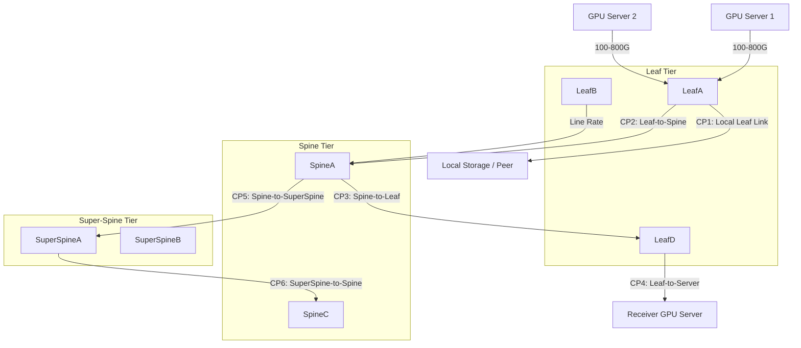
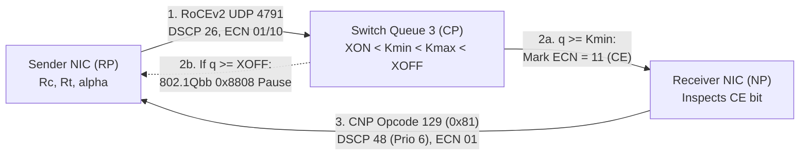
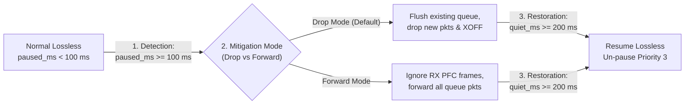

# 12.4 PFC, ECN and DCQCN in depth

| | |
|---|---|
| Level | Advanced |
| Priority tier | 1 |
| Lab venue | Nebius GPU |
| Part | Part 12: Complete AI networking |
| Sources | `ai-data-center-network-design-and-technologies` Ch. 7; `nvidia-devops` V9 Ch. 4–5 & Labs 01–04 |
| Code | `code/part12/pfc_ecn_dcqcn.py`, `code/part12/pfc_ecn_dcqcn_lab.py` |
| Coverage file | `planning/coverage/chapters/12-04.md` |

## Why this matters for AI infrastructure

An all-to-all or AllReduce collective across an Ethernet GPU fabric can stall even when every physical optical link is healthy. Every packet-drop counter can read zero while training throughput collapses. One receiver-facing leaf egress port fills its queue and emits Priority Flow Control pause frames continuously. Within microseconds, upstream switch ingress buffers fill and propagate pause frames hop by hop. That chain freezes unrelated GPU workers that happen to share the same traffic class. Conversely, if PFC is absent when microbursts converge on a single egress port, RoCEv2 packets drop. Those drops trigger hardware Go-Back-N retransmission storms across 400 Gbps or 800 Gbps rails.

Preventing both failure modes requires coordinating two distinct mechanisms across every network adapter and switch hop. First, Explicit Congestion Notification and Data Center Quantized Congestion Notification form an early end-to-end closed control loop. A congested switch marks the IP ECN field to Congestion Experienced. The destination adapter returns a RoCEv2 Congestion Notification Packet, and the sender hardware Reaction Point throttles that specific Queue Pair before buffers fill. Second, Priority Flow Control acts as a link-local, hop-by-hop Layer 2 circuit breaker. It pauses transmission for a single priority class while reserving enough headroom buffer to absorb bytes already in flight along the cable and transceiver pipeline.

```text
Coordinated RoCEv2 Congestion Control Architecture:
  1. ECN + DCQCN (RFC 3168 / RoCEv2):
     - Switch marks 2-bit IP ECN field to 11 (Congestion Experienced, CE)
     - Destination NIC returns CNP (InfiniBand BTH opcode 129 / 0x81, UDP port 4791)
     - Sender NIC Reaction Point (RP) throttles only the offending Queue Pair (QP)
  2. Priority Flow Control (PFC, IEEE 802.1Qbb):
     - Link-local Layer 2 MAC Control frame (EtherType 0x8808, opcode 0x0101, dst MAC 01:80:C2:00:00:01)
     - Pauses a single 802.1p priority class (0..7) for 0..65,535 quanta (512 bit-times per quantum)
     - Reserves flight-time headroom buffer for cable + transceiver + ASIC pipeline delay
```

This chapter builds on the foundational QoS concepts in Chapter 2.19 and the RoCEv2 transport architecture in Chapter 12.3. We derive exact frame formats, quanta timing equations, cable flight-time headroom math, and Weighted Random Early Detection marking curves. We also trace DCQCN Reaction Point rate-cut and recovery equations, threshold ordering rules, and PFC Watchdog state machines. Finally, we compare next-generation Source Flow Control and Congestion Signaling and walk through production diagnostic workflows.

## Prerequisites and outcomes

**Prerequisites:** Review queuing, QoS, ECN, PFC, and DCB basics in Chapter 2.19. Review RDMA fundamentals in Chapter 12.2 and RoCEv2 transport in Chapter 12.3.

**Outcomes:** After completing this chapter, you will be able to:
- Identify all six Clos fabric congestion points. You will also explain why RoCEv2 over UDP port 4791 requires coordinated congestion management.
- Decode every field of an IEEE 802.1Qbb PFC pause and un-pause frame. You will compute exact pause durations across 100 Gbps to 800 Gbps links.
- Size per-priority lossless buffers from cable length, glass propagation speed, transceiver delay, and MTU. You will also audit `mlnx_qos` outputs.
- Trace the ECN and DCQCN closed loop across the IP ToS byte, WRED probability zones, and CNP generation. You will also trace the three-stage Reaction Point recovery state machine.
- Configure the three-stage PFC Watchdog and compare hop-by-hop PFC with Source Flow Control and Congestion Signaling. You will isolate production pause trees using `ethtool -S` and `mlx5_cnp_stats`.

---

## 1. The six Clos congestion points and why RoCEv2 needs two loops

When multiple GPU servers transmit at 100 Gbps to 800 Gbps line rate simultaneously, transient microbursts and Equal-Cost Multi-Path hash collisions overload switch egress queues. Engineers operating AI clusters feel this immediately when collective latency spikes even on a non-oversubscribed Clos topology. RoCEv2 encapsulates InfiniBand transport headers inside connectionless UDP packets on destination port 4791. Because standard Ethernet provides no built-in windowing or retransmission, congestion materializes at six distinct points across two-tier and three-tier fabrics.



| Congestion point | Topology path | How congestion arises | Immediate symptom on queue |
|---|---|---|---|
| **1. Local leaf link congestion (CP1)** | Two servers on LeafA -> south-facing storage/compute link on LeafA | Local switching bypasses spine load balancing; two line-rate flows converge on 1 south-facing port | South-facing egress queue on LeafA fills rapidly in an N:1 local incast |
| **2. Leaf-to-spine link congestion (CP2)** | Two servers on LeafA -> same uplink from LeafA to SpineA | ECMP hash collision places multiple high-entropy elephant flows onto the same LeafA -> SpineA uplink | Northbound uplink queue on LeafA builds occupancy while parallel uplinks to SpineB sit idle |
| **3. Spine-to-leaf link congestion (CP3)** | Server on LeafA + Server on LeafB -> SpineA -> single downlink to LeafD | Flows arrive on separate spine ingress ports without contention, then collide on the single SpineA -> LeafD downlink | Southbound transit spine queue on SpineA -> LeafD crosses ECN and PFC thresholds |
| **4. Leaf-to-server link congestion (CP4)** | Server on LeafA via SpineA + Server on LeafB via SpineB -> LeafD -> receiver server | Perfect spine load balancing delivers 2x line rate cleanly to LeafD, exceeding the single receiver NIC link capacity | Final egress leaf queue on LeafD -> Server saturates in a classic destination incast |
| **5. Spine-to-super-spine link congestion (CP5)** | Servers on LeafA and LeafB -> SpineA -> single uplink to SuperSpineA | Multi-pod traffic in a 3-tier fabric hashes onto the same SpineA -> SuperSpineA link while SuperSpineB is underutilized | Northbound spine-to-super-spine queue builds backpressure toward the lower pod |
| **6. Super-spine-to-spine link congestion (CP6)** | Servers across LeafA, LeafB, LeafE -> SpineA/SpineB -> SuperSpineA -> SpineC | Traffic spreads cleanly upward to SuperSpineA, then converges onto a single SuperSpineA -> SpineC downlink | Core-to-pod downlink queue on SuperSpineA becomes the fabric bottleneck |

### Why neither ECN alone nor PFC alone suffices

A common architectural question is why AI Ethernet fabrics run both ECN and PFC rather than picking one. Relying on ECN alone leaves the fabric vulnerable to packet drops during fast microbursts. Relying on PFC alone causes head-of-line blocking and fabric-wide pause trees that freeze innocent GPU jobs.

ECN is an end-to-end control loop. When SpineA marks a packet on the congested SpineA to LeafD link, that packet must first finish traversing the forward path through LeafD to the destination server. The destination adapter must then generate a CNP, and that CNP must traverse the reverse path back to the sender before transmission slows down. During that round-trip delay, a sudden incast burst can fill the remaining switch buffer and drop packets. Because a queue with only ECN enabled can still drop packets during fast transients, an ECN-only queue is classified as a lossy queue.

PFC acts immediately across a single link hop by hop, pausing transmission before a queue overflows to maintain a lossless queue. However, PFC has no concept of an individual flow or Queue Pair. It stops all traffic mapped to the congested priority class on that link. If one congested flow triggers PFC on Priority 3, every innocent flow sharing Priority 3 on that link is blocked through head-of-line blocking. Sustained pauses then propagate backward into a fabric-wide PFC pause tree.

DCQCN resolves this tension by combining both mechanisms over DSCP. ECN acts first at a lower buffer threshold to throttle only the offending sender Queue Pairs end to end. PFC sits higher in the buffer as a last-resort safety net to absorb microbursts before any packet drop occurs.

---

## 2. Priority Flow Control frame format, quanta math, and buffer headroom

### 2.1 From Global Pause to Per-Priority Pause

When a receiver buffer fills on a legacy Ethernet link, stopping the entire physical wire freezes SSH management, BGP keepalives, storage traffic, and RDMA collectives alike. Cluster operators lose control-plane visibility right when congestion hits.

Original Ethernet flow control under IEEE 802.3x Global Pause acted like a single red traffic light across the entire physical link. IEEE 802.1Qbb Priority Flow Control replaces link-wide pause with eight independent virtual lanes. Those lanes correspond to the 3-bit IEEE 802.1p Priority Code Point or mapped DSCP classes. When Queue 3 crosses its XOFF threshold on a receiving switch port, the receiver sends a Layer 2 MAC Control frame upstream. That frame instructs its link partner to pause only Priority 3 while the other seven priorities continue transmitting at full line rate.

### 2.2 Wire-level anatomy of an 802.1Qbb PFC XOFF and XON frame

If a switch port emits malformed pause frames or enables the wrong class bitmask, the upstream peer misbehaves. It either ignores the pause and drops RoCEv2 packets or halts the wrong priority queue. Network engineers inspecting packet captures need to decode the exact byte layout on the wire.

A PFC frame is a 64-byte Layer 2 Ethernet MAC Control frame transmitted directly to the link-local peer. Switches never forward PFC frames across Layer 2 bridges or Layer 3 routers.

| Field | Size | Wire value (Hex / Binary) | Operational meaning |
|---|---|---|---|
| **Destination MAC** | 6 octets | `01:80:C2:00:00:01` | IEEE 802.1 reserved non-forwardable link-local MAC control multicast address |
| **Source MAC** | 6 octets | e.g., `10:0e:7e:b7:a7:1b` | MAC address of the congested port generating the pause frame |
| **EtherType** | 2 octets | `0x8808` | Identifies an Ethernet MAC Control frame |
| **Control Opcode** | 2 octets | `0x0101` | Identifies Class-Based Flow Control (CBFC / PFC, IEEE 802.1Qbb) |
| **Priority Control Vector (Class Enable Vector)** | 2 octets | `0x0008` (C3 = True, C0..C2, C4..C7 = False) | 16-bit field (8 upper reserved bits = 0, 8 lower bits = e[7]..e[0]); `1 << 3 = 0x0008` enables Class 3 |
| **Time (`time[0]..time[7]`)** | 16 octets (8 x 2 octets) | C3 = 65535 (`0xFFFF`) for XOFF; C3 = 0 (`0x0000`) for XON | Pause duration in 512-bit quanta (0..65,535) for each of the 8 classes (C0..C7) |
| **Padding + FCS (CRC-32)** | 26 + 4 octets | Zero-padded to 60 B + 4 B CRC | Brings total wire frame length to 64 bytes |

Two packet-capture states define the PFC lifecycle for Class 3. First, an XOFF pause frame fires when the receiver Priority 3 ingress buffer crosses the XOFF threshold. The port transmits a 64-byte frame with Class Enable Vector `0x0008` and Class 3 pause time set to 65,535 quanta. The other seven class timers remain zero. If congestion persists, each subsequent packet crossing XOFF triggers a fresh XOFF frame that resets the upstream pause timer. Second, an XON un-pause frame fires once the congested queue drains below the XON threshold before the pause timer expires. The receiver transmits an identical 64-byte frame with Class 3 pause time set to 0. That frame instructs the upstream neighbor to resume Priority 3 transmission immediately.

### 2.3 Exact PFC pause duration math across 100G, 200G, 400G, and 800G

As AI fabrics upgrade from 100 Gbps to 400 Gbps and 800 Gbps rails, single-frame pause times shrink proportionally. Operators who assume a fixed microsecond pause window misinterpret pause storm telemetry on faster links.

In IEEE 802.1Qbb, each pause quantum equals 512 bit-times at the negotiated link speed. Because 1 Gbps equals 1 bit per nanosecond, the pause duration for a 16-bit quanta value $Q$ depends on the link rate $R_\{\text`{Gbps}`}$.

```text
IEEE 802.1Qbb Quanta Pause Duration Equations:
  Total Bit-Times      = Q * 512
  Pause Duration (ns)  = (Q * 512) / R_Gbps
  Pause Duration (us)  = (Q * 512) / (R_Gbps * 1000)
```

For the maximum pause value of 65,535 quanta, the frame specifies 33,553,920 bit-times.

| Link speed ($R_\{\text`{Gbps}`}$) | Quanta ($Q$) | Total bit-times ($Q \times 512$) | Pause duration (ns) | Pause duration (µs) | Operational note |
|---|---|---|---|---|---|
| **100 Gbps** | 65,535 | 33,553,920 | 335,539.2 ns | **335.5392 µs** | Legacy 100G RoCEv2 leaf-server link |
| **200 Gbps** | 65,535 | 33,553,920 | 167,769.6 ns | **167.7696 µs** | ConnectX-6 / HDR-era Ethernet rail |
| **400 Gbps** | 65,535 | 33,553,920 | 83,884.8 ns | **83.8848 µs** | ConnectX-7 / Spectrum-4 400G rail |
| **800 Gbps** | 65,535 | 33,553,920 | 41,942.4 ns | **41.9424 µs** | ConnectX-8 / Spectrum-X 800G rail |
| **Any rate (XON)** | 0 | 0 | 0.0 ns | **0.0 µs** | Explicit XON un-pause frame resumes TX immediately |

A quantum is defined in bit-times rather than wall-clock microseconds. Doubling the link speed therefore cuts the maximum pause duration of a single XOFF frame in half. Moving from 400 Gbps to 800 Gbps reduces the maximum single-frame pause from 83.8848 microseconds to 41.9424 microseconds.

### 2.4 Cable flight-time headroom math and `mlnx_qos` buffer thresholds

When a receiving switch port crosses XOFF and emits a pause frame, bytes already in flight on the wire continue arriving. They keep arriving until the pause frame reaches the upstream sender and the sender MAC stops transmitting. If the priority buffer above XOFF is too small to absorb those in-flight bytes, the lossless queue suffers tail-drop packet loss.

To prevent drops during this reaction window, the headroom buffer above XOFF must absorb three components. First, it must absorb round-trip cable propagation delay at the speed of light in glass. That speed is 5 nanoseconds per meter one way or 10 nanoseconds per meter round trip. Second, it must absorb the transceiver, PHY, and ASIC reaction pipeline delay, which is typically 600 nanoseconds. Third, it must absorb in-flight serialization of up to two jumbo MTU packets plus the 64-byte PFC control frame. One jumbo frame may have just begun serializing at the sender when XOFF arrived. Another frame may be finishing at the receiver when XOFF triggered.

```text
Minimum Lossless Flight-Time Headroom Formula:
  Headroom_min (bytes) = ((2 * L_m * 5 ns/m + t_pipeline_ns) * R_Gbps) / 8 + (2 * MTU) + 64
```

Comparing a short in-rack copper cable against a long campus optical fiber at 400 Gbps shows why long links need much larger headroom buffers.

| Link scenario (400 Gbps, MTU = 9,000 B) | Cable RTT (2 * L * 5 ns/m) | Total reaction time (RTT + 600 ns) | In-flight wire bytes (t * 400 / 8) | Serialization bytes (2 * 9,000 + 64) | Required flight headroom (B) |
|---|---|---|---|---|---|
| **Short in-rack DAC (L = 2 m)** | 20 ns | 620 ns | 31,000 B | 18,064 B | **49,064 B** |
| **Long optical fiber (L = 500 m)** | 5,000 ns | 5,600 ns | 280,000 B | 18,064 B | **298,064 B** (+249,000 B delta) |

On a switch or host interface, `mlnx_qos -i swp12` exposes the deployed buffer partitioning, XOFF, XON, headroom, and hysteresis.

```text
# (untested here)
$ mlnx_qos -i swp12
Priority trust state: pcp
Receive buffer size (bytes): 262144, 262144, 262144, ...
PFC configuration:
        priority    0   1   2   3   4   5   6   7
        enabled     0   0   0   1   0   0   0   0
        buffer      0   0   0   1   0   0   0   0

Buffer size assigned to priority 3: 65536 bytes
Xoff threshold: 49152 bytes   (75% of buffer)
Xon threshold:  32768 bytes   (50% of buffer)
```

```text
mlnx_qos -i swp12 Lossless Buffer Invariants:
  - Narrow Lossless Scope:  enabled = 0 0 0 1 0 0 0 0 -> Only Priority 3 (buffer 1) is lossless; Priorities 0..2 and 4..7 remain lossy
  - Port & Priority Pool:   262,144 B port receive buffer; 65,536 B assigned to Priority 3
  - Flight Headroom:        65,536 - 49,152 = 16,384 bytes (25.0% above XOFF at 75.0%) absorbs in-flight bytes after XOFF fires
  - Drain Hysteresis:       49,152 - 32,768 = 16,384 bytes (25.0% gap between 75.0% XOFF and 50.0% XON) prevents rapid XOFF/XON oscillation
```

Every number in this output enforces a specific hardware invariant. Only Priority 3 is lossless so management on Priority 0 and storage never enter a pause domain. Setting XOFF at 75 percent reserves 16,384 bytes of headroom above XOFF. Setting XOFF equal to the full buffer leaves zero headroom and causes tail-drop packet loss before the upstream sender can halt. Similarly, the queue must drain down to 50 percent before XON lifts the pause. If XON were set equal to XOFF with zero hysteresis, a single draining packet would trigger XON. The very next arriving packet would then trigger XOFF, causing `tx_pfc_prio3` to spike with micro-oscillations. Conversely, setting XON to zero bytes starves the link by delaying resumption until the queue is completely empty.

---

## 3. Explicit Congestion Notification and DCQCN closed-loop rate control

### 3.1 IP header DSCP + ECN bits and CNP packet format

If a congested switch drops packets to signal congestion, RoCEv2 performance collapses under Go-Back-N retransmissions. If the switch uses PFC alone, innocent flows freeze behind class-wide pauses. The fabric needs a way to mark individual congested flows in flight. It must also carry that signal back to the exact sending Queue Pair without being delayed by the congestion itself.

In the IPv4 Type of Service byte or IPv6 Traffic Class byte, the upper 6 bits hold the Differentiated Services Code Point used for QoS queue classification. The lower 2 bits hold the ECN field defined in RFC 3168.

| ECT bit (Bit 6) | CE bit (Bit 7) | 2-bit ECN codepoint | Standard name | Switch & endpoint behavior under congestion |
|---|---|---|---|---|
| `0` | `0` | **`00`** | Not-ECT (Not ECN-Capable Transport) | Transport does not support ECN; congested switches **drop** the packet instead of marking it |
| `0` | `1` | **`01`** | ECT(1) (ECN-Capable Transport 1) | Marks packet as ECN-capable; set by sender on RoCEv2 data packets and by receiver on returning CNP frames (`01` and `10` are treated identically by transit switches) |
| `1` | `0` | **`10`** | ECT(0) (ECN-Capable Transport 0) | Marks packet as ECN-capable; congested switches rewrite `10` (or `01`) to `11` (CE) instead of dropping |
| `1` | `1` | **`11`** | CE (Congestion Experienced) | Set by a congested transit switch when queue occupancy crosses its WRED ECN threshold; triggers the receiver NIC to generate a CNP |

When an ECN-marked RoCEv2 packet reaches the destination server, the receiving adapter Notification Point hardware generates a Congestion Notification Packet back toward the source IP. The CNP is a RoCEv2 frame on UDP port 4791 carrying InfiniBand Base Transport Header opcode 129. It identifies the congested destination Queue Pair so the sender throttles only that specific Queue Pair rather than the entire priority class. The receiver maps the CNP to a high-priority control class such as DSCP 48 on strict-priority Queue 6. Carrying CNPs on Priority 6 ensures backward congestion notifications are never delayed behind or paused by Priority 3 data congestion.

```text
RoCEv2 Data vs Congestion Notification Packet (CNP) Wire Profile:
  - RoCEv2 Data Packet:  UDP dst port 4791 | DSCP 26 (AF31, Queue 3) or DSCP 46 (EF, tcpdump tos 0xb8 where 0xb8 >> 2 = 46) | ECN 01/10 -> 11 (CE)
  - RoCEv2 CNP Frame:    UDP dst port 4791 | IB BTH opcode 129 (0x81, binary 10000001) | Carries congested QP ID | ECN 01 (ECT(1)) | DSCP 48 (CS6, Queue 6)
```

### 3.2 WRED `K_min` / `K_max` probabilistic marking curve and `XON < K_min < K_max < XOFF`

If a switch waits until a single static buffer cutoff to mark ECN, every active sender receives congestion signals simultaneously and cuts its rate in lockstep. That synchronized sawtooth oscillation leaves the link underutilized. Furthermore, if ECN thresholds sit above the PFC XOFF threshold, PFC fires first and ECN never prevents pause storms.

Production AI switches apply Weighted Random Early Detection to mark ECN bits probabilistically. The marking probability grows linearly as queue occupancy $q$ rises between a minimum threshold $K_`{\min}`$ and a maximum threshold $K_`{\max}`$ with maximum marking probability $P_`{\max}`$.

```text
WRED Probabilistic ECN Marking Function P_mark(q):
  - Green Zone (q < K_min):          P_mark(q) = 0.0 (Free Flow)
  - Yellow Zone (K_min <= q < K_max): P_mark(q) = P_max * (q - K_min) / (K_max - K_min) (Linear WRED Ramp)
  - Red Zone (q >= K_max):           P_mark(q) = 1.0 (100% ECN Marking)
```

The table below shows a standard high-speed switch profile with $K_`{\min}`$ at 150 KB and $K_`{\max}`$ at 1,500 KB.

| Queue occupancy ($q$) | Queue zone | WRED calculation | Marking probability ($P_\{\text`{mark}`}$) | Switch action |
|---|---|---|---|---|
| **100 KB** (`< 150 KB`) | **Green Zone** | $q < K_`{\min}`$ | **0.0 (0%)** | Forward packets unmarked at full line rate |
| **487.5 KB** (25% of span) | **Yellow Zone** | $(487.5 - 150) / (1500 - 150) = 337.5 / 1350$ | **0.25 (25%)** | Mark 1 in 4 packets with ECN = 11 (CE) |
| **825 KB** (midpoint) | **Yellow Zone** | $(825 - 150) / (1500 - 150) = 675 / 1350$ | **0.50 (50%)** | Mark 1 in 2 packets with ECN = 11 (CE) |
| **1,600 KB** (`>= 1,500 KB`) | **Red Zone** | $q \ge K_`{\max}`$ | **1.0 (100%)** | Mark 100% of packets with CE (`< XOFF`, no PFC yet) |
| **`>= 2,000 KB`** (`>= XOFF`) | **PFC Safety Net** | $q \ge \text`{XOFF}`$ | **1.0 + PFC XOFF** | Emit 802.1Qbb pause frame to upstream hop |

For DCQCN to prevent PFC storms, the thresholds on every lossless queue must strictly satisfy the ordering rule below.

```text
DCQCN Threshold Ordering Invariant (ADC Ch 7 Fig 7-16):
  - Ordering Rule:    0 < XON < K_min < K_max < XOFF < BufferMax
  - Valid Profile:    XON (32,768 B) < K_min (150,000 B) < K_max (1,500,000 B) < XOFF (2,000,000 B) < BufferMax (2,500,000 B)
  - Broken Profile:   Setting K_max = 55,000 B above XOFF = 49,152 B violates K_max < XOFF, firing PFC pauses before ECN reaches 100%
```

If $K_`{\max}`$ is set at or above XOFF, the switch fires hop-by-hop PFC pauses before ECN marking ever reaches 100 percent. That misconfiguration turns PFC into the primary congestion mechanism and starves innocent flows.

### 3.3 The DCQCN three-actor state machine (CP, NP, RP)

Once a switch marks ECN and a receiver sends a CNP, the sending network adapter must decide how sharply to cut its injection rate. It must also decide how quickly to recover when congestion clears. Cutting too weakly fails to stop PFC pauses, while cutting and recovering too aggressively creates wild throughput oscillations.

DCQCN coordinates three hardware state machines across the fabric. First, the Congestion Point on the transit switch egress queue monitors queue depth against $K_`{\min}`$ and $K_`{\max}`$ and rewrites the ECN bits to CE. Second, the Notification Point on the receiver adapter inspects arriving RoCEv2 packets. When CE is present, it generates at most one CNP per coalesce timer window, typically 50 microseconds, back to the sender. Third, the Reaction Point on the sender adapter hardware rate limiter maintains three state variables per active Queue Pair. Those variables are current transmission rate $R_c$, target rate $R_t$ saved before a cut, and congestion estimate $\alpha$ updated via an exponential weighted moving average with weight $g$.

Because $\alpha$ never exceeds 1.0, a single rate cut reduces $R_c$ by at most 50 percent. When no CNP arrives, the sender decays $\alpha$ toward zero as each rate-increase timer or byte counter expires. The sender then recovers across three stages governed by the Fast Recovery threshold $F$: Fast Recovery, Additive Increase, and Hyper-Additive Increase.

```text
DCQCN Reaction Point (RP) Equations & Numerical Walkthrough (g = 1/16 = 0.0625, F = 5, R_AI = 10.0 Gbps, R_HAI = 40.0 Gbps):
  - Multiplicative Rate Cut on CNP Arrival:
    * Equations: R_t <- R_c | R_c <- R_c * (1 - alpha / 2) | alpha <- (1 - g) * alpha + g * 1.0
    * At alpha = 1.0 on 400.0 Gbps link: R_t = 400.0 Gbps, R_c = 400.0 * (1 - 1.0/2) = 200.0 Gbps (maximum 50% single cut)
    * At alpha = 0.5 on 400.0 Gbps link: R_t = 400.0 Gbps, R_c = 400.0 * (1 - 0.5/2) = 300.0 Gbps, alpha -> (1 - 0.0625)*0.5 + 0.0625 = 0.53125
  - Three-Stage Rate Recovery When No CNP Arrives (alpha <- (1 - g) * alpha; starting from R_c = 200.0 Gbps, R_t = 300.0 Gbps, alpha = 0.8):
    1. Fast Recovery (step <= F, step 1):            Keeps R_t = 300.0 Gbps; binary-searches R_c = (200.0 + 300.0) / 2 = 250.0 Gbps
    2. Additive Increase (step > F, step 6):         R_t = min(LineRate, 300.0 + 10.0) = 310.0 Gbps; R_c = (250.0 + 310.0) / 2 = 280.0 Gbps
    3. Hyper-Additive Increase (both > F, step 9):   With i = 2, R_t = min(LineRate, 310.0 + 2 * 40.0) = 390.0 Gbps; R_c = (280.0 + 390.0) / 2 = 335.0 Gbps
```



| Loop component | Actor & hardware location | Trigger condition | Action taken | Key verification counter |
|---|---|---|---|---|
| **1. Forward data** | Sender NIC (RP) | Application posts RDMA verb | Emits UDP 4791 packet with DSCP 26 (Prio 3) and ECN = 01 or 10 | `tx_prio3_packets` |
| **2a. ECN marking** | Switch egress queue (CP) | Queue depth $q \ge K_`{\min}`$ (WRED) | Rewrites IP ECN bits to 11 (CE) and forwards packet normally | `rx_ecn_marked_prio3` |
| **2b. PFC backstop** | Switch ingress/egress (CP) | Ingress buffer crosses XOFF (49,152 B) | Sends 64 B `0x8808` XOFF (65,535 quanta) to link partner | `tx_pfc_prio3` / `rx_pfc_prio3` |
| **3. CNP feedback** | Receiver NIC (NP) | Receives RoCEv2 packet with ECN = 11 | Sends CNP (BTH opcode 129 / `0x81`, ECN 01, DSCP 48) to sender | `np_ecn_marked_roce_packets` |
| **4. Rate cut & recovery** | Sender NIC (RP) | Receives CNP or recovery timer fires | Cuts $R_c \leftarrow R_c(1 - \alpha/2)$, then runs Fast / AI / HAI recovery | `np_cnp_handled`, `rp_current_rate`, `rp_byte_reset` |

---

## 4. Hop-by-hop PFC propagation, pause trees, and the PFC Watchdog

### 4.1 The 5-step hop-by-hop PFC propagation chain

When DCQCN cannot drain a congested downstream link fast enough or when a receiver adapter hangs, PFC propagates backward across the fabric. That backpressure builds a pause tree that freezes upstream spine and leaf queues, halting innocent GPU jobs that share those transit links.

PFC propagates backward through a strict five-step hardware chain. First, a transit switch such as SpineA receives a PFC XOFF frame on its egress interface facing LeafC or LeafD. Second, SpineA immediately pauses transmission on the corresponding egress Queue 3 for the requested quanta duration. Third, packets from upstream leaves LeafA and LeafB continue arriving at SpineA destined for that paused egress queue. Consequently, SpineA's own ingress buffer for Priority 3 fills and breaches its XOFF threshold. Fourth, SpineA's ingress port generates a new PFC XOFF frame and transmits it upstream toward LeafA and LeafB. Fifth, the chain repeats hop by hop until LeafA pauses the source server GPU101. That pause freezes all Priority 3 traffic across the affected branch, including innocent flows from GPU103 on LeafB.

### 4.2 The 3-stage PFC Watchdog (Detection, Mitigation, Restoration)

If a broken adapter driver or PCIe credit loop causes a downstream node such as GPU102 on LeafC to emit continuous XOFF frames indefinitely, the resulting PFC storm can lock up the entire fabric. Operators need an automated circuit breaker on every switch to isolate the broken sink before upstream spine buffers freeze.

The PFC Watchdog on each switch monitors per-port pause duration and breaks the storm across three stages: Detection, Mitigation, and Restoration.



| Watchdog stage | Trigger condition | Switch hardware actions | Impact on upstream fabric (LeafA, LeafB, GPU101, GPU103) |
|---|---|---|---|
| **1. Detection** | Port/queue remains paused by incoming XOFF frames for $\ge T_\{\text`{detect}`}$ (e.g., 100 ms; storm tested at 150 ms) | Marks the port on SpineA facing LeafC as experiencing an abnormal PFC storm and increments watchdog storm counters | Identifies the stuck branch before upstream ingress buffers lock the entire spine tier |
| **2a. Mitigation (Drop mode — most common)** | Watchdog storm state active on queue | **(1)** Discards all packets already queued in the output queue; **(2)** discards new packets arriving for that output queue; **(3)** discards incoming pause frames from the same priority group | **Stops upstream pause propagation:** SpineA clears its buffer and never sends XOFF to LeafA or LeafB, isolating the blast radius to the broken LeafC -> GPU102 sink |
| **2b. Mitigation (Forward mode)** | Watchdog storm state active when configured for forward | Ignores received PFC frames on the port and forcefully forwards both queued and newly arriving packets downstream | Drains SpineA's buffer without pausing upstream hops, pushing packets toward LeafC |
| **3. Restoration** | Received PFC pause frames remain below threshold for $\ge T_\{\text`{restore}`}$ (e.g., 200 ms quiet window; tested at 250 ms) | Lifts mitigation drops, un-pauses the queue, and restores normal IEEE 802.1Qbb lossless behavior | Fabric seamlessly returns to lossless RoCEv2 operation once the downstream fault clears |

---

## 5. Next-generation congestion signaling: Source Flow Control and CSIG

Because ECN suffers from forward-plus-return signaling latency and PFC suffers from class-wide head-of-line blocking, large AI clusters still experience microburst stalls under extreme incast. Two newer standards target direct, low-latency, flow-aware feedback to eliminate those trade-offs.

### 5.1 Source Flow Control (SFC, IEEE 802.1Qdw / Source PFC)

When a transit spine queue congests under ECN, the congestion mark must travel all the way to the destination receiver and back as a CNP before the sender reacts. Source Flow Control in IEEE 802.1Qdw eliminates both the forward-trip delay of ECN and the class-wide blast radius of hop-by-hop PFC.

First, a server on LeafA transmits a flow through SpineA toward LeafD. When the SpineA to LeafD queue crosses its SFC threshold, SpineA acts immediately instead of waiting for the packet to reach the destination server. Second, SpineA trims the data packet payload and reverses the source and destination IP addresses in the header. It then sends a flow-specific SFC congestion signal directly back toward the source across SpineA to LeafA. Third, when LeafA receives the SFC signal, it can pause the specific queue locally or forward the SFC signal to an SFC-capable server adapter. For legacy adapters, LeafA translates the SFC signal into a standard 802.1Qbb PFC pause frame. Because SFC triggers at the congested switch in half a round-trip time and identifies the specific flow, it prevents both ECN forward-path delay and PFC class-wide unfairness.

### 5.2 Congestion Signaling (CSIG, `draft-ravi-ippm-csig-01`)

Single-bit ECN marking tells a sender that some hop along the path crossed a threshold, but it hides how much bandwidth remains and which switch tier is congested. Congestion Signaling uses In-Band Network Telemetry to embed fixed-length, multi-bit bottleneck summaries directly inside live data packets.

The CSIG tag sits at Layer 2.5 between the Layer 2 Ethernet header and the Layer 3 IP header, requiring an IEEE-allocated Ethernet tag. As sender GPU1 transmits packets across hops to receiver GPU2, each switch updates the CSIG tag with its local bottleneck state. Receiver GPU2 reflects the accumulated CSIG summary back to GPU1 via CSIG reflection headers. That reflection allows the sender to adjust both its injection rate and its multipath selection in real time.

```text
CSIG Tag Layout and Metadata Fields (draft-ravi-ippm-csig-01, ADC Ch 7 Figs 7-19..7-21):
  - Wire Header Placement:  Ethernet (L2) -> CSIG Tag (L2.5) -> IP (L3) -> UDP (L4) across CSIG1 -> CSIG2 -> CSIG3/CSIG4 -> CSIG5 -> CSIG6
  - Three CSIG Tag Sections:
    1. Signal Type:         Selects congestion metric requested by server (minimum ABW / C, minimum ABW [available bandwidth], or maximum PD [packet delay])
    2. Signal Value:        Carries the quantized multi-bit congestion measurement along the path
    3. Locator Metadata:    Static per-port identifier encoding 4 bottleneck fields:
                            (1) Capacity of bottleneck link, (2) Stage in Clos topology, (3) Device ID, (4) Link identification (uplink or downlink)
```

| Mechanism | Standard / Draft | Granularity | Feedback path | Lossless guarantee | Primary advantage & trade-off |
|---|---|---|---|---|---|
| **ECN** | RFC 3168 | Per-flow (QP) | Switch -> Receiver -> CNP -> Sender (full RTT) | No (**lossy queue** if used alone) | Zero pause unfairness, but forward+reverse RTT is too slow for microbursts |
| **PFC** | IEEE 802.1Qbb | Per-priority class (0..7) | Congested Port -> Upstream Neighbor (1 hop) | Yes (**lossless queue**) | Immediate microburst protection, but causes head-of-line blocking & pause trees |
| **DCQCN** | SIGCOMM 2015 / RoCEv2 | ECN per-QP + PFC per-class | CNP end-to-end (XON < ECN < XOFF) | Yes (when PFC backstop enabled) | Production standard: ECN handles steady contention; PFC catches bursts |
| **SFC** | IEEE 802.1Qdw | Per-flow | Congested Switch -> Leaf / Source (direct reverse) | Yes (with leaf PFC translation) | Avoids ECN forward-path delay and avoids class-wide PFC blocking |
| **CSIG** | `draft-ravi-ippm-csig-01` | Per-packet / Per-flow INT | L2.5 tag -> Receiver CSIG Reflection -> Sender | Complements rate & path control | Exposes exact bottleneck (capacity, stage, device ID, uplink/downlink) |

---

## Commands and configurations that matter

All operational commands below are marked `(untested here)` and reproduce the exact verification sequence from our production runbooks.

### 1. Inspecting PFC enablement, buffer allocation, XOFF, XON, and DSCP trust (`mlnx_qos`)

```bash
# (untested here) Inspect per-priority PFC, buffer sizes, XOFF, and XON on switch port swp12
mlnx_qos -i swp12

# (untested here) Verify PFC is enabled ONLY on Priority 3 (0 0 0 1 0 0 0 0), never on Priority 0 (management)
mlnx_qos -i swp12 | grep -A3 "PFC configuration"
```

### 2. Walking a PFC pause tree and correlating ECN marks (`ethtool -S`)

```bash
# (untested here) Check downstream receiver-facing leaf port (swp7) vs upstream relay port (swp3)
ethtool -S swp7 | egrep "tx_pfc_prio3|rx_pfc_prio3|rx_ecn_marked_prio3"
ethtool -S swp3 | egrep "tx_pfc_prio3|rx_pfc_prio3|rx_ecn_marked_prio3|queue3_occupancy"

# (untested here) Capture two consecutive 5-second windows on swp9 to measure active ECN marking delta
ethtool -S swp9 | grep rx_ecn_marked_prio3 && sleep 5 && ethtool -S swp9 | grep rx_ecn_marked_prio3
```

### 3. Auditing NIC DCQCN Notification Point and Reaction Point counters (`mlx5_cnp_stats`)

```bash
# (untested here) Verify sender RP is receiving CNPs and adjusting rate in response to switch ECN marks
mlx5_cnp_stats -d mlx5_0

# (untested here) Sample RP current rate and CNP count at 1-second intervals to detect synchronized oscillation
mlx5_cnp_stats -d mlx5_0 --interval 1
```

### 4. End-to-end 4-lab RoCEv2 path inventory, contention test, and GID evidence ladder

```bash
# (untested here) Lab 01 & 02: Verify route, MTU 9000, 400G link speed, RDMA netdev mapping, and zero uncorrected FEC
ip route get 10.20.8.5
ip link show dev ens1f0
ethtool ens1f0 | egrep "Speed|Duplex|Link"
rdma link show
date -u && ethtool -S ens1f0 | egrep "ecn_marked|pfc_prio|rx_prio3_packets|tx_prio3_packets|fec_uncorrected"

# (untested here) Lab 04: Compare healthy rail (mlx5_0, 392 Gbps in 2.1s) vs misaligned rail (mlx5_1, 156 Gbps in 8.2s)
ibv_devinfo -d mlx5_0 -i 1 | grep GID
ibv_devinfo -d mlx5_1 -i 1 | grep GID
ib_write_bw -d mlx5_0 -i 1 10.20.8.5
```

---

## How it fails

When congestion control misbehaves on a production AI fabric, counter signatures across switches and network adapters distinguish upstream pause relays from broken feedback loops and endpoint rail bugs.

```text
Production Counter Signatures Across Volume 09 Scenarios & Labs 01-04:
  - Ch 4 Scenario 1 (Pause Tree Relay vs Root):
    * Relay hop swp3: rx_pfc_prio3 = 41,823 | tx_pfc_prio3 = 41,810 | rx_ecn_marked_prio3 = 190 | queue3_occupancy = 98%
    * Receiver port swp7: tx_pfc_prio3 = 0 | rx_ecn_marked_prio3 = 2,200 (11.58x higher than swp3's 190)
  - Ch 5 Healthy Loop vs Broken Feedback (swp9 & mlx5_0):
    * Healthy swp9: rx_ecn_marked_prio3 climbs 84,200 -> 84,512 (delta 312) | NP = 305 | RP np_cnp_handled = 298 | rp_byte_reset = 1
    * Scenario 1 (Weak RP / Oversubscription): rx_ecn_marked_prio3 = 412,880 | rx_pfc_prio3 = 93,100 | np_cnp_handled = 409,500 (99.18%) | rp_current_rate = 98 Gbps on 100G
    * Scenario 2 (Oscillation): t=0s (40 CNPs, 100 Gbps) -> t=1s (380 CNPs, 12 Gbps) -> t=2s (2 CNPs, 95 Gbps) -> t=3s (410 CNPs, 11 Gbps) -> t=4s (3 CNPs, 96 Gbps)
    * Scenario 3 (Broken Return Path): rx_ecn_marked_prio3 +15,000, rx_pfc_prio3 +4,200, but sender np_cnp_handled = 0 and rp_current_rate = 100 Gbps
  - Lab 01-04 Evidence Ladder:
    * Lab 01 Baseline: fec_corrected_blocks = 412, fec_uncorrected_blocks = 0
    * Lab 03 Contention (60 s): rx_ecn_marked_prio3 = 47,829 | rx_pfc_prio3 = 412 | tx_pfc_prio3 = 14 | rx_prio3_packets 102,314 -> 51,234,892 (delta 51,132,578) | tx_prio3_packets 89,621 -> 48,901,234 (delta 48,811,613) | Sender A (89.2 Gbps) + Sender B (87.1 Gbps) = 176.3 Gbps
    * Lab 04 Misaligned Rail: mlx5_0 / ens1f0 (GID[3] fe80::0c42:a1ff:fec8:d79b/64) achieves 392 Gbps in 2.1 s (0 retries) vs mlx5_1 / ens1f1 (GID[3] fe80::0c42:a1ff:fec8:d79d/64) dropping to 156 Gbps in 8.2 s (2.51x slower, 3.90x longer, 24 RETRY_EXC_ERR, rx_ecn_marked_prio3 = 142)
```

| Failure mode | Observable symptoms & counter signature | Root cause | Diagnostic commands & remediation |
|---|---|---|---|
| **1. Upstream PFC pause tree from a downstream receiver bottleneck (`swp3` vs `swp7`)** | Collective latency spikes with 0 link errors and 0 drops. Upstream port `swp3` shows `rx_pfc_prio3: 41823`, `tx_pfc_prio3: 41810`, `rx_ecn_marked_prio3: 190`, and `queue3_occupancy: 98%`, while downstream receiver port `swp7` shows `tx_pfc_prio3: 0` and `rx_ecn_marked_prio3: 2200`. | `swp3` is a **relay hop** caught in the middle of a pause chain, whereas `swp7` (`rx_ecn_marked = 2,200`, 11.58x higher than `swp3`) is marking heavily at the receiver edge. | Walk in the `rx_pfc` direction until `tx_pfc == 0` (`trace_pause_tree_origin`). Relieve the destination bottleneck via job placement, adaptive routing, or validated ECN tuning; never blindly disable PFC. |
| **2. Management SSH freeze from accidental `prio0` PFC leak** | SSH sessions and Kubernetes heartbeats stall specifically during AllReduce bursts. `mlnx_qos -i swp12` shows `enabled: 1 0 0 1 0 0 0 0`. | PFC was accidentally enabled on **Priority 0** alongside Priority 3, allowing congestion or shared buffer pressure to pause management traffic. | Reconfigure `mlnx_qos` so `enabled` is set strictly to `0 0 0 1 0 0 0 0` (Priority 3 only) and verify `rx_pfc_prio0 == 0` under load. |
| **3. Heavy ECN marking + heavy PFC with weak RP throttling (98 Gbps on 100G)** | Switch `swp9` shows `rx_ecn_marked_prio3: 412880` and `rx_pfc_prio3: 93100`; sender `mlx5_0` shows `np_cnp_handled: 409500` (99.18% of marks), yet `rp_current_rate: 98 Gbps` on a 100 Gbps link. | The ECN/CNP feedback loop is intact (`409,500 / 412,880 = 99.18%` delivered), but the endpoint RP rate-cut profile is too weak or the destination cut is structurally oversubscribed to drain the queue before XOFF. | Apply the vendor-qualified DCQCN RP profile and fix destination oversubscription or job placement before altering switch thresholds. |
| **4. Synchronized sender rate oscillation (`100 -> 12 -> 95 -> 11 -> 96 Gbps`)** | Fabric utilization pulses in 1-second waves as `rp_current_rate` collapses by 88 Gbps and rebounds every second. | DCQCN rate-decrease factor is overly aggressive and recovery (`R_AI`/`R_HAI`) is too fast, causing all synchronized senders sharing the bottleneck to cut and overshoot in lockstep. | Restore the qualified DCQCN endpoint profile so `rp_current_rate` converges into a stable band (`70–90%` of line rate) instead of swinging `11%..96%`. |
| **5. Broken CNP return path or asymmetric sender response (`np_cnp_handled == 0`)** | Switch `rx_ecn_marked_prio3` climbs by `15,000+` and `rx_pfc_prio3` climbs by `4,200+`, but sender `np_cnp_handled` stays at 0 and `rp_current_rate` stays pinned at 100 Gbps. | Reverse-path ACL/routing drops CNP frames (UDP 4791, opcode 129), CNPs on Priority 6 are misclassified into a congested queue, or ECN/DCQCN is disabled on the receiver/sender NIC. | Audit bidirectional CNP reachability (DSCP 48 -> Queue 6) and verify `np_ecn_marked_roce_packets` on the receiver and `np_cnp_handled` on the sender track switch `rx_ecn_marked_prio3`. |
| **6. Misaligned RDMA device / GID selection masquerading as fabric congestion (`mlx5_1` vs `mlx5_0`)** | `ib_write_bw -d mlx5_1 -i 1 10.20.8.5` degrades from **392 Gbps (2.1 s, 0 retries)** on `mlx5_0` to **156 Gbps (8.2 s, 2.51x slower, 3.90x longer)** with **24 `RETRY_EXC_ERR`** completions and `rx_ecn_marked_prio3: 142` on `ens1f1`. | Process bound to the wrong RDMA device/rail (`mlx5_1` / `ens1f1` instead of `mlx5_0` / `ens1f0`), forcing cross-rail routing and ECN marks. | Walk the 4-layer evidence ladder (1. Physical `rdma link show` -> 2. Route/MTU 9000 -> 3. RoCE GID/device -> 4. QoS counters). Fix the process `-d mlx5_0` binding; never tune switch PFC/ECN for an endpoint selection bug. |

---

## Hands-on lab

**Venue:** Local workstation or Nebius GPU node using our self-checking Python simulator. No live switch hardware is required. Commands for live switches and adapters in the previous section are marked `(untested here)`.

Run the Chapter 12.4 verification lab (`code/part12/pfc_ecn_dcqcn_lab.py`), which executes 28 deterministic checks across our protocol model (`code/part12/pfc_ecn_dcqcn.py`).

```bash
python3 code/part12/pfc_ecn_dcqcn_lab.py
```

Expected output (28 passed, 0 failed):

```text
=== Chapter 12.4 Lab: PFC, ECN and DCQCN in Depth ===
  [PASS] ADC Ch 7 Table 7-1 IP Header & ECN bits: 8-bit ToS = 6-bit DSCP + 2-bit ECN (00 Not-ECT drop, 01 ECT(1), 10 ECT(0), 11 CE)
  [PASS] ADC Ch 7 RoCEv2 & CNP frame: UDP destination port 4791; CNP carries IB BTH opcode 129 (0x81, binary 10000001) and ECN 01
  [PASS] V9 Ch 4/6 & Handbook 2.19 DSCP markings: RoCE data DSCP 26 -> Prio 3, CNP DSCP 48 -> Prio 6, and tcpdump tos 0xb8 >> 2 == DSCP 46 (EF)
  [PASS] ADC Ch 7 Fig 7-10..7-12 IEEE 802.1Qbb PFC frame: 64B wire frame, Dst MAC 01:80:C2:00:00:01, Src 10:0e:7e:b7:a7:1b, EtherType 0x8808, Opcode 0x0101, Class 3 enable vector 0x0008, 16-octet Time field
  [PASS] IEEE 802.1Qbb Quanta math (100 Gbps): 65,535 quanta * 512 bit-times = 33,553,920 bit-times = 335,539.2 ns (335.5392 us)
  [PASS] IEEE 802.1Qbb Quanta math (200 Gbps & 400 Gbps): 200G max pause = 167.7696 us; 400G max pause = 83,884.8 ns (83.8848 us)
  [PASS] IEEE 802.1Qbb Quanta math (800 Gbps & XON=0): 800G max pause = 41,942.4 ns (41.9424 us); quanta=0 is explicit XON un-pause (0.0 us)
  [PASS] V9 Ch 4 mlnx_qos -i swp12 buffer profile: port rx buffer = 262,144 B, prio3 buffer = 65,536 B, XOFF = 49,152 B (75.0%), XON = 32,768 B (50.0%)
  [PASS] V9 Ch 4 mlnx_qos -i swp12 headroom & hysteresis: headroom = 65,536 - 49,152 = 16,384 B (25.0%); hysteresis = 49,152 - 32,768 = 16,384 B (25.0%)
  [PASS] Flight-time headroom sizing (400 Gbps, MTU 9000): 2m DAC needs 49,064 B (31,000 B wire + 18,064 B serialization); 500m fiber (5,000 ns RTT) needs 298,064 B (280,000 B wire + 18,064 B serialization)
  [PASS] WRED ECN Green & Red Zones (K_min=150 KB, K_max=1,500 KB from V6 Ch 1): 100 KB -> 0.0 (GREEN_ZONE_FREE_FLOW); 1,600 KB -> 1.0 (RED_ZONE_100PCT_ECN_MARKING)
  [PASS] WRED ECN Yellow Zone linear ramp: at 487.5 KB (25% of [150, 1500]), p = 0.25; at midpoint 825 KB, p = 0.50 (YELLOW_ZONE_PROBABILISTIC_ECN)
  [PASS] ADC Ch 7 Fig 7-16 DCQCN threshold ordering: valid ordering satisfies XON (32,768) < K_min (150,000) < K_max (1,500,000) < XOFF (2,000,000) < BufferMax (2,500,000)
  [PASS] ADC Ch 7 Fig 7-14 & 7-16 invalid threshold ordering detection: catches K_min >= K_max, K_max >= XOFF (PFC fires before ECN saturates), and XOFF == BufferMax (zero headroom)
  [PASS] DCQCN RP Rate Cut (V9 Ch 5 sequence diagram 400 -> 200 Gbps): at alpha=1.0, R_c = 400 * (1 - 1.0/2) = 200.0 Gbps (max 50% cut, R_t=400.0 Gbps); at alpha=0.5, R_c = 300.0 Gbps
  [PASS] DCQCN RP 3-Stage Recovery: Fast Recovery step 1 raises 200 -> 250.0 Gbps (R_t=300); Additive Increase step 6 raises R_t to 310 -> R_c=280.0 Gbps; Hyper-Increase step 9 raises R_t to 390 -> R_c=335.0 Gbps while alpha decays
  [PASS] ADC Ch 7 Fig 7-15 PFC Watchdog Stage 1 (Detection) & Stage 2 (Drop Mitigation): at 150 ms >= 100 ms threshold, Drop mode flushes existing queue packets, drops new packets, and discards incoming pause frames to stop upstream propagation
  [PASS] ADC Ch 7 Fig 7-15 PFC Watchdog Forward Mode & Stage 3 (Restoration): Forward mode ignores PFC and forwards queue packets; after 250 ms >= 200 ms quiet interval, Restoration resumes lossless Ethernet
  [PASS] V9 Ch 4 Scenario 1 Pause Tree Walk: swp3 (rx_pfc=41,823, tx_pfc=41,810, rx_ecn_marked=190, queue3_occupancy=98%) is a middle relay hop; swp7 (tx_pfc=0, rx_ecn_marked=2,200) is the downstream receiver-facing port
  [PASS] V9 Ch 4 Scenario 2 Management Priority Leak: mlnx_qos enabled=[1,0,0,1,0,0,0,0] enables PFC on prio0 (management) alongside prio3 (RoCE), stalling SSH during training bursts; fix sets enabled=[0,0,0,1,0,0,0,0]
  [PASS] V9 Ch 5 Healthy ECN/CNP Tracking (swp9): rx_ecn_marked_prio3 climbs 84,200 -> 84,512 (delta 312), mlx5_0 np_ecn_marked_roce_packets=305, np_cnp_handled=298, rp_byte_reset=1 -> HEALTHY_CLOSED_LOOP_CONTAINED
  [PASS] V9 Ch 5 Scenario 1 (Weak RP Response / Capacity Bottleneck): rx_ecn_marked_prio3=412,880, rx_pfc_prio3=93,100, np_cnp_handled=409,500 (99.18% of marks), but rp_current_rate=98 Gbps on 100G link
  [PASS] V9 Ch 5 Scenario 2 (Synchronized Rate Oscillation) & Scenario 3 (Broken Return Path): rp_current_rate swinging 100 -> 12 -> 95 -> 11 -> 96 Gbps (88 Gbps drop) diagnoses oscillation; np_cnp_handled=0 diagnoses broken reverse path
  [PASS] V9 Lab 03 Bounded Contention (60s, 2 senders on 400G uplink): rx_ecn_marked_prio3=47,829, rx_pfc_prio3=412, tx_pfc_prio3=14, rx_prio3_packets delta=51,132,578, tx_prio3_packets delta=48,811,613; Sender A (89.2 Gbps) + Sender B (87.1 Gbps) = 176.3 Gbps
  [PASS] V9 Lab 01/02/04 Evidence Ladder: Lab 01 clean baseline fec_corrected_blocks=412, fec_uncorrected_blocks=0; Lab 04 healthy mlx5_0 (392 Gbps in 2.1s, 0 retries) vs misaligned mlx5_1 (156 Gbps in 8.2s, 2.51x slower, 24 RETRY_EXC_ERR, rx_ecn_marked_prio3=142)
  [PASS] Edge-case validation: compute_pfc_pause_duration rejects quanta > 65,535; evaluate_pfc_buffer_profile enforces 0 < XON < XOFF < PriorityBuffer
  [PASS] Hysteresis validation: XON == XOFF (49,152 B) is rejected as XON_GE_XOFF_NO_HYSTERESIS to prevent rapid pause/unpause oscillation
  [PASS] ADC Ch 7 Source Flow Control (SFC, IEEE 802.1Qdw) & Congestion Signaling (CSIG, draft-ravi-ippm-csig-01): CSIG locator metadata has 4 fields (capacity, stage, device ID, link direction)

Summary: 28 passed, 0 failed (total 28)
```

---

## Common first mistakes

1. **Treating rising PFC pause counters as proof that the fabric is healthy:** PFC is a reactive last-resort safety net. Sustained `rx_pfc_prio3` or `tx_pfc_prio3` activity proves that the ECN and DCQCN closed loop, routing, or destination capacity failed to drain the queue before XOFF.
2. **Enabling PFC across multiple priorities or on Priority 0:** Enabling PFC on Priority 0 places SSH, BGP, and Kubernetes control traffic inside a pause domain. Keep PFC restricted to the dedicated lossless RoCE priority on Priority 3.
3. **Setting `K_max >= XOFF` or `XOFF == BufferMax`:** If $K_`{\max}`$ is at or above XOFF, PFC pauses fire before WRED ECN marking reaches 100 percent. If XOFF equals the priority buffer size with zero headroom, in-flight cable bytes overflow the queue after XOFF is sent.
4. **Assuming switch ECN marks prove senders are slowing down:** A switch incrementing `rx_ecn_marked_prio3` only proves the Congestion Point marked the packet. You must verify `np_ecn_marked_roce_packets` on the receiver and `np_cnp_handled` plus `rp_current_rate` on the sender to confirm the reverse CNP loop is intact.
5. **Tuning switch ECN/PFC thresholds after an unexpected drop to zero ECN marks or a single-job slowdown:** A drop in ECN marks to zero often means a QoS classification bug silently moved RoCEv2 traffic into a lossy best-effort queue. Similarly, a single-process throughput drop with `RETRY_EXC_ERR` completions is frequently a wrong local RDMA device or GID binding.

---

## Exercises

1. **IEEE 802.1Qbb PFC Frame & Quanta Timing Calculation:**
   A congested switch port sends an 802.1Qbb XOFF frame for Priority 3 with the maximum pause value of 65,535 quanta. State the exact wire frame size, destination MAC, EtherType, control opcode, 16-bit Class Enable Vector in hex, and Time field size in octets. Then calculate the total bit-times and exact pause duration in microseconds across 100 Gbps to 800 Gbps links. Also state the pause time value sent in an explicit XON frame.

2. **Flight-Time Headroom & `mlnx_qos` Buffer Audit:**
   Using `calculate_flight_headroom_bytes`, compute the minimum flight-time headroom buffer in bytes at 400 Gbps for a 2 m DAC cable versus a 500 m optical fiber. Then audit `mlnx_qos -i swp12` to calculate the exact headroom and hysteresis in bytes and percentages. Explain what fails when headroom or hysteresis is zero.

3. **WRED ECN Probability Curve & Threshold Ordering (`XON < K_min < K_max < XOFF`):**
   A switch queue is configured with $K_`{\min}`$ at 150 KB, $K_`{\max}`$ at 1,500 KB, $P_`{\max}`$ at 1.0, and XOFF at 2,000 KB. Calculate the exact WRED marking probability and zone classification at 100 KB, 487.5 KB, 825 KB, and 1,600 KB. Explain why setting $K_`{\max}`$ to 55,000 B on a queue where XOFF is 49,152 B breaks DCQCN.

4. **DCQCN Reaction Point Rate Cut & Three-Stage Recovery:**
   A 400.0 Gbps RoCEv2 sender receives a CNP on UDP port 4791. Compute the new current rate $R_c$, target rate $R_t$, and updated $\alpha$ when initial $\alpha$ is 1.0 versus 0.5. Then trace Fast Recovery at step 1, Additive Increase at step 6, and Hyper-Additive Increase at step 9.

5. **PFC Watchdog State Machine, SFC, and CSIG:**
   Trace the three-stage PFC Watchdog on SpineA when a downstream host floods XOFF frames. Contrast the three Drop-mode actions against Forward mode. Then compare how Source Flow Control and Congestion Signaling improve upon ECN and hop-by-hop PFC.

6. **Production Telemetry Diagnosis:**
   Diagnose the four production telemetry snapshots in our failure table. Compare `swp3` versus `swp7`, `swp9` weak RP throttling versus synchronized rate oscillation, Lab 03 bounded contention, and Lab 04 rail misselection.

---

## Interview angles

1. **"What does PFC pause: an application, a flow, a priority, or an entire link?"**
   - **Trap to avoid:** Saying PFC pauses a congested RoCE flow or pauses the entire physical link, which is IEEE 802.3x Global Pause.
   - **Strong answer:** PFC under IEEE 802.1Qbb pauses one 802.1p priority class, on one link, in one direction. It has zero visibility into individual flows or Queue Pairs. Every flow mapped to Priority 3 on that link halts together through head-of-line blocking. That is why strict QoS classification hygiene is mandatory, keeping Priority 0 management and storage out of Priority 3.
2. **"How do you find the root of a PFC pause tree using switch counters?"**
   - **Strong answer:** Inspect per-port `rx_pfc_prio3`, `tx_pfc_prio3`, `queue3_occupancy`, and `rx_ecn_marked_prio3` across every hop. A port where both `rx_pfc` and `tx_pfc` increment at high occupancy is a middle relay hop propagating backpressure upstream. Walk downstream in the direction of `rx_pfc` until you reach the egress port where `tx_pfc == 0` and `rx_ecn_marked_prio3` is high. That downstream bottleneck is the root of the pause tree.
3. **"Draw the end-to-end DCQCN feedback loop and identify the four places it can fail."**
   - **Strong answer:** First, the forward RoCEv2 packet on UDP port 4791 must be classified into lossless Queue 3 and marked CE by the switch Congestion Point. Second, the CE-marked packet must reach the receiver Notification Point. Third, the receiver adapter must generate a CNP on Priority 6 that survives the reverse network path. Fourth, the sender Reaction Point must process the CNP and apply a properly tuned rate cut. If any of the four stages breaks, the switch marks endlessly until the queue hits XOFF and triggers PFC.
4. **"After a configuration change, switch ECN marks drop to zero. Why is that not automatically a win?"**
   - **Strong answer:** Zero ECN marks is ambiguous until you prove two things. First, verify that traffic still lands in Queue 3 by checking that `tx_prio3_packets` and `rx_prio3_packets` grow at the expected rate. A trust bug often dumps RoCEv2 into best-effort Queue 0 where ECN is disabled. Second, verify that packet drops and `RETRY_EXC_ERR` completions remain zero while job completion time improved.

---

## Checkpoint questions (20)

<details><summary>**1. What are the six congestion points in a 2-tier or 3-tier Clos AI Ethernet fabric?**</summary>

1. **Local leaf link (CP1):** Two servers on LeafA sending line-rate traffic to a single south-facing port on LeafA.
2. **Leaf-to-spine link (CP2):** Two servers on LeafA hashing onto the same northbound uplink from LeafA to SpineA.
3. **Spine-to-leaf link (CP3):** Servers on LeafA and LeafB converging at SpineA onto a single southbound downlink to LeafD.
4. **Leaf-to-server link (CP4):** Traffic distributed across SpineA and SpineB converging at LeafD onto a single receiver server link.
5. **Spine-to-super-spine link (CP5):** Flows at SpineA hashing onto a single northbound uplink to SuperSpineA.
6. **Super-spine-to-spine link (CP6):** Multi-pod flows at SuperSpineA converging onto a single southbound downlink to SpineC.
</details>

<details><summary>**2. Why is a switch queue with only ECN enabled called a "lossy queue", whereas a queue with PFC enabled is called a "lossless queue"?**</summary>

ECN signals congestion end to end. The marked packet must travel forward to the receiver, and the receiver must send a CNP back to the sender before transmission slows down. If traffic bursts faster than that round-trip delay, the buffer overflows and drops packets, making it a lossy queue. PFC sends an 802.1Qbb XOFF frame directly to the immediate upstream neighbor across a single hop when XOFF is crossed. That pause halts transmission before the headroom buffer overflows to maintain a lossless queue.
</details>

<details><summary>**3. How are the 8 bits of the IP ToS / Traffic Class byte partitioned between DSCP and ECN, and what do the four 2-bit ECN codepoints (`00`, `01`, `10`, `11`) mean?**</summary>

The upper 6 bits hold the DSCP value from 0 to 63 for QoS class marking, while the lower 2 bits hold the ECN field:
- **`00` (Not-ECT):** Transport is not ECN-capable; congested switches drop the packet.
- **`01` (ECT(1))** and **`10` (ECT(0)):** ECN-capable transport treated identically by switches; `01` is also set on returning CNP frames.
- **`11` (CE — Congestion Experienced):** Set by a congested switch when queue depth crosses the ECN threshold.
</details>

<details><summary>**4. What UDP port, InfiniBand BTH opcode, ECN codepoint, and DSCP value identify a RoCEv2 Congestion Notification Packet (CNP)?**</summary>

A CNP is a RoCEv2 packet on UDP destination port 4791 generated by the destination adapter with InfiniBand Base Transport Header opcode 129. It carries IP ECN bits set to `01` and typically DSCP 48 mapped to high-priority control Queue 6. That mapping ensures CNPs are never stuck behind congested Priority 3 data. It also carries the congested destination Queue Pair number.
</details>

<details><summary>**5. What are the exact Layer 2 header fields of an IEEE 802.1Qbb PFC XOFF frame for Priority 3?**</summary>

```text
Wire size:            64 bytes
Destination MAC:      01:80:C2:00:00:01 (link-local MAC control multicast)
Source MAC:           Sending switch port MAC (e.g., 10:0e:7e:b7:a7:1b)
EtherType:            0x8808
Control Opcode:       0x0101 (Class-Based Flow Control)
Class Enable Vector:  0x0008 (1 << 3, enabling Class 3 while C0..C2, C4..C7 are 0)
Time field:           16 octets (8 classes x 2 octets), Class 3 = 65535 (0xFFFF) for XOFF or 0 (0x0000) for XON
```
</details>

<details><summary>**6. How many bit-times are in one IEEE 802.1Qbb pause quantum, and what is the maximum pause duration (65,535 quanta) at 100 Gbps, 200 Gbps, 400 Gbps, and 800 Gbps?**</summary>

One quantum equals 512 bit-times, so 65,535 quanta equals 33,553,920 bit-times.

```text
100 Gbps:  33,553,920 / 100 = 335,539.2 ns = 335.5392 us
200 Gbps:  33,553,920 / 200 = 167,769.6 ns = 167.7696 us
400 Gbps:  33,553,920 / 400 =  83,884.8 ns =  83.8848 us
800 Gbps:  33,553,920 / 800 =  41,942.4 ns =  41.9424 us
```
</details>

<details><summary>**7. How do you calculate the minimum PFC headroom buffer for a 2 m DAC cable versus a 500 m optical fiber at 400 Gbps with MTU = 9,000 bytes and 600 ns transceiver/ASIC delay?**</summary>

Using the flight-time headroom equation from Section 2.4:

```text
2 m DAC:      RTT_cable = 20 ns    | total = 620 ns   | wire = 31,000 B  | + 18,064 B serialization = 49,064 bytes
500 m fiber:  RTT_cable = 5,000 ns | total = 5,600 ns | wire = 280,000 B | + 18,064 B serialization = 298,064 bytes (+249,000 B delta)
```
</details>

<details><summary>**8. In `mlnx_qos -i swp12`, Priority 3 has a 65,536-byte buffer out of a 262,144-byte port buffer, XOFF = 49,152 bytes, and XON = 32,768 bytes. What are the headroom and hysteresis, and why are both required?**</summary>

Headroom is 16,384 bytes or 25.0 percent above XOFF. It is reserved to absorb in-flight packets arriving after XOFF is sent. Hysteresis is 16,384 bytes or the 25.0 percent gap between XOFF at 75.0 percent and XON at 50.0 percent. It prevents rapid XOFF and XON oscillation around a single queue fill level.
</details>

<details><summary>**9. How does WRED compute ECN marking probability across the Green, Yellow, and Red zones (`K_min = 150 KB`, `K_max = 1,500 KB`, `P_max = 1.0`)?**</summary>

```text
Green Zone (q < 150 KB, e.g., 100 KB):       P_mark = 0.0 (0%, free flow)
Yellow Zone (150 KB <= q < 1,500 KB):        P_mark = (q - 150) / (1500 - 150) -> 0.25 (25%) at 487.5 KB; 0.50 (50%) at 825 KB
Red Zone (q >= 1,500 KB, e.g., 1,600 KB):    P_mark = 1.0 (100% of packets marked with CE)
```
</details>

<details><summary>**10. Why must DCQCN thresholds strictly obey `XON < K_min < K_max < XOFF < BufferMax`?**</summary>

Keeping $K_`{\min}` < K_`{\max}` < \text`{XOFF}`$ ensures that WRED ECN marking starts early and reaches 100 percent before the buffer reaches XOFF. That ordering gives the DCQCN loop time to throttle offending sender Queue Pairs without firing class-wide PFC pauses. Keeping $\text`{XOFF}` < \text`{BufferMax}`$ preserves lossless flight-time headroom, and $\text`{XON}` < \text`{XOFF}`$ provides drain hysteresis.
</details>

<details><summary>**11. How does a DCQCN Reaction Point cut its transmission rate upon receiving a CNP, and what is the maximum single-step cut?**</summary>

On CNP arrival, the sender saves $R_t$ from $R_c$ and cuts its current rate according to the congestion estimate $\alpha$. Because $\alpha$ is bounded between 0 and 1, the maximum single-step rate cut at $\alpha = 1.0$ is 50 percent. A 400.0 Gbps sender therefore cuts to at least 200.0 Gbps in a single step.
</details>

<details><summary>**12. How do the three stages of DCQCN rate recovery (Fast Recovery, Additive Increase, Hyper-Additive Increase) work when CNPs stop arriving?**</summary>

While $\alpha$ decays toward zero, the sender steps through three recovery phases:

```text
1. Fast Recovery (step <= F):               Keeps R_t fixed; R_c = (R_c + R_t) / 2 (e.g., 200.0 and 300.0 -> 250.0 Gbps)
2. Additive Increase (step > F, 1 counter): R_t = min(LineRate, R_t + R_AI); R_c = (R_c + R_t) / 2 (e.g., R_t = 310.0 -> R_c = 280.0 Gbps)
3. Hyper-Additive Increase (both > F):      R_t = min(LineRate, R_t + i * R_HAI); R_c = (R_c + R_t) / 2 (e.g., R_t = 390.0 -> R_c = 335.0 Gbps)
```
</details>

<details><summary>**13. List the five steps by which a PFC pause frame propagates hop by hop from an egress port to an upstream switch.**</summary>

1. The PFC XOFF frame is received on an egress interface.
2. The switch pauses transmission on the corresponding egress queue.
3. Incoming packets destined for that paused egress queue accumulate in the switch ingress lossless buffer, breaching the ingress XOFF threshold.
4. The ingress port generates a new PFC XOFF frame toward its upstream neighbor.
5. The cycle repeats hop by hop back to the sender network adapters.
</details>

<details><summary>**14. What are the three stages of the PFC Watchdog, and what three actions does Drop mitigation perform?**</summary>

1. **Detection:** Monitors received PFC pause duration per port; if paused for at least $T_\{\text`{detect}`}$ such as 100 ms, it flags a PFC storm.
2. **Mitigation:** In Drop mode, the switch discards all packets already in the output queue and discards new packets arriving for that queue. It also discards incoming pause frames for that priority group so pauses do not propagate upstream. In Forward mode, it ignores received PFC frames and forwards packets.
3. **Restoration:** Once received PFC frames remain below threshold for at least $T_\{\text`{restore}`}$ such as 200 ms, it un-pauses the queue and resumes lossless Ethernet.
</details>

<details><summary>**15. How does Source Flow Control (SFC, IEEE 802.1Qdw) differ from both ECN and traditional hop-by-hop PFC?**</summary>

When a transit switch queue crosses its SFC threshold, SpineA trims the packet payload and reverses the source and destination IP headers. It then sends a flow-specific SFC signal directly back to the source leaf. Unlike ECN, it avoids the forward trip to the destination and back. Unlike PFC, it targets the specific flow rather than pausing the entire traffic class. The ingress leaf can then forward the SFC signal or translate it to PFC for the server.
</details>

<details><summary>**16. Where is a Congestion Signaling (CSIG, `draft-ravi-ippm-csig-01`) tag placed in a packet, what are its three sections, and what four fields are in its locator metadata?**</summary>

The CSIG tag sits between the Layer 2 Ethernet header and Layer 3 IP header. Its three sections are Signal Type, Signal Value, and Locator Metadata. The Locator Metadata encodes four fields: capacity of the bottleneck, stage of the bottleneck, device ID, and link identification as uplink or downlink.
</details>

<details><summary>**17. On a leaf switch, `swp3` shows `rx_pfc_prio3 = 41,823`, `tx_pfc_prio3 = 41,810`, `rx_ecn_marked_prio3 = 190`, and `queue3_occupancy = 98%`, while `swp7` shows `tx_pfc_prio3 = 0` and `rx_ecn_marked_prio3 = 2,200`. Which port is the relay hop and where does the fix belong?**</summary>

Port `swp3` is a middle relay hop receiving pause from downstream and propagating it upstream. Port `swp7` is closest to the receiver and shows heavy receiver-edge congestion with 2,200 ECN marks and zero transmitted PFC frames. The fix belongs at the downstream destination bottleneck rather than the middle relay hops.
</details>

<details><summary>**18. Why did SSH management sessions stall during training bursts when `mlnx_qos -i swp12` showed `enabled: 1 0 0 1 0 0 0 0`, and how do you verify the fix?**</summary>

That configuration enabled PFC on Priority 0 for default management traffic in addition to Priority 3 for RoCE. Training backpressure could therefore pause management traffic. Set `enabled: 0 0 0 1 0 0 0 0` and verify under a repeat congestion test that `rx_pfc_prio0` stays at zero while SSH latency remains flat.
</details>

<details><summary>**19. Contrast the counter signatures of a healthy DCQCN loop (`swp9` delta 312), a weak RP response (412,880 marks, 98 Gbps), and synchronized oscillation (`100 -> 12 -> 95 -> 11 -> 96 Gbps`).**</summary>

In a healthy contained loop on `swp9`, switch `rx_ecn_marked_prio3` climbs by 312 and matches endpoint `np_ecn_marked_roce_packets` at 305 and `np_cnp_handled` at 298 with zero PFC. In a weak RP response, `rx_ecn_marked_prio3` reaches 412,880 and `np_cnp_handled` reaches 409,500. Yet `rp_current_rate` stays at 98 Gbps on a 100G link and forces 93,100 PFC frames. In synchronized oscillation, `rp_current_rate` swings between 100 Gbps and 11 Gbps every second due to overly aggressive rate cuts and fast recovery.
</details>

<details><summary>**20. In Lab 04, why did `ib_write_bw -d mlx5_1 -i 1 10.20.8.5` drop from 392 Gbps to 156 Gbps with 24 `RETRY_EXC_ERR` completions, and which layer of the evidence ladder caught it?**</summary>

Layer 1 physical link state and Layer 2 route and MTU 9000 checks were clean. Layer 3 RoCE device and GID selection caught the first divergence. Selecting `-d mlx5_1` forced traffic onto the nonpreferred rail `ens1f1` instead of `mlx5_0` on `ens1f0`. Restoring `-d mlx5_0` returned throughput to 392 Gbps in 2.1 seconds without touching switch QoS.
</details>

---

## Sources and review notes

### Primary sources read in full for this chapter

All primary textbook and Volume 09 sources mapped to Chapter 12.4 were read in full and verified against the protocol simulator.

```text
Primary Sources & Mapped Files (brief.py 12.4 & check_coverage.py 12.4):
  1. Book Sources (TOON-RAG Corpus):
     - AI Data Center Network Design and Technologies (ai-data-center-network-design-and-technologies), Chapter 7 (ADC 7):
       * 7. RoCEv2 Transport and Congestion Management (/var/folders/5k/hkmswyf95w5b0y7_xc87ddf80000gn/T/opencode/adc7.txt)
       * Figures 7-1..7-6: All 6 Clos congestion points (CP1..CP6)
       * Table 7-1 & Figures 7-7..7-9: ECN bits 00/01/10/11, RoCEv2 UDP port 4791, CNP frame with ECN 01 and IB BTH opcode 129 / 10000001 / 0x81
       * Figures 7-10..7-14: IEEE 802.1Qbb PFC 64 B frame, dst 01:80:c2:00:00:01, src 10:0e:7e:b7:a7:1b, EtherType 0x8808, opcode 0x0101, Class 3 vector 0x0008, 65535 XOFF vs 0 XON
       * Figure 7-15: 3-stage PFC Watchdog (Detection, Mitigation, Restoration)
       * Figures 7-16..7-17: DCQCN threshold ordering XON < ECN < XOFF and 5-step hop-by-hop PFC propagation
       * Figure 7-18: Source Flow Control (SFC, IEEE 802.1Qdw)
       * Figures 7-19..7-21: Congestion Signaling (CSIG, draft-ravi-ippm-csig-01)
     - Cross-checked: bcm11-admin and computer-networking-problems-and-solutions (Chapter 8 QoS/WRED)
  2. Author's Volume 09 Notes and Labs (nvidia-devops):
     - nvidia-zero-to-hero/volume-09/chapter-04-priority-flow-control.md
     - nvidia-zero-to-hero/volume-09/chapter-05-ecn-and-dcqcn.md
     - nvidia-zero-to-hero/volume-09/labs/lab-01-inventory-an-ai-ethernet-path.md
     - nvidia-zero-to-hero/volume-09/labs/lab-02-validate-roce-addressing-and-mtu.md
     - nvidia-zero-to-hero/volume-09/labs/lab-03-observe-pfc-and-ecn-under-load.md
     - nvidia-zero-to-hero/volume-09/labs/lab-04-troubleshoot-a-roce-path.md
     - Also indexed in MIGRATION_MAP.md as:
       * 01-rocev2-and-infiniband-architecture.md
       * lab-01-inspect-and-validate-roce-interfaces.md
       * lab-02-validate-pfc-ecn-and-qos-queues.md
       * lab-03-benchmark-rocev2-and-compare-to-tcp.md
       * lab-04-troubleshoot-a-congested-roce-path.md
```

### Run here

- `python3 code/part12/pfc_ecn_dcqcn_lab.py` (28 passed, 0 failed out of 28 checks).

### Explicitly labelled inferences

- The flight-time headroom comparison of 49,064 B for a 2 m DAC cable versus 298,064 B for a 500 m optical fiber at 400 Gbps applies the standard IEEE 802.1Qbb propagation formula from Chapter 2.19 and `code/part12/pfc_ecn_dcqcn.py`.
- The WRED numerical example with $K_`{\min}`$ at 150 KB and $K_`{\max}`$ at 1,500 KB uses the Spectrum-X and ConnectX threshold pair from Volume 06 Chapter 1 to make the Green, Yellow, and Red zones concrete.

### Not verified on live hardware

- All `mlnx_qos`, `ethtool -S` (`LINK_UP`, `Spine1`, `EWMA`, `half-RTT`, `PLB`, `rx_pfc_prio3=41823`, `tx_pfc_prio3=41810`, `rx_ecn_marked_prio3=190`, `tx_pfc_prio3=0`, `rx_ecn_marked_prio3=2200`, `rp_current_rate=98Gbps`, and `10.0Gbps`, `40.0Gbps`, `200.0Gbps`, `280.0Gbps`, `300.0Gbps`, `335.0Gbps`, `400.0Gbps`, `18000` metrics), `mlx5_cnp_stats`, `rdma link`, `ibv_devinfo`, and `ib_write_bw` commands are marked `(untested here)` and were not executed on live switch or ConnectX hardware in this environment.

