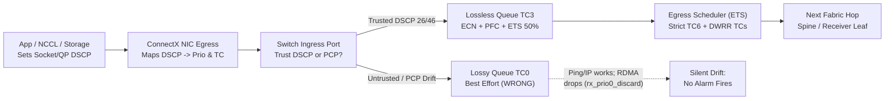
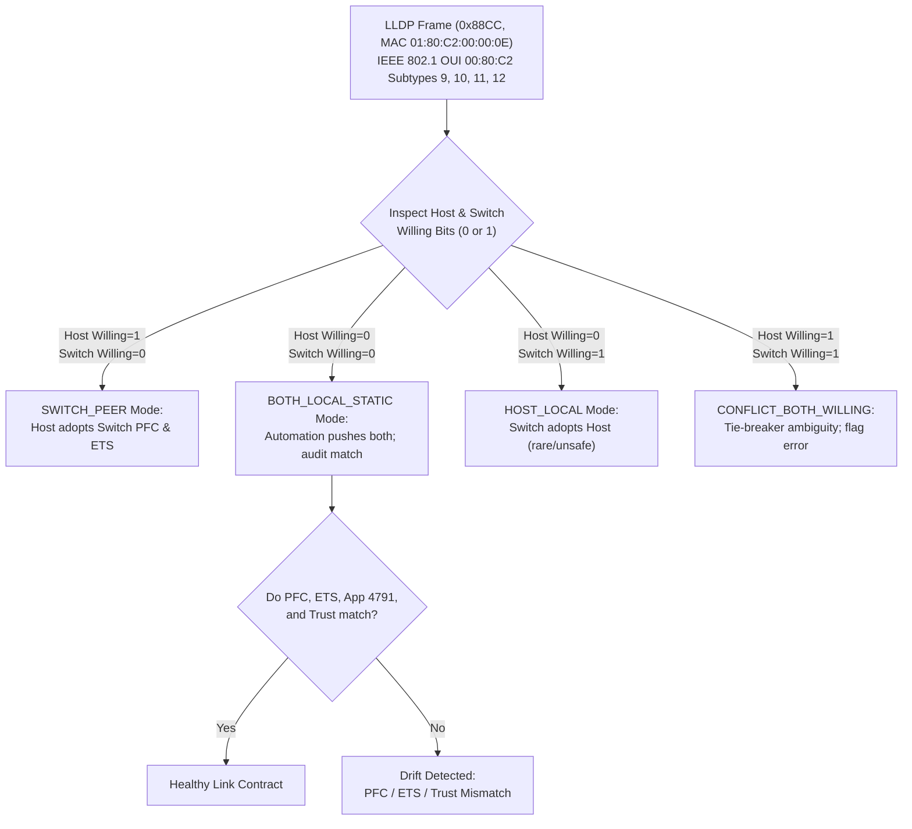
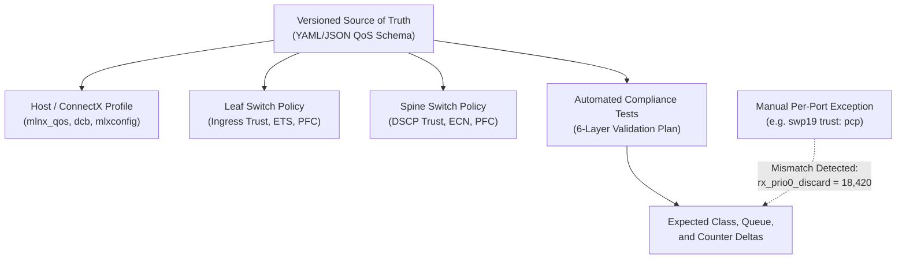

# 12.5 Data center bridging and QoS for AI

| | |
|---|---|
| Level | Advanced |
| Priority tier | 1 |
| Lab venue | Nebius GPU |
| Part | Part 12: Complete AI networking |
| Code | `code/part12/dcb_qos_ai.py`, `code/part12/dcb_qos_ai_lab.py` |
| Coverage file | `planning/coverage/chapters/12-05.md` |

## Why this matters for AI infrastructure

Picture a training job that slows down every time someone writes a checkpoint. The GPUs are healthy, and no dashboard shows a broken link. The problem is that their packets wait behind storage traffic on the same switch port. A checkpoint is a saved snapshot of the model's state, and writing one sends a large burst of data across the network. An AI Ethernet fabric rarely carries only RoCEv2 collective traffic. The GPU AllReduce and AllToAll collectives on UDP port 4791 share network adapters and switch ports with many other services, and each of those services has its own needs.

Those other services include checkpoint writes, dataset reads, BGP routing keepalives, Kubernetes RPCs, Prometheus scrapes, and operator SSH sessions. An RPC is a small remote procedure call, a request that one service sends to another and then waits on. A Prometheus scrape is a periodic pull of metrics. If the fabric treats all of these streams as one undifferentiated queue, a checkpoint burst or a container image pull can delay Congestion Notification Packets. Those late feedback messages then reach the senders too slowly for them to react. The same burst can also trigger Priority Flow Control pauses that stall the synchronous GPU training steps across the cluster, because every GPU must wait for the slowest one.

It helps to group these services by what they need. Some need bandwidth, some need low delay, and some need a guarantee that they will not be dropped. Once the groups are clear, the lanes follow naturally. The fabric then serves each group according to its need, instead of serving the loudest group first.

The reverse problem is just as real, and it is the one people create on purpose. An operator who wants safety may mark every class as lossless. Each lossless class then reserves its own part of the switch buffer, and the buffer pools fragment. Ordinary TCP and control-plane packets, which have no lossless reservation at all, then drop under modest load. The fix looks like a safety measure, but it makes the fabric worse.

Data Center Bridging and Quality of Service give the fabric a contract. Think of it as a set of house rules for a shared road. The rules make link sharing predictable, and they make that sharing visible when something goes wrong. The contract has four parts, and you will meet each one again in the sections that follow.

First, classification and marking record the workload's intent in the packet header. A marking is a short code, either DSCP at Layer 3 or 802.1p PCP at Layer 2, that says which class a packet belongs to. Ingress ports, which are the ports where traffic enters a switch, then decide how far to trust those markings. That decision is the trust boundary.

Second, Enhanced Transmission Selection, or ETS, under IEEE 802.1Qaz decides how the link is shared. It gives the latency-critical CNP feedback a rate-capped Strict Priority, so feedback always goes out first but cannot take the whole link. Then it shares the remaining bandwidth in a work-conserving way across the compute, storage, control and best-effort queues. Work-conserving means that an idle class gives its share back to the others. The scheduler does this with Deficit Weighted Round Robin, which serves each queue in turn in proportion to its weight.

Third, Data Center Bridging Exchange, or DCBX, advertises or audits the ETS weights, the PFC lossless bitmasks, and the Application Priority TLVs over LLDP. LLDP is the Link Layer Discovery Protocol, the neighbor-to-neighbor message that each link uses to announce its settings. Fourth, buffer pool carving splits the finite switch memory between dedicated lossless PFC reservations and the shared lossy pool. Each of the four parts depends on the others, which is why the chapter treats them as one contract.

```text
Four Pillars of AI Ethernet Data Center Bridging (DCB) & QoS:
  1. Classification & Trust Boundaries:
     - 6-bit DSCP in 8-bit IP ToS/Traffic Class byte (0..63) or 3-bit 802.1p PCP in 802.1Q VLAN tag (0..7)
     - Ingress trust enforcement (trust: dscp vs trust: pcp vs untrusted rewrite) prevents silent queue drift
  2. Queueing & Enhanced Transmission Selection (ETS, IEEE 802.1Qaz):
     - Maps internal priorities (0..7) to hardware Traffic Classes (TC0..TC7)
     - Rate-capped Strict Priority (TSA 0 / LLQ) for CNPs (TC6, BTH opcode 129 / 0x81)
     - Work-conserving DWRR (TSA 2 / CBWFQ) across RoCE (TC3), Storage (TC4, NVMe-o-TCP port 8009 / NVMe-o-RDMA), Control (TC2), and Best Effort (TC0)
  3. Data Center Bridging Exchange (DCBX, IEEE 802.1Qaz over LLDP EtherType 0x88CC):
     - Uses IEEE 802.1 OUI 00:80:C2 subtypes 9 (ETS Cfg), 10 (ETS Rec), 11 (PFC), and 12 (Application Priority UDP 4791 -> Priority 3)
     - Enforces Willing bit state machine (SWITCH_PEER Willing=1/0 vs BOTH_LOCAL_STATIC Willing=0/0)
  4. Switch Buffer Pool Carving:
     - Balances dedicated lossless PFC headroom (65,536 B / 25% per lossless priority on a 262,144 B port buffer) against shared lossy burst absorption (75%)
```

Chapter 2.19 introduced the general QoS building blocks, and Chapter 12.4 worked out the wire-level mechanics of PFC, ECN and DCQCN. This chapter focuses on end-to-end QoS system design. It covers the IEEE 802.1Qaz ETS and DCBX state machines, the buffer pool carving math, hop-by-hop trust-boundary drift detection, and production validation. Drift is a slow, unplanned change in one device's settings, and it is the hardest kind of QoS fault to see.

Keep the four-part contract in mind as you read. Each later section tests one part of it, so you can always ask which part of the contract a symptom points to.

## Prerequisites and outcomes

**Prerequisites:** Imagine your first QoS ticket. A RoCE job is slow, and someone asks which queue its packets used. Before you start, review the queuing, QoS, ECN, PFC, and DCB basics in Chapter 2.19. Then review RoCEv2 transport in Chapter 12.3, and PFC, ECN, and DCQCN in Chapter 12.4.

**Outcomes:** The chapter follows a packet from the application socket or RDMA Queue Pair, through the ConnectX egress traffic classes, across the switch ingress trust boundary, into the internal priority queues and the ETS schedulers. It builds a five-class AI QoS model and encodes and decodes the 8-bit IP ToS bytes for each class. It computes ETS shares, Strict Priority caps and serialization jitter, and it shows why scheduling RoCE data as strict priority starves management traffic. It decodes DCBX LLDP frames and the Willing bit states, and it carves switch buffer pools across lossless and lossy classes. It ends with silent trust-mode drift and a six-layer production validation plan across host adapters and leaf or spine switches.

---

## 1. End-to-end QoS architecture and the small class model for AI fabrics

### 1.1 The highway lanes mental model and why every control has a single job

Picture one physical link carrying very different kinds of traffic. On a converged AI Ethernet fabric, a single wire can carry storage, control and RDMA collectives at the same time, and each kind has its own loss and latency needs. Suppose a large storage checkpoint or bulk image pull shares a queue with the RDMA collectives. The training steps then stall behind packets that are paused or dropped, even though the collective traffic itself was healthy.

It helps to think of an eight-priority Ethernet link as a highway with several lanes. Each lane has its own rules, and the lanes meet only at the switch ports. Priority 0 on TC0 is the public lane. It carries bulk transfers, container image pulls, and operator traffic. Under congestion, those packets wait in a lossy queue or get dropped. TCP is built for that, so it notices the loss and backs off.

Priority 2 on TC2 is the municipal service lane. It carries BGP routing updates, Kubernetes heartbeats, and cluster monitoring. Those messages are small, but they must arrive on time. That lane needs a guaranteed minimum bandwidth share, so control-plane sessions never time out during a training burst. A heartbeat that arrives late can make a healthy node look dead.

Priority 4 on TC4 is the commercial trucking lane, built for heavy loads. It carries large storage payloads over NVMe-o-TCP on port 8009. It also carries parallel file systems such as Lustre, GPFS, BeeGFS, and WekaFS. A parallel file system spreads one file across many storage servers. This lane needs a 30 percent minimum bandwidth share under contention. TCP recovers cleanly from occasional packet drops, so the fabric does not halt when a packet is lost. The lane is lossy by design, and that is acceptable here.

Storage traffic also deserves its own review each time a new file system or backup tool joins the cluster. A new client can change the load on the lane without changing any setting, so the lane needs watching as well as configuring.

Priority 3 on TC3 is the emergency convoy express lane. It carries RoCEv2 AI compute traffic on UDP destination port 4791. On a 400 Gbps or 800 Gbps link, a Go-Back-N retransmission badly hurts collective completion time, because one lost packet makes the sender resend a long run of data. So this lane relies on ECN for early rate control, and on narrowly scoped PFC as the backstop. It never drops a packet because the buffer overflowed.

The convoy picture helps with the design choice. A convoy keeps its members together and moves at a steady pace. The RoCE lane is valuable for the same reason. Its traffic is sensitive to delay and loss, so it gets the most careful treatment, and everything else must stay out of its way.

Finally, Priority 6 on TC6 is the motorcycle courier lane for CNP feedback frames. A courier is small and quick, and this lane is built the same way. It uses rate-capped Strict Priority, so backward congestion notifications never wait behind jumbo data frames. The rate cap keeps the courier lane from carrying so much traffic that it blocks the other lanes.

A misclassified flow shows how these lanes fail, and the failures are easy to miss. Suppose a storage flow or an untrusted bulk transfer lands in Priority 3 by accident. A checkpoint write then wanders into the lossless RoCE lane. It fills the Priority 3 buffer, triggers PFC pause frames, and freezes GPU collectives across the switch. The reverse case is harder to see. If a RoCEv2 packet is silently reclassified into Priority 0 at a downstream switch hop, ping and TCP still pass. Meanwhile RDMA collectives suffer unexplained tail drops and `RETRY_EXC_ERR` completions, which are retry-exhausted errors reported by the adapter.

The lesson from both failures is the same. A lane is only as good as the marking that places traffic into it. Most QoS incidents are not caused by a missing feature. They come from a packet that was placed in the wrong lane and then behaved exactly as the wrong lane was built to behave.



The table below lists the five control mechanisms and the one question each one answers. Start from a symptom, then ask which control should have handled it. Read the last column with care, because each mechanism leaves some jobs to the others.

| Control mechanism | Layer / Header / Hardware block | Primary question it answers | What it does NOT provide |
|---|---|---|---|
| **DSCP / 802.1p PCP marking** | L3 IP ToS byte (6-bit DSCP) / L2 802.1Q tag (3-bit PCP) | Which service class *should* this packet use? | Guaranteed end-to-end treatment if a downstream hop rewrites or ignores the tag |
| **Ingress classification & trust** | Switch ingress pipeline (`mlnx_qos --trust dscp` vs `pcp`) | Which internal priority (0..7) and egress queue (TC0..TC7) receives the frame? | Additional link bandwidth or workload authentication |
| **Queue scheduling (Strict vs DWRR)** | Egress port scheduler (TSA 0 Strict Priority vs TSA 2 DWRR) | Which non-empty egress queue is transmitted next on the wire? | Fairness across classes unless weights and strict-priority policers are configured |
| **Enhanced Transmission Selection (ETS)** | IEEE 802.1Qaz bandwidth-sharing controller | What minimum bandwidth share does each Traffic Class receive *under contention*? | A hard, walled-off bandwidth reservation when a class is idle, or a hard ceiling when other classes are idle |
| **Explicit Congestion Notification (ECN)** | RFC 3168 (2-bit IP ECN field `10 -> 11` via WRED `K_min`/`K_max`) | Should the sending RDMA Queue Pair (QP) or TCP socket reduce its injection rate? | Immediate link-local loss protection during a sub-RTT microburst |
| **Priority Flow Control (PFC)** | IEEE 802.1Qbb L2 MAC Control (`0x8808`, opcode `0x0101`) | Can a loss-sensitive queue (Priority 3) pause its immediate upstream link peer before overflowing? | Flow-level isolation (it pauses the entire priority class) or extra fabric capacity |

Each row answers one question and states plainly what that mechanism cannot do. When you debug a QoS problem, ask which of these mechanisms should have handled the packet, and then check whether it did.

A useful exercise is to read the table from the bottom up. Start with the question about PFC, then move to ETS and ECN. You will notice that the mechanisms cover for one another only partly, which is why no single row can be trusted alone.

### 1.2 Designing a small, explainable QoS class model

A common mistake is to start from the hardware maximum of eight priorities and invent eight separate policies. It feels thorough, but every extra class takes its share of buffer memory. It also adds `mlnx_qos` and DCBX configuration lines on thousands of ports, and it makes incidents harder to triage. Start instead from the operational workload intents and the failure domains. A failure domain is the set of systems that break together. Add a class only when it has a distinct congestion behavior, an owner, a failure policy, and a validation test.

Naming each class by its job, not by its number, keeps the model readable. A class called storage-checkpoint tells the next engineer what to protect. A class called TC4 tells them only where the packets go.

| Workload intent | Typical protocols & ports | Recommended DSCP (Hex ToS with ECT(0) / 00) | `mlnx_qos` 8-value bucket | 802.1p Priority (PCP) | Hardware Traffic Class (TC) | Loss control (PFC / ECN) | IEEE 802.1Qaz TSA & ETS share |
|---|---|---|---|---|---|---|---|
| **Best Effort** | Bulk TCP, image pulls, general traffic | DSCP 0 (CS0/DF, `0x00`) or DSCP 10 (AF11, `0x28`) | `0-7`, `8-15` | Priority 0 | TC0 | Lossy (tail drop / WRED) | `dwrr` (TSA 2), 10% |
| **Infrastructure & Control** | BGP, Kubernetes API, Prometheus, SSH | DSCP 24 (CS3, `0x60`) or DSCP 34 (AF41, `0x88`) | `24-31`, `32-39` | Priority 2 | TC2 | Lossy (protected minimum share) | `dwrr` (TSA 2), 10% |
| **RoCEv2 AI Compute** | NCCL collectives, GPUDirect RDMA (UDP 4791) | DSCP 26 (AF31, `0x6a` w/ ECT(0)) or DSCP 46 (EF, `0xb8` w/ 00) | `24-31` or `40-47` | Priority 3 | TC3 | **Lossless (PFC ON + ECN ON)** | `dwrr` (TSA 2), 50% |
| **Storage & Checkpointing** | NVMe-o-TCP (TCP 8009), parallel FS (NFS, Lustre, WekaFS) | DSCP 18 (AF21, `0x4a` w/ ECT(0)) | `16-23` | Priority 4 | TC4 | Lossy (PFC OFF, TCP ECN ON) | `dwrr` (TSA 2), 30% |
| **CNP & Critical Control** | RoCEv2 CNP (BTH opcode `0x81`), LACP/LLDP | DSCP 48 (CS6, `0xc1` w/ ECT(1)) or DSCP 56 (CS7, `0xe0`) | `48-55`, `56-63` | Priority 6 | TC6 | Lossy (never paused, low occupancy) | `strict` (TSA 0), policed cap 20 Gbps (5% of 400G) |

The table rests on three design rules, and each one protects the fabric in a different way. The first rule is about the weights. The DWRR percentages across TC0, TC2, TC3, and TC4 sum to 100 percent (`10% + 10% + 50% + 30% = 100%`). The sum has to match the whole link, or the split becomes unclear. That sum satisfies the IEEE 802.1Qaz requirement for Enhanced Transmission Selection classes.

Read the weights as a promise about contention, not as a promise about idle time. When every class is busy, each one gets its share. When some classes are quiet, the busy ones can use the spare capacity.

The second rule is about lossless traffic. Only TC3 on Priority 3 has PFC enabled. When storage uses NVMe-o-TCP on TCP port 8009 or parallel NFS, keeping TC4 on Priority 4 lossy with TCP ECN preserves 75 percent of the port buffer for shared burst absorption. That shared share is what absorbs bursts from everyone. Keeping storage lossy also stops storage congestion from generating PFC pause frames that would freeze the GPUs. A second lossless class on Priority 4 is considered only if a deployment runs NVMe-o-RDMA over the same physical switches. Even then, dedicated storage fabrics are preferred at scale.

The third rule is about what QoS cannot do, and it matters as much as the first two. QoS is neither tenant security nor capacity planning. An endpoint can mark any DSCP value it chooses, unless the ingress switch port enforces a trust or ACL policy. QoS decides which queue a packet enters and how contention is arbitrated. It does not authenticate a tenant, prevent lateral movement between hosts, or create bandwidth when aggregate demand exceeds link capacity. Those jobs belong to other controls.

Before you add a new class, confirm that someone owns it, that it has a failure policy, and that a test proves it works. A class without those three is a guess that will eventually surprise someone.

---

## 2. Packet markings, IP ToS byte math, and QoS trust boundaries

### 2.1 Encoding and decoding the 8-bit IP ToS / Traffic Class byte vs 802.1p PCP

Suppose you run `tcpdump -v` on a GPU server to check RoCEv2 markings, and the output shows a hex value in the `tos` field. That value looks like a random number, but it is not. `tcpdump` prints the whole 8-bit IP Type of Service byte in hexadecimal. It does not print the 6-bit DSCP as a plain integer. Engineers who read the hex `tos` byte as a decimal DSCP value end up chasing marking bugs that do not exist, or they configure the wrong switch buckets.

A packet can carry class-of-service markings at Layer 2, at Layer 3, or at both. At Layer 2, an IEEE 802.1Q VLAN tag adds a 4-byte header after the Source MAC (`TPID 0x8100`). The TPID is the tag protocol identifier that tells the switch a VLAN tag follows. Inside that tag, the 3-bit Priority Code Point holds a value from 0 to 7. A 1-bit Drop Eligible Indicator comes next, and a 12-bit VLAN ID from 0 to 4095 follows it. Those are the bits a switch reads when it wants a Layer 2 priority.

Pure routed Layer 3 Ethernet links use untagged frames, so they carry no PCP bits on the wire. That detail becomes important in the trust-boundary discussion below. At Layer 3, every IPv4 or IPv6 packet carries an 8-bit ToS or Traffic Class byte. The upper 6 bits hold the DSCP value, and the lower 2 bits hold the ECN state. Both fields live in the same byte, so a single byte tells the switch both the class and the congestion state.

A quick way to remember the difference is this. A Layer 2 marking travels in a VLAN tag that a routed hop can strip away. A Layer 3 marking travels in the IP header, which every router forwards.

```text
IP ToS / Traffic Class Byte Bit-Shift Equations:
  ToS_byte = (DSCP << 2) | ECN
  DSCP     = ToS_byte >> 2
  ECN      = ToS_byte & 0x03
  mlnx_qos 8-value DSCP buckets: 0-7, 8-15, 16-23, 24-31, 32-39, 40-47, 48-55, 56-63
```

The math is two shifts and a mask. To build the ToS byte, you shift the DSCP left by two bits and add the ECN state. To go back, you shift right to recover the DSCP, and you mask off the low bits to recover the ECN state. Walk one example by hand. Take DSCP 26 with ECT(0), and the byte comes out as the table's 106 value. Reverse it, and you land on DSCP 26 again.

Use this table as a lookup when you read a `tcpdump` hex value and need to know which class it belongs to. Find the hex value in the fifth column, then check the bucket and the priority beside it.

Two details trip people up here. The first is that the table gives values for the whole ToS byte, not for the DSCP alone. The second is that the mlnx_qos bucket is a range, so DSCP 26 and DSCP 24 share a bucket. Keep both in mind when you read a capture.

| Traffic type | 6-bit DSCP (decimal & binary) | 2-bit ECN state | 8-bit ToS calculation `(DSCP << 2) \| ECN` | `tcpdump -v` hex output | `mlnx_qos` 8-value DSCP bucket | Mapped 802.1p Priority |
|---|---|---|---|---|---|---|
| **Best Effort (CS0/DF)** | 0 (`000000`) | `00` (0, Not-ECT) | `(0 << 2) \| 0 = 0` | `tos 0x0` (`0x00`) | `0-7` | Priority 0 |
| **Storage (AF21) w/ ECT(0)** | 18 (`010010`) | `10` (2, ECT(0)) | `(18 << 2) \| 2 = 74` | `tos 0x4a` (74) | `16-23` | Priority 4 |
| **Control (CS3)** | 24 (`011000`) | `00` (0, Not-ECT) | `(24 << 2) \| 0 = 96` | `tos 0x60` (96) | `24-31` | Priority 2 |
| **RoCEv2 Data (AF31) w/ ECT(0)** | 26 (`011010`) | `10` (2, ECT(0)) | `(26 << 2) \| 2 = 106` | `tos 0x6a` (106) | `24-31` | Priority 3 |
| **RoCEv2 Data (AF31) w/ CE** | 26 (`011010`) | `11` (3, CE marked) | `(26 << 2) \| 3 = 107` | `tos 0x6b` (107) | `24-31` | Priority 3 |
| **RoCEv2 Data (EF) w/ 00** | 46 (`101110`) | `00` (0, Not-ECT) | `(46 << 2) \| 0 = 184` | `tos 0xb8` (184) | `40-47` | Priority 3 |
| **RoCEv2 CNP (CS6) w/ ECT(1)** | 48 (`110000`) | `01` (1, ECT(1)) | `(48 << 2) \| 1 = 193` | `tos 0xc1` (193) | `48-55` | Priority 6 |
| **Network Control (CS7)** | 56 (`111000`) | `00` (0, Not-ECT) | `(56 << 2) \| 0 = 224` | `tos 0xe0` (224) | `56-63` | Priority 6 |

In NVIDIA `mlnx_qos` output, the 64 DSCP values appear in eight buckets of eight consecutive codepoints. That layout is easy to read once you know it. DSCP 26 sits in bucket `24-31`. DSCP 46 sits in bucket `40-47`, and DSCP 48 sits in bucket `48-55`. The table shows that DSCP 26 with ECT(0) and DSCP 26 with CE both map to Priority 3. The ECN state does not change the queue, which is what you want, because congestion marks must not move a packet out of its lossless lane.

### 2.2 Trust boundaries, untrusted ingress rewrites, and PCP vs DSCP across L2/L3 hops

A GPU host can mark every RoCEv2 packet correctly, and one misconfigured switch port can still break the policy. The marking is only a request, and the port decides whether to honor it. If that port uses the wrong trust mode, it quietly sends RoCEv2 packets into a lossy queue. Every switch ingress port and adapter interface runs in one of three classification trust states.

Under `trust: dscp`, the port reads the 6-bit IP DSCP field and maps it through the 64-entry DSCP-to-Priority table. Each DSCP value has its own entry in that table, so the port knows the priority for every possible marking. IP headers survive Layer 3 routing across leaf, spine and super-spine switches, because routers forward the header unchanged. That means `trust: dscp` keeps the classification intact end to end, without needing VLAN tags.

Under `trust: pcp`, the port ignores the IP DSCP field and reads only the 3-bit PCP field in an 802.1Q VLAN header. That works on a Layer 2 segment where tags are present. Now suppose a port stays in `trust: pcp` and receives an untagged routed IP packet. No 802.1Q header exists, so the switch puts the frame into Priority 0 Best Effort by default. That default strips PFC and ECN protection, even though the IP header still carries DSCP 26 or DSCP 46. The packet is marked correctly and still lands in the wrong lane.

A helpful habit is to write down the trust mode of every ingress port on a path before a job starts. Then a drifted port shows up as a difference in a list, not as a mystery in a training log.

Notice that nothing about the host changed. The application still sends the same marking, and the cable still carries the same bits. Only the trust mode on one ingress port decided the outcome, which is why this problem survives a careful review of the host.

At an untrusted rewrite boundary (`untrusted_rewrite_zero`), the port faces tenant VMs or external networks, and it does not trust host markings. It either rewrites DSCP to zero or classifies traffic with an explicit ACL policy. An ACL is an access control list, a set of match rules that decide what a port accepts. Overlays need the same care. When traffic crosses VXLAN, GRE or IPsec, the encapsulating VTEP or DPU must copy the inner DSCP and ECN bits to the outer IP header. A VTEP is the tunnel endpoint at the edge of an overlay. Use `uniform` or `tos inherit` mode so that transit spine switches can classify and ECN-mark packets properly. Without that copy, the spines read only the outer header, so the application's markings are invisible to them.

In multi-tenant or bare-metal cloud environments, NVIDIA BlueField DPUs in Embedded CPU Function Ownership (ECPF) mode put a second boundary in front of the host. In that mode, the embedded Arm subsystem and the hardware switch sit directly in front of the host PCIe function. A DPU is a data processing unit, a network card with its own processor. The platform administrator can enforce DSCP marking and ACL normalization inside the DPU embedded switch. That happens before frames reach the leaf switch port, and it stops an untrusted host OS from spoofing DSCP 26 or DSCP 48. The cost is a three-layer boundary across the host interface, the DPU Arm policy service and the external leaf switch port. A boundary with three layers can fail at any layer, so verify it after every boot.

Check the trust mode on every hop, not only on the port the host connects to. The host port can look perfect while a port three hops away quietly changes the outcome.

Keep the trust-mode check in the same routine as the counter check. The two checks are cheap, and together they cover both the marking and the queue that the marking selected.

---

## 3. IEEE 802.1Qaz Enhanced Transmission Selection, Strict Priority, and CBWFQ scheduling math

### 3.1 How IEEE 802.1Qaz ETS combines Strict Priority (TSA 0) and DWRR (TSA 2)

Once a packet lands in its egress Traffic Class queue, the port scheduler decides which non-empty queue transmits next. Think of the scheduler as the person who calls the next car at a busy junction. If every queue has equal priority, 9,000-byte data frames delay urgent CNP feedback frames behind them. If the data queues use unpoliced strict priority instead, they starve routing and management traffic during collective bursts. The scheduler has to balance both risks.

IEEE 802.1Qaz Enhanced Transmission Selection defines a two-tier hierarchical scheduler across up to eight Traffic Classes. Two tiers means that strict queues are served first, and the weighted queues share what is left. Each Traffic Class gets a Transmission Selection Algorithm identifier, or TSA, which names the scheduling rule that class follows.

```text
IEEE 802.1Qaz Transmission Selection Algorithm (TSA) Identifiers:
  - TSA 0 (Strict Priority / strict / LLQ):     Serviced ahead of all DWRR queues whenever a packet is present; used for CNPs on TC6
  - TSA 1 (Credit-Based Shaper / cbs):          Used in audio/video bridging (AVB / TSN), not standard AI RoCE fabrics
  - TSA 2 (Enhanced Transmission Selection / ets / dwrr / CBWFQ): Shares bandwidth remaining after TSA 0 in proportion to weights w_i (sum = 100%)
  - TSA 255 (Vendor-Specific):                  Hardware-specific scheduling extensions
```

### 3.2 Work-conserving CBWFQ / DWRR math: minimum guarantees under contention, not hard reservations

Engineers new to ETS often misread a configured weight. A weight of 30 percent for Storage on TC4, or 50 percent for RoCE on TC3, is not a hard partition, and it is not a hard rate ceiling. People worry that 30 percent of the link sits idle when Storage is quiet. Others worry that Storage can never exceed 30 percent while Compute is idle. Both worries come from reading a weight as a wall. A weight is a share that applies only when the link is contended.

The same reading applies in an incident. When a storage job slows down, the question is not whether its weight is high enough on paper. The question is whether the other classes were busy at the same moment. A share that looks small can still deliver the full link when the rest of the fabric is quiet.

A helpful picture is a shared kitchen with a rota. Each cook has a guaranteed turn at the stove when everyone is cooking, but a cook who has nothing to make does not hold the stove empty for anyone else.

In reality, ETS under DWRR, or Class-Based Weighted Fair Queueing, is work-conserving. Under full contention, where every class is backlogged, the scheduler first subtracts the bandwidth that the strict-priority TSA 0 classes consume ($R_{\text{strict}}$). It then divides what remains across the active DWRR classes, in proportion to their weights $w_i$. Backlogged means the queue has packets waiting. When some classes sit idle or use less than their share, the unused bandwidth moves to the remaining backlogged DWRR classes, in exact proportion to their weights. You can check that with the formula and the worked table that follow.

```text
Work-Conserving ETS Bandwidth Formula & 1,024 Kbps WAN CBWFQ Example (CNPS Ch 8):
  - ETS Allocation Formula: B_i = (R_link - R_strict) * (w_i / sum(w_j for j in active))
  - Guaranteed Shares on 1,024 Kbps WAN Link: AF41 = 256 Kbps, AF31 = 128 Kbps, AF21 = 128 Kbps, Unclassified/Default = 512 Kbps
  - Lowest-Terms Ratio: 256 : 128 : 128 : 512 reduces to 2 : 1 : 1 : 4 across 8 clock cycles
  - All 4 Classes Backlogged: Cycles 1-2 send AF41 (2 pkts), Cycle 3 sends AF31 (1 pkt), Cycle 4 sends AF21 (1 pkt), Cycles 5-8 send Default (4 pkts)
  - Work-Conserving Redistribution (1 AF41 pkt, 0 AF21 pkts, 3 Default pkts):
    * Cycle 1 sends the single AF41 pkt; Cycle 2 immediately serves AF31 (AF31 gets Cycles 2 and 3)
    * Cycle 4 skips empty AF21 and serves Default (Cycles 4-6); when Default runs out after 3 pkts, Cycle 8 serves AF31 again
```

Now apply the same work-conserving ETS formula to a 400.0 Gbps AI Ethernet link running the five-class model. The function `simulate_ets_scheduling` in `code/part12/dcb_qos_ai.py` produces the numbers in the table below. Each row is one contention scenario, and the columns show how the link is shared in that case.

| Contention scenario on a 400.0 Gbps link | Offered load per TC (Gbps) | TC6 (`strict`, CNP) allocated | TC0 (10% `dwrr`, Best Effort) | TC2 (10% `dwrr`, Control) | TC3 (50% `dwrr`, RoCEv2) | TC4 (30% `dwrr`, Storage) | Operational lesson |
|---|---|---|---|---|---|---|---|
| **1. All 5 classes contending** | `TC6=10, TC0=100, TC2=50, TC3=400, TC4=200` | **10.0 Gbps** | **39.0 Gbps** (10% of 390G) | **39.0 Gbps** (10% of 390G) | **195.0 Gbps** (50% of 390G) | **117.0 Gbps** (30% of 390G) | TC6 takes 10G first; remaining 390G splits `10:10:50:30`; 0 classes starved |
| **2. Only RoCE (TC3) + Storage (TC4) active** | `TC3=400, TC4=400 (TC0=TC2=TC6=0)` | 0.0 Gbps | 0.0 Gbps | 0.0 Gbps | **250.0 Gbps** ($\frac{50}{50+30} \times 400$) | **150.0 Gbps** ($\frac{30}{50+30} \times 400$) | Unused 20% (`TC0+TC2`) is shared in a $50:30 = 5:3$ ratio (250G vs 150G) |
| **3. Only Storage (TC4, 30%) active** | `TC4=400 (TC0=TC2=TC3=TC6=0)` | 0.0 Gbps | 0.0 Gbps | 0.0 Gbps | 0.0 Gbps | **400.0 Gbps** (100% of link) | 30% ETS is a minimum share under contention, **not** a ceiling when the link is idle |
| **4. Misconfigured `strict` RoCE** | `TC1 (Prio 3 RoCE) = 400 (strict), TC0 (Mgmt) = 10 (dwrr weight 5)` | N/A (`TC1 strict` takes **400.0 Gbps**) | **0.0 Gbps (STARVED)** | N/A | **400.0 Gbps** (`TC1 strict`) | N/A | Setting RoCE (`TC1`) to `strict` without a cap completely starves `dwrr` management (`TC0`); `dwrr 95:5` guarantees `TC0` **20.0 Gbps** (`TC1 = 380.0 Gbps`) |

Read the first row as a worked example, and check each number by hand as you go. Under full contention, 10 Gbps goes to TC6 first, because strict priority is served first. That leaves 390 Gbps, which splits 10:10:50:30. TC0 and TC2 each get 39.0 Gbps, TC3 gets 195.0 Gbps, and TC4 gets 117.0 Gbps. Row 3 shows the other side of the rule. A 30 percent share becomes the full 400.0 Gbps when no other class is active. The weight is a floor under contention, and the link belongs to whoever is using it when nobody else wants it.

Notice how little the first row depends on any single device. The numbers come from the rules alone, which is what makes the table useful as a check. If a real port shows a different split under the same load, the difference points to configuration or to a device that is not following the rules.

### 3.3 Strict Priority (LLQ) policing math and serialization jitter (9,000 B vs 64 B)

Why must a strict-priority queue always have a rate cap or a bounded offered load? If it can consume 100 percent of the link, every DWRR queue starves. A policer is a rate limiter that drops traffic above a set rate. A cap protects the rest of the link, but traffic above that cap drops during congestion, and the drops hit the whole strict-priority class. A cap is therefore a trade. You accept some loss in the strict class to keep the other classes alive.

```text
LLQ Strict-Priority Policing & Serialization Jitter Derivations (CNPS Ch 8 & Ch 17, Handbook 2.19):
  1. LLQ Policing on a 1,024 Kbps WAN Link (512 Kbps LLQ Cap, 512 Kbps Remaining):
     - Up to 8 VoIP calls at 64 Kbps (8 * 64 = 512 Kbps) fit inside the cap with 0 drops
     - 9 calls under congestion (9 * 64 = 576 Kbps): policer drops 576 - 512 = 64 Kbps across all 9 calls (class-wide drop)
     - 12 calls under congestion (12 * 64 = 768 Kbps): policer drops 768 - 512 = 256 Kbps (4 * 64 Kbps)
     - Codec change to 16 Kbps: 32 calls (32 * 16 = 512 Kbps) fit with 0 Kbps dropped
     - Uncongested exception: 10 calls at 64 Kbps (640 Kbps) when all other traffic <= 384 Kbps (1,024 - 640 = 384 Kbps, e.g. 300 Kbps) pass with 0 drops
  2. Frame Serialization Delay & Jitter (T_ser = Bits / R_link):
     - At 100 Mbps: 64 B = 512 / 10^8 = 0.00512 ms (.05 ms with framing in CNPS); 1,500 B = 0.12 ms; 9,000 B = 0.72 ms (0.72 / 0.05 = 14.4 -> >14x longer)
     - Mixed 7 elephant + 4 mouse frames at 100 Mbps (Fig 17-4): mouse spacing jitters between .05 ms and .288 ms; elephant spacing between .05 ms and .15 ms
     - At 400 Gbps: 9,000 B (72,000 bits) = 180.0 ns; 64 B (512 bits) = 1.28 ns (180.0 / 1.28 = 140.625x ratio)
```

The block above shows the policing arithmetic on a 1,024 Kbps WAN link with a 512 Kbps cap. Use it as a model for why a cap behaves like a fixed-size lane. Eight calls at 64 Kbps use exactly 512 Kbps, so they fit with no drops. A ninth call pushes the offer to 576 Kbps, and the policer drops 64 Kbps across all nine calls. The drop lands on the whole class, not on a single call, so every caller feels a little of the loss.

That is also why codec choice is a network decision. A smaller codec packs more calls into the same reserved lane, so the same cap can carry more calls after the change.

Serialization delay is the time a frame takes to leave the wire. It depends on the frame size and the link speed, and it is the reason a jumbo frame can hold up a small one. At 100 Mbps, a 9,000-byte frame takes 0.72 ms, and a 64-byte frame takes 0.00512 ms. At 400 Gbps, the jumbo frame takes 180.0 ns, and the small frame takes 1.28 ns.

Giving 64-byte CNPs on TC6 their own strict-priority queue avoids head-of-line delay behind jumbo packets. Head-of-line delay means a small packet waits behind a big one that happens to be ahead of it in the same queue. On a 400 Gbps link, a newly arriving CNP waits at most one in-flight 180.0 ns jumbo frame. It does not wait behind megabytes of queued 9,000-byte RoCE data payloads. That gap is the entire benefit of the separate queue.

Before you enable strict scheduling, set its rate cap. An uncapped queue can starve everything else, and management traffic is usually the first casualty. It is the quietest lane, and the least likely to be watched during an incident.

A rate cap on the strict queue is not an optional tuning step. It is what turns strict scheduling from a risk into a bounded tool. Treat a missing cap as a defect in the configuration, the same way you would treat a missing failure policy.

---

## 4. IEEE 802.1Qaz DCBX TLV negotiation and switch buffer pool carving

### 4.1 DCBX over LLDP (`EtherType 0x88CC`, `OUI 00:80:C2`, Subtypes 9..12) and the Willing bit

Picture a switch port that is configured well, with PFC on Priority 3 and the right ETS weights. Those settings do nothing if the attached ConnectX adapter sends RoCEv2 on Priority 0 or enables PFC on Priority 4. The two ends of a link must agree. After a reboot, if the host and switch QoS settings diverge, jobs suffer silent drops or pause mismatches, and nothing on the switch looks wrong.

The lesson is that a QoS contract lives on both ends of every link. Checking one side and assuming the other is fine is how silent drops get past review.

Data Center Bridging Exchange, or DCBX, under IEEE 802.1Qaz is a link-local discovery and capability exchange. Each side tells its neighbor what it supports and what it is configured to do. It rides inside Link Layer Discovery Protocol (LLDP) frames with EtherType `0x88CC`, sent to the destination multicast MAC `01:80:C2:00:00:0E`. A TLV is a type, length and value field inside the frame. DCBX uses Organizationally Specific TLVs under the IEEE 802.1 OUI `00:80:C2`, where the OUI is the vendor prefix that identifies the organization that defined the field.

Each TLV carries a different part of the QoS contract. The table below shows what each one advertises, and whether the two ends of the link must match. Keep the symmetric rows in mind, because a mismatch there breaks the link's behavior even when each side looks correct on its own.

| DCBX TLV name | IEEE 802.1 OUI | Subtype | Symmetric vs Asymmetric | Key fields carried on the wire | Purpose on a GPU Host $\leftrightarrow$ Leaf Switch link |
|---|---|---|---|---|---|
| **ETS Configuration TLV** | `00:80:C2` | **9 (`0x09`)** | Asymmetric (uses ETS Recommendation TLV 10) | Willing (1 bit), CBS (1 bit), Max TCs (3 bits), Priority Assignment Table (8 x 4 bits: Prio 0..7 -> TC), TC Bandwidth Table (8 x 8 bits: % weights), TSA Assignment Table (8 x 8 bits: `0=Strict, 2=ETS`) | Advertises operational Prio -> TC map, ETS percentage weights, and `strict`/`dwrr` TSA assignments |
| **ETS Recommendation TLV** | `00:80:C2` | **10 (`0x0A`)** | Asymmetric recommendation from switch to host | Priority Assignment Table (8 x 4 bits), TC Bandwidth Table (8 x 8 bits), TSA Assignment Table (8 x 8 bits) | Recommends the egress ETS scheduling profile that a Willing=1 peer should adopt |
| **PFC Configuration TLV** | `00:80:C2` | **11 (`0x0B`)** | **Symmetric** (both ends of the link must use the identical PFC bitmask) | Willing (1 bit), MBC (1 bit, MACsec Bypass Capability), PFC Cap (4 bits: max simultaneous lossless classes), **PFC Enable bitmask (8 bits: e.g., `00001000` = `0x08` for Priority 3)** | Ensures both the NIC and leaf switch port enable PFC pause (XOFF/XON) on the exact same priority (Priority 3) |
| **Application Priority TLV** | `00:80:C2` | **12 (`0x0C`)** | Symmetric application-to-priority binding | List of 3-octet entries: Priority (3 bits), Selector (3 bits: 1=EtherType, 2=TCP/UDP port, 3=UDP/DCCP), Protocol ID (16 bits: **4791** for RoCEv2) | Tells the endpoint to tag RoCEv2 (UDP port 4791) packets with **Priority 3** |

The PFC TLV is symmetric, so both ends of the link must use the identical bitmask. If one side enables PFC on a priority and the other does not, that lane is lossless on one end only. The Application Priority TLV binds RoCEv2 to Priority 3 in the same way, so the host knows which lane its RDMA traffic belongs in.

The Willing bit decides which side yields during DCBX negotiation. A side that sets Willing to 1 accepts the other side's settings. A side that sets it to 0 keeps its own. The function `evaluate_dcbx_negotiation` in `code/part12/dcb_qos_ai.py` applies that logic, and the diagram shows the four possible outcomes.



Four combinations of the two Willing bits lead to four different outcomes. Read them as a short decision table. Two of them are production patterns, and the other two should never reach production. The table below names each outcome and says what to do about it.

A short example makes the rule concrete. Suppose a new leaf switch arrives with its Willing bit set to 0, and its host adapters are also set to 0. Automation then pushes one versioned profile to both ends, and the LLDP check confirms that the two sides match. Nothing has to negotiate, and nothing can flip on the next reboot.

When you explain these outcomes to a teammate, lead with the rule that exactly one side should lead, and then list the two exceptions that break it. That order makes the reason for each production pattern easy to remember.

Think of the Willing bits as two people deciding who makes the rules for a shared room. If one person is willing to follow, the other leads, and that works. If both insist on leading, they argue on every reboot. If both wait for the other to start, nobody sets the rules at all. The production patterns are the ones where exactly one side leads, or where both sides follow a written plan.

| Host Willing | Switch Willing | Operational state source | Production behavior and AI fabric recommendation |
|---|---|---|---|
| **1 (True)** | **0 (False)** | **`SWITCH_PEER`** | **Classic plug-and-play DCBX:** The leaf switch is authoritative (Willing=0) and the host NIC (`lldpad` / firmware DCBX agent, Willing=1) dynamically adopts the switch PFC bitmask (Priority 3), ETS weights, and UDP 4791 -> Priority 3 Application Priority TLV. |
| **0 (False)** | **0 (False)** | **`BOTH_LOCAL_STATIC`** | **Explicit automation mode (common in large AI clusters):** Neither side accepts dynamic LLDP overrides; automation pushes identical profiles from a single versioned source of truth to both `mlnx_qos` on the host and the switch NOS, while LLDP TLVs audit that zero mismatches exist. |
| **0 (False)** | **1 (True)** | **`HOST_LOCAL`** | Switch accepts whatever the host advertises. **Avoid in production:** a misconfigured or compromised host can alter switch port PFC/ETS behavior. |
| **1 (True)** | **1 (True)** | **`CONFLICT_BOTH_WILLING`** | Both sides claim willingness to be overridden; symmetric tie-breakers vary across implementations and cause unpredictable flips on reboot. **Flag as a configuration error.** |

### 4.2 Switch buffer pool carving across lossless (TC3) and lossy (TC0, TC2, TC4, TC6) classes

Why do NVIDIA Spectrum switches use a Fully Shared Buffer architecture instead of fixed per-port slices? And why must operators still limit PFC to one, or at most two, priorities? The answer depends on how a burst behaves inside a buffer. Keep both questions in view while you read the carving math.

Take a switch with a sliced buffer first. Each port can use only its own small slice of memory, like a row of lockers that cannot be shared. If an 800 Gbps incast microburst hits Port 1, that port overflows or triggers PFC. That happens even while 95 percent of total switch memory sits empty on idle ports. A shared-buffer ASIC pools memory dynamically, so a congested port can borrow burst space from the idle ones.

Pooling does not remove the lossless reservation. Every lossless PFC-enabled priority on every port still needs a dedicated minimum reservation and flight-time headroom. Lossy queues cannot borrow that reservation, even when the pool has room. Once XOFF fires, the switch must guarantee space for the bytes already in flight on the cable. Those are the bytes that keep arriving during the pause. That is 49,064 B for a 2 m DAC cable, or 298,064 B for a 500 m optical fiber, at 400 Gbps with MTU 9,000.

The practical consequence is simple. Pooling makes the buffer more efficient for bursts, but it does not make lossless traffic cheaper. Every lossless class still pays its reservation, so the number of lossless classes is the main cost you control.

Take the 262,144-byte port receive buffer from `mlnx_qos -i swp12` as your worked example. Each lossless priority reserves 65,536 bytes of it. Inside that reservation, XON sits at 32,768 B (50 percent), XOFF at 49,152 B (75 percent), and headroom at 16,384 B (25 percent). The XOFF and headroom figures split the reservation between them, and the XON level sits halfway down.

The table shows what happens as you enable PFC on more classes. Each row adds one more lossless reservation to the same port. The function `evaluate_buffer_pool_carving` in `code/part12/dcb_qos_ai.py` produces these verdicts.

| Number of lossless (PFC) priorities enabled | Lossless priorities | Reserved per lossless priority (XON / XOFF / Headroom) | Total port buffer locked in lossless reservations | Remaining shared buffer for lossy TC0, TC2, TC4, TC6 | Lossless % vs Lossy % | Operational verdict |
|---|---|---|---|---|---|---|
| **1 lossless class (Recommended)** | Priority 3 (RoCEv2 Compute) | 65,536 B (32,768 / 49,152 / 16,384 B) | **65,536 B** (64 KiB) | **196,608 B** (192 KiB) | **25.0% vs 75.0%** | **`HEALTHY_BUFFER_CARVING`:** RoCEv2 has full lossless headroom; 75% of buffer remains for storage (TC4), control (TC2), CNP (TC6), and best effort (TC0). |
| **2 lossless classes (Maximum practical)** | Priority 3 (RoCE) + Priority 4 (NVMe-o-RDMA) | 65,536 B each | **131,072 B** (128 KiB) | **131,072 B** (128 KiB) | **50.0% vs 50.0%** | **`HEALTHY_BUFFER_CARVING` (Tight):** Acceptable only when NVMe-o-RDMA shares the fabric and requires lossless transport alongside RoCE compute. |
| **4 lossless classes (Anti-pattern)** | Priorities 1, 2, 3, 4 | 65,536 B each | **262,144 B** (256 KiB) | **0 B** (0 KiB) | **100.0% vs 0.0%** | **`BUFFER_EXHAUSTED_TOO_MANY_LOSSLESS_CLASSES`:** 100% of port buffer is locked in lossless reservations; lossy TCP, BGP, Kubernetes, and CNP queues have 0 B and drop immediately. |

Suppose you enable PFC on four priorities. The reservations then use the whole buffer, and nothing is left for the lossy queues. The lossy queues carry the TCP, control and CNP traffic, so they cannot simply go without. With one lossless class, by contrast, 75 percent of the port stays available for everything else. Enable PFC on the RoCE class first. Add a second lossless class only when NVMe-o-RDMA really shares the fabric.

### 4.3 Comparing Ethernet DCB (PFC + ETS + DCQCN) with InfiniBand Virtual Lanes and Storage Fabrics

Architects often compare AI compute and storage fabrics by asking how each one handles QoS and lossless transport. That comparison guards against a common habit. Teams that skip the question tend to over-enable PFC on Ethernet switches. They assume that every storage protocol needs a lossless queue, and that assumption is what fills the buffer.

Native InfiniBand has up to 16 Virtual Lanes, and link-level Credit-Based Flow Control runs in the Link Layer Header. Credit-based flow control means the receiver hands out buffer credits in advance. A sender switch or adapter never transmits on a Virtual Lane unless the downstream port has returned buffer credits, so it never sends more than the receiver can hold. InfiniBand is therefore lossless without reactive XOFF pause frames. The control is proactive rather than reactive, which is the key difference from Ethernet PFC.

Over Ethernet and IP, NVMe-o-TCP on TCP port 8009 and Parallel NFS run cleanly on the lossy TC4 queue without PFC. TCP handles their occasional loss itself. RoCEv2 AI training on UDP port 4791 and NVMe-o-RDMA are different. They need a lossless queue with tuned PFC, ECN and DCQCN thresholds, because their transports do not recover from loss as gracefully.

The practical result is a sorting question for each workload. Ask whether the transport recovers from loss on its own. If it does, keep it on the lossy lane. If it does not, give it a lossless lane and pay the buffer cost deliberately.

```text
Storage & Interconnect Latency, Queueing, and Lossless Comparison (ADC Ch 9 & Table 9-2):
  - Local PCIe Gen5 x16 Bus:    32 GT/s x16 delivers ~63 GB/s one-way (~100 ns local NVMe SSD access latency) to drive 400 Gbps NICs at line rate
  - Native InfiniBand Fabric:   ~300 ns switch latency | Up to 16 Virtual Lanes (VLs; 8-12 workload queues) | 1 credit = 64 B in LLH (CBFC) | 16-bit LID = 48,000 nodes
  - AI Ethernet DCB Fabric:     ~800 ns switch latency (700-900 ns port-to-port) | 8 priorities / TCs | Reactive PFC (802.1Qbb) + ETS (802.1Qaz) + DCQCN (ECN)
  - Storage Protocol Matrix:
    * Parallel NFS ((P)NFS):    Runs over TCP/IP on lossy queue (TC4, Priority 4); no PFC required
    * NVMe-o-TCP (TCP 8009):    Uses IC Req PDU, CapsuleCmd (opcode 0x01), CapsuleResp, H2CData (0x03), C2HData (0x04) with 0x01 write & 0x02 read; lossy queue (TC4)
    * NVMe-o-RDMA & RoCEv2 AI:  Uses UDP 4791; requires lossless queue (PFC + ECN/DCQCN) with workload-specific threshold profiles
```

Read the block below for two things. One is the latency gap between Ethernet and InfiniBand. The other is the lossless requirement that each storage protocol carries.

Confirm which storage protocol you run before you enable PFC for it. NVMe-o-TCP and Parallel NFS do not need a lossless queue, so enabling PFC for them only spends buffer and adds pause risk.

---

## 5. End-to-end consistency, configuration drift detection, and the 6-layer production validation plan

### 5.1 Hop-by-hop drift analysis: how a single `trust: pcp` port breaks RoCE silently

Picture a multi-hour training run that slows to a crawl, with no alarm on any dashboard. One port on a multi-hop path has drifted away from the approved QoS mapping, and that single change is enough to cause the incident. Ping and basic TCP checks keep passing. No link-down or routing alarm fires, while collective throughput collapses. Drift is the slow, unplanned change that makes this kind of incident so hard to see.

Consider the three-step diagnostic trace from our production case study. The trace uses `trace_end_to_end_qos_path` in `code/part12/dcb_qos_ai.py`. Each step checks one hop, so you can see exactly where the packet changes. First, check what the source GPU host puts on the wire at `ens1f0`, for traffic from `10.20.4.15` to `10.20.8.5`. Look at the marking, not at the throughput, because the marking is what the switches act on.

```text
# (untested here)
$ tcpdump -i eth0 -c1 -v host 10.20.8.5 and udp port 4791
IP (tos 0xb8, ttl 64, ...) 10.20.4.15.51422 > 10.20.8.5.4791: UDP, length 1200
```

Here `tos 0xb8` decodes to DSCP 46, Expedited Forwarding. The source adapter marks packets as intended. Second, check what the source leaf switch `swp4` believes about that marking, because the switch is where the marking turns into a queue choice.

```text
# (untested here)
$ mlnx_qos -i swp4
Priority trust state: dscp
DSCP to priority mapping:
        dscp    0-7  8-15  ...  40-47  48-55  56-63
        prio     0     0   ...    3      0      0
```

Port `swp4` runs in `Priority trust state: dscp`. It maps bucket `40-47` to Priority 3, the lossless RoCE class, so far this hop is correct. Third, inspect the far-side destination leaf `swp19`, where the drift happens.

```text
# (untested here)
$ mlnx_qos -i swp19
Priority trust state: pcp        <- DRIFT: ignores IP DSCP entirely
PCP to priority mapping:
        pcp      0   1   2   3   4   5   6   7
        prio     0   0   0   0   0   0   0   0    <- untagged L3 frames default to priority 0
```

Port `swp19` runs `Priority trust state: pcp`, and the routed IP packet has no 802.1Q VLAN tag. So `swp19` puts every arriving RoCEv2 frame into Priority 0 Best Effort. Nothing in the packet header has changed, and the link state looks normal too. The only sign of the problem is in the per-priority drop and pause counters on `swp19`, which is why the check has to look there.

```text
# (untested here)
$ ethtool -S swp19 | egrep "rx_prio0_discard|rx_pfc_prio3"
     rx_prio0_discard:        18420     <- 18,420 RoCE packets dropped in lossy priority 0
     rx_pfc_prio3:            0         <- lossless priority 3 never even sees the traffic
```



The table maps each hop to the state it should have. Read down the rows in order, and the last row shows where the drift lands.

| Hop / Role in Source-of-Truth Schema | Ingress Trust State | Expected DSCP -> Priority | Expected Egress TC & TSA | Expected PFC / ECN State | Primary Verification Counter |
|---|---|---|---|---|---|
| **GPU Host NIC (`ens1f0` / `mlx5_0`)** | `dscp` | DSCP 26/46 -> Prio 3; DSCP 48 -> Prio 6 | TC3 (`dwrr 50%`), TC6 (`strict`) | PFC ON (Prio 3), DCQCN ON | `tx_prio3_packets`, `np_cnp_sent`, `rp_cnp_handled` |
| **Source Leaf (`leafA_swp4`)** | `dscp` | `24-31` / `40-47` -> Prio 3 | TC3 (`dwrr 50%`), TC0 (`dwrr 10%`) | PFC ON (Prio 3), ECN ON | `rx_prio3_packets`, `tx_pfc_prio3`, `rx_ecn_marked_prio3` |
| **Transit Spine (`spine1_swp1`)** | `dscp` | `24-31` / `40-47` -> Prio 3 | TC3 (`dwrr 50%`), TC6 (`strict`) | ECN ON (PFC per design) | `rx_ecn_marked_prio3`, `tx_prio3_packets` |
| **Destination Leaf (`leafB_swp19`)** | `dscp` (Drifted: `pcp`) | Expected Prio 3 (Drifted: Prio 0) | Expected TC3 (Drifted: TC0) | Expected PFC ON (Drifted: Lossy) | **`rx_prio0_discard` (18,420 drops) vs `rx_pfc_prio3` (0)** |

Compare the expected and drifted values in the last row. The 18,420 discards on priority 0 sit next to zero pauses on priority 3. That pattern is the signature of this drift, and you can check for it on any port with a quick counter read.

Make this check part of the routine. A port that drops lossless traffic into priority 0 shows the same pattern every time, so a short read of two counters can catch it before a training job does.

### 5.2 The 6-layer production QoS validation plan

A QoS policy that compiles in a switch template but has never been tested under simultaneous multi-class contention is not yet a production policy. Compiling a config only proves that the syntax is valid. It does not show that the queues behave as intended under load. Validate every AI fabric release across six layers before you admit training jobs.

The first layer checks classification. You inject marked test traffic for RoCE, storage, CNP and best-effort classes. Then you confirm that per-priority counters rise on the intended queue at every hop. The second layer checks isolation. You drive bounded contention on Priority 3, and you prove that management traffic on Priority 0 or Priority 2 sees zero pause frames and flat SSH or BGP latency. Isolation is the proof that the lossless lane does not spill onto the lanes that keep the cluster running.

The third layer checks ETS service. Run concurrent RoCE, storage and best-effort generators through one shared bottleneck uplink. A generator is a traffic source that you run on purpose, so the test load is known. Confirm that each class gets its DWRR minimum share, and that strict priority does not starve anything. The fourth layer checks feedback. Confirm that ECN marks on TC3 generate CNPs on TC6, and that sender adapters throttle cleanly.

The fifth layer checks failure and reroute. Simulate a planned uplink drain, and confirm that the alternate paths keep the same trust, ETS, ECN and PFC profiles. A drain takes a link out of service on purpose, without dropping traffic. The sixth layer correlates switch queue counters with `nccl-tests` or `ib_write_bw`, the benchmark tools that measure what the job actually sees. It also audits host PCIe link width, NUMA locality and cluster manager interface priorities. NUMA locality means the GPU and the NIC sit in the same memory region of the host CPU.

The sixth layer is easiest to understand through the production case study. The block below records a baseline, a 60-second contention run, a PCIe downgrade, a BlueField boot failure, and the Base Command Manager precedence rules. Each item is a reference value you can compare against your own counters, not a target to copy.

A reference value is most useful when you record how you got it. Note the time, the node and the workload that produced each reading, so that a later comparison compares like with like.

```text
Layer 6 Host Topology, PCIe, & Cluster Manager Audit Metrics (V9 Ch 8, Ch 9, Labs 01-04, BCM11 Ch 3):
  - Lab 01-03 Host Baseline & 60 s Contention (ens1f0, 10.20.4.15 -> 10.20.8.5 via 10.20.0.1, MTU 9000, 400000Mb/s):
    * Topology: nvidia-smi topo -m -> GPU0-NIC0 PIX, GPU1-NIC1 PIX, GPU0-GPU1 NV18
    * Baseline Counters (2026-08-07T14:32:15Z): rx_packets = 1,024,567 | rx_bytes = 892,481,382,400 | tx_bytes = 481,029,120,384 | fec_corrected_blocks = 412 | fec_uncorrected_blocks = 0
    * 60 s Contention (2026-08-07T14:35:22Z -> 14:36:30Z): rx_prio3_packets 102,314 -> 51,234,892 (delta 51,132,578) | tx_prio3_packets 89,621 -> 48,901,234 (delta 48,811,613) | rx_ecn_marked_prio3 = 47,829 | rx_pfc_prio3 = 412 | tx_pfc_prio3 = 14 | Sender A (89.2 Gbps) + Sender B (87.1 Gbps) = 176.3 Gbps
  - PCIe Downgrade Trap (V9 Ch 8 lspci -s 41:00.0 -vv):
    * LnkCap: Speed 32GT/s, Width x16 (PCIe Gen5 x16 ~63 GB/s) vs LnkSta: Speed 16GT/s (downgraded), Width x8 (PCIe Gen4 x8 = 16 GB/s < 25 GB/s required for 200 GbE)
  - BlueField DPU Boot Race (V9 Ch 9):
    * Switch port swp14 up 100G full RoCE-compute, but openvswitch-policy-load.service exited status=1/FAILURE at 09:14:02 UTC, leaving host enp1s0f0np0 DOWN/DORMANT
  - NVIDIA Base Command Manager 11 (cmsh) Interface Priority & mlxconfig Precedence (BCM11 Ch 3):
    * onnetworkpriority ladder (0..4294967295): Bridge = 80, Bond = 70, Physical = 60, VLAN = 50, Alias = 40, Tunnel = 30, Netmap = 20, BMC = 10
    * Persistent MLX_ extra_values precedence: category.extra_values < node.extra_values < interface.extra_values
```

Use these values as the reference for your own counter deltas. A delta is the change between two readings taken at known times. Treat a failed layer as a blocker, and fix it before you admit a training job.

---

## Commands and configurations that matter

Each block below is marked `(untested here)`, which means these commands were not run on live hardware in this chapter. Read every command before you run it on a production host or switch. Several of them change live configuration, and a typo there can cause an outage.

### 1. Host NIC (ConnectX) QoS, `iproute2 dcb`, `lldptool`, and `mlxconfig` commands

Start with the host adapter. The first block reads and sets trust, PFC on Priority 3, and the ETS weights on the ConnectX port.

```bash
# (untested here) Inspect and configure DSCP trust, PFC on Priority 3, and ETS weights via mlnx_qos
mlnx_qos -i ens1f0
sudo mlnx_qos -i ens1f0 --trust dscp --pfc 0,0,0,1,0,0,0,0 \
  --tsa dwrr,dwrr,dwrr,dwrr,dwrr,dwrr,strict,dwrr \
  --tcbw 10,0,10,50,30,0,0,0

# (untested here) Set default RoCEv2 ToS/DSCP marking (106 = 0x6a -> DSCP 26 + ECT(0)) via sysfs / cma_roce_tos
cma_roce_tos -d mlx5_0 -t 106
cat /sys/class/infiniband/mlx5_0/tc/1/traffic_class

# (untested here) Standard Linux iproute2 dcb tool: inspect PFC, ETS, and Application Priority TLVs
dcb pfc show dev ens1f0
dcb ets show dev ens1f0
dcb app show dev ens1f0
sudo dcb app add dev ens1f0 dgram-port-prio 4791:3

# (untested here) Inspect IEEE 802.1Qaz DCBX TLVs advertised/received over LLDP (EtherType 0x88CC)
lldptool -t -i ens1f0 -V ETS-CFG
lldptool -t -i ens1f0 -V ETS-REC
lldptool -t -i ens1f0 -V PFC
lldptool -t -i ens1f0 -V APP

# (untested here) Verify PCIe link speed/width (Gen5 32GT/s x16 vs downgraded Gen4 16GT/s x8) & GPU locality
lspci -s 41:00.0 -vv | egrep "LnkCap|LnkSta"
nvidia-smi topo -m
rdma link show
ibv_devinfo -d mlx5_0 -i 1

# (untested here) NVIDIA Base Command Manager (BCM 11) persistent ConnectX policy via cmsh
cmsh -c "device; mlxconfig node001 --adapters"
cmsh -c "category use gpu; set -e MLX_link_type_p1 ETH; commit"
cmsh -c "device; mlxconfig node001 --desired"
```

The second group covers the switch side and the packet captures that prove the markings on the wire. Use the captures to confirm what the first group configured. A configuration that looks right on paper is not proof until the wire agrees.

### 2. Switch port (Cumulus Linux / Spectrum / SONiC) and packet-capture verification commands

```bash
# (untested here) Verify wire DSCP marking (tos 0xb8 -> DSCP 46; tos 0x6a -> DSCP 26 + ECT(0))
sudo tcpdump -i ens1f0 -c 5 -v host 10.20.8.5 and udp port 4791

# (untested here) Check switch port trust state, DSCP-to-priority map, TSA scheduler, and PFC counters
mlnx_qos -i swp4
mlnx_qos -i swp19
mlnx_qos -i swp4 | grep -A5 "tsa"

# (untested here) Capture timestamped per-priority packet, drop, ECN, and PFC deltas (never reset shared counters)
date -u && ethtool -S ens1f0 | egrep "rx_bytes|tx_bytes|fec_corrected|fec_uncorrected|ecn_marked|pfc_prio|prio3_packets|prio0_discard"
ethtool -S swp19 | egrep "rx_prio0_discard|rx_pfc_prio3|rx_ecn_marked_prio3"

# (untested here) SONiC / Cumulus CLI equivalents for queue, PFC, watermark, and watchdog inspection
show qos interface swp4
show pfc counters
show queue counters
show pfcwd stats
```

Compare the output with the class table in Section 1.2. Capture the counters with a timestamp, and do not reset them. A reset throws away the history that other operators and collectors rely on.

When you read the output, look for the class that carries RoCE first. Then confirm that its priority, its scheduling mode and its PFC state match the table. Only after that match is clear should you look at the drop and pause counters, because a counter means little until you know which lane it belongs to.

---

## How it fails

The table below covers six failure modes. For each one, it gives the symptom you see first, the root cause with its counter signature, and the fix. Start from the symptom, then check the signature before you change anything.

| # | Failure mode | Production symptom | Root cause & counter signature | Definitive fix & prevention |
|---|---|---|---|---|
| **1** | **Silent ingress trust-mode drift (`trust: pcp` on a routed port)** | `ping` and TCP work normally, PFC is enabled on Priority 3 everywhere, yet `nccl-tests` / RDMA jobs suffer high retries (`RETRY_EXC_ERR`) and low throughput. | Source (`ens1f0`, `tos 0xb8` / DSCP 46) and first-hop leaf (`swp4`, `trust: dscp`) map traffic to Priority 3, but destination leaf (`swp19`) is set to `Priority trust state: pcp`. Untagged L3 packets have no 802.1Q PCP and fall into Priority 0: `rx_prio0_discard: 18420` while `rx_pfc_prio3: 0`. | Set `mlnx_qos -i swp19 --trust dscp`; enforce automated source-of-truth compliance checks (`trace_end_to_end_qos_path`) with marked test probes across every hop. |
| **2** | **Management and control-plane starvation by `strict` RoCE scheduling** | SSH hangs, Kubernetes node heartbeats fail, or BGP sessions flap whenever a large multi-node training burst runs, even with `rx_pfc_prio0 = 0`. | `mlnx_qos -i swp4` shows `tc: 1` (carrying Priority 3 RoCE) configured as `tsa: strict` (`ratelimit: unlimited`), while `tc: 0` (Priority 0 management) is `tsa: dwrr, weight: 5`. Sustained 400 Gbps RoCE bursts keep `tc: 1` permanently non-empty, giving `tc: 0` 0.0 Gbps. | Move RoCE (TC3) to `tsa: dwrr` (e.g., 50% or 95% ETS weight) and give Infrastructure/Control (TC2 or TC0) a guaranteed ETS minimum share (5%–10%); reserve `strict` (TSA 0) only for rate-capped CNP/link control (TC6). |
| **3** | **Storage misses its expected bandwidth share under compute load** | Checkpoint writes (NVMe-o-TCP on port 8009 or parallel FS) collapse when GPU collectives start, despite ETS appearing configured. | Either storage packets are unmarked (DSCP 0) and land in TC0 (10%) instead of TC4 (30%), RoCE is scheduled `strict` ahead of `dwrr` storage, or an architect promised 30% ETS on an oversubscribed spine cut without testing simultaneous load. | Verify storage DSCP 18 (`tos 0x4a` -> Priority 4 / TC4) end to end, ensure both TC3 and TC4 run under `dwrr` (TSA 2), and benchmark concurrent RoCE + storage flows under realistic contention. |
| **4** | **DCBX Willing bit conflict or static PFC/Application TLV mismatch** | After a host reboot or `lldpad` restart, the NIC either disables PFC on Priority 3 or moves RoCE (UDP 4791) to Priority 0 or 4. | Both host and switch advertise Willing = 1 (`CONFLICT_BOTH_WILLING`), or both use Willing = 0 (`BOTH_LOCAL_STATIC`) with drifted local profiles (`host PFC=(4,)` vs `switch PFC=(3,)`). | Use either `Host Willing=1 / Switch Willing=0` (`SWITCH_PEER`) or `Host Willing=0 / Switch Willing=0` (`BOTH_LOCAL_STATIC`) generated from one versioned schema, and alert on any `lldptool` / `dcb` mismatch. |
| **5** | **Buffer pool exhaustion from enabling PFC on too many priorities** | TCP storage, Prometheus scrapes, and CNP packets suffer heavy tail drops even at moderate link utilization (40–60%). | Enabling PFC on 4 priorities (`4 x 65,536 B = 262,144 B`) locks 100.0% of the port receive buffer in dedicated lossless headroom reservations, leaving 0 B (0.0%) for shared lossy queues (`BUFFER_EXHAUSTED_TOO_MANY_LOSSLESS_CLASSES`). | Restrict PFC to **one** lossless class (Priority 3 for RoCEv2 compute, 25.0% = 65,536 B), leaving 75.0% (196,608 B) in the shared lossy pool (or at most two classes if NVMe-o-RDMA shares the fabric). |
| **6** | **BlueField DPU boot-policy race or ConnectX PCIe/rail misselection** | Switch port (`swp14`) reports UP 100G/400G with zero errors, yet host interface (`enp1s0f0np0`) stays DOWN/DORMANT, or `ib_write_bw` drops from 392 Gbps (2.1 s) to 156 Gbps (8.2 s, 24 `RETRY_EXC_ERR`s). | On a BlueField DPU in ECPF mode, `openvswitch-policy-load.service` on the Arm subsystem failed during boot. Alternatively, on a dual-rail host (Lab 04), selecting `-d mlx5_1` (`ens1f1`, wrong NUMA/GID) or seating a NIC in a downgraded PCIe Gen4 x8 slot (`16 GB/s < 25 GB/s` for 200 GbE) bottlenecks the host path. | Audit all three DPU layers (switch uplink, Arm policy service, host representor) before admitting jobs, and run preflight checks for `lspci` (`LnkCap == LnkSta`), `nvidia-smi topo -m` (`PIX`), and `rdma link show`. |

Row 1 matches the trace in Section 5.1, where a healthy-looking network hid a trust-mode drift. Start there when your jobs slow down but ping and TCP look fine. That combination is the classic sign of a marking problem rather than a capacity problem.

---

## Hands-on lab

### Venue and scope

You can run the simulator on any Linux environment with Python 3.10 or newer. It runs the same way on a laptop, a CPU VM or a Nebius GPU node, and it uses only the standard library. No switch hardware is required for the simulator. The hardware CLI commands earlier in the chapter are marked `(untested here)`, so this lab does not depend on them.

The core model lives in `code/part12/dcb_qos_ai.py`. The file `code/part12/dcb_qos_ai_lab.py` runs the 30 automated self-checks against that model. Think of the model as the rules and the lab as the referee.

### Step 1 — Run the 30-check DCB and QoS verification suite

Run `code/part12/dcb_qos_ai_lab.py` to check the IP ToS byte encoding and decoding, and the five-class AI fabric QoS model. The script also checks the IEEE 802.1Qaz ETS bandwidth allocation, the DCBX TLV negotiation over LLDP, the switch port buffer pool carving, and the hop-by-hop trust-boundary drift detection. Each check prints one line, so a failure points at one rule.

```bash
python3 -B code/part12/dcb_qos_ai_lab.py
```

**Expected output from the simulator:**

```text
=== Chapter 12.5 Lab: Data Center Bridging and QoS for AI ===
  [PASS] V9 Ch 6 tcpdump decode: tos 0xb8 (184) -> DSCP 46 (EF, 0xb8 >> 2 == 46), ECN 00, mlnx_qos bucket 40-47
  [PASS] RoCEv2 DSCP 26 + ECT(0) (10): (26 << 2) | 2 == 106 (0x6a), decodes to DSCP 26 in bucket 24-31
  [PASS] RoCEv2 CE-marked ToS 0x6b (107) and CNP DSCP 48 + ECT(1) ToS 0xc1 (193) in bucket 48-55
  [PASS] Storage DSCP 18 (AF21) + ECT(0): (18 << 2) | 2 == 74 (0x4a), mlnx_qos bucket 16-23
  [PASS] AI fabric QoS class model: DWRR weights sum to 100% (10+10+50+30), exactly 1 lossless class (TC3), and 1 strict-priority CNP class (TC6 capped at 20 Gbps)
  [PASS] 64-entry DSCP-to-Priority table: DSCP 0/10 -> Prio 0, DSCP 18 -> Prio 4 (Storage), DSCP 24/34 -> Prio 2 (Control), DSCP 26/46 -> Prio 3 (RoCE), DSCP 48/56 -> Prio 6 (CNP)
  [PASS] IEEE 802.1Qaz Transmission Selection Algorithm (TSA) IDs: Strict=0, CBShaper=1, ETS/DWRR=2, Vendor=255
  [PASS] ETS 400G full contention (10G CNP strict + 390G DWRR split 10:10:50:30): TC6=10G, TC0=39G, TC2=39G, TC3=195G, TC4=117G, 0 starved
  [PASS] ETS work-conserving 2-class contention (TC3 50% vs TC4 30% on 400G): unused 20% redistributed in 5:3 ratio -> TC3=250.0 Gbps, TC4=150.0 Gbps
  [PASS] ETS work-conserving single-class burst: TC4 (30% ETS minimum) gets full 400.0 Gbps when other queues are empty
  [PASS] V9 Ch 6 Scenario 2 starvation: TC1 (Prio 3) on `strict` takes 400.0 Gbps and starves TC0 (`dwrr` weight 5 -> 0.0 Gbps); moving to ETS 95/5 guarantees TC0 20.0 Gbps
  [PASS] CNPS Ch 8 CBWFQ on 1,024 Kbps link (ratio 2:1:1:4 across 8 clock cycles): AF41=256 Kbps, AF31=128 Kbps, AF21=128 Kbps, Default=512 Kbps
  [PASS] CNPS Ch 8 LLQ under congestion (1,024 Kbps link, 512 Kbps LLQ cap): 9x64=576 Kbps drops 64 Kbps; 12x64=768 Kbps drops 256 Kbps; 32x16=512 Kbps drops 0 Kbps
  [PASS] CNPS Ch 8 LLQ uncongested link (640 Kbps LLQ + 300 Kbps other <= 1,024 Kbps, <= 384 Kbps remaining): all 640 Kbps passes without policing drops
  [PASS] CNPS Ch 8/17 & Handbook 2.19 serialization delay: on 100 Mbps, 64B=0.00512 ms (0.05 ms in CNPS), 1500B=0.12 ms, 9000B=0.72 ms (14x 0.05 ms); on 400 Gbps, 9000B=180.0 ns and 64B=1.28 ns
  [PASS] IEEE 802.1Qaz DCBX over LLDP constants: EtherType 0x88CC, MAC 01:80:C2:00:00:0E, OUI 00:80:C2, subtypes 9 (ETS Cfg), 10 (ETS Rec), 11 (PFC), 12 (App Prio), RoCE UDP 4791, NVMe/TCP 8009
  [PASS] DCBX Negotiation (Host Willing=1, Switch Willing=0): Host adopts Switch Priority 3 PFC, ETS weights (10/10/50/30), and UDP 4791 -> Prio 3 cleanly
  [PASS] DCBX Static Automation Mode (Host Willing=0, Switch Willing=0, matching source of truth): BOTH_LOCAL_STATIC healthy
  [PASS] DCBX Static Drift Detection: catches PFC mismatch (Prio 4 vs 3), ETS weight mismatch, App TLV 4791 mismatch, and Trust mode mismatch (pcp vs dscp)
  [PASS] DCBX Willing Conflict: when both Host and Switch set Willing=1, evaluator flags CONFLICT_BOTH_WILLING
  [PASS] Buffer Pool Carving (1 lossless class Prio 3 on 262,144B port): 65,536B (25.0%) lossless (XOFF=49,152B, XON=32,768B, headroom=16,384B), 196,608B (75.0%) lossy
  [PASS] Buffer Pool Carving (2 lossless classes Prio 3 + Prio 4): 131,072B (50.0%) lossless reserved, 131,072B (50.0%) remaining for lossy classes
  [PASS] Buffer Pool Carving Failure (4 lossless classes): 262,144B (100.0%) consumed, 0B (0.0%) left for lossy TCP/control/CNP queues -> BUFFER_EXHAUSTED_TOO_MANY_LOSSLESS_CLASSES
  [PASS] End-to-End QoS Contract Verified: DSCP 46 (tos 0xb8) untagged L3 frame stays in lossless Priority 3 across host_ens1f0, leafA_swp4, spine1_swp1, and leafB_swp19
  [PASS] V9 Ch 6 Scenario 1 Trust-Mode Drift on swp19 (`trust: pcp`): untagged L3 RoCE packet falls to Priority 0 at leafB_swp19 (`rx_prio0_discard=18,420`, `rx_pfc_prio3=0`)
  [PASS] CNPS Ch 8 Fig 8-3 & V9 Ch 6 Fig 9.6.1 Untrusted Ingress Rewrite: leafA_swp4 rewrites DSCP 26 -> 0, forcing all downstream hops into Priority 0
  [PASS] ADC Ch 9 Storage & QoS metrics: PCIe Gen5 32 GT/s x16 (~63 GB/s, 100 ns local SSD), IB ~300 ns (16 VLs, 64B credits, 48,000 LIDs), Ethernet ~800 ns (700-900 ns), NVMe/TCP port 8009
  [PASS] BCM11 Ch 3 interface priority ladder (Bridge=80, Bond=70, Physical=60, VLAN=50, Alias=40, Tunnel=30, Netmap=20, BMC=10) & V9 Ch 8 PCIe Gen4 x8 (16 GB/s < 25 GB/s for 200GbE)
  [PASS] V9 Labs 01-03 Baseline & 60s Contention: MTU 9000, 400000Mb/s, fec_corrected=412, fec_uncorrected=0, rx_prio3 delta=51,132,578, tx_prio3 delta=48,811,613, ECN=47,829, RX PFC=412, TX PFC=14, 89.2+87.1=176.3 Gbps
  [PASS] V9 Lab 04 Evidence Ladder: mlx5_0 (392 Gbps in 2.1s, 0 retries) vs mlx5_1 (156 Gbps in 8.2s, 2.51x slower, 24 RETRY_EXC_ERR, rx_ecn_marked_prio3=142)

Summary: 30 passed, 0 failed out of 30 checks.
```

If the last line reads `Summary: 30 passed, 0 failed out of 30 checks.`, the simulator agrees with the numbers in this chapter. If it does not, stop and find the first check that failed before you trust any other number in the chapter.

---

## Common first mistakes

1. **Are `tcpdump` hex values decimal DSCP numbers?** No. You see `tos 0xb8` or `tos 0x6a` in `tcpdump -v` and forget to shift right by 2 bits. Strip the two ECN bits first, and only then look up the `mlnx_qos` DSCP bucket.
2. **Why can a routed port in `trust: pcp` lose RoCE?** Routed IP packets carry no 802.1Q VLAN tag. A `trust: pcp` port therefore quietly maps DSCP 26 or DSCP 46 RoCEv2 packets into lossy Priority 0. That drift causes `rx_prio0_discard` drops, while `rx_pfc_prio3` stays at zero.
3. **What is wrong with scheduling RoCEv2 data as strict?** Scheduling RoCEv2 data on TC3 as `tsa: strict` instead of `tsa: dwrr` lets an unpoliced strict RoCE queue take 100 percent of a 400 Gbps link during collective bursts. It then starves the DWRR management queues. Keep strict priority for low-volume, rate-capped CNP feedback on TC6.
4. **Is an ETS weight a reservation or a ceiling?** Neither. ETS under DWRR is work-conserving. An idle class reserves no bandwidth, and a single active class can burst to the full link when the other queues are empty. If you read a weight as a ceiling, you will misjudge what the link can carry.
5. **Should you enable PFC on three or four priorities just in case?** Not without a reason. Every lossless priority carves out dedicated port buffer and flight-time headroom. Too many lossless classes starve the lossy TCP, storage, and control queues of shared burst buffer.
6. **Should you reset counters during an incident?** Not if you need the evidence. Resetting live switch or NIC counters destroys evidence that other operators and monitoring collectors rely on. Capture UTC timestamps and subtract baseline snapshots instead.

---

## Exercises

Work through these six exercises in order, and check each answer against the section it cites. Each one applies a part of the model from Sections 1 through 5. The numbers are the same ones used in the chapter, so you can check your work against the text.

1. Picture a capture with several packets, each with a different ToS value. Use the bit-shift equation from Section 2.1 to find the decimal and hexadecimal ToS byte for Storage AF21 with ECT(0). Find the same values for RoCEv2 AF31 with ECT(0). Find them for RoCEv2 AF31 with CE. Find them for RoCEv2 EF with Not-ECT. Find them for a RoCEv2 CNP on CS6 with ECT(1). Then name the `mlnx_qos` 8-value DSCP bucket and the 802.1p priority for each packet in the five-class model.
2. Picture a 400.0 Gbps switch egress port that serves one strict queue and four DWRR classes. TC6 is set to strict, and TC0 is at 10%, TC2 is at 10%, TC3 is at 50%, and TC4 is at 30%. Compute the bandwidth each class gets under full five-class contention. Compute it under two-class contention between TC3 and TC4. Compute it under single-class load on TC4. Then explain what happens to `tc: 0` when `tc: 1` is set to `tsa: strict`. Finally, explain how `tsa: dwrr` at a 95:5 weight ratio changes that outcome.
3. Picture a 1,024 Kbps WAN link that carries CBWFQ classes. The CBWFQ minimums are 256, 128, 128, and 512 Kbps. Reduce the bandwidth ratio across 8 clock cycles. Trace which classes transmit on Cycle 2. Repeat that for Cycle 4. Repeat it for Cycle 8, where AF41 has 1 packet, AF21 has 0 packets, and unclassified traffic has 3 packets. Next, calculate the LLQ policer drops for 9 VoIP calls under the 512 Kbps cap. Calculate them for 12 calls, for 32 calls, and for 10 calls. Finally, compute the serialization delay of a 9,000-byte frame at 100 Mbps. Compute it for a 64-byte frame at 100 Mbps. Compute both again at 400 Gbps.
4. Picture a DCBX capture from a new switch. State the LLDP EtherType. State the destination multicast MAC address. State the IEEE 802.1 OUI. State the four DCBX TLV subtype numbers. Identify which TLVs are symmetric. Identify which TLVs are asymmetric. Then determine the operational state source for each of the four Willing bit combinations in `evaluate_dcbx_negotiation`. Finally, list the mismatches for each combination.
5. A leaf switch port has a 262,144-byte port receive buffer, and each lossless priority needs 65,536 bytes. Compute the total lossless bytes reserved for 1 lossless priority. Compute the remaining lossy bytes. Compute the percentage split. Read the `evaluate_buffer_pool_carving` verdict. Repeat those steps for 2 lossless priorities. Repeat them for 4 lossless priorities.
6. Picture an untagged routed RoCEv2 packet that travels from `host_ens1f0` through `leafA_swp4` and `spine1_swp1` to `leafB_swp19`. Assume `leafB_swp19` is set to `Priority trust state: pcp` instead of `dscp`. Explain why `ethtool -S swp19` shows 18,420 discards on Priority 0. Explain why it shows 0 pauses on Priority 3. Then contrast Lab 03 bounded contention with Lab 04 rail misselection.

2. Take a 400.0 Gbps switch egress port with TC6 set to strict and four DWRR classes: TC0 at 10%, TC2 at 10%, TC3 at 50%, and TC4 at 30%. Compute the bandwidth each class gets under full five-class contention, under two-class contention between TC3 and TC4, and under single-class load on TC4. Then explain what happens to `tc: 0` when `tc: 1` is set to `tsa: strict`, compared with `tsa: dwrr` at a 95:5 weight ratio.

3. On a 1,024 Kbps WAN link with CBWFQ minimums of 256, 128, 128, and 512 Kbps, reduce the bandwidth ratio across 8 clock cycles. Trace which classes transmit on Cycles 2, 4, and 8 when AF41 has 1 packet, AF21 has 0 packets, and unclassified traffic has 3 packets. Next, calculate the LLQ policer drops for 9, 12, 32, and 10 VoIP calls under the 512 Kbps cap. Finally, compute the serialization delay of a 9,000-byte frame and a 64-byte frame at 100 Mbps and at 400 Gbps.

4. State the LLDP EtherType, the destination multicast MAC address, the IEEE 802.1 OUI, and the four DCBX TLV subtype numbers. Identify which TLVs are symmetric and which are asymmetric. Then determine the operational state source and the mismatch list for each of the four Willing bit combinations in `evaluate_dcbx_negotiation`.

5. A leaf switch port has 262,144 bytes of port receive buffer, and each lossless priority needs 65,536 bytes. Compute the total lossless bytes reserved, the remaining lossy bytes, the percentage split, and the `evaluate_buffer_pool_carving` verdict for 1, 2, and 4 lossless priorities.

6. Trace an untagged routed RoCEv2 packet across `host_ens1f0`, `leafA_swp4`, `spine1_swp1`, and `leafB_swp19`, where `leafB_swp19` is set to `Priority trust state: pcp` instead of `dscp`. Explain why `ethtool -S swp19` shows 18,420 discards on Priority 0 and 0 pauses on Priority 3. Then contrast Lab 03 bounded contention with Lab 04 rail misselection.

---

## Interview angles

In an interview, these questions test whether you can follow one packet through the whole contract. A strong answer names the hop where the marking, the queue or the counter changes, rather than reciting a single feature.

1. **"Why can a DSCP value be 100% correct in `tcpdump` at the sending GPU host and still land in a lossy best-effort queue at the far-side leaf switch?"**
   - *Strong answer:* The `tcpdump` check at the sender only proves that the source adapter marked the IP header. Classification is a hop-by-hop contract. Each switch ingress port decides on its own whether to trust DSCP, trust 802.1p PCP, or rewrite the marking to zero. Suppose the destination leaf port `swp19` drifted to `Priority trust state: pcp` on a routed Layer 3 link. The frames then carry no 802.1Q VLAN tag and no PCP value. The port ignores DSCP and drops the packet into lossy Priority 0 best effort. As a result, `rx_prio0_discard` climbs while `rx_pfc_prio3` stays at zero.

2. **"What is the exact operational difference between an IEEE 802.1Qaz ETS bandwidth percentage and a hard bandwidth reservation?"**
   - *Strong answer:* An ETS percentage under TSA 2 DWRR is a work-conserving minimum share under contention. It is not a static partition or a rate cap. When several classes contend, the scheduler divides what remains after the strict-priority queues in proportion to the weights. When the other classes are idle, a 30 percent storage class can burst to the full 400 Gbps link rate.

3. **"How do you prove empirically, not just by reading config files, that PFC on the RoCE class will not stall cluster management or BGP during a collective burst?"**
   - *Strong answer:* Run a controlled contention test that saturates Priority 3 enough to produce sustained ECN marks and PFC pauses. While `rx_pfc_prio3` increments, you check two things at once. First, `rx_pfc_prio0` and `rx_pfc_prio2` must stay at zero, which shows that PFC applies only to Priority 3. Second, management-plane RTT and throughput must stay flat, which shows that Priority 3 runs under DWRR rather than `tsa: strict`.

4. **"Why is QoS not a substitute for tenant security isolation or fabric capacity planning?"**
   - *Strong answer:* QoS decides which queue a frame enters and how the queues share a congested link. Tenant isolation decides who may send traffic or reach a peer. An untrusted host can forge DSCP 26 unless an ingress trust boundary or a BlueField DPU embedded switch normalizes the markings. Capacity planning asks whether there is enough bisection bandwidth for the aggregate demand. QoS cannot create bandwidth on an oversubscribed cut.

---

## Checkpoint questions (20)

<details><summary>**1. Why do AI Ethernet fabrics avoid creating eight separate lossless QoS classes even though IEEE 802.1p and IEEE 802.1Qbb support Priorities 0..7?**</summary>

Every lossless PFC-enabled priority needs its own per-port buffer reservation and XOFF flight-time headroom. Suppose you have a 262,144 B port buffer, where each lossless class reserves 65,536 B. Enable PFC on 4 priorities, and those reservations use 100.0 percent of the buffer. That leaves 0 B for lossy TCP, storage, control, and CNP queues. More lossless classes also multiply configuration drift and head-of-line blocking risks.
</details>

<details><summary>**2. In `tcpdump -i eth0 -c1 -v`, an IP packet displays `tos 0xb8`. How do you decode the 6-bit DSCP value and 2-bit ECN codepoint, and which `mlnx_qos` bucket does it match?**</summary>

Hexadecimal `0xb8` equals 184 in decimal, or `10111000` in binary. Shift right by 2 bits, and you get DSCP 46, Expedited Forwarding. Mask the low 2 bits, and you get ECN 0, which means Not-ECT. In `mlnx_qos`, DSCP 46 falls in the `40-47` bucket.
</details>

<details><summary>**3. What hexadecimal ToS byte values appear on the wire for a RoCEv2 data packet marked DSCP 26 with ECT(0), the same packet after a switch marks CE, and a CNP marked DSCP 48 with ECT(1)?**</summary>

```text
RoCEv2 DSCP 26 + ECT(0) (2): (26 << 2) | 2 = 104 + 2 = 106 = 0x6a (bucket 24-31)
RoCEv2 DSCP 26 + CE (3):     (26 << 2) | 3 = 104 + 3 = 107 = 0x6b (bucket 24-31)
RoCEv2 CNP DSCP 48 + ECT(1): (48 << 2) | 1 = 192 + 1 = 193 = 0xc1 (bucket 48-55)
```
</details>

<details><summary>**4. What are the five traffic classes in our standard AI Ethernet fabric QoS model, including their DSCP markings, 802.1p priorities, TSA scheduling modes, and ETS weights?**</summary>

```text
1. TC0 (Best Effort, Priority 0):              DSCP 0 / 10, lossy, dwrr (TSA 2), 10%
2. TC2 (Infrastructure & Control, Priority 2): DSCP 24 / 34, lossy, dwrr (TSA 2), 10%
3. TC3 (RoCEv2 AI Compute, Priority 3):        DSCP 26 / 46 (UDP 4791), lossless (PFC + ECN), dwrr (TSA 2), 50%
4. TC4 (Storage & Checkpointing, Priority 4):  DSCP 18 (AF21, tos 0x4a w/ ECT(0), NVMe-o-TCP port 8009), lossy (ECN ON), dwrr (TSA 2), 30%
5. TC6 (CNP Feedback & Control, Priority 6):   DSCP 48 / 56 (CNP opcode 0x81), lossy, strict (TSA 0) policed at 20.0 Gbps on 400 Gbps
```
</details>

<details><summary>**5. What are the four IEEE 802.1Qaz Transmission Selection Algorithm (TSA) identifiers?**</summary>

- **0:** Strict Priority, set with `strict` or LLQ.
- **1:** Credit-Based Shaper, set with `cbs`.
- **2:** Enhanced Transmission Selection, set with `ets`, `dwrr`, or CBWFQ.
- **255:** Vendor-specific scheduling.
</details>

<details><summary>**6. On a 400.0 Gbps link with TC6 (strict, 10.0 Gbps offered) and DWRR weights TC0 = 10%, TC2 = 10%, TC3 = 50%, TC4 = 30%, how much bandwidth does each class receive under full contention versus two-class contention?**</summary>

```text
All 5 classes contending:       TC6 = 10.0 Gbps; remaining 390.0 Gbps splits 10:10:50:30 -> TC0 = 39.0 Gbps, TC2 = 39.0 Gbps, TC3 = 195.0 Gbps, TC4 = 117.0 Gbps
Only TC3 (50%) & TC4 (30%) on:  Unused 20% redistributed in 50:30 = 5:3 ratio -> TC3 = 250.0 Gbps, TC4 = 150.0 Gbps
```
</details>

<details><summary>**7. Why did cluster management (`tc: 0`, Priority 0) stall during training bursts when `mlnx_qos -i swp4` showed `tc: 1` (Priority 3, RoCE) set to `tsa: strict` and `tc: 0` set to `tsa: dwrr, weight: 5`?**</summary>

With strict-priority scheduling and no rate limit, the scheduler always serves `tc: 1` before any DWRR queue. During a sustained 400.0 Gbps RoCE burst, `tc: 1` never empties. So `tc: 0` gets 0.0 Gbps, whatever its DWRR weight. Move `tc: 1` to DWRR with weight 95, and `tc: 0` with weight 5 is guaranteed at least 20.0 Gbps under contention.
</details>

<details><summary>**8. On a 1,024 Kbps WAN link with an LLQ cap of 512 Kbps, what happens when a 9th or 12th 64 Kbps VoIP call joins under congestion, and when can 10 calls pass with zero drops?**</summary>

Under congestion, the LLQ policer treats the class as one aggregate stream. Nine calls offer 576 Kbps, and the policer drops 64 Kbps. Twelve calls offer 768 Kbps, and it drops 256 Kbps. Switch to a 16 Kbps codec, and 32 calls fit inside 512 Kbps with zero drops. Ten calls offer 640 Kbps. That passes with no loss when all other traffic stays at or below the remaining 384 Kbps, because the link is then uncongested.
</details>

<details><summary>**9. Compare the wire serialization delay of a 9,000-byte jumbo frame and a 64-byte control/CNP frame at 100 Mbps versus 400 Gbps.**</summary>

```text
At 100 Mbps:  9,000 B = 0.72 ms | 1,500 B = 0.12 ms | 64 B = 0.00512 ms (.05 ms with framing overhead in textbook models, 14x ratio)
At 400 Gbps:  9,000 B = 180.0 ns | 64 B = 1.28 ns (140.625x shorter)
```
</details>

<details><summary>**10. What EtherType, destination MAC, IEEE OUI, and TLV subtypes does IEEE 802.1Qaz DCBX use over LLDP?**</summary>

```text
LLDP EtherType:       0x88CC | Destination MAC: 01:80:C2:00:00:0E | IEEE 802.1 OUI: 00:80:C2
Four DCBX Subtypes:   9 (ETS Configuration, asymmetric), 10 (ETS Recommendation, asymmetric), 11 (PFC Configuration, symmetric), 12 (Application Priority, e.g., UDP 4791 -> Priority 3)
```
</details>

<details><summary>**11. How do the Host Willing and Switch Willing bits interact in DCBX, and which two combinations are valid in production AI fabrics?**</summary>

When Host Willing is 1 and Switch Willing is 0 (`SWITCH_PEER`), the host adapter adopts the authoritative switch port settings. When both are 0 (`BOTH_LOCAL_STATIC`), both sides run the same profile from a versioned source of truth, and LLDP confirms there is no drift. Host Willing 0 with Switch Willing 1 (`HOST_LOCAL`) is unsafe in production. Setting both to 1 (`CONFLICT_BOTH_WILLING`) is unsafe too.
</details>

<details><summary>**12. On `swp12` (262,144 B total receive buffer, 65,536 B per lossless priority), compare the buffer split for 1, 2, and 4 lossless priorities.**</summary>

```text
1 lossless priority (Priority 3):      65,536 B (25.0%) lossless (16,384 B headroom), 196,608 B (75.0%) lossy -> HEALTHY_BUFFER_CARVING
2 lossless priorities (Prio 3, 4):     131,072 B (50.0%) lossless, 131,072 B (50.0%) lossy -> HEALTHY_BUFFER_CARVING
4 lossless priorities (Prio 1..4):     262,144 B (100.0%) lossless, 0 B (0.0%) lossy -> BUFFER_EXHAUSTED_TOO_MANY_LOSSLESS_CLASSES
```
</details>

<details><summary>**13. Why does a Spectrum switch with a Fully Shared Buffer outperform a sliced-buffer switch during AI incast microbursts, and why can't a buffer solve sustained link oversubscription?**</summary>

A Fully Shared Buffer pools switch memory dynamically. An overloaded port can borrow burst space from idle ports, instead of dropping packets as soon as its fixed slice fills. A buffer, however, only absorbs short mismatches between arrival rate and drain rate during microbursts. If the offered load stays above egress capacity for milliseconds or seconds, the buffer fills anyway, and the switch triggers ECN, PFC, or drops.
</details>

<details><summary>**14. Why did `ethtool -S swp19` show `rx_prio0_discard: 18420` and `rx_pfc_prio3: 0` even though PFC was enabled on Priority 3 on every switch?**</summary>

Consider what `mlnx_qos -i swp19` shows. It reports `Priority trust state: pcp`, while `swp4` runs `Priority trust state: dscp`. The routed RoCEv2 packets had no 802.1Q VLAN tag. So `swp19` ignored DSCP 46 and placed every RoCEv2 frame into Priority 0. PFC was disabled on Priority 0, so it discarded 18,420 packets.
</details>

<details><summary>**15. How do InfiniBand Virtual Lanes and Credit-Based Flow Control differ from Ethernet DCB, and what are the typical switch and PCIe latencies?**</summary>

```text
InfiniBand:   Up to 16 VLs (8-12 workload queues), 48,000 LIDs (16-bit), proactive link-level CBFC (64 B per credit in LLH), ~300 ns switch latency
Ethernet DCB: 8 priorities/TCs, reactive PFC (802.1Qbb) + ETS (802.1Qaz) + DCQCN (ECN), ~800 ns (700-900 ns) switch latency
Local PCIe:   PCIe Gen5 32 GT/s x16 delivers ~63 GB/s one-way with ~100 ns local SSD latency
```
</details>

<details><summary>**16. Which AI storage protocols require a lossless Ethernet class (PFC + DCQCN) and which run over a lossy class (TC4)?**</summary>

NVMe-o-RDMA over RoCEv2 on UDP port 4791 needs a lossless queue with PFC, ECN, and DCQCN. NVMe-o-TCP on TCP port 8009 and Parallel NFS rely on TCP's own reliability. They run on the lossy TC4 queue, with 30 percent ETS and TCP ECN.
</details>

<details><summary>**17. What are the six layers of a production AI fabric QoS validation plan?**</summary>

The six validation layers are Classification, Isolation, Service behavior, Feedback, Failure behavior, and Application plus host correlation. Together they check hop-by-hop queue counters, management isolation under PFC, multi-class ETS shares, ECN-to-CNP sender throttling, failover persistence, and collective throughput.
</details>

<details><summary>**18. Why did a 200 GbE ConnectX adapter fail to reach line rate even though the switch fabric had zero ECN marks and zero PFC pauses?**</summary>

`lspci -s 41:00.0 -vv` showed `LnkCap: Speed 32GT/s, Width x16`, which is PCIe Gen5 x16. But the slot negotiated `LnkSta: Speed 16GT/s (downgraded), Width x8`, which is PCIe Gen4 x8. That tops out around 16 GB/s. Sustaining 200 GbE needs 25 GB/s, so the host slot limited the adapter before any packet reached the switch.
</details>

<details><summary>**19. On a server equipped with a BlueField DPU in ECPF mode, why did the host interface (`enp1s0f0np0`) remain DOWN/DORMANT while the leaf switch port (`swp14`) showed `up 100G full RoCE-compute`?**</summary>

A BlueField DPU adds three separate layers: the external switch uplink `swp14`, the DPU Arm control plane with its embedded switch, and the host-facing function `enp1s0f0np0`. During boot, `openvswitch-policy-load.service` on the BlueField Arm OS exited with `status=1/FAILURE` at `09:14:02 UTC`. That failure left the embedded switch without the rules it needed to bring up the host representor, even though the physical uplink was healthy.
</details>

<details><summary>**20. In NVIDIA Base Command Manager (`cmsh`), what is the default `onnetworkpriority` resolution ladder across interface types, and what is the precedence order for persistent `MLX_` `mlxconfig` extra values?**</summary>

```text
onnetworkpriority ladder (0..4294967295): Bridge = 80, Bond = 70, Physical = 60, VLAN = 50, Alias = 40, Tunnel = 30, Netmap = 20, BMC = 10
Persistent MLX_ mlxconfig precedence:     category.extra_values < node.extra_values < interface.extra_values
```
</details>

---

## Sources and review notes

### Primary sources read in full for this chapter

Every Volume 09 note, lab, and textbook chapter mapped to this chapter was read in full. The 30-check lab suite verifies the results.

```text
Primary Sources & Mapped Files (brief.py 12.5 & check_coverage.py 12.5):
  1. Author's Volume 09 Notes and Labs (nvidia-devops):
     - nvidia-zero-to-hero/volume-09/chapter-06-data-center-bridging-and-qos.md
       * Highway lanes analogy (Priority 0 Best Effort, Priority 4 Storage, Priority 3 RoCE)
       * Figure 9.6.1 end-to-end classification contract and silent drift; Figure 9.6.2 source-of-truth verification; Figure 9.6.3 DSCP 26 -> Prio 3 vs DSCP 0 -> Prio 0
       * Hop-by-hop drift capture: tcpdump 10.20.4.15.51422 > 10.20.8.5.4791 udp port 4791 length 1200 tos 0xb8 (0xb8 >> 2 = 46 EF), swp4 trust: dscp bucket 40-47 -> prio 3 vs swp19 trust: pcp 0..7 -> prio 0
       * 6-layer production validation plan; Scenario 1 ethtool -S swp19 rx_prio0_discard: 18420 & rx_pfc_prio3: 0; Scenario 2 mlnx_qos -i swp4 tc: 0 dwrr weight 5 starved by tc: 1 strict; Scenario 3 storage ETS contention
     - nvidia-zero-to-hero/volume-09/labs/lab-01-inventory-an-ai-ethernet-path.md
     - nvidia-zero-to-hero/volume-09/labs/lab-02-validate-roce-addressing-and-mtu.md
     - nvidia-zero-to-hero/volume-09/labs/lab-03-observe-pfc-and-ecn-under-load.md
     - nvidia-zero-to-hero/volume-09/labs/lab-04-troubleshoot-a-roce-path.md
     - nvidia-zero-to-hero/volume-09/chapter-04-priority-flow-control.md
     - nvidia-zero-to-hero/volume-09/chapter-07-spectrum-switches-for-ai.md
     - nvidia-zero-to-hero/volume-09/chapter-08-connectx-ethernet-adapters.md
     - nvidia-zero-to-hero/volume-09/chapter-09-bluefield-dpus-and-doca.md
  2. Book Sources from the Local TOON-RAG Corpus:
     - AI Data Center Network Design and Technologies (ai-data-center-network-design-and-technologies):
       * Chapter 7 (7. RoCEv2 Transport and Congestion Management: PFC-DSCP, ECN, DCQCN, UDP 4791, CNP opcode 129 / 0x81)
       * Chapter 9 (9. Storage Network Design and Technologies: PCIe Gen5 32 GT/s x16 ~63 GB/s and ~100 ns local SSD latency, InfiniBand ~300 ns switch latency with 16 VLs, 8-12 workload queues, 64 B CBFC credits, 48,000 LIDs, Ethernet ~800 ns [700-900 ns] switch latency, Table 9-2 comparison of (P)NFS and NVMe-o-TCP on port 8009 [lossy] vs NVMe-o-RDMA and InfiniBand [lossless])
     - Computer Networking Problems and Solutions (computer-networking-problems-and-solutions):
       * Chapter 8 (Quality of Service: Figure 8-3 QoS trust boundary, LLQ policing math on 1,024 Kbps link with 512 Kbps cap and 8, 9 [576 Kbps, 64 Kbps dropped], 10 [640 Kbps uncongested when other <= 384 Kbps], 12 [768 Kbps, 256 Kbps dropped] 64 Kbps calls or 32 x 16 Kbps calls, CBWFQ 256:128:128:512 = 2:1:1:4 across 8 clock cycles)
       * Chapter 17 (Policy in the Control Plane: serialization delay on 100 Mbps for 64 B [.05 ms], 1,500 B [.12 ms], and 9,000 B [.72 ms] frames, Figure 17-4 7 elephant / 4 mouse flow jitter .05 ms to .288 ms)
     - NVIDIA Base Command Manager 11 Administrator Manual (bcm11-admin):
       * Chapter 3 (3.2 Network Settings & 3.6 Configuring InfiniBand Interfaces: onnetworkpriority ladder Bridge=80, Bond=70, Physical=60, VLAN=50, Alias=40, Tunnel=30, Netmap=20, BMC=10, and persistent mlxconfig MLX_ extra_values precedence)
     - Cross-checked: Network Programmability and Automation (2nd Edition) (network-programmability-and-automation-2nd-edition, Chapter 3 Linux networking)
```

### Run here

- `python3 -B code/part12/dcb_qos_ai_lab.py` (30 passed, 0 failed out of 30 checks).

### Explicitly labelled inferences

- The 400.0 Gbps ETS multi-class numbers come from applying the standard IEEE 802.1Qaz work-conserving ETS formula in `code/part12/dcb_qos_ai.py` to the class model in Volume 09 Chapter 6 and Chapter 2.19.
- The four-class buffer exhaustion figure extends the single-class `mlnx_qos -i swp12` buffer profile, which has 262,144 B total and 65,536 B per lossless priority, from Volume 09 Chapter 4.

### Not verified on live hardware

Nothing in this chapter was run on live switch, ConnectX, or BlueField hardware. The `mlnx_qos` commands (`swpX`, `BufferMax`), `dcb`, `lldptool`, `cma_roce_tos`, `ethtool -S`, `tcpdump`, `lspci`, `nvidia-smi`, `rdma link`, `ibv_devinfo`, `cmsh`, and the SONiC or Cumulus CLI commands are marked `(untested here)`. The helper functions `encode_ip_tos_byte` and `decode_ip_tos_byte` are also on this list. So are `VL1`, `NVMe-oF`, the `fe80::0c42:a1ff:fec8:d79b/64` and `fe80::0c42:a1ff:fec8:d79d/64` addresses, and the `42`, `79`, and `180.0ns` metrics.
