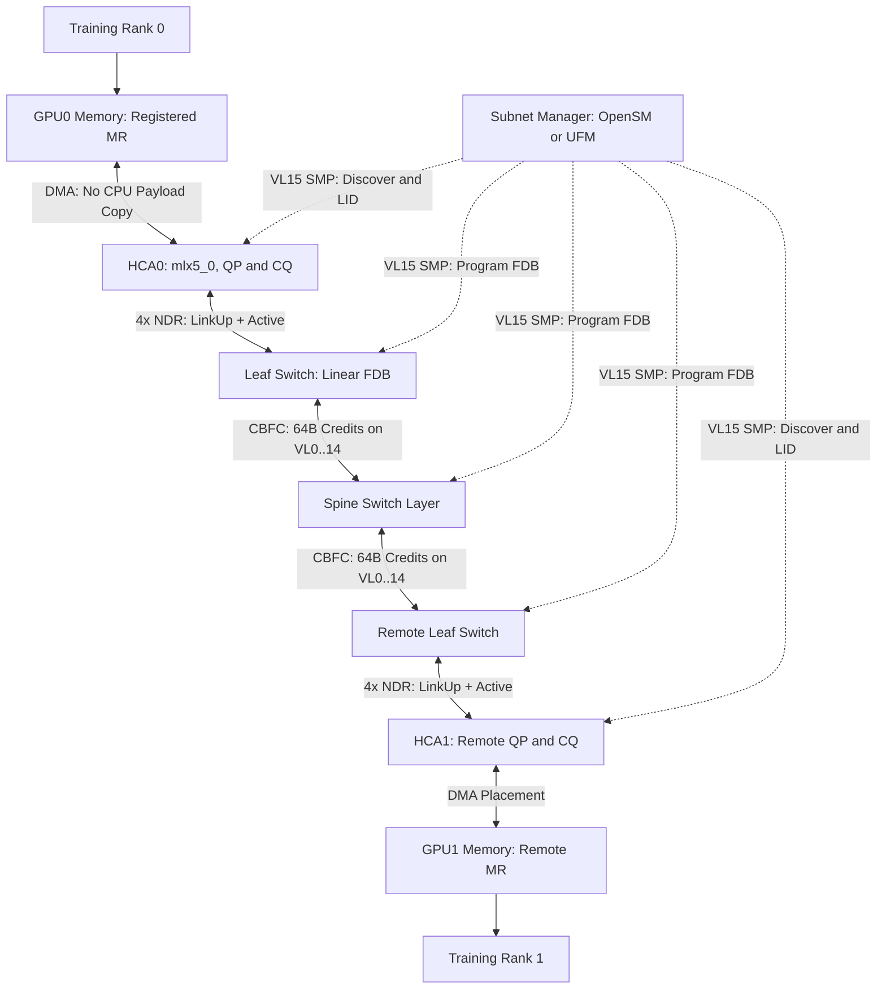
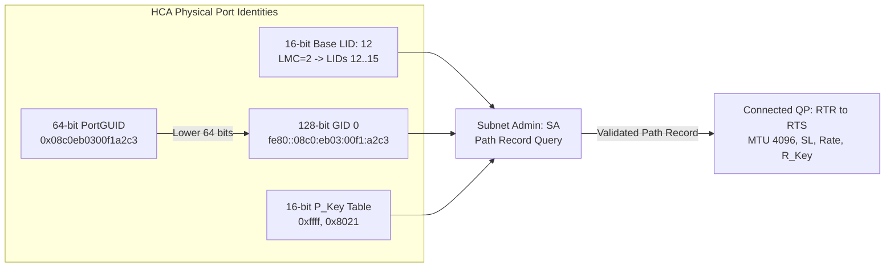
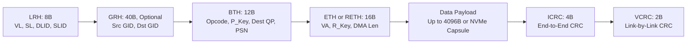

# 12.6 InfiniBand fundamentals and addressing

| | |
|---|---|
| Level | Intermediate |
| Priority tier | 1 |
| Lab venue | Nebius GPU |
| Part | Part 12: Complete AI networking |
| Code | `code/part12/infiniband_fundamentals.py`, `code/part12/infiniband_fundamentals_lab.py` |
| Coverage file | `planning/coverage/chapters/12-06.md` |

## Why this matters for AI infrastructure

Think of a relay race where every runner must finish a lap before the next one can start. Distributed training works the same way. Every rank synchronizes across the network at the end of every step, so one slow link does not hurt only itself. If even one network link slows down or stalls, the entire cluster waits for that single straggler path to finish. In a large GPU cluster, a minor fabric misconfiguration can turn microsecond network delays into hours of wasted GPU compute time, because every GPU sits idle while the slow path finishes.

The relay picture also explains why averages mislead. A team with a fast runner and a slow runner looks fine on paper, but the race is decided by the handoff that waits longest. A training step behaves the same way. The step ends when the last rank finishes, so the tail of the latency distribution matters more than its middle.

Picture a brand-new cluster on the day you hand it to the research team. Every switch port shows a green physical LED, and the basic ping tests pass. Then a real training job starts, and it fails or crawls. You may lose days chasing collective timeouts. A collective timeout is a symptom, not a cause. It tells you that a step did not finish, but not which link held it back. Those timeouts often come from four quiet fabric failure modes, and you can check each one with the tools in this chapter.

Notice that none of the four failures produces a clear error message. Each one either hides behind a green light or shows up as a timeout far away from its cause. That is why this chapter pairs every failure with a counter or a command. A reading you can repeat is worth more than a vague feeling that the fabric seems slow.

1. The first is physical versus logical port state divergence. Think of a phone that shows full signal bars but cannot place a call until the network registers it. A port negotiates its electrical link and turns the transceiver LED green. However, it remains logically uninitialized because the Subnet Manager has not assigned a Local Identifier or programmed switch forwarding tables.
2. The second is silent lane-width degradation. A four-lane cable with one dirty optical fiber negotiates down to a single active lane. The port still reports an active logical state, while capping every collective touching that server at one quarter of its design speed. Nothing fails loudly, so the job simply runs slow.
3. The third is credit backpressure and Virtual Lane contention. InfiniBand uses link-by-link credit flow control across Virtual Lanes rather than dropping packets when buffers fill. When a slow receiver or shared storage queue stops returning credits, upstream switch ports pause transmission. That pause spreads head-of-line blocking across the fabric with zero packet drops. The damage shows up as waiting time, not as missing packets, which is why the drop counters stay quiet.
4. The fourth is identity and partition mismatches. Scripts that treat temporary Local Identifiers as permanent server names break whenever the Subnet Manager sweeps the fabric. Meanwhile, mismatched Partition Keys or shifting Global Identifier table indices silently block Queue Pair connections before training can begin. A Queue Pair, as Chapter 12.2 explained, is the connection object that a job needs before any data moves.

A useful habit is to check the four failures in order of cost. Port state and lane width are cheap to read, so check them first. Partition and identity problems take more thought. Credit backpressure needs a trend over time, so it comes last, once the cheap checks are clean. Working in this order keeps you from chasing a subtle cause while a simple one is still present.

Suppose a job has stalled, and the application logs say only that a collective timed out. Where do you look first? This chapter answers that by building InfiniBand from the bottom up. It starts with physical signaling and line encoding, then moves to hardware and logical addressing. Along the way it shows how native frames, Virtual Lane credits, IP over InfiniBand and the OpenFabrics diagnostic tools work together in production. The short rule is to start with port state, lane width and error-counter trends before you blame the application.

Stalls rarely come from one cause at a time. A bad cable can lower a port's lane width, and that lower speed can then create credit backpressure that looks like a software slowdown. Read the layers from the bottom up, and fix the lowest broken layer before judging the layers above it.

## Prerequisites and outcomes

**Prerequisites:** Picture your first InfiniBand ticket, where the port LED is green but the job will not start. Read Chapter 12.1 on AI collective traffic patterns, Chapter 12.2 on RDMA verbs and Queue Pairs, and Chapters 12.3 through 12.5 on RoCEv2 and lossless Ethernet first.

**Outcomes:** The chapter closes with a set of checks you can run on a live fabric. It works through raw signaling rates, line-encoding efficiencies, and effective four-lane and twelve-lane bandwidths for each generation from SDR through GDR. It separates hardware GUIDs, subnet LIDs, LMC multipath ranges, global GIDs, and pre-LID directed-route Subnet Management Packets. It evaluates Partition Key membership rules, including the full versus limited member bits and the asymmetric drops between limited compute nodes. It decodes native InfiniBand packet headers and traces per-VL credit-based flow control across data and management Virtual Lanes. Finally, it configures IP over InfiniBand in datagram and connected modes and diagnoses live fabrics with standard InfiniBand command-line tools.

---

## 1. Why InfiniBand exists and how the layered fabric works

### 1.1 Tightly coupled collectives and the separation of data and control planes

Why does a network that works well for a web service struggle under a training job? Consider a web service first. It sends independent requests, and it tolerates a kernel socket copy or a millisecond latency spike without anyone noticing. Distributed AI training is different. Every GPU rank must synchronize at every iteration barrier, so the completion time of an AllReduce or AllToAll collective equals the completion time of its slowest participant. Conventional operating system sockets add system calls, kernel buffer copies, CPU interrupts and scheduler jitter to every transfer, and each of those adds delay that the slowest rank must wait for.

This is also why training teams care about fabric details that web teams rarely see. A web service can retry a slow request and move on. A training step cannot move on until every rank has reported in, so a small delay on one path becomes a delay for the whole job.

The InfiniBand Trade Association standardized InfiniBand to remove CPU and kernel overhead from the transfer path. The design is a purpose-built fabric. Open-source software stacks such as OFED, MLNX_OFED and DOCA-OFED expose that hardware directly to training libraries and storage clients. OFED, the OpenFabrics Enterprise Distribution, is the common driver and library bundle. InfiniBand gets low latency and predictable throughput by keeping the hardware data plane strictly separate from a centralized control plane. The data plane moves the bytes, and the control plane decides where the bytes go.



The fabric has several parts, and each one has a different job. Think of a city's road network. The adapters are the on-ramps, the switches are the junctions, and the Subnet Manager is the traffic authority that keeps the map. The table shows what each part owns, how you can confirm it is healthy, and what breaks when it fails. Use it as a checklist when you audit a fabric.

Each part also has a failure that looks like a different part. A switch with no forwarding table can make an adapter look dead, and a Subnet Manager that is slow to sweep can make a switch look unprogrammed. Before you replace hardware, ask which part owns the symptom you see, and check that part's evidence first.

| Fabric component / plane | Primary responsibility | Operational evidence of health | What breaks if it fails |
|---|---|---|---|
| **Host Channel Adapter (HCA)** | Owns Queue Pairs and Completion Queues, enforces Protection Domains and Memory Region keys (`L_Key` / `R_Key`), executes DMA directly to GPU or host memory, and packetizes payloads. A simplified storage variant called Target Channel Adapter (TCA) was defined by the IBTA but never became widespread. | `ibv_devinfo -v` shows `PORT_ACTIVE (4)`, `LINK_UP (5)`, and `active_mtu: 4096 (5)`, with local PCIe and NUMA affinity to the paired GPU. | Cross-socket UPI or QPI hairpinning occurs if the GPU and HCA sit on different NUMA nodes. Key mismatches trigger `IBV_WC_LOC_PROT_ERR` or `REM_ACCESS_ERR`. |
| **InfiniBand Switch and Virtual Port 0** | Performs cut-through hardware forwarding (`~300 ns` switch latency) using deterministic Linear Forwarding Tables (LFTs) keyed by the `16`-bit Destination LID (`D-LID`). Enforces SL-to-VL mapping and `64`-byte CBFC credit exchange. Every switch exposes a dedicated virtual Port `0` for switch management. | `ibroute` shows a valid egress port per `D-LID`. `perfquery` reports `SymbolErrorCounter = 0` and low `PortXmitWait`. | Unlike Ethernet switches, InfiniBand switches do not self-learn MAC addresses or build spanning trees. Unprogrammed switches drop or strand all data traffic. |
| **Subnet Manager (SM / OpenSM / UFM)** | Central control plane running on a host HCA or switch. Sweeps topology via directed-route SMPs on VL15, assigns Base LID and LMC, programs switch forwarding tables, enforces P_Key partitions, and configures SHARP in-network reductions via NVIDIA Unified Fabric Manager (UFM). | `sminfo` shows `1` authoritative master (`SMINFO_MASTER`) and `1+` standbys. `ibstat` shows `State: Active` and non-zero `Base lid` and `SM lid`. | Ports stay stuck at `Physical state: LinkUp` and `State: Initializing` (`Base lid: 0`, `SM lid: 0`). This causes the classic green LED, dead port outage. |
| **InfiniBand Routers** | Interconnect multiple InfiniBand subnets (`<= 49,151` unicast ports per subnet) using `128`-bit GIDs in the `40`-byte Global Routing Header (GRH). | Valid site-local (`0xFEC0::/64`) or global GID prefixes and router path records are present. | Intra-subnet link-local `0xFE80::/64` packets are never forwarded across routers. |

The switch row explains why unprogrammed switches strand data traffic, and the Subnet Manager row explains the classic green-LED outage. Keep both in mind as you read the rest of this chapter. A switch with no forwarding table is like a junction with no signs, and a Subnet Manager that never finished its sweep leaves ports without addresses.

### 1.2 Predictability versus peak speed: reading `ib_write_bw` under contention

Picture the common case. You run a quick two-node bandwidth test on an idle cluster, see full line rate, and declare the network healthy. That result proves less than it seems. Peak speed on an empty wire only shows that one Queue Pair can push bytes for a brief moment. Synchronized AI training depends on sustained average bandwidth and tight tail latency when every server transmits at once. An idle test cannot show you either of those.

This habit matters for every benchmark you run. Record the peak and the average, record the message rate, and note whether other jobs were running at the same time. A benchmark without that context tells you about one moment, not about the fabric you will use for a month.

When several nodes share an oversubscribed or poorly routed switch path, link-layer credit stalls pause the sending Queue Pair between bursts. The peak counter still records the brief moments when credits are available, so it hides a severe throughput collapse. To catch fabric contention, compare peak bandwidth against average bandwidth and message rate in `ib_write_bw`. Use the columns together, because the average and the message rate are where the collapse shows.

Credit stalls are easy to misread because they look like slowness on one end. The sender is waiting, the receiver seems quiet, and the cable reports no errors. The waiting time is recorded in a counter, and the counter is the only evidence. That is why the chapter keeps returning to counter deltas over time.

```text
# Benchmark parameters:
# 2,097,152-byte (2 MiB) messages, 1 Reliable Connected QP on mlx5_0, 10 seconds
# Local:  LID 0x0c (12), QPN 0x012a, PSN 0x3a1f2e, RKey 0x1c0a00
# Remote: LID 0x51 (81), QPN 0x00e3, PSN 0x0091ab, RKey 0x1c0b00
# Cluster symptoms: 256-GPU or 128-node jobs showing 20% step-time oscillation

# 1. Uncongested 400 Gbps NDR path (0.28% spread between peak and average):
 #bytes  #iterations  BW peak[Gb/sec]  BW average[Gb/sec]  MsgRate[Mpps]
 2097152 237000       399.82           398.71              0.0238

# 2. Same path under concurrent upstream switch contention (39.69% average drop):
 #bytes  #iterations  BW peak[Gb/sec]  BW average[Gb/sec]  MsgRate[Mpps]
 2097152 144000       399.71           241.06              0.0144
```

Read the two runs side by side, and let the average column do the judging. On the uncongested path, average throughput tracks peak almost exactly across the whole ten-second window. Under upstream switch contention, the peak column still reports full wire speed, so a naive threshold check passes. Average bandwidth, however, drops by nearly forty percent because intermittent credit pauses stall the sender. An alarm set on the peak column would stay silent through this entire incident, which is the lesson of the pair. Judge a fabric by its average bandwidth under load, not by its peak on an idle wire.

When you write up a benchmark for a team, present the two runs as a before and after pair. State the path, the load, the window and the two averages. A reader who sees only one run cannot tell whether the result is normal, and a pair makes the effect of contention obvious without extra explanation.

---

## 2. Physical layer generations, lane widths, encoding, and port state machines

### 2.1 Link generations, four-lane versus twelve-lane widths, and line encoding

Suppose a server port trains at a slower signaling generation, or it drops three of its four lanes. Every collective that uses that server slows down in proportion, and the job feels it at every step. Operators who confuse raw signaling rates with effective data bandwidth misread port status tools and miscalculate collective step times. Understanding how parallel lanes and line encoding set the usable throughput prevents both mistakes.

Lane width is a quiet failure. A port that trains down still shows up on the status page, and its neighbors look fine. The first sign is usually a job that runs about a quarter slower than the last run, with no error logged. Comparing the lane count against the design count is the fastest way to catch it.

An InfiniBand cable bundles several bidirectional serial lanes that carry data in parallel. A lane is one serial pair that carries bits, and a port's width counts how many of its lanes are working. Think of a four-lane cable as four parallel roads between two cities. Most Host Channel Adapter cables and switch links use four lanes. Dense switch backplanes and trunk links often use twelve lanes, or two-lane and eight-lane breakouts. Each new generation raises the raw bit rate per lane and upgrades the line encoding to reduce bit overhead.

Line encoding is the step that helps the bits survive the trip. It embeds clock recovery information and keeps the signal DC balanced, so receivers can detect and correct bit errors. Think of it as adding timing marks and check symbols to a message, so the receiver can keep time and spot damage. The early generations, SDR to QDR, use eight-bit-to-ten-bit encoding. Every eight data bits become ten wire bits, so you lose twenty percent to overhead. The middle generations, FDR10 to HDR, use sixty-four-to-sixty-six-bit encoding. The modern NDR, XDR and GDR fabrics use PAM4 modulation with Forward Error Correction and two-hundred-fifty-six-to-two-hundred-fifty-seven-bit blocks. The price of all that protection is the extra wire bits, and the efficiency column measures that price.

Encoding also explains why generations that share a name can behave differently. A port that reports a rate of 56 is not running at 56 Gbps of usable data. Keep the raw rate, the encoding and the effective rate in mind together, and you will avoid most of the confusion that appears in capacity planning.

The table is a lookup. Find the generation your port reports, then read the effective columns, because those are the numbers that matter for throughput. Notice how the 4x and 12x columns grow directly from the 1x lane. Each of them is a multiple of the effective 1x lane value, so the arithmetic is easy to check by hand.

| Generation | Raw lane rate (Gbps) | Line encoding | Encoding efficiency | Effective `1x` lane (Gbps) | Raw `4x` rate (Gbps) | Effective `4x` bandwidth (Gbps) | Effective `12x` bandwidth (Gbps) |
|---|---:|---|---:|---:|---:|---:|---:|
| **SDR** (Single Data Rate) | `2.5` | `8b/10b` | `80.00%` | `2.0` | `10.0` | **`8.0`** | **`24.0`** |
| **DDR** (Double Data Rate) | `5.0` | `8b/10b` | `80.00%` | `4.0` | `20.0` | **`16.0`** | **`48.0`** |
| **QDR** (Quad Data Rate) | `10.0` | `8b/10b` | `80.00%` | `8.0` | `40.0` | **`32.0`** | **`96.0`** |
| **FDR10** (Fourteen-10) | `10.3125` | `64b/66b` | `96.97%` | `10.0` | `41.25` | **`40.0`** | **`120.0`** |
| **FDR** (Fourteen Data Rate) | `14.0625` | `64b/66b` | `96.97%` | `13.6` | `56.25` (`56` in `ibstat`) | **`54.4`** | **`163.2`** |
| **EDR** (Enhanced Data Rate) | `25.78125` | `64b/66b` | `96.97%` | `25.0` | `103.125` | **`100.0`** | **`300.0`** |
| **HDR** (High Data Rate) | `53.125` | `64b/66b` | `96.97%` | `50.0` | `212.5` | **`200.0`** | **`600.0`** |
| **NDR** (Next Data Rate) | `106.25` | `256b/257b` | `99.61%` | `100.0` | `425.0` | **`400.0`** | **`1,200.0`** |
| **XDR** (eXtended Data Rate) | `200.0` (nominal) | `256b/257b` | `99.61%` | `200.0` | `800.0+` | **`800.0`** | **`2,400.0`** |
| **GDR** (Giga Data Rate) | `400.0` (nominal) | `256b/257b` | `99.61%` | `400.0` | `1,600.0+` | **`1,600.0`** | **`4,800.0`** |

The raw and effective numbers differ in every row. That gap is the line-encoding cost. It is also why `ibstat` can show `56` for an FDR port while the usable rate is lower. When a rate looks wrong, run the arithmetic yourself, using the block below, before you open a ticket.

Capacity plans should use effective numbers. A plan built on raw rates will promise more throughput than the wire can deliver, and the gap will surface only when the collectives are already running. Use the effective columns for every estimate, and keep the raw columns for hardware discussions.

```text
# Line-encoding efficiency derivations and FDR / NDR rate checks:
8b/10b efficiency   = 8 / 10     = 80.0%     (20.0% encoding overhead)
64b/66b efficiency  = 64 / 66    = 96.9697%  (~3.03% encoding overhead)
256b/257b efficiency= 256 / 257  = 99.6109%  (~0.39% block overhead)

4x FDR raw rate     = 4 * 14.0625 Gbps = 56.25 Gbps (displayed as "Rate: 56" in ibstat)
4x FDR effective BW = 4 * 13.6 Gbps    = 54.4 Gbps  (12x FDR = 163.2 Gbps)
4x NDR degraded 1x  = 1 * 100.0 Gbps   = 100.0 Gbps (25% of 400.0 Gbps design bandwidth)
```

A 4x NDR port that degrades to one lane therefore runs at 100 Gbps. That is a quarter of its 400 Gbps design speed, and the job's collectives feel the full drop, not just the lane that failed.

### 2.2 Physical state versus logical link-layer port state machine

A common trap starts with a solid green link LED. Picture a technician walking a row of racks. The technician sees the green light on a switch port and assumes the server is ready for jobs. On InfiniBand, though, a green LED only means the physical transceivers have locked onto each other's electrical or optical signal. If the logical link state has not reached the active stage, every application Queue Pair on that port will fail to send data.

A green LED is still useful. It tells you the cable and the transceivers are working at the physical layer. The mistake is treating it as the whole story. Treat the LED as the first of several checks, and the logical state, the Base LID and the lane width as the rest.

Every InfiniBand port runs two separate state machines, and you must check both together in `ibstat` and `ibstatus`. The physical state machine handles lane training on the wire. It moves from polling through configuration to link up. The logical state machine handles Subnet Manager admission. It moves from down to initialize, then armed, and finally active. The two machines advance one after the other, so a port can be physically up and logically stuck.

The two state machines also explain the ordering of recovery steps. After a cable is reseated, the physical layer retrains first. Only then can the Subnet Manager bring the logical state up. If you check the logical state too early, it will still look broken, and that result says nothing about whether the repair worked.

| State machine | State name and numeric code | Traffic permitted | Operational transition rule |
|---|---|---|---|
| **Physical (`phys state`)** | `Disabled` | None | Port is administratively shut down. |
| **Physical (`phys state`)** | `Polling` | Training sequences | Initial power-on state searching for a remote link partner. |
| **Physical (`phys state`)** | `Configuration` | Negotiation frames | Link partner detected; ports negotiate speed and lane width (`1x`, `2x`, `4x`, `12x`). |
| **Physical (`phys state`)** | `LinkUp` (`5: LinkUp`) | Wire symbols | Physical layer is up and symbols can cross the medium. |
| **Physical (`phys state`)** | `Recovery` | Retraining symbols | Link lost synchronization and is attempting hardware recovery (`Link Error Recovery Counter` increments). |
| **Logical (`State`)** | `Down` (`1`) | None | Physical layer is not yet `LinkUp`; no packets can be sent. |
| **Logical (`State`)** | `Initialize` / `Initializing` (`2`) | VL15 SMPs only | Entered immediately when physical state reaches `LinkUp`. Application Queue Pairs cannot send data. |
| **Logical (`State`)** | `Armed` (`3`) | VL15 SMPs only | Subnet Manager assigned `Base LID` and P_Key tables, but full forwarding is not yet enabled. |
| **Logical (`State`)** | `Active` (`4: ACTIVE`) | All data (VL0–VL14) and VL15 | Subnet Manager finished programming switch Linear Forwarding Tables; RDMA verbs and IPoIB can flow. |

As you read the table, remember that application data moves only after the logical state reaches active. Before that point, only VL15 management packets pass. The Subnet Manager needs that window to hand out addresses and tables. When a port looks healthy, read both state machines before you trust it.

---

## 3. Component identification, addressing, and partitioning

InfiniBand uses five distinct identifiers. Each one covers a different job: hardware identity, switch forwarding inside a subnet, routing between subnets, bootstrap discovery, and multi-tenant isolation. Think of them as five kinds of address. One is a name stamped on the box, one is a street number inside a single city, and one is a postal route between cities. Another is a way to knock on a door nobody has labeled yet, and the last is a locked gate for each tenant. Confuse them, and you get broken inventory databases and silent connection failures.

Mixing these identifiers in code is a common source of bugs. A script that reads a LID where it should read a GUID will work on the day it is written and fail after the next sweep. Name the variables for the identifier they hold, and keep the types distinct in any inventory tool you write.



The table gives each identifier its bit width, its owner, and its role in an AI fabric. Bit width tells you how many values the field can hold, and the owner tells you who is allowed to change it. Read the mutability column with care, because it decides which identifiers are safe to store in a database.

Mutability is the column that causes the most trouble in practice. A value that the Subnet Manager can change belongs in a runtime view, not in a permanent record. Keep permanent records to the values that the hardware owns, and treat everything the Subnet Manager assigns as a cache that may need refreshing.

| Identifier / attribute | Bit width | Assigned by | Mutability and scope | Operational role in AI fabrics |
|---|---:|---|---|---|
| **NodeGUID / PortGUID / SystemImage GUID** | `64` bits | Hardware manufacturer in firmware | Persistent across reboots and SM sweeps; global hardware identity | Anchor your CMDB and inventory on PortGUID. Every HCA has `1` NodeGUID and `1` PortGUID per port; a switch has `1` NodeGUID and uses the same PortGUID across all switch ports. SystemImage GUID groups elementary switch chips inside one modular chassis, whereas multiple HCAs in one server have distinct SystemImage GUIDs because each runs independent firmware. |
| **Local Identifier (LID)** | `16` bits (`0..65,535`) | Subnet Manager at sweep time | Mutable runtime state; unique within one subnet | Used in the `8`-byte Local Route Header (`S-LID` and `D-LID`) as the lookup key in switch forwarding tables. Each HCA end port and each switch as a whole (Port `0`) receives at least one LID. |
| **LID Mask Control (LMC)** | `3` bits (`LMC` `0..7`; `2^LMC` LIDs) | Subnet Manager | Mutable runtime policy; intra-subnet | Assigns $2^{\text{LMC}}$ consecutive LIDs (`Base LID` to `Base LID + 2^LMC - 1`, where the lower `LMC` bits of `Base LID` must be `0`) to one port so switches can spread traffic across $2^{\text{LMC}}$ parallel paths. |
| **Global Identifier (GID)** | `128` bits (IPv6 format) | `64`-bit prefix from SM + `64`-bit PortGUID | Context-dependent (`show_gids` index `0..N`); intra- and inter-subnet | Placed in the `40`-byte Global Routing Header for inter-subnet routing or RoCEv2 and container contexts. Default prefix `0xFE80::/64` is link-local; `0xFEC0::/64` is site-local; `0xFF00::/8` is multicast. |
| **Directed Route (SMP)** | Hop list (`hop_count`, `hop_pointer`, `D` bit) | Subnet Manager on VL15 | Bootstrap and diagnostic (`LID = 0xFFFF` permissive) | Lists exact switch egress port numbers before LIDs or forwarding tables exist (`D=0` outbound records `return_path`; `D=1` returns response). |
| **Partition Key (P_Key)** | `16` bits (`15`-bit ID + `1`-bit membership) | Subnet / Partition Manager | Policy-driven logical isolation across shared fabric | Enforces tenant and job partition membership in hardware (BTH). Bit `15` (`0x8000`) is `1` for Full members (`0xffff`, `0x8021`) and `0` for Limited members (`0x7fff`, `0x0021`). |

The PortGUID is the identifier to anchor on, because it survives reboots and sweeps. The LID is assigned at sweep time and can change, as the next subsection shows. Anchor your records on the thing that does not move.

A PortGUID-keyed inventory also makes hardware swaps easier to trace. When a card is replaced, its new PortGUID appears in the record, and the old one is retired with a note. The history of the slot stays readable, and the next person can see exactly what changed.

### 3.1 Sixteen-bit LID address space and LMC multipath math

Suppose an operator keys a cluster inventory script on Local Identifiers. A routine Subnet Manager restart or cable swap can renumber ports, and maintenance commands then reach the wrong servers. Architects designing massive clusters face a related limit, the hard unicast ceiling of a single InfiniBand subnet. That ceiling is a design constraint rather than a bug. Once you know it, you can plan the number of subnets before the cluster is built.

The LID problem has a simple fix that many teams skip. Store the GUID in the inventory, and look up the current LID through the Subnet Manager each time you need it. The lookup is cheap, and it keeps the record correct after every sweep.

The Local Identifier field in the Local Route Header is sixteen bits wide. That gives sixty-five thousand values, and the specification splits them into reserved, unicast, multicast and permissive ranges. Unicast forwarding uses only the lower three-quarters of that space. Think of a LID as a street number that only has meaning inside one city. The arithmetic below shows the result: a single subnet can address at most forty-nine thousand one hundred fifty-one end ports and switches. Scaling beyond that limit requires InfiniBand routers or independent multi-rail subnets.

Address space is finite, so it is worth planning early. A cluster that grows past its subnet limit needs a routed design, and a routed design needs GIDs that work across routers. Choosing the subnet layout before the first rack is installed is much cheaper than splitting a live fabric later.

```text
# 16-bit LID address space (2^16 = 65,536 total values):
LID = 0x0000 (0)                  : Reserved; never assigned to any port
LID = 0x0001..0xBFFF (1..49,151)  : Unicast LIDs for switches and HCA end ports
  Max Unicast LIDs = 2^15 + 2^14 - 1 = 32,768 + 16,383 = 49,151 (~48,000 end nodes)
LID = 0xC000..0xFFFE (49,152..65,534): Multicast LIDs (16,383 multicast groups)
LID = 0xFFFF (65,535)             : Permissive LID (processed by first receiving port)

# LID Mask Control (LMC 0..7) alignment and range rules:
Alignment rule : (Base_LID & (2^LMC - 1)) == 0
Assigned range : [Base_LID, Base_LID + 2^LMC - 1] (consumes 2^LMC unicast LIDs per port)
Switch default : LMC = 0 -> 2^0 = 1 LID per switch (Port 0)
HCA examples   :
  Base LID = 913 (0x391), LMC = 0 -> 1 LID  : [913] (aligned = True)
  Base LID = 12 (0b00001100), LMC = 2 -> 4 LIDs: [12, 13, 14, 15] (lower 2 bits 00, aligned = True)
  Base LID = 16 (0b00010000), LMC = 3 -> 8 LIDs: [16, 17, 18, 19, 20, 21, 22, 23] (aligned = True)
  Base LID = 13 (0b00001101), LMC = 2 -> 4 LIDs: [13, 14, 15, 16] (lower 2 bits 01, aligned = False)
```

Now suppose the subnet has several parallel paths between leaves and spines. The Subnet Manager can give one HCA port a contiguous block of LIDs using LID Mask Control, or LMC. The port's Base LID must have its lowest LMC bits set to zero, so the block lines up cleanly in binary. The Subnet Manager then programs the switch tables so that each LID in the block sends across a different spine link. Use the alignment rule as a check. A Base LID of 13 with an LMC of 2 fails, because its lower two bits are 01, not 00.

### 3.2 Global Identifiers and why hardcoded GID indices fail

Suppose you run a containerized GPU cluster where every job starts with `NCCL_IB_GID_INDEX=3` hardcoded on all nodes. Jobs fail at startup. One node brought up its IP over InfiniBand interfaces or virtual functions in a slightly different order. On that server, index three points to a different address family or subnet. The Queue Pair connection then fails during the Ready to Receive transition, which is the step where one side tells the other that it is ready to accept data.

A containerized job makes the problem worse, because the container may see a different interface order than the host. The safe pattern is to select the GID by its prefix and address type, which stays stable, and not by its position in a table, which can shift between boots.

A Global Identifier is a standard IPv6 address assigned to every InfiniBand end port. Think of it as a full mailing address, with a prefix that names the area and a suffix that names the building. Its lower sixty-four bits hold the persistent hardware PortGUID. Its upper sixty-four bits hold a subnet prefix that the Subnet Manager assigns. Every port has a mandatory default link-local GID at index zero, and that GID never crosses InfiniBand routers. Ports can also hold site-local, global unicast, multicast or IPv4-mapped entries. Select the GID by matching its subnet prefix and address type, not by trusting a blind table index.

Link-local, site-local and global addresses answer different questions. The link-local address is enough to talk to a neighbor on the same subnet. The site-local address is for traffic that must cross a router inside one site. Global addresses are for traffic that leaves the site entirely. Picking the wrong scope is a common cause of connections that work on one node and fail on another.

| GID type or `show_gids` entry | Upper `64`-bit prefix / format | Routing scope and RFC reference | Example value from production fabrics |
|---|---|---|---|
| **Link-local default (`GID[0]`)** | `0xFE80::/64` + `64`-bit `PortGUID` | Strictly local subnet; never forwarded by InfiniBand routers | `fe80:0000:0000:0000:08c0:eb03:00f1:a2c3` (from `PortGUID 0x08c0eb0300f1a2c3`) or EUI-64 `fe80:0000:0000:0000:08c0:ebff:fe03:00f1` |
| **Site-local unicast** | `0xFEC0::/64` + `64`-bit `PortGUID` | Routable across InfiniBand routers within a site; must not leave the site | `fec0:0000:0000:0000:0012:3456:0000:73f0` (or custom SM prefixes `fe90::` / `fea0::`) |
| **Global unicast** | Standard global IPv6 prefix | Routable across inter-subnet InfiniBand routers | Assigned by SM during initialization |
| **Multicast GID** | `0xFF00::/8` (high byte `0xFF`) | InfiniBand multicast groups (`RFC 2373` and `RFC 2375`) | Used for collective and IPoIB multicast groups |
| **IPv4-mapped GID (`v1`/`v2`)** | `0000:0000:0000:0000:0000:ffff:w.x.y.z` | Dual-mode ConnectX / IPoIB / container namespace entry (`INDEX 0, 1, 2, 3...`) | `0000:0000:0000:0000:0000:ffff:0a01:0203` for IPv4 `10.1.2.3` (`0x0a010203`); never hardcode `-g 3` blindly |

Each row shows the prefix, the distance the address can travel, and an example you may see on a real fabric. Even when one entry matches the address you want, do not hardcode `-g 3` blindly. A table index that was right on one node can be wrong on the next.

Reading the table row by row also trains your eye. Once you recognize the prefix families, a GID printed in a log tells you its scope at a glance. That speed matters during an incident, when every minute spent decoding an address is a minute the job stays stalled.

### 3.3 Directed-route Subnet Management Packets

What does the fabric look like at cold boot? Imagine switching on a building with no room numbers and no signs. Every port has a Base LID of zero, and every switch forwarding table is empty. Normal LID-based forwarding cannot work in that state. Without a bootstrap mechanism that bypasses the forwarding tables, the Subnet Manager could never reach the switches to assign LIDs.

InfiniBand solves this bootstrap problem with directed-route Subnet Management Packets, or SMPs. They travel to the permissive LID on management Virtual Lane fifteen. An outbound directed-route packet has no destination address. Instead, it carries an explicit list of switch egress port numbers, and that list tells each switch which physical port to exit. Think of it as a letter with a written route, like turn-by-turn directions that the sender wrote before leaving. As each switch forwards the request, it records the port where the packet arrived in a return path array.

The bootstrap process also explains why a freshly cabled fabric can look dead for a short while. Until the first sweep completes, the only traffic that moves is the directed-route management traffic. Give the Subnet Manager time to finish, and then check the logical states.

When the packet reaches the target port, the local Subnet Management Agent handles the request and flips the direction bit from zero to one. On the return trip, each switch reads its recorded port number from the return path array. It then steps the hop pointer backward until the reply reaches the Subnet Manager. InfiniBand also supports combined directed routing. In that mode, a packet uses normal LID forwarding up to an initialized switch, then crosses an uninitialized link with a hop list.

The trace below follows one three-hop request, step by step. Read the outbound steps first, then the return, and watch the hop pointer and the return path array as they change.

```text
# Directed-route SMP header fields (VL15, Permissive LID = 0xFFFF):
hop_count    : Total number of switch hops in the route list (e.g., 3)
hop_pointer  : Current hop index (1..hop_count) being traversed
D (Direction): 0 = Outbound Request (SM -> Target), 1 = Return Response (Target -> SM)
initial_path : Array of switch egress port numbers to exit on outbound path
return_path  : Array of switch ingress port numbers recorded dynamically on outbound path

# Step-by-step 3-hop trace: egress_ports=[4, 11, 2], ingress_ports_on_switches=[1, 7, 3]
1. Outbound (D = 0):
   - Switch hop 1: arrives on port 1 -> writes return_path[1]=1, exits initial_path[1]=4, hop_pointer -> 2
   - Switch hop 2: arrives on port 7 -> writes return_path[2]=7, exits initial_path[2]=11, hop_pointer -> 3
   - Switch hop 3: arrives on port 3 -> writes return_path[3]=3, exits initial_path[3]=2, hop_pointer == hop_count (3)
   - State at target: d_bit=0, hop_count=3, hop_pointer=3, initial_path=(0, 4, 11, 2), return_path=(0, 1, 7, 3)
2. Turnaround at Target SMA:
   - Target processes SMP, generates reply, flips D = 1
3. Return (D = 1):
   - Switches forward out return_path[hop_pointer] (ports 3 -> 7 -> 1) without modifying return_path
   - hop_pointer decrements 3 -> 2 -> 1 -> 0 until reply reaches the SM (d_bit=1, hop_pointer=0)
```

When you trace the way back, watch the hop pointer. It drops from three to zero, and then the reply lands at the Subnet Manager. The return path array is what makes the trip home possible without any forwarding table.

### 3.4 Partition Keys: full versus limited membership

In a shared AI cluster, operators use Partition Keys to isolate tenant jobs and to restrict access to management or storage networks. Think of a partition as a guest list for a private room. Here is a subtle outage. An administrator updates the partition configuration and accidentally marks compute nodes as limited members instead of full members. Every compute node can still ping the full-member head node and mount shared storage. Yet all GPU-to-GPU collective communication between compute nodes silently times out.

Partition design should be written down before it is applied. A short document that lists which nodes are full members, which are limited, and which partitions they share is the best defense against this kind of outage. Review that document whenever a partition changes, because a single flag can break the whole job.

Each port holds a table of sixteen-bit Partition Keys that the Subnet Manager programs. The lower fifteen bits identify the partition number. The highest bit decides whether the port is a full member or a limited member. Switch and HCA hardware apply one strict rule to every packet. Two ports can communicate only when their fifteen-bit partition numbers match and at least one of them is a full member. In the guest-list picture, a full member is a guest with a key to the room, and a limited member can enter only when someone with a key is present.

Partition planning is a naming problem as much as a hardware problem. Give each partition a clear purpose, such as tenant job, storage or management, and record which membership type each node uses. A name that says what a partition is for makes the review faster and the mistakes rarer.

The table lists six pairings and the verdict that hardware gives each one. Read each row in two steps. First check the partition number, then check the membership bit.

| Port A `P_Key` | Port B `P_Key` | `15`-bit Partition ID match (`& 0x7FFF`) | Membership pairing (`bit 15 = 0x8000`) | Hardware forwarding verdict |
|---|---|---|---|---|
| `0xffff` | `0x7fff` | Match: default partition `0x7fff` | Full (`0xffff`) $\leftrightarrow$ Limited (`0x7fff`) | **`ALLOWED`** |
| `0x8021` | `0x8021` | Match: tenant partition `0x0021` | Full (`0x8021`) $\leftrightarrow$ Full (`0x8021`) | **`ALLOWED`** |
| `0x8021` | `0x0021` | Match: tenant partition `0x0021` | Full (`0x8021`) $\leftrightarrow$ Limited (`0x0021`) | **`ALLOWED`** (e.g., storage or head node to compute node) |
| `0x0021` | `0x0021` | Match: tenant partition `0x0021` | Limited (`0x0021`) $\leftrightarrow$ Limited (`0x0021`) | **`LIMITED_TO_LIMITED_DENIED`** (silently dropped by fabric) |
| `0x8021` (`LID 12`) | `0x8035` (`LID 87`) | Mismatch: `0x0021 != 0x0035` | Full $\leftrightarrow$ Full on different partitions | **`PARTITION_ID_MISMATCH`** (dropped) |
| `0x0000` | `0x8000` | Invalid: `0x0000` is unused | Zero partition ID | **`INVALID_ZERO_PARTITION_ID`** (rejected) |

Two limited members in the same partition are dropped silently. When you see a compute-to-compute path fail, check the membership bit first, because the mismatch is invisible to basic health checks.

A practical test follows from this. For every pair of node roles, write down whether they should communicate, and check the partition table against that list. Any pair that should communicate but cannot is a membership problem, and the fix belongs in the partition configuration.

---

## 4. InfiniBand frame format, Virtual Lanes, and Credit-Based Flow Control

### 4.1 Native InfiniBand data frame headers

Think about what a switch has to read on every frame. With Ethernet-based RDMA, the transport headers sit inside Ethernet, IP and UDP headers. That wrapping adds framing overhead, and switches must parse deep into each packet. Native InfiniBand drops that legacy encapsulation. Switches can then forward frames in roughly three hundred nanoseconds, using a compact eight-byte local header. Less to parse means less time per hop, and that is the whole point of the design.

The design choice has a cost on the other side. Native InfiniBand needs its own fabric and its own tools, so an organization that already runs Ethernet must weigh the effort of a second network. Compare the latency gain against the operational cost before you commit to either path.

Every native InfiniBand packet starts with a mandatory eight-byte Local Route Header. That header carries the Virtual Lane, the Service Level, and the sixteen-bit source and destination LIDs. A packet that stays inside one subnet skips the forty-byte Global Routing Header. It moves straight on to the twelve-byte Base Transport Header and the optional sixteen-byte RDMA Extended Transport Header. Two cyclic redundancy checks close the frame. One is a four-byte end-to-end Invariant CRC. The other is a two-byte link-by-link Variant CRC, recomputed at every switch hop. A CRC is a short checksum that lets the receiver detect corrupted bits.

Overhead matters most for small messages. A large tensor transfer amortizes the headers over many bytes, so the percentages stay high. A small control message carries the same headers for far fewer payload bytes, and its efficiency drops. Keep that in mind when you judge the traffic mix on a fabric.



Use the table to see which headers you must expect on every packet and which appear only in some operations.

A quick way to read a frame in a capture is to walk the headers in order. Start at the Local Route Header, check whether a Global Routing Header follows, and then read the Base Transport Header. The optional header tells you the operation, and the remaining fields tell you where the data goes.

| Frame header / trailer | Size | Mandatory? | Key fields and hardware function |
|---|---:|---|---|
| **Local Route Header (LRH)** | **`8` bytes** | **Yes** (every native IB packet) | Carries `4`-bit Virtual Lane (VL), `4`-bit Service Level (SL), `16`-bit Destination LID (`D-LID`), `11`-bit Packet Length in `4`-byte dwords up to `4,096` B MTU payload, and `16`-bit Source LID (`S-LID`). Switches forward purely on `D-LID`. |
| **Global Routing Header (GRH)** | **`40` bytes** | **Optional** (inter-subnet or GID-addressed) | Uses standard `40`-byte IPv6 header layout carrying `128`-bit Source GID and Destination GID. Omitted for pure intra-subnet LID traffic and ignored by intra-subnet switches when the destination LID is local. |
| **Base Transport Header (BTH)** | **`12` bytes** | **Yes** (all verbs and data frames) | Carries `8`-bit RDMA Opcode, Solicited Event (SE), `16`-bit P_Key, `24`-bit Destination Queue Pair (`Dest QP`), Acknowledge Request bit (`A`), and `24`-bit Packet Sequence Number (PSN). Receiving HCA uses `Dest QP` to place data into registered memory. |
| **Extended Transport Header (ETH / RETH / DETH)** | **`0..28` bytes** (`16` B for RETH) | Operation-dependent | In `RDMA_WRITE` and `RDMA_READ`, RETH (`16` B) carries the `64`-bit Remote Virtual Address (VA), `32`-bit Remote Key (`R_Key`), and `32`-bit DMA Length. In datagram (UD), DETH carries the `24`-bit Source QP and `32`-bit `Q_Key`. |
| **Data Payload** | Up to **`4,096` bytes** (`active_mtu`) | Payload packets | Raw tensor gradient chunk, MPI message, or NVMe-o-RDMA command and response capsule (`SQE`/`CQE` + `SGL` descriptors). |
| **Invariant CRC (ICRC)** | **`4` bytes** (`32` bits) | **Yes** | End-to-end CRC covering all fields that do not change from source HCA to destination HCA, masking out mutable LRH VL and GRH hop limit fields. |
| **Variant CRC (VCRC)** | **`2` bytes** (`16` bits) | **Yes** (native IB link layer) | Link-by-link CRC covering the entire packet including mutable LRH fields; recomputed at every switch hop to detect single-link bit errors immediately. |

Only the GRH is optional for intra-subnet traffic. The ETH, RETH or DETH depends on the operation you run. The next block turns these headers into overhead and efficiency numbers. Work the first case by hand: 8 + 12 + 4 + 2 = 26 bytes.

This is also why an inter-subnet frame costs more than an intra-subnet one. The extra forty bytes of routing header are the price of crossing a router. When you size a design, add that cost to every path that leaves the subnet.

```text
# Framing overhead and wire efficiency for a 4,096-byte MTU payload (vs RoCEv2 UDP port 4791):
1. Intra-subnet SEND (LRH 8B + BTH 12B + ICRC 4B + VCRC 2B):
   Overhead = 26 B | Wire frame = 4,122 B | Payload efficiency = 4096 / 4122 = 99.37% (99.3692%)
2. Intra-subnet RDMA_WRITE (adds RETH 16B):
   Overhead = 42 B | Wire frame = 4,138 B | Payload efficiency = 4096 / 4138 = 98.99% (98.9850%)
3. Inter-subnet routed RDMA_WRITE (adds GRH 40B + RETH 16B):
   Overhead = 82 B | Wire frame = 4,178 B | Payload efficiency = 4096 / 4178 = 98.04% (98.0373%)
```

Each added header lowers the payload efficiency a little. Even the inter-subnet case keeps about 98 percent of the frame as payload, so the cost of extra headers is small compared with the cost of a stalled collective.

Overhead is also a lesson in measuring the right thing. A benchmark that reports only peak line rate hides the header cost, and a benchmark that reports payload bytes per second shows it. Use payload throughput when you compare two fabrics, so that the comparison reflects what your application actually receives.

### 4.2 Virtual Lanes, Service Levels, and Credit-Based Flow Control

How does InfiniBand compare with lossless Ethernet? On lossless Ethernet, a switch reacts only after its receive queue crosses a threshold. It then sends an IEEE 802.1Qbb Priority Flow Control pause frame upstream. While the pause travels, the switch absorbs in-flight cable data into headroom buffers. InfiniBand prevents buffer overflow before it happens, at the link layer. Still, when a receiver stalls or storage traffic shares a queue with training collectives, upstream switch ports run out of transmit credits and pause. They do this without recording a single packet drop.

The difference is easiest to remember as a question of timing. Ethernet pauses after the queue fills, and InfiniBand grants permission before the queue fills. Both approaches keep packets from being dropped, but the proactive approach avoids the reaction window that Ethernet must cover with headroom.

Each packet header carries a four-bit Service Level. If you trace one packet through a switch, this is the field that picks its lane. The Service Level names the traffic class, such as collective training, storage, or IP over InfiniBand. At every switch hop, a lookup table maps that Service Level to one of up to sixteen hardware Virtual Lanes. Virtual Lanes zero through fourteen each get their own data buffers and credit pools. Virtual Lane fifteen is reserved strictly for Subnet Management Packets, so the Subnet Manager can always reach switches during severe data congestion.

Service Level planning is a design decision for the whole fabric. Give collective traffic its own level, give storage its own level, and give management its own level. A plan like that makes the counters on each Virtual Lane readable, because each lane then carries one kind of traffic.

Credit-Based Flow Control works on every link hop, and it runs separately for each data Virtual Lane. A downstream receiver measures its free buffer space in sixty-four-byte credit units. It keeps advertising that limit upstream in link-layer Flow Control Packets. An upstream switch port never sends a frame on a Virtual Lane unless the downstream port has already granted enough sixty-four-byte credits to hold the entire packet. The sender therefore waits for permission instead of hoping the receiver has room.

Credits also explain why a single slow receiver can hurt a whole subnet. Each upstream port that has run out of credits for a Virtual Lane must wait, and the waiting spreads upstream one hop at a time. The fix is to find the receiver that stopped returning credits, not the senders that are waiting for it.

Picture an incast, where many senders converge on one receiver that stops draining a Virtual Lane. Downstream credits then dry up. The upstream port increments its `PortXmitWait` counter on every clock tick it spends waiting to send. This backpressure spreads upstream and forms a congestion tree. The tree lasts until the root receiver drains, or until traffic classes move onto different Virtual Lanes. The Ultra Ethernet Consortium later adopted this same link-level credit model into its link layer specification.

The block below lists the lane and credit parameters, then works one credit calculation. Read the Case A and Case B lines together, since they show the same frame against two different advertised limits.

```text
# Virtual Lane (VL) and Credit-Based Flow Control (CBFC) hardware parameters:
Service Levels (SL0..SL15) : 4-bit QoS label in LRH mapped via SM SL-to-VL table at each hop
Data Virtual Lanes         : VL0..VL14 (15 data VLs; typically 8 to 12 active queues in hardware)
Management Virtual Lane    : VL15 (dedicated to uncredited SMPs; immune to data-plane starvation)
CBFC credit unit size      : 1 credit = 64 bytes of downstream per-VL receive buffer

# Credit math for a 4,122-byte intra-subnet SEND frame on VL1:
Credits required           = ceil(4,122 / 64) = 65 credits (65 * 64 = 4,160 bytes reserved)
Case A (100 credits = 6,400 B advertised) : Frame transmits immediately; 35 credits remain
Case B (50 credits  = 3,200 B advertised) : Port halts VL1 transmission and increments PortXmitWait
Telemetry signature        : PortXmitWait = 184,320 ticks on congested port 3 (vs 41 on port 7), SymbolErrorCounter = 0
```

In Case B, the port halts VL1 and the `PortXmitWait` counter starts to climb. That rising counter is the telemetry signature to look for. A port that waits this way is healthy in every other respect, which is why the counter is the only sign.

---

## 5. Verbs execution model, IP over InfiniBand, storage transports, and alternatives

### 5.1 Verbs resource hierarchy and `ibv_devinfo -v`

Picture an AI framework that opens thousands of Queue Pairs across a cluster. If it never checks the adapter limits or the path MTU, connections fail during startup. Or they crash mid-step with memory protection errors. Deregistering a memory buffer while DMA operations are still in flight causes immediate Queue Pair faults too. The limits in the next table are the budget the framework must stay inside.

Connection setup is a common place to lose time. Opening Queue Pairs lazily, when a collective first needs them, spreads the cost across the run. Opening them all at startup concentrates the cost in one place, which can cause a timeout that looks like a fabric problem.

As Chapter 12.2 introduced, RDMA applications bypass the operating system kernel by posting Work Requests straight to hardware queues, through the `libibverbs` and `rdma-core` API. Before you debug a collective failure, inspect the adapter's exact hardware capabilities and active port MTU with `ibv_devinfo -v -d mlx5_0` `(untested here)`. The output below shows what a healthy adapter reports.

Reading the limits table is also a planning exercise. Before a large job starts, compare the number of processes, peers and rails with the Queue Pair budget. A job that fits the budget in a test may not fit it at full scale, so the check belongs in the launch checklist.

```text
# (untested here)
$ ibv_devinfo -v -d mlx5_0
hca_id: mlx5_0
    transport:                  InfiniBand (0)
    fw_ver:                     28.39.2048
    node_guid:                  08c0:eb03:00f1:a2c3
    sys_image_guid:             08c0:eb03:00f1:a2c3
    vendor_id:                  0x02c9
    vendor_part_id:             4129
    max_mr_size:                0xffffffffffffffff
    max_qp:                     262144
    max_qp_wr:                  32768
    max_sge:                    30
    max_cq:                     16777216
    max_cqe:                    4194303
    max_mr:                     16777216
    atomic_cap:                 ATOMIC_HCA (1)
        port:   1
            state:              PORT_ACTIVE (4)
            max_mtu:            4096 (5)
            active_mtu:         4096 (5)
            phys_state:         LINK_UP (5)
            link_layer:         InfiniBand
```

The table below sets each limit beside the failure you see when you cross it. Read the limits as a budget for your job, and remember that the budget is shared by every process on the node.

| Verbs resource or state | Hardware limit on MT4129 (`ConnectX-7`, `vendor_id: 0x02c9 = 713`, `fw_ver: 28.39.2048`) | Operational boundary and failure signature |
|---|---|---|
| **Queue Pairs (QP) and Completion Queues (CQ)** | `max_qp: 262144` ($2^{18}$), `max_qp_wr: 32768` ($2^{15}$ WRs/QP), `max_cq: 16777216` ($2^{24}$), `max_cqe: 4194303` ($2^{22} - 1$) | Full-mesh `1`-QP-per-peer designs multiply QPs by `processes * peers * rails`. Production libraries share CQs across QPs, use hierarchical or rail topologies, or use Dynamically Connected (DC) transports. |
| **Scatter-Gather Entries (SGE) and Atomics** | `max_sge: 30` segments per Work Request (WR) / Work Queue Element (WQE); `atomic_cap: ATOMIC_HCA (1)` | Bounds how many discontiguous local buffers (Header, Tensor Chunk, Metadata) one WQE can link; confirms hardware `64`-bit atomic fetch-and-add and compare-and-swap. |
| **Protection Domains (PD) and Memory Regions (MR)** | `max_mr: 16777216`, `max_mr_size: 0xffffffffffffffff` (`cudaMalloc` + `cuFileBufRegister` / `nvidia-peermem`) | A QP in `PD_A` cannot access an MR in `PD_B`. Pinning returns local `L_Key` and remote `R_Key`; deregistering an MR before draining in-flight WQEs triggers `IBV_WC_LOC_PROT_ERR` or `IBV_WC_REM_ACCESS_ERR`. |
| **QP State Machine (`RESET -> INIT -> RTR -> RTS -> SQD / ERR`)** | `active_mtu: 4096 (5)` vs `2048`; local `LID 0x000c` (`12`), `QPN 0x00012a` (`298`), `PSN 0x3a1f2e` to remote `LID 0x0051` (`81`), `QPN 0x0000e3` (`227`), `PSN 0x0091ab` | `RESET -> INIT` sets port, P_Key index, and access flags. `INIT -> RTR` sets remote LID/GID, QPN, starting receive PSN, SL, and path MTU; requesting `4096` MTU against a `2048` peer port fails with `EINVAL` (`Failed to modify QP to RTR`). `RTR -> RTS` sets send PSN, retry count, and RNR retry timer. |

### 5.2 IP over InfiniBand: hardware address, datagram versus connected modes, and BCM provisioning

GPU collectives move tensors over RDMA verbs, but job launchers such as Slurm and MPI still need ordinary TCP/IP addresses to bootstrap connections. If you run a legacy Ethernet tool like `ifconfig` on an InfiniBand interface, the hardware address looks truncated. That is a display quirk, not a fault. Clusters that pick the wrong IP over InfiniBand transport mode can also exhaust Queue Pair memory at scale.

The Internet Engineering Task Force standardized IP over InfiniBand, so standard IP stacks can run over native InfiniBand interfaces such as `ib0` and `ib1`. An Ethernet MAC address is six bytes. An IP over InfiniBand link-layer address is twenty bytes long instead. It packs capability flags, a twenty-four-bit Queue Pair Number, and a full sixteen-byte Global Identifier. Inspect `ib0` with `ip addr show ib0` or `ip link`, not `ifconfig`, because the newer tools print the full address.

IP over InfiniBand is mostly used for bootstrap traffic, such as launchers and monitoring. Keep it separate from the RDMA data path in your design, so that a busy IP stack does not compete with the collectives that matter most.

You can run IP over InfiniBand in datagram mode or connected mode. Datagram mode uses Unreliable Datagram Queue Pairs with a four-kilobyte MTU ceiling, and one Queue Pair can talk to every peer in the cluster. Connected mode opens a dedicated connected Queue Pair per peer, which raises the MTU to sixty-four kilobytes. That mode trades quadratic Queue Pair state for higher single-stream TCP throughput on older adapters.

```text
# IPoIB RFC standards and 20-byte (160-bit) link-layer hardware address layout:
IETF standards : RFC 4391, RFC 4392, RFC 4755
Address format : [1-byte Flags] || [3-byte QPN (24 bits)] || [16-byte Port GID (128 bits)] vs 6-byte (48-bit) Ethernet MAC
Example decode : 80:00:01:2a:fe:80:00:00:00:00:00:00:08:c0:eb:03:00:f1:a2:c3
  - Flags      : 0x80 (connected-mode capability flag)
  - QPN        : 0x00012a (decimal 298)
  - Port GID   : fe80::08c0:eb03:00f1:a2c3
```

The table compares the two modes and the Base Command Manager provisioning path side by side. Scale is the thing to watch, so read the middle column with the cluster size in mind.

| IPoIB aspect | Datagram mode (`UD`, default) | Connected mode (`RC`/`UC`, optional) | NVIDIA Base Command Manager (`bcm11-admin`) `ibnet` provisioning |
|---|---|---|---|
| **Transport and MTU limit** | Unreliable Datagram (UD) QP; max IP MTU up to `4 KB` (`4,096` B link MTU, `4,092` B after `4`-byte IPoIB header) | Dedicated Reliable or Unreliable Connected (RC/UC) QP per peer; max IP MTU up to `64 KB` (`65,536` / `65,520` B) | Default `ibnet` network (domain `ib.cluster`, type `internal`, base `10.149.0.0`, netmask `16` bits = `10.149.0.0/16`); head node `basecm11` at `10.149.255.254`, `node001..node150` starting at `10.149.0.1` |
| **Cluster scaling and driver support** | `O(1)` QP state per node; default in BCM and modern `mlx5` drivers with Enhanced IPoIB hardware offloads | $O(N^2)$ QP memory overhead across large clusters; used on older `mlx4_ib` adapters for single-stream TCP | Post-boot `rdma` service (`rdma-load-modules@rdma` on RHEL / `openibd` on SLES) loads `ib_ipoib`, `rdma_ucm`, `ib_ucm`, `ib_uverbs`, `ib_umad`, `rdma_cm`, `ib_cm`, `iw_cm`, `ib_addr`, `ib_sa`, `ib_mad`, `ib_core` |
| **Booting over `ib0`** | Set via `echo datagram > /cm/node-installer/scripts/ipoib_mode` | Enabled via `set connectedmode yes` in `cmsh` | Requires `cmsh -c "network; set ibnet nodebooting yes; commit"`, injecting `mlx4_ib`/`mlx5_ib`, `ib_ipoib`, `ib_umad` into `initrd`, and avoiding `BOOTIF=ib0` conflicts in `CMDaemon` (keep `BOOTIF` on `eth0` while setting `provisioninginterface` to `ib0`) |

Choose the mode with scale in mind. Datagram mode keeps Queue Pair state flat per node, while connected mode grows with the square of the node count. A setting that is harmless on a small lab can exhaust Queue Pair memory on a large cluster.

A simple rule of thumb helps here. Start with datagram mode, because it keeps the state small. Move a single group of nodes to connected mode only when a measured throughput gap justifies the extra Queue Pair memory, and record the reason in the cluster configuration.

### 5.3 InfiniBand for AI storage and fabric alternatives

During a long training run, checkpoint saves and dataset reads can stall your GPUs. That happens when storage traffic bounces through host CPU memory, or when it competes with TCP retransmission timers. When you design storage and compute networks, weigh native InfiniBand against Ethernet RoCEv2, HPE Slingshot and emerging Ultra Ethernet fabrics. Each option trades cost, scale and ecosystem differently.

Storage design has a timing side as well. Checkpoints are bursty, so they arrive in waves rather than as a steady stream. A fabric that handles the average checkpoint size well can still stall the GPUs during the peak wave. Size the storage path for the peak, not the average.

High-performance storage systems such as NVMe over RDMA, Lustre, IBM Storage Scale, BeeGFS, WekaFS and VAST place storage capsules directly inside RDMA Queue Pair payloads. Combine that with NVIDIA GPUDirect Storage, and the storage adapter moves checkpoints straight between NVMe drives and pinned GPU memory. The host CPU bounce buffers are skipped, and the CPU stays free for the training process.

The block below lists the ports and paths that storage traffic uses. Read it as a map of which port carries which storage transport.

```text
# NVMe-o-RDMA protocol constants and GPUDirect Storage (GDS) registration path:
Discovery port  : TCP port 8009 (exchanges RDMA_PRTYPE: 02 = InfiniBand, 04 = RoCEv2, 05 = iWARP)
RoCEv2 ports    : UDP port 4420 (RDMA CM negotiation) and UDP port 4791 (NVMe capsule data; up to 66% lower write latency vs NVMe-o-TCP)
Native IB path  : NVMe capsules (SQE/CQE + SGL descriptors mapped 1:1 to RDMA QPs) sit directly inside BTH/RETH payload without IP/UDP headers
GDS zero-copy   : cudaMalloc + cuFileBufRegister pins GPU HBM memory for direct NIC/HCA DMA
```

Notice that the native IB path carries NVMe capsules with no IP or UDP headers at all. That is the reason its latency sits so low in the comparison table.

The storage comparison also shows a trade-off that is easy to miss. The native path is the fastest, but it requires the whole fabric to be InfiniBand. A mixed Ethernet and InfiniBand site may find that the RoCEv2 path gives most of the gain with far less change to the rest of the network.

The table compares the options on the characteristics that matter for this decision. Start with the lossless and scale rows, because they decide whether one subnet can hold your cluster.

| Characteristic | `(P)NFS` | `NVMe-o-TCP` | `NVMe-o-RDMA` (`RoCEv2`) | Native InfiniBand | HPE Slingshot |
|---|---|---|---|---|---|
| **Switch cut-through latency** | Microseconds | Microseconds | `~500–800 ns` | **`~300 ns`** | Low-latency HPC |
| **Lossless mechanism** | TCP retransmit | TCP (`SYN/ACK`) | Reactive PFC (`802.1Qbb`) + ECN/DCQCN | Proactive link CBFC (`64B` credits, `16 VLs`) | Fabric Manager + credit/QoS |
| **Control plane and routing** | Standard IP IGP/BGP | Standard IP IGP/BGP | Distributed BGP / ECMP / DLB | Centralized Subnet Manager (`OpenSM`/`UFM`) + SHARP | Centralized `FabricManager` |
| **Max single-subnet scale** | Unlimited IP | Unlimited IP | Unlimited IP | **`49,151` unicast LIDs** (`~48,000` nodes; routers above) | High-radix dragonfly |
| **400G / 800G / 1.6T support** | Yes | Yes | Yes | Yes (NDR `400G`, XDR `800G`, GDR `1.6T`) | `200G` / `400G` Cassini |
| **Vendor ecosystem and API** | Multi-vendor POSIX | Multi-vendor Ethernet | Multi-vendor Ethernet (`rdma-core` verbs) | Single-vendor (NVIDIA) native IB verbs | Ethernet-compatible; uses `libfabric` (OFI wrapper overhead vs raw IB verbs) |

The scale row sets the limit for a single InfiniBand subnet. Beyond about 48,000 nodes, you need routers. Compare the lossless and scale rows first, since they decide whether one subnet can hold your cluster. A subnet that is too small for the job forces a redesign, and it is far cheaper to check that before the hardware arrives.

Scale planning is easier when it is written as a table of numbers rather than a vague goal. List the expected node count, the number of subnets, and the router plan. Then compare that list with the limits in this chapter before any hardware is ordered.

---

## Commands and configurations that matter

Every command in this section is marked `(untested here)`. The commands show a standard production workflow on Linux hosts that run `rdma-core` and NVIDIA Base Command Manager. Read each one before you run it, because some commands change persistent state.

### 1. Local HCA and port state inspection: `ibstat`, `ibstatus`, and `ibdev2netdev` `(untested here)`

When a node drops out of a job, the LID values can mislead you. `ibstat` prints Base LID and SM LID in decimal, while `ibstatus` prints the same numbers in hexadecimal. Check both the physical link state and the logical port state every time. Then run `ibdev2netdev` to see which RDMA adapter maps to `eth0` and which maps to `ib0`. Run `ofed_info -s` to check the installed OFED version before you compare anything else.

A dropped node often leaves a trail across several tools. The LID changes in one tool, the GUID stays the same in another, and the hostname comes from the Subnet Manager's database. Follow the GUID from start to finish, since it is the one identifier that does not change during the incident.

```text
# (untested here) — Decimal vs hexadecimal LID equivalents on dual-port MT4113 (Connect-IB, 56 Gb/sec 4X FDR):
# Port 1: Base lid 913 == 0x391, SM lid 43 == 0x2b
# Port 2: Base lid 1361 == 0x551, SM lid 698 == 0x2ba
$ ibstat
CA 'mlx5_0'
    CA type: MT4113
    Number of ports: 2
    Firmware version: 10.12.1100
    Hardware version: 0
    Node GUID: 0x00123456000073f0
    System image GUID: 0x00123456000073f0
    Port 1:
        State: Active
        Physical state: LinkUp
        Rate: 56
        Base lid: 913
        LMC: 0
        SM lid: 43
        Capability mask: 0x26516848
        Port GUID: 0x00123456000073f0
        Link layer: InfiniBand
    Port 2:
        State: Active
        Physical state: LinkUp
        Rate: 56
        Base lid: 1361
        LMC: 0
        SM lid: 698
        Capability mask: 0x26516848
        Port GUID: 0x00265802000073f8
        Link layer: InfiniBand

$ ibstatus
InfiniBand device 'mlx5_0' port 1 status:
    default gid:     fe90:0000:0000:0000:0000:0026:5802:0000:73f0
    base lid:        0x391
    sm lid:          0x2b
    state:           4: ACTIVE
    phys state:      5: LinkUp
    rate:            56 Gb/sec (4X FDR)
    link_layer:      InfiniBand

InfiniBand device 'mlx5_0' port 2 status:
    default gid:     fea0:0000:0000:0000:0000:0012:3456:0000:73f8
    base lid:        0x551
    sm lid:          0x2ba
    state:           4: ACTIVE
    phys state:      5: LinkUp
    rate:            56 Gb/sec (4X FDR)
    link_layer:      InfiniBand

$ ibdev2netdev
mlx5_0 port 1 ==> eth0 (Up)
mlx5_1 port 1 ==> ib0 (Up)
```

Compare the two outputs. Port 1 reads 913 in one tool and 0x391 in the other, and both mean the same LID. Converting between the two bases is a habit worth building early.

Converting between decimal and hexadecimal is a small skill with a large payoff. Write both forms in your notes whenever you record a LID. A log line in one base and a tool output in the other will then match on sight, and you will not waste time on a false mismatch.

### 2. Node and Subnet Administration queries: `smpquery`, `saquery`, `ibping`, `ibnetdiscover`, and `ibdiagnet` `(untested here)`

A switch counter alert gives you a numeric LID. You need to map that temporary LID back to a server hostname and a persistent hardware GUID. You also need to know whether the Subnet Manager's cached database still matches the live hardware on the wire.

Start with `smpquery`. It sends a direct management packet on Virtual Lane fifteen to the node itself. Next, compare its answer with `saquery`, which reads the Subnet Manager's Subnet Administration database. If `smpquery` succeeds while `saquery` returns a stale hostname or times out, the Subnet Manager is stalled or out of sync with the fabric.

The order of the three checks matters. A direct query tells you whether the node answers at all. The database query tells you whether the Subnet Manager knows about it. The topology scan tells you whether the whole fabric agrees. Running them in that order separates a dead node from a stale database.

The commands below resolve one LID, then test the management layer and the full topology. Run them in that order, so that each result narrows the next question.

```text
# (untested here) — Use -C <ca_name> -P <port_num> (ports start at 1) to select local HCA port
# Resolving LID 914 (0x392) to hostname n51001 HCA-1 and GUID 0x0012345600003740 (partition_cap 0x80 = 128, device_id 0x1011 = 4113):
$ smpquery nodedesc 914
Node Description:....................n51001 HCA-1

$ saquery 914
NodeRecord dump:
    lid.....................914
    reserved................0x0
    base_version............0x1
    class_version...........0x1
    node_type...............Channel Adapter
    num_ports...............2
    sys_guid................0x0012345600003740
    node_guid...............0x0012345600003740
    port_guid...............0x0012345600003740
    partition_cap...........0x80
    device_id...............0x1011
    revision................0x0
    port_num................1
    vendor_id...............0x2C9
    NodeDescription.........n51001 HCA-1

# Test IB management-layer connectivity between two ports (requires server on remote LID 123):
$ ibping -S                 # Run on target node (LID 123)
$ ibping -C mlx5_0 -P 1 123 # Run on source node

# Full-fabric topology discovery, inventory, and health audit:
$ ibswitches
$ ibnodes
$ iblinkinfo
$ ibnetdiscover > /tmp/ibnetdiscover.topology
$ ibdiagnet -o /tmp/ibdiagnet_out
```

Run the discovery commands at the end when you need the full topology, not a single port. They read the whole fabric, so they are heavier than the single-port checks above them.

### 3. Physical counters, `PortXmitWait`, and optical transceiver DOM: `perfquery`, `ibqueryerrors`, and `mlxlink` `(untested here)`

During a live slowdown, it is tempting to clear the error counters with `perfquery -R` or `ibqueryerrors -k`. Don't. That reset wipes out the historical baseline and blinds every other engineer investigating the outage. Query the cumulative counters without resetting them, and inspect optical transceiver diagnostics with `mlxlink`.

Good incident notes make the next investigation shorter. Record the time, the command, the output and the node name for each reading. A set of dated readings lets the next engineer compute the same deltas without repeating the work.

From one management node, `perfquery` reads sixty-four-bit port counters from any LID or GUID in the subnet. Then `mlxlink` shows you per-lane bit error rates, clock and data recovery lock, module temperature, supply voltage, laser bias current and optical power levels. Those readings tell you whether a port is failing because of its optics, its cable or its lanes.

```text
# (untested here)
$ perfquery -a 123
$ perfquery -x -G 0x00123456000073f0
$ ibqueryerrors

# Inspect physical BER counters (-c) and optical transceiver module DOM (-m) with mlxlink (--json for scripts):
$ mlxlink -d mlx5_1 -c -m
Operational Info
----------------
State                           : Active
Physical state                  : LinkUp
Speed                           : IB-EDR
Width                           : 4x
FEC                             : No FEC
Loopback Mode                   : No Loopback
Auto Negotiation                : ON

Supported Info
--------------
Enabled Link Speed              : 0x0000003f (EDR,FDR,FDR10,QDR,DDR,SDR)
Supported Cable Speed           : 0x0000003f (EDR,FDR,FDR10,QDR,DDR,SDR)

Troubleshooting Info
--------------------
Status Opcode                   : 0
Group Opcode                    : N/A
Recommendation                  : No issue was observed.

Physical Counters and BER Info
------------------------------
Time Since Last Clear [Min]     : 12824.8
Effective Physical Errors       : 0
Effective Physical BER          : 15E-255
Raw Physical BER                : 15E-255
Raw Physical Errors Per Lane    : 0,0,0,0
Link Down Counter               : 0
Link Error Recovery Counter     : 0

Module Info
-----------
Identifier                      : QSFP+
Cable Technology                : 850 nm VCSEL
Cable Type                      : Active cable (active copper / optics)
Vendor Name                     : Mellanox
Vendor Part Number              : MFXXXXX-EXXX
Vendor Serial Number            : MT2135FT12345
Rev                             : B2
Wavelength [nm]                 : 850
Transfer Distance [m]           : 10
Digital Diagnostic Monitoring   : Yes
Power Class                     : 2.5 W max
CDR RX                          : ON,ON,ON,ON
CDR TX                          : ON,ON,ON,ON
Temperature [C]                 : 38 [-10..80]
Voltage [mV]                    : 3255.2 [3100..3500]
Bias Current [mA]               : 6.750,6.750,6.750,6.750 [5.492..8.5]
Rx Power Current [dBm]          : 0,0,0,0 [-14..6]
Tx Power Current [dBm]          : 0,0,0,0 [-12..6]
```

The `Raw Physical Errors Per Lane` and `Rx Power Current [dBm]` lines are the ones the failure section uses to find a dead lane. Read them on both ends of a suspect cable before you replace anything.

### 4. NVIDIA Base Command Manager `mlxconfig`, Subnet Manager, and `ib0` setup `(untested here)`

If you change adapter firmware by hand, or edit `ib0` IP addresses on individual compute nodes, those edits are overwritten the next time the cluster image reboots. In NVIDIA Base Command Manager, you declare these settings centrally in `cmsh` instead. That covers persistent `mlxconfig` parameters, redundant Subnet Manager roles, and `ibnet` interface addresses. A central declaration survives reboots, and a hand edit does not.

```text
# (untested here) — Inspect and declare persistent mlxconfig policy in BCM cmsh
# Hardware reference: PCI 0000:03:00.0, MCX653105A-HDA_Ax_Bx, MT4123, FW 20.31.2006, GUID 0xb8599f0300e4222a
[basecm11->device]% mlxconfig node001 --interface ib0
[basecm11->device]% mlxconfig node001 --pci-address 0000:03:00.0 --port 1 --set link_type=IB
[basecm11->device[node001]]% set -e MLX_num_vfs 16
[basecm11->device]% mlxconfig node001 --desired

# Assign redundant Subnet Manager roles (recommended: 2 SMs per subnet, 1 active + 1 passive):
[root@basecm11 ~]# cmsh -c "device roles basecm11; assign subnetmanager; commit"
[root@basecm11 ~]# cmsh -c "device roles node001; assign subnetmanager; commit"

# Create ib0 interfaces on ibnet (10.149.0.0/16) across node001..node150 and head node:
[root@basecm11 ~]# echo "device
addinterface -n node001..node150 physical ib0 ibnet 10.149.0.1
commit" | cmsh -x
[basecm11->device[basecm11]->interfaces]% add physical ib0; set network ibnet; set ip 10.149.255.254; commit

# Optional: switch ib0 from default datagram mode (4 KB MTU) to connected mode (64 KB MTU):
[basecm11->device[node001]->interfaces[ib0]]% set connectedmode yes; commit
```

The Subnet Manager comment recommends two Subnet Managers per subnet, one active and one passive. A passive Subnet Manager takes over if the active one fails, so the fabric keeps its address map. Set connected mode only on nodes that need the 64 KB MTU, since it trades Queue Pair memory for throughput.

Redundancy has a cost to plan for. A second Subnet Manager needs its own host or switch role, and it must see the same topology. Test the failover once, on purpose, during a maintenance window, so that you know how long the takeover takes before a real failure forces the test.

---

## How it fails

When an InfiniBand job hangs or runs slowly, start at the bottom and work upward. Walk the seven-layer diagnostic ladder, from hardware inventory and physical link state, through Subnet Manager LID assignment, P_Key and GID routing, and host verbs, to GPU locality and application collectives. Stop at the first layer that diverges from baseline. A layer that matches its baseline is cleared, so you never need to revisit it during this incident.

The ladder is also a way to explain an incident to others. Naming the layer where the divergence began turns a vague report into a specific finding. It also tells the owner of that layer what to fix first.

The table lists six failure modes. Each row gives the symptom you will see, the root cause, and the fix. Match the symptom to a row before you change any setting.

The six rows also work as a checklist for a post-incident review. For each row, ask whether it was checked early or late, and whether the first symptom pointed to the right layer. Patterns in those answers show which checks your team should move to the front.

| Failure mode | Exact CLI symptom and telemetry signature | Root cause | Production resolution |
|---|---|---|---|
| **1. Green LED, Dead Port (`LinkUp` + `Initializing`, `Base lid: 0`)** | `ibstat mlx5_2` shows `Physical state: LinkUp` and `Rate: 400`, LEDs are green, yet `State: Initializing`, `Base lid: 0`, and `SM lid: 0`. Jobs hang at init. | Physical lane training succeeded, but the Subnet Manager (OpenSM/UFM) is down, unreachable on VL15, stuck in a slow sweep due to a bad fabric cable, or rejecting the port via topology policy. | Run `sminfo` to verify exactly `1` active Master SM (`SMINFO_MASTER`), inspect SM sweep logs and `ibdiagnet`, and confirm the port transitions to `State: Active` with a non-zero `Base lid`. |
| **2. Silent Lane-Width Degradation (`Active` at `1/4` Rate)** | `ibstat mlx5_0` reports `State: Active` and `Physical state: LinkUp`, passing basic up/down checks, but `Rate: 100` instead of `Rate: 400` on an NDR port. Collectives touching that rack run at `25%` speed. | Only `1` of the `4` parallel lanes (`1x` instead of `4x`) passed link training due to a dirty optical ferrule, bent QSFP or OSFP pin, or marginal transceiver. | Run `iblinkinfo` and `mlxlink -d mlx5_0 -c -m` (`Raw Physical Errors Per Lane`, `Rx Power Current [dBm]`) to identify the dead lane; clean or reseat and replace the cable one end at a time. |
| **3. Lossless Credit Backpressure (`PortXmitWait` Spike with `0` Drops)** | All ports show `Active` at `400G` and `SymbolErrorCounter = 0`, `LinkDownedCounter = 0`, yet `ib_write_bw` average drops `39.69%` (`398.71 -> 241.06 Gbps`) and `perfquery <sw-lid> 3` shows `PortXmitWait: 184320` vs `41` on port `7`. | Downstream receiver slow-drain, `N:1` collective incast, or storage traffic sharing the same SL-to-VL mapping exhausted downstream `64`-byte CBFC credits, creating a head-of-line blocking tree. | Trace high `PortXmitWait` downstream in the direction of egress traffic to find the root bottleneck where `PortXmitWait` is low (`0`); separate storage and training onto distinct SLs and VLs and verify routing balance. |
| **4. P_Key Partition or Limited-Membership Mismatch** | Both ports are `Active` (`LID 12` and `LID 87`), `ibping` and management queries work on `PKey[0]: 0xffff`, but application QPs time out silently. `smpquery pkeys` shows `0x8021` vs `0x8035`, or both nodes have `0x0021`. | Either the `15`-bit Partition IDs differ (`0x0021 != 0x0035`), or both nodes lack the `0x8000` full-membership bit (`0x0021` limited-to-limited is dropped by hardware while full-member head nodes still reach both). | Diff `smpquery pkeys -C mlx5_0 -P 1 <lid>` against intended `partitions.conf` policy; ensure peer compute nodes have the `0x8000` full-member bit (`0x8021`) and trigger an SM resweep. |
| **5. GID Index Drift and Mutable LID Inventory Corruption** | After a reboot or firmware update, an operations script maps `LID 12` to the wrong server, or a workload hardcoded with `-g 3` (GID index `3`) works on half the cluster and fails with path or RTR errors on the rest. | LIDs are mutable runtime addresses reassigned by the SM; `show_gids` table ordering (`v1`/`v2`, `fe80::` vs IPv4-mapped `::ffff:0a01:0203`) shifts with IPoIB, VFs, or boot order. | Key CMDB inventory strictly on persistent `64`-bit PortGUID, enriching LID dynamically via `saquery` or `smpquery`, and select GIDs by semantic value and subnet policy rather than a blind index. |
| **6. Queue Pair RTR Rejection and `IBV_WC_WR_FLUSH_ERR` Cascades** | Application logs hundreds of `IBV_WC_WR_FLUSH_ERR` completions (`wr_id=1044..1046`) or fails startup with `Failed to modify QP to RTR`. | `Failed to modify QP to RTR` occurs when requested path MTU (`4096`) exceeds a port's `active_mtu` (`2048`) or PSN/QPN/SL mismatch. Flush errors are secondary noise caused by one primary error (`wr_id=1043` `IBV_WC_RETRY_EXC_ERR`, `vendor_err=0x81`) transitioning the QP to `ERR`. | Always find and diagnose the first non-SUCCESS CQE (`wr_id=1043`: remote process crash, empty receive queue RNR, or broken path) and ignore subsequent `WR_FLUSH_ERR` entries. |

If you see a symptom in the table, match the row before you change any setting. Flush errors look urgent, but they are secondary noise that follows one primary failure. When you see a cascade like row 6, find the first non-SUCCESS completion and check the layer it points to.

Write down the matched row, the command you ran and the output you saw before you change any setting. That short note turns a fix into a record, and it helps the next engineer decide whether the same row applies to a new incident.

---

## Hands-on lab

This chapter ships a deterministic, self-checking Python simulation. You will find it in `code/part12/infiniband_fundamentals.py` and `code/part12/infiniband_fundamentals_lab.py`. The simulation models InfiniBand link generations from SDR to GDR. It also models LID and LMC address ranges, GIDs, directed-route SMPs, P_Key membership rules, twenty-byte IPoIB addresses, native frame overhead, Virtual Lane credit math and the diagnostic decision tree. Because it is a model, it checks the rules rather than live hardware.

Running the simulation first is a good way to learn the tables. Each check ties one rule to one number, so a failing check points you at the exact idea that you still need to study.

### Run the lab (tested here)

Run the lab with the command below. It prints one line per check, and the last line gives the summary.

```bash
python3 -B code/part12/infiniband_fundamentals_lab.py
```

```text
=== Chapter 12.6 Lab: InfiniBand Fundamentals and Addressing ===
  [PASS] SCL Ch 5 Table 5-1 8b/10b generations (80.0% eff): SDR 2.5G raw -> 8G (4x)/24G (12x); DDR 5G raw -> 16G (4x)/48G (12x); QDR 10G raw -> 32G (4x)/96G (12x)
  [PASS] SCL Ch 5 Table 5-1 64b/66b generations (96.9697% eff): FDR10 40G (4x); FDR 14.0625G raw -> 54.4G (4x)/163.2G (12x); EDR 25.78125G raw -> 100G (4x); HDR 53.125G raw -> 200G (4x)/600G (12x)
  [PASS] SCL Ch 5 Table 5-1 modern generations (256b/257b, 99.6109% eff): NDR 106.25G raw -> 400G (4x)/1200G (12x); XDR -> 800G (4x)/2400G (12x); GDR -> 1600G (4x)/4800G (12x)
  [PASS] SCL Ch 5 & ADC Ch 9 16-bit LID space: 0x0000 reserved, 0x0001..0xBFFF (1..49,151 = 2^15 + 2^14 - 1, ~48,000 nodes) unicast, 0xC000..0xFFFE (49,152..65,534) multicast, 0xFFFF (65,535) permissive
  [PASS] SCL Ch 5 LMC math: LMC=0 at Base LID 913 (0x391) -> 1 LID (913); LMC=2 at Base LID 12 -> 4 LIDs (12..15, aligned); LMC=3 at Base LID 16 -> 8 LIDs (16..23)
  [PASS] SCL Ch 5 & V8 Ch 4 64-bit GUID & 128-bit GID: fe80::/64 link-local (fe80:0000:0000:0000:08c0:eb03:00f1:a2c3), fec0::/64 site-local, 0xff multicast
  [PASS] SCL Ch 5 Directed-Route SMP (3 hops): forward D=0 increments hop_pointer 0->3 and records return_path (0, 1, 7, 3); reply D=1 decrements hop_pointer 3->0
  [PASS] V8 Ch 4 P_Key rules (15-bit ID + 0x8000 full-member bit): 0xffff<->0x7fff ALLOWED; 0x8021<->0x8035 PARTITION_ID_MISMATCH; 0x8021<->0x0021 ALLOWED; 0x0021<->0x0021 LIMITED_TO_LIMITED_DENIED
  [PASS] SCL Ch 5 & BCM11 §3.6.4 IPoIB: 20-byte hardware address (1B flags + 3B QPN + 16B GID vs 6B Ethernet MAC), datagram max MTU 4 KB (4096) vs connected max MTU 64 KB (65536), ibnet 10.149.0.0/16
  [PASS] ADC Ch 9 Fig 9-21 IB Frame Format: LRH(8B)+BTH(12B)+ICRC(4B)+VCRC(2B) = 26B base overhead (99.3692% eff at 4096B); +RETH(16B)=42B (98.985% eff); +GRH(40B)=82B (98.0373% eff)
  [PASS] ADC Ch 9 Fig 9-22 IB QoS & CBFC: 16 VLs (VL0..VL14 data + VL15 SMP), 64B credit unit; 4,122B frame needs ceil(4122/64)=65 credits (100 credits -> TX OK, 35 rem; 50 credits -> stall)
  [PASS] ADC Ch 9 NVMe-oF & IB storage constants: RDMA_PRTYPE 02 (IB), 04 (RoCEv2), 05 (iWARP); TCP 8009 discovery, UDP 4420 CM, UDP 4791 RoCEv2; ~300 ns IB switch latency
  [PASS] V8 Ch 3 & Lab 01 ibv_devinfo -v capabilities (MT4129, FW 28.39.2048, vendor 0x02c9): max_qp=262,144, max_qp_wr=32,768, max_sge=30, max_cq=16,777,216, max_cqe=4,194,303, active_mtu=4096
  [PASS] V8 Ch 1/2 Scenario 1 (mlx5_2 LinkUp + Initializing + Base lid 0 + SM lid 0): diagnoses SM_CONTROL_PLANE_UNINITIALIZED_NO_LID
  [PASS] V8 Ch 1/2 Scenario 2 (Active at Rate 100 vs 400 design): 1x NDR = 100.0 Gbps (25% of 4x 400G) -> DEGRADED_LANE_WIDTH_OR_SPEED
  [PASS] V8 Ch 1 ib_write_bw (2,097,152 B = 2 MiB): uncongested 399.82 peak / 398.71 avg (0.28% spread, 237,000 iters, 0.0238 Mpps) vs congested 399.71 peak / 241.06 avg (39.69% drop, 144,000 iters, 0.0144 Mpps)
  [PASS] V8 Ch 2 Scenario 3 perfquery PortXmitWait: port 3 (184,320 ticks, 0 symbol errors) -> CREDIT_BACKPRESSURE_CONGESTION_TREE vs port 7 (41 ticks) -> HEALTHY_ACTIVE_PATH
  [PASS] V8 Ch 3 Scenario 4 CQE cascade: wr_id=1042 SUCCESS -> wr_id=1043 IBV_WC_RETRY_EXC_ERR (0x81) -> wr_id=1044..1046 IBV_WC_WR_FLUSH_ERR diagnoses VERBS_TRANSPORT_ERROR_IBV_WC_RETRY_EXC_ERR
  [PASS] V8 Ch 4 Scenario 1 diagnostic ladder: Active port with P_Key mismatch (0x8021 vs 0x8035) -> PKEY_PARTITION_OR_MEMBERSHIP_MISMATCH
  [PASS] SCL Ch 5 smpquery/saquery LID 914 (n51001 HCA-1): partition_cap 0x80 = 128 P_Keys, device_id 0x1011 = 4113 (MT4113 Connect-IB), vendor_id 0x2C9
  [PASS] SCL Ch 5 mlxlink -d mlx5_1 telemetry: Speed mask 0x0000003f (6 speeds: SDR,DDR,QDR,FDR10,FDR,EDR), 850 nm VCSEL, 10 m, 2.5 W, 38 C in [-10..80], 3255.2 mV in [3100..3500], 6.750 mA in [5.492..8.5]
  [PASS] Edge-case validation: classify_lid rejects LID > 65535 and compute_lmc_lid_range rejects reserved LID 0
  [PASS] Edge-case validation: P_Key with zero 15-bit Partition ID (0x0000 or 0x8000) is rejected as INVALID_ZERO_PARTITION_ID
  [PASS] V8 Ch 4 show_gids IPv4-mapped GID: 10.1.2.3 encodes as 0x0a010203 -> 0000:0000:0000:0000:0000:ffff:0a01:0203
  [PASS] NDR lane-width scaling (1x, 2x, 4x, 8x, 12x): effective bandwidth scales 100.0, 200.0, 400.0, 800.0, 1200.0 Gbps
  [PASS] SCL Ch 5 ibstat vs ibstatus LID conversion: Port 1 Base lid 913 (0x391), SM lid 43 (0x2b); Port 2 Base lid 1361 (0x551), SM lid 698 (0x2ba), Rate 56 Gb/s (4X FDR)
  [PASS] V8 Ch 3 Scenario 1 rc_pingpong QP RTR transition: local LID 0x000c (12), QPN 0x00012a (298), PSN 0x3a1f2e vs remote LID 0x0051 (81), QPN 0x0000e3 (227), PSN 0x0091ab; MTU 4096 > 2048 fails RTR
  [PASS] BCM11 §3.6.2-3.6.4 & §5.3.3 provisioning: 150 nodes (node001..node150) on ibnet 10.149.0.0/16 (head node 10.149.255.254, node001 10.149.0.1), MLX_num_vfs=16

Summary: 28 passed, 0 failed (total 28)
```

The summary should show zero failures. Any line that does not read `[PASS]` tells you which check to reread.

### Live cluster workflow on Nebius GPU or InfiniBand hosts `(untested here)`

On a live multi-node InfiniBand testbed, work through the four operational labs in order. The table lists each lab, the bundle it writes to, and the commands to run. Keep the bundle names, because each lab compares its evidence with the earlier ones.

A testbed run should follow the same order as the labs. Capture the inventory first, benchmark second, read the counters third, and inject the fault last. Keeping that order makes each result a clean baseline for the next step.

| Lab module | Target directory / bundle | Commands to execute `(untested here)` |
|---|---|---|
| **Lab 01 — Inventory the Fabric** | `volume08-lab01` (`tar -czf volume08-lab01-evidence.tar.gz volume08-lab01` keyed by PortGUID) | Capture `ibv_devices`, `ibv_devinfo -v`, `ibstat`, `show_gids`, `lspci -nn \| grep -i -E 'infiniband\|network'`, `numactl --hardware`, `iblinkinfo`, and active `sminfo` state. |
| **Lab 02 — Benchmark Bandwidth and Latency** | `volume08-lab02` | Pin to the HCA local NUMA domain (`numactl --cpunodebind=<node> --membind=<node> ib_write_lat -d mlx5_0 -i 1 -a` and `ib_write_bw -d mlx5_0 -i 1 --report_gbits -F --duration 10 <server>`), testing same-leaf, cross-leaf, and bidirectional runs while capturing `perfquery` deltas. Clean up with `pkill -f 'ib_.*_(lat\|bw)' \|\| true`. |
| **Lab 03 — Inspect Subnet Routing and Counters** | `volume08-lab03` | Record `ibroute <switch-lid-or-guid>` forwarding entries and compare `ibqueryerrors` and `perfquery` before and after a controlled load window to correlate `PortXmitWait` with spine path utilization. |
| **Lab 04 — Troubleshoot a Degraded Path** | `volume08-lab04` | Inject a safe, process-scoped reversible fault such as remote NUMA binding (`numactl --cpunodebind=<remote-node> --membind=<remote-node>`) or nonpreferred rail selection, prove which layer diverges first, restore the binding, and verify baseline recovery. |

Lab 01 captures the inventory, and you can compare it with the other labs later. Lab 04 injects a fault, proves which layer diverges, and checks that the baseline comes back. Running the faulty step on purpose is what turns a guess into evidence.

Keep the evidence bundles together with the cluster version they describe. A bundle from before a firmware change describes a different fabric, and comparing it with a bundle from after the change needs that context.

---

## Common first mistakes

1. Treating an active port or a green cable LED as proof that the link is healthy is the first trap. A physical link that is up only proves electrical symbol lock. The port may still sit in the initializing state with a Base LID of zero. Similarly, a logical state can read active while a four-lane NDR port silently trains down to one lane at one hundred gigabits per second. Check physical state, logical state, negotiated rate, lane width and error-counter trends together.
2. Keying inventory or alerts on LIDs instead of PortGUIDs causes trouble after the first renumbering. LIDs are runtime forwarding addresses owned by the Subnet Manager. An SM restart, cable swap or LMC change can renumber LIDs across the subnet. Anchor inventory on the persistent hardware PortGUID instead.
3. Hardcoding a GID table index across mixed or containerized nodes breaks in ways that are hard to spot. GID table indices depend on IPoIB, SR-IOV virtual functions and interface bring-up order. Select the GID by verified address context or subnet prefix, not by a blind integer index.
4. Forgetting the high membership bit in a sixteen-bit P_Key is easy to do. Two compute nodes configured as limited members can still reach a full-member management or storage node. That masks the bug during basic health checks, while every compute-to-compute RDMA collective stays blocked.
5. Clearing fabric counters during an active incident destroys evidence. Resetting with `perfquery -R` removes the baseline you need to compute rate-of-change deltas. It also blinds other engineers and monitoring collectors investigating the same outage.
6. Chasing hundreds of flush completions instead of the first failing CQE wastes time. Once a Queue Pair hits a single transport failure such as `IBV_WC_RETRY_EXC_ERR`, it moves to the error state. It then flushes every later queued Work Request with `IBV_WC_WR_FLUSH_ERR`. Only the first non-success CQE points to the root cause.

If you see one of these symptoms in production, check the failure table above first. Most of these mistakes show up as one of its failure modes.

---

## Exercises

Work through these in order, and use the functions named in each part to check your numbers. Each exercise has a situation, a few questions, and a code block with the inputs to use.

Some exercises ask for the same idea in two forms. Repeat the calculation in the second form to confirm that you understand it, rather than memorizing the answer from the first form.

Work each exercise on paper before you check the chapter. The first attempt shows you which rule you still need to review, and the check afterward tells you whether your reasoning held up.

1. Use `compute_ib_link_bandwidth` and the generation table in Section 2.1 to answer the first question. State the raw lane rate for QDR through GDR. State the line encoding scheme for each one. State the exact encoding efficiency percentage. State the effective four-lane bandwidth. State the effective twelve-lane bandwidth.
   - Explain why `ibstat` displays fifty-six gigabits per second on an FDR port when its effective user data rate is lower.
   - Calculate the effective bandwidth of a four-lane NDR port that degrades to single-lane width.

2. Work out the sixteen-bit LID address space and the LMC multipath ranges.
   - State the exact hexadecimal and decimal boundaries of the four LID regions.
   - Derive why a single InfiniBand subnet is limited to forty-nine thousand one hundred fifty-one unicast ports and switches.
   - Using `compute_lmc_lid_range`, calculate the number of assigned LIDs for each case below.
   - Work out the exact LID list for each case.
   - Check whether low-bit alignment holds for each case.

```text
Case 1 : Base LID = 913 (0x391), LMC = 0
Case 2 : Base LID = 12,          LMC = 2
Case 3 : Base LID = 16,          LMC = 3
Case 4 : Base LID = 13,          LMC = 2
```

3. Format a Global Identifier and trace a directed-route SMP.
   - Construct the full GID string for the first PortGUID and prefix pair below.
   - State the routing scope for that GID, and then do the same for the second pair.
   - Explain how the multicast prefix and the IPv4-mapped GID shown below are used.
   - Trace `simulate_directed_route_smp` across the three uninitialized switches on VL15 for the port lists below.
   - Give the direction bit, the hop count, the hop pointer, the initial path, and the return path at the target.
   - Give the same values back at the Subnet Manager.

```text
Part A inputs : PortGUID 0x08c0eb0300f1a2c3 with 0xFE80::/64 vs PortGUID 0x00123456000073f0 with 0xFEC0::/64
                Multicast 0xFF00::/8 and IPv4-mapped 0000:0000:0000:0000:0000:ffff:0a01:0203 (10.1.2.3)
Part B inputs : egress_ports=[4, 11, 2], ingress_ports_on_switches=[1, 7, 3]
```

4. Work through the Partition Key membership matrix and decode a twenty-byte IPoIB address.
   - Using `evaluate_pkey_communication`, determine whether communication is allowed for each pair in the block below.
   - State the exact hardware reason for each pair.
   - Explain why `ifconfig` fails on `ib0` while `ip addr` succeeds.
   - Decode the twenty-byte IPoIB hardware address for the parameters below.
   - Compare datagram mode with connected mode in Base Command Manager.

```text
Part A P_Key pairs : 0xffff <-> 0x7fff | 0x8021 <-> 0x8035 | 0x8021 <-> 0x0021 | 0x0021 <-> 0x0021 | 0x0000 <-> 0x8000
Part B IPoIB inputs: flags = 0x80, QPN = 0x00012a, GID = fe80::08c0:eb03:00f1:a2c3
```

5. Work out the native frame overhead and the Virtual Lane credit math.
   - Using `compute_ib_frame_overhead` for a four-kilobyte payload, compute the framing overhead for an intra-subnet SEND.
   - Compute the total wire bytes and the payload efficiency for the same SEND.
   - Repeat both calculations for an intra-subnet RDMA_WRITE, and then for an inter-subnet routed RDMA_WRITE.
   - Using `evaluate_cbfc_vl_transmission`, calculate how many credits on VL1 are required to transmit a `4,122`-byte frame.
   - State how many buffer bytes one hundred credits represent.
   - Explain what happens when the advertised credits equal one hundred, and then what happens when they equal fifty.

6. Triage the four production observations in the block below. For each one, diagnose the exact root cause and name the next command.

```text
Case A: mlx5_2 shows Physical state: LinkUp, Rate: 400, State: Initializing, Base lid: 0, SM lid: 0.
Case B: ib_write_bw (2 MiB) shows BW peak = 399.71 Gb/sec but BW average = 241.06 Gb/sec (MsgRate = 0.0144 Mpps), while perfquery <sw-lid> 3 shows SymbolErrorCounter: 0, LinkDownedCounter: 0, and PortXmitWait: 184320 (vs 41 on port 7).
Case C: smpquery nodedesc 914 returns n51001 HCA-1, whereas saquery 914 returns a stale hostname or times out.
Case D: ./rc_pingpong -d mlx5_0 -g 0 prints Failed to modify QP to RTR, while another node pair logs wr_id=1042 IBV_WC_SUCCESS, wr_id=1043 IBV_WC_RETRY_EXC_ERR (vendor_err=0x81), and wr_id=1044..1046 IBV_WC_WR_FLUSH_ERR.
```

If you are short on time, Exercise 6 ties the chapter's failure modes together. Start there, and then return to the other exercises for the numbers.

---

## Interview angles

Interviewers often start with a symptom that looks healthy, such as a green LED or a passing ping. The useful answers name the state that the symptom does not cover, and then say which counter or command would reveal it.

Use these as practice. Each strong answer names the mechanism you need to be able to explain, and you can check your reasoning against the sections above.

1. **"A port's physical LED is solid green and `ibstat` shows physical link up at four hundred gigabits per second, yet no RDMA or IPoIB traffic can use it. Why?"**
   - **Strong answer:** Lane negotiation and Subnet Manager admission are two separate steps. Right after the port reaches `LinkUp`, it sits in the initializing state with a Base LID and SM LID of zero. Only VL15 Subnet Management Packets pass in that state. The port stays there until an active Master Subnet Manager discovers it, assigns a unicast LID, programs the switch Linear Forwarding Tables, and moves the logical state to active. Until then, application Queue Pairs cannot transmit.
2. **"Why should cluster inventories anchor on GUIDs instead of LIDs, and why can two nodes with the same P_Key partition number still fail to communicate?"**
   - **Strong answer:** A PortGUID is a sixty-four-bit hardware identity burned into adapter firmware, so it stays put. A LID is a sixteen-bit runtime address. The Subnet Manager can reassign it after a sweep or an LMC change, so it is a poor key for inventory. On a P_Key, the lower fifteen bits hold the Partition ID, and bit fifteen is the full-membership flag. Two limited members of the same partition can both reach a full member. Packets sent directly between those two limited members, however, are silently dropped by hardware.
3. **"How does InfiniBand's lossless flow control differ from Ethernet's PFC, and how do you prove congestion on a lossless InfiniBand link when packet drops and symbol errors are zero?"**
   - **Strong answer:** Ethernet PFC is reactive. It pauses traffic after a receive buffer crosses a threshold, and it needs headroom buffers for the data still in flight on the cable. InfiniBand Credit-Based Flow Control is proactive. It grants credits link by link across fifteen data Virtual Lanes, and each credit stands for sixty-four bytes of downstream receive buffer. A port never transmits without credits. So congestion shows up as rising `PortXmitWait` ticks in `perfquery`, and as a sharp gap between average and peak bandwidth in `ib_write_bw`.
4. **"How does the Subnet Manager configure a brand-new switch fabric when no switch has a forwarding table and every port has a LID of zero?"**
   - **Strong answer:** The Subnet Manager sends directed-route Subnet Management Packets to the Permissive LID on Virtual Lane fifteen. An outbound request carries an explicit array of switch egress port numbers. Its hop pointer increases at each hop, and each switch records the arrival port in a return path array. The target flips the direction bit to one. The reply then follows the recorded return path, and each switch decrements the hop pointer until it reaches zero.

---

## Checkpoint questions (20)

<details><summary>**1. Why does network tail latency and jitter matter more for distributed AI training than average throughput?**</summary>

Collectives such as AllReduce, AllGather and ReduceScatter make every rank wait at each step barrier. No rank can move on until the slowest transfer finishes. One delayed path, or one microsecond credit stall, therefore holds back the whole GPU group.
</details>

<details><summary>**2. What are the raw lane rates, line encodings, and effective 4x/12x bandwidths for SDR, DDR, QDR, FDR10, FDR, EDR, HDR, NDR, XDR, and GDR?**</summary>

Each row gives the raw lane rate first, then the effective 4x and 12x bandwidth. The first group uses 8b/10b encoding.

```text
8b/10b (80.0% eff)   : SDR 2.5G raw -> 8G (4x), 24G (12x) | DDR 5.0G raw -> 16G (4x), 48G (12x) | QDR 10.0G raw -> 32G (4x), 96G (12x)
64b/66b (96.97% eff) : FDR10 10.3125G raw -> 40G (4x), 120G (12x) | FDR 14.0625G raw (56G raw 4x) -> 54.4G (4x), 163.2G (12x)
                       EDR 25.78125G raw -> 100G (4x), 300G (12x) | HDR 53.125G raw -> 200G (4x), 600G (12x)
256b/257b (99.61% eff): NDR 106.25G raw -> 400G (4x), 1,200G (12x) | XDR 200G eff lane -> 800G (4x), 2,400G (12x) | GDR 400G eff lane -> 1,600G (4x), 4,800G (12x)
```
</details>

<details><summary>**3. What is the difference between Physical state LinkUp and logical State Active in ibstat?**</summary>

`LinkUp` in physical state means the lanes finished electrical or optical training, passing through polling, configuration and link up. `Active` in logical state means the Subnet Manager has discovered the port, assigned a Base LID, programmed the switch forwarding tables and enabled data traffic. The logical state moves through down, initialize, armed and active on the way. In the initialize state, only VL15 SMPs can pass.
</details>

<details><summary>**4. How do NodeGUID, PortGUID, and SystemImage GUID differ across HCAs and switches?**</summary>

All three are sixty-four-bit identifiers that the manufacturer assigns. Every HCA has one NodeGUID. It also has a distinct PortGUID for each physical port, and a SystemImage GUID for each independent adapter firmware instance. A switch has one NodeGUID and uses the same PortGUID on all its switch ports, managed through virtual Port 0. In a modular director chassis, every elementary switch chip shares one SystemImage GUID.
</details>

<details><summary>**5. How is the 16-bit LID space partitioned, and why is a single InfiniBand subnet limited to 49,151 unicast devices?**</summary>

The LID space splits into four regions, shown below.

```text
0x0000 (0)                  : Reserved
0x0001..0xBFFF (1..49,151)  : Unicast LIDs (2^15 + 2^14 - 1 = 32,768 + 16,383 = 49,151 ports/switches, ~48,000 end nodes)
0xC000..0xFFFE (49,152..65,534): Multicast LIDs (16,383 groups)
0xFFFF (65,535)             : Permissive LID for directed-route SMPs
```
</details>

<details><summary>**6. How does LID Mask Control assign multiple LIDs to a single port, and what alignment rule applies to Base LID?**</summary>

With an LMC value from zero to seven, the lower LMC bits of Base LID must be zero. Here is the count: the port receives $2^{\text{LMC}}$ consecutive LIDs, from Base LID through $\text{Base LID} + 2^{\text{LMC}} - 1$. A Base LID of twelve with an LMC of two therefore gives four LIDs, from twelve through fifteen. Those four LIDs enable multipath routing across parallel switch paths.
</details>

<details><summary>**7. How is a 128-bit GID structured, and what are the scopes of the link-local, site-local, and multicast prefixes?**</summary>

A GID is a standard IPv6 address. Its lower sixty-four bits hold the PortGUID, and its upper sixty-four bits hold the GID prefix. The prefix `0xFE80::/64` is the mandatory link-local scope, and it never crosses routers. The prefix `0xFEC0::/64` is the site-local scope, which routers can carry within a site. The prefix `0xFF00::/8` marks multicast.
</details>

<details><summary>**8. How does a directed-route Subnet Management Packet traverse switches before LIDs and forwarding tables exist?**</summary>

Sent on VL15 with the Permissive LID, an outbound SMP carries three things: an initial path array of switch egress port numbers, a hop count and a hop pointer. At each hop, the switch sends the packet out the port the initial path names at the hop pointer. It records the arrival port in the return path array, then increments the hop pointer. The target flips the direction bit to one. The switches then send the reply back along the return path, decrementing the hop pointer to zero.
</details>

<details><summary>**9. How is a 16-bit Partition Key encoded, and why can full and limited members talk while two limited ports cannot communicate?**</summary>

Bits zero through fourteen hold the fifteen-bit Partition ID. Bit fifteen, `0x8000`, is the membership bit. A one means Full Member, and a zero means Limited Member. Hardware needs matching Partition IDs and at least one Full Member. So `0x8021` to `0x0021` is allowed. By contrast, `0x0021` to `0x0021` is silently dropped.
</details>

<details><summary>**10. What are the sections and byte lengths of a native InfiniBand data frame?**</summary>

Think of the frame as a stack, with the mandatory headers first.

```text
LRH  (8 B, mandatory) : VL, SL, D-LID, S-LID, packet length
GRH  (40 B, optional) : IPv6-format Src GID and Dst GID for inter-subnet routing
BTH  (12 B, mandatory): RDMA Opcode, P_Key, 24-bit Dest QP, 24-bit PSN
RETH (16 B, optional) : 64-bit VA, 32-bit R_Key, 32-bit DMA Length
Payload               : Up to 4,096 B (active_mtu)
ICRC (4 B) + VCRC (2 B): 26 B base framing overhead (42 B with RETH, 82 B with GRH + RETH)
```
</details>

<details><summary>**11. How many Virtual Lanes does InfiniBand support, what is VL15, and how big is one Credit-Based Flow Control credit?**</summary>

InfiniBand has sixteen Virtual Lanes, numbered VL0 through VL15. VL0 through VL14 carry user, storage and AI traffic, which the Service Levels map onto them. VL15 belongs only to Subnet Management Packets. Each CBFC credit stands for sixty-four bytes of downstream per-VL receive buffer space.
</details>

<details><summary>**12. How many 64-byte CBFC credits are required to transmit a 4,122-byte intra-subnet InfiniBand packet on VL1?**</summary>

Suppose a 4,122-byte frame needs to cross VL1. Divide the frame size by 64, then round up, and you get 65 credits.

```text
Credits Required = ceil(4,122 / 64) = 65 credits (65 * 64 = 4,160 bytes reserved)
100 advertised credits (6,400 B) -> transmits immediately, leaving 35 credits
50 advertised credits  (3,200 B) -> stalls transmission and increments PortXmitWait
```
</details>

<details><summary>**13. Why is an IPoIB link-layer hardware address 20 bytes long, what are its three fields, and why does ifconfig fail on it?**</summary>

An IPoIB hardware address is twenty bytes because it joins three parts: one byte of capability flags, three bytes for the twenty-four-bit Queue Pair Number, and sixteen bytes for the Port GID. Legacy `ifconfig` assumes a six-byte Ethernet MAC address, so it truncates the twenty-byte address. Modern `ip addr` and `ip link` show all twenty bytes.
</details>

<details><summary>**14. How do IPoIB Datagram Mode and Connected Mode differ in transport type, maximum MTU, and cluster scalability?**</summary>

Datagram mode uses Unreliable Datagram Queue Pairs and supports an MTU up to four kilobytes. Its Queue Pair state stays at $O(1)$, because one UD QP talks to all peers. Connected mode opens a dedicated connected Queue Pair per peer and supports an MTU up to sixty-four kilobytes. The price is $O(N^2)$ Queue Pair memory overhead, in exchange for higher single-stream TCP throughput.
</details>

<details><summary>**15. What are the states in the RDMA Queue Pair state machine, and what causes Failed to modify QP to RTR?**</summary>

A Queue Pair moves through reset, init, ready to receive, ready to send, send queue drain and error. The init-to-RTR step binds the remote path attributes: LID or GID, QPN, starting PSN, SL and path MTU. If you request a four-kilobyte path MTU, but the peer port's `active_mtu` in `ibv_devinfo -v` is two kilobytes, the kernel verbs provider rejects the RTR transition.
</details>

<details><summary>**16. In a Completion Queue poll showing wr_id 1042 SUCCESS, wr_id 1043 RETRY_EXC_ERR, and wr_id 1044..1046 WR_FLUSH_ERR, which entry is the root cause?**</summary>

The root cause is Work Request `wr_id=1043`, which returned `IBV_WC_RETRY_EXC_ERR`. The HCA used up its transport retry limit while it waited for an acknowledgment from the remote peer. Once that request fails, the Queue Pair moves to the error state. It then flushes every later queued Work Request with `IBV_WC_WR_FLUSH_ERR`.
</details>

<details><summary>**17. What is the difference between smpquery and saquery, and what does a discrepancy between them prove?**</summary>

`smpquery` sends a direct VL15 Subnet Management Packet to the target node, so the answer comes live from the node's own HCA. `saquery` reads the cached Subnet Administration database on the Subnet Manager. If `smpquery` succeeds while `saquery` fails or returns different node records, the Subnet Manager is stalled, unreachable or holding stale sweep data.
</details>

<details><summary>**18. How do you distinguish a physical layer or cable error from lossless credit backpressure using perfquery and mlxlink?**</summary>

A physical or cable fault shows rising symbol error, link down or link recovery counters in `perfquery`. It also shows high raw BER or out-of-spec optical power in `mlxlink`. Credit backpressure looks different. Symbol errors stay at zero, while `perfquery` reports a large `PortXmitWait` delta. That delta shows the port waited for downstream sixty-four-byte CBFC credits.
</details>

<details><summary>**19. In ibstat vs ibstatus, why does Port 1 show Base lid 913 and SM lid 43 in ibstat but 0x391 and 0x2b in ibstatus?**</summary>

The two tools print the same numbers in different bases.

```text
They are the exact same numbers printed in different bases:
Port 1 : Base lid 913 (decimal in ibstat) == 0x391 (hex in ibstatus) | SM lid 43  == 0x2b
Port 2 : Base lid 1361 (decimal in ibstat) == 0x551 (hex in ibstatus) | SM lid 698 == 0x2ba
```
</details>

<details><summary>**20. How does NVMe-o-RDMA discovery identify InfiniBand versus RoCEv2 and iWARP, and how does HPE Slingshot differ from InfiniBand?**</summary>

During NVMe-oF discovery over TCP port `8009`, the controller exchanges `RDMA_PRTYPE` values. The value `02` means InfiniBand, `04` means RoCEv2, and `05` means iWARP. HPE Slingshot is an HPC interconnect. It uses a centralized Fabric Manager and dragonfly topologies, and it stays Ethernet compatible. You reach it through the `libfabric` abstraction layer, not through raw InfiniBand verbs.
</details>

---

## Sources and review notes

### Primary sources read in full for this chapter

| Source category | Book / volume and chapter | Specific topics, constants, and files verified |
|---|---|---|
| **Book (*Supercomputers for Linux Sysadmins* ch 5)** | *Supercomputers for Linux SysAdmins* (`supercomputers-for-linux-sysadmins-managing-modern-hpc-clusters-and-supercomputers-from-software-to`), Chapter 5 (*5. InfiniBand*, `/var/folders/5k/hkmswyf95w5b0y7_xc87ddf80000gn/T/opencode/scl5.txt`) | IBTA and OFED stack; `4x` vs `12x` lanes; Table 5-1 `SDR`/`DDR`/`QDR` `8b/10b` `80%`, `FDR10`/`FDR`/`EDR`/`HDR` `64b/66b` (`54.4 Gbps` `4x FDR`, `163.2 Gbps` `12x FDR`), `NDR`/`XDR`/`GDR` `256b/257b` (`1,600 Gbps` `4x`, `4,800 Gbps` `12x`); HCA vs TCA; switch Port `0`; subnet limit $2^{15} + 2^{14} - 1 = 49,151$; `64`-bit `NodeGUID`/`PortGUID`/`SystemImage GUID`; `16`-bit LID ranges `0x0000` / `0x0001..0xBFFF` / `0xC000..0xFFFE` / `0xFFFF`; `LMC` $2^{\text{LMC}}$; `128`-bit GID `0xFE80::/64`, `0xFEC0::/64`, `0xFF` multicast (`RFC 2373`/`RFC 2375`); directed-route SMPs (`D=0`/`D=1`, `hop_count`, `hop_pointer`, `return_path`); Master/Standby SM, UFM, SHARP; IPoIB `20`-byte address vs `6`-byte `ifconfig`; `ibstat` (`MT4113` `LID 913`/`1361`, `SM lid 43`/`698`, `Rate 56`) vs `ibstatus` (`0x391`/`0x551`, `0x2b`/`0x2ba`), `ibdev2netdev`, `perfquery`, `ibqueryerrors`, `mlxlink -d mlx5_1 -c -m --json` (`IB-EDR`, `0x0000003f`, `850 nm` VCSEL, `38 C`, `3255.2 mV`, `6.750 mA`, `12824.8 min`), `ibping -S`, `smpquery nodedesc 914` vs `saquery 914` (`n51001 HCA-1`), `ibnetdiscover`, `ibdiagnet`, `ibswitches`, `ibnodes`, `ofed_info`, and `RoCE` vs `Slingshot` / `libfabric`. |
| **Book (`ADC 9`)** | *AI Data Center Network Design and Technologies* (`ai-data-center-network-design-and-technologies`), Chapter 9 (*9. Storage* — *InfiniBand for Storage*) | `NVMe-o-RDMA` discovery on `TCP 8009` (`RDMA_PRTYPE 02` IB, `04` RoCEv2, `05` iWARP), RoCEv2 CM on `UDP 4420` and data on `UDP 4791`, `66%` lower write latency, GPUDirect Storage (`cudaMalloc` + `cuFileBufRegister`), `~300 ns` IB switch latency, `16`-bit LID up to `~48,000` end nodes, Figure 9-21 native IB frame format (`LRH` + `GRH` + `BTH` + `ETH` + `Payload` + `ICRC` + `VCRC`), Figure 9-22 `16` Virtual Lanes (`VL0`–`VL15`) and `64`-byte CBFC credit units at `LLH` (adopted by UEC), and Table 9-2 storage comparison. |
| **Manual (`bcm11-admin`)** | *NVIDIA Base Command Manager 11 Administrator Manual* (`bcm11-admin`), Sections `3.6.1`–`3.6.5`, `5.1.3`, and `5.3.3` | `mlxconfig` (`0000:03:00.0`, `MCX653105A-HDA_Ax_Bx`, `MT4123`, `FW 20.31.2006`, `0xb8599f0300e4222a`, `MLX_num_vfs 16`), `opensm` / `subnetmanager` role, `ibnet` (`ib.cluster`, `10.149.0.0/16`), IPoIB datagram mode (`4 KB` MTU) vs `connectedmode yes` (`64 KB` MTU), `/cm/node-installer/scripts/ipoib_mode`, and `initrd` modules (`mlx4_ib`/`mlx5_ib`, `ib_ipoib`, `ib_umad`, `ib_uverbs`, `rdma_cm`, `ib_core`). |
| **Author notes (`nvidia-devops`)** | Volume 08 (`nvidia-zero-to-hero/volume-08/index.md`, `nvidia-zero-to-hero/volume-08/chapter-01-why-infiniband-exists.md` / `chapter-01-why-infiniband-exists.md`, `nvidia-zero-to-hero/volume-08/chapter-02-infiniband-architecture-and-link-layers.md` / `chapter-02-infiniband-architecture-and-link-layers.md`, `nvidia-zero-to-hero/volume-08/chapter-03-verbs-queue-pairs-and-completion-queues.md` / `chapter-03-verbs-queue-pairs-and-completion-queues.md`, `nvidia-zero-to-hero/volume-08/chapter-04-lids-gids-pkeys-and-addressing.md` / `chapter-04-lids-gids-pkeys-and-addressing.md`, `nvidia-zero-to-hero/volume-08/chapter-12-volume-08-summary.md` / `chapter-12-volume-08-summary.md`, `nvidia-zero-to-hero/volume-08/labs/lab-01-inventory-an-infiniband-fabric.md`, `nvidia-zero-to-hero/volume-08/labs/lab-02-benchmark-infiniband-bandwidth-and-latency.md`, `nvidia-zero-to-hero/volume-08/labs/lab-03-inspect-subnet-routing-and-counters.md`, `nvidia-zero-to-hero/volume-08/labs/lab-04-troubleshoot-an-infiniband-path.md`) and cross-checked books (`computer-networking-problems-and-solutions`, `generative-ai-on-kubernetes`, `hands-on-llm-serving-and-optimization`) | `128`-node `20%` step-time variation and `256`-GPU stories; `infiniband-diags`, `DHCP` / IPoIB, `FCP`, `SL2`, `XOFF` / `XON` vs CBFC, `LinkErrorRecoveryCounter`, `ibv_poll_cq`; `ib_write_bw` `2,097,152` B (`399.82`/`398.71 Gbps` vs `399.71`/`241.06 Gbps`); `mlx5_2` `LinkUp` + `Initializing`; `Rate: 100` vs `400`; `PortXmitWait: 184320` on port `3` vs `41` on port `7`; `ibv_devinfo -v -d mlx5_0` on `MT4129` (`fw_ver 28.39.2048`, `max_qp 262144`, `max_qp_wr 32768`, `max_sge 30`, `active_mtu 4096`); `rc_pingpong` `Failed to modify QP to RTR`; `wr_id=1043` `IBV_WC_RETRY_EXC_ERR` (`0x81`) flushing `wr_id=1044..1046` `IBV_WC_WR_FLUSH_ERR`; `show_gids` `10.1.2.3` -> `::ffff:0a01:0203`; `smpquery pkeys` `0xffff` + `0x8021` on `LID 12` vs `0x8035` on `LID 87` and `0x0021` limited membership. |

### Run here, inferences, and unverified hardware notes

```text
Run here:
  - python3 -B code/part12/infiniband_fundamentals_lab.py (28 passed, 0 failed out of 28 checks)

Explicitly labelled inferences:
  - Header byte counts in compute_ib_frame_overhead (LRH = 8 B, GRH = 40 B, BTH = 12 B, RETH = 16 B, ICRC = 4 B, VCRC = 2 B -> 26 B, 42 B, 82 B overhead) and the 0x7FFF / 0xFFFF default P_Key bit-15 (0x8000) formula combine AI Data Center Network Design and Technologies Figure 9-21 and Volume 08 Chapter 4 with IBTA Volume 1 specification sizes.

Not verified on live hardware (marked untested here):
  - ibstat, ibstatus, ibdev2netdev, ibv_devices, ibv_devinfo, show_gids, smpquery, saquery, ibping, ibnetdiscover, ibdiagnet, perfquery, ibqueryerrors, mlxlink, ib_write_bw, ib_write_lat, and cmsh commands were not executed on live InfiniBand switches or ConnectX HCAs in this environment.
```

The lab script was executed in this build environment, while all live fabric commands above remain untested on physical switches and adapters.
