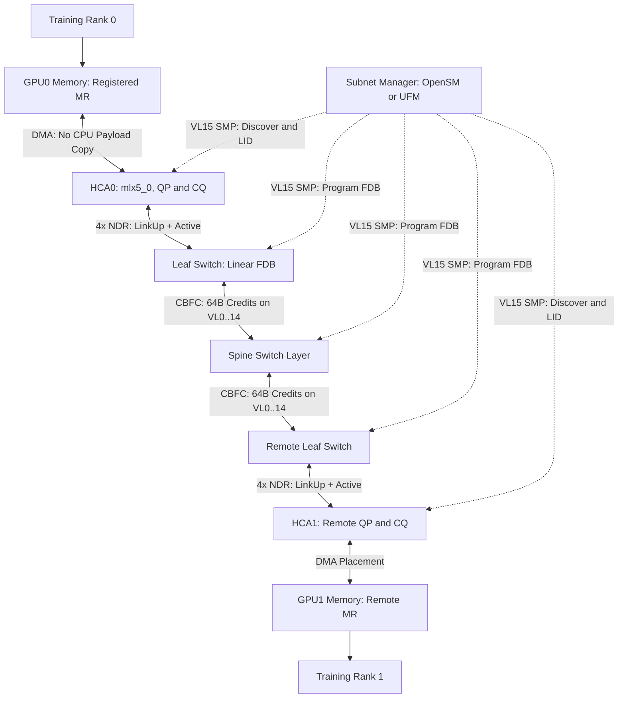
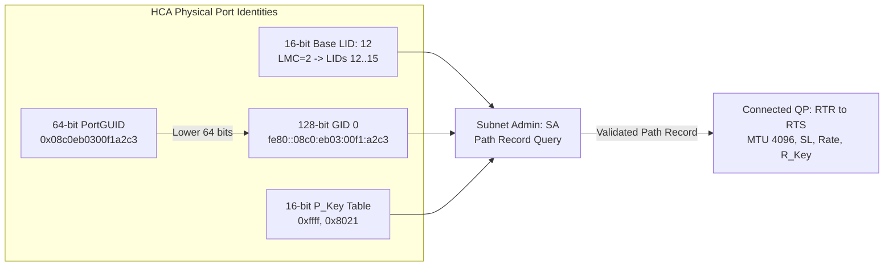
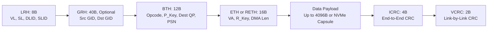

# 12.6 InfiniBand fundamentals and addressing

| | |
|---|---|
| Level | Intermediate |
| Priority tier | 1 |
| Lab venue | Nebius GPU |
| Part | Part 12: Complete AI networking |
| Sources | `supercomputers-for-linux-sysadmins` Ch. 5; `ai-data-center-network-design-and-technologies` Ch. 9; `bcm11-admin` §3.6.3–3.6.4 & §5.3.3; `nvidia-devops` V8 Ch. 1–4, Ch. 12, `index.md` & Labs 01–04 |
| Code | `code/part12/infiniband_fundamentals.py`, `code/part12/infiniband_fundamentals_lab.py` |
| Coverage file | `planning/coverage/chapters/12-06.md` |

## Why this matters for AI infrastructure

Distributed training jobs synchronize every rank across the network at the end of every step. If even one network link slows down or stalls, the entire cluster waits for that single straggler path to finish. In a large GPU cluster, a minor fabric misconfiguration turns microsecond network delays into hours of wasted GPU compute time.

A newly built cluster can show green physical LEDs on every switch port and pass basic ping tests, yet fail or crawl once a real training job starts. Engineers routinely lose days chasing mysterious collective timeouts that stem from four quiet fabric failure modes.

1. **Physical versus logical port state divergence:** A port negotiates electrical link and turns the transceiver LED green. However, it remains logically uninitialized because the Subnet Manager has not assigned a Local Identifier or programmed switch forwarding tables.
2. **Silent lane-width degradation:** A four-lane cable with one dirty optical fiber negotiates down to a single active lane. The port still reports an active logical state while capping every collective touching that server at one quarter of its design speed.
3. **Credit backpressure and Virtual Lane contention:** InfiniBand uses link-by-link credit flow control across Virtual Lanes rather than dropping packets when buffers fill. When a slow receiver or shared storage queue stops returning credits, upstream switch ports pause transmission. That pause spreads head-of-line blocking across the fabric with zero packet drops.
4. **Identity and partition mismatches:** Scripts that treat temporary Local Identifiers as permanent server names break whenever the Subnet Manager sweeps the fabric. Meanwhile, mismatched Partition Keys or shifting Global Identifier table indices silently block Queue Pair connections before training can begin.

This chapter builds the InfiniBand architecture from physical signaling and line encoding to hardware and logical addressing. You will learn how native frames, Virtual Lane credits, IP over InfiniBand, and the OpenFabrics diagnostic tools work together in production.

## Prerequisites and outcomes

**Prerequisites:** Chapter 12.1 on AI collective traffic patterns, Chapter 12.2 on RDMA verbs and Queue Pairs, and Chapters 12.3 through 12.5 on RoCEv2 and lossless Ethernet.

**Outcomes:** After completing this chapter, you will be able to:
- Calculate raw signaling rates, line-encoding efficiencies, and effective four-lane and twelve-lane bandwidths across every InfiniBand generation from SDR through GDR.
- Distinguish hardware GUIDs, subnet LIDs, LMC multipath ranges, global GIDs, and pre-LID directed-route Subnet Management Packets.
- Evaluate Partition Key membership rules, including full versus limited member bits and asymmetric drops between limited compute nodes.
- Decode native InfiniBand packet headers and trace per-VL credit-based flow control across data and management Virtual Lanes.
- Configure IP over InfiniBand in datagram and connected modes, and diagnose live fabrics with standard InfiniBand command-line tools.

---

## 1. Why InfiniBand exists and how the layered fabric works

### 1.1 Tightly coupled collectives and the separation of data and control planes

Standard enterprise web services handle independent requests that easily tolerate kernel socket copies and millisecond latency spikes. Distributed AI training works very differently because every GPU rank must synchronize at every iteration barrier. The completion time of an AllReduce or AllToAll collective equals the completion time of its single slowest participant. Conventional operating system sockets add system calls, kernel buffer copies, CPU interrupts, and scheduler jitter to every transfer.

The InfiniBand Trade Association standardized InfiniBand to eliminate CPU and kernel overhead through a purpose-built fabric architecture. Open-source software stacks such as OFED, MLNX_OFED, and DOCA-OFED expose this hardware directly to training libraries and storage clients. InfiniBand achieves low latency and predictable throughput by strictly separating the hardware data plane from a centralized control plane.



| Fabric component / plane | Primary responsibility | Operational evidence of health | What breaks if it fails |
|---|---|---|---|
| **Host Channel Adapter (HCA)** | Owns Queue Pairs and Completion Queues, enforces Protection Domains and Memory Region keys (`L_Key` / `R_Key`), executes DMA directly to GPU or host memory, and packetizes payloads. A simplified storage variant called Target Channel Adapter (TCA) was defined by the IBTA but never became widespread. | `ibv_devinfo -v` shows `PORT_ACTIVE (4)`, `LINK_UP (5)`, and `active_mtu: 4096 (5)`, with local PCIe and NUMA affinity to the paired GPU. | Cross-socket UPI or QPI hairpinning occurs if the GPU and HCA sit on different NUMA nodes. Key mismatches trigger `IBV_WC_LOC_PROT_ERR` or `REM_ACCESS_ERR`. |
| **InfiniBand Switch and Virtual Port 0** | Performs cut-through hardware forwarding (`~300 ns` switch latency) using deterministic Linear Forwarding Tables (LFTs) keyed by the `16`-bit Destination LID (`D-LID`). Enforces SL-to-VL mapping and `64`-byte CBFC credit exchange. Every switch exposes a dedicated virtual Port `0` for switch management. | `ibroute` shows a valid egress port per `D-LID`. `perfquery` reports `SymbolErrorCounter = 0` and low `PortXmitWait`. | Unlike Ethernet switches, InfiniBand switches do not self-learn MAC addresses or build spanning trees. Unprogrammed switches drop or strand all data traffic. |
| **Subnet Manager (SM / OpenSM / UFM)** | Central control plane running on a host HCA or switch. Sweeps topology via directed-route SMPs on VL15, assigns Base LID and LMC, programs switch forwarding tables, enforces P_Key partitions, and configures SHARP in-network reductions via NVIDIA Unified Fabric Manager (UFM). | `sminfo` shows `1` authoritative master (`SMINFO_MASTER`) and `1+` standbys. `ibstat` shows `State: Active` and non-zero `Base lid` and `SM lid`. | Ports stay stuck at `Physical state: LinkUp` and `State: Initializing` (`Base lid: 0`, `SM lid: 0`). This causes the classic green LED, dead port outage. |
| **InfiniBand Routers** | Interconnect multiple InfiniBand subnets (`<= 49,151` unicast ports per subnet) using `128`-bit GIDs in the `40`-byte Global Routing Header (GRH). | Valid site-local (`0xFEC0::/64`) or global GID prefixes and router path records are present. | Intra-subnet link-local `0xFE80::/64` packets are never forwarded across routers. |

### 1.2 Predictability versus peak speed: reading `ib_write_bw` under contention

Engineers often run a quick two-node bandwidth benchmark on an idle cluster, see full line rate, and declare the network healthy. However, peak speed on an empty wire only proves that one Queue Pair can push bytes for a brief moment. Synchronized AI training depends on sustained average bandwidth and tight tail latency when every server transmits at once.

When multiple nodes share an oversubscribed or poorly routed switch path, link-layer credit stalls pause the sending Queue Pair between bursts. A peak bandwidth counter still records the brief moments when credits are available, hiding severe throughput collapse. You must compare peak bandwidth against average bandwidth and message rate in `ib_write_bw` to catch fabric contention.

```text
# Benchmark parameters:
# 2,097,152-byte (2 MiB) messages, 1 Reliable Connected QP on mlx5_0, 10 seconds
# Local:  LID 0x0c (12), QPN 0x012a, PSN 0x3a1f2e, RKey 0x1c0a00
# Remote: LID 0x51 (81), QPN 0x00e3, PSN 0x0091ab, RKey 0x1c0b00
# Cluster symptoms: 256-GPU or 128-node jobs showing 20% step-time oscillation

# 1. Uncongested 400 Gbps NDR path (0.28% spread between peak and average):
 #bytes  #iterations  BW peak[Gb/sec]  BW average[Gb/sec]  MsgRate[Mpps]
 2097152 237000       399.82           398.71              0.0238

# 2. Same path under concurrent upstream switch contention (39.69% average drop):
 #bytes  #iterations  BW peak[Gb/sec]  BW average[Gb/sec]  MsgRate[Mpps]
 2097152 144000       399.71           241.06              0.0144
```

On the uncongested path, average throughput tracks peak throughput almost identically across the entire ten-second window. Under upstream switch contention, the peak column still reports full wire speed, so a naive threshold check passes. Meanwhile, average bandwidth drops by nearly forty percent because intermittent credit pauses stall the sender.

---

## 2. Physical layer generations, lane widths, encoding, and port state machines

### 2.1 Link generations, four-lane versus twelve-lane widths, and line encoding

If a server port trains at a slower signaling generation or drops three of its four lanes, every collective using that server slows down proportionally. Operators who confuse raw signaling rates with effective data bandwidth also misread port status tools and miscalculate collective step times. Understanding how parallel lanes and line encoding determine usable throughput prevents both errors.

An InfiniBand cable bundles multiple bidirectional serial lanes that transmit in parallel. Most Host Channel Adapter cables and switch links use four parallel lanes. Dense switch backplanes and trunk links often use twelve lanes or two-lane and eight-lane breakouts. Each generation increases the raw bit rate per lane and upgrades the line encoding scheme to reduce bit overhead.

Line encoding embeds clock recovery information and maintains DC balance on the wire so receivers can detect and correct bit errors. Early generations from SDR to QDR use eight-bit-to-ten-bit encoding, which turns every eight data bits into ten wire bits and costs twenty percent overhead. Middle generations from FDR10 to HDR use sixty-four-to-sixty-six-bit encoding. Modern NDR, XDR, and GDR fabrics use PAM4 modulation with Forward Error Correction and two-hundred-fifty-six-to-two-hundred-fifty-seven-bit blocks.

| Generation | Raw lane rate (Gbps) | Line encoding | Encoding efficiency | Effective `1x` lane (Gbps) | Raw `4x` rate (Gbps) | Effective `4x` bandwidth (Gbps) | Effective `12x` bandwidth (Gbps) |
|---|---:|---|---:|---:|---:|---:|---:|
| **SDR** (Single Data Rate) | `2.5` | `8b/10b` | `80.00%` | `2.0` | `10.0` | **`8.0`** | **`24.0`** |
| **DDR** (Double Data Rate) | `5.0` | `8b/10b` | `80.00%` | `4.0` | `20.0` | **`16.0`** | **`48.0`** |
| **QDR** (Quad Data Rate) | `10.0` | `8b/10b` | `80.00%` | `8.0` | `40.0` | **`32.0`** | **`96.0`** |
| **FDR10** (Fourteen-10) | `10.3125` | `64b/66b` | `96.97%` | `10.0` | `41.25` | **`40.0`** | **`120.0`** |
| **FDR** (Fourteen Data Rate) | `14.0625` | `64b/66b` | `96.97%` | `13.6` | `56.25` (`56` in `ibstat`) | **`54.4`** | **`163.2`** |
| **EDR** (Enhanced Data Rate) | `25.78125` | `64b/66b` | `96.97%` | `25.0` | `103.125` | **`100.0`** | **`300.0`** |
| **HDR** (High Data Rate) | `53.125` | `64b/66b` | `96.97%` | `50.0` | `212.5` | **`200.0`** | **`600.0`** |
| **NDR** (Next Data Rate) | `106.25` | `256b/257b` | `99.61%` | `100.0` | `425.0` | **`400.0`** | **`1,200.0`** |
| **XDR** (eXtended Data Rate) | `200.0` (nominal) | `256b/257b` | `99.61%` | `200.0` | `800.0+` | **`800.0`** | **`2,400.0`** |
| **GDR** (Giga Data Rate) | `400.0` (nominal) | `256b/257b` | `99.61%` | `400.0` | `1,600.0+` | **`1,600.0`** | **`4,800.0`** |

```text
# Line-encoding efficiency derivations and FDR / NDR rate checks:
8b/10b efficiency   = 8 / 10     = 80.0%     (20.0% encoding overhead)
64b/66b efficiency  = 64 / 66    = 96.9697%  (~3.03% encoding overhead)
256b/257b efficiency= 256 / 257  = 99.6109%  (~0.39% block overhead)

4x FDR raw rate     = 4 * 14.0625 Gbps = 56.25 Gbps (displayed as "Rate: 56" in ibstat)
4x FDR effective BW = 4 * 13.6 Gbps    = 54.4 Gbps  (12x FDR = 163.2 Gbps)
4x NDR degraded 1x  = 1 * 100.0 Gbps   = 100.0 Gbps (25% of 400.0 Gbps design bandwidth)
```

### 2.2 Physical state versus logical link-layer port state machine

A common operational trap occurs when a technician sees a solid green link LED on a switch port and assumes the server is ready for jobs. On InfiniBand, a green LED only indicates that the physical transceivers have locked onto each other's electrical or optical signal. If the logical link state has not reached the active stage, every application Queue Pair on that port will fail to send data.

Every InfiniBand port runs two separate state machines that you must check together in `ibstat` and `ibstatus`. The physical state machine governs transceiver lane training on the wire, progressing from polling through configuration to link up. The logical state machine governs Subnet Manager admission, advancing from down to initialize, armed, and finally active.

| State machine | State name and numeric code | Traffic permitted | Operational transition rule |
|---|---|---|---|
| **Physical (`phys state`)** | `Disabled` | None | Port is administratively shut down. |
| **Physical (`phys state`)** | `Polling` | Training sequences | Initial power-on state searching for a remote link partner. |
| **Physical (`phys state`)** | `Configuration` | Negotiation frames | Link partner detected; ports negotiate speed and lane width (`1x`, `2x`, `4x`, `12x`). |
| **Physical (`phys state`)** | `LinkUp` (`5: LinkUp`) | Wire symbols | Physical layer is up and symbols can cross the medium. |
| **Physical (`phys state`)** | `Recovery` | Retraining symbols | Link lost synchronization and is attempting hardware recovery (`Link Error Recovery Counter` increments). |
| **Logical (`State`)** | `Down` (`1`) | None | Physical layer is not yet `LinkUp`; no packets can be sent. |
| **Logical (`State`)** | `Initialize` / `Initializing` (`2`) | VL15 SMPs only | Entered immediately when physical state reaches `LinkUp`. Application Queue Pairs cannot send data. |
| **Logical (`State`)** | `Armed` (`3`) | VL15 SMPs only | Subnet Manager assigned `Base LID` and P_Key tables, but full forwarding is not yet enabled. |
| **Logical (`State`)** | `Active` (`4: ACTIVE`) | All data (VL0–VL14) and VL15 | Subnet Manager finished programming switch Linear Forwarding Tables; RDMA verbs and IPoIB can flow. |

---

## 3. Component identification, addressing, and partitioning

InfiniBand uses five distinct identifiers to separate hardware identity, intra-subnet switch forwarding, inter-subnet routing, bootstrap discovery, and multi-tenant isolation. Confusing these identifiers leads to broken inventory databases and silent connection failures.



| Identifier / attribute | Bit width | Assigned by | Mutability and scope | Operational role in AI fabrics |
|---|---:|---|---|---|
| **NodeGUID / PortGUID / SystemImage GUID** | `64` bits | Hardware manufacturer in firmware | Persistent across reboots and SM sweeps; global hardware identity | Anchor your CMDB and inventory on PortGUID. Every HCA has `1` NodeGUID and `1` PortGUID per port; a switch has `1` NodeGUID and uses the same PortGUID across all switch ports. SystemImage GUID groups elementary switch chips inside one modular chassis, whereas multiple HCAs in one server have distinct SystemImage GUIDs because each runs independent firmware. |
| **Local Identifier (LID)** | `16` bits (`0..65,535`) | Subnet Manager at sweep time | Mutable runtime state; unique within one subnet | Used in the `8`-byte Local Route Header (`S-LID` and `D-LID`) as the lookup key in switch forwarding tables. Each HCA end port and each switch as a whole (Port `0`) receives at least one LID. |
| **LID Mask Control (LMC)** | `3` bits (`LMC` `0..7`; `2^LMC` LIDs) | Subnet Manager | Mutable runtime policy; intra-subnet | Assigns $2^\{\text`{LMC}`}$ consecutive LIDs (`Base LID` to `Base LID + 2^LMC - 1`, where the lower `LMC` bits of `Base LID` must be `0`) to one port so switches can spread traffic across $2^\{\text`{LMC}`}$ parallel paths. |
| **Global Identifier (GID)** | `128` bits (IPv6 format) | `64`-bit prefix from SM + `64`-bit PortGUID | Context-dependent (`show_gids` index `0..N`); intra- and inter-subnet | Placed in the `40`-byte Global Routing Header for inter-subnet routing or RoCEv2 and container contexts. Default prefix `0xFE80::/64` is link-local; `0xFEC0::/64` is site-local; `0xFF00::/8` is multicast. |
| **Directed Route (SMP)** | Hop list (`hop_count`, `hop_pointer`, `D` bit) | Subnet Manager on VL15 | Bootstrap and diagnostic (`LID = 0xFFFF` permissive) | Lists exact switch egress port numbers before LIDs or forwarding tables exist (`D=0` outbound records `return_path`; `D=1` returns response). |
| **Partition Key (P_Key)** | `16` bits (`15`-bit ID + `1`-bit membership) | Subnet / Partition Manager | Policy-driven logical isolation across shared fabric | Enforces tenant and job partition membership in hardware (BTH). Bit `15` (`0x8000`) is `1` for Full members (`0xffff`, `0x8021`) and `0` for Limited members (`0x7fff`, `0x0021`). |

### 3.1 Sixteen-bit LID address space and LMC multipath math

If an operator keys a cluster inventory script on Local Identifiers, a routine Subnet Manager restart or cable swap can renumber ports and send maintenance commands to the wrong servers. In addition, architects designing massive clusters must respect the hard unicast ceiling of a single InfiniBand subnet.

The Local Identifier field in the Local Route Header is sixteen bits wide. The specification divides those sixty-five thousand values into reserved, unicast, multicast, and permissive ranges. Because unicast forwarding uses only the lower three-quarters of that space, a single InfiniBand subnet can address at most forty-nine thousand one hundred fifty-one end ports and switches. Scaling beyond that limit requires InfiniBand routers or independent multi-rail subnets.

When a subnet provides multiple parallel paths between leaves and spines, the Subnet Manager can assign a contiguous block of LIDs to a single HCA port using LID Mask Control. The port's Base LID must have its lowest LMC bits set to zero so the entire block aligns cleanly in binary. The Subnet Manager then programs switch forwarding tables to send each LID in that block across a different spine link.

```text
# 16-bit LID address space (2^16 = 65,536 total values):
LID = 0x0000 (0)                  : Reserved; never assigned to any port
LID = 0x0001..0xBFFF (1..49,151)  : Unicast LIDs for switches and HCA end ports
  Max Unicast LIDs = 2^15 + 2^14 - 1 = 32,768 + 16,383 = 49,151 (~48,000 end nodes)
LID = 0xC000..0xFFFE (49,152..65,534): Multicast LIDs (16,383 multicast groups)
LID = 0xFFFF (65,535)             : Permissive LID (processed by first receiving port)

# LID Mask Control (LMC 0..7) alignment and range rules:
Alignment rule : (Base_LID & (2^LMC - 1)) == 0
Assigned range : [Base_LID, Base_LID + 2^LMC - 1] (consumes 2^LMC unicast LIDs per port)
Switch default : LMC = 0 -> 2^0 = 1 LID per switch (Port 0)
HCA examples   :
  Base LID = 913 (0x391), LMC = 0 -> 1 LID  : [913] (aligned = True)
  Base LID = 12 (0b00001100), LMC = 2 -> 4 LIDs: [12, 13, 14, 15] (lower 2 bits 00, aligned = True)
  Base LID = 16 (0b00010000), LMC = 3 -> 8 LIDs: [16, 17, 18, 19, 20, 21, 22, 23] (aligned = True)
  Base LID = 13 (0b00001101), LMC = 2 -> 4 LIDs: [13, 14, 15, 16] (lower 2 bits 01, aligned = False)
```

### 3.2 Global Identifiers and why hardcoded GID indices fail

In multi-tenant or containerized GPU clusters, training jobs often fail at startup when an engineer hardcodes a Global Identifier index such as `NCCL_IB_GID_INDEX=3` across all nodes. If one node boots its IP over InfiniBand interface or virtual functions in a slightly different order, index three on that server points to a completely different address family or subnet. The Queue Pair connection then fails during the Ready to Receive transition.

A Global Identifier is a standard IPv6 address assigned to every InfiniBand end port. Its lower sixty-four bits hold the persistent hardware PortGUID, while its upper sixty-four bits hold a subnet prefix assigned by the Subnet Manager. Every port always has a mandatory default link-local GID at index zero that never crosses InfiniBand routers. Ports can also hold site-local, global unicast, multicast, or IPv4-mapped entries. Always select GIDs by matching the subnet prefix and address type rather than trusting a blind table index.

| GID type or `show_gids` entry | Upper `64`-bit prefix / format | Routing scope and RFC reference | Example value from production fabrics |
|---|---|---|---|
| **Link-local default (`GID[0]`)** | `0xFE80::/64` + `64`-bit `PortGUID` | Strictly local subnet; never forwarded by InfiniBand routers | `fe80:0000:0000:0000:08c0:eb03:00f1:a2c3` (from `PortGUID 0x08c0eb0300f1a2c3`) or EUI-64 `fe80:0000:0000:0000:08c0:ebff:fe03:00f1` |
| **Site-local unicast** | `0xFEC0::/64` + `64`-bit `PortGUID` | Routable across InfiniBand routers within a site; must not leave the site | `fec0:0000:0000:0000:0012:3456:0000:73f0` (or custom SM prefixes `fe90::` / `fea0::`) |
| **Global unicast** | Standard global IPv6 prefix | Routable across inter-subnet InfiniBand routers | Assigned by SM during initialization |
| **Multicast GID** | `0xFF00::/8` (high byte `0xFF`) | InfiniBand multicast groups (`RFC 2373` and `RFC 2375`) | Used for collective and IPoIB multicast groups |
| **IPv4-mapped GID (`v1`/`v2`)** | `0000:0000:0000:0000:0000:ffff:w.x.y.z` | Dual-mode ConnectX / IPoIB / container namespace entry (`INDEX 0, 1, 2, 3...`) | `0000:0000:0000:0000:0000:ffff:0a01:0203` for IPv4 `10.1.2.3` (`0x0a010203`); never hardcode `-g 3` blindly |

### 3.3 Directed-route Subnet Management Packets

When an InfiniBand cluster powers on from cold boot, every port has a Base LID of zero and every switch forwarding table is completely empty. Normal LID-based packet forwarding cannot work in this uninitialized state. Without a bootstrap mechanism that bypasses forwarding tables, the Subnet Manager could never reach switches to assign LIDs in the first place.

InfiniBand solves this bootstrap problem with directed-route Subnet Management Packets sent to the permissive LID on management Virtual Lane fifteen. Instead of a destination address, an outbound directed-route packet carries an explicit list of switch egress port numbers. That list tells each switch along the path which physical port to exit. As each switch forwards the request outbound, it records the ingress port where the packet arrived into a return path array.

When the packet reaches the target port, the local Subnet Management Agent processes the request and flips the direction bit from zero to one. Each switch along the return trip reads its recorded port number from the return path array and steps the hop pointer backward until the reply reaches the Subnet Manager. InfiniBand also supports combined directed routing. In that mode, a packet uses normal LID forwarding up to an initialized switch before stepping across an uninitialized link with a hop list.

```text
# Directed-route SMP header fields (VL15, Permissive LID = 0xFFFF):
hop_count    : Total number of switch hops in the route list (e.g., 3)
hop_pointer  : Current hop index (1..hop_count) being traversed
D (Direction): 0 = Outbound Request (SM -> Target), 1 = Return Response (Target -> SM)
initial_path : Array of switch egress port numbers to exit on outbound path
return_path  : Array of switch ingress port numbers recorded dynamically on outbound path

# Step-by-step 3-hop trace: egress_ports=[4, 11, 2], ingress_ports_on_switches=[1, 7, 3]
1. Outbound (D = 0):
   - Switch hop 1: arrives on port 1 -> writes return_path[1]=1, exits initial_path[1]=4, hop_pointer -> 2
   - Switch hop 2: arrives on port 7 -> writes return_path[2]=7, exits initial_path[2]=11, hop_pointer -> 3
   - Switch hop 3: arrives on port 3 -> writes return_path[3]=3, exits initial_path[3]=2, hop_pointer == hop_count (3)
   - State at target: d_bit=0, hop_count=3, hop_pointer=3, initial_path=(0, 4, 11, 2), return_path=(0, 1, 7, 3)
2. Turnaround at Target SMA:
   - Target processes SMP, generates reply, flips D = 1
3. Return (D = 1):
   - Switches forward out return_path[hop_pointer] (ports 3 -> 7 -> 1) without modifying return_path
   - hop_pointer decrements 3 -> 2 -> 1 -> 0 until reply reaches the SM (d_bit=1, hop_pointer=0)
```

### 3.4 Partition Keys: full versus limited membership

In a shared AI cluster, operators use Partition Keys to isolate tenant jobs and restrict access to management or storage networks. A subtle outage occurs when an administrator updates the partition configuration and accidentally marks compute nodes as limited members instead of full members. Every compute node can still ping the full-member head node and mount shared storage. However, all GPU-to-GPU collective communication between compute nodes silently times out.

Each port holds a table of sixteen-bit Partition Keys programmed by the Subnet Manager. The lower fifteen bits identify the partition number, while the highest bit controls whether the port is a full member or a limited member. Switch and HCA hardware enforce a strict rule on every packet. Two ports can communicate only if their fifteen-bit partition numbers match and at least one of the two endpoints is a full member.

| Port A `P_Key` | Port B `P_Key` | `15`-bit Partition ID match (`& 0x7FFF`) | Membership pairing (`bit 15 = 0x8000`) | Hardware forwarding verdict |
|---|---|---|---|---|
| `0xffff` | `0x7fff` | Match: default partition `0x7fff` | Full (`0xffff`) $\leftrightarrow$ Limited (`0x7fff`) | **`ALLOWED`** |
| `0x8021` | `0x8021` | Match: tenant partition `0x0021` | Full (`0x8021`) $\leftrightarrow$ Full (`0x8021`) | **`ALLOWED`** |
| `0x8021` | `0x0021` | Match: tenant partition `0x0021` | Full (`0x8021`) $\leftrightarrow$ Limited (`0x0021`) | **`ALLOWED`** (e.g., storage or head node to compute node) |
| `0x0021` | `0x0021` | Match: tenant partition `0x0021` | Limited (`0x0021`) $\leftrightarrow$ Limited (`0x0021`) | **`LIMITED_TO_LIMITED_DENIED`** (silently dropped by fabric) |
| `0x8021` (`LID 12`) | `0x8035` (`LID 87`) | Mismatch: `0x0021 != 0x0035` | Full $\leftrightarrow$ Full on different partitions | **`PARTITION_ID_MISMATCH`** (dropped) |
| `0x0000` | `0x8000` | Invalid: `0x0000` is unused | Zero partition ID | **`INVALID_ZERO_PARTITION_ID`** (rejected) |

---

## 4. InfiniBand frame format, Virtual Lanes, and Credit-Based Flow Control

### 4.1 Native InfiniBand data frame headers

Ethernet-based RDMA wraps transport headers inside Ethernet, IP, and UDP headers. That extra encapsulation adds framing overhead and requires switches to parse deep packet headers. Native InfiniBand strips away that legacy encapsulation so switches can forward frames in roughly three hundred nanoseconds using a compact eight-byte local header.

Every native InfiniBand packet begins with a mandatory eight-byte Local Route Header that carries the Virtual Lane, Service Level, and sixteen-bit source and destination LIDs. Packets that remain inside a single subnet omit the forty-byte Global Routing Header entirely. They jump straight to the twelve-byte Base Transport Header and optional sixteen-byte RDMA Extended Transport Header. Two cyclic redundancy checks close the frame: a four-byte end-to-end Invariant CRC and a two-byte link-by-link Variant CRC recomputed at every switch hop.



| Frame header / trailer | Size | Mandatory? | Key fields and hardware function |
|---|---:|---|---|
| **Local Route Header (LRH)** | **`8` bytes** | **Yes** (every native IB packet) | Carries `4`-bit Virtual Lane (VL), `4`-bit Service Level (SL), `16`-bit Destination LID (`D-LID`), `11`-bit Packet Length in `4`-byte dwords up to `4,096` B MTU payload, and `16`-bit Source LID (`S-LID`). Switches forward purely on `D-LID`. |
| **Global Routing Header (GRH)** | **`40` bytes** | **Optional** (inter-subnet or GID-addressed) | Uses standard `40`-byte IPv6 header layout carrying `128`-bit Source GID and Destination GID. Omitted for pure intra-subnet LID traffic and ignored by intra-subnet switches when the destination LID is local. |
| **Base Transport Header (BTH)** | **`12` bytes** | **Yes** (all verbs and data frames) | Carries `8`-bit RDMA Opcode, Solicited Event (SE), `16`-bit P_Key, `24`-bit Destination Queue Pair (`Dest QP`), Acknowledge Request bit (`A`), and `24`-bit Packet Sequence Number (PSN). Receiving HCA uses `Dest QP` to place data into registered memory. |
| **Extended Transport Header (ETH / RETH / DETH)** | **`0..28` bytes** (`16` B for RETH) | Operation-dependent | In `RDMA_WRITE` and `RDMA_READ`, RETH (`16` B) carries the `64`-bit Remote Virtual Address (VA), `32`-bit Remote Key (`R_Key`), and `32`-bit DMA Length. In datagram (UD), DETH carries the `24`-bit Source QP and `32`-bit `Q_Key`. |
| **Data Payload** | Up to **`4,096` bytes** (`active_mtu`) | Payload packets | Raw tensor gradient chunk, MPI message, or NVMe-o-RDMA command and response capsule (`SQE`/`CQE` + `SGL` descriptors). |
| **Invariant CRC (ICRC)** | **`4` bytes** (`32` bits) | **Yes** | End-to-end CRC covering all fields that do not change from source HCA to destination HCA, masking out mutable LRH VL and GRH hop limit fields. |
| **Variant CRC (VCRC)** | **`2` bytes** (`16` bits) | **Yes** (native IB link layer) | Link-by-link CRC covering the entire packet including mutable LRH fields; recomputed at every switch hop to detect single-link bit errors immediately. |

```text
# Framing overhead and wire efficiency for a 4,096-byte MTU payload (vs RoCEv2 UDP port 4791):
1. Intra-subnet SEND (LRH 8B + BTH 12B + ICRC 4B + VCRC 2B):
   Overhead = 26 B | Wire frame = 4,122 B | Payload efficiency = 4096 / 4122 = 99.37% (99.3692%)
2. Intra-subnet RDMA_WRITE (adds RETH 16B):
   Overhead = 42 B | Wire frame = 4,138 B | Payload efficiency = 4096 / 4138 = 98.99% (98.9850%)
3. Inter-subnet routed RDMA_WRITE (adds GRH 40B + RETH 16B):
   Overhead = 82 B | Wire frame = 4,178 B | Payload efficiency = 4096 / 4178 = 98.04% (98.0373%)
```

### 4.2 Virtual Lanes, Service Levels, and Credit-Based Flow Control

On lossless Ethernet, a switch reacts to congestion only after its receive queue crosses a threshold. It then sends an IEEE `802.1Qbb` Priority Flow Control pause frame upstream while absorbing in-flight cable data into headroom buffers. InfiniBand prevents buffer overflow proactively at the link layer. However, when a receiver stalls or storage traffic shares a queue with training collectives, upstream switch ports run out of transmit credits and pause without recording a single packet drop.

Every InfiniBand packet header carries a four-bit Service Level that identifies its traffic class, such as collective training, storage, or IP over InfiniBand. At each switch hop, a lookup table maps that Service Level to one of up to sixteen hardware Virtual Lanes. Virtual Lanes zero through fourteen provide independent data buffers and credit pools. Virtual Lane fifteen is strictly reserved for Subnet Management Packets so the Subnet Manager can always reach switches during severe data congestion.

Credit-Based Flow Control operates across every individual link hop and separately for each data Virtual Lane. A downstream receiver measures its free buffer space in sixty-four-byte credit units and continually advertises that credit limit upstream via link-layer Flow Control Packets. An upstream switch port never transmits a frame on a Virtual Lane unless the downstream port has already granted enough sixty-four-byte credits to hold the entire packet.

When an incast or slow receiver stops draining a Virtual Lane, downstream credits dry up. The upstream port then increments its `PortXmitWait` counter on every clock tick it waits to send. This backpressure spreads upstream into a congestion tree until the root receiver drains or traffic classes are separated onto different Virtual Lanes. The Ultra Ethernet Consortium later adopted this same link-level credit model into its link layer specification.

```text
# Virtual Lane (VL) and Credit-Based Flow Control (CBFC) hardware parameters:
Service Levels (SL0..SL15) : 4-bit QoS label in LRH mapped via SM SL-to-VL table at each hop
Data Virtual Lanes         : VL0..VL14 (15 data VLs; typically 8 to 12 active queues in hardware)
Management Virtual Lane    : VL15 (dedicated to uncredited SMPs; immune to data-plane starvation)
CBFC credit unit size      : 1 credit = 64 bytes of downstream per-VL receive buffer

# Credit math for a 4,122-byte intra-subnet SEND frame on VL1:
Credits required           = ceil(4,122 / 64) = 65 credits (65 * 64 = 4,160 bytes reserved)
Case A (100 credits = 6,400 B advertised) : Frame transmits immediately; 35 credits remain
Case B (50 credits  = 3,200 B advertised) : Port halts VL1 transmission and increments PortXmitWait
Telemetry signature        : PortXmitWait = 184,320 ticks on congested port 3 (vs 41 on port 7), SymbolErrorCounter = 0
```

---

## 5. Verbs execution model, IP over InfiniBand, storage transports, and alternatives

### 5.1 Verbs resource hierarchy and `ibv_devinfo -v`

When an AI framework initializes thousands of Queue Pairs across a cluster without checking adapter limits or path MTU settings, connections fail during startup or crash mid-step with memory protection errors. Deregistering a memory buffer while DMA operations are still in flight also causes immediate Queue Pair faults.

As introduced in Chapter 12.2, RDMA applications bypass the operating system kernel by posting Work Requests directly to hardware queues through the `libibverbs` and `rdma-core` API. Before debugging a collective failure, inspect the adapter's exact hardware capabilities and active port MTU using `ibv_devinfo -v -d mlx5_0` `(untested here)`.

```text
# (untested here)
$ ibv_devinfo -v -d mlx5_0
hca_id: mlx5_0
    transport:                  InfiniBand (0)
    fw_ver:                     28.39.2048
    node_guid:                  08c0:eb03:00f1:a2c3
    sys_image_guid:             08c0:eb03:00f1:a2c3
    vendor_id:                  0x02c9
    vendor_part_id:             4129
    max_mr_size:                0xffffffffffffffff
    max_qp:                     262144
    max_qp_wr:                  32768
    max_sge:                    30
    max_cq:                     16777216
    max_cqe:                    4194303
    max_mr:                     16777216
    atomic_cap:                 ATOMIC_HCA (1)
        port:   1
            state:              PORT_ACTIVE (4)
            max_mtu:            4096 (5)
            active_mtu:         4096 (5)
            phys_state:         LINK_UP (5)
            link_layer:         InfiniBand
```

| Verbs resource or state | Hardware limit on MT4129 (`ConnectX-7`, `vendor_id: 0x02c9 = 713`, `fw_ver: 28.39.2048`) | Operational boundary and failure signature |
|---|---|---|
| **Queue Pairs (QP) and Completion Queues (CQ)** | `max_qp: 262144` ($2^`{18}`$), `max_qp_wr: 32768` ($2^`{15}`$ WRs/QP), `max_cq: 16777216` ($2^`{24}`$), `max_cqe: 4194303` ($2^`{22}` - 1$) | Full-mesh `1`-QP-per-peer designs multiply QPs by `processes * peers * rails`. Production libraries share CQs across QPs, use hierarchical or rail topologies, or use Dynamically Connected (DC) transports. |
| **Scatter-Gather Entries (SGE) and Atomics** | `max_sge: 30` segments per Work Request (WR) / Work Queue Element (WQE); `atomic_cap: ATOMIC_HCA (1)` | Bounds how many discontiguous local buffers (Header, Tensor Chunk, Metadata) one WQE can link; confirms hardware `64`-bit atomic fetch-and-add and compare-and-swap. |
| **Protection Domains (PD) and Memory Regions (MR)** | `max_mr: 16777216`, `max_mr_size: 0xffffffffffffffff` (`cudaMalloc` + `cuFileBufRegister` / `nvidia-peermem`) | A QP in `PD_A` cannot access an MR in `PD_B`. Pinning returns local `L_Key` and remote `R_Key`; deregistering an MR before draining in-flight WQEs triggers `IBV_WC_LOC_PROT_ERR` or `IBV_WC_REM_ACCESS_ERR`. |
| **QP State Machine (`RESET -> INIT -> RTR -> RTS -> SQD / ERR`)** | `active_mtu: 4096 (5)` vs `2048`; local `LID 0x000c` (`12`), `QPN 0x00012a` (`298`), `PSN 0x3a1f2e` to remote `LID 0x0051` (`81`), `QPN 0x0000e3` (`227`), `PSN 0x0091ab` | `RESET -> INIT` sets port, P_Key index, and access flags. `INIT -> RTR` sets remote LID/GID, QPN, starting receive PSN, SL, and path MTU; requesting `4096` MTU against a `2048` peer port fails with `EINVAL` (`Failed to modify QP to RTR`). `RTR -> RTS` sets send PSN, retry count, and RNR retry timer. |

### 5.2 IP over InfiniBand: hardware address, datagram versus connected modes, and BCM provisioning

Although GPU collectives transfer tensors directly over RDMA verbs, distributed job launchers such as Slurm and MPI still need standard TCP/IP addresses to bootstrap connections. Operators who run legacy Ethernet tools like `ifconfig` on an InfiniBand interface see truncated hardware addresses. Furthermore, clusters that pick the wrong IP over InfiniBand transport mode can exhaust Queue Pair memory at scale.

The Internet Engineering Task Force standardized IP over InfiniBand to run standard IP stacks over native InfiniBand interfaces such as `ib0` and `ib1`. Unlike Ethernet's six-byte MAC address, an IP over InfiniBand link-layer address is twenty bytes long. It packs capability flags, a twenty-four-bit Queue Pair Number, and a full sixteen-byte Global Identifier. Always inspect `ib0` with `ip addr show ib0` or `ip link` rather than `ifconfig`.

Administrators can run IP over InfiniBand in either datagram mode or connected mode. Datagram mode uses Unreliable Datagram Queue Pairs with a four-kilobyte MTU ceiling so a single Queue Pair can talk to every peer in the cluster. Connected mode opens a dedicated connected Queue Pair per peer to raise the MTU to sixty-four kilobytes. That mode trades quadratic Queue Pair state for higher single-stream TCP throughput on older adapters.

```text
# IPoIB RFC standards and 20-byte (160-bit) link-layer hardware address layout:
IETF standards : RFC 4391, RFC 4392, RFC 4755
Address format : [1-byte Flags] || [3-byte QPN (24 bits)] || [16-byte Port GID (128 bits)] vs 6-byte (48-bit) Ethernet MAC
Example decode : 80:00:01:2a:fe:80:00:00:00:00:00:00:08:c0:eb:03:00:f1:a2:c3
  - Flags      : 0x80 (connected-mode capability flag)
  - QPN        : 0x00012a (decimal 298)
  - Port GID   : fe80::08c0:eb03:00f1:a2c3
```

| IPoIB aspect | Datagram mode (`UD`, default) | Connected mode (`RC`/`UC`, optional) | NVIDIA Base Command Manager (`bcm11-admin`) `ibnet` provisioning |
|---|---|---|---|
| **Transport and MTU limit** | Unreliable Datagram (UD) QP; max IP MTU up to `4 KB` (`4,096` B link MTU, `4,092` B after `4`-byte IPoIB header) | Dedicated Reliable or Unreliable Connected (RC/UC) QP per peer; max IP MTU up to `64 KB` (`65,536` / `65,520` B) | Default `ibnet` network (domain `ib.cluster`, type `internal`, base `10.149.0.0`, netmask `16` bits = `10.149.0.0/16`); head node `basecm11` at `10.149.255.254`, `node001..node150` starting at `10.149.0.1` |
| **Cluster scaling and driver support** | `O(1)` QP state per node; default in BCM and modern `mlx5` drivers with Enhanced IPoIB hardware offloads | $O(N^2)$ QP memory overhead across large clusters; used on older `mlx4_ib` adapters for single-stream TCP | Post-boot `rdma` service (`rdma-load-modules@rdma` on RHEL / `openibd` on SLES) loads `ib_ipoib`, `rdma_ucm`, `ib_ucm`, `ib_uverbs`, `ib_umad`, `rdma_cm`, `ib_cm`, `iw_cm`, `ib_addr`, `ib_sa`, `ib_mad`, `ib_core` |
| **Booting over `ib0`** | Set via `echo datagram > /cm/node-installer/scripts/ipoib_mode` | Enabled via `set connectedmode yes` in `cmsh` | Requires `cmsh -c "network; set ibnet nodebooting yes; commit"`, injecting `mlx4_ib`/`mlx5_ib`, `ib_ipoib`, `ib_umad` into `initrd`, and avoiding `BOOTIF=ib0` conflicts in `CMDaemon` (keep `BOOTIF` on `eth0` while setting `provisioninginterface` to `ib0`) |

### 5.3 InfiniBand for AI storage and fabric alternatives

During massive training runs, checkpoint saves and dataset reads can stall GPUs if storage traffic bounces through host CPU memory or competes with TCP retransmission timers. Architects must also weigh native InfiniBand against Ethernet RoCEv2, HPE Slingshot, and emerging Ultra Ethernet fabrics when designing storage and compute networks.

High-performance storage systems such as NVMe over RDMA, Lustre, IBM Storage Scale, BeeGFS, WekaFS, and VAST place storage capsules directly inside RDMA Queue Pair payloads. When combined with NVIDIA GPUDirect Storage, the storage adapter DMAs checkpoints directly between NVMe drives and pinned GPU memory without touching host CPU bounce buffers.

```text
# NVMe-o-RDMA protocol constants and GPUDirect Storage (GDS) registration path:
Discovery port  : TCP port 8009 (exchanges RDMA_PRTYPE: 02 = InfiniBand, 04 = RoCEv2, 05 = iWARP)
RoCEv2 ports    : UDP port 4420 (RDMA CM negotiation) and UDP port 4791 (NVMe capsule data; up to 66% lower write latency vs NVMe-o-TCP)
Native IB path  : NVMe capsules (SQE/CQE + SGL descriptors mapped 1:1 to RDMA QPs) sit directly inside BTH/RETH payload without IP/UDP headers
GDS zero-copy   : cudaMalloc + cuFileBufRegister pins GPU HBM memory for direct NIC/HCA DMA
```

| Characteristic | `(P)NFS` | `NVMe-o-TCP` | `NVMe-o-RDMA` (`RoCEv2`) | Native InfiniBand | HPE Slingshot |
|---|---|---|---|---|---|
| **Switch cut-through latency** | Microseconds | Microseconds | `~500–800 ns` | **`~300 ns`** | Low-latency HPC |
| **Lossless mechanism** | TCP retransmit | TCP (`SYN/ACK`) | Reactive PFC (`802.1Qbb`) + ECN/DCQCN | Proactive link CBFC (`64B` credits, `16 VLs`) | Fabric Manager + credit/QoS |
| **Control plane and routing** | Standard IP IGP/BGP | Standard IP IGP/BGP | Distributed BGP / ECMP / DLB | Centralized Subnet Manager (`OpenSM`/`UFM`) + SHARP | Centralized `FabricManager` |
| **Max single-subnet scale** | Unlimited IP | Unlimited IP | Unlimited IP | **`49,151` unicast LIDs** (`~48,000` nodes; routers above) | High-radix dragonfly |
| **400G / 800G / 1.6T support** | Yes | Yes | Yes | Yes (NDR `400G`, XDR `800G`, GDR `1.6T`) | `200G` / `400G` Cassini |
| **Vendor ecosystem and API** | Multi-vendor POSIX | Multi-vendor Ethernet | Multi-vendor Ethernet (`rdma-core` verbs) | Single-vendor (NVIDIA) native IB verbs | Ethernet-compatible; uses `libfabric` (OFI wrapper overhead vs raw IB verbs) |

---

## Commands and configurations that matter

All commands below are marked `(untested here)` and show the standard production workflow on Linux hosts with `rdma-core` and NVIDIA Base Command Manager.

### 1. Local HCA and port state inspection: `ibstat`, `ibstatus`, and `ibdev2netdev` `(untested here)`

When a node drops out of a job, operators often misread LID values because `ibstat` prints Base LID and SM LID in decimal. By contrast, `ibstatus` prints the exact same numbers in hexadecimal. Always check both the physical link state and logical port state. Then run `ibdev2netdev` to see which RDMA adapter maps to `eth0` versus `ib0`, and run `ofed_info -s` to check the installed OFED version.

```text
# (untested here) — Decimal vs hexadecimal LID equivalents on dual-port MT4113 (Connect-IB, 56 Gb/sec 4X FDR):
# Port 1: Base lid 913 == 0x391, SM lid 43 == 0x2b
# Port 2: Base lid 1361 == 0x551, SM lid 698 == 0x2ba
$ ibstat
CA 'mlx5_0'
    CA type: MT4113
    Number of ports: 2
    Firmware version: 10.12.1100
    Hardware version: 0
    Node GUID: 0x00123456000073f0
    System image GUID: 0x00123456000073f0
    Port 1:
        State: Active
        Physical state: LinkUp
        Rate: 56
        Base lid: 913
        LMC: 0
        SM lid: 43
        Capability mask: 0x26516848
        Port GUID: 0x00123456000073f0
        Link layer: InfiniBand
    Port 2:
        State: Active
        Physical state: LinkUp
        Rate: 56
        Base lid: 1361
        LMC: 0
        SM lid: 698
        Capability mask: 0x26516848
        Port GUID: 0x00265802000073f8
        Link layer: InfiniBand

$ ibstatus
InfiniBand device 'mlx5_0' port 1 status:
    default gid:     fe90:0000:0000:0000:0000:0026:5802:0000:73f0
    base lid:        0x391
    sm lid:          0x2b
    state:           4: ACTIVE
    phys state:      5: LinkUp
    rate:            56 Gb/sec (4X FDR)
    link_layer:      InfiniBand

InfiniBand device 'mlx5_0' port 2 status:
    default gid:     fea0:0000:0000:0000:0000:0012:3456:0000:73f8
    base lid:        0x551
    sm lid:          0x2ba
    state:           4: ACTIVE
    phys state:      5: LinkUp
    rate:            56 Gb/sec (4X FDR)
    link_layer:      InfiniBand

$ ibdev2netdev
mlx5_0 port 1 ==> eth0 (Up)
mlx5_1 port 1 ==> ib0 (Up)
```

### 2. Node and Subnet Administration queries: `smpquery`, `saquery`, `ibping`, `ibnetdiscover`, and `ibdiagnet` `(untested here)`

When a switch counter alert reports a numeric LID, you need to map that temporary LID back to a server hostname and persistent hardware GUID. You also need to know whether the Subnet Manager's cached database still matches the live hardware on the wire.

Run `smpquery` to send a direct management packet on Virtual Lane fifteen to the node itself. Compare its output with `saquery`, which reads the Subnet Manager's Subnet Administration database. If `smpquery` succeeds while `saquery` returns a stale hostname or times out, the Subnet Manager is stalled or out of sync with the fabric.

```text
# (untested here) — Use -C <ca_name> -P <port_num> (ports start at 1) to select local HCA port
# Resolving LID 914 (0x392) to hostname n51001 HCA-1 and GUID 0x0012345600003740 (partition_cap 0x80 = 128, device_id 0x1011 = 4113):
$ smpquery nodedesc 914
Node Description:....................n51001 HCA-1

$ saquery 914
NodeRecord dump:
    lid.....................914
    reserved................0x0
    base_version............0x1
    class_version...........0x1
    node_type...............Channel Adapter
    num_ports...............2
    sys_guid................0x0012345600003740
    node_guid...............0x0012345600003740
    port_guid...............0x0012345600003740
    partition_cap...........0x80
    device_id...............0x1011
    revision................0x0
    port_num................1
    vendor_id...............0x2C9
    NodeDescription.........n51001 HCA-1

# Test IB management-layer connectivity between two ports (requires server on remote LID 123):
$ ibping -S                 # Run on target node (LID 123)
$ ibping -C mlx5_0 -P 1 123 # Run on source node

# Full-fabric topology discovery, inventory, and health audit:
$ ibswitches
$ ibnodes
$ iblinkinfo
$ ibnetdiscover > /tmp/ibnetdiscover.topology
$ ibdiagnet -o /tmp/ibdiagnet_out
```

### 3. Physical counters, `PortXmitWait`, and optical transceiver DOM: `perfquery`, `ibqueryerrors`, and `mlxlink` `(untested here)`

During a live job slowdown, clearing hardware error counters with `perfquery -R` or `ibqueryerrors -k` wipes out the historical baseline. That reset blinds every other engineer investigating the outage. Instead, query cumulative counters non-destructively and inspect optical transceiver diagnostics with `mlxlink`.

Use `perfquery` to read sixty-four-bit port counters from any LID or GUID in the subnet from a single management node. Then run `mlxlink` to inspect per-lane bit error rates, clock and data recovery lock, module temperature, supply voltage, laser bias current, and optical power levels.

```text
# (untested here)
$ perfquery -a 123
$ perfquery -x -G 0x00123456000073f0
$ ibqueryerrors

# Inspect physical BER counters (-c) and optical transceiver module DOM (-m) with mlxlink (--json for scripts):
$ mlxlink -d mlx5_1 -c -m
Operational Info
----------------
State                           : Active
Physical state                  : LinkUp
Speed                           : IB-EDR
Width                           : 4x
FEC                             : No FEC
Loopback Mode                   : No Loopback
Auto Negotiation                : ON

Supported Info
--------------
Enabled Link Speed              : 0x0000003f (EDR,FDR,FDR10,QDR,DDR,SDR)
Supported Cable Speed           : 0x0000003f (EDR,FDR,FDR10,QDR,DDR,SDR)

Troubleshooting Info
--------------------
Status Opcode                   : 0
Group Opcode                    : N/A
Recommendation                  : No issue was observed.

Physical Counters and BER Info
------------------------------
Time Since Last Clear [Min]     : 12824.8
Effective Physical Errors       : 0
Effective Physical BER          : 15E-255
Raw Physical BER                : 15E-255
Raw Physical Errors Per Lane    : 0,0,0,0
Link Down Counter               : 0
Link Error Recovery Counter     : 0

Module Info
-----------
Identifier                      : QSFP+
Cable Technology                : 850 nm VCSEL
Cable Type                      : Active cable (active copper / optics)
Vendor Name                     : Mellanox
Vendor Part Number              : MFXXXXX-EXXX
Vendor Serial Number            : MT2135FT12345
Rev                             : B2
Wavelength [nm]                 : 850
Transfer Distance [m]           : 10
Digital Diagnostic Monitoring   : Yes
Power Class                     : 2.5 W max
CDR RX                          : ON,ON,ON,ON
CDR TX                          : ON,ON,ON,ON
Temperature [C]                 : 38 [-10..80]
Voltage [mV]                    : 3255.2 [3100..3500]
Bias Current [mA]               : 6.750,6.750,6.750,6.750 [5.492..8.5]
Rx Power Current [dBm]          : 0,0,0,0 [-14..6]
Tx Power Current [dBm]          : 0,0,0,0 [-12..6]
```

### 4. NVIDIA Base Command Manager `mlxconfig`, Subnet Manager, and `ib0` setup `(untested here)`

Manual adapter firmware changes or ad-hoc `ib0` IP edits on individual compute nodes get overwritten the next time a cluster image reboots. In NVIDIA Base Command Manager, declare persistent `mlxconfig` parameters, redundant Subnet Manager roles, and `ibnet` interface addresses centrally in `cmsh`.

```text
# (untested here) — Inspect and declare persistent mlxconfig policy in BCM cmsh
# Hardware reference: PCI 0000:03:00.0, MCX653105A-HDA_Ax_Bx, MT4123, FW 20.31.2006, GUID 0xb8599f0300e4222a
[basecm11->device]% mlxconfig node001 --interface ib0
[basecm11->device]% mlxconfig node001 --pci-address 0000:03:00.0 --port 1 --set link_type=IB
[basecm11->device[node001]]% set -e MLX_num_vfs 16
[basecm11->device]% mlxconfig node001 --desired

# Assign redundant Subnet Manager roles (recommended: 2 SMs per subnet, 1 active + 1 passive):
[root@basecm11 ~]# cmsh -c "device roles basecm11; assign subnetmanager; commit"
[root@basecm11 ~]# cmsh -c "device roles node001; assign subnetmanager; commit"

# Create ib0 interfaces on ibnet (10.149.0.0/16) across node001..node150 and head node:
[root@basecm11 ~]# echo "device
addinterface -n node001..node150 physical ib0 ibnet 10.149.0.1
commit" | cmsh -x
[basecm11->device[basecm11]->interfaces]% add physical ib0; set network ibnet; set ip 10.149.255.254; commit

# Optional: switch ib0 from default datagram mode (4 KB MTU) to connected mode (64 KB MTU):
[basecm11->device[node001]->interfaces[ib0]]% set connectedmode yes; commit
```

---

## How it fails

When an InfiniBand job hangs or runs slowly, walk the seven-layer bottom-up diagnostic ladder from hardware inventory and physical link state up through Subnet Manager LID assignment, P_Key and GID routing, host verbs, GPU locality, and application collectives. Stop at the first layer that diverges from baseline.

| Failure mode | Exact CLI symptom and telemetry signature | Root cause | Production resolution |
|---|---|---|---|
| **1. Green LED, Dead Port (`LinkUp` + `Initializing`, `Base lid: 0`)** | `ibstat mlx5_2` shows `Physical state: LinkUp` and `Rate: 400`, LEDs are green, yet `State: Initializing`, `Base lid: 0`, and `SM lid: 0`. Jobs hang at init. | Physical lane training succeeded, but the Subnet Manager (OpenSM/UFM) is down, unreachable on VL15, stuck in a slow sweep due to a bad fabric cable, or rejecting the port via topology policy. | Run `sminfo` to verify exactly `1` active Master SM (`SMINFO_MASTER`), inspect SM sweep logs and `ibdiagnet`, and confirm the port transitions to `State: Active` with a non-zero `Base lid`. |
| **2. Silent Lane-Width Degradation (`Active` at `1/4` Rate)** | `ibstat mlx5_0` reports `State: Active` and `Physical state: LinkUp`, passing basic up/down checks, but `Rate: 100` instead of `Rate: 400` on an NDR port. Collectives touching that rack run at `25%` speed. | Only `1` of the `4` parallel lanes (`1x` instead of `4x`) passed link training due to a dirty optical ferrule, bent QSFP or OSFP pin, or marginal transceiver. | Run `iblinkinfo` and `mlxlink -d mlx5_0 -c -m` (`Raw Physical Errors Per Lane`, `Rx Power Current [dBm]`) to identify the dead lane; clean or reseat and replace the cable one end at a time. |
| **3. Lossless Credit Backpressure (`PortXmitWait` Spike with `0` Drops)** | All ports show `Active` at `400G` and `SymbolErrorCounter = 0`, `LinkDownedCounter = 0`, yet `ib_write_bw` average drops `39.69%` (`398.71 -> 241.06 Gbps`) and `perfquery <sw-lid> 3` shows `PortXmitWait: 184320` vs `41` on port `7`. | Downstream receiver slow-drain, `N:1` collective incast, or storage traffic sharing the same SL-to-VL mapping exhausted downstream `64`-byte CBFC credits, creating a head-of-line blocking tree. | Trace high `PortXmitWait` downstream in the direction of egress traffic to find the root bottleneck where `PortXmitWait` is low (`0`); separate storage and training onto distinct SLs and VLs and verify routing balance. |
| **4. P_Key Partition or Limited-Membership Mismatch** | Both ports are `Active` (`LID 12` and `LID 87`), `ibping` and management queries work on `PKey[0]: 0xffff`, but application QPs time out silently. `smpquery pkeys` shows `0x8021` vs `0x8035`, or both nodes have `0x0021`. | Either the `15`-bit Partition IDs differ (`0x0021 != 0x0035`), or both nodes lack the `0x8000` full-membership bit (`0x0021` limited-to-limited is dropped by hardware while full-member head nodes still reach both). | Diff `smpquery pkeys -C mlx5_0 -P 1 <lid>` against intended `partitions.conf` policy; ensure peer compute nodes have the `0x8000` full-member bit (`0x8021`) and trigger an SM resweep. |
| **5. GID Index Drift and Mutable LID Inventory Corruption** | After a reboot or firmware update, an operations script maps `LID 12` to the wrong server, or a workload hardcoded with `-g 3` (GID index `3`) works on half the cluster and fails with path or RTR errors on the rest. | LIDs are mutable runtime addresses reassigned by the SM; `show_gids` table ordering (`v1`/`v2`, `fe80::` vs IPv4-mapped `::ffff:0a01:0203`) shifts with IPoIB, VFs, or boot order. | Key CMDB inventory strictly on persistent `64`-bit PortGUID, enriching LID dynamically via `saquery` or `smpquery`, and select GIDs by semantic value and subnet policy rather than a blind index. |
| **6. Queue Pair RTR Rejection and `IBV_WC_WR_FLUSH_ERR` Cascades** | Application logs hundreds of `IBV_WC_WR_FLUSH_ERR` completions (`wr_id=1044..1046`) or fails startup with `Failed to modify QP to RTR`. | `Failed to modify QP to RTR` occurs when requested path MTU (`4096`) exceeds a port's `active_mtu` (`2048`) or PSN/QPN/SL mismatch. Flush errors are secondary noise caused by one primary error (`wr_id=1043` `IBV_WC_RETRY_EXC_ERR`, `vendor_err=0x81`) transitioning the QP to `ERR`. | Always find and diagnose the first non-SUCCESS CQE (`wr_id=1043`: remote process crash, empty receive queue RNR, or broken path) and ignore subsequent `WR_FLUSH_ERR` entries. |

---

## Hands-on lab

This chapter includes a deterministic, self-checking Python simulation in `code/part12/infiniband_fundamentals.py` and `code/part12/infiniband_fundamentals_lab.py`. It models InfiniBand link generations from SDR to GDR, LID and LMC address ranges, GIDs, directed-route SMPs, P_Key membership rules, twenty-byte IPoIB addresses, native frame overhead, Virtual Lane credit math, and the diagnostic decision tree.

### Run the lab (tested here)

```bash
python3 -B code/part12/infiniband_fundamentals_lab.py
```

```text
=== Chapter 12.6 Lab: InfiniBand Fundamentals and Addressing ===
  [PASS] SCL Ch 5 Table 5-1 8b/10b generations (80.0% eff): SDR 2.5G raw -> 8G (4x)/24G (12x); DDR 5G raw -> 16G (4x)/48G (12x); QDR 10G raw -> 32G (4x)/96G (12x)
  [PASS] SCL Ch 5 Table 5-1 64b/66b generations (96.9697% eff): FDR10 40G (4x); FDR 14.0625G raw -> 54.4G (4x)/163.2G (12x); EDR 25.78125G raw -> 100G (4x); HDR 53.125G raw -> 200G (4x)/600G (12x)
  [PASS] SCL Ch 5 Table 5-1 modern generations (256b/257b, 99.6109% eff): NDR 106.25G raw -> 400G (4x)/1200G (12x); XDR -> 800G (4x)/2400G (12x); GDR -> 1600G (4x)/4800G (12x)
  [PASS] SCL Ch 5 & ADC Ch 9 16-bit LID space: 0x0000 reserved, 0x0001..0xBFFF (1..49,151 = 2^15 + 2^14 - 1, ~48,000 nodes) unicast, 0xC000..0xFFFE (49,152..65,534) multicast, 0xFFFF (65,535) permissive
  [PASS] SCL Ch 5 LMC math: LMC=0 at Base LID 913 (0x391) -> 1 LID (913); LMC=2 at Base LID 12 -> 4 LIDs (12..15, aligned); LMC=3 at Base LID 16 -> 8 LIDs (16..23)
  [PASS] SCL Ch 5 & V8 Ch 4 64-bit GUID & 128-bit GID: fe80::/64 link-local (fe80:0000:0000:0000:08c0:eb03:00f1:a2c3), fec0::/64 site-local, 0xff multicast
  [PASS] SCL Ch 5 Directed-Route SMP (3 hops): forward D=0 increments hop_pointer 0->3 and records return_path (0, 1, 7, 3); reply D=1 decrements hop_pointer 3->0
  [PASS] V8 Ch 4 P_Key rules (15-bit ID + 0x8000 full-member bit): 0xffff<->0x7fff ALLOWED; 0x8021<->0x8035 PARTITION_ID_MISMATCH; 0x8021<->0x0021 ALLOWED; 0x0021<->0x0021 LIMITED_TO_LIMITED_DENIED
  [PASS] SCL Ch 5 & BCM11 §3.6.4 IPoIB: 20-byte hardware address (1B flags + 3B QPN + 16B GID vs 6B Ethernet MAC), datagram max MTU 4 KB (4096) vs connected max MTU 64 KB (65536), ibnet 10.149.0.0/16
  [PASS] ADC Ch 9 Fig 9-21 IB Frame Format: LRH(8B)+BTH(12B)+ICRC(4B)+VCRC(2B) = 26B base overhead (99.3692% eff at 4096B); +RETH(16B)=42B (98.985% eff); +GRH(40B)=82B (98.0373% eff)
  [PASS] ADC Ch 9 Fig 9-22 IB QoS & CBFC: 16 VLs (VL0..VL14 data + VL15 SMP), 64B credit unit; 4,122B frame needs ceil(4122/64)=65 credits (100 credits -> TX OK, 35 rem; 50 credits -> stall)
  [PASS] ADC Ch 9 NVMe-oF & IB storage constants: RDMA_PRTYPE 02 (IB), 04 (RoCEv2), 05 (iWARP); TCP 8009 discovery, UDP 4420 CM, UDP 4791 RoCEv2; ~300 ns IB switch latency
  [PASS] V8 Ch 3 & Lab 01 ibv_devinfo -v capabilities (MT4129, FW 28.39.2048, vendor 0x02c9): max_qp=262,144, max_qp_wr=32,768, max_sge=30, max_cq=16,777,216, max_cqe=4,194,303, active_mtu=4096
  [PASS] V8 Ch 1/2 Scenario 1 (mlx5_2 LinkUp + Initializing + Base lid 0 + SM lid 0): diagnoses SM_CONTROL_PLANE_UNINITIALIZED_NO_LID
  [PASS] V8 Ch 1/2 Scenario 2 (Active at Rate 100 vs 400 design): 1x NDR = 100.0 Gbps (25% of 4x 400G) -> DEGRADED_LANE_WIDTH_OR_SPEED
  [PASS] V8 Ch 1 ib_write_bw (2,097,152 B = 2 MiB): uncongested 399.82 peak / 398.71 avg (0.28% spread, 237,000 iters, 0.0238 Mpps) vs congested 399.71 peak / 241.06 avg (39.69% drop, 144,000 iters, 0.0144 Mpps)
  [PASS] V8 Ch 2 Scenario 3 perfquery PortXmitWait: port 3 (184,320 ticks, 0 symbol errors) -> CREDIT_BACKPRESSURE_CONGESTION_TREE vs port 7 (41 ticks) -> HEALTHY_ACTIVE_PATH
  [PASS] V8 Ch 3 Scenario 4 CQE cascade: wr_id=1042 SUCCESS -> wr_id=1043 IBV_WC_RETRY_EXC_ERR (0x81) -> wr_id=1044..1046 IBV_WC_WR_FLUSH_ERR diagnoses VERBS_TRANSPORT_ERROR_IBV_WC_RETRY_EXC_ERR
  [PASS] V8 Ch 4 Scenario 1 diagnostic ladder: Active port with P_Key mismatch (0x8021 vs 0x8035) -> PKEY_PARTITION_OR_MEMBERSHIP_MISMATCH
  [PASS] SCL Ch 5 smpquery/saquery LID 914 (n51001 HCA-1): partition_cap 0x80 = 128 P_Keys, device_id 0x1011 = 4113 (MT4113 Connect-IB), vendor_id 0x2C9
  [PASS] SCL Ch 5 mlxlink -d mlx5_1 telemetry: Speed mask 0x0000003f (6 speeds: SDR,DDR,QDR,FDR10,FDR,EDR), 850 nm VCSEL, 10 m, 2.5 W, 38 C in [-10..80], 3255.2 mV in [3100..3500], 6.750 mA in [5.492..8.5]
  [PASS] Edge-case validation: classify_lid rejects LID > 65535 and compute_lmc_lid_range rejects reserved LID 0
  [PASS] Edge-case validation: P_Key with zero 15-bit Partition ID (0x0000 or 0x8000) is rejected as INVALID_ZERO_PARTITION_ID
  [PASS] V8 Ch 4 show_gids IPv4-mapped GID: 10.1.2.3 encodes as 0x0a010203 -> 0000:0000:0000:0000:0000:ffff:0a01:0203
  [PASS] NDR lane-width scaling (1x, 2x, 4x, 8x, 12x): effective bandwidth scales 100.0, 200.0, 400.0, 800.0, 1200.0 Gbps
  [PASS] SCL Ch 5 ibstat vs ibstatus LID conversion: Port 1 Base lid 913 (0x391), SM lid 43 (0x2b); Port 2 Base lid 1361 (0x551), SM lid 698 (0x2ba), Rate 56 Gb/s (4X FDR)
  [PASS] V8 Ch 3 Scenario 1 rc_pingpong QP RTR transition: local LID 0x000c (12), QPN 0x00012a (298), PSN 0x3a1f2e vs remote LID 0x0051 (81), QPN 0x0000e3 (227), PSN 0x0091ab; MTU 4096 > 2048 fails RTR
  [PASS] BCM11 §3.6.2-3.6.4 & §5.3.3 provisioning: 150 nodes (node001..node150) on ibnet 10.149.0.0/16 (head node 10.149.255.254, node001 10.149.0.1), MLX_num_vfs=16

Summary: 28 passed, 0 failed (total 28)
```

### Live cluster workflow on Nebius GPU or InfiniBand hosts `(untested here)`

When running the four operational labs on a live multi-node InfiniBand testbed, follow this sequence:

| Lab module | Target directory / bundle | Commands to execute `(untested here)` |
|---|---|---|
| **Lab 01 — Inventory the Fabric** | `volume08-lab01` (`tar -czf volume08-lab01-evidence.tar.gz volume08-lab01` keyed by PortGUID) | Capture `ibv_devices`, `ibv_devinfo -v`, `ibstat`, `show_gids`, `lspci -nn \| grep -i -E 'infiniband\|network'`, `numactl --hardware`, `iblinkinfo`, and active `sminfo` state. |
| **Lab 02 — Benchmark Bandwidth and Latency** | `volume08-lab02` | Pin to the HCA local NUMA domain (`numactl --cpunodebind=<node> --membind=<node> ib_write_lat -d mlx5_0 -i 1 -a` and `ib_write_bw -d mlx5_0 -i 1 --report_gbits -F --duration 10 <server>`), testing same-leaf, cross-leaf, and bidirectional runs while capturing `perfquery` deltas. Clean up with `pkill -f 'ib_.*_(lat\|bw)' \|\| true`. |
| **Lab 03 — Inspect Subnet Routing and Counters** | `volume08-lab03` | Record `ibroute <switch-lid-or-guid>` forwarding entries and compare `ibqueryerrors` and `perfquery` before and after a controlled load window to correlate `PortXmitWait` with spine path utilization. |
| **Lab 04 — Troubleshoot a Degraded Path** | `volume08-lab04` | Inject a safe, process-scoped reversible fault such as remote NUMA binding (`numactl --cpunodebind=<remote-node> --membind=<remote-node>`) or nonpreferred rail selection, prove which layer diverges first, restore the binding, and verify baseline recovery. |

---

## Common first mistakes

1. **Treating an active port or green cable LED as proof that the link is healthy:** Physical link up only proves electrical symbol lock while the port may still sit in the initializing state with a Base LID of zero. Similarly, an active logical state passes even when a four-lane NDR port silently trains down to one lane at one hundred gigabits per second. Always check physical state, logical state, negotiated rate, lane width, and error-counter trends together.
2. **Keying inventory or monitoring alerts on LIDs instead of PortGUIDs:** LIDs are runtime forwarding addresses owned by the Subnet Manager. An SM restart, cable swap, or LMC change can renumber LIDs across the subnet, so always anchor inventory on the persistent hardware PortGUID.
3. **Hardcoding a GID table index across heterogeneous or containerized nodes:** GID table indices depend on IPoIB, SR-IOV virtual functions, and interface bring-up order. Select GIDs by verified address context or subnet prefix rather than a blind integer index.
4. **Forgetting the high membership bit in sixteen-bit P_Keys:** Configuring two compute nodes as limited members instead of full members lets both nodes talk to a full-member management or storage node. This masks the bug during basic health checks while blocking all compute-to-compute RDMA collectives.
5. **Clearing fabric counters during an active incident:** Resetting counters with `perfquery -R` destroys the baseline needed to compute rate-of-change deltas. It also blinds other engineers or monitoring collectors investigating the same outage.
6. **Chasing hundreds of flush completions instead of the first failing CQE:** Once a Queue Pair encounters a single transport failure such as `IBV_WC_RETRY_EXC_ERR`, it transitions to the error state. It then flushes all subsequent queued Work Requests with `IBV_WC_WR_FLUSH_ERR`, so only the first non-success CQE indicates the root cause.

---

## Exercises

1. **InfiniBand Signaling Generations and Encoding Overhead:**
   Use `compute_ib_link_bandwidth` and the generation table in Section 2.1 to answer both parts.
   - Part A: State the raw lane rate, line encoding scheme, exact encoding efficiency percentage, and effective four-lane and twelve-lane bandwidths for QDR through GDR.
   - Part B: Explain why `ibstat` displays fifty-six gigabits per second on an FDR port when its effective user data rate is lower. Also calculate the effective bandwidth of a four-lane NDR port that degrades to single-lane width.

2. **Sixteen-bit LID Address Space and LMC Multipath Range Calculation:**
   - Part A: State the exact hexadecimal and decimal boundaries of the four LID regions. Derive why a single InfiniBand subnet is limited to forty-nine thousand one hundred fifty-one unicast ports and switches.
   - Part B: Using `compute_lmc_lid_range`, calculate the number of assigned LIDs, the exact LID list, and whether low-bit alignment holds for the four test cases below.

```text
Case 1 : Base LID = 913 (0x391), LMC = 0
Case 2 : Base LID = 12,          LMC = 2
Case 3 : Base LID = 16,          LMC = 3
Case 4 : Base LID = 13,          LMC = 2
```

3. **Global Identifier Formatting and Directed-Route SMP Traversal:**
   - Part A: Construct the full GID string and state the routing scope for the two PortGUID and prefix pairs below. Explain how the multicast prefix and IPv4-mapped GID shown below are used.
   - Part B: Trace `simulate_directed_route_smp` across three uninitialized switches on VL15 for the port lists below. Give the direction bit, hop count, hop pointer, initial path, and return path at the target and back at the SM.

```text
Part A inputs : PortGUID 0x08c0eb0300f1a2c3 with 0xFE80::/64 vs PortGUID 0x00123456000073f0 with 0xFEC0::/64
                Multicast 0xFF00::/8 and IPv4-mapped 0000:0000:0000:0000:0000:ffff:0a01:0203 (10.1.2.3)
Part B inputs : egress_ports=[4, 11, 2], ingress_ports_on_switches=[1, 7, 3]
```

4. **Partition Key Membership Matrix and Twenty-Byte IPoIB Addressing:**
   - Part A: Using `evaluate_pkey_communication`, determine whether communication is allowed and state the exact hardware reason for each pair in the block below.
   - Part B: Explain why `ifconfig` fails on `ib0` while `ip addr` succeeds, decode the twenty-byte IPoIB hardware address for the parameters below, and compare datagram mode with connected mode in BCM.

```text
Part A P_Key pairs : 0xffff <-> 0x7fff | 0x8021 <-> 0x8035 | 0x8021 <-> 0x0021 | 0x0021 <-> 0x0021 | 0x0000 <-> 0x8000
Part B IPoIB inputs: flags = 0x80, QPN = 0x00012a, GID = fe80::08c0:eb03:00f1:a2c3
```

5. **Native InfiniBand Frame Overhead and Virtual Lane Credit Math:**
   - Part A: Using `compute_ib_frame_overhead` for a four-kilobyte payload, compute the framing overhead, total wire bytes, and payload efficiency percentage for an intra-subnet SEND, an intra-subnet RDMA_WRITE, and an inter-subnet routed RDMA_WRITE.
   - Part B: Using `evaluate_cbfc_vl_transmission`, calculate how many credits on VL1 are required to transmit a `4,122`-byte frame. State how many buffer bytes one hundred credits represent, and what happens when advertised credits equal one hundred versus fifty.

6. **Production Telemetry Triage:**
   Diagnose the exact root cause and next command for each observation in the block below:

```text
Case A: mlx5_2 shows Physical state: LinkUp, Rate: 400, State: Initializing, Base lid: 0, SM lid: 0.
Case B: ib_write_bw (2 MiB) shows BW peak = 399.71 Gb/sec but BW average = 241.06 Gb/sec (MsgRate = 0.0144 Mpps), while perfquery <sw-lid> 3 shows SymbolErrorCounter: 0, LinkDownedCounter: 0, and PortXmitWait: 184320 (vs 41 on port 7).
Case C: smpquery nodedesc 914 returns n51001 HCA-1, whereas saquery 914 returns a stale hostname or times out.
Case D: ./rc_pingpong -d mlx5_0 -g 0 prints Failed to modify QP to RTR, while another node pair logs wr_id=1042 IBV_WC_SUCCESS, wr_id=1043 IBV_WC_RETRY_EXC_ERR (vendor_err=0x81), and wr_id=1044..1046 IBV_WC_WR_FLUSH_ERR.
```

---

## Interview angles

1. **"A port's physical LED is solid green and `ibstat` shows physical link up at four hundred gigabits per second, yet no RDMA or IPoIB traffic can use it. Why?"**
   - **Strong answer:** InfiniBand separates electrical lane negotiation from Subnet Manager admission. Immediately after reaching `LinkUp`, the port enters the initializing state with a Base LID and SM LID of zero, where only VL15 Subnet Management Packets are permitted. Until an active Master Subnet Manager discovers the port, assigns a unicast LID, programs switch Linear Forwarding Tables, and transitions the logical state to active, application Queue Pairs cannot transmit.
2. **"Why should cluster inventories anchor on GUIDs instead of LIDs, and why can two nodes with the same P_Key partition number still fail to communicate?"**
   - **Strong answer:** Sixty-four-bit PortGUIDs are persistent hardware identities burned into adapter firmware. By contrast, sixteen-bit LIDs are mutable runtime forwarding addresses that the Subnet Manager can reassign after a sweep or LMC change. In a sixteen-bit P_Key, the lower fifteen bits hold the Partition ID and bit fifteen is the full-membership flag. Two nodes configured as limited members of the same partition can both reach a full member, but hardware silently drops packets sent directly between two limited members.
3. **"How does InfiniBand's lossless flow control differ from Ethernet's PFC, and how do you prove congestion on a lossless InfiniBand link when packet drops and symbol errors are zero?"**
   - **Strong answer:** Ethernet PFC is a reactive pause mechanism triggered after a receive buffer crosses a threshold, requiring headroom buffers for in-flight cable data. InfiniBand Credit-Based Flow Control is a proactive link-by-link credit grant system across fifteen data Virtual Lanes where each credit represents sixty-four bytes of downstream receive buffer. Because a port never transmits without credits, congestion appears as rising `PortXmitWait` ticks in `perfquery` and a sharp drop in average bandwidth versus peak bandwidth in `ib_write_bw`.
4. **"How does the Subnet Manager configure a brand-new switch fabric when no switch has a forwarding table and every port has a LID of zero?"**
   - **Strong answer:** The Subnet Manager uses directed-route Subnet Management Packets addressed to the Permissive LID on Virtual Lane fifteen. Outbound requests carry an explicit array of switch egress port numbers and a hop pointer that increments at each hop while switches record the arrival port into a return path array. The target flips the direction bit to one and sends the response back along the recorded return path as each switch decrements the hop pointer down to zero.

---

## Checkpoint questions (20)

<details><summary>**1. Why does network tail latency and jitter matter more for distributed AI training than average throughput?**</summary>

Distributed AI collectives such as AllReduce, AllGather, and ReduceScatter synchronize all participating ranks at every step barrier. Because no rank can proceed until the slowest transfer finishes, a single delayed path or microsecond credit stall holds back the entire GPU group through synchronization amplification.
</details>

<details><summary>**2. What are the raw lane rates, line encodings, and effective 4x/12x bandwidths for SDR, DDR, QDR, FDR10, FDR, EDR, HDR, NDR, XDR, and GDR?**</summary>

```text
8b/10b (80.0% eff)   : SDR 2.5G raw -> 8G (4x), 24G (12x) | DDR 5.0G raw -> 16G (4x), 48G (12x) | QDR 10.0G raw -> 32G (4x), 96G (12x)
64b/66b (96.97% eff) : FDR10 10.3125G raw -> 40G (4x), 120G (12x) | FDR 14.0625G raw (56G raw 4x) -> 54.4G (4x), 163.2G (12x)
                       EDR 25.78125G raw -> 100G (4x), 300G (12x) | HDR 53.125G raw -> 200G (4x), 600G (12x)
256b/257b (99.61% eff): NDR 106.25G raw -> 400G (4x), 1,200G (12x) | XDR 200G eff lane -> 800G (4x), 2,400G (12x) | GDR 400G eff lane -> 1,600G (4x), 4,800G (12x)
```
</details>

<details><summary>**3. What is the difference between Physical state LinkUp and logical State Active in ibstat?**</summary>

Physical state `LinkUp` means the physical lanes completed electrical or optical training across polling, configuration, and link up. Logical state `Active` means the Subnet Manager has discovered the port, assigned a Base LID, programmed switch forwarding tables, and enabled application data traffic across down, initialize, armed, and active. In the initialize state, only VL15 SMPs can pass.
</details>

<details><summary>**4. How do NodeGUID, PortGUID, and SystemImage GUID differ across HCAs and switches?**</summary>

All three are sixty-four-bit manufacturer-assigned hardware identifiers. Every HCA has one NodeGUID, a distinct PortGUID for each physical port, and a SystemImage GUID per independent adapter firmware instance. An InfiniBand switch has one NodeGUID and uses the same PortGUID across all switch ports managed via virtual Port 0, while all elementary switch chips inside a modular director chassis share a single SystemImage GUID.
</details>

<details><summary>**5. How is the 16-bit LID space partitioned, and why is a single InfiniBand subnet limited to 49,151 unicast devices?**</summary>

```text
0x0000 (0)                  : Reserved
0x0001..0xBFFF (1..49,151)  : Unicast LIDs (2^15 + 2^14 - 1 = 32,768 + 16,383 = 49,151 ports/switches, ~48,000 end nodes)
0xC000..0xFFFE (49,152..65,534): Multicast LIDs (16,383 groups)
0xFFFF (65,535)             : Permissive LID for directed-route SMPs
```
</details>

<details><summary>**6. How does LID Mask Control assign multiple LIDs to a single port, and what alignment rule applies to Base LID?**</summary>

With an LMC value from zero to seven, the lower LMC bits of Base LID must be zero. The port receives $2^\{\text`{LMC}`}$ consecutive LIDs from Base LID through $\text`{Base LID}` + 2^\{\text`{LMC}`} - 1$. For example, a Base LID of twelve with an LMC of two assigns four LIDs from twelve through fifteen, enabling multipath routing across parallel switch paths.
</details>

<details><summary>**7. How is a 128-bit GID structured, and what are the scopes of the link-local, site-local, and multicast prefixes?**</summary>

A Global Identifier is formatted as a standard IPv6 address whose lower sixty-four bits hold the PortGUID and upper sixty-four bits hold the GID prefix. Prefix `0xFE80::/64` is the mandatory link-local scope that never crosses routers, `0xFEC0::/64` is the site-local scope routable across InfiniBand routers within a site, and `0xFF00::/8` is the multicast prefix.
</details>

<details><summary>**8. How does a directed-route Subnet Management Packet traverse switches before LIDs and forwarding tables exist?**</summary>

Sent on VL15 with the Permissive LID, an outbound SMP carries an initial path array of switch egress port numbers, a hop count, and a hop pointer. At each hop, the switch routes out the initial path port at the hop pointer, records the arrival port into the return path array, and increments the hop pointer. The target flips the direction bit to one, and switches route the reply back along the return path while decrementing the hop pointer to zero.
</details>

<details><summary>**9. How is a 16-bit Partition Key encoded, and why can full and limited members talk while two limited ports cannot communicate?**</summary>

Bits zero through fourteen hold the fifteen-bit Partition ID, and bit fifteen (`0x8000`) is the membership bit where one indicates a Full Member and zero indicates a Limited Member. Hardware requires matching Partition IDs and at least one Full Member. Therefore `0x8021` to `0x0021` is allowed, whereas `0x0021` to `0x0021` is silently dropped.
</details>

<details><summary>**10. What are the sections and byte lengths of a native InfiniBand data frame?**</summary>

```text
LRH  (8 B, mandatory) : VL, SL, D-LID, S-LID, packet length
GRH  (40 B, optional) : IPv6-format Src GID and Dst GID for inter-subnet routing
BTH  (12 B, mandatory): RDMA Opcode, P_Key, 24-bit Dest QP, 24-bit PSN
RETH (16 B, optional) : 64-bit VA, 32-bit R_Key, 32-bit DMA Length
Payload               : Up to 4,096 B (active_mtu)
ICRC (4 B) + VCRC (2 B): 26 B base framing overhead (42 B with RETH, 82 B with GRH + RETH)
```
</details>

<details><summary>**11. How many Virtual Lanes does InfiniBand support, what is VL15, and how big is one Credit-Based Flow Control credit?**</summary>

InfiniBand supports sixteen Virtual Lanes from VL0 through VL15. VL0 through VL14 carry user, storage, and AI data traffic mapped from Service Levels, while VL15 is dedicated exclusively to Subnet Management Packets. Each CBFC credit represents sixty-four bytes of downstream per-VL receive buffer space.
</details>

<details><summary>**12. How many 64-byte CBFC credits are required to transmit a 4,122-byte intra-subnet InfiniBand packet on VL1?**</summary>

```text
Credits Required = ceil(4,122 / 64) = 65 credits (65 * 64 = 4,160 bytes reserved)
100 advertised credits (6,400 B) -> transmits immediately, leaving 35 credits
50 advertised credits  (3,200 B) -> stalls transmission and increments PortXmitWait
```
</details>

<details><summary>**13. Why is an IPoIB link-layer hardware address 20 bytes long, what are its three fields, and why does ifconfig fail on it?**</summary>

An IPoIB hardware address is twenty bytes long because it concatenates one byte of capability flags, three bytes for the twenty-four-bit Queue Pair Number, and sixteen bytes for the Port GID. Legacy `ifconfig` assumes a fixed six-byte Ethernet MAC address and truncates the twenty-byte IPoIB address. Modern `ip addr` and `ip link` commands display all twenty bytes properly.
</details>

<details><summary>**14. How do IPoIB Datagram Mode and Connected Mode differ in transport type, maximum MTU, and cluster scalability?**</summary>

Datagram mode uses Unreliable Datagram Queue Pairs, supports an MTU up to four kilobytes, and scales with $O(1)$ Queue Pair state because one UD QP communicates with all peers. Connected mode opens dedicated connected Queue Pairs per peer to support an MTU up to sixty-four kilobytes, trading $O(N^2)$ Queue Pair memory overhead for higher single-stream TCP throughput.
</details>

<details><summary>**15. What are the states in the RDMA Queue Pair state machine, and what causes Failed to modify QP to RTR?**</summary>

The Queue Pair states progress through reset, init, ready to receive, ready to send, send queue drain, and error. The init-to-RTR transition binds remote path attributes including LID or GID, QPN, starting PSN, SL, and path MTU. Requesting a four-kilobyte path MTU when a peer port's `active_mtu` in `ibv_devinfo -v` is two kilobytes causes the kernel verbs provider to reject the RTR transition.
</details>

<details><summary>**16. In a Completion Queue poll showing wr_id 1042 SUCCESS, wr_id 1043 RETRY_EXC_ERR, and wr_id 1044..1046 WR_FLUSH_ERR, which entry is the root cause?**</summary>

Work Request `wr_id=1043` (`IBV_WC_RETRY_EXC_ERR`) is the root cause, showing that the HCA exhausted its transport retry limit waiting for an acknowledgment from the remote peer. Once that request fails, the Queue Pair transitions to the error state and automatically flushes every subsequent queued Work Request with `IBV_WC_WR_FLUSH_ERR`.
</details>

<details><summary>**17. What is the difference between smpquery and saquery, and what does a discrepancy between them prove?**</summary>

`smpquery` sends a direct VL15 Subnet Management Packet to the target node and reads the live answer from the node's own HCA. `saquery` queries the Subnet Manager's cached Subnet Administration database. If `smpquery` succeeds while `saquery` fails or returns different node records, the Subnet Manager is stalled, unreachable, or holding stale sweep data.
</details>

<details><summary>**18. How do you distinguish a physical layer or cable error from lossless credit backpressure using perfquery and mlxlink?**</summary>

A physical or cable fault produces rising symbol error, link down, or link recovery counters in `perfquery`, alongside high raw BER or out-of-spec optical power in `mlxlink`. Lossless credit backpressure shows zero physical symbol errors while `perfquery` reports a large `PortXmitWait` delta, proving the port waited for downstream sixty-four-byte CBFC credits.
</details>

<details><summary>**19. In ibstat vs ibstatus, why does Port 1 show Base lid 913 and SM lid 43 in ibstat but 0x391 and 0x2b in ibstatus?**</summary>

```text
They are the exact same numbers printed in different bases:
Port 1 : Base lid 913 (decimal in ibstat) == 0x391 (hex in ibstatus) | SM lid 43  == 0x2b
Port 2 : Base lid 1361 (decimal in ibstat) == 0x551 (hex in ibstatus) | SM lid 698 == 0x2ba
```
</details>

<details><summary>**20. How does NVMe-o-RDMA discovery identify InfiniBand versus RoCEv2 and iWARP, and how does HPE Slingshot differ from InfiniBand?**</summary>

During NVMe-oF discovery over TCP port `8009`, the controller exchanges `RDMA_PRTYPE` values of `02` for InfiniBand, `04` for RoCEv2, and `05` for iWARP. HPE Slingshot is an HPC interconnect with a centralized Fabric Manager, dragonfly topologies, and Ethernet compatibility, accessed via the `libfabric` abstraction layer rather than raw InfiniBand verbs.
</details>

---

## Sources and review notes

### Primary sources read in full for this chapter

| Source category | Book / volume and chapter | Specific topics, constants, and files verified |
|---|---|---|
| **Book (`SCL 5`)** | *Supercomputers for Linux SysAdmins* (`supercomputers-for-linux-sysadmins-managing-modern-hpc-clusters-and-supercomputers-from-software-to`), Chapter 5 (*5. InfiniBand*, `/var/folders/5k/hkmswyf95w5b0y7_xc87ddf80000gn/T/opencode/scl5.txt`) | IBTA and OFED stack; `4x` vs `12x` lanes; Table 5-1 `SDR`/`DDR`/`QDR` `8b/10b` `80%`, `FDR10`/`FDR`/`EDR`/`HDR` `64b/66b` (`54.4 Gbps` `4x FDR`, `163.2 Gbps` `12x FDR`), `NDR`/`XDR`/`GDR` `256b/257b` (`1,600 Gbps` `4x`, `4,800 Gbps` `12x`); HCA vs TCA; switch Port `0`; subnet limit $2^`{15}` + 2^`{14}` - 1 = 49,151$; `64`-bit `NodeGUID`/`PortGUID`/`SystemImage GUID`; `16`-bit LID ranges `0x0000` / `0x0001..0xBFFF` / `0xC000..0xFFFE` / `0xFFFF`; `LMC` $2^\{\text`{LMC}`}$; `128`-bit GID `0xFE80::/64`, `0xFEC0::/64`, `0xFF` multicast (`RFC 2373`/`RFC 2375`); directed-route SMPs (`D=0`/`D=1`, `hop_count`, `hop_pointer`, `return_path`); Master/Standby SM, UFM, SHARP; IPoIB `20`-byte address vs `6`-byte `ifconfig`; `ibstat` (`MT4113` `LID 913`/`1361`, `SM lid 43`/`698`, `Rate 56`) vs `ibstatus` (`0x391`/`0x551`, `0x2b`/`0x2ba`), `ibdev2netdev`, `perfquery`, `ibqueryerrors`, `mlxlink -d mlx5_1 -c -m --json` (`IB-EDR`, `0x0000003f`, `850 nm` VCSEL, `38 C`, `3255.2 mV`, `6.750 mA`, `12824.8 min`), `ibping -S`, `smpquery nodedesc 914` vs `saquery 914` (`n51001 HCA-1`), `ibnetdiscover`, `ibdiagnet`, `ibswitches`, `ibnodes`, `ofed_info`, and `RoCE` vs `Slingshot` / `libfabric`. |
| **Book (`ADC 9`)** | *AI Data Center Network Design and Technologies* (`ai-data-center-network-design-and-technologies`), Chapter 9 (*9. Storage* — *InfiniBand for Storage*) | `NVMe-o-RDMA` discovery on `TCP 8009` (`RDMA_PRTYPE 02` IB, `04` RoCEv2, `05` iWARP), RoCEv2 CM on `UDP 4420` and data on `UDP 4791`, `66%` lower write latency, GPUDirect Storage (`cudaMalloc` + `cuFileBufRegister`), `~300 ns` IB switch latency, `16`-bit LID up to `~48,000` end nodes, Figure 9-21 native IB frame format (`LRH` + `GRH` + `BTH` + `ETH` + `Payload` + `ICRC` + `VCRC`), Figure 9-22 `16` Virtual Lanes (`VL0`–`VL15`) and `64`-byte CBFC credit units at `LLH` (adopted by UEC), and Table 9-2 storage comparison. |
| **Manual (`bcm11-admin`)** | *NVIDIA Base Command Manager 11 Administrator Manual* (`bcm11-admin`), Sections `3.6.1`–`3.6.5`, `5.1.3`, and `5.3.3` | `mlxconfig` (`0000:03:00.0`, `MCX653105A-HDA_Ax_Bx`, `MT4123`, `FW 20.31.2006`, `0xb8599f0300e4222a`, `MLX_num_vfs 16`), `opensm` / `subnetmanager` role, `ibnet` (`ib.cluster`, `10.149.0.0/16`), IPoIB datagram mode (`4 KB` MTU) vs `connectedmode yes` (`64 KB` MTU), `/cm/node-installer/scripts/ipoib_mode`, and `initrd` modules (`mlx4_ib`/`mlx5_ib`, `ib_ipoib`, `ib_umad`, `ib_uverbs`, `rdma_cm`, `ib_core`). |
| **Author notes (`nvidia-devops`)** | Volume 08 (`nvidia-zero-to-hero/volume-08/index.md`, `nvidia-zero-to-hero/volume-08/chapter-01-why-infiniband-exists.md` / `chapter-01-why-infiniband-exists.md`, `nvidia-zero-to-hero/volume-08/chapter-02-infiniband-architecture-and-link-layers.md` / `chapter-02-infiniband-architecture-and-link-layers.md`, `nvidia-zero-to-hero/volume-08/chapter-03-verbs-queue-pairs-and-completion-queues.md` / `chapter-03-verbs-queue-pairs-and-completion-queues.md`, `nvidia-zero-to-hero/volume-08/chapter-04-lids-gids-pkeys-and-addressing.md` / `chapter-04-lids-gids-pkeys-and-addressing.md`, `nvidia-zero-to-hero/volume-08/chapter-12-volume-08-summary.md` / `chapter-12-volume-08-summary.md`, `nvidia-zero-to-hero/volume-08/labs/lab-01-inventory-an-infiniband-fabric.md`, `nvidia-zero-to-hero/volume-08/labs/lab-02-benchmark-infiniband-bandwidth-and-latency.md`, `nvidia-zero-to-hero/volume-08/labs/lab-03-inspect-subnet-routing-and-counters.md`, `nvidia-zero-to-hero/volume-08/labs/lab-04-troubleshoot-an-infiniband-path.md`) and cross-checked books (`computer-networking-problems-and-solutions`, `generative-ai-on-kubernetes`, `hands-on-llm-serving-and-optimization`) | `128`-node `20%` step-time variation and `256`-GPU stories; `infiniband-diags`, `DHCP` / IPoIB, `FCP`, `SL2`, `XOFF` / `XON` vs CBFC, `LinkErrorRecoveryCounter`, `ibv_poll_cq`; `ib_write_bw` `2,097,152` B (`399.82`/`398.71 Gbps` vs `399.71`/`241.06 Gbps`); `mlx5_2` `LinkUp` + `Initializing`; `Rate: 100` vs `400`; `PortXmitWait: 184320` on port `3` vs `41` on port `7`; `ibv_devinfo -v -d mlx5_0` on `MT4129` (`fw_ver 28.39.2048`, `max_qp 262144`, `max_qp_wr 32768`, `max_sge 30`, `active_mtu 4096`); `rc_pingpong` `Failed to modify QP to RTR`; `wr_id=1043` `IBV_WC_RETRY_EXC_ERR` (`0x81`) flushing `wr_id=1044..1046` `IBV_WC_WR_FLUSH_ERR`; `show_gids` `10.1.2.3` -> `::ffff:0a01:0203`; `smpquery pkeys` `0xffff` + `0x8021` on `LID 12` vs `0x8035` on `LID 87` and `0x0021` limited membership. |

### Run here, inferences, and unverified hardware notes

```text
Run here:
  - python3 -B code/part12/infiniband_fundamentals_lab.py (28 passed, 0 failed out of 28 checks)

Explicitly labelled inferences:
  - Header byte counts in compute_ib_frame_overhead (LRH = 8 B, GRH = 40 B, BTH = 12 B, RETH = 16 B, ICRC = 4 B, VCRC = 2 B -> 26 B, 42 B, 82 B overhead) and the 0x7FFF / 0xFFFF default P_Key bit-15 (0x8000) formula combine AI Data Center Network Design and Technologies Figure 9-21 and Volume 08 Chapter 4 with IBTA Volume 1 specification sizes.

Not verified on live hardware (marked untested here):
  - ibstat, ibstatus, ibdev2netdev, ibv_devices, ibv_devinfo, show_gids, smpquery, saquery, ibping, ibnetdiscover, ibdiagnet, perfquery, ibqueryerrors, mlxlink, ib_write_bw, ib_write_lat, and cmsh commands were not executed on live InfiniBand switches or ConnectX HCAs in this environment.
```

The lab script was executed in this build environment, while all live fabric commands above remain untested on physical switches and adapters.

