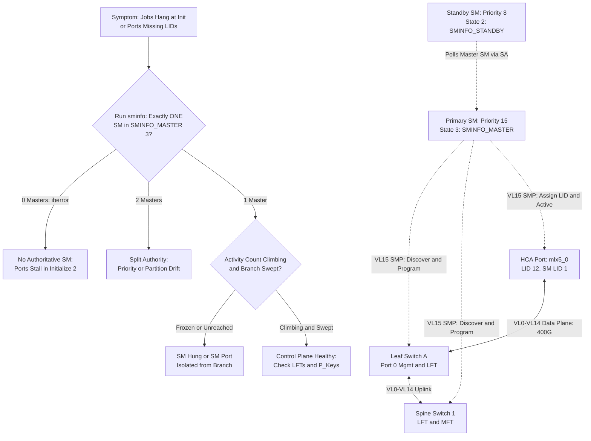
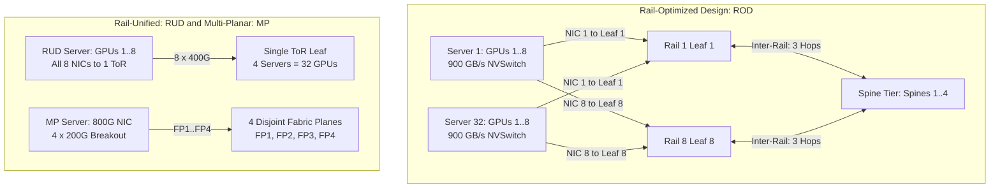

# 12.7 InfiniBand subnet manager, routing, topologies and rails

| | |
|---|---|
| Level | Advanced |
| Priority tier | 1 |
| Lab venue | Nebius GPU |
| Part | Part 12: Complete AI networking |
| Sources | `nvidia-devops` V8 Ch. 5–6, Ch. 12, Index & Labs 01–04; `supercomputers-for-linux-sysadmins-managing-modern-hpc-clusters-and-supercomputers-from-software-to` Ch. 5; `ai-data-center-network-design-and-technologies` Ch. 3 & Ch. 8; `bcm11-admin` §3.6.3 & §7.5 |
| Code | `code/part12/infiniband_sm_routing.py`, `code/part12/infiniband_sm_routing_lab.py` |
| Coverage file | `planning/coverage/chapters/12-07.md` |

## Why this matters for AI infrastructure

Suppose you bring up a new InfiniBand cluster. Every optical cable is seated, and every switch port shows a green physical link LED. The fabric can still fail to move a single byte of training data. Even when every port reaches an active logical state, a large training run can take twice as long per step. That slowdown happens when static forwarding tables pile twenty gigabytes of traffic onto two leaf uplinks while the adjacent uplinks sit nearly idle.

Ethernet switches run distributed routing protocols on every switch CPU. InfiniBand works differently. Its switches depend on one central control plane, the Subnet Manager. OpenSM or NVIDIA Unified Fabric Manager can implement it. The Subnet Manager discovers the topology over Virtual Lane fifteen, the management lane, and assigns Local Identifiers (LIDs) to the ports. It then programs the switch Linear Forwarding Tables and Multicast Forwarding Tables, applies Partition Keys and Service Level maps, and moves ports into the active state. Until an authoritative Master Subnet Manager finishes that sequence, the physical fabric remains logically dark.

Once the subnet is active, delivered collective bandwidth depends on three architectural layers working together. Layer 1 of 3 is the Subnet Manager and its routing engine. The Subnet Manager elects a single master by priority, using the lowest GUID to break ties, and it sweeps link state changes. It also prevents credit loops across Virtual Lanes and spreads destination LIDs across spine uplinks.

Layer 2 of 3 is switch topology, radix and oversubscription. Three-stage and five-stage folded Clos and Fat-Tree fabrics, Scheduled Fabrics, Dragonfly pods, and Torus rings scale from small pods to tens of thousands of GPUs. Oversubscription or a single spine failure directly cuts cross-rack bandwidth.

Layer 3 of 3 is the rail-optimized geometry that connects server NICs to leaf switches, along with its IP fabric counterparts. Mapping eight server NICs across eight independent rail switches behaves very differently from connecting all eight NICs to one top-of-rack switch or breaking out ports across multiple planes. AI Ethernet fabrics solve these same routing and multi-tenancy problems using dynamic IP protocols.

Before you blame a cable for a stuck port, check whether a master Subnet Manager has finished its sequence.

## Prerequisites and outcomes

**Prerequisites:** Read Chapter 12.2 on RDMA Queue Pairs and Completion Queues first. You will also need Chapter 12.6, which covers InfiniBand physical signaling, addressing and credit-based Virtual Lane flow control.

**Outcomes:** By the end of this chapter, you will be able to:
- Explain the ten-stage Subnet Manager lifecycle, read `sminfo` output, and apply the OpenSM master election and lowest-GUID tie-breaker rules.
- Configure redundant OpenSM instances on Linux and in NVIDIA Base Command Manager.
- Trace the InfiniBand port state machine together with Directed Route SMP hop-pointer traversal and LMC multipath LID blocks.
- Inspect switch Linear Forwarding Tables and Multicast Forwarding Tables with `ibroute`, `ibtracert`, `smpquery`, `saquery` and `perfquery`, and choose the right OpenSM routing engine.
- Size non-blocking and oversubscribed three-stage and five-stage Fat-Tree and Clos fabrics, and compare rail-optimized, rail-only, rail-unified, multi-planar, scheduled, dragonfly, and torus designs.
- Compare InfiniBand OpenSM routing with AI Ethernet routing protocols, and integrate topology discovery with Slurm through Topograph in Base Command Manager.

---

## 1. Centralized subnet management, port states, and the OpenSM lifecycle

### 1.1 Why InfiniBand requires a Subnet Manager

Consider a switch or server that reboots on an InfiniBand cluster while no Subnet Manager is working. Its ports negotiate a physical link, but they never receive a Local Identifier or a forwarding path. Any distributed PyTorch or NCCL job that touches those nodes hangs right away, during rendezvous or Queue Pair initialization.

InfiniBand switches do not learn their forwarding paths with Spanning Tree, OSPF or BGP. A single daemon, the Subnet Manager, does that work. It handles topology discovery, LID assignment and deadlock-free path calculation. It also programs the forwarding tables, distributes Partition Keys and maps Service Levels to Virtual Lanes. In normal operation, data packets never pass through the Subnet Manager. Switches forward frames in hardware at full wire speed, using the tables the Subnet Manager has already written.



The LID space is fixed, and the Subnet Manager works inside it. The block below shows how the 16-bit range is divided.

```text
# InfiniBand single-subnet LID address space managed by the Subnet Manager:
LID 0x0000 (0)                  : Reserved
LID 0x0001..0xBFFF (1..49,151)  : Unicast end ports and switches (2^15 + 2^14 - 1 = 49,151)
LID 0xC000..0xFFFE (49,152..65,534): Multicast groups
LID 0xFFFF (65,535)             : Permissive LID for Directed Route SMPs on VL15
Data-plane line rates           : 200 Gbps HDR, 400 Gbps NDR, 800 Gbps XDR
```

The table below lists the control-plane entities that keep this design healthy. Check each row when a fabric misbehaves. The healthy state needs exactly one Master, and zero masters leaves new or rebooted ports stuck in `Initialize`.

| Control-plane entity or check | Identifier / wire mechanism | Healthy production state | Failure symptom when broken |
|---|---|---|---|
| **Master Subnet Manager (`SM1`)** | `sminfo` `state 3` (`SMINFO_MASTER`), `priority 15` | Exactly `1` master instance across the subnet; `activity count` increments on every sweep and query | `0` masters (`sminfo: iberror: failed: query`) leaves new or rebooted ports stuck in `Initialize` (`Base lid: 0`) |
| **Standby Subnet Manager (`SM2`)** | `sminfo` `state 2` (`SMINFO_STANDBY`), `priority 8` | `1` or more standbys in separate power and rack failure domains polling master and ready for takeover | Unmanaged host or switch SM with higher priority hijacks master role or applies drifted `opensm.conf` after failover |
| **Management Virtual Lane (VL15)** | Dedicated SMP lane (`IB_SMP_VL = 15`), `DLID 0xFFFF` | Carries Directed Route and LID-routed SMPs even before VL0..VL14 data lanes are `Active` | Bad cable or hung node port slows VL15 SMP responses, stretching SM sweep duration and delaying convergence |
| **Switch Management Port (Port `0`)** | Virtual switch port `0` (`SwitchGUID` / switch LID) | Every switch is assigned `1` switch-wide LID (`LMC = 0`) on virtual Port `0` for SMP management | Unreachable Port `0` prevents OpenSM from writing `LinearFDBTop` and LFT blocks to that switch |
| **HCA End Port (`mlx5_0` Port `1`)** | PortGUID (`64`-bit), `Base lid` (`16`-bit), `SM lid` | `Physical state: LinkUp (5)`, `State: Active (4)`, `Base lid >= 1`, `SM lid` matching Master SM | `Physical state: LinkUp` with `State: Initialize (2)` or `Armed (3)` blocks all VL0..VL14 user Queue Pairs |

### 1.2 The ten-stage Subnet-Management lifecycle and the port state machine

Suppose a marginal optical cable flaps every few seconds on a large cluster. Each flap triggers another heavy sweep in OpenSM, and those sweeps stall collective latency across every running job. To see why, you need the ten stages of the Subnet Manager lifecycle and the four logical port states. Together they show that physical link up is only the start of fabric initialization.

When OpenSM or NVIDIA UFM starts, it binds to a local port and sweeps the fabric over Virtual Lane fifteen. It then assigns LIDs, computes deadlock-free routes, programs the switch forwarding and partition tables, and activates the ports. After that, it listens for asynchronous link-state traps such as `Trap 128`. It also runs periodic sweeps, so routes are recalculated whenever links change.

The ten stages run in order, and you can inspect the artifact each one leaves. The table below lists them.

| SM lifecycle stage | Control-plane action and wire SMPs | Key configuration or state artifact |
|---|---|---|
| **1. Bind to local management port** | Attach to local HCA port (`-g <port_guid>`), assign the SM's own LID, and initialize the Subnet Administration (SA) database. | Bound `PortGUID` and `SM lid` |
| **2. Discover topology (Heavy Sweep)** | Traverse every reachable switch and end port using Directed Route SMPs (`SubnGet(NodeInfo)`, `SubnGet(NodeDescription)`, `SubnGet(SwitchInfo)`, `SubnGet(PortInfo)`). | In-memory topology graph |
| **3. Identify nodes, ports, switches, and links** | Record `NodeGUID`, `PortGUID`, `SystemImageGUID` (grouping multi-ASIC chassis switches), widths (`4x`, `12x`), and speeds (`FDR 56 Gbps`, `EDR 100 Gbps`, `HDR 200 Gbps`, `NDR 400 Gbps`, `XDR 800 Gbps`). | Inventory of switches and end ports |
| **4. Assign or confirm LIDs** | Allocate unique `16`-bit Base LIDs (`1..49,151`) and LMC ranges (`2^LMC` consecutive LIDs per port), preserving assignments via `/var/cache/opensm/guid2lid`. | Persistent `guid2lid` mapping |
| **5. Calculate routes** | Invoke configured routing engine (`ftree`, `updn`, `minhop`, `dor`, `dfsssp`, or adaptive `ar_ftree`) to compute deadlock-free unicast paths and multicast trees. | Unicast LFT and multicast MFT maps |
| **6. Program switch forwarding tables** | Push `LinearFDBTable` (LFT) and `MulticastFDBTable` (MFT) blocks into every switch's Port `0` via `SubnSet` SMPs. | Hardware LFT and MFT programmed |
| **7. Apply partition (P_Key) and QoS policy** | Program `P_KeyTable` entries (`full` bit `15 = 1`, e.g., `0xFFFF`; `limited` bit `15 = 0`, e.g., `0x7FFF`), `SLtoVLMappingTable`, and VL Arbitration tables. | `/etc/opensm/partitions.conf` and QoS tables |
| **8. Move eligible ports to `Active`** | Send `SubnSet(PortInfo)` transitions moving ports from `Initialize` (`2`) to `Armed` (`3`) and finally `Active` (`4`). | `State: Active (4)` |
| **9. Monitor for traps and periodic sweeps** | Listen for asynchronous traps such as `Trap 128` (link state change) and run periodic sweeps (`sweep_interval`, default `10 s`). | `/var/log/opensm.log` trap counters |
| **10. Recalculate affected state on change** | Re-run discovery and route programming on `Trap 128` or `SIGHUP`, updating LFTs and P_Key tables so surviving paths absorb traffic. | Updated LFTs after link event |

Stage 9 leaves its trap counters in `/var/log/opensm.log`. The port state table below shows what each logical state allows. Physical link up is only the start.

| Layer | State code and name in `ibstat` / `ibstatus` | Allowed traffic | What drives the transition to the next state |
|---|---|---|---|
| **Physical layer** | `2: Polling` -> `Configuration` -> **`5: LinkUp`** (or `3: Disabled`, `Recovery`) | Symbol lock and lane training (`8b/10b`, `64b/66b`, `256b/257b`) | Electrical or optical SERDES handshake between directly connected transceivers |
| **Logical link layer** | **`1: Down`** | None (`Physical state` is not yet `LinkUp`) | Physical layer reaches `5: LinkUp`, automatically advancing logical state to `2: Initialize` |
| **Logical link layer** | **`2: Initialize`** (`Init`) | **VL15 SMPs only** (`Base lid: 0`, `SM lid: 0`); all user RDMA (VL0..VL14) blocked | Master SM discovers the port via Directed Route SMP, assigns Base LID, SM LID, and P_Keys (`SubnSet(PortInfo)` -> `Armed`) |
| **Logical link layer** | **`3: Armed`** | **VL15 SMPs** + link-local readiness; user RDMA (VL0..VL14) still blocked | Master SM finishes programming switch LFTs along the path and sends `SubnSet(PortInfo)` setting `PortState = 4 (Active)` |
| **Logical link layer** | **`4: Active`** | **All traffic (VL0..VL14 user RDMA + VL15 SMPs)** | Port remains `Active` unless physical link drops (`-> Down`) or SM re-initializes the port |

If you read the table from top to bottom, you follow a port from startup to traffic. Traffic stays blocked until the Subnet Manager moves the port to `Active`, so do not treat a link LED as the finish line.

### 1.3 Directed Route SMPs: how OpenSM discovers an unaddressed fabric

Think about a cold boot. No switch has a forwarding table yet, and no port has a Local Identifier. If OpenSM depended on normal address lookups to reach a switch, it would have no way to discover or program the fabric.

Chapter 12.6 introduced the answer, Directed Route addressing. It runs on Virtual Lane fifteen and uses permissive source and destination LIDs, so the packet can travel before any forwarding table exists. The outbound request carries its own route, an explicit array of switch egress port numbers called the Initial Path. Each transit switch sends the packet out the port at the current hop pointer. It then records its own receiving ingress port in the Return Path array and increments the hop pointer.

When the request reaches the destination node, the target processes the management attribute, flips the direction bit from zero to one, and sends the response back. On the return trip, each switch reads its recorded ingress port from the Return Path array and decrements the hop pointer. The reply eventually reaches the Subnet Manager. Combined directed routing adds one more option. OpenSM can use normal LID forwarding across a core that is already configured, then step onto an unconfigured branch.

The sketch below follows one request across three switch hops. Read the forward pass first, then the reverse pass.

```text
# Directed Route SMP (management class 0x81, VL15, DLID = 0xFFFF, SLID = 0xFFFF, DrSLID / DrDLID != 0xFFFF for combined):
# Outbound egress ports = [1, 7, 14] | Switch receiving ingress ports = [18, 4, 2]
Header fields:
  hop_count   = 3 (0 for local port, N for N switch hops)
  hop_pointer = 1..3 (1-based index into 64-byte Initial Path / Return Path port arrays)
  D (Direction)= 0 (forward request: source -> destination), 1 (reverse reply: destination -> source)

1. Forward request (D = 0):
   - Initial state at SM : D=0, hop_count=3, hop_pointer=1, Initial Path=[0, 1, 7, 14], Return Path=[0, 0, 0, 0]
   - Hop 1 switch        : receives on Port 18 -> sets Return Path[1]=18, hop_pointer=2, exits Initial Path[1]=Port 1
   - Hop 2 switch        : receives on Port 4  -> sets Return Path[2]=4,  hop_pointer=3, exits Initial Path[2]=Port 7
   - Hop 3 switch        : receives on Port 2  -> sets Return Path[3]=2,  hop_pointer=4, exits Initial Path[3]=Port 14
2. Target turnaround (hop_pointer > hop_count):
   - Target HCA processes SubnGet/SubnSet, writes reply, sets D = 1 and hop_pointer = hop_count = 3
3. Reverse reply (D = 1):
   - Switches forward out Return Path[hop_pointer] (Port 2 -> Port 4 -> Port 18) without modifying arrays
   - hop_pointer decrements 3 -> 2 -> 1 -> 0 until reply reaches the SM
```

If you follow the forward pass first, the reverse pass makes sense. The reply retraces the request's path, using the Return Path array as its map.

### 1.4 Master and Standby election, split authority, and HA architecture

Consider two ways this goes wrong. In the first, the only Subnet Manager host loses power and no standby is running. Any rebooted compute node, or any newly replaced cable, stays stuck in the initialize state. In the second, a standby takes over with an outdated configuration file, or a compute node boots an enabled `opensm` daemon at maximum priority. In both cases, routing tables and tenant partitions can change silently across the entire cluster.

A production subnet should run two or three Subnet Manager instances for high availability. Exactly one acts as Master, and the others wait in Standby. OpenSM elects the Master with a two-step rule carried in `SMInfo` packets. The instance with the highest configured integer priority, from zero to fifteen, wins outright. If two instances share that highest priority, the port with the numerically lowest sixty-four-bit GUID wins the tie-breaker.

Standby instances poll the Master at regular intervals. If the Master stops responding, the highest-priority standby takes over and sweeps the subnet to update every port's SM LID. Always verify in `sminfo` that exactly one Master exists and that its activity count is still climbing, not frozen.

The example below shows a Master report and the election rules behind it. Read the state codes as the key to the output.

```text
# Querying the authoritative Subnet Manager (untested here)
# Standby polling parameters: polling_retry_number and sminfo_polling_timeout
$ sminfo
sminfo: sm lid 1 sm guid 0x0002c903004a1b20, activity count 184223 priority 15 state 3 SMINFO_MASTER

# OpenSM election rules and sminfo state codes:
1. Priority rule (0..15) : Highest sm_priority wins (e.g., priority 15 defeats priority 8 or 0)
2. Tie-breaker rule      : If sm_priority is equal (e.g., both priority 14), lowest 64-bit GUID wins:
                           0x0002c903004a1b20 < 0x08c0eb0300f1a2c3 -> 0x0002c903004a1b20 becomes SMINFO_MASTER
3. sminfo state codes    : 0 = SMINFO_NOTACTIVE, 1 = SMINFO_DISCOVERING, 2 = SMINFO_STANDBY, 3 = SMINFO_MASTER
4. Frozen activity count : If state == 3 but activity count (184223) never increments across sweeps, the SM daemon is wedged
```

The tie-breaker only matters when priorities are equal. A frozen activity count with `state 3` means the daemon is wedged, even though it still claims mastership. The table below sets out four production rules that keep your HA design sound. Each row names the failure you avoid by following its rule.

| Production HA rule | Operational requirement | What goes wrong if violated |
|---|---|---|
| **1. Separate failure domains and out-of-band access** | Place Primary SM (`priority 15`) and Standby SM (`priority 8`) on independent management servers or UFM appliances with separate power feeds and out-of-band Ethernet SSH/BMC access. | Making the SM host reachable only over `ib0` (IPoIB) locks operators out of the SM host during the very fabric outage they need to fix. |
| **2. Identical version-controlled config** | Keep `/etc/opensm/opensm.conf` (`routing_engine ftree`) and `/etc/opensm/partitions.conf` checksum-identical across primary and standby SMs. | Standby failover keeps `ibping` alive while silently switching routing to `minhop` or dropping tenant P_Key partitions. |
| **3. Prevent rogue compute or switch SMs** | Disable `opensm.service` on compute node images and unmanaged switch OS instances. | A compute node booted with `sm_priority 15` and a lower GUID hijacks `SMINFO_MASTER` mid-training run. |
| **4. Cluster Manager (BCM 11 / UFM) integration** | Manage OpenSM roles in BCM `CMDaemon` (`cmsh -c "device roles <node>; assign subnetmanager; commit"` or `device services <node>; add opensm; set autostart yes; set monitored yes; commit`) or via NVIDIA UFM (`ufmsettings`) for SHARP. | Unmonitored SM daemons exit silently without alerting operators or restarting automatically. |

Before you bring a new Subnet Manager into service, decide which host will be its standby and confirm that the two configurations match.

---

## 2. Linear Forwarding Tables, LMC multipathing, and OpenSM routing engines

### 2.1 Destination-based LID lookup, LFTs, MFTs, and LMC

Start with a simple rule. In a classical InfiniBand fabric without adaptive routing, each destination LID maps to one fixed outgoing port. Picture a naive routing setup where all active compute nodes get destination LIDs that map onto the same two leaf uplinks. A multi-rack collective then bottlenecks at a fraction of the switch's total spine capacity.

Every InfiniBand switch routes unicast packets with a flat hardware table, the Linear Forwarding Table. When a frame arrives, the switch reads the sixteen-bit Destination LID from the Local Route Header. It then looks up `LFT[DLID]` and sends the frame out a single eight-bit port number. Multicast frames work differently. They use the Multicast Forwarding Table, which stores a bitmask of outgoing ports for each multicast LID across a loop-free spanning tree.

A single HCA port with LMC at zero owns just one LID, so all of its traffic follows one path. LID Mask Control, or LMC, changes that. The Subnet Manager uses it to spread one HCA port across several parallel spine links, and the table stays deterministic. Setting LMC above zero gives each HCA port a contiguous block of LIDs. The block holds 2 to the power of LMC LIDs. The Subnet Manager then maps each LID in that block to a different switch uplink port in the Linear Forwarding Table. Communication libraries can open several Queue Pairs, each bound to a different path LID on the same physical adapter port.

The reference block below lists the lookup rule and the LMC arithmetic that you will need.

```text
# Linear Forwarding Table (LFT), Multicast Forwarding Table (MFT), and LMC (2^LMC) rules:
LFT lookup : LFT[DLID] -> 8-bit egress port (1..254; 0 = switch management Port 0; 0xFF / 255 = unrouted LID)
MFT lookup : MFT[DLID 0xC000..0xFFFE] -> bitmask of egress ports for collective and IPoIB ARP/ND multicast
LMC range  : [Base LID, Base LID + 2^LMC - 1] where lower LMC bits of Base LID are 0 (0 <= LMC <= 7)
  - LMC = 0: 2^0 = 1 LID  (e.g., Base lid 913 or Base lid 12)
  - LMC = 2: 2^2 = 4 LIDs (Base lid 16 -> LIDs 16, 17, 18, 19 mapped to LFT[16..19] -> Uplinks 5, 6, 7, 8)
  - LMC = 3: 2^3 = 8 LIDs (Base lid 64 -> LIDs 64..71)
```

Notice the LMC = 2 line. A Base LID of 16 covers four consecutive LIDs, and each one lands on a different uplink.

### 2.2 Comparing OpenSM routing engines: `minhop`, `updn`, `ftree`, `dor`, and `dfsssp`

InfiniBand relies on lossless, link-level credit flow control. That design has a sharp edge. A cyclic path of buffer waits across switches locks up every port in the loop permanently. Picking a routing engine that does not match your physical topology can therefore cause credit deadlocks or a severe uplink imbalance.

OpenSM offers several topology-aware routing engines. You choose them with `routing_engine` in `/etc/opensm/opensm.conf`. The setting accepts a fallback list, such as `routing_engine ftree,updn,minhop`. In tree-based topologies, the Up/Down rule prevents credit loops using a single Virtual Lane. Packets travel up toward the root spine switches, then down toward the leaves. The rule strictly forbids any downward-to-upward turn through a leaf switch.

Why does that rule work? Every cycle in a tree-derived graph has at least one top peak at a spine and one bottom valley at a leaf. Forbidding downward-to-upward turns therefore breaks every possible credit loop, and it needs no extra Virtual Lanes. That guarantee holds only if `/etc/opensm/root_guids.conf` never labels a leaf switch as a root. On symmetric folded Clos AI clusters, `ftree` and its adaptive variant `ar_ftree` improve on generic `updn`. They balance destination LIDs evenly across all spine uplinks, in a deterministic way.

The table compares the five routing engines by target topology, path method and deadlock protection. Notice that `minhop` provides no deadlock protection once the topology has cycles, so match the engine to the wiring, not to habit.

| OpenSM routing engine | Target topology | How paths and LFTs are computed | Credit-loop (deadlock) avoidance mechanism | Minimum data VLs and Adaptive Routing (AR) variant |
|---|---|---|---|---|
| **`minhop`** (Minimum Hop) | Single switch or simple small trees without cyclic shortcuts | Computes shortest hop count from every switch to every LID and balances destinations per switch | **None** on cyclic topologies; if cable errors or meshes create cycles, shortest paths can form credit loops | `1` VL (`None`) |
| **`updn`** (Up/Down) | Irregular trees, degraded Clos fabrics, or clusters with non-uniform cabling | Identifies root spine switches (via `root_guid_file` or auto-detection) and ranks switches by distance from roots | Enforces the **Up/Down turn rule**: a packet may traverse `0` or more `UP` hops followed by `0` or more `DOWN` hops; `DOWN -> UP` turns are strictly forbidden | `1` VL (`ar_updn`) |
| **`ftree`** (Fat-Tree) | Symmetric or bounded-asymmetric 2-tier and 3-tier Fat-Tree / Folded Clos AI clusters | Indexes switches by rank tier and deterministically spreads downward destination LIDs across upward spine links | Structural Up/Down hierarchy (`upward` phase to lowest common ancestor spine, then `downward` phase) guarantees zero credit loops | `1` VL (`ar_ftree`) |
| **`dor`** (Dimension-Ordered Routing) | `1D`, `2D`, or `3D` Torus and Mesh fabrics (`X`, `Y`, `Z` coordinates) | Routes packets completely along Dimension `X` first, then `Y`, then `Z` (`X -> Y -> Z`) | Dimension ordering prevents cross-dimension cycles; wrap-around torus links split across `>= 2` Virtual Lanes (VL0/VL1) at a dateline to break intra-ring loops | `>= 2` VLs for torus (`ar_dor` / `torus-2QoS`) |
| **`dfsssp`** (Deadlock-Free Single-Source Shortest-Path) | Arbitrary or irregular graphs and Dragonfly-style topologies | Computes Dijkstra shortest paths across any topology graph and builds a channel dependency graph (CDG) | Breaks cycles in the CDG by assigning SL-to-VL transitions across multiple Virtual Lanes | `>= 2` VLs (`None`) |

Match the routing engine to your cabling before you enable it, because a mismatch can deadlock the fabric.

---

## 3. Topologies, oversubscription math, and three-stage versus five-stage scale

### 3.1 Leaf oversubscription and its exact cost on AllReduce

Picture a leaf switch with twice as many server downlinks as spine uplinks. Every single-pair bandwidth test inside the rack still runs at full line rate. The trouble starts when a multi-rack training job runs an AllReduce across the spine tier. Each GPU's effective network bandwidth drops in half. Losing one of two spine switches then cuts throughput in half again.

The oversubscription ratio of a switch tier is its total southbound downlink capacity divided by its total northbound uplink capacity. When every server under an oversubscribed leaf transmits across the spine at once, they share the smaller uplink pool equally. You can check this yourself with a paired `ib_write_bw` test. Run one inside the same leaf, then run one across two racks.

$$\text{Oversubscription Ratio} = \frac{\text{Total Downlink Bandwidth}}{\text{Total Uplink Bandwidth}} = \frac{N_{\text{down}} \times R_{\text{down}}}{N_{\text{up}} \times R_{\text{up}}}$$

A ratio of 2.0 means the leaf offers half as much uplink as downlink.

The example below follows one leaf through three cases, using the leaf numbers from the Volume 08 analysis. Read the arithmetic line by line.

```text
# Production leaf switch oversubscription and AllReduce step-time math (Volume 08 analysis):
Leaf downlinks               : 16 x 400 Gbps = 6,400 Gbps (facing 16 endpoints)
Leaf uplinks (2:1 design)    : 8 x 400 Gbps  = 3,200 Gbps (split 4 and 4 across Spine 1 and Spine 2)

1. Nominal 2:1 oversubscription:
   Ratio                     = 6,400 Gbps / 3,200 Gbps = 2.0 (2:1)
   Same-leaf ib_write_bw     = 397.62 Gbps (2,097,152 B = 2 MiB message size; local ASIC switching)
   Cross-rack ib_write_bw    = 201.18 Gbps (all 16 nodes sharing 3,200 Gbps uplinks -> 200 Gbps = 25 GB/s per node)

2. Synchronized 2 GB AllReduce step time:
   1:1 non-blocking leaf (16 down : 16 up, 400 Gbps = 50 GB/s/node): 2 GB / 50 GB/s = 40.0 ms
   2:1 oversubscribed leaf (16 down : 8 up, 200 Gbps = 25 GB/s/node): 2 GB / 25 GB/s = 80.0 ms (2x slower)

3. Single-spine failure blast radius (Spine 1 fails -> 4 uplinks lost):
   Surviving uplink capacity = 4 x 400 Gbps = 1,600 Gbps
   Degraded oversubscription = 6,400 Gbps / 1,600 Gbps = 4.0 (2:1 doubles to 4:1)
   Degraded per-node rate    = 1,600 Gbps / 16 = 100 Gbps (12.5 GB/s -> 160.0 ms per 2 GB AllReduce step)
```

Notice that the 2:1 leaf needs twice as long per step as the non-blocking one. Losing one spine doubles the ratio to 4:1.

Before you size a leaf, decide how much oversubscription your AllReduce jobs can tolerate.

### 3.2 Scaling three-stage and five-stage folded Clos and Fat-Tree fabrics

Suppose you try to grow a two-tier leaf-spine network past the radix of its spine switches. The radix is the port count of the switch. Some leaves can no longer reach every spine. A third super-spine tier fixes that radix limit for very large clusters. The cost is more optical transceivers, more power draw, and possible super-spine oversubscription.

Modern AI clusters grow in modular building blocks, called rows and blocks, built from eight-GPU servers and sixty-four-port switches. A single rail row connects thirty-two servers across eight leaf switches and four spine switches. Now stack eight rows. They fill all sixty-four ports of the spine tier. That sets the maximum non-blocking scale of a three-stage Clos with sixty-four-port switches at two thousand forty-eight GPUs. Swapping fixed sixty-four-port spines for two-hundred-fifty-six-port chassis spines cuts the spine switch count by four times.

Past two thousand forty-eight GPUs, architects group four rows into a one-thousand-twenty-four-GPU block. A third tier of super-spine switches connects those blocks, and the scale can reach thirty-two thousand GPUs and beyond. The number of super-spine switches and blocks sets the inter-block oversubscription. It runs from non-blocking `1:1` up to `7:1`.

The sizing sheet below uses eight-GPU servers and 64 by 400 Gbps switches, with 32 ports down and 32 up at 1:1.

```text
# Modular building blocks with 8-GPU servers (NIC 1..8) and 64 x 400 Gbps switches (32 down + 32 up at 1:1):
- 1 Rail Row (Stripe)  : 32 servers = 256 GPUs | 8 leaf switches (Leaf 1..8) | 4 spine switches (Spine 1..4, 8 links/leaf)
  (Note: A single row of 256 GPUs—or 512 GPUs if all 64 leaf ports face 64 servers—can operate rail-only without spines)
- Max 3-Stage Clos (64p): 8 rows = 256 servers = 2,048 GPUs | 64 leaf switches | 32 fixed 64x400G spines (or 8 chassis 256x400G spines)
- 1 5-Stage Block (Brick): 4 rows = 128 servers = 1,024 GPUs | 32 leaf switches | 32 spine switches (1,024 leaf ports + 1,024 super-spine ports)
- 32-Block Supercluster : 32 blocks x 1,024 GPUs = 32,768 GPUs (32K; extendable to 32K–128K GPUs)
```

The table walks through each scale tier, from one row up to the five-stage Clos.

| Architecture and scale tier | Rows and blocks | Total servers / GPUs | Server / spine / super-spine ports | Leaf switches (`64 x 400G`) | Spine switches | Super-spine switches (`64 x 400G`) | Super-spine oversubscription |
|---|---|---|---|---|---|---|---|
| **3-stage Clos (`1` row)** | `1` row | `32` servers / **`256` GPUs** | `256` / `256` / `0` | `8` | `4` (`64 x 400G`) | `0` | `1:1` (non-blocking) |
| **3-stage Clos (`2` rows)** | `2` rows | `64` servers / **`512` GPUs** | `512` / `512` / `0` | `16` | `8` (`64 x 400G`) | `0` | `1:1` (non-blocking) |
| **3-stage Clos (`8` rows, fixed spines)** | `8` rows | `256` servers / **`2,048` GPUs** | `2,048` / `2,048` / `0` | `64` | `32` (`64 x 400G`) | `0` | `1:1` (max 3-stage `64p`) |
| **3-stage Clos (`8` rows, chassis spines)** | `8` rows | `256` servers / **`2,048` GPUs** | `2,048` / `2,048` / `0` | `64` | **`8` (`256 x 400G`)** | `0` | `1:1` (`1/4` spine switches) |
| **5-stage Block unit (`1` block)** | `4` rows (`1` block) | `128` servers / **`1,024` GPUs** | `1,024` / `1,024` / `1,024` | `32` | `32` (`64 x 400G`) | Modular | `1:1` within block |
| **5-stage Clos (`2` blocks, `1:1`)** | `8` rows (`2` blocks) | `256` servers / **`2,048` GPUs** | `2,048` / `2,048` / `2,048` | `64` | `64` (`64 x 400G`) | `32` | **`1:1`** |
| **5-stage Clos (`4` blocks, `2:1`)** | `16` rows (`4` blocks) | `512` servers / **`4,096` GPUs** | `4,096` / `4,096` / `2,048` | `128` | `128` (`64 x 400G`) | `32` | **`2:1`** |
| **5-stage Clos (`6` blocks, `3:1`)** | `24` rows (`6` blocks) | `768` servers / **`6,144` GPUs** | `6,144` / `6,144` / `2,048` | `192` | `192` (`64 x 400G`) | `32` | **`3:1`** |
| **5-stage Clos (`8` blocks, `4:1`)** | `32` rows (`8` blocks) | `1,024` servers / **`8,192` GPUs** | `8,192` / `8,192` / `2,048` | `256` | `256` (`64 x 400G`) | `32` | **`4:1`** |
| **5-stage Clos (`10`..`14` blocks)** | `40..56` rows (`10..14` blocks) | `1,280..1,792` servers / **`10,240..14,336` GPUs** | `10,240..14,336` / `10,240..14,336` / `2,048` | `320..448` | `320..448` (`64 x 400G`) | `32` | **`5:1` to `7:1`** |
| **5-stage Clos (`16` blocks, chassis SS)** | `64` rows (`16` blocks) | `2,048` servers / **`16,384` GPUs** | `16,384` / `16,384` / `16,384` | `512` (`64/blk`) | `512` (`32/blk`) | Chassis SS | **`1:1`** |

The chassis spine option is the one to notice. It cuts the spine count from 32 to 8 at 2,048 GPUs, and the ratio stays at 1:1.

Before you choose a scale tier, work out how many spine ports your row count actually needs.

### 3.3 Alternative topologies: Scheduled Fabric, Dragonfly, and Torus

A five-stage Clos that grows past sixteen thousand GPUs pays for every extra spine-to-super-spine optical hop, in cost, power and latency. Some architects therefore look at non-Clos fabrics. Those include cell-scheduled fabrics, Dragonfly groups, and direct Torus rings. Each one trades optical count against routing complexity and vendor lock-in.

Each alternative handles traffic differently. A Scheduled Fabric chops arriving packets at the ingress leaf into small, fixed-size cells. It sprays those cells across all spine links, using Virtual Output Queues and credit grants, and reassembles them at the egress leaf. Dragonfly topologies connect groups of switches with a global mesh of inter-group links. When a direct link congests, they fall back on non-minimal adaptive routing. Torus topologies wire each node straight to its neighbors, in one, two or three dimensions. They need Dimension-Ordered Routing across at least two Virtual Lanes to break wrap-around credit loops.

The table compares the three designs by mechanism, main advantage and trade-off. Notice that each advantage comes with a lock-in or routing cost.

| Alternative topology | Hardware mechanism and key parameters | Primary advantage | Architectural trade-off |
|---|---|---|---|
| **Scheduled Fabric (VOQ + Cell Spraying)** | Broadcom Jericho3-AI / Ramon3, Cisco Silicon One; segments packets into `64`-, `128`-, or `256`-byte cells sprayed across spines and reassembled at egress leaf via Virtual Output Queues (VOQ) and credit grant schedulers | Eliminates head-of-line blocking and achieves near-`100%` link utilization without DCQCN rate oscillation | Proprietary pod or brick lock-in across leaf and spine ASICs |
| **Dragonfly (`DF` / `DF+` / `Dragonfly Sparse`)** | Modular pods (full-graph mesh or `2`-tier Clos / `Butterfly+` bipartite group) interconnected by a global full mesh between spine or router nodes | Cuts network diameter and long-haul optical links vs a `5`-stage super-spine Clos | Requires global non-minimal adaptive routing (`UGAL`) or RIFT Dragonfly Sparse (`draft-przygienda-rift-dragonfly`) under congestion |
| **`1D`, `2D`, and `3D` Torus** | Direct neighbor links with wrap-around edges: `1D` torus ring = `2` connections/node; `2D` torus grid = `4` connections/node; `3D` torus (`X`, `Y`, `Z` cube) = `6` connections/node | Slashes switch and optics cost for nearest-neighbor (`stencil` / `3D` halo or `1D` inter-rail leaf rings) traffic | Larger hop diameter for all-to-all traffic; requires OpenSM `dor` with `>= 2` VLs to prevent wrap-around ring deadlocks |

Before you pick a non-Clos fabric, price the routing work and the vendor lock-in it brings with it.

---

## 4. Rail-optimized, Rail-Only, Rail-Unified, and Multi-Planar designs

### 4.1 ROD versus Rail-Only versus RUD: GPU-to-leaf cabling and failure blast radius

A leaf switch fails in the middle of a training run. How far the damage spreads depends on how you wired the eight network adapters of each eight-GPU server. Wiring all eight NICs to one Top-of-Rack leaf keeps the cables short inside the rack. The cost shows up on failure. One leaf outage knocks four entire servers and thirty-two GPUs out of the job.

Start inside one server. Its eight GPUs talk at high speed over an internal NVSwitch domain. Each GPU also pairs one-to-one, through a local PCIe switch, with its own dedicated network adapter. In a Rail-Optimized Design, adapter `k` on every server in a row connects to rail leaf switch `k`. Same-index GPUs across thirty-two servers exchange tensors in a single leaf switch hop. Losing one leaf switch costs each server only one-eighth of its network capacity.

Rail-Only designs go further. They drop the inter-rail spine connections entirely, so cross-rail traffic travels through the server's internal NVSwitch. Multi-Planar architectures take a different route. They break out each high-speed adapter into four independent fabric planes. The NIC sprays packets across all four planes. If one plane fails, bandwidth falls by only twenty-five percent.

The diagram below sets the Rail-Optimized and Rail-Unified wiring side by side.



The server envelope below gives the physical baseline. It compares the DGX H100 with the DGX A100, and it shows why rack power becomes a design question.

```text
# Server physical envelope and intra-node fabric baseline (DGX H100 vs DGX A100):
DGX H100 chassis : 8U height, 19 in wide x 35.3 in deep (vs 6U for DGX A100)
Rack density     : 4..5 servers per 42U rack drawing 48 kW to 60 kW (vs 20..25 kW in legacy racks)
Intra-node fabric: 8 GPUs (GPU 1..8) over 900 GB/s NVSwitch; 1:1 local PCIe switch pairing to NIC 1..8 (400G or 800G)
```

The table sets the four designs side by side, with their switch hops, blast radius and cabling. Notice that Rail-Optimized keeps every server connected after one leaf fails. Rail-Unified gives the simplest cabling, but it carries the largest blast radius.

| Design pattern | Server-to-leaf connectivity | Intra-rail vs inter-rail switch hops | Single leaf switch failure blast radius | Cabling and operational trade-off |
|---|---|---|---|---|
| **Rail-Optimized Design (ROD)** | `NIC k` (`k = 1..8`) connects to `Leaf k` (`8` leaves per server across a `32`-server row) | **Intra-rail (`GPU k <-> GPU k`):** `1` leaf switch hop; **Inter-rail (`GPU j <-> GPU k`):** `3` switch hops (`Leaf j -> Spine -> Leaf k`, `2x` fabric latency) | **`0` servers completely isolated**; all `32` servers lose `1/8` (`12.5%`) of their network rails and continue via `7` healthy rails + internal NVSwitch | Requires cross-rack cabling from every server to `8` leaf switches (`ToR` spans `8` racks, `MoR` `6` racks, `EoR` `10` racks) |
| **Rail-Only Design** | Same `NIC k -> Leaf k` mapping as ROD, but spines only connect same-index rails across stripes (no inter-rail fabric links) | **Intra-rail:** `1` switch hop (same stripe) or `3` hops (across stripes via rail-dedicated spines); **Inter-rail:** `0` fabric hops (relies on intra-node NVSwitch) | Faults in `Rail k` are `100%` isolated from `Rail j`; `0` cross-rail congestion | Lowest switch count and simpler per-rail OpenSM or BGP domains, but requires every cross-rail transfer to transit the server's internal NVSwitch |
| **Rail-Unified Design (RUD)** | All `8` NICs (`NIC 1..8`) of a server connect to `1` single ToR leaf (or `4` NICs to `2` leaves); `4` servers (`32` GPUs) share `1` `32`-downlink leaf | **`1` switch hop** for both intra-rail and inter-rail among the `4` servers on the same ToR; **`3` switch hops** via spine to all other servers | **High blast radius:** losing `1` ToR leaf completely isolates **`4` entire servers (`32` GPUs)** from the cluster | Simplest intra-rack cabling (short low-cost copper DAC or AEC cables within `1` rack); requires BGP DPF or P_Key coloring to segregate rails on the shared leaf |
| **Multi-Planar Architecture (`FP1..FP4`)** | Each `800 Gbps` NIC breaks out into **`4 x 200 Gbps`** links connecting to `4` independent 2-tier Fabric Planes (`FP1..FP4`) via shuffle cables | `1` or `2` tier hops inside each independent plane (`64 x 800G` leaf provides `128 x 200G` server downlinks + `32 x 800G` / `64 x 400G` spine uplinks) | Losing an entire switch or plane reduces bandwidth by `25%` (`600 Gbps` survives across the other `3` planes) with **zero control-plane coupling** | NIC hardware sprays packets across `FP1..FP4` and reorders or coalesces out-of-order completions in firmware before delivering in-order RDMA to the GPU |

Decide how many servers you can afford to lose with one leaf, because that number decides which wiring pattern fits.

### 4.2 Rack placement trade-offs for rail rows

A Rail-Optimized row of thirty-two servers spread over eight racks needs cables from every server to eight separate leaf switches. Where you put those leaf switches decides which limit you hit. Either you exceed the power budget of the GPU racks, or you exceed the reach of low-cost copper cables.

Top of Rack saves floor space. You put one leaf switch at the top of each of the eight server racks. The price is heat and power. Those switches add load to racks that already draw up to sixty kilowatts, and the horizontal cables then span eight racks. Middle of Row moves the switch power out of the server racks. Two dedicated network racks sit in the center, and the longest cable run drops to six racks. End of Row keeps switch power out of the server racks too, but the longest cable now spans ten racks. Those runs need optical transceivers or Linear Pluggable Optics.

The table gives the physical layout and the trade-off for each option. Notice that the middle layout gives the shortest maximum cable span of the three, at six racks.

| Rack layout | Physical placement (`32` servers = `256` GPUs) | Total racks | Max cable span | Power and optical trade-off |
|---|---|---|---|---|
| **Top-of-Rack (`ToR`)** | `1` leaf switch at the top of each of the `8` server racks (`4` servers + `1` leaf/rack) | `8` racks | **`8` racks** | Least floor space; adds switch power and cooling load to dense `48..60 kW` GPU racks |
| **Middle-of-Row (`MoR`)** | `4` server racks left + `2` network switch racks center + `4` server racks right | `10` racks | **`6` racks** | Removes switch heat from server racks and minimizes horizontal cable reach |
| **End-of-Row (`EoR`)** | `8` server racks followed by `2` dedicated network switch racks at row end | `10` racks | **`10` racks** | Keeps switch power out of server racks; longest cables require optics or LPO/LRO (removing `2` or `1` DSPs) |

Before you choose a rack layout, decide whether power headroom or copper reach is the tighter limit in your room.

---

## 5. AI fabric IP routing counterparts, multi-tenancy, and topology-aware scheduling

Ethernet AI fabrics must solve the same Clos multipathing, rail isolation and multi-tenancy problems that OpenSM handles on InfiniBand. They do so with distributed or controller-driven IP routing protocols. Understanding both sides lets you compare InfiniBand and RoCEv2 designs on equal footing.

### 5.1 Dynamic IP routing options: eBGP unnumbered, BGP DPF, RIFT, IS-IS Flex Algo, and SRv6

Suppose an engineer gives every spine switch in an Ethernet Clos its own BGP Autonomous System Number. A multi-link failure can then route BGP traffic down into a transit leaf and back up to another spine. That valley turn congests the transit leaf's server ports and causes severe packet hunting.

The fix is an ASN layout. Give all spine switches one shared BGP ASN, and give each leaf its own. Standard AS-PATH loop detection then blocks valley routing through a transit leaf. AI Ethernet fabrics pair this layout with other tools. BGP unnumbered runs over IPv6 link-local addresses, and Link Bandwidth Extended Communities support weighted packet spraying. Other options cover rail coloring, link-state fabrics and central traffic engineering. Those are BGP Deterministic Path Forwarding, RIFT or IS-IS Flex Algo, and compressed SRv6 micro-SIDs.

The table compares the protocols by standard, peering model and advanced capabilities. If you look at the eBGP row, notice that it depends on the same-ASN and unique-ASN layout, because that layout is what prevents path hunting.

| Routing protocol / mechanism | Standard / RFC and scale | Underlay peering, BGP ASN allocation, and loop prevention | BGP advanced capabilities, path diversity, UCMP, and AI traffic engineering |
|---|---|---|---|
| **eBGP Underlay + BGP Unnumbered** | `RFC 7938` (DC BGP), `RFC 5549` (Extended Next Hop Encoding, Cap Code `5`, Len `6`, IPv4 AFI `1`, SAFI `1`, IPv6 NH AFI `2`), TCP port `179`, hold time `90 s` | Uses IPv6 link-local addresses (`fe80::/64`) via ICMPv6 RA/ND without point-to-point IPv4 link subnets. All spines share **one ASN** (`65001` from `16`-bit private range `64512..65535` or `32`-bit `4294967100` from `4200000000..4294967294`) while each leaf gets a unique ASN (`65101..65104`), preventing `Leaf1 -> Spine1 -> Leaf2 -> Spine1 -> Leaf3` path hunting on multi-link failures | Supports **`BGP ADD-PATH`** (advertising multiple paths from `65501`/`65502` border leaves), **AS-PATH strip-and-replace** ingress normalization, **Minimum BGP peers per prefix** auto-withdrawal, and **`BGP Link Bandwidth Extended Community`** Weighted ECMP / Weighted Packet Spraying (`WPS`, e.g., `400G/800G/100G/400G` links weighted `20% / 45% / 15% / 20%`) |
| **BGP Deterministic Path Forwarding (BGP DPF)** | `draft-wang-idr-dpf` | Colors underlay eBGP sessions and prefixes (`black` active vs `gray` backup fabric IDs) and prunes unmatched colors on advertisement | Maps GPU IDs, RoCEv2 UDP source ports, or BTH Queue Pairs (`QPair`s) to dedicated logical fabrics (e.g., `128 x GPU 0` pinned to `1.2 Tbps` = `3 x 400G` uplinks per leaf) via **Filter-Based Forwarding (FBF)**, **on-box agents**, **central CPCE controllers**, or **`EVPN-VXLAN` `MAC-VRF`/`RT5` color correlation** |
| **RIFT (Routing in Fat Trees)** | `RFC 9692` (`>= 1,000` switch nodes) + `draft-przygienda-rift-dragonfly` | Hybrid IGP using **link-state flooding northbound** and **distance-vector routing southbound** over UDP `hello` + IPv6 ND (`Zero-Touch Provisioning`, minimal leaf FIB) | Automatic disaggregation on link failure, wide ECMP/UCMP, K-store link/queue metadata advertisements, and native **Dragonfly Sparse** horizontal Top-of-Fabric (`ToF`) routing |
| **IS-IS (`Flood Reduction` + `Flex Algo`)** | `RFC 9350`, `RFC 9502`, `draft-ietf-lsr-distoptflood`, `draft-ietf-lsr-flex-algo-bw-con` (up to `2,500` switches) | Elects a single spine neighbor to flood LSP fragments (`Optimal Distributed Flooding`), slashing control-plane replication across `32..64` spines | **`Flex Algo` (`FAD`s `128`, `129`, `130` + `MTID`)** computes constrained SPF planes (e.g., `min-bandwidth` or `max-link-delay`) for storage, inference, and training on a pure IP fabric without MPLS |
| **Segment Routing (`SR-MPLS` and `SRv6` `uSID`)** | `RFC 8754` (`SRH`), `RFC 8986` (`SRv6`), `draft-filsfils-spring-net-pgm-extension-srv6-usid-16`, `draft-filsfils-srv6ops-srv6-ai-backend` | Central controller learns topology via `BGP-LS`/IGP and pushes explicit segment lists (`Node SID`s + `Adjacency SID`s, e.g., `SID 5 -> SID 1`) to ingress leaves via `PCEP` | `SRv6` encodes `[Locator : Function : Argument]` in `128`-bit IPv6 addresses; **Compressed `SRv6 uSID` (`micro-SID`)** shrinks each hop instruction from `128` bits to **`16` bits** to eliminate MTU overhead while steering GPU collectives around congested links |

Choose the ASN layout first, and do not borrow ASN rules from a different design.

### 5.2 Multi-tenancy and Slurm topology-aware scheduling via BCM Topograph

If you run a multi-tenant GPU cloud, tenants may share the same physical switches or even the same eight-GPU server. They must never read each other's memory or congest each other's network rails. Slurm can add a different risk. It may place nodes across distant switch blocks even when a single leaf had enough free GPUs. Collective latency and spine congestion then jump for no good reason.

On InfiniBand, OpenSM isolates tenants in hardware with sixteen-bit Partition Keys. Ethernet AI fabrics use a different toolset. They combine EVPN-VXLAN Layer 2 and Layer 3 virtual routing instances with Multi-Instance GPU VLAN tags and VXLAN Group-Based Policy tags. On either fabric, job placement has to match the physical switch tree. NVIDIA Base Command Manager runs the `topograph` service to keep that match. The service discovers the switch or cloud placement topology and updates Slurm's `topology.conf` automatically.

The table lists the three isolation and scheduling domains, with their mechanisms and scale numbers. Notice that the Topograph row is what keeps Slurm's placement aligned with the wiring.

| Isolation or scheduling domain | Mechanism and protocol parameters | Operational configuration and scale numbers |
|---|---|---|
| **InfiniBand Partition Isolation (`P_Key`s)** | `/etc/opensm/partitions.conf` (`16`-bit `P_Key` tables on HCAs and switches) | Bit `15` controls membership: **full members** (`bit 15 = 1`, e.g., default `0xFFFF` or tenant `0x8001`) talk to full and limited members of the same `15`-bit base partition; **limited members** (`bit 15 = 0`, e.g., `0x7FFF` or `0x0001`) cannot talk to other limited members. |
| **Ethernet Network + Server Multi-Tenancy (`EVPN-VXLAN` + `MIG`)** | `EVPN` Route Type 5 (`RT5` IP-VRF) and `MAC-VRF` (`RT2`) VXLAN tunnels + `MIG` `VLAN 1..7` + `VXLAN GBP` tag IDs + host `FRR` (`eBGP`/`iBGP`) | On a `64 x 800 Gbps` rail (`64` server ports via `2 x 400 Gbps` breakouts across `32` ports + `32 x 800 Gbps` spine ports = `512` GPUs/rail), bare-metal tenants (`4` tenants x `128` GPUs) isolate via `RT5`/`MAC-VRF`. When an `8`-GPU H100 server is sliced into `7` NVIDIA Multi-Instance GPU (MIG) instances (`GPU Instance 1..7`), each maps to `VLAN 1..7` -> `7` `MAC-VRF` and `7` `RT5 IP-VRF` instances (plus optional `BGP DPF` colors or `VXLAN GBP` microsegmentation). Host `FRR` can peer via `32`-bit server ASNs `4200000001..4200000004` advertising anycast `192.168.10.10/32` or via virtual Route Reflector `iBGP`. |
| **Slurm Topology Integration (`BCM 11 Topograph`)** | `topograph` / `topograph4` service on HTTPS TCP port **`49021`**, config `/etc/topograph/topograph-config.yaml` | Parameters: `Fetch timeout = 20 s`, `Fetch attempts = 12`, `Fetch wait time = 15 s`, `RequestAggregationDelay = 15 s`, `PageSize = 100`, exporting **`26` Prometheus measurables** at `https://localhost:49021/metrics`. Discovers IB/Ethernet switches or cloud instances (`AWS p5.48xlarge` `ec2:DescribeInstanceTopology`, `OCI` `compute-hpc-islands`, `GCP` compact placement) and autogenerates `/cm/shared/apps/slurm/etc/<cluster>/topology.conf` for Slurm **`topology/tree`** (`SwitchName=... Switches=... Nodes=...`) or **`topology/block`** (`BlockName=... Nodes=...`, `Block sizes = 2 4`), triggering `scontrol reconfigure`. |

Decide which isolation domain your tenants need before you pick the fabric, since the tools for each one differ.

---

## Commands and configurations that matter

### 1. Inspecting HCA readiness, LIDs, and OpenSM master state: `ibv_devinfo`, `ibstat`, `ibstatus`, and `sminfo`

A newly booted server that cannot join a collective job needs a check of its local Queue Pair limits and port state first. After that, confirm that its SM LID matches the active Master Subnet Manager reported by `sminfo`. Start by listing the local RDMA adapters, so you can read their limits.

```bash
# 1. Enumerate local RDMA HCAs and verify QP/WR limits (untested here)
ibv_devices
ibv_devinfo -v -d mlx5_0 | head -20
```

```text
hca_id: mlx5_0
    transport:                  InfiniBand (0)
    fw_ver:                     28.39.2048
    node_guid:                  08c0:eb03:00f1:a2c3
    vendor_id:                  0x02c9
    vendor_part_id:             4129
    max_mr_size:                0xffffffffffffffff
    max_qp:                     262144
    max_qp_wr:                  32768
    max_sge:                    30
```

The fields `max_qp` and `max_qp_wr` set how many Queue Pairs and work requests the adapter supports. Next, check the physical and logical state of the port.

```bash
# 2. Verify physical (LinkUp) vs logical (Active) state, Base LID, LMC, and SM LID (untested here)
ibstat
ibstatus
sminfo
```

```text
CA 'mlx5_0'
    CA type: MT4129
    Number of ports: 1
    Port 1:
        State: Active
        Physical state: LinkUp
        Rate: 400
        Base lid: 12
        LMC: 0
        SM lid: 1
        Capability mask: 0x2651e848
        Port GUID: 0x08c0eb0300f1a2c3
        Link layer: InfiniBand

sminfo: sm lid 1 sm guid 0x0002c903004a1b20, activity count 184223 priority 15 state 3 SMINFO_MASTER
```

In this sample, the port reports `LinkUp` and `Active`, with Base lid 12 and SM lid 1. The `sminfo` line confirms which Subnet Manager is the Master.

### 2. Comparing direct node SMP queries versus the Subnet Administration database: `smpquery` and `saquery`

Say a node vanishes from path lookups right after a cable swap. Start with `smpquery`, which asks the node's own hardware over Virtual Lane fifteen. Then run `saquery` to see what the Subnet Manager's cached database says. If `smpquery` succeeds while `saquery` fails or returns a stale record, the Subnet Administration database is wedged or out of sync.

The two queries below ask about LID 914. The first sends a live SMP, and the second reads the Subnet Manager's database.

```bash
# Query node description directly from LID 914 via SMP vs from the SM's SA database (untested here)
smpquery nodedesc 914
saquery 914
```

```text
Node Description:....................n51001 HCA-1

NodeRecord dump:
    lid.....................914
    node_type...............Channel Adapter
    num_ports...............2
    sys_guid................0x0012345600003740
    node_guid...............0x0012345600003740
    port_guid...............0x0012345600003740
    partition_cap...........0x80
    device_id...............0x1011
    vendor_id...............0x2C9
    NodeDescription.........n51001 HCA-1
```

Both outputs describe the same node. If they ever disagree, the database is the suspect.

### 3. Inspecting switch LFTs, path traces, and uplink balance: `ibroute`, `ibtracert`, and `perfquery`

Suppose a collective runs slowly across a leaf, yet all four spine uplinks are active. Start by reading the switch's Linear Forwarding Table with `ibroute`. Next, trace the exact hop path between two LIDs with `ibtracert`. Then sample `PortXmitData` across the leaf uplinks with `perfquery`. Do not pass `-R` to `perfquery` on a shared production switch without change approval. That flag zeroes the hardware counters for every monitoring collector.

The two commands below dump the table and sample the counters without resetting anything.

```bash
# 1. Dump the Linear Forwarding Table (LFT) of switch LID 4 and trace path from LID 12 to LID 914 (untested here)
ibroute 4
ibtracert 12 914

# 2. Sample PortXmitData (in 4-octet words) across leaf uplinks 5..8 without resetting counters (untested here)
for p in 5 6 7 8; do
  echo -n "port $p: "
  perfquery 4 $p | awk '/PortXmitData/ {print $NF}'
done
```

Notice that the loop reads ports 5 through 8, the four uplinks, and prints only the transmit word count for each.

### 4. Configuring OpenSM, BCM `opensm`, and BCM Topograph

Two habits prevent most configuration surprises. The first is to keep `/etc/opensm/opensm.conf` identical on the primary and standby Subnet Managers, so failover does not drift the routing. The second is to enable Slurm Topograph in NVIDIA Base Command Manager, so job placement follows the topology.

The primary's configuration file is shown below. Your standby should match it, so you can compare the two files line by line.

```ini
# /etc/opensm/opensm.conf — Production Primary SM configuration (untested here)
guid 0x0002c903004a1b20
sm_priority 15
routing_engine ftree,updn,minhop
lmc 0
sweep_interval 10
reassign_lids FALSE
part_config_file /etc/opensm/partitions.conf
root_guid_file /etc/opensm/root_guids.conf
```

Notice the `routing_engine` fallback list and the `root_guid_file` path. Those are the two settings the earlier sections warned about.

The `cmsh` commands below assign the Subnet Manager role, enable the OpenSM service, and turn on Topograph for Slurm.

```bash
# Configure OpenSM and Slurm Topograph in NVIDIA Base Command Manager (BCM 11 cmsh) (untested here)
cmsh -c "device roles node001; assign subnetmanager; commit"
cmsh -c "device services node001; add opensm; set autostart yes; set monitored yes; commit"
cmsh -c "wlm use slurm; topologysettings; set topologyplugin tree; set topologysource topograph; commit"
cmsh -c "wlm use slurm; topology update; topology print"
```

The last two commands run the topology update and print the result, so you can confirm the change. Keep the standby's configuration a copy of the primary's, and version it alongside the rest of the fabric.

---

## How it fails

When a control-plane, routing or topology incident hits an InfiniBand cluster, match the symptom against the six signatures below. Each row pairs what the hosts show with the evidence that confirms it, and with the fix.

| Failure mode | Symptoms on hosts and jobs | Exact diagnostic evidence (`sminfo`, `ibstat`, `perfquery`, logs) | Root cause and production fix |
|---|---|---|---|
| **1. Missing or unreachable Master SM (`Ports Stuck in Initialize`)** | Physical links are up (LED green), but distributed jobs fail immediately; `ibv_rc_pingpong` and IPoIB cannot transmit | `ibstat` shows `Physical state: LinkUp (5)`, `State: Initializing (2)`, `Base lid: 0`, `SM lid: 0`; `sminfo` fails with `sminfo: iberror: failed: query` | No active SM on the subnet, SM bound to the wrong HCA port GUID, or SM management link disconnected. Start or restore the primary OpenSM/UFM instance and verify `sminfo` reports `state 3 SMINFO_MASTER` |
| **2. Standby SM failover configuration drift (`Silent Route Degradation`)** | `ibping` reachability survives after an SM host reboot, but collective bandwidth drops or tenant jobs fail authorization | `sminfo` shows the standby SM (`priority 8`) is now `SMINFO_MASTER`, but `diff /etc/opensm/opensm.conf` between primary and standby shows `routing_engine minhop` instead of `ftree` or a stale `partitions.conf` | Standby SM configuration was not version-controlled alongside the primary. Synchronize `/etc/opensm/opensm.conf` and `partitions.conf` from Git, run a controlled sweep (`kill -HUP $(pidof opensm)`), and verify `ibroute` |
| **3. `Trap 128` heavy-sweep storm (`Flapping Link Churn`)** | Training jobs experience periodic `100–500 ms` latency spikes, route changes, and high OpenSM CPU usage | `/var/log/opensm.log` repeats `Received a heavy sweep flag` paired with `Trap 128 (link state change) received: LID 44 port 3` every few seconds (`mlxlink -d mlx5_1 -c` shows rising `Link Down Counter`) | A marginal optical transceiver or unseated cable on `LID 44 port 3` flaps repeatedly, forcing full-fabric heavy sweeps. Disable and quarantine `LID 44 port 3` (`ibportstate 44 3 disable`), replace the cable, and confirm sweep rate stabilizes |
| **4. Static LFT / LID uplink concentration (`20:1 Hot Uplink Imbalance`)** | Point-to-point `ib_write_bw` between two nodes passes at `397.62 Gbps`, but `256`-GPU AllReduce runs at a fraction of expected busbw | Sampling `perfquery <leaf-lid> <port>` across uplinks `5..8` shows ports `5` and `6` transmitting **`21,474,836,480` B** and **`21,489,234,432` B** (`~20 GB`) while ports `7` and `8` transmit only **`1,073,741,824` B** and **`1,081,654,272` B** (`~1 GB`) — a **`20:1` imbalance** | Static destination LID assignment or naive routing engine pins communicating rank pairs onto two of four uplinks. Switch to `ftree` / `ar_ftree` (or enable `LMC > 0` / rail-aligned rank placement) and re-verify `PortXmitData` balance |
| **5. Inter-rack `2:1` oversubscription or spine loss (`2:1 -> 4:1` collapse)** | Same-rack `8`-node jobs achieve full speed, but `2`-rack `16`-node jobs run `2x` slower (`4x` slower after a spine maintenance event) | Paired `ib_write_bw` (`2,097,152` B) drops from **`397.62 Gbps`** (same leaf) to **`201.18 Gbps`** (cross-rack); leaf has `16 x 400G` downlinks (`6,400 Gbps`) and `8 x 400G` uplinks (`3,200 Gbps`, dropping to `4` uplinks = `1,600 Gbps` when `1` of `2` spines is down) | Structural `2:1` leaf oversubscription, compounded to `4:1` by losing `1` of `2` spines. Restore the failed spine, configure Slurm `topology/tree` or `topology/block` via Topograph to pack jobs within leaves and blocks, or add spine uplinks |
| **6. Multi-rail collapse or remote NUMA binding (`One Rail Hot, Others Idle`)** | `8`-GPU nodes have `8` `Active` `400G` HCAs, yet multi-node collectives bottleneck at single-HCA throughput | Per-HCA `perfquery` shows `mlx5_0` saturated while `mlx5_1..mlx5_7` sit near zero, or `numactl --hardware` + `lspci` shows the process bound to NUMA node `1` while driving `mlx5_0` on NUMA node `0` | Process or NCCL environment variables (`NCCL_IB_HCA`) restricted traffic to one HCA or crossed the CPU socket interconnect. Restore full multi-rail `NCCL_IB_HCA` visibility and pin each rank to its local GPU and HCA NUMA node |

If you look at row 2, it looks healthy from `ibping`, so its drift shows up only in bandwidth and authorization. When you see a symptom, start with the symptom column, then move to the evidence column before you change anything.

---

## Hands-on lab

The companion simulator runs anywhere with the Python standard library. Its two files are `code/part12/infiniband_sm_routing.py` and `code/part12/infiniband_sm_routing_lab.py`. You need InfiniBand hardware only for the live `sminfo`, `ibroute` and `ibtracert` commands. Those are marked `(untested here)` earlier in the chapter.

Run the self-checking lab, which has twenty-seven checks:

```bash
python3 -B code/part12/infiniband_sm_routing_lab.py
```

```text
=== Chapter 12.7 Lab: InfiniBand Subnet Manager, Routing, Topologies and Rails ===
  [PASS] SCL Ch 5 LID address space: 0 reserved, 1..0xBFFF (2^15 + 2^14 - 1 = 49,151) unicast, 0xC000..0xFFFE (49,152..65,534) multicast, 0xFFFF (65,535) permissive
  [PASS] SCL Ch 5 & V8 Ch 5 GID & SMP constants: default GID prefix 0xfe80::/64, site-local 0xfec0::/64, VL15 for SMPs, Trap 128 link state change
  [PASS] V8 Ch 5 & SCL Ch 5 OpenSM priority (0..15) and sminfo states (0=NOTACTIVE, 1=DISCOVERING, 2=STANDBY, 3=MASTER)
  [PASS] V8 Ch 5 OpenSM election by priority: priority 15 (0x0002c903004a1b20, lid 1, activity 184223) wins MASTER over priority 8 and 0 despite higher GUID
  [PASS] OpenSM equal-priority tie-breaker: when both SMs have priority 14, lowest GUID (0x0002c903004a1b20 < 0x08c0eb0300f1a2c3) wins SMINFO_MASTER
  [PASS] V8 Ch 5 Fig 8.5.1 SM authority audit: distinguishes 0 masters, 2 masters (split authority), frozen activity count, and healthy climbing master
  [PASS] Port state machine (Down -> Initialize): Physical Polling -> Logical Down (1); Physical LinkUp (5) without SM -> Logical Initialize (2, Base LID=0, SM LID=0, VL15 SMP only)
  [PASS] Port state machine (Armed -> Active): Armed (3) has LID=12 & SM LID=1 but user RDMA blocked; Active (4) requires SM LFT programming + PortInfo activation
  [PASS] SCL Ch 5 Directed Route SMP (DLID 0xFFFF): 3-hop path [0, 1, 7, 14] increments hop_pointer 1->2->3 (D=0), records return_path [0, 18, 4, 2], and decrements 3->2->1 (D=1)
  [PASS] SCL Ch 5 LMC multipath LID math: LMC=0 -> 1 LID (913), LMC=2 -> 2^2=4 LIDs (16..19), LMC=3 -> 2^3=8 LIDs (64..71)
  [PASS] LFT programming (`ftree_round_robin`): 84 remote LIDs spread evenly across uplinks 5..8 (21 LIDs/uplink, 1.0:1 ratio)
  [PASS] LFT programming (`static_naive` vs `ftree`): naive static LFT concentrates 40 LIDs on ports 5-6 vs 2 LIDs on ports 7-8 (20.0:1 ratio)
  [PASS] V8 Ch 6 Scenario 1 `perfquery` PortXmitData audit: ports 5-6 (~21.47 GB / 5,368,709,120 words) vs ports 7-8 (~1.07 GB / 268,435,456 words) = 20.01:1 imbalance
  [PASS] OpenSM routing engines (`minhop`, `updn`, `ftree`, `dor`, `dfsssp`): `ftree` -> `ar_ftree`, `updn` -> `ar_updn`, `dor` -> `ar_dor` (requires >=2 VLs), `dfsssp` (requires >=2 VLs)
  [PASS] Up/Down (`updn`) credit-loop turn validator: UP->UP->DOWN->DOWN is valid, whereas UP->DOWN->UP violates the Down->Up turn prohibition
  [PASS] V8 Ch 6 Non-blocking (1:1) vs 2:1 oversubscribed leaf: 16x400G=6,400 Gbps down vs 8x400G=3,200 Gbps up -> 2:1 oversubscription, 200 Gbps (25 GB/s) per node
  [PASS] V8 Ch 6 AllReduce step time & spine failure blast radius: 2 GB gradient takes 40.0 ms at 1:1 (50 GB/s) vs 80.0 ms at 2:1 (25 GB/s); losing 1 of 2 spines doubles oversubscription from 2:1 to 4:1
  [PASS] V8 Ch 6 Scenario 3 paired `ib_write_bw` (2,097,152 B): same-leaf 397.62 Gbps vs cross-rack 201.18 Gbps (1.98x ratio matching 2:1 leaf design)
  [PASS] ADC Ch 3 Fig 3-9 3-stage Clos scale (64x400G switches): 1 row = 256 GPUs (32 servers, 8 leaves, 4 spines); 2 rows = 512 GPUs (64 servers, 16 leaves, 8 spines)
  [PASS] ADC Ch 3 Fig 3-9 & 3-10 3-stage max scale (8 rows = 2,048 GPUs, 64 leaves): requires 32 fixed 64x400G spines or 8 chassis 256x400G spines (1/4 spine count)
  [PASS] ADC Ch 3 Fig 3-11 5-stage Clos block (brick): 1 block = 4 rows = 1,024 GPUs (128 servers), 32 leaves (64x400G), 32 spines (64x400G)
  [PASS] ADC Ch 3 Fig 3-12 5-stage Clos super-spine oversubscription (32 super-spines = 2,048 ports): 2 blocks (2,048 GPUs)=1:1, 4 blocks (4,096)=2:1, 8 blocks (8,192)=4:1, 14 blocks (14,336)=7:1, 32 blocks=32,768 GPUs
  [PASS] ADC Ch 3 & Ch 8 ROD vs RUD blast radius: ROD connects 8 NICs to 8 leaves (0 servers isolated on 1 leaf failure, 32 degraded by 1/8); RUD connects 8 NICs to 1 leaf (4 servers / 32 GPUs completely isolated on 1 leaf failure)
  [PASS] ADC Ch 3 Fig 3-36 Multi-Planar & Rack Layout: 800G NIC breaks out into 4x200G across FP1..FP4 (64x800G leaf -> 128x200G downlinks + 32x800G / 64x400G uplinks); rack span ToR=8, MoR=6, EoR=10 racks
  [PASS] ADC Ch 8 eBGP unnumbered (RFC 5549, TCP 179, Hold 90s): Extended Next Hop cap code 5, len 6 (AFI 1 IPv4, SAFI 1, NH AFI 2 IPv6); 16-bit private ASN 64512..65535 (Spine 65001, Leaves 65101..65104); 32-bit ASN 4200000000..4294967294
  [PASS] ADC Ch 8 RIFT (RFC 9692 >=1,000 switches), IS-IS Flex Algo (RFC 9350/9502 algos 128, 129, 130, 2,500 switches), and SRv6 (128-bit SID vs 16-bit uSID)
  [PASS] BCM 11 (§3.6.3 OpenSM / §7.5 Topograph port 49021, timeout 20s, attempts 12, wait 15s, 26 measurables) & V8 Lab 01 (MT4129 vendor 0x02c9, max_qp 262,144, max_qp_wr 32,768, max_sge 30)

Summary: 27 passed, 0 failed
```

A clean run ends with `Summary: 27 passed, 0 failed`. Any other total means one of the checks needs a closer look.

---

## Common first mistakes

1. Do not replace a cable just because `ibstat` shows the physical link up while the logical state is initializing. `LinkUp` proves that the transceiver, fiber and SERDES lanes negotiated cleanly. A port stuck in initializing with a Base LID of zero points to a Subnet Manager control-plane problem. Check for zero active masters, a wrong SM port binding or an isolated fabric branch.
2. Do not key your cluster inventory on LIDs. Unicast LIDs are mutable forwarding addresses, and they can change after an SM resweep or a failover. Anchor the inventory on the persistent NodeGUID and PortGUID values, and treat the Base LID as runtime state you observe.
3. Do not run `perfquery -R` during live incident triage. The flag resets cumulative hardware counters on the queried switch port, which destroys evidence that other engineers and monitoring collectors still need. Sample `perfquery` at two timestamps, subtract the deltas, and multiply the word count by four bytes.
4. Do not assume two running `opensm` processes give you safe high availability. A standby may carry a drifted `/etc/opensm/opensm.conf` that uses `minhop` instead of `ftree`, or an outdated `partitions.conf`. Failover then keeps the subnet up while routing quietly degrades or tenant isolation breaks.
5. Do not give each spine its own eBGP ASN in an AI Ethernet Clos. Distinct spine ASNs let BGP route around multi-link failures through a transit-leaf valley turn, and that turn saturates the transit leaf's server pod. One shared ASN across all spines enforces AS-PATH loop prevention, so traffic never bounces through a transit leaf.

Check the control plane and the counters before you order new hardware.

---

## Exercises

1. Three Subnet Manager instances start on the same subnet, as the block below shows.
   - Part A: Which instance wins Master state, which become Standby, and why?
   - Part B: If `sm-c` has its priority raised to fifteen, how does the election outcome change? Verify with `elect_master_sm` in `code/part12/infiniband_sm_routing.py`.

```text
sm-a : GUID 0x08c0eb0300f1a2c3, priority 14
sm-b : GUID 0x0002c903004a1b20, priority 14
sm-c : GUID 0x00123456000073f0, priority 8
States: state 3 = SMINFO_MASTER, state 2 = SMINFO_STANDBY
```

2. You will follow a port through its logical states, then trace a Directed Route SMP through three hops.
   - Part A: Trace the four logical port states and explain why a port in the initialize state can answer `smpquery` on VL15 while blocking `ib_write_bw` on VL0.
   - Part B: For the Directed Route SMP hop parameters below, write the exact Initial Path, Return Path, forward hop pointer sequence, and reverse hop pointer sequence.

```text
Part A constants : Initialize (state 2), VL15 (DLID 0xFFFF), VL0 user data
Part B hop lists : switch egress ports = [1, 7, 14], switch ingress ports = [18, 4, 2]
                   D = 0 (forward request) vs D = 1 (reverse reply)
```

3. You will work out the LID ranges for two LMC settings, then check the uplink balance from a sample of counters.
   - Part A: Derive the maximum number of unicast LIDs and compute the consecutive LID ranges for the two LMC configurations below.
   - Part B: Given the `perfquery` word deltas on leaf uplinks five through eight below, convert each to bytes, calculate the max-to-min imbalance ratio, and identify the hot versus idle uplinks.

```text
Part A inputs : Base LID = 16, LMC = 2 | Base LID = 64, LMC = 3
Part B deltas : Uplink port 5 = 5,368,709,120 words | Uplink port 6 = 5,372,308,608 words
                Uplink port 7 =   268,435,456 words | Uplink port 8 =   270,413,568 words
```

4. A leaf switch has sixteen server downlinks and eight uplinks split evenly across two spine switches, at four hundred gigabits per second per port. Work out the oversubscription and the cost of a large AllReduce.
   - Part A: Calculate the oversubscription ratio, per-node cross-leaf bandwidth, and communication time for a two-gigabyte per-node AllReduce step. Compare it against a non-blocking leaf with sixteen uplinks.
   - Part B: If one of the two spine switches fails, what is the new oversubscription ratio and new AllReduce step time?

5. You need to size a rail-optimized Clos from sixty-four-port switches. Each switch has 32 downlinks and 32 uplinks at 400 Gbps, and the servers have eight GPUs each.
   - Part A: Calculate the number of servers, leaf switches, and spine switches for one row, two rows, and eight rows with fixed sixty-four-port spines versus two-hundred-fifty-six-port chassis spines.
   - Part B: In a five-stage Clos built from one-thousand-twenty-four-GPU blocks and thirty-two fixed super-spine switches, compute the super-spine oversubscription ratio for two, four, eight, and fourteen blocks.

6. Use what you have learned about the designs in this chapter to compare their failure domains and routing options.
   - Part A: Compare the single-leaf-failure blast radius of Rail-Optimized Design versus Rail-Unified Design, and explain how Multi-Planar breakout across four planes changes fault isolation.
   - Part B: Compare how eBGP unnumbered, BGP DPF, RIFT, IS-IS Flex Algo, and SRv6 micro-SIDs provide loop-free multipathing and tenant isolation alongside EVPN-VXLAN and MIG VLANs.

---

## Interview angles

1. **"All switch and HCA ports show physical link up, but half the cluster has a Base LID of zero and sits in the initializing state. Where do you look first?"**
   - *Strong answer:* Leave the cables alone, because physical link up already shows that Layer 1 lane training succeeded. Go straight to the Subnet Manager control plane. Run `sminfo` and `ibstat` to inspect the SM LID. Three things can explain the symptom. Zero Subnet Managers are responding, the active Master's activity count is frozen, or the physical link to the SM branch is down. Without Directed Route SMP sweeps on VL15 reaching those ports, they cannot receive LIDs or move from armed to active.
2. **"Why does OpenSM's Up/Down routing engine forbid downward-to-upward turns? When should you use Fat-Tree or Dimension-Ordered Routing instead?"**
   - *Strong answer:* InfiniBand is lossless at the link level, so any cycle in the channel dependency graph can become a permanent credit deadlock. In a tree rooted at the spine, allowing upward-to-downward transitions gives full connectivity. Forbidding downward-to-upward turns breaks every cycle without extra Virtual Lanes. On symmetric folded Clos AI fabrics, `ftree` beats generic `updn`, because it spreads destination LIDs evenly across all spine uplinks. On Torus topologies, use `dor` with at least two Virtual Lanes, split at a wrap-around dateline.
3. **"Compare Rail-Optimized Design and Rail-Unified Design for a thirty-two-server cluster."**
   - *Strong answer:* In ROD, adapter `k` on all thirty-two servers connects to rail leaf switch `k` across eight leaves. Same-index GPUs across all thirty-two servers talk in a single leaf hop. If one leaf fails, each server loses only one-eighth of its bandwidth, and no server is cut off. RUD connects all eight NICs of four servers to a single ToR leaf with short intra-rack copper cables. That cabling is simpler. But if that leaf fails, four servers and thirty-two GPUs are cut off completely.

---

## Checkpoint questions (20)

<details>
<summary>**1. Why can an InfiniBand port report Physical state LinkUp while remaining logically Initializing and unable to pass RDMA traffic?**</summary>

`LinkUp` only means the two directly connected transceivers have finished electrical or optical lane negotiation and symbol lock. The port is still logically in `Initialize`, and in that state only Subnet Management Packets on Virtual Lane fifteen are allowed. User RDMA Queue Pairs on VL0 through VL14 stay blocked. They open only after an authoritative Master Subnet Manager discovers the port, assigns a Base LID and P_Key table, programs the switch LFTs and moves the port to `Active`.
</details>

<details>
<summary>**2. What is the maximum number of unicast devices/ports in a single InfiniBand subnet, and how is the 16-bit LID range partitioned?**</summary>

```text
LID 0x0000 (0)                  : Reserved
LID 0x0001..0xBFFF (1..49,151)  : Unicast end ports and switches (2^15 + 2^14 - 1 = 49,151)
LID 0xC000..0xFFFE (49,152..65,534): Multicast groups
LID 0xFFFF (65,535)             : Permissive LID used by Directed Route SMPs
```
</details>

<details>
<summary>**3. How does OpenSM elect a single Master Subnet Manager when multiple SMs run on the same subnet?**</summary>

Each Subnet Manager advertises a priority from zero to fifteen in its `SMInfo` structure. The highest priority wins the election and enters `SMINFO_MASTER`. If two or more instances share that top priority, the one with the numerically lowest sixty-four-bit Port or SM GUID wins the tie-breaker. Every other instance enters `SMINFO_STANDBY`.
</details>

<details>
<summary>**4. How do you interpret sminfo output, and what does a frozen activity count indicate?**</summary>

```text
sminfo: sm lid 1 sm guid 0x0002c903004a1b20, activity count 184223 priority 15 state 3 SMINFO_MASTER
```

The SM LID and SM GUID identify the port that hosts the Master Subnet Manager. The `state 3` means it holds mastership, and the priority `15` is the highest election priority. The activity count goes up on every sweep and management action. If repeated `sminfo` queries show `state 3` with a count that never moves, the SM process is hung or wedged while it still holds mastership.
</details>

<details>
<summary>**5. How does a Directed Route SMP traverse switches before any LIDs or LFTs exist?**</summary>

A Directed Route SMP travels on VL15 and carries a hop count, a hop pointer, a direction bit, an Initial Path array of egress ports and a Return Path array. On the forward request, `D = 0`, each switch sends the packet out the Initial Path port that the hop pointer points to. It also records its own ingress port in the Return Path array and advances the hop pointer. At the target, the direction bit flips to `D = 1`. On the reverse reply, each switch forwards out the Return Path port and decrements the hop pointer until it reaches zero.
</details>

<details>
<summary>**6. What is the difference between smpquery and saquery when diagnosing a suspect InfiniBand node?**</summary>

`smpquery` sends a Subnet Management Packet straight to the target node over VL15 and returns the node's live hardware response. `saquery` reads the Subnet Manager's cached Subnet Administration database instead. If `smpquery` succeeds while `saquery` fails or disagrees, the database is stale or out of sync.
</details>

<details>
<summary>**7. How does LMC enable multipath forwarding across a deterministic Linear Forwarding Table?**</summary>

A port with a Base LID and an LMC value from zero to seven owns 2^LMC consecutive LIDs, running from the Base LID up to the Base LID plus 2^LMC minus 1. A switch LFT maps each individual DLID to one egress port, so the Subnet Manager can map each of those LIDs to a different spine uplink. Multiple Queue Pairs can then spread traffic across parallel paths.
</details>

<details>
<summary>**8. What causes OpenSM to log repeated Trap 128 events and heavy sweeps, and how should operators respond?**</summary>

`Trap 128` signals a physical link-state change on a switch port, such as the port on LID 44 port 3 flapping. Each flap from a marginal cable or optic triggers a full-fabric heavy sweep, which causes route churn and collective stalls. Operators should rank the `Trap 128` counts by LID and port in `/var/log/opensm.log`. Then you should disable or replace the flapping link, rather than increasing the sweep interval.
</details>

<details>
<summary>**9. Compare OpenSM's minhop, updn, ftree, dor, and dfsssp routing engines.**</summary>

`minhop` computes shortest paths without cycle protection. `updn` prevents credit loops on trees by forbidding downward-to-upward turns below the root spines. `ftree` optimizes Up/Down routing for Fat-Tree and Clos fabrics, spreading destination LIDs across all spine uplinks in a deterministic way. `dor` routes Torus and Mesh fabrics along the `X`, `Y` and `Z` dimensions, and uses at least two Virtual Lanes across wrap-around links. `dfsssp` computes deadlock-free shortest paths on arbitrary or Dragonfly graphs, using at least two Virtual Lanes.
</details>

<details>
<summary>**10. Why must you multiply perfquery PortXmitData and PortRcvData deltas by 4, and how do they reveal route imbalance?**</summary>

```text
PortXmitData / PortRcvData unit = 4-octet (32-bit) words -> multiply word delta by 4 to get bytes
Volume 08 Scenario 1 uplinks 5..8:
  Ports 5 and 6 : 5,368,709,120 and 5,372,308,608 words = ~21.47 GB each
  Ports 7 and 8 :   268,435,456 and   270,413,568 words = ~1.07 GB each -> 20:1 imbalance
```

The counters count 4-octet words, so each delta must be multiplied by 4 to get bytes. Ports 5 and 6 each carry about 21.47 GB, while ports 7 and 8 each carry about 1.07 GB. That is a 20:1 imbalance.
</details>

<details>
<summary>**11. How does a 2:1 oversubscribed leaf switch affect a synchronized 2 GB AllReduce step and a single-spine failure?**</summary>

```text
Nominal 2:1 leaf (6,400 Gbps down / 3,200 Gbps up):
  16 nodes receive 3,200 / 16 = 200 Gbps (25 GB/s) each vs 400 Gbps (50 GB/s) at 1:1
  2 GB AllReduce step time doubles from 40 ms (at 1:1) to 80 ms (at 2:1)
Single-spine failure (1 of 2 spines lost -> 4 uplinks = 1,600 Gbps remain):
  Oversubscription doubles from 2:1 to 4:1 (100 Gbps = 12.5 GB/s per node -> 160 ms per step)
```

The 2:1 leaf gives each of its 16 nodes 200 Gbps, or 25 GB/s, which doubles the 2 GB step from 40 ms to 80 ms. If one spine fails, the ratio doubles to 4:1, and each node drops to 100 Gbps, or 12.5 GB/s.
</details>

<details>
<summary>**12. How many GPUs, leaf switches, and spine switches fit in a 1:1 non-blocking 3-stage Clos built from 64 x 400 Gbps switches?**</summary>

```text
1 rail row  :  32 servers =   256 GPUs |  8 leaf switches |  4 spine switches (64 x 400G)
2 rail rows :  64 servers =   512 GPUs | 16 leaf switches |  8 spine switches (64 x 400G)
8 rail rows : 256 servers = 2,048 GPUs | 64 leaf switches | 32 fixed 64x400G spines (or 8 chassis 256x400G spines)
```

Each row you add brings 32 servers and 256 GPUs to the fabric. Eight rows reach the 2,048 GPU limit.
</details>

<details>
<summary>**13. How is a 5-stage Clos block structured for 1,024 to 32,768 GPUs, and how does super-spine oversubscription scale from 1:1 to 7:1?**</summary>

```text
1 block unit : 4 rows = 128 servers = 1,024 GPUs | 32 leaves + 32 spines (64x400G, 1,024 super-spine ports/block)
With 32 fixed 64x400G super-spines (2,048 ports total):
  2 blocks (2,048 GPUs) = 1:1 | 4 blocks (4,096 GPUs) = 2:1 | 6 blocks (6,144 GPUs) = 3:1
  8 blocks (8,192 GPUs) = 4:1 | 14 blocks (14,336 GPUs, 448 leaves, 448 spines) = 7:1 | 32 blocks = 32,768 GPUs
```

One block of four rows gives 1,024 GPUs. With 32 fixed super-spines, the oversubscription climbs from 1:1 at two blocks to 7:1 at fourteen.
</details>

<details>
<summary>**14. Compare Rail-Optimized Design, Rail-Only Design, and Rail-Unified Design.**</summary>

ROD connects each of a server's eight NICs to a separate leaf switch. That gives one-hop switching within a rail, three-hop switching between rails through the spines, and no completely isolated servers if one leaf fails. Rail-Only drops the inter-rail spine links, so cross-rail traffic goes through the server's internal NVSwitch. RUD connects all eight NICs of four servers to one ToR leaf. That keeps intra-rack copper cabling simple, but one leaf failure isolates all four servers and thirty-two GPUs.
</details>

<details>
<summary>**15. How do Top-of-Rack, Middle-of-Row, and End-of-Row leaf placements compare for a 32-server rail row?**</summary>

```text
ToR : 1 leaf/rack across 8 racks (8 racks total)           | Max cable span = 8 racks  | Adds switch power to 48..60 kW GPU racks
MoR : 4 server racks + 2 switch racks + 4 server racks (10)| Max cable span = 6 racks  | Removes switch power, shortest reach
EoR : 8 server racks + 2 switch racks at end of row (10)   | Max cable span = 10 racks | Longest cables (optics or LPO/LRO)
```

Top of Rack saves floor space but adds switch power to the 48 to 60 kW GPU racks. Middle of Row gives the shortest maximum span, at six racks. End of Row keeps switch power out of the server racks, but its ten-rack span needs optics or LPO/LRO.
</details>

<details>
<summary>**16. How does a Multi-Planar scale-out architecture work with 800 Gbps NICs and 64 x 800 Gbps switches?**</summary>

Each server's eight-hundred-gigabit NIC breaks out into four two-hundred-gigabit links, connected by shuffle cables to four independent two-tier Fabric Planes. A sixty-four-port leaf switch provides one hundred twenty-eight server downlinks and thirty-two or sixty-four spine uplinks. The NIC sprays packets across all four planes and reorders completions in hardware and firmware. If one plane fails, bandwidth drops by only twenty-five percent.
</details>

<details>
<summary>**17. How does eBGP unnumbered establish peerings in an AI IP Clos, and why should all spines share the same BGP ASN?**</summary>

eBGP unnumbered finds its peers through IPv6 link-local addresses, discovered via ICMPv6 RA and ND. Both ends negotiate Extended Next Hop Encoding, `RFC 5549`, over TCP port `179`. That lets IPv4 server prefixes use an IPv6 link-local next hop, so you do not need point-to-point IPv4 link subnets. When you give every spine the same ASN and every leaf its own, BGP stops from routing a failed spine's traffic down into a transit leaf.
</details>

<details>
<summary>**18. How do BGP Link Bandwidth Extended Community and BGP Deterministic Path Forwarding improve AI fabric utilization?**</summary>

The BGP Link Bandwidth Extended Community tells each leaf how much capacity a path has. The leaf can then do Weighted ECMP or Weighted Packet Spraying in proportion to link speed. BGP DPF colors eBGP sessions and routes into separate logical fabrics, and prunes any color that does not match. That coloring makes sure specific GPU rails, Queue Pairs or tenants get deterministic spine paths.
</details>

<details>
<summary>**19. When are RIFT, IS-IS Flex Algo, and SRv6 uSID preferred over eBGP in AI backends?**</summary>

RIFT (`RFC 9692`) mixes northbound link-state flooding with southbound distance-vector routing. It disaggregates automatically on failure and supports native Dragonfly Sparse routing. IS-IS brings Optimal Distributed Flooding and Flex Algo, which compute separate constrained SPF planes without MPLS. SRv6 with sixteen-bit Compressed Micro-SIDs lets a central controller pin congestion-free segment lists at the ingress leaf, with little header overhead.
</details>

<details>
<summary>**20. How does NVIDIA Base Command Manager configure OpenSM and synchronize physical/cloud fabric topology with Slurm via Topograph?**</summary>

In NVIDIA Base Command Manager 11, you enable OpenSM on redundant management nodes with `cmsh`. You either assign the `subnetmanager` role or add the `opensm` service. For Slurm, the `topograph` service listens on HTTPS port `49021`. It discovers the switch or cloud topology and updates `/cm/shared/apps/slurm/etc/<cluster>/topology.conf`. Then it runs `scontrol reconfigure` automatically.
</details>

---

## Sources and review notes

### Primary sources cited

| Source category | Book / volume and chapter | Specific topics, constants, and files verified |
|---|---|---|
| **Author notes (`nvidia-devops`)** | Volume 08 (`nvidia-zero-to-hero/volume-08/chapter-05-subnet-management-and-opensm.md`, `nvidia-zero-to-hero/volume-08/chapter-06-routing-topologies-and-oversubscription.md`, `nvidia-zero-to-hero/volume-08/chapter-12-volume-08-summary.md`, `nvidia-zero-to-hero/volume-08/index.md`, `nvidia-zero-to-hero/volume-08/labs/lab-01-inventory-an-infiniband-fabric.md`, `nvidia-zero-to-hero/volume-08/labs/lab-02-benchmark-infiniband-bandwidth-and-latency.md`, `nvidia-zero-to-hero/volume-08/labs/lab-03-inspect-subnet-routing-and-counters.md`, `nvidia-zero-to-hero/volume-08/labs/lab-04-troubleshoot-an-infiniband-path.md`, cross-referenced with Chapters `12.8` and `12.14`) | `V8 Ch 5`: 10-stage SM lifecycle, `sminfo` (`sm lid 1 sm guid 0x0002c903004a1b20, activity count 184223 priority 15 state 3 SMINFO_MASTER`), `Trap 128` on `LID 44 port 3`, HA failure domains, Scenarios 1–4. `V8 Ch 6`: destination-based forwarding (`LRH` DLID, `SL2VL`, `VLArb`), `GPUaaS`, `/24` IPoIB, `LPM`, ASN `65004`, `16 x 400G = 6,400 Gbps` down vs `8 x 400G = 3,200 Gbps` up (`2:1`), `2 GB` AllReduce `40 ms` at `50 GB/s` vs `80 ms` at `25 GB/s`, single-spine failure `2:1 -> 4:1`, Scenario 1 `perfquery` `PortXmitData` (`21,474,836,480` B / `21,489,234,432` B vs `1,073,741,824` B / `1,081,654,272` B `20:1` imbalance), Scenario 3 `ib_write_bw` `2,097,152` B (`397.62 Gbps` same-leaf vs `201.18 Gbps` cross-rack). `V8 Ch 12` & `Index`: 8-layer table, 9-step workflow, `128`-node `20%` variance story. `V8 Labs 01–04`: `ibv_devinfo` `MT4129` (`fw_ver 28.39.2048`, `node_guid 08c0:eb03:00f1:a2c3`, `vendor_id 0x02c9`, `max_qp 262144`, `max_qp_wr 32768`, `max_sge 30`) and `ibstat` (`Base lid: 12`, `SM lid: 1`, `Rate: 400`). |
| **Book (*Supercomputers for Linux Sysadmins* ch 5)** | Sergey Zhumatiy, *Supercomputers for Linux SysAdmins* (`supercomputers-for-linux-sysadmins-managing-modern-hpc-clusters-and-supercomputers-from-software-to`, Chapter 5: *5. InfiniBand*) | Max subnet size `2^15 + 2^14 - 1 = 49,151`, unicast LIDs `1..0xBFFF`, multicast `0xC000..0xFFFE`, permissive `0xFFFF`, LMC `2^LMC` consecutive LIDs, GID prefixes `0xFE80::/64` and `0xFEC0::/64`, Directed Route SMP `D=0`/`D=1` hop pointer and reverse path, `ibstat` `MT4113` `LID 913`/`1361`, `smpquery nodedesc 914` vs `saquery 914` on `n51001 HCA-1`, `mlxlink`, `perfquery`, `ibnetdiscover`, and `ibdiagnet`. |
| **Book (`ADC 3 & 8`)** | Rajasekar Krishnamurthy et al., *AI Data Center Network Design and Technologies* (`ai-data-center-network-design-and-technologies`, Chapter 3: *3. Network Design Considerations* and Chapter 8: *8. IP Routing for AI/ML Fabrics*) | ROD vs Rail-Only vs RUD, `3`-stage `256`/`512`/`2,048` GPU scale with `64 x 400G` and `256 x 400G` switches, `5`-stage `1,024`-GPU blocks scaling to `2,048..14,336` GPUs at `1:1..7:1` and `32K` GPUs, `ToR`/`MoR`/`EoR` `8`/`6`/`10`-rack cable spans, `48..60 kW` DGX H100 racks, Scheduled Fabric `64`/`128`/`256`-byte cells and VOQ, Dragonfly and `1D`/`2D`/`3D` Torus `2`/`4`/`6` connections, Multi-Planar `800G -> 4 x 200G` `FP1..FP4` breakout, eBGP unnumbered `RFC 5549`/`RFC 7938`, `BGP ADD-PATH`, `Link Bandwidth Extended Community` `20/45/15/20%`, BGP DPF `draft-wang-idr-dpf`, RIFT `RFC 9692` & `draft-przygienda-rift-dragonfly`, IS-IS Flex Algo `RFC 9350`/`RFC 9502` `128..130` & `draft-ietf-lsr-distoptflood`, `EVPN-VXLAN` `MAC-VRF`/`RT5` + MIG `VLAN 1..7` + `VXLAN GBP`, and SRv6 `128`-bit SID vs `16`-bit `uSID`. |
| **Manual & Reference (`bcm11-admin`, `CNPS`)** | *NVIDIA Base Command Manager 11 Administrator Manual* (`bcm11-admin`, §3.6.3 & §7.5) and Russ White & Ethan Banks, *Computer Networking Problems and Solutions* (`computer-networking-problems-and-solutions`, Chapters 3, 7, 8, and 12) | BCM `subnetmanager` role, `opensm` service, IPoIB `10.149.0.0/16` (`4k` datagram / `64k` connected MTU), and `topograph` / `topograph4` on port `49021` with `26` Prometheus measurables generating Slurm `topology.conf` for `topology/tree` and `topology/block`; Clos/Fat-Tree control-plane fundamentals and link-state/path-vector routing theory. |

### Verification and unverified notes

```text
Run here:
  - python3 -B code/part12/infiniband_sm_routing_lab.py (27 passed, 0 failed)

Not verified on live hardware (marked untested here):
  - sminfo, ibstat, ibstatus, smpquery, saquery, ibroute, ibtracert, perfquery, and cmsh require physical HCA hardware and a running OpenSM or UFM fabric and were not executed on live hardware in this build environment.
```

All simulation checks above passed locally, while live fabric CLI commands remain untested on physical InfiniBand switches and adapters.
