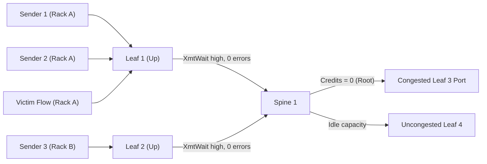
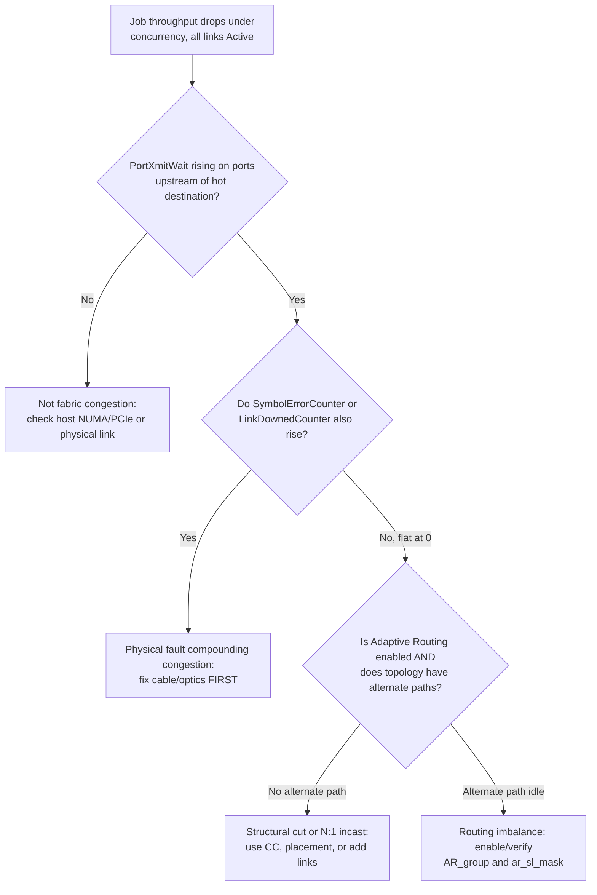
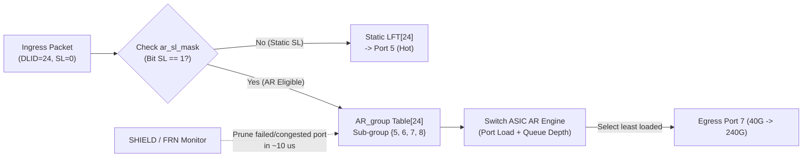
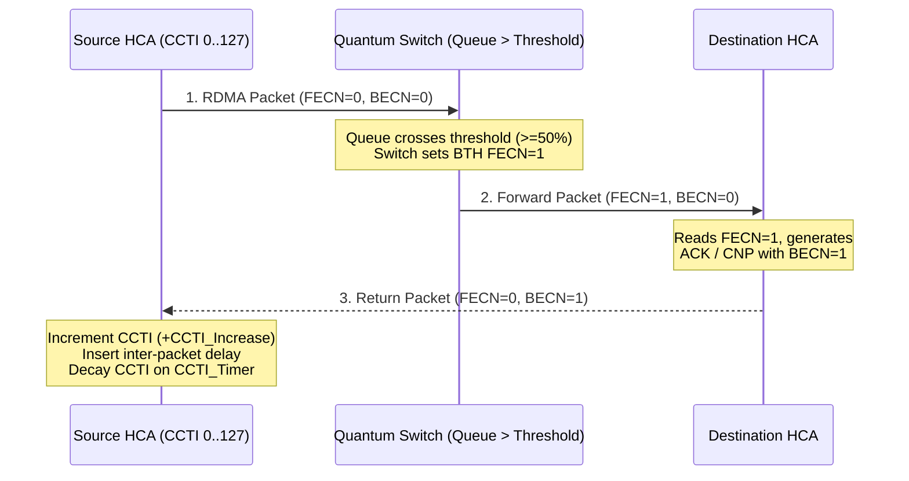

# 12.8 InfiniBand adaptive routing and congestion control

| | |
|---|---|
| Level | Advanced |
| Priority tier | 1 |
| Lab venue | Nebius GPU |
| Part | Part 12: Complete AI networking |
| Code | `code/part12/infiniband_ar_cc.py`, `code/part12/infiniband_ar_cc_lab.py` |
| Coverage file | `planning/coverage/chapters/12-08.md` |

## Why this matters for AI infrastructure

Picture a training run that is crawling, while every port on the fabric reports a healthy state. Every physical port can report an `Active` logical state, with a `LinkUp` physical state, and still show zero symbol errors or packet drops. Yet collective step times double whenever multiple jobs run together. A lossless InfiniBand fabric can still bring a multi-thousand-GPU training run to its knees. The on-call engineer checks the links, finds nothing wrong, and then wonders where the time is going. This chapter explains where it goes.

Lossless flow control avoids drops by pausing the sender instead of discarding packets. In Credit-Based Flow Control, a sender transmits only when the link partner downstream advertises free 64-byte buffer credits for the target Virtual Lane. A credit is a unit of permission, and each one stands for a fixed amount of receive buffer space. Losslessness protects packets in flight. It does not create infinite link bandwidth or infinite switch buffer depth. A pause is a delay, and a delay that lasts long enough still slows the whole job down.

Now picture synchronized AllReduce rings, Mixture-of-Experts AllToAll bursts, and parallel storage checkpoints all converging on the same switch egress ports. An AllToAll is the collective where every GPU sends a different slice of its data to every other GPU. Each of those traffic patterns is normal on its own. Together they all aim at the same few ports at the same moment. The downstream receive buffers fill up. Credits stop returning to the upstream switch, its transmit queues stall, and the backpressure spreads backward across several switch tiers as a congestion tree. Innocent jobs that merely share an upstream spine link or Virtual Lane behind the hot spot suffer Head-of-Line blocking and sharp tail-latency spikes. Head-of-Line blocking means a packet at the front of a queue holds up every packet behind it, even when those packets are headed somewhere free.

Modern NVIDIA Quantum-2 and Quantum-X800 fabrics attack this problem with three hardware mechanisms, coordinated by OpenSM or Unified Fabric Manager. The first is Adaptive Routing, which spreads packets across equal-cost paths. ConnectX Host Channel Adapters (HCAs) reorder out-of-order Packet Sequence Numbers (PSNs) in silicon while that happens. A PSN is the counter that numbers the packets of one connection, so the receiver can tell what order they were sent in. The second is Fast Notification and the Self-Healing Interconnect, which prune failed or congested ports from forwarding groups in microseconds, rather than waiting for control-plane sweeps. The third is InfiniBand Congestion Control. It marks congested packets in flight and paces the offending source Queue Pairs before downstream credits run dry.

```text
NVIDIA Quantum Fabric Scale & Hardware Control Mechanisms (superpod-gb300-ra, ADC Ch. 9, V8 Ch. 7):
  - Quantum-2 NDR Switch:           400 Gbps per port, 64 ports per switch ASIC (~300 ns port-to-port latency vs ~800 ns on Ethernet storage switches)
  - Quantum-X800 XDR Switch:        800 Gbps per port, 144 ports on Q3400-RD switches, scaling up to 16 Scalable Units and 9,216 GPUs in a two-layer fat-tree
  - 1. Adaptive Routing (AR + OOO): Maps 16-bit DLID to an AR_group of eligible egress ports; ConnectX HCAs reorder out-of-order PSNs in hardware
  - 2. SHIELD & Fast Notification:  Prunes failed or saturated ports from AR_group tables in ~10 us instead of waiting ~500 ms for an OpenSM Trap 128 heavy sweep
  - 3. Congestion Control (IB CC):  Congested switch sets 1-bit BTH FECN -> receiver reflects BECN -> source HCA advances CCTI (0..127 across 128-entry CCT) until CCTI_Timer recovery
```

This chapter builds on the InfiniBand addressing and link-layer foundations in Chapter 12.6, and on the Subnet Manager architectures in Chapter 12.7. Here we derive the credit-based flow-control equations and the Virtual Lane victim-buffer isolation. We also work through Adaptive Routing group selection, SHIELD failover math, ConnectX hardware reordering windows, the FECN/BECN/CCTI state machine, and production counter diagnostics. Read the chapter in the order it is written, because each part uses the vocabulary of the one before it. The credit rules explain the congestion tree, the tree explains why static routing hurts, and the routing fixes lead to the congestion control loop.

A useful way to hold the whole chapter in your head is to think of a highway system. The credits are the traffic lights at each on-ramp. The congestion tree is the queue that forms behind a closed lane. Adaptive Routing is the set of detour signs that send drivers onto a quieter road, and Congestion Control is the metering light that slows the cars entering the highway when the exits are full. Each tool covers a different part of the same jam.

## Prerequisites and outcomes

Before you start, review three earlier chapters. Chapter 12.2 covers RDMA Queue Pairs and completions. Chapter 12.6 covers InfiniBand link layers, LIDs, P_Keys, Service Levels and Virtual Lanes. Chapter 12.7 covers OpenSM and fat-tree topologies. A Service Level, or SL, is the label on each packet that picks which Virtual Lane it travels on. A P_Key is the Partition Key that groups ports into a tenant partition.

The chapter starts with the credit mechanics, then shows how a congestion tree forms and how Virtual Lanes keep one traffic class from blocking another. It then moves to the counters that tell congestion apart from a broken cable, and to the Adaptive Routing and SHIELD features that route around a hot spot. It finishes with the Congestion Control loop, the decision between routing, control and capacity, and the multi-tenant and telemetry practices that keep a shared fabric honest. Along the way it works through the arithmetic, so you can check each number yourself.

When you meet a number in this chapter, ask where it came from. Most of the numbers are a product of a size and a rate, such as bytes in a buffer divided by bytes in a credit, or bytes per second multiplied by a time. Once you can rebuild a number from its parts, you can tell whether a reading from your own fabric makes sense.

```text
Quantitative Targets Verified in This Chapter (V8 Ch. 2, 5, 6, 7, 9, 10, 11 & Labs 01-04):
  - CBFC & Virtual Lanes:     64 bytes/credit across 16 VLs (VL0..VL14 data, VL15 SMP); separating SLs recovers 89.52% of HoL latency (1.8 ms -> 14.2 ms -> 3.1 ms p99)
  - Congestion vs Faults:     PortXmitWait climbing with SymbolErrorCounter=0 and LinkDownedCounter=0 vs physical symbol and link-down counter growth
  - LFT vs AR & OOO Tail:     20.01:1 PortXmitData skew (21.48 GB vs 1.08 GB) under ar_sl_mask 0xFFFF; OOO tail spike 7.2 us -> 38.6 us p99 and 9.1 us -> 112.4 us max
  - SHIELD vs OpenSM Sweep:   ~10 us hardware reroute (500,000 B in flight at 400 Gbps) vs ~500 ms / 500,000 us Trap 128 sweep (25,000,000,000 B in flight)
  - IB CC State Machine:      FECN -> BECN -> CCTI (0..127 in 128-entry CCT) pacing 400.0 Gbps down to 266.67 Gbps, 200.0 Gbps, and 80.5 Gbps before CCTI_Timer decay
```

Each line in this block is verified later in the chapter. Use it as a checklist when you work through the labs. A line that you cannot reproduce from the chapter text is a sign that you should reread the section that owns it.

---

## 1. Credit-based flow control, congestion trees, and Virtual Lane isolation

A fabric that never drops a packet still has to explain why a job slowed down. The answer starts with the credit system, because the credits decide when a sender may transmit at all. This section builds that system from the bottom up. It shows how credits work on one link, how one busy port spreads its backlog across tiers, and how Virtual Lanes keep unrelated traffic from paying for that backlog.

### 1.1 Link-level Credit-Based Flow Control and 64-byte credit blocks

Picture a burst of RDMA writes hitting a switch port faster than the egress link can drain. Dropping even one packet forces transport timeouts and costly retransmissions across the synchronized GPU ranks. A timeout is the wait the sender spends before it decides a packet was lost, and every rank that waits for the lost packet waits too. Standard Ethernet sends frames without checking first, and relies on reactive IEEE 802.1Qbb Priority Flow Control pause frames when a downstream ingress buffer nears overflow. InfiniBand takes the opposite approach. It prevents buffer overflow on every hop before it happens, using link-level Credit-Based Flow Control between HCAs, leaf switches and spine switches. Think of it as a parking garage that counts the free spaces before any car is allowed to enter the ramp, rather than one that lets cars in and then has to tow the ones that do not fit.

An InfiniBand physical link carries up to 16 logical Virtual Lanes, which are multiplexed onto the same cable. A Virtual Lane is a separate channel with its own buffers and its own credits, sharing the one physical wire. The first 15, VL0 through VL14, carry application RDMA and storage payloads. Each packet's 4-bit Service Level field selects its lane through the switch SL-to-VL table. VL15 is reserved for unrouted Subnet Management Packets.

Because VL15 has independent buffer space and is exempt from data-lane credit stalls, OpenSM or UFM can always query and reprogram switches. That holds even when every data lane is fully stalled by congestion. A fabric that cannot be managed during congestion cannot be repaired during congestion, so this separate lane matters.

In practice, this means the first command you run during an incident still works. Your query goes out on VL15 while the data lanes are jammed, and the answer comes back. Without that guarantee, the team would be trying to repair a fabric with the tools that the congestion has already locked away. Receivers advertise their buffer space per Virtual Lane, using flow-control packets in the Link Layer Header. The unit is the Flow Control Credit Unit, and one credit equals 64 bytes of receive buffer space. Before an upstream port sends a packet on a given lane, hardware checks that the available credits cover the packet's length, rounded up to 64-byte blocks:

$$
C_{\text{avail}}(v) = \left\lfloor \frac{B_{\text{buf}}(v) - B_{\text{occ}}(v)}{64} \right\rfloor \ge \left\lceil \frac{B_{\text{pkt}}}{64} \right\rceil
$$


In plain words, the free space on the lane is divided into 64-byte credits, and the packet needs at least its own length in credits. When the available credits cover the packet, the port sends immediately at full wire speed. If the downstream drain slows and free credits fall short, the upstream transmitter pauses on that Virtual Lane. It does not drop the packet. Each clock tick that a lane has packets queued but too few credits, hardware increments the `PortXmitWait` counter. That counter is the signature of a port that is waiting for room, not one that is broken.

Consider a 4,096-byte packet, which needs 64 credits. The buffer below shows two cases for that packet.

```text
Per-VL Credit Accounting Example for a 4,096-Byte (4 KB) InfiniBand MTU (ADC Ch. 9, code/part12/infiniband_ar_cc.py):
  - Virtual Lane Architecture:  16 total VLs = VL0..VL14 (15 data VLs; 8 to 12 queues typically active in combined AI/storage profiles) + VL15 (1 management SMP VL)
  - Credit Unit & Packet Cost:  1 FCCL credit = 64 bytes; 1 packet of 4,096 B (4 KB MTU) requires ceil(4096 / 64) = 64 credits
  - Allocated VL0 Buffer:       B_buf(0) = 65,536 bytes = 1,024 total credits
  - Case 1 (Half Occupied):     B_occ(0) = 32,768 bytes -> C_avail(0) = 512 credits >= 64 -> Transmits immediately at 400 Gbps or 800 Gbps (~300 ns IB vs ~800 ns Ethernet latency)
  - Case 2 (Credit Stalled):    B_occ(0) = 63,488 bytes -> 2,048 bytes free = 32 credits < 64 -> Port A pauses VL0 transmission and increments PortXmitWait on every clock tick
```

In the first case, 32,768 bytes occupied leave 512 credits, far more than the 64 the packet needs. In the second case, 63,488 bytes occupied leave only 32 credits, half of what the packet requires. The port pauses and counts the wait, and no packet is lost. As you read the two cases, notice which number decides the outcome. It is the free space on the lane, not the speed of the link, and that is why a fast link can still stall. The same 400 Gbps wire that sends the first packet at once has to wait for room in the second case.

A simple check on a live switch is to read the buffer occupancy before you read the wait counter. If the buffer is nearly full, the wait counter is telling the truth. If the buffer has room, a rising wait counter points to something else, such as a credit return that is delayed by a fault further along the path.

### 1.2 Backpressure propagation, congestion trees, and Head-of-Line blocking

Credit-Based Flow Control never drops packets when buffers fill. So if offered load stays above the drain rate, the extra traffic simply queues upstream. A single hot destination port can quickly grow into a slowdown across several switch tiers. You may see unrelated jobs stall, even though those jobs never talk to the overloaded node. The queue is not in the place where the problem is. It sits upstream, where the blocked traffic is waiting for credits.



| Hop / Element | Credit & Buffer State | Operational Effect on Traffic | Telemetry Signature (`perfquery`) |
|---|---|---|---|
| **Congested Destination Port (`Leaf 3` egress)** | Many-to-one incast (`S1 + S2 + S3`) exceeds `1x` port drain rate; buffer fills (`Credits -> 0`) | Root of the congestion tree; stops returning `VL0` credits to `Spine 1` | Highest `PortXmitWait` on `Spine 1` downlink facing `Leaf 3`; `SymbolErrorCounter = 0` |
| **Transit Switch (`Spine 1` ingress from `Leaf 1` & `Leaf 2`)** | Cannot drain packets toward `Leaf 3`; ingress `VL0` buffers fill and stop returning credits to `Leaf 1` & `Leaf 2` | Backpressure spreads one tier upstream away from the actual bottleneck | Elevated `PortXmitWait` on `Leaf 1` and `Leaf 2` uplinks feeding `Spine 1` |
| **Victim Flow (`Rack A -> Leaf 4` via `Spine 1` on `VL0`)** | Shares `Leaf 1 -> Spine 1` uplink and `VL0` buffer with congested flows `S1` & `S2` | **Head-of-Line (`HoL`) blocking:** delayed behind stalled `VL0` packets even though `Leaf 4` is completely idle | Victim job latency spikes (`p99` `1.8 ms -> 14.2 ms`) with zero packet loss |

The table shows where each effect lands.

The victim row is the one that surprises people. The victim flow sends nothing toward the hot port, and its destination is idle. Its job still slows down because it shares a road and a lane with the hot traffic. A good way to remember this is that a traffic jam does not check where each car is going before it slows them all. Read the first row to find the root, and the last row to see who pays for it. The diagram above shows the same story as a picture. The congested leaf port is the root, the spine is the middle tier that absorbs the backlog, and the idle leaf is the place where the victim's packets never needed to go.

This chain reaction has five steps. First, a downstream root port receives traffic from several senders faster than its wire rate, and its receive buffer credits run out. Second, the upstream spine port runs out of downstream credits for that leaf port. It pauses transmission on that Virtual Lane and increments `PortXmitWait`. Third, packets bound for the hot leaf port pile up in the spine's ingress buffers. Fourth, the spine stops returning credits to the upstream leaf switches, so their uplinks pause and build queues of their own. Fifth, victim flows that use those same uplinks on the same Virtual Lane, bound for an idle destination, sit trapped behind the stalled packets. That is a classic Head-of-Line block. The victim never saw the hot port, but it shares the road that leads there.

### 1.3 Isolating victim flows with Virtual Lanes and preventing credit loops

Suppose a large training collective and a latency-sensitive inference service share the same default Virtual Lane. The training bursts use up the buffer credits on shared uplinks, and inference is left with none. Separating the two onto distinct Service Levels and Virtual Lanes fixes this. Each class then gets its own 64-byte credit counter and buffer partition on every physical link. When a synchronized training burst drives VL0 available credits to zero, VL1 keeps its own free credits, and it keeps forwarding inference packets over the same physical cable. The two classes share the wire, but they no longer share the parking spaces.

```text
Virtual Lane Victim-Buffer Isolation & Deadlock Prevention (V8 Ch. 11 Scenario 3, code/part12/infiniband_ar_cc.py):
  - Isolated Inference Baseline (no training active):          p99 latency = 1.8 ms
  - Shared Virtual Lane (SL0 -> VL0 for training + inference): p99 latency = 14.2 ms (7.89x inflation from VL0 credit starvation & HoL blocking)
  - Separated Virtual Lanes (SL0 -> VL0 train, SL1 -> VL1 inf): p99 latency = 3.1 ms (89.52% of latency regression recovered; 512+ VL1 credits remain free)
  - Residual 1.3 ms Gap (3.1 ms vs 1.8 ms baseline):           Reflects shared physical wire serialization arbitration across active VLs
  - Cyclic Credit Loop (Deadlock):                             SW1_VL0 -> SW2_VL0 -> SW3_VL0 -> SW1_VL0 (every switch holds VL0 buffers waiting for next switch credits)
  - Acyclic VL Split (Deadlock-Free DAG):                      SW1_VL0 -> SW2_VL0 -> SW3_VL1 -> SW1_VL1 (routing engines updn, ftree, dfsssp, dor break credit cycles)
```

Separating the lanes removes buffer Head-of-Line blocking and recovers nearly ninety percent of the tail-latency regression. The leftover gap above the idle baseline shows a real hardware limit. Virtual Lanes isolate switch buffers and flow-control credits, but they still arbitrate for the same physical serial wire. A separate lane is not a separate cable, so a small wait remains even in the best case.

The mappings must also be consistent and deadlock-free across every switch hop in the subnet. Credit-Based Flow Control holds upstream buffers while it waits for downstream credits. So a cyclic buffer dependency across switches creates a permanent credit loop. In that loop, every switch in the ring waits forever for the next one to free 64-byte credits. Picture three people in a revolving door, each holding a door that the next person needs. Nobody can move, and nobody can let go first. Topology-aware routing engines also prevent credit loops. They restrict turns under the Up/Down rule, or they split upward and downward hops onto separate Virtual Lanes. Either way, the channel dependency graph becomes a Directed Acyclic Graph, which is a map of who waits for whom that has no circle in it.

Before you tune anything in a congested fabric, confirm that the Virtual Lane mappings are consistent on every hop. A mapping that differs on one switch can create a loop that the other switches never see.

## 2. Congestion versus physical link faults: reading `perfquery` evidence

Suppose a job slows down while every link reports Active. The on-call engineer sees high link utilization and reaches for a new optical cable. That is one of the most expensive mistakes on an InfiniBand cluster. Replacing transceivers because utilization is high wastes maintenance windows and leaves the real bottleneck in place. The opposite mistake costs just as much. Tuning congestion control while a degraded fiber lane is corrupting symbols leaves a broken physical link in production. The two problems look alike from the job's point of view, so the counters are the only way to tell them apart.



The flowchart above is the decision order for these cases. Start at the top and follow the question that matches what your counters show. Each diamond asks one question about one counter, and each answer points you to a different fix.

| Diagnostic Dimension | Pure Fabric Congestion (`CBFC` Backpressure) | Physical / Link Layer Fault |
|---|---|---|
| **Logical & Physical Port State (`ibstat`)** | `State: Active`, `Physical state: LinkUp` at design rate (`400` or `800` Gbps) | May flap, retrain, or negotiate reduced width (`1x`/`2x` instead of `4x`) or speed |
| **Physical Error Counters (`perfquery`)** | `SymbolErrorCounter = 0`, `LinkDownedCounter = 0`, `PortRcvErrors = 0` (deltas flat) | `SymbolErrorCounter`, `LinkErrorRecoveryCounter`, or `LinkDownedCounter` increasing |
| **Credit Stall Counter (`PortXmitWait`)** | **High and climbing rapidly** during concurrent collective windows | Low or secondary to link recovery events |
| **Scope & Reproducibility** | Appears under concurrent multi-node collectives or specific rank placements | Tied to a specific physical cable, transceiver cage, switch port, or HCA port even in 2-node tests |
| **Correct Remediation** | Trace congestion-tree gradient; enable/tune `AR` and `CC`; fix rank placement or oversubscription | Reseat or replace cable/transceiver; isolate faulty port before touching routing or `CC` |

Use the table to tell the two cases apart. Read each row as one piece of evidence, and look at the two columns side by side. Congestion shows up as a rising wait counter with clean error counters. A fault shows up as rising error counters. Notice that the scope row is often the fastest clue. A fault follows one cable or one port wherever it is connected, while congestion moves with the traffic pattern.

This difference is the most useful thing to remember from the table. When you move a job to another rack and the slowdown moves with it, you are probably looking at congestion. When the slowdown stays on one physical port even after the job has moved away, you are looking at the port or its cable. Watching where the problem goes is often faster than reading any single counter.

### 2.1 Distinguishing congestion from hardware faults on the same switch

When a job slows down across a leaf switch, ask one question first. Are the ports waiting for downstream credits, or are they suffering physical bit errors? To answer it, take two read-only snapshots of the `perfquery` counters across an active workload window, then compute the difference. A snapshot is a copy of the counters at one moment, and the difference is what changed in between. During incident triage, never pass the `-R` reset flag to `perfquery`, and never pass `-k` or `-K` to `ibqueryerrors`. Clearing the hardware registers destroys the evidence you need.

```text
Switch Port Telemetry Comparison (V8 Ch. 2 Scenario 3 & Ch. 7, perfquery deltas):
  switch port 3: PortXmitWait=998432  SymbolErrorCounter=0   LinkDownedCounter=0   -> PURE_FABRIC_CONGESTION (clean link stalled waiting for 64-byte downstream credits)
  switch port 4: PortXmitWait=2109    SymbolErrorCounter=41  LinkDownedCounter=2   -> PHYSICAL_LINK_FAULT (41 symbol errors + 2 forced link-down recovery events)
  leaf port 3 vs sibling port 7 (V8 Ch. 2):
    leaf port 3: PortXmitWait=184320  SymbolErrorCounter=0   LinkDownedCounter=0   -> Credit bottleneck on port 3 downstream path
    leaf port 7: PortXmitWait=41      SymbolErrorCounter=0   LinkDownedCounter=0   -> Healthy uncongested sibling port
```

Compare `switch port 3` with `switch port 4` to see why counter families must never be mixed up. On port 3, `SymbolErrorCounter` and `LinkDownedCounter` stay flat at zero, while `PortXmitWait` climbs to nearly one million ticks. That cable is clean. Its transmitter is simply waiting for downstream buffer credits.

The wait is a sign of a busy path, and it does not say that anything broke. An analogy helps here. A car waiting at a long red light is not a broken car. It is a car in a queue. The fix is to change the timing of the lights or to send some cars another way, not to take the car to a mechanic. A busy port that is still clean is a port with a traffic problem, and the fix is in the routing, the placement or the congestion settings.

Port 4 is different. Its `PortXmitWait` is small, but the port has accumulated symbol errors and two forced link-down events. A symbol error is a bit that arrives damaged on the wire, and a forced link-down is the link dropping and retraining. That is a physical media fault. Reseat or replace the cable or optical transceiver before anyone touches routing or congestion settings. A quiet wait counter does not make a port healthy when its error counters are climbing.

Think of a car that drives smoothly but leaks oil. The smooth ride is real, but it does not mean the car is safe to keep on the road. The error counters are the oil leak, and they deserve attention even when the ride feels fine. The wait counter tells you about traffic. The error counter tells you about the car.

### 2.2 Tracing a congestion tree to its root via the `PortXmitWait` gradient

When a congestion tree spreads across several switch tiers, dozens of upstream ports can show nonzero `PortXmitWait` deltas at the same time. You need a reliable way to find the downstream port that started the backup. Credit backpressure weakens as it fans out upstream across links. So the port closest to the true bottleneck always records the largest `PortXmitWait` delta. The farther a port sits from the bottleneck, the smaller its share of the wait. That falling gradient points you back toward the source, the way a rising smell points you toward a fire.

```text
Leaf Switch PortXmitWait Delta Gradient During Slow Collective (V8 Ch. 7 Scenario 1):
  port 1: delta 340
  port 2: delta 298
  port 3: delta 51204   <-- Congestion tree root candidate (~150x above baseline)
  port 4: delta 47890   <-- Congestion tree root candidate (~150x above baseline)
  port 5: delta 312
```

In this snapshot, ports 1, 2 and 5 stay near a quiet baseline of roughly three hundred ticks. Ports 3 and 4 record deltas roughly 150 times higher. Cross-check those two ports against the `iblinkinfo` topology map. That shows which downstream rack or destination node pair is the root of the congestion tree. The map turns a port number into a machine name, and that name is what the scheduler and the on-call team can act on.

Once you have the name, the next steps are practical. You can check which job was placed on that rack, whether its ranks all sit under one leaf, and whether the congestion appeared after a placement change. Each of those checks narrows the search without touching any hardware.

If a job slows with clean links, trace the congestion tree before you replace any hardware.

---

## 3. Adaptive Routing, SHIELD self-healing, and ConnectX OOO reordering

Routing is the part of the fabric that decides which path each packet takes. When routing is static, the path is fixed in advance, and a busy path stays busy even when a free one sits next to it. This section shows how a static table creates a hot uplink, how Adaptive Routing spreads the load, how the switches heal around a failed link, and how the adapters put out-of-order packets back into order.

### 3.1 Why static Linear Forwarding Tables create 20-to-1 uplink hot spots

Picture a fully nonblocking fat-tree with plenty of idle spine bandwidth. Static routing can still starve a distributed training job. Under classic InfiniBand forwarding, OpenSM programs a deterministic Linear Forwarding Table (LFT) on every switch. The LFT is a flat lookup array. It is indexed by the 16-bit Destination LID, and it maps each destination to one fixed egress port. A deterministic table gives the same answer every time, which makes it easy to debug and easy to overload:

$$
\text{EgressPort} = \text{LFT}[\text{DLID}]
$$

A leaf switch may have four, eight or sixteen equal-cost uplinks to the spine tier. Static forwarding still pins every packet for a given Destination LID onto one pre-assigned uplink. Suppose GPU ranks in an AllReduce or AllToAll collective exchange data with peers whose Destination LIDs hash to the same spine uplink. Those flows collide in one large queue, while the sibling uplinks sit nearly idle. The picture is a supermarket with four checkout lanes where every shopper is sent to lane one at the door. Lane one grows long, and the other three lanes stay empty even though the store has plenty of staff.

```text
Static LFT Uplink Collision on Four 400 Gbps Leaf Uplinks (V8 Ch. 6 Scenario 1, PortXmitData 4-octet words):
  port 5 (uplink to S1): 5,368,709,120 words x 4 = delta 21474836480 bytes (~21.48 GB / 20.00 GiB)
  port 6 (uplink to S2): 5,372,308,608 words x 4 = delta 21489234432 bytes (~21.49 GB / 20.01 GiB)
  port 7 (uplink to S3):   268,435,456 words x 4 = delta 1073741824 bytes  (~1.07 GB  /  1.00 GiB)
  port 8 (uplink to S4):   270,413,568 words x 4 = delta 1081654272 bytes  (~1.08 GB  /  1.01 GiB)
  Imbalance Ratio:       21,489,234,432 / 1,073,741,824 = 20.01:1 max/min uplink traffic skew
```

Keep in mind that `PortXmitData` in `perfquery` counts 4-octet words. To get transmitted bytes, multiply the raw counter delta by 4.

The conversion matters because a word-based counter looks small at first glance. A reader who forgets the factor compares the wrong quantities and may decide that two uplinks are balanced when they are not. Converting both sides to bytes before you compare them keeps the comparison honest, and it lets you check the result against the link speed. Uplinks 5 and 6 carry about twenty times the traffic of uplinks 7 and 8, which are identical links on the same leaf switch. When two large elephant flows collide on uplink 5 while uplink 7 sits nearly empty, static forwarding cuts collective throughput in half. The spine has spare capacity the whole time. An elephant flow is one very large, long-lived transfer, and it is the kind of flow that can fill a link for a long stretch without any help from its neighbors.

### 3.2 Adaptive Routing groups, Private LFTs, and the Service Level mask

You can avoid static uplink collisions without waiting for the Subnet Manager to recompute tables. NVIDIA Quantum switches do this with Adaptive Routing, which replaces single-port lookups. Instead of binding a Destination LID to one fixed port, OpenSM or UFM programs a two-stage hardware lookup. It maps each destination to an Adaptive Routing group (AR group) of equal-cost egress ports. The first stage finds the group. The second stage picks one port from the group, using the load the switch can see right now.



| Hardware Table / Control | Programmed By | Granularity & Width | Role in Packet Forwarding |
|---|---|---|---|
| **`ar_sl_mask`** | OpenSM / UFM (`opensm.conf`) | `16`-bit bitmask (`0x0000..0xFFFF`, default `0xFFFF`) | Enables (`1`) or disables (`0`) Adaptive Routing per Service Level (`SL0..SL15`); cleared bits fall back to deterministic static `LFT` |
| **Private LFT (`PLFT`) / `LFT` entry** | OpenSM `ar_updn`, `ar_ftree`, `ar_dfsssp`, `ar_torus` | Indexed by `16`-bit `DLID` (`1..48,000`) | Points either to a single deterministic fallback port or to an `AR_group` ID |
| **Adaptive Routing Group (`AR_group`)** | OpenSM / UFM + Switch ASIC | Group of equal-cost egress ports (e.g., `{5, 6, 7, 8}`) | Lists all topologically valid, loop-free shortest-path ports reaching `DLID` |
| **Switch ASIC AR Selector** | Quantum-2 / Quantum-X800 hardware | Sub-microsecond per-packet or per-flowlet evaluation | Evaluates local egress port utilization, `VL` queue depth, and downstream `FRN` notifications to pick the least-congested port (e.g., `Port 7` at `40 Gbps` instead of `Port 5` at `380 Gbps`) |

When a packet arrives, the switch ASIC first checks the 16-bit Service Level bitmask, `ar_sl_mask`. An ASIC is the custom switch chip that does the forwarding. It looks at the bit that matches the packet's Service Level. If that bit is one, the switch finds the destination's Adaptive Routing group and picks the least-loaded egress port. It judges load by local link load and transmit queue depth. If the bit is zero, hardware uses the static Linear Forwarding Table entry instead. This per-SL mask lets you keep bulk training collectives adaptive, while pinning legacy or diagnostic traffic to deterministic single-path forwarding. The mask is the switch that you turn per traffic class, rather than all at once for the whole fabric.

```text
Static LFT vs Adaptive Routing Port Selection on Four 400.0 Gbps Leaf Uplinks (code/part12/infiniband_ar_cc.py):
  - Existing Uplink Loads & Queues:
      port 5: 380.0 Gbps (queue 120.0 KB) | port 6: 360.0 Gbps (queue 90.0 KB)
      port 7:  40.0 Gbps (queue   0.0 KB) | port 8:  60.0 Gbps (queue  5.0 KB)
  - New Arriving Elephant Flow:       200.0 Gbps targeting DLID 24
  - Mode 1 (Static LFT -> port 5):    Pins flow onto port 5 -> 380.0 + 200.0 = 580.0 Gbps offered load (180.0 Gbps excess queued into PortXmitWait)
  - Mode 2 (AR_group {5,6,7,8}, SL0): ar_sl_mask = 0xFFFF selects least-loaded port 7 -> 40.0 + 200.0 = 240.0 Gbps (max uplink load 380.0 Gbps <= 400.0 Gbps, 0.0 Gbps excess)
  - Mode 3 (Selective Mask 0xFFF7):   Clears bit 3 (SL3) -> forces SL3 onto static LFT port 5 (580.0 Gbps, 180.0 Gbps excess) while SL0..2 and SL4..15 stay adaptive
```

Compare the modes. Static forwarding pushes the flow onto port 5, which reaches 580.0 Gbps of offered load. Adaptive Routing sends the same flow to port 7 instead, so no uplink exceeds 380.0 Gbps. The selective mask keeps SL3 on static forwarding, while the other Service Levels stay adaptive. Read the three modes as three decisions about one arriving flow. The first decision is the worst, the second is the best, and the third shows that you can mix the two on purpose.

Use `ar_sl_mask` to decide which traffic classes get adaptive routing. Enable it for the classes that can tolerate reordering, and think carefully before you pin any class that carries large collectives.

### 3.3 Fast Notification and Self-Healing Interconnect

Local port-load sensing fixes collisions on the uplinks attached to a leaf switch. It cannot see a broken cable or a saturated downlink beyond the spine. Suppose a link between a spine switch and a remote leaf switch fails. Every microsecond of a training step spent forwarding packets into that dead path stalls thousands of GPUs. A microsecond is one millionth of a second, which is too short to see on a clock but long enough to matter to a packet train on a 400 Gbps wire.

Without autonomous healing in the switches, a link failure sends an InfiniBand Trap 128 message to the master Subnet Manager. OpenSM then runs a heavy sweep. It rediscovers the topology, recomputes forwarding tables and pushes updated blocks across the fabric. In a large cluster that loop takes roughly half a second. During that time, gigabytes of line-rate traffic pile up behind the dead port. The control plane is correct, but it is slow compared with the traffic it protects.

This gap in speed is why the chapter keeps returning to hardware. Software can make the right decision and still arrive too late. A fast path that lives in the silicon is the only kind that can act inside the time a training step is willing to wait.

On Quantum-2 and Quantum-X800 switches, the Self-Healing Interconnect and Fast Routing Notification run in switch silicon. When a switch detects a local link failure, or severe downstream congestion toward a destination group, it removes the failed port from its local Adaptive Routing group at once. It then sends hardware notification packets to neighboring switches. Upstream switches prune the affected path from their forwarding sub-tables in about ten microseconds. That cuts the data at risk by fifty thousand times compared with a control-plane sweep. The fix happens in the hardware, so no software has to wake up and decide first.

```text
Link-Failure Recovery Comparison on a 400.0 Gbps (50,000 B/us) Link (V8 Ch. 5, superpod-gb300-ra, code/part12/infiniband_ar_cc.py):
  - Fault Event:                        Uplink port 6 in AR_group {5, 6, 7, 8} fails (Trap 128 on LID 44 port 3); surviving AR_group = (5, 7, 8)
  - Control-Plane Recovery (OpenSM):    Trap 128 heavy sweep takes ~500 ms (500.0 ms = 500,000 us = 500,000.0 us)
                                        In-flight data at risk at 400.0 Gbps = 500,000 us x 50,000 B/us = 25,000,000,000 bytes (25 GB)
  - Hardware Self-Healing (SHIELD/FRN): Autonomous ASIC pruning takes ~10 us (10.0 us) across Quantum-2 (400G, 64-port) and Quantum-X800 (800G, 144-port Q3400-RD)
                                        In-flight data at risk at 400.0 Gbps = 10 us x 50,000 B/us = 500,000 bytes (500 KB) -> 50,000x (50,000.0x) speedup
```

Work through the block. Control-plane recovery leaves 25 GB in flight. Hardware pruning leaves 500 KB, which is the fifty-thousand-fold difference. The reason is simple. The data at risk is the rate multiplied by the time, so a shorter time gives a proportionally smaller pile of data.

### 3.4 Out-of-Order packet delivery and ConnectX HCA hardware reordering

Adaptive Routing spreads the packets of one Queue Pair across several paths. Those paths have different queue depths, so packets reach the destination HCA out of sequence. Think of two cars sent on different roads to the same town. The car on the faster road can arrive first, even though it left second. Under strict traditional InfiniBand Reliable Connection transport, a packet with a higher Packet Sequence Number than expected triggers a sequence-gap Negative Acknowledgment (NAK). A NAK is the receiver's message that says a packet is missing. That forces a Go-Back-N retransmission, which means the sender replays everything from the missing packet onward. The retransmissions waste link bandwidth and destroy collective tail latency.

Modern ConnectX-6, ConnectX-7, ConnectX-8 and BlueField-3 adapters eliminate this penalty with hardware out-of-order packet reordering. During Queue Pair setup, the adapter turns on an on-chip reorder buffer window. That window lets RDMA Write and Send payloads land out of order. When slightly out-of-order packets arrive inside the window, the HCA places each payload straight into target memory. It holds the completion until the missing sequence number arrives. The application sees the packets complete in order, even though they arrived out of order.

Now consider an adapter where hardware reordering is disabled, or where the reordering limit is exceeded. Adaptive Routing or aggressive congestion settings can raise average bandwidth there, while tail latency degrades badly. Every rank in a synchronized collective waits at a barrier for the slowest rank. So a fivefold jump in 99th-percentile latency slows the whole training step, even when median latency improves. The median describes a typical packet, but the barrier waits for the worst one.

That is why a benchmark that reports only an average can look like a success while the training job gets slower. An engineer who sees a better median should ask a second question at once, which is what happened to the slowest packets. The answer usually determines whether the change is safe to keep.

```text
ConnectX Hardware OOO Reordering & Tail-Latency Regression (V8 Ch. 7 Scenario 3, ADC Ch. 6, code/part12/infiniband_ar_cc.py):
  - Arriving PSN Stream (7 packets):  (100, 102, 103, 101, 104, 106, 105) -> max_reorder_distance = 2
  - Hardware OOO Reordering OFF:      Receiving 102 before 101 triggers 3 PSN-gap NAKs and Go-Back-N retransmissions
  - Hardware OOO Reordering ON:       ConnectX-7 (MT4129) reorder window = 64 packets (>= 2) delivers (100, 101, 102, 103, 104, 105, 106) with 0 PSN-gap NAKs
  - Latency Percentiles Before vs After Bad AR/CC Tuning (V8 Ch. 7 Scenario 3):
                       p50      p95      p99      max
      Before tuning:  3.1us    4.8us    7.2us    9.1us
      After tuning:   2.4us    5.9us   38.6us   112.4us
      Impact:         p50 improved (3.1 us -> 2.4 us), but p99 inflated 5.36x (7.2 us -> 38.6 us) and max inflated 12.35x (9.1 us -> 112.4 us)
```

In the trace, the reorder window absorbs the out-of-order arrivals, so the stream is delivered in order with no NAKs. The median improved after tuning, but the p99 rose 5.36 times and the maximum rose 12.35 times. Those tail numbers are what the barrier waits for. A percentile is the value that a given share of the packets stay under, so p99 describes the slowest one packet in a hundred.

Before you enable aggressive Adaptive Routing settings, confirm that hardware reordering is on for every adapter. Then judge the result by tail percentiles, not medians.

---

## 4. InfiniBand Congestion Control

Adaptive Routing moves traffic to free paths, but a free path is not always there. Some bottlenecks sit at the very end of the route, where no other path exists. This section explains why routing cannot fix those cases, and it walks through the hardware loop that slows the senders down instead.

### 4.1 Why Adaptive Routing needs Congestion Control

Adaptive Routing spreads traffic across alternate spine paths. That fixes uplink imbalance when spare links exist. It cannot fix two structural bottlenecks, though, and both appear constantly in production AI clusters. A structural bottleneck is one that exists in the shape of the network, rather than in how the traffic is spread across it.

The first is destination incast. Suppose eight or sixty-four senders write RDMA data to one storage server, or to one parameter-server HCA port, at the same moment. Every alternate spine path eventually converges on that one destination leaf egress port. No alternate path exists for the final hop to the target host. So spreading packets across the spine does nothing for the bottleneck. The whole crowd has to pass through the same single door at the end.

The second is an oversubscribed topology cut. Suppose a leaf switch has twice as much downlink bandwidth from compute nodes as uplink bandwidth to the spine tier. If every node runs a cross-rack AllReduce at once, the offered load exceeds the uplink capacity. That holds even when every uplink is balanced perfectly. Balancing cannot create bandwidth that the wires do not have.

The practical lesson is to measure the ratio of downlink to uplink capacity before you blame the routing. If the ratio is already high, no routing table can make the job run at full speed. In that case the right conversation is about adding uplinks, moving work to another rack or accepting a slower step for that job.

```text
Structural Bottlenecks That Adaptive Routing Cannot Solve (V8 Ch. 6 & Ch. 7):
  - 1. Destination Incast (CP1 / CP4):  8 to 64 senders targeting 1 HCA port converge on a single final leaf egress port with no alternate path
  - 2. 2:1 Oversubscribed Leaf Cut:     16 x 400 Gbps downlinks (6,400 Gbps) feeding 8 x 400 Gbps uplinks (3,200 Gbps) -> 2:1 (2.0:1) oversubscription ratio
                                        Simultaneous cross-rack AllReduce caps each node at 200 Gbps (200.0 Gbps), doubling a 2 GB step from 40.0 ms to 80.0 ms
                                        Paired ib_write_bw drops from 397.62 Gbps (same-leaf) to 201.18 Gbps (cross-rack, 1.98:1 ratio)
```

Here is the arithmetic for the oversubscribed case.

The arithmetic is worth doing slowly once, because the same pattern appears in many designs. Start with the downlink total, then the uplink total, then the ratio. Only after the ratio is clear should you divide the job's data by the per-node rate to get a step time. Each step is simple, and skipping one of them is how people end up with a plausible but wrong estimate. Sixteen 400 Gbps downlinks carry 6,400 Gbps. Eight uplinks of the same speed carry 3,200 Gbps. That 2:1 ratio caps each node at 200.0 Gbps. A 2 GB AllReduce step therefore doubles in time. It goes from 40.0 ms to 80.0 ms. The paired `ib_write_bw` test shows the same effect. Throughput drops from 397.62 Gbps on the same leaf to 201.18 Gbps across racks. That is a 1.98:1 ratio.

Without source rate regulation, both cases do the same damage.

It helps to name the two cases side by side. In the first, many senders share one destination port. In the second, many nodes share too few uplinks. The two look different on the topology diagram, yet both fill the same kind of buffer and both start the same congestion tree. A single control loop can respond to either one, which is why Congestion Control is worth understanding even when routing looks healthy. The bottleneck egress buffer fills, downstream 64-byte credits run out, and a congestion tree grows across the fabric. InfiniBand Congestion Control stops that growth. It throttles only the offending source Queue Pairs, before downstream credits run out. The throttle is the brake that the senders apply to themselves, after a signal tells them the road ahead is full.

Self-regulation has a major advantage over a central controller. The sender sees the congestion within a few round trips, and it reacts without waiting for a manager to decide. That speed is what lets the fabric stay ahead of the credit exhaustion described earlier in the chapter.

### 4.2 The 3-stage FECN, BECN, and CCTI hardware control loop

InfiniBand Congestion Control runs as a closed hardware loop with three stages. It spans Quantum switches and ConnectX HCAs. When a switch egress queue crosses its configured congestion threshold, and that port is the true root of contention, the switch marks outgoing packets. The receiver then reflects a notification back to the sender. The source HCA paces its packet injection rate in response. A loop here means the signal goes out and comes back, and the sender uses the returning signal to adjust itself.



| Stage & Actor | Packet Header Bit / Register | Trigger Condition | Hardware Action |
|---|---|---|---|
| **1. Detection & Marking (Switch)** | `BTH` `FECN` (`1` bit, Forward Explicit Congestion Notification) | Switch egress port queue occupancy crosses configured `Threshold` (e.g., `>= 50%`) and port is the root of congestion (not merely credit-stalled from downstream) | Switch sets `FECN = 1` in the Base Transport Header (`BTH`) of packets traversing the congested queue |
| **2. Notification / Reflection (Destination HCA)** | `BTH` `BECN` (`1` bit, Backward Explicit Congestion Notification) | Destination HCA receives a packet with `FECN == 1` | Destination HCA increments its Marked Packet counter and transmits an `ACK` or explicit Congestion Notification Packet (`CNP`) back to the source `LID`/`QP` with `BECN = 1` |
| **3. Source Reaction & Recovery (Source HCA)** | Congestion Control Table (`CCT`, `128` entries `0..127`) & `CCTI` | Source HCA receives `BECN == 1` or its periodic `CCTI_Timer` expires without `BECN` | On `BECN = 1`: `CCTI = min(CCTI_Limit, CCTI + CCTI_Increase)`, increasing inter-packet injection delay. On `CCTI_Timer` expiry: `CCTI = max(CCTI_Min, CCTI - 1)`, smoothly restoring full line rate |

If you read the table top to bottom, you see one loop. Stage 1 marks the packet, stage 2 returns the signal, and stage 3 slows the sender and then lets it recover. The diagram shows the same three steps in time order, so you can follow one packet from the sender to the receiver and back.

### 4.3 Worked numerical trace of the CCTI rate-throttling state machine

The Congestion Manager in OpenSM or UFM programs each HCA with a 128-entry Congestion Control Table (CCT). A table entry is a row that says how much to slow down at that index. The manager also sets four control registers for each Service Level: a minimum index, a maximum index limit, an index step increase, and a recovery timer. The index that the sender is currently using is called the CCTI. The standard inter-packet delay model gives the effective injection rate on a line-rate port:

$$
R_{\text{inj}}(\text{CCTI}) = \frac{R_{\text{line}}}{1 + \frac{\text{CCTI}}{32}}
$$

While switch queue occupancy stays below the threshold, the index stays at zero. The sender then transmits at full line rate. Each arriving BECN packet raises the index by the configured step. The extra delay between packets lets the downstream buffer drain before flow-control credits run out. After BECN notifications stop, each recovery timer expiry lowers the index by one. The Queue Pair returns smoothly to full line rate. The rise is quick and the recovery is gradual, which keeps the fabric from swinging back and forth between full speed and a stall.

The asymmetry is a deliberate design choice. If the sender recovered as quickly as it slowed, a burst of traffic would push it down, a short quiet period would push it back up, and the cycle would repeat. That swing is called oscillation, and it wastes capacity on both ends of the swing. A slow recovery gives the buffers time to drain before the sender pushes again.

```text
Worked 5-Step Trace of the IB Congestion Control State Machine on a 400.0 Gbps NDR Port (code/part12/infiniband_ar_cc.py):
  - Programmed HCA Registers:  128-entry CCT (indices 0..127, CCT_MAX_INDEX = 127), CCTI_Min = 0, CCTI_Limit = 127, CCTI_Increase = 16, CCTI_Timer = 15..50 us, Switch FECN Threshold = 50% (50.0%)
  - Step 1 (Uncongested Baseline):     switch_queue = 25% (< 50%), CCTI = 0        -> FECN = 0, BECN = 0, multiplier = 1 + 0/32   = 1.0x    -> R_inj = 400.0 Gbps
  - Step 2 (First Congestion Wave):    switch_queue = 65% (>= 50%), CCTI: 0 -> 16  -> FECN = 1, BECN = 1, multiplier = 1 + 16/32  = 1.5x    -> R_inj = 266.67 Gbps
  - Step 3 (Second Congestion Wave):   switch_queue = 75% (>= 50%), CCTI: 16 -> 32 -> FECN = 1, BECN = 1, multiplier = 1 + 32/32  = 2.0x    -> R_inj = 200.0 Gbps (50% line rate)
  - Step 4 (Severe Incast Ceiling):    switch_queue = 90% (>= 50%), CCTI: 120->127 -> FECN = 1, BECN = 1, multiplier = 1 + 127/32 = 4.9688x -> R_inj = 80.5 Gbps (clamped at CCTI_Limit = 127)
  - Step 5 (CCTI_Timer Recovery):      switch_queue = 20% (< 50%), CCTI: 32..1->0  -> FECN = 0, BECN = 0, timer decrements CCTI by 1 per tick -> R_inj = 400.0 Gbps restored at CCTI = 0
```

Walk the five steps in order.

Read the steps as a short story. The network starts calm, then a wave of traffic arrives, then the wave grows, then the wave peaks at the ceiling, and finally the wave passes and the network calms again. Each step is one moment in that story, and the rate column shows how much the sender gave up at that moment. The recovery at the end matters just as much as the slowdown, because it proves that the loop has a way back to full speed. The index climbs as the queue fills, and the sender's rate falls at each step. At the severe-incast step, the CCTI_Limit of 127 clamps the index. When the queue drains below the threshold, the timer brings the index back to zero. Notice that the sender never has to guess the cause.

This is a useful design principle outside InfiniBand too. A control loop works best when each side acts only on signals it can actually observe, and when it relaxes as soon as those signals stop. A sender that tried to guess the reason for a slowdown would often guess wrong. It reacts only to the marks it receives, and it stops reacting when the marks stop.

### 4.4 Architectural comparison: Adaptive Routing vs Congestion Control vs Placement vs Capacity

The table compares four tools. Use it to pick the right one for each bottleneck.

| Mechanism | Primary Hardware / Software Action | Best Suited For | What It Cannot Solve |
|---|---|---|---|
| **Adaptive Routing (`AR` + `SHIELD`)** | Switch selects least-loaded eligible port in `AR_group` and prunes failed ports in `~10 µs` | Path imbalance (`20:1` uplink skew) when alternate spine paths exist | True `N:1` destination incast (`CP4`) or an oversubscribed topology cut (`2:1` leaf) |
| **Congestion Control (`FECN`/`BECN`/`CCTI`)** | Switch marks `FECN`, receiver returns `BECN`, source HCA paces `QP` injection via `CCTI` (`0..127`) | Persistent destination contention or incast that would otherwise build a congestion tree | Broken physical cables (`SymbolErrorCounter > 0`) or missing bisection bandwidth |
| **Workload / Rank Placement** | Scheduler co-locates communicating ranks under the same leaf or aligns rails | Avoidable cross-rack traffic concentration and multi-tenant uplink sharing | Full-cluster synchronous `AllToAll` or `AllReduce` spanning every rack simultaneously |
| **Physical Capacity Expansion** | Add spine switches, leaf uplinks (`8 -> 16`), or upgrade NDR (`400G`) to XDR (`800G`) | Structural oversubscription (`2:1 -> 1:1`) when all uplinks are already balanced and saturated | Static routing hash collisions or faulty transceivers |

When a bottleneck is structural, choose capacity or placement. The other mechanisms cannot fix missing bandwidth in the topology. Adaptive Routing and Congestion Control are the right tools when the bandwidth exists but is unevenly used. Placement and capacity are the right tools when it does not exist at all.

---

## 5. Multi-tenancy, SuperPOD scale, and operational observability

A shared fabric serves more than one team, and its counters serve more than one purpose. This section covers how tenants share a fabric safely, how the largest reference designs use the same mechanisms, and how to read counters that only ever go up.

### 5.1 Multi-tenant isolation: why Partition Keys do not prevent congestion interference

Suppose a shared InfiniBand cluster runs training collectives, latency-sensitive inference and GPUDirect Storage on one fabric. Architects often assume that Partition Keys isolate tenant performance. That assumption fails under load. Partition Keys enforce logical addressability and security membership. They stop a Queue Pair in Tenant A from reading or writing memory in Tenant B. A partition is a fence around who may talk to whom, and the fence does its job well.

Partition Keys do not split physical link bandwidth or switch buffer credits, though.

This is a point that often surprises teams who are new to shared InfiniBand clusters. A Partition Key is a checkpoint at the door of each tenant, and it checks the ticket before a packet enters. The checkpoint does not decide how many packets can share a road once they are inside. For that, the fabric needs lanes, credits and placement, which are separate tools with separate jobs. Say two tenants land on nodes under the same leaf switches, and both map to the same default Service Level and Virtual Lane. One tenant's AllToAll burst can then exhaust VL0 credits on the shared spine links. The congestion tree stalls the other tenant. Two tenants can be fenced apart on paper and still wait in the same line at the same checkout.

True isolation for multi-tenant or mixed workloads needs four operational controls, layered together. The first is topology-aware scheduler placement. Give a large training job entire leaf switches or Scalable Units whenever possible. A Scalable Unit is a block of nodes and switches that is built and managed as one piece. The second is dedicated Service Levels and Virtual Lanes for latency-sensitive inference and storage traffic. Those classes also get weighted arbitration and independent 64-byte credit pools. Arbitration is the switch's rule for which waiting packet goes next. The third is Adaptive Routing with Congestion Control, so no single tenant pins a spine uplink or monopolizes downstream buffers. The fourth is joining per-port telemetry counters with scheduler placement metadata and hardware GUID inventory. A GUID is the permanent identifier of a device, so it ties a counter to a physical box even after its LID changes.

```text
Multi-Tenant & Storage Protocol Context on Shared InfiniBand Fabrics (ADC Ch. 9, V8 Ch. 7 & Ch. 11):
  - P_Key Scope:                 Enforces logical partition membership only; does NOT isolate physical bandwidth or VL0 64-byte buffer credits
  - GPUDirect Storage (GDS):     NVMe-o-RDMA uses UDP port 4420 (CM) / TCP port 8009 (discovery) or native IB; requires dedicated SL -> VL separation from bulk training
  - 4-Layer Isolation Stack:     (1) Topology-aware SU/leaf placement, (2) SL2VL + VLArbitration credit separation, (3) AR + IB CC (FECN/BECN/CCTI), (4) GUID-joined telemetry
```

The four layers in the block match the four controls above, in the same order. Read them as a stack. Each layer covers a gap that the layer below it leaves open.

Stacks like this are easy to build and easy to forget. A team may set up the placement layer and assume the isolation layer is handled, or enable adaptive routing and assume the telemetry layer will reveal problems on its own. Walking the stack from the bottom up, and asking which gap each layer leaves, is a good review habit before a new tenant moves in.

### 5.2 Scale-out reference points: DGX B200 NDR and DGX GB300 Quantum-X800 SuperPODs

Production cluster geometry shows how Adaptive Routing and Congestion Control get used at scale. Compare the NVIDIA DGX B200 NDR SuperPOD with the NVIDIA DGX GB300 Quantum-X800 SuperPOD. In the DGX B200 design, each Scalable Unit uses 400 Gbps Quantum-2 switches. One physical UFM appliance goes into the first Scalable Unit, which displaces one compute node. In the DGX GB300 design, 144-port Quantum-X800 switches run at 800 Gbps. They scale a two-layer, rail-aligned fat-tree up to 9,216 GPUs. That design uses Adaptive Routing and SHARP in-network reductions, with SHIELD self-healing enabled across all rails. SHARP is the in-network reduction feature that lets the switches add up the data while it passes through them.

```text
Reference SuperPOD Fabric Topologies & Cabling Envelopes (superpod-b200-dc, superpod-gb300-ra, V8 Ch. 12):
  1. DGX B200 NDR (400 Gbps) SuperPOD (458 kW per 32-node SU; 1 UFM appliance displaces 1 DGX B200 server; 512-GPU nonblocking leaf uses 16 down / 16 up at 400 Gbps):
     - 1 SU:  31 compute nodes (248 GPUs),  8 leaf switches,  4 spine switches,   252 compute+UFM cables,   256 ISL cables
     - 2 SUs: 63 compute nodes (504 GPUs), 16 leaf switches,  8 spine switches,   508 node cables,          512 ISL cables
     - 3 SUs: 95 compute nodes (760 GPUs), 24 leaf switches, 16 spine switches,   764 node cables,          768 ISL cables
     - 4 SUs: 127 compute nodes (1,016 GPUs), 32 leaf switches, 16 spine switches, 1,020 node cables,     1,024 ISL cables
     - Cable Rules: Passive copper DAC <= 5 m at 100G or <= 3 m at 400G; Active Optical Cables (AOC) <= 30 m, kept < 90% of max standard distance with zero patch panels
  2. DGX GB300 Quantum-X800 (800 Gbps) SuperPOD (Q3400-RD 144-port switches; 8 DGX GB300 systems / 576 GPUs per SU across 8 leaves in 4 rails of 2 leaves each):
     - 2 SUs (1,152 GPUs):  16 leaf switches,  8 spine switches
     - 4 SUs (2,304 GPUs):  32 leaf switches, 18 spine switches
     - 8 SUs (4,608 GPUs):  64 leaf switches, 36 spine switches
     - 16 SUs (9,216 GPUs): 128 leaf switches, 72 spine switches (two-layer fat-tree with AR, SHARP, and SHIELD enabled)
```

Read the B200 rows for cable counts and the GB300 rows for switch counts. Each row adds Scalable Units and grows the leaf and spine tiers with them. The rows show the scale of a design, not a parts list you can copy. Check each row against the power and cable rules before you order anything.

Reference designs are useful because they show how the parts fit together, but they assume a specific building, power budget and cable run. Before you copy a row, confirm that your room can supply the power and that your cable lengths stay inside the stated limits. A design that fits on paper but not in the room will cost time later.

### 5.3 Rate-of-change alerting versus cumulative counter scar tissue

Counters from `perfquery` and UFM only go up, counting from the last counter clear or switch reboot. If you alert whenever a counter is above zero, you get two bad outcomes. You get false alarms about old history, and you miss slowly dying optics. Scar tissue is the name for an old error count that stays on the counter long after the event that caused it.

Suppose two snapshots, taken five minutes apart under active traffic, show the same nonzero `SymbolErrorCounter`. The delta is zero. That number is old scar tissue from an earlier cable seating event, not an active fault. Now take a port that starts with a tiny error count on Day 1. If its error rate accelerates forty-five times over a single week, and link-down recoveries rise with it, the optical transceiver is failing. It has to be replaced before it triggers continuous Trap 128 sweeps. The rate of change is the signal, and the total is only the history.

In practice, the simplest alert is a rate check over a fixed window. Compare the counter now with the counter at the start of the window, and page the on-call engineer only when the difference crosses an agreed threshold. The historical total stays on the dashboard for context, where it can explain a trend without raising false alarms.

```text
Cumulative Scar Tissue vs Error-Rate Acceleration in perfquery (V8 Ch. 9):
  - Case A (Historical Scar Tissue on port 9 over 300 s / 5 min):
      t = 0 s: SymbolErrorCounter = 12,034 | t = 300 s: SymbolErrorCounter = 12,034 -> delta = 0 (0.0 errors/day; old history, do NOT replace cable)
  - Case B (Active Optical Degradation on switch port 12 over 6 days):
      Day 1:          SymbolErrorCounter = 4,      LinkDownedCounter = 0
      Day 4 (+3 days): SymbolErrorCounter = 890     (delta = +886,    rate = 295.33 errors/day),    LinkDownedCounter = 3
      Day 7 (+3 days): SymbolErrorCounter = 41,200  (delta = +40,310, rate = 13,436.67 errors/day), LinkDownedCounter = 11
      Acceleration:   13,436.67 / 295.33 = 45.5x error-rate acceleration + 11 forced link-down recoveries
```

Case A has no active degradation, so it needs no cable change. Case B shows the rate climbing from 295.33 to 13,436.67 errors per day. The acceleration works out to 45.5x, with 11 forced link-down recoveries.

Alert on the rate of change, not on the raw counter total.

---

## Commands and configurations that matter

Every fabric diagnostic command below is read-only unless noted. Each one is marked `(untested here)`, because no live InfiniBand HCA or Quantum switch is attached to this build environment.

The honest status is simple. The commands and their outputs were not run against a live InfiniBand adapter or switch, so the values in this section are the expected reference rather than a record of a measured fabric. When you run them on your own hardware, record the real output and compare it with the reference, field by field. Treat the commands as a checklist to run in order on a real node, and keep the output next to the expected values in this section.

Keeping the outputs side by side makes each later incident faster to read. A new reading that matches the baseline closes a question quickly, and a reading that differs points you straight at the field that changed.

### 1. Endpoint HCA, port state, and SM authority baseline

Before you investigate routing or congestion, check that every local HCA is in the Active logical state. Its physical state should be LinkUp at the design rate, with valid endpoint and Subnet Manager LIDs. Then confirm with `sminfo` that one authoritative Master Subnet Manager is active. Its activity count should keep rising. A baseline is the set of known-good values that every later reading is measured against, so write these down while the fabric is healthy.

```text
Expected Endpoint HCA & Subnet Manager Baseline Values (V8 Lab 01 & Ch. 5):
  - HCA Hardware (ibv_devinfo -v -d mlx5_0): MT4129 ConnectX-7, vendor_id 0x02c9, part 4129, fw_ver 28.39.2048, node_guid 08c0:eb03:00f1:a2c3
                                             max_qp = 262,144 (262144), max_qp_wr = 32,768 (32768), max_sge = 30
  - Port Status (ibstat mlx5_0):             State: Active, Physical state: LinkUp, Rate: 400 (or 800), Base lid: 12, LMC: 0, SM lid: 1
                                             Capability mask: 0x2651e848, Port GUID: 0x08c0eb0300f1a2c3
  - Master SM (sminfo):                      sm lid 1, sm guid 0x0002c903004a1b20, activity count 184,223 (184223), priority 15, state 3 SMINFO_MASTER
```

```bash
# (untested here) Enumerate local RDMA HCAs, firmware, and QP limits
ibv_devices
ibv_devinfo -v -d mlx5_0 | head -20

# (untested here) Verify Physical state (LinkUp), logical State (Active), Rate (400), Base lid (12), SM lid (1)
ibstat mlx5_0

# (untested here) Confirm exactly one authoritative Master SM (state 3 SMINFO_MASTER, priority 15)
sminfo
```

Compare your own output against these values before you move on.

Compare each field as a pair. A field that matches the baseline needs no further action. A field that differs needs a short note, which records whether the difference is a fault or a valid change in the design. Keeping those notes is what makes the next incident faster to read. If a value differs, decide whether the difference is a real fault or a different but valid design, and write the reason down.

### 2. Inspecting OpenSM Adaptive Routing, SHIELD, and SL2VL configuration

Open `/etc/opensm/opensm.conf` first. Check that an Adaptive Routing engine is active, and that `ar_sl_mask` enables the Service Levels you intend. Then run `ibroute` and `ibdiagnet`. They confirm valid Adaptive Routing groups and zero credit loops across the subnet. The configuration file is the intent, and the two tools show whether the hardware agrees with that intent.

```ini
# (untested here) /etc/opensm/opensm.conf excerpt for Adaptive Routing + SHIELD + QoS
routing_engine ar_ftree,ar_updn

# Enable Adaptive Routing across all 16 Service Levels (SL0..SL15)
ar_sl_mask 0xffff

# Enable QoS and consistent SL-to-VL mapping across all switches
qos TRUE
qos_sl2vl 0,1,2,3,4,5,6,7,8,9,10,11,12,13,14,15
```

```bash
# (untested here) Dump switch Linear Forwarding Table (LFT) and Adaptive Routing state
ibroute <switch-lid>

# (untested here) Run fabric-wide diagnostic check including AR tables, credit loops, and BER
ibdiagnet --routing
```

### 3. Sampling `PortXmitData`, `PortXmitWait`, and physical errors without clearing counters

During live incident triage, never pass `-R` to `perfquery`, and never pass `-k` or `-K` to `ibqueryerrors`. Resetting counters erases the historical gradient you need to locate the root port. Sample before and after a fixed observation window instead, and compute the deltas. A window is the stretch of time you watch, and the deltas tell you what happened inside it.

```bash
# (untested here) Compare PortXmitWait, SymbolErrorCounter, and LinkDownedCounter on a switch
for p in 1 2 3 4 5 6 7 8; do
  echo "=== Port $p ==="
  perfquery <switch-lid> $p | grep -E 'PortXmitData|PortRcvData|PortXmitWait|SymbolErrorCounter|LinkDownedCounter'
done

# (untested here) Capture fabric-wide error counters before and after a controlled benchmark
ibqueryerrors > counters_before.txt
sleep 60
ibqueryerrors > counters_after.txt
```

### 4. Benchmarking NUMA-pinned pairwise bandwidth and tail latency

Always bind RDMA microbenchmarks to the CPU and memory of the NUMA node local to the HCA under test. NUMA stands for non-uniform memory access, which means a CPU reaches the memory on its own socket faster than the memory on the other socket. Read the 99% and 99.9% latency percentiles in `ib_write_lat`. A normal median can hide packet-reordering or credit-wait tail spikes, so look at the tails.

```text
Expected Pairwise Bandwidth & Tail-Latency Benchmarks (V8 Ch. 6 Scenario 3, Ch. 10 Step 6, Labs 02 & 04):
  - Pairwise Bandwidth (ib_write_bw):      397.62 Gbps same-leaf vs 201.18 Gbps cross-rack across a 2:1 oversubscribed leaf (1.98:1 ratio)
  - Latency Percentiles (ib_write_lat):    t_typical = 1.58 us vs 1.55 us baseline (+1.9%)
                                           99% percentile   = 2.90 us vs 1.71 us baseline (1.70x inflation)
                                           99.9% percentile = 5.77 us vs 1.98 us baseline (2.91x inflation)
```

```bash
# (untested here) NUMA-pinned RDMA Write bandwidth test (compare same-leaf 397.62 Gbps vs cross-rack 201.18 Gbps)
numactl --cpunodebind=0 --membind=0 ib_write_bw -d mlx5_0 -i 1 --report_gbits <server-ip>

# (untested here) RDMA Write latency test with 99% and 99.9% tail percentiles across 1000 iterations
numactl --cpunodebind=0 --membind=0 ib_write_lat -d mlx5_0 -i 1 -F <server-ip>
```

Run the read-only commands first, and change the config file only after the baselines match.

Each benchmark in this section is a test of the path, not a test of the application. A slow result is a reason to check the path before blaming the training code. The `perfquery` counters from the earlier commands should tell you whether the path was busy during the run, which is the context you need to read the benchmark correctly.

## How it fails

Each row pairs a symptom with the evidence that points to its cause. Find the symptom in the first column, then check the evidence before you act on the remediation. If you skip the evidence, you may fix the wrong layer. The six rows cover the failures that show up most often on a healthy-looking fabric.

| Failure Mode | Observable Symptom | Root Cause & Diagnostic Evidence | Remediation |
|---|---|---|---|
| **1. Congestion tree from `N:1` destination incast (`V8` Ch. 7 Scenario 1)** | Step time doubles under concurrent jobs; zero packet drops; `SymbolErrorCounter = 0` across all links | Downstream leaf ports `3` and `4` saturate and exhaust `64`-byte credits; `PortXmitWait` deltas on ports `3` (`51,204`) and `4` (`47,890`) are `~150x` higher than sibling ports `1` (`340`), `2` (`298`), and `5` (`312`) | Enable/verify IB Congestion Control (`FECN`/`BECN`/`CCTI`) so source `QP`s pace injection before credits exhaust; spread rank/storage targets across leaves |
| **2. Static `LFT` hash collision / disabled `AR` (`V8` Ch. 6 Scenario 1 & Ch. 7 Scenario 2)** | Cross-rack collectives run at half speed even though the fat-tree is `1:1` nonblocking | Routing engine is static (`updn`/`ftree` without `ar_*`) or `ar_sl_mask` excludes the active `SL`; `PortXmitData` deltas on uplinks `5` (`21,474,836,480` B) and `6` (`21,489,234,432` B) are `20.01x` higher than uplinks `7` (`1,073,741,824` B) and `8` (`1,081,654,272` B) | Enable supported Adaptive Routing (`ar_ftree`/`ar_updn`) and verify `ar_sl_mask = 0xFFFF` across all switches and HCA firmware |
| **3. `OOO` reordering / reaction-timing tail latency spike (`V8` Ch. 7 Scenario 3)** | Average bandwidth and `p50` latency improve (`3.1 µs -> 2.4 µs`) after tuning, but collective step time worsens | `OOO` packet delivery exceeds HCA reorder capability or overly aggressive `CC` parameters cause rate oscillation; `p99` latency jumps `5.36x` (`7.2 µs -> 38.6 µs`) and `max` jumps `12.35x` (`9.1 µs -> 112.4 µs`) | Roll back immediately to the last validated policy; verify ConnectX HCA hardware `OOO` reordering support and retune one parameter at a time against `p99`/`p99.9` baselines |
| **4. Physical link degradation misdiagnosed as congestion (`V8` Ch. 7 & Ch. 9)** | Jobs spanning one rack stall; engineers attempt to tune `AR`/`CC` without effect | `perfquery` shows `switch port 4` has `SymbolErrorCounter = 41` and `LinkDownedCounter = 2` (or `port 12` `SymbolErrorCounter` accelerating `45.5x` from `4 -> 890 -> 41,200` over `6` days with `LinkDownedCounter` `0 -> 3 -> 11`), triggering `Trap 128` heavy sweeps (`LID 44 port 3`) | Fix physical layer first: reseat/replace the failing cable or optical transceiver and confirm `SymbolErrorCounter` delta returns to `0` before evaluating congestion |
| **5. Multi-tenant / mixed-workload `VL` starvation (`V8` Ch. 2 Scenario 4 & Ch. 11 Scenario 3)** | Training bursts or checkpoint writes cause inference `p99` latency to spike `7.89x` (`1.8 ms -> 14.2 ms`) despite separate `P_Key` partitions | `P_Key`s only control membership; both workloads map to the same Virtual Lane (`VL0`), suffering shared `CBFC` credit exhaustion and HoL blocking | Map latency-sensitive traffic to a dedicated `SL -> VL` end to end across every switch hop (`14.2 ms -> 3.1 ms`, `89.52%` recovery) and verify deadlock-free `SL2VL` tables |
| **6. Remote NUMA / wrong rail binding (`V8` Lab 04)** | Pairwise and collective large-message throughput drops on one host while `ibstat`, `sminfo`, `ibroute`, and `perfquery` counters remain completely clean | Benchmark or rank process on `NUMA node 1` is bound to `mlx5_0` on `NUMA node 0` (cross-socket PCIe/UPI traversal) or collapsed onto a single nonpreferred rail | Enforce `numactl --cpunodebind=<local> --membind=<local>` and verify symmetric multi-rail GPU-to-HCA affinity (`nvidia-smi topo -m`) |

Work from the symptom to the root cause, confirm the evidence, and only then apply the fix in the last column. Row 4 shows the cost of skipping that order, because a cable fault that looks like congestion gets tuned instead of replaced.

Fix the physical layer first when the error counters rise, and tune congestion only after they stay flat.

A practical habit is to write the decision down before you change anything. Record the counter values, the symptom, the hypothesis and the change you plan to make. When the result comes in, compare it to the written hypothesis. That habit keeps a long incident from turning into a series of guesses.

---

## Hands-on lab

### Venue and scope

This is a self-checking Python simulation. It runs on any workstation or Nebius GPU instance, and it uses only the Python 3 standard library. The code lives in `code/part12/infiniband_ar_cc.py` and `code/part12/infiniband_ar_cc_lab.py`. The lab models per-Virtual-Lane 64-byte credit accounting and Head-of-Line victim-buffer isolation. It checks credit-loop cycle detection, and it compares static LFT forwarding with dynamic Adaptive Routing group selection. It also covers SHIELD against OpenSM link-failure recovery, ConnectX out-of-order PSN reordering, the FECN/BECN/CCTI rate-control loop, and `perfquery` counter classification. There are 28 automated assertions in total. The simulator checks the rules offline, so you can rehearse the arithmetic before you touch a fabric.

Each group of checks in the lab maps to one part of the chapter. The credit checks follow the first section, the routing checks follow the third, and the congestion loop checks follow the fourth. The telemetry checks at the end follow the second section. Reading the check names with that map in mind shows you which part of the chapter to reread when a check fails.

### Run the lab (tested here)

```bash
python3 -B code/part12/infiniband_ar_cc_lab.py
```

### Expected output (28 passed, 0 failed)

Your output should match this block, with all 28 checks passing and none failing. The lab steps in this section were not run on a live fabric, so the block is the reference you compare against.

```text
=== Chapter 12.8 Lab: InfiniBand Adaptive Routing and Congestion Control ===
  [PASS] ADC Ch 9 IB QoS & Addressing: 16 VLs (VL0..VL14 data, VL15 SMP), 64B credit unit, 16-bit LID (48,000 unicast nodes), 300ns IB vs 800ns Ethernet switch latency
  [PASS] superpod-gb300-ra Quantum-2 & Quantum-X800 specs: NDR 400G/64-port, XDR 800G/144-port Q3400-RD scaling to 16 SUs (9,216 GPUs, 128 leaf, 72 spine switches)
  [PASS] CBFC healthy VL0 state: 65,536 B buffer = 1,024 credits (64 B each); 32,768 B occupied leaves 512 credits (>= 64 credits needed for 4,096 B MTU)
  [PASS] CBFC stalled VL0 state: 63,488 B occupied in 65,536 B buffer leaves 2,048 B = 32 credits (< 64 credits for 4,096 B MTU -> link-level credit stall)
  [PASS] V8 Ch 11 Scenario 3 Victim Buffer & VL HoL Isolation: shared VL stalls victim (p99 1.8 ms -> 14.2 ms, 7.89x); separated VL keeps victim flowing (p99 3.1 ms, 89.52% recovery)
  [PASS] Credit loop detector: cyclic VL dependency (SW1_VL0 -> SW2_VL0 -> SW3_VL0 -> SW1_VL0) deadlocks; splitting onto VL1 breaks the cycle
  [PASS] V8 Ch 6 Scenario 1 Uplink Imbalance: PortXmitData (4-octet words) on ports 5-6 (~21.48 GB each) vs ports 7-8 (~1.08 GB each) -> 20.01:1 max/min imbalance
  [PASS] Static LFT vs AR_group selection: static LFT pins 200G flow onto port 5 (580G -> 180G excess); AR_group dynamically selects least-loaded port 7 (240G, 0G excess)
  [PASS] ar_sl_mask bitmask filtering: mask 0xFFF7 clears bit 3 (SL3), forcing SL3 onto static LFT port 5 while keeping other SLs adaptive
  [PASS] SHIELD / FRN autonomous failover vs OpenSM Trap 128 sweep: removes port 6 in 10 us (500,000 B at risk at 400G) vs 500,000 us OpenSM sweep (25,000,000,000 B at risk, 50,000x faster)
  [PASS] ConnectX HCA OOO hardware packet reordering ON: PSN sequence (100,102,103,101,104,106,105) reordered to (100..106) with 0 PSN-gap NAKs
  [PASS] V8 Ch 7 Scenario 3 OOO / Reaction tail latency regression: p50 improves 3.1 -> 2.4 us, but p99 inflates 7.2 -> 38.6 us (5.36x) and max inflates 9.1 -> 112.4 us (12.35x); 3 PSN-gap NAKs when OOO buffer is off
  [PASS] IB CC uncongested baseline (25% queue < 50% FECN threshold): FECN=False, BECN=False, CCTI=0 (of 128-entry table 0..127), full 400.0 Gbps injection
  [PASS] IB CC FECN -> BECN rate cut (step 1): 65% queue >= 50% marks FECN=1 -> BECN=1 increments CCTI 0 -> 16 (delay multiplier 1.5x, rate 400.0 -> 266.67 Gbps)
  [PASS] IB CC sustained BECN (step 2): CCTI 16 -> 32 raises inter-packet delay multiplier to 2.0x and throttles source HCA to 200.0 Gbps
  [PASS] IB CC CCTI_Limit ceiling: CCTI 120 + 16 clamps at CCT_MAX_INDEX = 127 (delay multiplier 4.9688x, rate 80.5 Gbps)
  [PASS] IB CC CCTI_Timer recovery: when BECN=0 and CCTI_Timer expires, CCTI decrements 1 -> 0 and restores full 400.0 Gbps line rate
  [PASS] V8 Ch 7 Port 3 telemetry (`PortXmitWait=998,432`, `SymbolErrorCounter=0`, `LinkDownedCounter=0`): classified as PURE_FABRIC_CONGESTION
  [PASS] V8 Ch 7 Port 4 telemetry (`PortXmitWait=2,109`, `SymbolErrorCounter=41`, `LinkDownedCounter=2`): classified as PHYSICAL_LINK_FAULT
  [PASS] V8 Ch 2 Scenario 3 telemetry: Port 3 (`PortXmitWait=184,320`, 0 errors) is PURE_FABRIC_CONGESTION while sibling Port 7 (`PortXmitWait=41`, 0 errors) is HEALTHY_PORT
  [PASS] V8 Ch 7 Scenario 1 Congestion Tree Gradient: deltas {1:340, 2:298, 3:51204, 4:47890, 5:312} isolate ports (3, 4) as the congestion tree root
  [PASS] V8 Ch 9 Error Rate Acceleration: Day 1 (4) -> Day 4 (890, +886 = 295.33/day) -> Day 7 (41,200, +40,310 = 13,436.67/day) = 45.5x acceleration
  [PASS] V8 Ch 9 Scenario 1 Cumulative Scar Tissue: `SymbolErrorCounter` 12,034 -> 12,034 has 0 delta and is_active_degradation=False
  [PASS] V8 Ch 6 2:1 Leaf Oversubscription math: 6,400 Gbps down / 3,200 Gbps up = 2.0:1 ratio, 200.0 Gbps/node effective, 2 GB AllReduce step doubles from 40.0 ms to 80.0 ms
  [PASS] V8 Ch 6 Scenario 3 Paired ib_write_bw: 397.62 Gbps same-leaf vs 201.18 Gbps cross-rack (1.98:1 ratio matching 2:1 leaf oversubscription)
  [PASS] V8 Ch 10 Step 6 ib_write_lat percentile check: typical 1.58 vs 1.55 us (+1.9%), but 99% is 2.90 vs 1.71 us (1.70x) and 99.9% is 5.77 vs 1.98 us (2.91x)
  [PASS] V8 Lab 01 HCA & Port Inventory (`MT4129` ConnectX-7): vendor 0x02c9, max_qp=262,144, max_qp_wr=32,768, max_sge=30, Rate=400, Base lid=12, SM lid=1
  [PASS] superpod-b200-dc Cabling & SU scale (1..4 SUs, 458 kW/SU, UFM appliance displacing 1 node): 4 SUs = 127 nodes, 1,016 GPUs, 32 leaf, 16 spine, 1,020 node cables, 1,024 ISL cables

Summary: 28 passed, 0 failed out of 28 checks.
```

The summary line at the bottom is the one to check first.

Treat the summary as a gate for the whole lab. If the count matches, the simulator agrees with the chapter, and you can trust the worked examples that depend on it. If the count does not match, do not move on to the exercises until the difference is explained, because the exercises reuse the same rules. If it reads anything other than 28 passed and 0 failed, find the failing check and reread the section that owns it.

---

## Common first mistakes

Each of the five mistakes below sends you to the wrong fix.

Several of these mistakes share one root. Each one treats a single number as the whole story, whether that number is a counter total, a median latency or a link LED. The fix in every case is to read the evidence in context, and to check the second number before acting on the first. They are common because each one looks like a reasonable first move when the job is slow and the links look healthy.

1. Clearing hardware counters during an active incident is a mistake. Passing `-R` to `perfquery`, or `-k` to `ibqueryerrors`, destroys the accumulated `PortXmitWait` gradient and the `SymbolErrorCounter` acceleration history. That history is what separates multi-day optical degradation from a transient burst. Always sample two read-only snapshots and subtract them. If you do, the history stays intact for the diagnosis.
2. Replacing optical cables on ports with high `PortXmitWait` and zero symbol errors is a mistake. High `PortXmitWait` with zero `SymbolErrorCounter` and zero `LinkDownedCounter` measures time spent waiting for downstream flow-control credits. It does not measure physical media errors. Ignoring rising symbol and link-down counters on a port, just because its `PortXmitWait` is small, leaves a broken link in the fabric.
3. Assuming Adaptive Routing fixes an oversubscribed leaf or a destination incast is a mistake. Adaptive Routing can shift traffic only onto alternate paths that exist and have spare bandwidth. When a leaf is oversubscribed 2-to-1, or when sixteen senders write at once to one storage port, every path is saturated. Only Congestion Control, rank placement or added links can help then.
4. Validating a routing or congestion change with only the mean or median latency is a mistake. Aggressive dynamic routing or congestion settings can improve the median while inflating the 99th-percentile and maximum latency five to twelve times. Synchronized collectives pace on the slowest rank, so every benchmark gate must check the tail percentiles.
5. Treating Partition Keys as bandwidth or congestion isolation is a mistake. Two tenants in separate Partition Key domains still compete for the same physical switch uplinks and VL0 buffer credits. They stay in contention unless scheduler placement or end-to-end SL-to-VL policies isolate them.

---

## Exercises

Work through these yourself.

These exercises are designed to be worked on paper first. The arithmetic is short, but each step depends on the step before it, so an early slip carries into the answer. Keep a small table of the parameters beside you, and write each intermediate value on its own line. When you finish, compare your final answer with the chapter text rather than with a memory of it. You will need the parameters given below each exercise, so check your working against them as you go. Read each exercise once without a pencil, then work the arithmetic on paper. Each question below asks for one result, so answer them in order.

1. Work through per-VL credit accounting and victim buffer isolation.
   How many Virtual Lanes does InfiniBand support per link, and which lane is reserved for Subnet Management Packets?
   How many bytes does one credit represent?
   Compute the total credits and the available credits for the VL0 buffer parameters below.
   Decide whether a packet can transmit in that state.
   Work out the victim tail-latency inflation from the shared and separated Virtual Lane parameters below.
   Then work out the percentage recovery.
2. Work out the static LFT uplink imbalance, then compare Adaptive Routing with Service Level masking.
   Compute the transmitted byte delta on each port from the 4-octet word deltas below.
   Compute the max-to-min imbalance ratio from those byte values.
   Compare the selected port across static LFT, full Adaptive Routing and selective SL masking, using the parameters below.
   Then compare the peak uplink load and the excess queued bandwidth for the same three modes.
3. Compare SHIELD self-healing with the OpenSM Trap 128 heavy sweep.
   Name the surviving Adaptive Routing group ports after the failure described below.
   Compute the failover latency in microseconds for hardware SHIELD and for an OpenSM heavy sweep.
   Compute the speedup factor between them.
   Then compute the in-flight bytes at risk for each.
4. Trace ConnectX out-of-order reordering and the tail-latency percentiles.
   Trace the arrival PSN stream below with hardware reordering enabled.
   Then trace the same stream with reordering disabled.
   Find the maximum reorder distance, the delivered sequence and the NAK count in each case.
   Explain why the tuning change below degraded distributed training step time.
   Then compute the exact 99th-percentile and maximum inflation factors.
5. Work through the InfiniBand Congestion Control state machine.
   Compute `FECN`, `BECN`, `new_ccti`, the inter-packet delay multiplier and the injected rate in Gbps across the five queue-occupancy transitions below.
6. Triage production telemetry.
   Classify the two switch ports below as congestion or fault.
   Locate the congestion tree root ports from the leaf delta profile.
   Contrast the active error acceleration with the cumulative scar tissue.
   Then contrast both with the leaf oversubscription case.

```text
Exercise Input Parameters & Function Entry Points (code/part12/infiniband_ar_cc.py):
  - Ex 1 (evaluate_vl_credit_state & simulate_vl_hol_isolation):
      VL0 buffer = 65,536 B, MTU = 4,096 B (4 KB), occupied = 32,768 B vs 63,488 B; inference p99 = 1.8 ms (isolated) -> 14.2 ms (shared VL0) -> 3.1 ms (separated VL1)
  - Ex 2 (analyze_uplink_port_xmit_data & simulate_lft_vs_ar_group_selection):
      PortXmitData (4-octet words): port 5 = 5,368,709,120, port 6 = 5,372,308,608, port 7 = 268,435,456, port 8 = 270,413,568
      Loads {5: 380.0, 6: 360.0, 7: 40.0, 8: 60.0} Gbps, queues {5: 120.0, 6: 90.0, 7: 0.0, 8: 5.0} KB, new flow = 200.0 Gbps to DLID 24 (static port 5 vs 0xFFFF SL0 vs 0xFFF7 SL3)
  - Ex 3 (evaluate_shield_frn_vs_opensm_failover):
      AR_group {5, 6, 7, 8}, port 6 fails on 400.0 Gbps (50,000 B/us) link; SHIELD/FRN = 10.0 us vs OpenSM Trap 128 sweep = 500.0 ms (500,000.0 us)
  - Ex 4 (evaluate_ar_ooo_reordering):
      PSN stream (100, 102, 103, 101, 104, 106, 105), window = 64 packets; latency before (p50=3.1, p95=4.8, p99=7.2, max=9.1 us) vs after (p50=2.4, p95=5.9, p99=38.6, max=112.4 us)
  - Ex 5 (step_ib_cc_state_machine):
      400.0 Gbps HCA, 128-entry CCT (0..127), CCTI_Increase=16, CCTI_Min=0, CCTI_Limit=127, FECN threshold=50.0%; steps: (i) 25% @ CCTI=0, (ii) 65% @ 0, (iii) 75% @ 16, (iv) 90% @ 120, (v) 20% @ 1 on timer
  - Ex 6 (classify_ib_port_telemetry, locate_congestion_tree_root_ports, evaluate_symbol_error_acceleration):
      port 3 (PortXmitWait=998,432, SymbolError=0, LinkDowned=0) vs port 4 (2,109, 41, 2); leaf deltas {1: 340, 2: 298, 3: 51204, 4: 47890, 5: 312};
      port 12 SymbolError (Day 1: 4 -> Day 4: 890 -> Day 7: 41,200) vs port 9 (12,034 -> 12,034 over 300 s); 2:1 leaf (16x400G down, 8x400G up, 2 GB AllReduce, 397.62 vs 201.18 Gbps)
```

---

## Interview angles

Practice answering each of these three questions out loud.

Each question is a chance to show that you can connect a symptom to a mechanism. Good answers name the first check, explain why that check is the right one, and then say what each outcome would mean for the next step. An interviewer listens for the order of your reasoning, so say the first check you would make before you give the answer.

1. Explain why concurrent job slowdowns happen on a lossless fabric with zero symbol errors, and how you would find the cause.
   - Credit-Based Flow Control, with its 64-byte credits per Virtual Lane, prevents packet drops. It does so by pausing upstream transmitters, which increments `PortXmitWait`, whenever downstream credits run out. Under concurrent jobs, static route collisions or destination incast build a congestion tree. That tree causes Head-of-Line blocking for innocent flows that share VL0.
   - Sample `PortXmitWait` deltas across switch tiers without resetting counters. Follow the gradient to the highest-wait downstream ports, and map those ports with `iblinkinfo`. Then remediate with Adaptive Routing for path skew, Congestion Control for destination incast, or job placement.
2. Explain how you would tell Adaptive Routing, SHIELD and Congestion Control apart.
   - Adaptive Routing selects the least-loaded egress port in an `AR_group` to fix static uplink hash collisions. SHIELD and Fast Notification prune failed or congested links in hardware in roughly ten microseconds. They do not wait half a second for an OpenSM Trap 128 heavy sweep.
   - Neither mechanism can solve a destination incast on the final leaf-to-HCA hop, or a 2-to-1 oversubscribed leaf cut, because no alternate uncongested path exists. Congestion Control paces the offending source Queue Pairs through FECN, BECN and CCTI before credits run out. Physical cable faults need hardware replacement.
3. Explain why distributed training slowed down after median latency improved.
   - Synchronized collectives wait for the slowest rank at every step. They are governed by 99th-percentile and maximum tail latency, not by average bandwidth or median latency.
   - Dynamic packet spraying introduces out-of-order PSN arrivals. If ConnectX hardware reordering is disabled or exceeded, tail latency jumps five to twelve times, even while median latency drops. Roll back to the last validated policy at once, verify hardware reordering support, and retune one parameter at a time against tail-percentile baselines.

```text
Key Quantitative Anchors for Technical Interviews (V8 Ch. 6, 7, 10):
  - Congestion Tree Root Gradient:  Leaf ports 3 (51,204) and 4 (47,890) vs sibling ports 1, 2, 5 (298..340) -> ~150x delta pinpoints root rack
  - Static LFT vs AR Skew:          20:1 (20.01:1) PortXmitData imbalance; SHIELD/FRN prunes failed links in ~10 us vs ~500 ms OpenSM Trap 128 sweep
  - Tail-Latency Regression:        Average ib_write_bw rose 15% and p50 dropped 3.1 us -> 2.4 us, but p99 jumped 5.36x (7.2 -> 38.6 us) and max jumped 12.35x (9.1 -> 112.4 us)
```

## Checkpoint questions (20)

<details><summary>**1. Why can a lossless InfiniBand fabric experience severe latency spikes and job slowdowns with zero packet loss and zero physical symbol errors?**</summary>

InfiniBand avoids buffer-overrun drops with link-level Credit-Based Flow Control. An upstream port sends only when the downstream receiver has advertised free 64-byte credits for that Virtual Lane. When offered load exceeds the port's drain rate, credits run out. The upstream transmitters pause and increment `PortXmitWait`, and queues fill hop by hop into a congestion tree. Unrelated flows on the same Virtual Lane suffer Head-of-Line blocking. So contention shows up as queuing delay, not as packet loss.
</details>

<details><summary>**2. How many Virtual Lanes does an InfiniBand link support, how is VL15 special, and how many credits are required to transmit a 4,096-byte MTU packet?**</summary>

An InfiniBand link supports up to 16 Virtual Lanes. VL0 through VL14 carry data traffic, mapped from the 4-bit Service Level. VL15 is reserved exclusively for unrouted, link-local Subnet Management Packets, and it is exempt from data-lane credit stalls. Since 1 flow-control credit equals 64 bytes, a 4,096-byte packet needs 64 credits.
</details>

<details><summary>**3. In a 65,536-byte VL0 buffer, why can a 4,096-byte packet transmit when 32,768 bytes are occupied but stalls when 63,488 bytes are occupied?**</summary>

```text
VL0 Buffer Credit Calculation (65,536 B buffer = 1,024 total credits, 4,096 B MTU = 64 credits):
  - At 32,768 B occupied: (65,536 - 32,768) / 64 = 512 available credits (>= 64 required -> transmits immediately)
  - At 63,488 B occupied: (65,536 - 63,488) / 64 = 2,048 B / 64 = 32 available credits (< 64 required -> stalls and increments PortXmitWait)
```
</details>

<details><summary>**4. How do Service Levels and Virtual Lanes reduce Head-of-Line blocking between training and inference, and what did the tail-latency measurement prove?**</summary>

Mapping training to SL0 and VL0, and inference to SL1 and VL1, gives each class its own 64-byte credit counter and buffer pool on every link. Sharing VL0 pushed inference p99 latency from 1.8 ms to 14.2 ms. Moving inference to VL1 brought p99 down to 3.1 ms, which recovers 89.52% of the regression. The remaining 1.3 ms gap above baseline shows that Virtual Lanes isolate buffers and credits, but still share physical wire bandwidth.
</details>

<details><summary>**5. What is a credit loop in InfiniBand, and how do routing engines and Virtual Lanes prevent it?**</summary>

A credit loop is a cyclic buffer dependency across switches. Each switch in the ring holds Virtual Lane buffers while it waits for the next switch to return 64-byte credits, and the ring deadlocks permanently. Routing engines such as `updn`, `ftree`, `dfsssp` and `dor` prevent credit loops. They do this either by forbidding cyclic turns, or by splitting transitions across distinct Virtual Lanes, so the channel dependency graph stays a Directed Acyclic Graph.
</details>

<details><summary>**6. On a switch, port 3 shows high PortXmitWait with zero symbol errors, while port 4 shows low PortXmitWait with symbol and link-down errors. Diagnose each port and state the fix.**</summary>

```text
Port 3 vs Port 4 Diagnosis (V8 Ch. 7):
  - switch port 3 (PortXmitWait=998,432, SymbolErrorCounter=0, LinkDownedCounter=0):
      Pure fabric congestion (CBFC credit stall on a clean physical link). Trace downstream congestion tree, verify AR/CC, or adjust placement; do NOT replace cable.
  - switch port 4 (PortXmitWait=2,109, SymbolErrorCounter=41, LinkDownedCounter=2):
      Physical link fault (41 symbol errors and 2 link-down recovery events). Reseat or replace cable/transceiver before tuning routing or congestion control.
```
</details>

<details><summary>**7. Why must you never run `perfquery -R` or `ibqueryerrors -k` during initial incident triage, and how do you locate the root of a congestion tree from `PortXmitWait` deltas?**</summary>

The `-R`, `-k` and `-K` flags clear cumulative hardware counters, which destroys the history and the gradient needed to trace the incident. If you take two read-only snapshots and subtract them, the evidence stays intact. Ports 3 and 4 show deltas around fifty thousand ticks, while sibling ports 1, 2 and 5 show roughly three hundred. That points to the downstream endpoints behind ports 3 and 4 as the root of the congestion tree.
</details>

<details><summary>**8. How does `PortXmitData` report bytes in `perfquery`, and what does a 20-to-1 uplink delta profile prove?**</summary>

`PortXmitData` counts in 4-octet words, so multiply the raw counter delta by 4 to get transmitted bytes. Ports 5 and 6 moved roughly 21.48 GB, while equal-speed sibling ports 7 and 8 moved roughly 1.08 GB. That 20.01-to-1 ratio proves an uplink load imbalance. The cause is static LFT destination concentration, not a shortage of spine capacity.
</details>

<details><summary>**9. How does Adaptive Routing differ from a static Linear Forwarding Table, and what role does `ar_sl_mask` play?**</summary>

A static Linear Forwarding Table maps each 16-bit Destination LID to one fixed egress port. Adaptive Routing maps each destination to an `AR_group` of equal-cost egress ports. The switch ASIC then picks the least-loaded port, using real-time load and queue depth. The 16-bit `ar_sl_mask` decides which Service Levels use Adaptive Routing. `0xFFFF` enables all 16, while `0xFFF7` clears bit 3, which forces SL3 onto deterministic static forwarding.
</details>

<details><summary>**10. Compare link-failure recovery under autonomous hardware SHIELD and Fast Notification versus an OpenSM Trap 128 heavy sweep on a 400 Gbps link.**</summary>

When a port fails, SHIELD and Fast Notification prune it from the local and neighboring `AR_group` tables in hardware, in roughly 10 microseconds. At 400 Gbps, only 500,000 bytes are in flight in that time. An OpenSM Trap 128 heavy sweep takes roughly 500 milliseconds, far longer. Hardware self-healing is 50,000 times faster, and it keeps 25 GB of line-rate traffic from stalling behind a dead link.
</details>

<details><summary>**11. How does Adaptive Routing cause Out-of-Order packet arrival, and how do ConnectX-6, ConnectX-7, and ConnectX-8 HCAs handle an out-of-order PSN sequence?**</summary>

When Adaptive Routing spreads one Queue Pair's packets across several spines with different queue depths, they arrive out of PSN order. Without hardware reordering, receiving PSN 102 before PSN 101 triggers 3 PSN-gap NAKs and Go-Back-N retransmissions across the 7-packet burst. With ConnectX hardware OOO reordering enabled and a 64-packet window, the HCA reorders the stream in silicon and sees 0 NAKs.
</details>

<details><summary>**12. Why did a congestion and routing tuning change that improved median latency from 3.1 us to 2.4 us cause distributed training jobs to slow down, and what is the correct operational response?**</summary>

Median latency improved from 3.1 us to 2.4 us, but tail latency got much worse. The 99th percentile rose 5.36 times, to 38.6 us, and the maximum rose 12.35 times, to 112.4 us. Those stalls come from reordering and reaction-timing jitter. Synchronized collectives wait for the slowest rank at every barrier, so tail latency sets the step time. Roll back to the last validated policy right away, then retune one parameter at a time against tail-percentile benchmarks.
</details>

<details><summary>**13. Trace the three stages of the InfiniBand Congestion Control loop.**</summary>

1. **Switch Detection and Marking:** When a switch egress queue crosses its congestion threshold of 50%, the switch sets the 1-bit Forward Explicit Congestion Notification flag in the packet Base Transport Header.
2. **Destination Reflection:** The receiving HCA detects `FECN = 1` and returns an acknowledgment or Congestion Notification Packet to the source HCA, with Backward Explicit Congestion Notification set.
3. **Source Reaction:** When the source HCA receives `BECN = 1`, it raises its Congestion Control Table index (CCTI) by `CCTI_Increase`, up to `CCTI_Limit = 127`, to insert inter-packet delay. Without BECN, each `CCTI_Timer` expiry lowers the index by 1, down to 0.
</details>

<details><summary>**14. On a 400.0 Gbps port where injection rate is $400 / (1 + \text{CCTI}/32)$ and `CCTI_Increase = 16`, what is the source injection rate at CCTI = 0, 16, 32, and 127?**</summary>

```text
CCTI Rate-Pacing Profile on a 400.0 Gbps Port (128-entry CCT, indices 0..127):
  - CCTI = 0:   Delay multiplier = 1.0x    -> 400.0 Gbps
  - CCTI = 16:  Delay multiplier = 1.5x    -> 266.67 Gbps
  - CCTI = 32:  Delay multiplier = 2.0x    -> 200.0 Gbps
  - CCTI = 127: Delay multiplier = 4.9688x -> 80.5 Gbps (CCT_MAX_INDEX ceiling)
```
</details>

<details><summary>**15. Why does enabling Adaptive Routing sometimes leave link imbalance or job slowdowns unchanged?**</summary>

Imbalance can persist for several reasons. The topology may have no alternate uncongested path. The cut may be oversubscribed. Adaptive Routing may not be enabled consistently across all switches and HCA firmware. The `ar_sl_mask` may restrict the active Service Level to static forwarding. Switch congestion thresholds may never be reached. The workload may have too few active flows. Or a single destination port may be suffering an N-to-1 incast.
</details>

<details><summary>**16. Calculate the oversubscription ratio, per-node cross-leaf bandwidth, and 2 GB AllReduce communication time on a leaf switch with 16 downlinks and 8 uplinks at 400 Gbps.**</summary>

```text
2:1 Leaf Oversubscription Derivation (V8 Ch. 6):
  - Downlink vs Uplink Capacity: 16 x 400 Gbps = 6,400 Gbps down vs 8 x 400 Gbps = 3,200 Gbps up -> 2.0:1 oversubscription ratio
  - Per-Node Cross-Leaf Rate:    3,200 Gbps / 16 nodes = 200.0 Gbps per node (25 GB/s instead of 50 GB/s)
  - 2 GB AllReduce Step Time:    Doubles from 40.0 ms (1:1 nonblocking) to 80.0 ms (2:1 oversubscribed)
  - Paired ib_write_bw Check:    397.62 Gbps same-leaf vs 201.18 Gbps cross-rack (1.98:1 ratio)
```
</details>

<details><summary>**17. Why are Partition Keys insufficient for multi-tenant performance isolation, and what four controls are required?**</summary>

Partition Keys enforce logical partition membership, so unauthorized Queue Pairs cannot communicate across partitions. But tenants still share the same physical switch links and Virtual Lane buffers. Real multi-tenant fairness needs four controls. They are topology-aware job placement on dedicated leaves or Scalable Units, SL-to-VL traffic-class separation with weighted arbitration, Adaptive Routing with Congestion Control, and per-tenant telemetry with admission control.
</details>

<details><summary>**18. Contrast the SymbolErrorCounter histories on switch port 9 and switch port 12.**</summary>

Port 9 stays at 12,034 over 300 seconds of active traffic, so its delta is 0. That is historical scar tissue, and it does not need a cable replacement. Port 12 climbs from 4 on Day 1, to 890 on Day 4, to 41,200 on Day 7. That is a 45.5-fold acceleration in the daily error rate, with 11 link-down events. It is active physical degradation and must be replaced immediately.
</details>

<details><summary>**19. How does NVIDIA Unified Fabric Manager relate to OpenSM and the CLI tools, and how do the DGX B200 and DGX GB300 SuperPODs scale?**</summary>

UFM is the centralized operations platform, built on top of OpenSM. It supervises the Subnet Manager, collects per-port error and congestion deltas, and maps them onto rack and rail topology views. It also automates Adaptive Routing, SHIELD and Congestion Control policies. A DGX B200 NDR SuperPOD scales from 1 to 4 Scalable Units, from 31 to 127 compute nodes and 248 to 1,016 GPUs. One UFM appliance displaces one node. A DGX GB300 Quantum-X800 SuperPOD uses 144-port Q3400-RD switches at 800 Gbps. It scales a two-layer fat-tree up to 16 Scalable Units, which is 9,216 GPUs across 128 leaf switches and 72 spine switches.
</details>

<details><summary>**20. Why does a path with a normal typical latency of 1.58 us but a 99.9th-percentile latency of 5.77 us fail verification, and what is the 7-gate bottom-up triage order?**</summary>

Typical latency is only 1.9% above the 1.55 us baseline. But the 99th percentile is 1.70 times baseline, and the 99.9th percentile is 2.91 times the 1.98 us baseline. That shows intermittent tail stalls that would hold back synchronized collectives. Triage in the strict bottom-up order of seven gates, and stop at the first failing gate. The gates are inventory and recent change, physical state and width, Subnet Manager and LID state, Partition Key and route balance, host-memory RDMA percentiles, GPU-memory RDMA and NUMA locality, and finally application collectives.
</details>

---

## Sources and review notes

### Primary sources read in full for this chapter

The primary `nvidia-devops` notes and book chapters read in full and migrated into this chapter are cataloged below.

```text
1. Author's Volume 08 Notes and Labs (nvidia-devops, mapped in brief.py 12.8):
   - nvidia-zero-to-hero/volume-08/chapter-07-adaptive-routing-and-congestion-control.md
     (Mapped to 12.8: CBFC credit flow control, backpressure & congestion trees, perfquery switch port 3 PortXmitWait=998432, SymbolErrorCounter=0,
      LinkDownedCounter=0 vs switch port 4 PortXmitWait=2109, SymbolErrorCounter=41, LinkDownedCounter=2, HoL blocking, Adaptive Routing vs
      Congestion Control vs Placement vs Capacity, Scenario 1 leaf PortXmitWait gradient 340, 298, 51204, 47890, 312, Scenario 2 AR imbalance causes,
      Scenario 3 tail-latency regression p50 3.1->2.4us, p95 4.8->5.9us, p99 7.2->38.6us, max 9.1->112.4us, and Scenario 4 multi-tenant contention)
   - nvidia-zero-to-hero/volume-08/chapter-12-volume-08-summary.md
     (Mapped to 12.8: 8-layer InfiniBand architecture summary table, 10 production design principles, bottom-up troubleshooting sequence,
      and 512-GPU 16-down / 16-up at 400 Gbps nonblocking leaf sizing)
   - nvidia-zero-to-hero/volume-08/index.md
     (Mapped to 12.8: 128-node / 20% step-time variance production story across reduced link width, adaptive routing behavior, and cross-NUMA HCA pairing)
   - nvidia-zero-to-hero/volume-08/labs/lab-01-inventory-an-infiniband-fabric.md
     (ibv_devices, ibv_devinfo -v -d mlx5_0 MT4129 fw_ver 28.39.2048 vendor_id 0x02c9 max_qp 262144 max_qp_wr 32768 max_sge 30,
      ibstat Rate: 400 Base lid: 12 SM lid: 1 Capability mask: 0x2651e848 Port GUID: 0x08c0eb0300f1a2c3, show_gids, iblinkinfo)
   - nvidia-zero-to-hero/volume-08/labs/lab-02-benchmark-infiniband-bandwidth-and-latency.md (numactl, ib_write_lat, ib_write_bw)
   - nvidia-zero-to-hero/volume-08/labs/lab-03-inspect-subnet-routing-and-counters.md (ibroute, ibqueryerrors before/after deltas)
   - nvidia-zero-to-hero/volume-08/labs/lab-04-troubleshoot-an-infiniband-path.md (7-step bottom-up decision tree and NUMA node 1 vs 0 fault injection)
   - Supporting Volume 08 chapters cross-referenced:
     chapter-02-infiniband-architecture-and-link-layers.md (PortXmitWait 184,320 on port 3 vs 41 on port 7),
     chapter-05-subnet-management-and-opensm.md (sminfo activity count 184223 priority 15 state 3 SMINFO_MASTER, Trap 128 on LID 44 port 3),
     chapter-06-routing-topologies-and-oversubscription.md (2:1 leaf oversubscription 6,400 vs 3,200 Gbps, 200 Gbps/node, 2 GB AllReduce 40 ms -> 80 ms,
     PortXmitData 4-octet deltas 21,474,836,480 B & 21,489,234,432 B vs 1,073,741,824 B & 1,081,654,272 B, ib_write_bw 397.62 vs 201.18 Gbps),
     chapter-09-fabric-monitoring-and-telemetry.md (Day 1: 4 -> Day 4: 890 -> Day 7: 41,200 SymbolErrorCounter & 0 -> 3 -> 11 LinkDownedCounter,
     12,034 -> 12,034 over 300 s, and UFM architecture),
     chapter-10-production-troubleshooting.md (ib_write_lat 1.58 vs 1.55 us typical, 2.90 vs 1.71 us 99%, 5.77 vs 1.98 us 99.9%),
     chapter-11-production-design-scenarios.md (p99 inference latency 1.8 ms -> 14.2 ms -> 3.1 ms across shared vs separated VLs)

2. Book Sources from the Local TOON-RAG Corpus:
   - NVIDIA DGX SuperPOD: Next Generation Scalable Infrastructure for AI Factories Reference Architecture Featuring NVIDIA DGX GB300 Systems
     (superpod-gb300-ra, pages 12, 20-21: Quantum-X800 800 Gbps per direction, Adaptive Routing AR, SHARP, SHIELD dynamic network healing,
      fat-tree/Dragonfly/Torus support, and 144-port Q3400-RD switches scaling across 2, 4, 8, 16 SUs / 1,152, 2,304, 4,608, 9,216 GPUs /
      16, 32, 64, 128 leaf switches / 8, 18, 36, 72 spine switches)
   - DGX SuperPOD Data Center Infrastructure (DGX B200) (superpod-b200-dc, pages 5, 19-23: 32 DGX B200 systems at 458 kW per SU, 1 UFM appliance
      displacing 1 compute node for 31, 63, 95, 127 nodes / 248, 504, 760, 1,016 GPUs across 1..4 SUs, 8..32 leaves, 4..16 spines,
      252..1,020 node cables, 256..1,024 ISL cables, passive DAC <= 5 m at 100G / <= 3 m at 400G, AOC <= 30 m, < 90% max distance rule, no patch panels)
   - AI Data Center Network Design and Technologies (ai-data-center-network-design-and-technologies, Chapters 2, 6, and 9: proactive vs reactive
      congestion management, SLB/DLB/GLB/per-packet spraying and ConnectX-6/7 Write opcode hardware packet reordering in Ch. 6; 16-bit LID up to
      48,000 end nodes, LRH/GRH/BTH/ICRC/VCRC frame format, 16 Virtual Lanes with 8..12 active queues, 64-byte CBFC credit unit in the LLH,
      and 300 ns InfiniBand vs 800 ns Ethernet storage switch latency in Ch. 9)
   - Cross-checked bcm11-admin, supercomputers-for-linux-sysadmins-managing-mode, ai-systems-performance-engineering, and computer-networking-problems-and-solutions
```

### Run here
- `python3 -B code/part12/infiniband_ar_cc_lab.py` passes all 28 checks with 0 failures.

### Explicitly labelled inferences
- The SHIELD and Fast Notification failover calculation. The CCTI injection-rate curve $R_{\text{inj}} = R_{\text{line}} / (1 + \text{CCTI}/32)$ in `code/part12/infiniband_ar_cc.py` are deterministic pedagogical models illustrating the IBTA 128-entry Congestion Control Table and Quantum SHIELD autonomous failover mechanisms described in `superpod-gb300-ra` and `nvidia-devops` Volume 08 Chapter 7.

### Not verified on live hardware
- All InfiniBand diagnostic commands (`SMPs`, `LPs` link partners, `CP2`, `CP3`, `CP5` Clos congestion points, `PFC` vs CBFC, `NCCL` / `MoE` workloads, `20.0GiB`, `200.0Gbps`, `400.0Gbps` examples, and `nvidia-zero-to-hero/volume-08/chapter-02-infiniband-architecture-and-link-layers.md`) and `/etc/opensm/opensm.conf` snippets in this chapter are marked `(untested here)` and were not executed on live InfiniBand switches or ConnectX HCAs in this environment.
