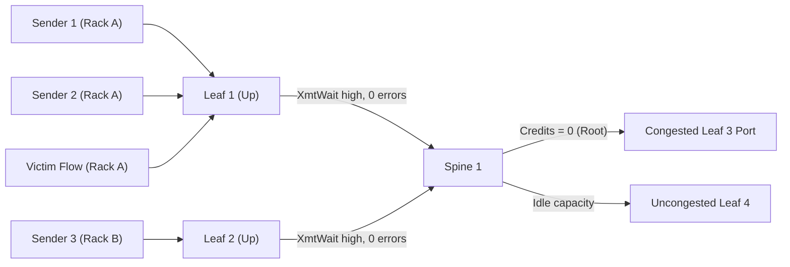
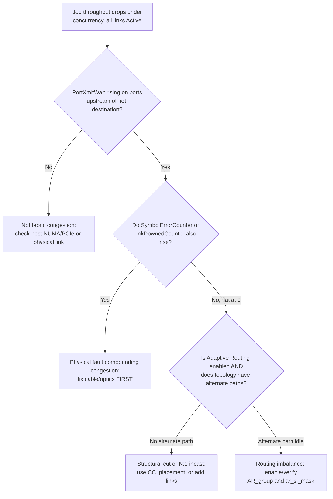
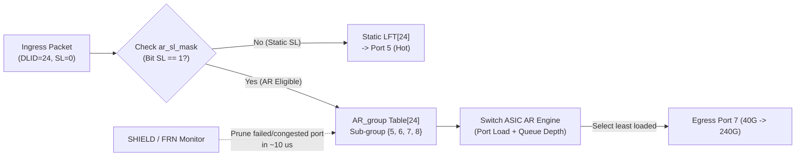
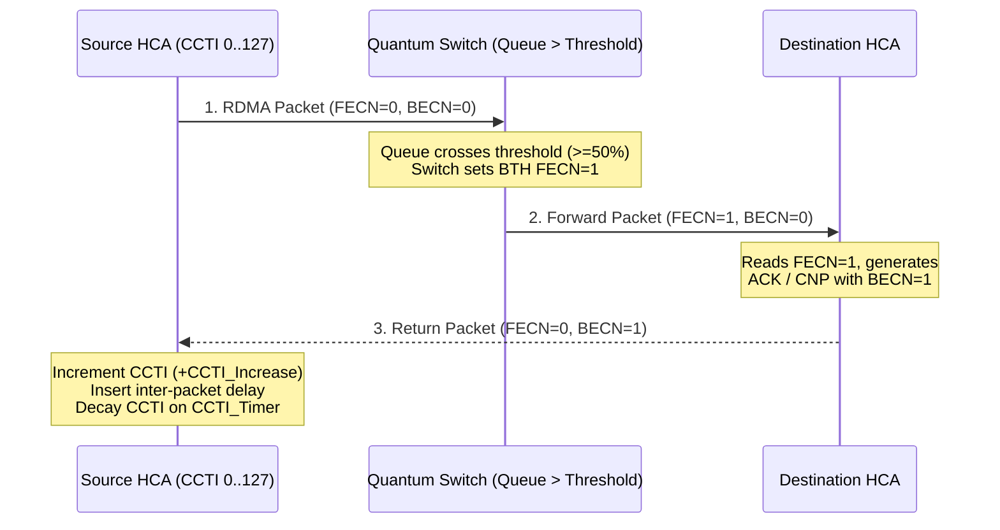

# 12.8 InfiniBand adaptive routing and congestion control

| | |
|---|---|
| Level | Advanced |
| Priority tier | 1 |
| Lab venue | Nebius GPU |
| Part | Part 12: Complete AI networking |
| Sources | `nvidia-devops` V8 Ch. 7, Ch. 12, Index & Labs 01–04; `superpod-gb300-ra`; `superpod-b200-dc`; `ai-data-center-network-design-and-technologies` Ch. 2, 6, 9 |
| Code | `code/part12/infiniband_ar_cc.py`, `code/part12/infiniband_ar_cc_lab.py` |
| Coverage file | `planning/coverage/chapters/12-08.md` |

## Why this matters for AI infrastructure

A lossless InfiniBand fabric can still bring a multi-thousand-GPU training run to its knees. Every physical port can report an Active logical state. A LinkUp physical state with zero symbol errors or packet drops, yet collective step times double whenever multiple jobs run together.

This slowdown happens because lossless link-level flow control prevents buffer-overrun drops by pausing upstream transmitters instead. Under Credit-Based Flow Control, a sender transmits only when its downstream link partner advertises free 64-byte buffer credits for the target Virtual Lane. Losslessness protects packets in flight, but it does not create infinite link bandwidth or infinite switch buffer depth.

When synchronized AllReduce rings, Mixture-of-Experts AllToAll bursts, or parallel storage checkpoints converge on the same switch egress ports, downstream receive buffers fill up. Credits stop returning to the upstream switch, upstream transmit queues stall, and backpressure spreads backward across multiple switch tiers as a congestion tree. Innocent jobs that merely share an upstream spine link or Virtual Lane behind the hot spot suffer Head-of-Line blocking and severe tail-latency spikes.

Modern NVIDIA Quantum-2 and Quantum-X800 fabrics attack this problem with three hardware mechanisms coordinated by OpenSM or Unified Fabric Manager. First, Adaptive Routing dynamically spreads packets across equal-cost paths while ConnectX Host Channel Adapters reorder out-of-order Packet Sequence Numbers in silicon. Second, Fast Notification and the Self-Healing Interconnect prune failed or congested ports from forwarding groups in microseconds rather than waiting for control-plane sweeps. Third, InfiniBand Congestion Control marks congested packets in flight and paces offending source Queue Pairs before downstream credits run dry.

```text
NVIDIA Quantum Fabric Scale & Hardware Control Mechanisms (superpod-gb300-ra, ADC Ch. 9, V8 Ch. 7):
  - Quantum-2 NDR Switch:           400 Gbps per port, 64 ports per switch ASIC (~300 ns port-to-port latency vs ~800 ns on Ethernet storage switches)
  - Quantum-X800 XDR Switch:        800 Gbps per port, 144 ports on Q3400-RD switches, scaling up to 16 Scalable Units and 9,216 GPUs in a two-layer fat-tree
  - 1. Adaptive Routing (AR + OOO): Maps 16-bit DLID to an AR_group of eligible egress ports; ConnectX HCAs reorder out-of-order PSNs in hardware
  - 2. SHIELD & Fast Notification:  Prunes failed or saturated ports from AR_group tables in ~10 us instead of waiting ~500 ms for an OpenSM Trap 128 heavy sweep
  - 3. Congestion Control (IB CC):  Congested switch sets 1-bit BTH FECN -> receiver reflects BECN -> source HCA advances CCTI (0..127 across 128-entry CCT) until CCTI_Timer recovery
```

This chapter builds on the InfiniBand addressing and link-layer foundations in Chapter 12.6 and the Subnet Manager architectures in Chapter 12.7. We derive the credit-based flow-control equations, Virtual Lane victim-buffer isolation. Adaptive Routing group selection, SHIELD failover math, ConnectX hardware reordering windows, the FECN/BECN/CCTI state machine, and production counter diagnostics.

## Prerequisites and outcomes

**Prerequisites:** Review Chapter 12.2 for RDMA Queue Pairs and completions, Chapter 12.6 for InfiniBand link layers, LIDs, P_Keys, Service Levels. Virtual Lanes, and Chapter 12.7 for OpenSM and fat-tree topologies.

**Outcomes:** After completing this chapter, you will be able to:
- Calculate per-Virtual-Lane credit availability across 64-byte credit units, trace how downstream credit exhaustion forms a multi-tier congestion tree. Isolate victim traffic classes using deadlock-free Service Level to Virtual Lane mappings.
- Distinguish pure fabric congestion from physical link faults in `perfquery` and locate the root port of a congestion tree. Sampling counter deltas across switch tiers without clearing hardware registers.
- Explain how OpenSM and UFM program static Linear Forwarding Tables alongside Adaptive Routing groups, why static routing creates 20-to-1 uplink skews. How ConnectX hardware packet reordering prevents tail-latency spikes.
- Compare autonomous hardware link-failure recovery under SHIELD and Fast Notification against control-plane OpenSM Trap 128 heavy-sweep reconvergence.
- Trace the closed-loop InfiniBand Congestion Control state machine from switch FECN marking to receiver BECN reflection and source CCTI rate pacing. Choose between Adaptive Routing, Congestion Control, rank placement, and capacity expansion.

```text
Quantitative Targets Verified in This Chapter (V8 Ch. 2, 5, 6, 7, 9, 10, 11 & Labs 01-04):
  - CBFC & Virtual Lanes:     64 bytes/credit across 16 VLs (VL0..VL14 data, VL15 SMP); separating SLs recovers 89.52% of HoL latency (1.8 ms -> 14.2 ms -> 3.1 ms p99)
  - Congestion vs Faults:     PortXmitWait climbing with SymbolErrorCounter=0 and LinkDownedCounter=0 vs physical symbol and link-down counter growth
  - LFT vs AR & OOO Tail:     20.01:1 PortXmitData skew (21.48 GB vs 1.08 GB) under ar_sl_mask 0xFFFF; OOO tail spike 7.2 us -> 38.6 us p99 and 9.1 us -> 112.4 us max
  - SHIELD vs OpenSM Sweep:   ~10 us hardware reroute (500,000 B in flight at 400 Gbps) vs ~500 ms / 500,000 us Trap 128 sweep (25,000,000,000 B in flight)
  - IB CC State Machine:      FECN -> BECN -> CCTI (0..127 in 128-entry CCT) pacing 400.0 Gbps down to 266.67 Gbps, 200.0 Gbps, and 80.5 Gbps before CCTI_Timer decay
```

---

## 1. Credit-based flow control, congestion trees, and Virtual Lane isolation

### 1.1 Link-level Credit-Based Flow Control and 64-byte credit blocks

When a burst of RDMA writes hits a switch port faster than the egress link can drain. Dropping even a single packet forces transport timeouts and expensive retransmissions across synchronized GPU ranks. Standard Ethernet transmits frames blindly and relies on reactive IEEE 802.1Qbb Priority Flow Control pause frames when a downstream ingress buffer nears overflow. InfiniBand prevents buffer overflow proactively on every hop using link-level Credit-Based Flow Control between HCAs, leaf switches, and spine switches.

An InfiniBand physical link is multiplexed into up to 16 logical Virtual Lanes. The first 15 lanes, VL0 through VL14, carry application RDMA and storage payloads mapped from the packet 4-bit Service Level field through each switch SL-to-VL table. The sixteenth lane, VL15, is dedicated exclusively to unrouted Subnet Management Packets. Because VL15 uses independent buffer space and is exempt from data-lane credit stalls. OpenSM or UFM can always query and reprogram switches even when every data Virtual Lane is completely stalled by congestion.

In the InfiniBand Link Layer Header and flow-control Link Packets, receivers advertise buffer availability per Virtual Lane in Flow Control Credit Units. One credit equals 64 bytes of receive buffer space. Before an upstream port transmits a packet of length $B_\{\text`{pkt}`}$ bytes on Virtual Lane $v$. Hardware verifies that the available credit balance $C_\{\text`{avail}`}(v)$ covers the packet ceiling in 64-byte blocks:

$$
C_\{\text`{avail}`}(v) = \left\lfloor \frac\{B_\{\text`{buf}`}(v) - B_\{\text`{occ}`}(v)}`{64}` \right\rfloor \ge \left\lceil \frac\{B_\{\text`{pkt}`}}`{64}` \right\rceil
$$

When available credits meet or exceed the packet credit cost, the port transmits immediately at full wire speed. When downstream drain slows and free credits drop below the required packet blocks, the upstream transmitter pauses on that Virtual Lane without dropping the packet. On every clock tick that a Virtual Lane has packets queued for transmission but insufficient downstream credits, hardware increments the port `PortXmitWait` counter.

```text
Per-VL Credit Accounting Example for a 4,096-Byte (4 KB) InfiniBand MTU (ADC Ch. 9, code/part12/infiniband_ar_cc.py):
  - Virtual Lane Architecture:  16 total VLs = VL0..VL14 (15 data VLs; 8 to 12 queues typically active in combined AI/storage profiles) + VL15 (1 management SMP VL)
  - Credit Unit & Packet Cost:  1 FCCL credit = 64 bytes; 1 packet of 4,096 B (4 KB MTU) requires ceil(4096 / 64) = 64 credits
  - Allocated VL0 Buffer:       B_buf(0) = 65,536 bytes = 1,024 total credits
  - Case 1 (Half Occupied):     B_occ(0) = 32,768 bytes -> C_avail(0) = 512 credits >= 64 -> Transmits immediately at 400 Gbps or 800 Gbps (~300 ns IB vs ~800 ns Ethernet latency)
  - Case 2 (Credit Stalled):    B_occ(0) = 63,488 bytes -> 2,048 bytes free = 32 credits < 64 -> Port A pauses VL0 transmission and increments PortXmitWait on every clock tick
```

### 1.2 Backpressure propagation, congestion trees, and Head-of-Line blocking

Because Credit-Based Flow Control never drops packets when buffers fill, any sustained mismatch between offered load and drain rate converts excess traffic into upstream queue occupancy. What starts as a single hot destination port quickly turns into a multi-tier fabric slowdown. Engineers see unrelated jobs across the cluster stall even though those jobs never communicate with the overloaded destination node.



| Hop / Element | Credit & Buffer State | Operational Effect on Traffic | Telemetry Signature (`perfquery`) |
|---|---|---|---|
| **Congested Destination Port (`Leaf 3` egress)** | Many-to-one incast (`S1 + S2 + S3`) exceeds `1x` port drain rate; buffer fills (`Credits -> 0`) | Root of the congestion tree; stops returning `VL0` credits to `Spine 1` | Highest `PortXmitWait` on `Spine 1` downlink facing `Leaf 3`; `SymbolErrorCounter = 0` |
| **Transit Switch (`Spine 1` ingress from `Leaf 1` & `Leaf 2`)** | Cannot drain packets toward `Leaf 3`; ingress `VL0` buffers fill and stop returning credits to `Leaf 1` & `Leaf 2` | Backpressure spreads one tier upstream away from the actual bottleneck | Elevated `PortXmitWait` on `Leaf 1` and `Leaf 2` uplinks feeding `Spine 1` |
| **Victim Flow (`Rack A -> Leaf 4` via `Spine 1` on `VL0`)** | Shares `Leaf 1 -> Spine 1` uplink and `VL0` buffer with congested flows `S1` & `S2` | **Head-of-Line (`HoL`) blocking:** delayed behind stalled `VL0` packets even though `Leaf 4` is completely idle | Victim job latency spikes (`p99` `1.8 ms -> 14.2 ms`) with zero packet loss |

This chain reaction follows five deterministic steps across the switch hierarchy. First, a downstream root port receives traffic from multiple senders faster than its wire rate and exhausts its receive buffer credits. Second, the upstream spine port runs out of downstream credits for that leaf port, pauses transmission on that Virtual Lane, and increments `PortXmitWait`.

Third, incoming packets destined for the hot leaf port accumulate inside the spine switch ingress buffers. Fourth, the spine switch stops returning credits to the upstream leaf switches, forcing their uplinks to pause and build their own queues. Fifth, unrelated victim flows traversing those same leaf uplinks on the same Virtual Lane toward an idle destination sit trapped behind the stalled packets in a classic Head-of-Line block.

### 1.3 Isolating victim flows with Virtual Lanes and preventing credit loops

When a high-volume training collective and a latency-sensitive inference service share the same default Virtual Lane, training bursts starve the inference service of buffer credits on shared uplinks. Separating competing traffic classes onto distinct Service Levels and Virtual Lanes gives each class an independent 64-byte credit counter and dedicated buffer partition on every physical link. When a synchronized training burst saturates VL0 and drives VL0 available credits to zero. VL1 retains its own free credits and continues forwarding inference packets across the exact same physical cable.

```text
Virtual Lane Victim-Buffer Isolation & Deadlock Prevention (V8 Ch. 11 Scenario 3, code/part12/infiniband_ar_cc.py):
  - Isolated Inference Baseline (no training active):          p99 latency = 1.8 ms
  - Shared Virtual Lane (SL0 -> VL0 for training + inference): p99 latency = 14.2 ms (7.89x inflation from VL0 credit starvation & HoL blocking)
  - Separated Virtual Lanes (SL0 -> VL0 train, SL1 -> VL1 inf): p99 latency = 3.1 ms (89.52% of latency regression recovered; 512+ VL1 credits remain free)
  - Residual 1.3 ms Gap (3.1 ms vs 1.8 ms baseline):           Reflects shared physical wire serialization arbitration across active VLs
  - Cyclic Credit Loop (Deadlock):                             SW1_VL0 -> SW2_VL0 -> SW3_VL0 -> SW1_VL0 (every switch holds VL0 buffers waiting for next switch credits)
  - Acyclic VL Split (Deadlock-Free DAG):                      SW1_VL0 -> SW2_VL0 -> SW3_VL1 -> SW1_VL1 (routing engines updn, ftree, dfsssp, dor break credit cycles)
```

Separating Virtual Lanes eliminates buffer Head-of-Line blocking and recovers nearly ninety percent of the tail-latency regression. However, the small residual latency gap above the idle baseline proves an important hardware truth. Virtual Lanes isolate switch buffers and flow-control credits, but they still arbitrate for the same physical serial wire bandwidth.

Furthermore, Virtual Lane mappings must be consistent and deadlock-free across every switch hop in the subnet. Because Credit-Based Flow Control holds upstream buffers while waiting for downstream credits, a cyclic buffer dependency across switches creates a permanent credit loop. In a credit loop, every switch in the ring waits forever for the next switch to free 64-byte credits. Topology-aware routing engines prevent credit loops either. Restricting turns under the Up/Down rule or by splitting upward and downward hops onto separate Virtual Lanes so the channel dependency graph forms a Directed Acyclic Graph.

---

## 2. Congestion versus physical link faults: reading `perfquery` evidence

The single most expensive operational mistake on an InfiniBand cluster is confusing credit backpressure with a damaged optical cable. Replacing transceivers because link utilization is high wastes maintenance windows without fixing the bottleneck. Conversely, tuning congestion control while a degraded fiber lane is actively corrupting symbols leaves a broken physical link in production.



| Diagnostic Dimension | Pure Fabric Congestion (`CBFC` Backpressure) | Physical / Link Layer Fault |
|---|---|---|
| **Logical & Physical Port State (`ibstat`)** | `State: Active`, `Physical state: LinkUp` at design rate (`400` or `800` Gbps) | May flap, retrain, or negotiate reduced width (`1x`/`2x` instead of `4x`) or speed |
| **Physical Error Counters (`perfquery`)** | `SymbolErrorCounter = 0`, `LinkDownedCounter = 0`, `PortRcvErrors = 0` (deltas flat) | `SymbolErrorCounter`, `LinkErrorRecoveryCounter`, or `LinkDownedCounter` increasing |
| **Credit Stall Counter (`PortXmitWait`)** | **High and climbing rapidly** during concurrent collective windows | Low or secondary to link recovery events |
| **Scope & Reproducibility** | Appears under concurrent multi-node collectives or specific rank placements | Tied to a specific physical cable, transceiver cage, switch port, or HCA port even in 2-node tests |
| **Correct Remediation** | Trace congestion-tree gradient; enable/tune `AR` and `CC`; fix rank placement or oversubscription | Reseat or replace cable/transceiver; isolate faulty port before touching routing or `CC` |

### 2.1 Distinguishing congestion from hardware faults on the same switch

When a job slows down across a leaf switch, operators must check whether the switch ports are waiting for downstream credits or suffering physical bit errors. When sampling counters with `perfquery`, always capture two read-only snapshots across an active workload window and compute the difference. Never pass the `-R` reset flag to `perfquery` or the `-k` or `-K` clear flags to `ibqueryerrors` during incident triage, because clearing hardware registers destroys the evidence trail.

```text
Switch Port Telemetry Comparison (V8 Ch. 2 Scenario 3 & Ch. 7, perfquery deltas):
  switch port 3: PortXmitWait=998432  SymbolErrorCounter=0   LinkDownedCounter=0   -> PURE_FABRIC_CONGESTION (clean link stalled waiting for 64-byte downstream credits)
  switch port 4: PortXmitWait=2109    SymbolErrorCounter=41  LinkDownedCounter=2   -> PHYSICAL_LINK_FAULT (41 symbol errors + 2 forced link-down recovery events)
  leaf port 3 vs sibling port 7 (V8 Ch. 2):
    leaf port 3: PortXmitWait=184320  SymbolErrorCounter=0   LinkDownedCounter=0   -> Credit bottleneck on port 3 downstream path
    leaf port 7: PortXmitWait=41      SymbolErrorCounter=0   LinkDownedCounter=0   -> Healthy uncongested sibling port
```

Comparing `switch port 3` and `switch port 4` shows why counter families must never be conflated. On port 3, `SymbolErrorCounter` and `LinkDownedCounter` remain flat at zero while `PortXmitWait` climbs to nearly one million ticks. The physical cable on port 3 is completely clean, and its transmitter is simply waiting for downstream buffer credits.

On port 4, `PortXmitWait` is small, but the port has accumulated symbol errors and two forced link-down events. Port 4 has a physical media fault that requires reseating or replacing the cable or optical transceiver before anyone touches routing or congestion settings.

### 2.2 Tracing a congestion tree to its root via the `PortXmitWait` gradient

When a congestion tree spreads across several switch tiers, dozens of upstream ports report nonzero `PortXmitWait` deltas simultaneously. Operators need a reliable way to find the exact downstream port that started the backup. Because credit backpressure decays as it fans out upstream across multiple links, the port closest to the true bottleneck always records the largest `PortXmitWait` delta.

```text
Leaf Switch PortXmitWait Delta Gradient During Slow Collective (V8 Ch. 7 Scenario 1):
  port 1: delta 340
  port 2: delta 298
  port 3: delta 51204   <-- Congestion tree root candidate (~150x above baseline)
  port 4: delta 47890   <-- Congestion tree root candidate (~150x above baseline)
  port 5: delta 312
```

In this leaf-switch snapshot, ports 1, 2, and 5 sit near a quiet baseline of roughly three hundred ticks. By contrast, ports 3 and 4 record deltas roughly 150 times higher than their siblings. Cross-referencing ports 3 and 4 against the `iblinkinfo` topology map immediately identifies which downstream rack or destination node pair is the root of the congestion tree.

---

## 3. Adaptive Routing, SHIELD self-healing, and ConnectX OOO reordering

### 3.1 Why static Linear Forwarding Tables create 20-to-1 uplink hot spots

Even in a fully nonblocking fat-tree with plenty of idle spine bandwidth, static routing can starve a distributed training job. Under classic InfiniBand forwarding, OpenSM programs a deterministic Linear Forwarding Table on every switch. The Linear Forwarding Table is a flat lookup array indexed by the 16-bit Destination LID that maps each destination to a single fixed egress port:

$$
\text`{EgressPort}` = \text`{LFT}`[\text`{DLID}`]
$$

Even when a leaf switch has four, eight, or sixteen equal-cost uplinks to the spine tier. Static forwarding pins all packets targeting a given Destination LID onto one pre-assigned uplink. When active GPU ranks in an AllReduce or AllToAll collective exchange data with peers whose Destination LIDs hash to the same spine uplink. Those flows collide in a massive queue while sibling uplinks sit nearly idle.

```text
Static LFT Uplink Collision on Four 400 Gbps Leaf Uplinks (V8 Ch. 6 Scenario 1, PortXmitData 4-octet words):
  port 5 (uplink to S1): 5,368,709,120 words x 4 = delta 21474836480 bytes (~21.48 GB / 20.00 GiB)
  port 6 (uplink to S2): 5,372,308,608 words x 4 = delta 21489234432 bytes (~21.49 GB / 20.01 GiB)
  port 7 (uplink to S3):   268,435,456 words x 4 = delta 1073741824 bytes  (~1.07 GB  /  1.00 GiB)
  port 8 (uplink to S4):   270,413,568 words x 4 = delta 1081654272 bytes  (~1.08 GB  /  1.01 GiB)
  Imbalance Ratio:       21,489,234,432 / 1,073,741,824 = 20.01:1 max/min uplink traffic skew
```

Remember that `PortXmitData` in `perfquery` counts in 4-octet words, so multiplying the raw counter delta by 4 gives transmitted bytes. Here, uplinks 5 and 6 carry twenty times more traffic than identical uplinks 7 and 8 on the same leaf switch. When two large elephant flows collide on uplink 5 while uplink 7 is nearly empty, static forwarding cuts collective throughput in half despite ample spare spine capacity.

### 3.2 Adaptive Routing groups, Private LFTs, and the Service Level mask

To eliminate static uplink collisions without waiting for the Subnet Manager to recompute forwarding tables, NVIDIA Quantum switches replace single-port lookups with Adaptive Routing. Instead of binding a Destination LID to one fixed port. OpenSM or UFM programs a two-stage hardware lookup that maps each destination to an Adaptive Routing group of equal-cost egress ports.



| Hardware Table / Control | Programmed By | Granularity & Width | Role in Packet Forwarding |
|---|---|---|---|
| **`ar_sl_mask`** | OpenSM / UFM (`opensm.conf`) | `16`-bit bitmask (`0x0000..0xFFFF`, default `0xFFFF`) | Enables (`1`) or disables (`0`) Adaptive Routing per Service Level (`SL0..SL15`); cleared bits fall back to deterministic static `LFT` |
| **Private LFT (`PLFT`) / `LFT` entry** | OpenSM `ar_updn`, `ar_ftree`, `ar_dfsssp`, `ar_torus` | Indexed by `16`-bit `DLID` (`1..48,000`) | Points either to a single deterministic fallback port or to an `AR_group` ID |
| **Adaptive Routing Group (`AR_group`)** | OpenSM / UFM + Switch ASIC | Group of equal-cost egress ports (e.g., `{5, 6, 7, 8}`) | Lists all topologically valid, loop-free shortest-path ports reaching `DLID` |
| **Switch ASIC AR Selector** | Quantum-2 / Quantum-X800 hardware | Sub-microsecond per-packet or per-flowlet evaluation | Evaluates local egress port utilization, `VL` queue depth, and downstream `FRN` notifications to pick the least-congested port (e.g., `Port 7` at `40 Gbps` instead of `Port 5` at `380 Gbps`) |

When an ingress packet arrives for a destination, the switch ASIC first checks the 16-bit Service Level bitmask `ar_sl_mask`. If the bit corresponding to the packet Service Level is set to one. The switch looks up the destination Adaptive Routing group and selects the least-loaded egress port based on local link load and transmit queue depth. If the Service Level bit is cleared to zero, hardware falls back to the deterministic static Linear Forwarding Table entry. This per-SL mask lets operators keep bulk training collectives adaptive while pinning legacy or diagnostic traffic to deterministic single-path forwarding.

```text
Static LFT vs Adaptive Routing Port Selection on Four 400.0 Gbps Leaf Uplinks (code/part12/infiniband_ar_cc.py):
  - Existing Uplink Loads & Queues:
      port 5: 380.0 Gbps (queue 120.0 KB) | port 6: 360.0 Gbps (queue 90.0 KB)
      port 7:  40.0 Gbps (queue   0.0 KB) | port 8:  60.0 Gbps (queue  5.0 KB)
  - New Arriving Elephant Flow:       200.0 Gbps targeting DLID 24
  - Mode 1 (Static LFT -> port 5):    Pins flow onto port 5 -> 380.0 + 200.0 = 580.0 Gbps offered load (180.0 Gbps excess queued into PortXmitWait)
  - Mode 2 (AR_group {5,6,7,8}, SL0): ar_sl_mask = 0xFFFF selects least-loaded port 7 -> 40.0 + 200.0 = 240.0 Gbps (max uplink load 380.0 Gbps <= 400.0 Gbps, 0.0 Gbps excess)
  - Mode 3 (Selective Mask 0xFFF7):   Clears bit 3 (SL3) -> forces SL3 onto static LFT port 5 (580.0 Gbps, 180.0 Gbps excess) while SL0..2 and SL4..15 stay adaptive
```

### 3.3 Fast Notification and Self-Healing Interconnect

Local port-load sensing solves collisions on the uplinks directly attached to a leaf switch. It cannot see a broken cable or saturated downlink on the far side of a spine switch. If a link between a spine switch and a remote leaf switch fails. A training step, every microsecond spent forwarding packets into that dead path stalls thousands of GPUs.

Without autonomous switch healing, a link failure generates an InfiniBand Trap 128 management message that travels to the master Subnet Manager. OpenSM then schedules a heavy sweep, rediscovers the topology, recomputes forwarding tables, and pushes updated blocks across the fabric. In a large cluster, that control-plane loop takes roughly half a second, during which gigabytes of line-rate traffic pile up behind the dead port.

On NVIDIA Quantum-2 and Quantum-X800 switches, the Self-Healing Interconnect and Fast Routing Notification execute directly in switch silicon. When a switch detects a local link failure or severe downstream congestion toward a destination group. It immediately removes the failed port from its local Adaptive Routing group and sends hardware notification packets to neighboring switches. Upstream switches prune the affected path from their forwarding sub-tables in about ten microseconds, cutting in-flight data at risk by fifty thousand times compared to a control-plane sweep.

```text
Link-Failure Recovery Comparison on a 400.0 Gbps (50,000 B/us) Link (V8 Ch. 5, superpod-gb300-ra, code/part12/infiniband_ar_cc.py):
  - Fault Event:                        Uplink port 6 in AR_group {5, 6, 7, 8} fails (Trap 128 on LID 44 port 3); surviving AR_group = (5, 7, 8)
  - Control-Plane Recovery (OpenSM):    Trap 128 heavy sweep takes ~500 ms (500.0 ms = 500,000 us = 500,000.0 us)
                                        In-flight data at risk at 400.0 Gbps = 500,000 us x 50,000 B/us = 25,000,000,000 bytes (25 GB)
  - Hardware Self-Healing (SHIELD/FRN): Autonomous ASIC pruning takes ~10 us (10.0 us) across Quantum-2 (400G, 64-port) and Quantum-X800 (800G, 144-port Q3400-RD)
                                        In-flight data at risk at 400.0 Gbps = 10 us x 50,000 B/us = 500,000 bytes (500 KB) -> 50,000x (50,000.0x) speedup
```

### 3.4 Out-of-Order packet delivery and ConnectX HCA hardware reordering

When Adaptive Routing dynamically spreads packets of a single Queue Pair. Multiple spine switches, different queue depths along those parallel paths cause packets to arrive at the destination HCA out of sequence. In strict traditional InfiniBand Reliable Connection transport. Receiving a packet with a higher Packet Sequence Number than expected immediately triggers a sequence-gap Negative Acknowledgment and forces a Go-Back-N retransmission. Those retransmissions waste link bandwidth and destroy collective tail latency.

Modern NVIDIA ConnectX-6, ConnectX-7, ConnectX-8, and BlueField-3 adapters eliminate this penalty through hardware Out-of-Order packet reordering. During Queue Pair setup, the adapter enables an on-chip reorder buffer window and allows native out-of-order payload placement for RDMA Write and Send operations. When slightly out-of-order packets arrive within the hardware window, the HCA places their payloads directly into target memory and holds completion signaling until the missing sequence number arrives.

If Adaptive Routing or aggressive congestion parameters are enabled on an adapter where hardware reordering is disabled or exceeded, average bandwidth can rise while tail latency degrades catastrophically. Because every rank in a synchronized collective waits at a barrier for the slowest rank. A fivefold jump in 99th-percentile latency slows overall training step time even when median latency improves.

```text
ConnectX Hardware OOO Reordering & Tail-Latency Regression (V8 Ch. 7 Scenario 3, ADC Ch. 6, code/part12/infiniband_ar_cc.py):
  - Arriving PSN Stream (7 packets):  (100, 102, 103, 101, 104, 106, 105) -> max_reorder_distance = 2
  - Hardware OOO Reordering OFF:      Receiving 102 before 101 triggers 3 PSN-gap NAKs and Go-Back-N retransmissions
  - Hardware OOO Reordering ON:       ConnectX-7 (MT4129) reorder window = 64 packets (>= 2) delivers (100, 101, 102, 103, 104, 105, 106) with 0 PSN-gap NAKs
  - Latency Percentiles Before vs After Bad AR/CC Tuning (V8 Ch. 7 Scenario 3):
                       p50      p95      p99      max
      Before tuning:  3.1us    4.8us    7.2us    9.1us
      After tuning:   2.4us    5.9us   38.6us   112.4us
      Impact:         p50 improved (3.1 us -> 2.4 us), but p99 inflated 5.36x (7.2 us -> 38.6 us) and max inflated 12.35x (9.1 us -> 112.4 us)
```

---

## 4. InfiniBand Congestion Control

### 4.1 Why Adaptive Routing needs Congestion Control

Adaptive Routing redistributes traffic across alternate spine paths, which solves uplink path imbalance when spare links exist. However, Adaptive Routing cannot solve two structural bottlenecks that occur constantly in production AI clusters.

First, Adaptive Routing cannot route around a destination incast. When eight or sixty-four senders simultaneously transmit RDMA writes to a single storage server. Parameter-server HCA port, every alternate spine path eventually converges onto that single destination leaf egress port. Because no alternate path exists for the final hop to the target host, spreading packets across the spine does nothing to relieve the bottleneck.

Second, Adaptive Routing cannot create bandwidth across an oversubscribed topology cut. If a leaf switch has twice as much downlink bandwidth from compute nodes as uplink bandwidth to the spine tier. All compute nodes run a cross-rack AllReduce simultaneously, total offered load exceeds total uplink capacity even when every uplink is balanced perfectly.

```text
Structural Bottlenecks That Adaptive Routing Cannot Solve (V8 Ch. 6 & Ch. 7):
  - 1. Destination Incast (CP1 / CP4):  8 to 64 senders targeting 1 HCA port converge on a single final leaf egress port with no alternate path
  - 2. 2:1 Oversubscribed Leaf Cut:     16 x 400 Gbps downlinks (6,400 Gbps) feeding 8 x 400 Gbps uplinks (3,200 Gbps) -> 2:1 (2.0:1) oversubscription ratio
                                        Simultaneous cross-rack AllReduce caps each node at 200 Gbps (200.0 Gbps), doubling a 2 GB step from 40.0 ms to 80.0 ms
                                        Paired ib_write_bw drops from 397.62 Gbps (same-leaf) to 201.18 Gbps (cross-rack, 1.98:1 ratio)
```

Without source rate regulation, both destination incast and oversubscribed cuts fill the bottleneck egress buffer, exhaust downstream 64-byte credits, and grow a congestion tree across the fabric. InfiniBand Congestion Control prevents congestion trees from spreading by throttling only the offending source Queue Pairs before downstream credits run out.

### 4.2 The 3-stage FECN, BECN, and CCTI hardware control loop

InfiniBand Congestion Control operates as a three-stage closed hardware loop across Quantum switches and ConnectX HCAs. When a switch egress queue crosses its configured congestion threshold. It is the true root of contention, the switch marks outgoing packets, the receiver reflects a notification back to the sender. The source HCA paces its packet injection rate.



| Stage & Actor | Packet Header Bit / Register | Trigger Condition | Hardware Action |
|---|---|---|---|
| **1. Detection & Marking (Switch)** | `BTH` `FECN` (`1` bit, Forward Explicit Congestion Notification) | Switch egress port queue occupancy crosses configured `Threshold` (e.g., `>= 50%`) and port is the root of congestion (not merely credit-stalled from downstream) | Switch sets `FECN = 1` in the Base Transport Header (`BTH`) of packets traversing the congested queue |
| **2. Notification / Reflection (Destination HCA)** | `BTH` `BECN` (`1` bit, Backward Explicit Congestion Notification) | Destination HCA receives a packet with `FECN == 1` | Destination HCA increments its Marked Packet counter and transmits an `ACK` or explicit Congestion Notification Packet (`CNP`) back to the source `LID`/`QP` with `BECN = 1` |
| **3. Source Reaction & Recovery (Source HCA)** | Congestion Control Table (`CCT`, `128` entries `0..127`) & `CCTI` | Source HCA receives `BECN == 1` or its periodic `CCTI_Timer` expires without `BECN` | On `BECN = 1`: `CCTI = min(CCTI_Limit, CCTI + CCTI_Increase)`, increasing inter-packet injection delay. On `CCTI_Timer` expiry: `CCTI = max(CCTI_Min, CCTI - 1)`, smoothly restoring full line rate |

### 4.3 Worked numerical trace of the CCTI rate-throttling state machine

The Congestion Manager in OpenSM or UFM programs each HCA with a 128-entry Congestion Control Table. Four per-Service-Level control registers: minimum index, maximum index limit, index step increase, and recovery timer. Using the standard inter-packet delay scaling model, effective injection rate on a line-rate port follows:

$$
R_\{\text`{inj}`}(\text`{CCTI}`) = \frac\{R_\{\text`{line}`}\}\{1 + \frac\{\text`{CCTI}`}`{32}`}
$$

When switch queue occupancy stays below the threshold, the index sits at zero and the sender transmits at full line rate. Each incoming BECN packet jumps the index upward by the configured step size, inserting hardware delay between packets so the downstream switch buffer drains before exhausting flow-control credits. Once BECN notifications stop arriving, each expiration of the recovery timer steps the index down by one until the Queue Pair smoothly returns to full line rate.

```text
Worked 5-Step Trace of the IB Congestion Control State Machine on a 400.0 Gbps NDR Port (code/part12/infiniband_ar_cc.py):
  - Programmed HCA Registers:  128-entry CCT (indices 0..127, CCT_MAX_INDEX = 127), CCTI_Min = 0, CCTI_Limit = 127, CCTI_Increase = 16, CCTI_Timer = 15..50 us, Switch FECN Threshold = 50% (50.0%)
  - Step 1 (Uncongested Baseline):     switch_queue = 25% (< 50%), CCTI = 0        -> FECN = 0, BECN = 0, multiplier = 1 + 0/32   = 1.0x    -> R_inj = 400.0 Gbps
  - Step 2 (First Congestion Wave):    switch_queue = 65% (>= 50%), CCTI: 0 -> 16  -> FECN = 1, BECN = 1, multiplier = 1 + 16/32  = 1.5x    -> R_inj = 266.67 Gbps
  - Step 3 (Second Congestion Wave):   switch_queue = 75% (>= 50%), CCTI: 16 -> 32 -> FECN = 1, BECN = 1, multiplier = 1 + 32/32  = 2.0x    -> R_inj = 200.0 Gbps (50% line rate)
  - Step 4 (Severe Incast Ceiling):    switch_queue = 90% (>= 50%), CCTI: 120->127 -> FECN = 1, BECN = 1, multiplier = 1 + 127/32 = 4.9688x -> R_inj = 80.5 Gbps (clamped at CCTI_Limit = 127)
  - Step 5 (CCTI_Timer Recovery):      switch_queue = 20% (< 50%), CCTI: 32..1->0  -> FECN = 0, BECN = 0, timer decrements CCTI by 1 per tick -> R_inj = 400.0 Gbps restored at CCTI = 0
```

### 4.4 Architectural comparison: Adaptive Routing vs Congestion Control vs Placement vs Capacity

| Mechanism | Primary Hardware / Software Action | Best Suited For | What It Cannot Solve |
|---|---|---|---|
| **Adaptive Routing (`AR` + `SHIELD`)** | Switch selects least-loaded eligible port in `AR_group` and prunes failed ports in `~10 µs` | Path imbalance (`20:1` uplink skew) when alternate spine paths exist | True `N:1` destination incast (`CP4`) or an oversubscribed topology cut (`2:1` leaf) |
| **Congestion Control (`FECN`/`BECN`/`CCTI`)** | Switch marks `FECN`, receiver returns `BECN`, source HCA paces `QP` injection via `CCTI` (`0..127`) | Persistent destination contention or incast that would otherwise build a congestion tree | Broken physical cables (`SymbolErrorCounter > 0`) or missing bisection bandwidth |
| **Workload / Rank Placement** | Scheduler co-locates communicating ranks under the same leaf or aligns rails | Avoidable cross-rack traffic concentration and multi-tenant uplink sharing | Full-cluster synchronous `AllToAll` or `AllReduce` spanning every rack simultaneously |
| **Physical Capacity Expansion** | Add spine switches, leaf uplinks (`8 -> 16`), or upgrade NDR (`400G`) to XDR (`800G`) | Structural oversubscription (`2:1 -> 1:1`) when all uplinks are already balanced and saturated | Static routing hash collisions or faulty transceivers |

---

## 5. Multi-tenancy, SuperPOD scale, and operational observability

### 5.1 Multi-tenant isolation: why Partition Keys do not prevent congestion interference

In a shared multi-tenant InfiniBand cluster or a fabric running both training collectives and latency-sensitive inference or GPUDirect Storage, architects often assume that Partition Keys isolate tenant performance. That assumption fails under load. Partition Keys enforce logical addressability and security membership, preventing an unauthorized Queue Pair in Tenant A from reading or writing memory in Tenant B.

However, Partition Keys do not partition physical link bandwidth or switch buffer credits. If two tenants are scheduled onto nodes under the same leaf switches. Mapped to the same default Service Level and Virtual Lane. One tenant AllToAll burst can exhaust VL0 credits on shared spine links and stall the other tenant via a congestion tree.

True multi-tenant and mixed-workload isolation requires layering four operational controls. First, use topology-aware scheduler placement to allocate entire leaf switches or Scalable Units to a single large training job whenever possible. Second, map latency-sensitive inference and storage traffic onto dedicated Service Levels and Virtual Lanes with weighted arbitration and independent 64-byte credit pools. Third, enable Adaptive Routing and Congestion Control so no single tenant pins a spine uplink or monopolizes downstream buffers. Fourth, join per-port telemetry counters with scheduler placement metadata and hardware GUID inventory.

```text
Multi-Tenant & Storage Protocol Context on Shared InfiniBand Fabrics (ADC Ch. 9, V8 Ch. 7 & Ch. 11):
  - P_Key Scope:                 Enforces logical partition membership only; does NOT isolate physical bandwidth or VL0 64-byte buffer credits
  - GPUDirect Storage (GDS):     NVMe-o-RDMA uses UDP port 4420 (CM) / TCP port 8009 (discovery) or native IB; requires dedicated SL -> VL separation from bulk training
  - 4-Layer Isolation Stack:     (1) Topology-aware SU/leaf placement, (2) SL2VL + VLArbitration credit separation, (3) AR + IB CC (FECN/BECN/CCTI), (4) GUID-joined telemetry
```

### 5.2 Scale-out reference points: DGX B200 NDR and DGX GB300 Quantum-X800 SuperPODs

To ground Adaptive Routing and Congestion Control in production cluster geometry, compare the NVIDIA DGX B200 NDR SuperPOD against the NVIDIA DGX GB300 Quantum-X800 SuperPOD. In the DGX B200 design, each Scalable Unit uses 400 Gbps Quantum-2 switches. And one physical UFM appliance is installed in the first Scalable Unit, displacing one compute node. In the DGX GB300 design, 144-port Quantum-X800 switches running at 800 Gbps scale a two-layer rail-aligned fat-tree up to 9,216 GPUs with Adaptive Routing, SHARP in-network reductions. SHIELD self-healing enabled across all rails.

```text
Reference SuperPOD Fabric Topologies & Cabling Envelopes (superpod-b200-dc, superpod-gb300-ra, V8 Ch. 12):
  1. DGX B200 NDR (400 Gbps) SuperPOD (458 kW per 32-node SU; 1 UFM appliance displaces 1 DGX B200 server; 512-GPU nonblocking leaf uses 16 down / 16 up at 400 Gbps):
     - 1 SU:  31 compute nodes (248 GPUs),  8 leaf switches,  4 spine switches,   252 compute+UFM cables,   256 ISL cables
     - 2 SUs: 63 compute nodes (504 GPUs), 16 leaf switches,  8 spine switches,   508 node cables,          512 ISL cables
     - 3 SUs: 95 compute nodes (760 GPUs), 24 leaf switches, 16 spine switches,   764 node cables,          768 ISL cables
     - 4 SUs: 127 compute nodes (1,016 GPUs), 32 leaf switches, 16 spine switches, 1,020 node cables,     1,024 ISL cables
     - Cable Rules: Passive copper DAC <= 5 m at 100G or <= 3 m at 400G; Active Optical Cables (AOC) <= 30 m, kept < 90% of max standard distance with zero patch panels
  2. DGX GB300 Quantum-X800 (800 Gbps) SuperPOD (Q3400-RD 144-port switches; 8 DGX GB300 systems / 576 GPUs per SU across 8 leaves in 4 rails of 2 leaves each):
     - 2 SUs (1,152 GPUs):  16 leaf switches,  8 spine switches
     - 4 SUs (2,304 GPUs):  32 leaf switches, 18 spine switches
     - 8 SUs (4,608 GPUs):  64 leaf switches, 36 spine switches
     - 16 SUs (9,216 GPUs): 128 leaf switches, 72 spine switches (two-layer fat-tree with AR, SHARP, and SHIELD enabled)
```

### 5.3 Rate-of-change alerting versus cumulative counter scar tissue

Hardware counters exposed by `perfquery` and UFM accumulate monotonically since the last counter clear or switch reboot. Alerting naively whenever a static counter exceeds zero produces both false alarms on old history and missed detections on slowly dying optics.

If two snapshots taken five minutes apart during active traffic show the exact same nonzero `SymbolErrorCounter` value, the delta is zero. That static number is historical scar tissue from an earlier cable seating event rather than an active fault. By contrast, if a port starts with a tiny error count on Day 1 that accelerates. Forty-five times over a single week alongside rising link-down recoveries, the optical transceiver is actively failing and must be replaced before it triggers continuous Trap 128 sweeps.

```text
Cumulative Scar Tissue vs Error-Rate Acceleration in perfquery (V8 Ch. 9):
  - Case A (Historical Scar Tissue on port 9 over 300 s / 5 min):
      t = 0 s: SymbolErrorCounter = 12,034 | t = 300 s: SymbolErrorCounter = 12,034 -> delta = 0 (0.0 errors/day; old history, do NOT replace cable)
  - Case B (Active Optical Degradation on switch port 12 over 6 days):
      Day 1:          SymbolErrorCounter = 4,      LinkDownedCounter = 0
      Day 4 (+3 days): SymbolErrorCounter = 890     (delta = +886,    rate = 295.33 errors/day),    LinkDownedCounter = 3
      Day 7 (+3 days): SymbolErrorCounter = 41,200  (delta = +40,310, rate = 13,436.67 errors/day), LinkDownedCounter = 11
      Acceleration:   13,436.67 / 295.33 = 45.5x error-rate acceleration + 11 forced link-down recoveries
```

---

## Commands and configurations that matter

All fabric diagnostic commands below are read-only unless noted and are marked `(untested here)` because no live InfiniBand HCA or Quantum switch is attached to this build environment.

### 1. Endpoint HCA, port state, and SM authority baseline

Before investigating routing or congestion, verify that every local HCA is in the Active logical state. LinkUp physical state at its design rate with valid endpoint and Subnet Manager LIDs. Confirm with `sminfo` that a single authoritative Master Subnet Manager is active and incrementing its activity count.

```text
Expected Endpoint HCA & Subnet Manager Baseline Values (V8 Lab 01 & Ch. 5):
  - HCA Hardware (ibv_devinfo -v -d mlx5_0): MT4129 ConnectX-7, vendor_id 0x02c9, part 4129, fw_ver 28.39.2048, node_guid 08c0:eb03:00f1:a2c3
                                             max_qp = 262,144 (262144), max_qp_wr = 32,768 (32768), max_sge = 30
  - Port Status (ibstat mlx5_0):             State: Active, Physical state: LinkUp, Rate: 400 (or 800), Base lid: 12, LMC: 0, SM lid: 1
                                             Capability mask: 0x2651e848, Port GUID: 0x08c0eb0300f1a2c3
  - Master SM (sminfo):                      sm lid 1, sm guid 0x0002c903004a1b20, activity count 184,223 (184223), priority 15, state 3 SMINFO_MASTER
```

```bash
# (untested here) Enumerate local RDMA HCAs, firmware, and QP limits
ibv_devices
ibv_devinfo -v -d mlx5_0 | head -20

# (untested here) Verify Physical state (LinkUp), logical State (Active), Rate (400), Base lid (12), SM lid (1)
ibstat mlx5_0

# (untested here) Confirm exactly one authoritative Master SM (state 3 SMINFO_MASTER, priority 15)
sminfo
```

### 2. Inspecting OpenSM Adaptive Routing, SHIELD, and SL2VL configuration

In `/etc/opensm/opensm.conf`, verify that an Adaptive Routing engine is active and that `ar_sl_mask` enables the intended Service Levels. Then run `ibroute` and `ibdiagnet` to confirm valid Adaptive Routing groups and zero credit loops across the subnet.

```ini
# (untested here) /etc/opensm/opensm.conf excerpt for Adaptive Routing + SHIELD + QoS
routing_engine ar_ftree,ar_updn

# Enable Adaptive Routing across all 16 Service Levels (SL0..SL15)
ar_sl_mask 0xffff

# Enable QoS and consistent SL-to-VL mapping across all switches
qos TRUE
qos_sl2vl 0,1,2,3,4,5,6,7,8,9,10,11,12,13,14,15
```

```bash
# (untested here) Dump switch Linear Forwarding Table (LFT) and Adaptive Routing state
ibroute <switch-lid>

# (untested here) Run fabric-wide diagnostic check including AR tables, credit loops, and BER
ibdiagnet --routing
```

### 3. Sampling `PortXmitData`, `PortXmitWait`, and physical errors without clearing counters

Never pass `-R` to `perfquery` or `-k` or `-K` to `ibqueryerrors` during live incident triage, because resetting counters erases the historical gradient needed to locate the root port. Instead, sample before and after a fixed observation window and compute deltas.

```bash
# (untested here) Compare PortXmitWait, SymbolErrorCounter, and LinkDownedCounter on a switch
for p in 1 2 3 4 5 6 7 8; do
  echo "=== Port $p ==="
  perfquery <switch-lid> $p | grep -E 'PortXmitData|PortRcvData|PortXmitWait|SymbolErrorCounter|LinkDownedCounter'
done

# (untested here) Capture fabric-wide error counters before and after a controlled benchmark
ibqueryerrors > counters_before.txt
sleep 60
ibqueryerrors > counters_after.txt
```

### 4. Benchmarking NUMA-pinned pairwise bandwidth and tail latency

Always bind RDMA microbenchmarks to the CPU and memory NUMA node local to the HCA under test. Inspect the 99% and 99.9% latency percentiles in `ib_write_lat` so packet-reordering or credit-wait tail spikes are never hidden behind a normal median latency.

```text
Expected Pairwise Bandwidth & Tail-Latency Benchmarks (V8 Ch. 6 Scenario 3, Ch. 10 Step 6, Labs 02 & 04):
  - Pairwise Bandwidth (ib_write_bw):      397.62 Gbps same-leaf vs 201.18 Gbps cross-rack across a 2:1 oversubscribed leaf (1.98:1 ratio)
  - Latency Percentiles (ib_write_lat):    t_typical = 1.58 us vs 1.55 us baseline (+1.9%)
                                           99% percentile   = 2.90 us vs 1.71 us baseline (1.70x inflation)
                                           99.9% percentile = 5.77 us vs 1.98 us baseline (2.91x inflation)
```

```bash
# (untested here) NUMA-pinned RDMA Write bandwidth test (compare same-leaf 397.62 Gbps vs cross-rack 201.18 Gbps)
numactl --cpunodebind=0 --membind=0 ib_write_bw -d mlx5_0 -i 1 --report_gbits <server-ip>

# (untested here) RDMA Write latency test with 99% and 99.9% tail percentiles across 1000 iterations
numactl --cpunodebind=0 --membind=0 ib_write_lat -d mlx5_0 -i 1 -F <server-ip>
```

---

## How it fails

| Failure Mode | Observable Symptom | Root Cause & Diagnostic Evidence | Remediation |
|---|---|---|---|
| **1. Congestion tree from `N:1` destination incast (`V8` Ch. 7 Scenario 1)** | Step time doubles under concurrent jobs; zero packet drops; `SymbolErrorCounter = 0` across all links | Downstream leaf ports `3` and `4` saturate and exhaust `64`-byte credits; `PortXmitWait` deltas on ports `3` (`51,204`) and `4` (`47,890`) are `~150x` higher than sibling ports `1` (`340`), `2` (`298`), and `5` (`312`) | Enable/verify IB Congestion Control (`FECN`/`BECN`/`CCTI`) so source `QP`s pace injection before credits exhaust; spread rank/storage targets across leaves |
| **2. Static `LFT` hash collision / disabled `AR` (`V8` Ch. 6 Scenario 1 & Ch. 7 Scenario 2)** | Cross-rack collectives run at half speed even though the fat-tree is `1:1` nonblocking | Routing engine is static (`updn`/`ftree` without `ar_*`) or `ar_sl_mask` excludes the active `SL`; `PortXmitData` deltas on uplinks `5` (`21,474,836,480` B) and `6` (`21,489,234,432` B) are `20.01x` higher than uplinks `7` (`1,073,741,824` B) and `8` (`1,081,654,272` B) | Enable supported Adaptive Routing (`ar_ftree`/`ar_updn`) and verify `ar_sl_mask = 0xFFFF` across all switches and HCA firmware |
| **3. `OOO` reordering / reaction-timing tail latency spike (`V8` Ch. 7 Scenario 3)** | Average bandwidth and `p50` latency improve (`3.1 µs -> 2.4 µs`) after tuning, but collective step time worsens | `OOO` packet delivery exceeds HCA reorder capability or overly aggressive `CC` parameters cause rate oscillation; `p99` latency jumps `5.36x` (`7.2 µs -> 38.6 µs`) and `max` jumps `12.35x` (`9.1 µs -> 112.4 µs`) | Roll back immediately to the last validated policy; verify ConnectX HCA hardware `OOO` reordering support and retune one parameter at a time against `p99`/`p99.9` baselines |
| **4. Physical link degradation misdiagnosed as congestion (`V8` Ch. 7 & Ch. 9)** | Jobs spanning one rack stall; engineers attempt to tune `AR`/`CC` without effect | `perfquery` shows `switch port 4` has `SymbolErrorCounter = 41` and `LinkDownedCounter = 2` (or `port 12` `SymbolErrorCounter` accelerating `45.5x` from `4 -> 890 -> 41,200` over `6` days with `LinkDownedCounter` `0 -> 3 -> 11`), triggering `Trap 128` heavy sweeps (`LID 44 port 3`) | Fix physical layer first: reseat/replace the failing cable or optical transceiver and confirm `SymbolErrorCounter` delta returns to `0` before evaluating congestion |
| **5. Multi-tenant / mixed-workload `VL` starvation (`V8` Ch. 2 Scenario 4 & Ch. 11 Scenario 3)** | Training bursts or checkpoint writes cause inference `p99` latency to spike `7.89x` (`1.8 ms -> 14.2 ms`) despite separate `P_Key` partitions | `P_Key`s only control membership; both workloads map to the same Virtual Lane (`VL0`), suffering shared `CBFC` credit exhaustion and HoL blocking | Map latency-sensitive traffic to a dedicated `SL -> VL` end to end across every switch hop (`14.2 ms -> 3.1 ms`, `89.52%` recovery) and verify deadlock-free `SL2VL` tables |
| **6. Remote NUMA / wrong rail binding (`V8` Lab 04)** | Pairwise and collective large-message throughput drops on one host while `ibstat`, `sminfo`, `ibroute`, and `perfquery` counters remain completely clean | Benchmark or rank process on `NUMA node 1` is bound to `mlx5_0` on `NUMA node 0` (cross-socket PCIe/UPI traversal) or collapsed onto a single nonpreferred rail | Enforce `numactl --cpunodebind=<local> --membind=<local>` and verify symmetric multi-rail GPU-to-HCA affinity (`nvidia-smi topo -m`) |

---

## Hands-on lab

### Venue and scope

This self-checking Python simulation lab runs locally on any workstation or Nebius GPU instance using only the Python 3 standard library via `code/part12/infiniband_ar_cc.py` and `code/part12/infiniband_ar_cc_lab.py`. It models per-VL 64-byte credit accounting, Head-of-Line victim-buffer isolation. Credit-loop cycle detection, static LFT vs dynamic Adaptive Routing group selection. SHIELD vs OpenSM link-failure recovery, ConnectX out-of-order PSN reordering, the FECN/BECN/CCTI rate-control loop, and `perfquery` counter classification across 28 automated assertions.

### Run the lab (tested here)

```bash
python3 -B code/part12/infiniband_ar_cc_lab.py
```

### Expected output (28 passed, 0 failed)

```text
=== Chapter 12.8 Lab: InfiniBand Adaptive Routing and Congestion Control ===
  [PASS] ADC Ch 9 IB QoS & Addressing: 16 VLs (VL0..VL14 data, VL15 SMP), 64B credit unit, 16-bit LID (48,000 unicast nodes), 300ns IB vs 800ns Ethernet switch latency
  [PASS] superpod-gb300-ra Quantum-2 & Quantum-X800 specs: NDR 400G/64-port, XDR 800G/144-port Q3400-RD scaling to 16 SUs (9,216 GPUs, 128 leaf, 72 spine switches)
  [PASS] CBFC healthy VL0 state: 65,536 B buffer = 1,024 credits (64 B each); 32,768 B occupied leaves 512 credits (>= 64 credits needed for 4,096 B MTU)
  [PASS] CBFC stalled VL0 state: 63,488 B occupied in 65,536 B buffer leaves 2,048 B = 32 credits (< 64 credits for 4,096 B MTU -> link-level credit stall)
  [PASS] V8 Ch 11 Scenario 3 Victim Buffer & VL HoL Isolation: shared VL stalls victim (p99 1.8 ms -> 14.2 ms, 7.89x); separated VL keeps victim flowing (p99 3.1 ms, 89.52% recovery)
  [PASS] Credit loop detector: cyclic VL dependency (SW1_VL0 -> SW2_VL0 -> SW3_VL0 -> SW1_VL0) deadlocks; splitting onto VL1 breaks the cycle
  [PASS] V8 Ch 6 Scenario 1 Uplink Imbalance: PortXmitData (4-octet words) on ports 5-6 (~21.48 GB each) vs ports 7-8 (~1.08 GB each) -> 20.01:1 max/min imbalance
  [PASS] Static LFT vs AR_group selection: static LFT pins 200G flow onto port 5 (580G -> 180G excess); AR_group dynamically selects least-loaded port 7 (240G, 0G excess)
  [PASS] ar_sl_mask bitmask filtering: mask 0xFFF7 clears bit 3 (SL3), forcing SL3 onto static LFT port 5 while keeping other SLs adaptive
  [PASS] SHIELD / FRN autonomous failover vs OpenSM Trap 128 sweep: removes port 6 in 10 us (500,000 B at risk at 400G) vs 500,000 us OpenSM sweep (25,000,000,000 B at risk, 50,000x faster)
  [PASS] ConnectX HCA OOO hardware packet reordering ON: PSN sequence (100,102,103,101,104,106,105) reordered to (100..106) with 0 PSN-gap NAKs
  [PASS] V8 Ch 7 Scenario 3 OOO / Reaction tail latency regression: p50 improves 3.1 -> 2.4 us, but p99 inflates 7.2 -> 38.6 us (5.36x) and max inflates 9.1 -> 112.4 us (12.35x); 3 PSN-gap NAKs when OOO buffer is off
  [PASS] IB CC uncongested baseline (25% queue < 50% FECN threshold): FECN=False, BECN=False, CCTI=0 (of 128-entry table 0..127), full 400.0 Gbps injection
  [PASS] IB CC FECN -> BECN rate cut (step 1): 65% queue >= 50% marks FECN=1 -> BECN=1 increments CCTI 0 -> 16 (delay multiplier 1.5x, rate 400.0 -> 266.67 Gbps)
  [PASS] IB CC sustained BECN (step 2): CCTI 16 -> 32 raises inter-packet delay multiplier to 2.0x and throttles source HCA to 200.0 Gbps
  [PASS] IB CC CCTI_Limit ceiling: CCTI 120 + 16 clamps at CCT_MAX_INDEX = 127 (delay multiplier 4.9688x, rate 80.5 Gbps)
  [PASS] IB CC CCTI_Timer recovery: when BECN=0 and CCTI_Timer expires, CCTI decrements 1 -> 0 and restores full 400.0 Gbps line rate
  [PASS] V8 Ch 7 Port 3 telemetry (`PortXmitWait=998,432`, `SymbolErrorCounter=0`, `LinkDownedCounter=0`): classified as PURE_FABRIC_CONGESTION
  [PASS] V8 Ch 7 Port 4 telemetry (`PortXmitWait=2,109`, `SymbolErrorCounter=41`, `LinkDownedCounter=2`): classified as PHYSICAL_LINK_FAULT
  [PASS] V8 Ch 2 Scenario 3 telemetry: Port 3 (`PortXmitWait=184,320`, 0 errors) is PURE_FABRIC_CONGESTION while sibling Port 7 (`PortXmitWait=41`, 0 errors) is HEALTHY_PORT
  [PASS] V8 Ch 7 Scenario 1 Congestion Tree Gradient: deltas {1:340, 2:298, 3:51204, 4:47890, 5:312} isolate ports (3, 4) as the congestion tree root
  [PASS] V8 Ch 9 Error Rate Acceleration: Day 1 (4) -> Day 4 (890, +886 = 295.33/day) -> Day 7 (41,200, +40,310 = 13,436.67/day) = 45.5x acceleration
  [PASS] V8 Ch 9 Scenario 1 Cumulative Scar Tissue: `SymbolErrorCounter` 12,034 -> 12,034 has 0 delta and is_active_degradation=False
  [PASS] V8 Ch 6 2:1 Leaf Oversubscription math: 6,400 Gbps down / 3,200 Gbps up = 2.0:1 ratio, 200.0 Gbps/node effective, 2 GB AllReduce step doubles from 40.0 ms to 80.0 ms
  [PASS] V8 Ch 6 Scenario 3 Paired ib_write_bw: 397.62 Gbps same-leaf vs 201.18 Gbps cross-rack (1.98:1 ratio matching 2:1 leaf oversubscription)
  [PASS] V8 Ch 10 Step 6 ib_write_lat percentile check: typical 1.58 vs 1.55 us (+1.9%), but 99% is 2.90 vs 1.71 us (1.70x) and 99.9% is 5.77 vs 1.98 us (2.91x)
  [PASS] V8 Lab 01 HCA & Port Inventory (`MT4129` ConnectX-7): vendor 0x02c9, max_qp=262,144, max_qp_wr=32,768, max_sge=30, Rate=400, Base lid=12, SM lid=1
  [PASS] superpod-b200-dc Cabling & SU scale (1..4 SUs, 458 kW/SU, UFM appliance displacing 1 node): 4 SUs = 127 nodes, 1,016 GPUs, 32 leaf, 16 spine, 1,020 node cables, 1,024 ISL cables

Summary: 28 passed, 0 failed out of 28 checks.
```

---

## Common first mistakes

1. **Clearing hardware counters during an active incident:** Passing `-R` to `perfquery`. `-k` to `ibqueryerrors` destroys the accumulated `PortXmitWait` gradient and `SymbolErrorCounter` acceleration history needed to distinguish multi-day optical degradation from a transient burst. Always sample two read-only snapshots and subtract.
2. **Replacing optical cables on ports with high `PortXmitWait`. Zero symbol errors:** High `PortXmitWait` with zero `SymbolErrorCounter` and zero `LinkDownedCounter` measures time waiting for downstream flow-control credits, not physical media errors. Conversely, ignoring rising symbol and link-down counters on a port because its `PortXmitWait` is small leaves a broken link in the fabric.
3. **Assuming Adaptive Routing fixes an oversubscribed leaf or a destination incast:** Adaptive Routing can only shift traffic onto alternate paths that exist and have spare bandwidth. When a leaf switch is oversubscribed 2-to-1 or when sixteen senders write simultaneously to one storage port. Every path is saturated and only Congestion Control, rank placement, or added links can help.
4. **Validating routing or congestion tuning using only mean. Median latency:** Enabling aggressive dynamic routing or congestion parameters can improve median latency while inflating 99th-percentile and maximum latency by five to twelve times. Synchronized collectives pace on the slowest rank, so every benchmark gate must inspect tail percentiles.
5. **Treating Partition Keys as bandwidth or congestion isolation:** Two tenants in completely separate Partition Key domains still contend for the same physical switch uplinks. VL0 buffer credits unless isolated by scheduler placement or end-to-end SL-to-VL policies.

---

## Exercises

1. **Per-VL Credit Accounting and Victim Buffer Isolation:**
   - Answer how many Virtual Lanes InfiniBand supports per link, which lane is reserved for Subnet Management Packets, and how many bytes one credit represents.
   - Compute total credits, available credits, and packet transmission eligibility for the VL0 buffer parameters below.
   - Quantify the victim tail-latency inflation and percentage recovery from the shared vs separated Virtual Lane parameters below.
2. **Static LFT Uplink Imbalance vs Adaptive Routing and Service Level Masking:**
   - Compute the transmitted byte delta per port and the max-to-min imbalance ratio from the 4-octet word deltas below.
   - Compare the selected port, peak uplink load, and excess queued bandwidth across static LFT, full Adaptive Routing, and selective SL masking using the parameters below.
3. **Autonomous SHIELD Self-Healing vs OpenSM Trap 128 Heavy Sweep:**
   - Compare the surviving Adaptive Routing group ports, failover latency in microseconds, speedup factor, and in-flight bytes at risk between hardware SHIELD and an OpenSM heavy sweep.
4. **ConnectX OOO Packet Reordering and Tail-Latency Percentiles:**
   - Trace the arrival PSN stream below with hardware reordering enabled vs disabled to find the maximum reorder distance, delivered sequence, and NAK count.
   - Explain why the tuning change below degraded distributed training step time and compute the exact 99th-percentile and maximum inflation factors.
5. **InfiniBand Congestion Control State Machine:**
   - Compute `FECN`, `BECN`, `new_ccti`, inter-packet delay multiplier, and injected rate in Gbps across the five queue-occupancy transitions below.
6. **Production Telemetry Triage:**
   - Classify the two switch ports below, locate the congestion tree root ports from the leaf delta profile. And contrast active error acceleration against cumulative scar tissue and leaf oversubscription.

```text
Exercise Input Parameters & Function Entry Points (code/part12/infiniband_ar_cc.py):
  - Ex 1 (evaluate_vl_credit_state & simulate_vl_hol_isolation):
      VL0 buffer = 65,536 B, MTU = 4,096 B (4 KB), occupied = 32,768 B vs 63,488 B; inference p99 = 1.8 ms (isolated) -> 14.2 ms (shared VL0) -> 3.1 ms (separated VL1)
  - Ex 2 (analyze_uplink_port_xmit_data & simulate_lft_vs_ar_group_selection):
      PortXmitData (4-octet words): port 5 = 5,368,709,120, port 6 = 5,372,308,608, port 7 = 268,435,456, port 8 = 270,413,568
      Loads {5: 380.0, 6: 360.0, 7: 40.0, 8: 60.0} Gbps, queues {5: 120.0, 6: 90.0, 7: 0.0, 8: 5.0} KB, new flow = 200.0 Gbps to DLID 24 (static port 5 vs 0xFFFF SL0 vs 0xFFF7 SL3)
  - Ex 3 (evaluate_shield_frn_vs_opensm_failover):
      AR_group {5, 6, 7, 8}, port 6 fails on 400.0 Gbps (50,000 B/us) link; SHIELD/FRN = 10.0 us vs OpenSM Trap 128 sweep = 500.0 ms (500,000.0 us)
  - Ex 4 (evaluate_ar_ooo_reordering):
      PSN stream (100, 102, 103, 101, 104, 106, 105), window = 64 packets; latency before (p50=3.1, p95=4.8, p99=7.2, max=9.1 us) vs after (p50=2.4, p95=5.9, p99=38.6, max=112.4 us)
  - Ex 5 (step_ib_cc_state_machine):
      400.0 Gbps HCA, 128-entry CCT (0..127), CCTI_Increase=16, CCTI_Min=0, CCTI_Limit=127, FECN threshold=50.0%; steps: (i) 25% @ CCTI=0, (ii) 65% @ 0, (iii) 75% @ 16, (iv) 90% @ 120, (v) 20% @ 1 on timer
  - Ex 6 (classify_ib_port_telemetry, locate_congestion_tree_root_ports, evaluate_symbol_error_acceleration):
      port 3 (PortXmitWait=998,432, SymbolError=0, LinkDowned=0) vs port 4 (2,109, 41, 2); leaf deltas {1: 340, 2: 298, 3: 51204, 4: 47890, 5: 312};
      port 12 SymbolError (Day 1: 4 -> Day 4: 890 -> Day 7: 41,200) vs port 9 (12,034 -> 12,034 over 300 s); 2:1 leaf (16x400G down, 8x400G up, 2 GB AllReduce, 397.62 vs 201.18 Gbps)
```

---

## Interview angles

1. **Diagnosing concurrent job slowdowns on a lossless fabric with zero symbol errors:**
   - Explain that 64-byte per-VL Credit-Based Flow Control prevents packet drops by pausing upstream transmitters via `PortXmitWait` whenever downstream credits run out. Under concurrent jobs, static route collisions or destination incast build a congestion tree that causes Head-of-Line blocking for innocent flows sharing VL0.
   - Sample `PortXmitWait` deltas across switch tiers without resetting counters, follow the gradient to the highest-wait downstream ports, map those ports with `iblinkinfo`. Remediate using Adaptive Routing for path skew, Congestion Control for destination incast, or job placement.
2. **Distinguishing Adaptive Routing, SHIELD, and Congestion Control:**
   - Adaptive Routing selects the least-loaded egress port in an `AR_group` to fix static uplink hash collisions. SHIELD and Fast Notification prune failed or congested links in hardware in roughly ten microseconds rather than waiting half a second for an OpenSM Trap 128 heavy sweep.
   - Neither mechanism can solve a destination incast on the final leaf-to-HCA hop or a 2-to-1 oversubscribed leaf cut because no alternate uncongested path exists. Congestion Control paces offending source Queue Pairs via FECN, BECN, and CCTI before credits exhaust, while physical cable faults require hardware replacement.
3. **Explaining why distributed training slowed down after median latency improved:**
   - Synchronized collectives wait for the slowest rank at every step and are governed by 99th-percentile and maximum tail latency, not average bandwidth or median latency.
   - Dynamic packet spraying introduces out-of-order PSN arrivals. And if ConnectX hardware reordering is disabled or exceeded, tail latency jumps by five to twelve times even while median latency drops. Roll back immediately to the last validated policy, verify hardware reordering support, and retune one parameter at a time against tail-percentile baselines.

```text
Key Quantitative Anchors for Technical Interviews (V8 Ch. 6, 7, 10):
  - Congestion Tree Root Gradient:  Leaf ports 3 (51,204) and 4 (47,890) vs sibling ports 1, 2, 5 (298..340) -> ~150x delta pinpoints root rack
  - Static LFT vs AR Skew:          20:1 (20.01:1) PortXmitData imbalance; SHIELD/FRN prunes failed links in ~10 us vs ~500 ms OpenSM Trap 128 sweep
  - Tail-Latency Regression:        Average ib_write_bw rose 15% and p50 dropped 3.1 us -> 2.4 us, but p99 jumped 5.36x (7.2 -> 38.6 us) and max jumped 12.35x (9.1 -> 112.4 us)
```

---

## Checkpoint questions (20)

<details><summary>**1. Why can a lossless InfiniBand fabric experience severe latency spikes and job slowdowns with zero packet loss and zero physical symbol errors?**</summary>

InfiniBand prevents buffer-overrun packet drops through link-level Credit-Based Flow Control. Where an upstream port transmits only when the downstream receiver advertises available 64-byte buffer credits for that Virtual Lane. When offered load exceeds a port drain rate, credits run out, upstream transmitters pause and increment `PortXmitWait`, queues fill hop by hop into a congestion tree. Unrelated flows sharing the same Virtual Lane suffer Head-of-Line blocking. Contention is therefore expressed as queuing delay rather than packet loss.
</details>

<details><summary>**2. How many Virtual Lanes does an InfiniBand link support, how is VL15 special, and how many credits are required to transmit a 4,096-byte MTU packet?**</summary>

An InfiniBand link supports up to 16 Virtual Lanes: VL0 through VL14 carry data traffic mapped from the 4-bit Service Level. VL15 is reserved exclusively for unrouted link-local Subnet Management Packets and is exempt from data-lane credit stalls. Because 1 flow-control credit equals 64 bytes, a 4,096-byte packet requires 64 credits.
</details>

<details><summary>**3. In a 65,536-byte VL0 buffer, why can a 4,096-byte packet transmit when 32,768 bytes are occupied but stalls when 63,488 bytes are occupied?**</summary>

```text
VL0 Buffer Credit Calculation (65,536 B buffer = 1,024 total credits, 4,096 B MTU = 64 credits):
  - At 32,768 B occupied: (65,536 - 32,768) / 64 = 512 available credits (>= 64 required -> transmits immediately)
  - At 63,488 B occupied: (65,536 - 63,488) / 64 = 2,048 B / 64 = 32 available credits (< 64 required -> stalls and increments PortXmitWait)
```
</details>

<details><summary>**4. How do Service Levels and Virtual Lanes reduce Head-of-Line blocking between training and inference, and what did the tail-latency measurement prove?**</summary>

Mapping training onto SL0/VL0 and inference onto SL1/VL1 gives each traffic class an independent 64-byte credit counter and buffer pool on every link. Sharing VL0 caused training backpressure to inflate inference p99 latency from 1.8 ms to 14.2 ms. Separating inference onto VL1 lowered p99 latency to 3.1 ms and recovered 89.52% of the regression. The remaining 1.3 ms gap above baseline proves that Virtual Lanes isolate buffers and credits but still share physical wire bandwidth.
</details>

<details><summary>**5. What is a credit loop in InfiniBand, and how do routing engines and Virtual Lanes prevent it?**</summary>

A credit loop is a cyclic buffer dependency across switches. Every switch in the ring holds occupied Virtual Lane buffers while waiting for the next switch to return 64-byte credits, causing permanent deadlock. Routing engines such as `updn`, `ftree`, `dfsssp`, and `dor` prevent credit loops. Forbidding cyclic turns or by splitting transitions across distinct Virtual Lanes so the channel dependency graph remains a Directed Acyclic Graph.
</details>

<details><summary>**6. On a switch, port 3 shows high PortXmitWait with zero symbol errors, while port 4 shows low PortXmitWait with symbol and link-down errors. Diagnose each port and state the fix.**</summary>

```text
Port 3 vs Port 4 Diagnosis (V8 Ch. 7):
  - switch port 3 (PortXmitWait=998,432, SymbolErrorCounter=0, LinkDownedCounter=0):
      Pure fabric congestion (CBFC credit stall on a clean physical link). Trace downstream congestion tree, verify AR/CC, or adjust placement; do NOT replace cable.
  - switch port 4 (PortXmitWait=2,109, SymbolErrorCounter=41, LinkDownedCounter=2):
      Physical link fault (41 symbol errors and 2 link-down recovery events). Reseat or replace cable/transceiver before tuning routing or congestion control.
```
</details>

<details><summary>**7. Why must you never run `perfquery -R` or `ibqueryerrors -k` during initial incident triage, and how do you locate the root of a congestion tree from `PortXmitWait` deltas?**</summary>

The `-R`, `-k`, and `-K` flags clear cumulative hardware counters, destroying the historical evidence and gradient needed to trace the incident. Taking two read-only snapshots and subtracting shows that ports 3 and 4 have deltas around fifty thousand ticks versus roughly three hundred ticks on sibling ports 1, 2. 5, pinpointing the downstream endpoints behind ports 3 and 4 as the root of the congestion tree.
</details>

<details><summary>**8. How does `PortXmitData` report bytes in `perfquery`, and what does a 20-to-1 uplink delta profile prove?**</summary>

`PortXmitData` counts in 4-octet words, so multiplying the raw counter delta by 4 yields transmitted bytes. Moving roughly 21.48 GB on ports 5 and 6 versus roughly 1.08 GB on equal-speed sibling ports 7 and 8 proves a 20.01-to-1 uplink load imbalance caused. Static LFT destination concentration rather than insufficient spine capacity.
</details>

<details><summary>**9. How does Adaptive Routing differ from a static Linear Forwarding Table, and what role does `ar_sl_mask` play?**</summary>

A static Linear Forwarding Table maps each 16-bit Destination LID to a single fixed egress port. Adaptive Routing maps each destination to an `AR_group` of equal-cost egress ports and lets the switch ASIC dynamically pick the least-loaded port using real-time load and queue depth. The 16-bit `ar_sl_mask` controls which Service Levels use Adaptive Routing: `0xFFFF` enables all 16 Service Levels, while `0xFFF7` clears bit 3 to force SL3 onto deterministic static forwarding.
</details>

<details><summary>**10. Compare link-failure recovery under autonomous hardware SHIELD and Fast Notification versus an OpenSM Trap 128 heavy sweep on a 400 Gbps link.**</summary>

When a port fails, SHIELD and Fast Notification prune the failed port from local and neighboring switch `AR_group` tables in hardware in roughly 10 microseconds. Only 500,000 bytes in flight at 400 Gbps. Waiting for an OpenSM Trap 128 heavy sweep takes roughly 500 milliseconds. Hardware self-healing is 50,000 times faster and prevents 25 GB of line-rate traffic from stalling behind a dead link.
</details>

<details><summary>**11. How does Adaptive Routing cause Out-of-Order packet arrival, and how do ConnectX-6, ConnectX-7, and ConnectX-8 HCAs handle an out-of-order PSN sequence?**</summary>

When Adaptive Routing spreads packets of a single Queue Pair across multiple spines with different queue depths, packets arrive out of PSN order. Without hardware reordering, receiving PSN 102 before PSN 101 triggers 3 PSN-gap NAKs and Go-Back-N retransmissions across the 7-packet burst. With ConnectX hardware OOO reordering enabled across a 64-packet window, the HCA buffers and reorders the stream in silicon with 0 NAKs.
</details>

<details><summary>**12. Why did a congestion and routing tuning change that improved median latency from 3.1 us to 2.4 us cause distributed training jobs to slow down, and what is the correct operational response?**</summary>

Although median latency improved from 3.1 us to 2.4 us. 99th-percentile latency degraded 5.36 times to 38.6 us and maximum latency degraded 12.35 times to 112.4 us due to reordering stalls and reaction-timing jitter. Because synchronized collectives wait for the slowest rank at every barrier, tail latency dominates step time. Operators should roll back immediately to the last validated policy, then retune one parameter at a time against tail-percentile benchmarks.
</details>

<details><summary>**13. Trace the three stages of the InfiniBand Congestion Control loop.**</summary>

1. **Switch Detection and Marking:** When a switch egress queue crosses its congestion threshold of 50%. The switch sets the 1-bit Forward Explicit Congestion Notification flag in the packet Base Transport Header.
2. **Destination Reflection:** The receiving HCA detects `FECN = 1` and returns an acknowledgment or Congestion Notification Packet to the source HCA with Backward Explicit Congestion Notification set.
3. **Source Reaction:** On receiving `BECN = 1`, the source HCA increments its Congestion Control Table Index by `CCTI_Increase` up to `CCTI_Limit = 127` to insert inter-packet delay. Decrements the index by 1 on each `CCTI_Timer` expiry without BECN down to 0.
</details>

<details><summary>**14. On a 400.0 Gbps port where injection rate is $400 / (1 + \text`{CCTI}`/32)$ and `CCTI_Increase = 16`, what is the source injection rate at CCTI = 0, 16, 32, and 127?**</summary>

```text
CCTI Rate-Pacing Profile on a 400.0 Gbps Port (128-entry CCT, indices 0..127):
  - CCTI = 0:   Delay multiplier = 1.0x    -> 400.0 Gbps
  - CCTI = 16:  Delay multiplier = 1.5x    -> 266.67 Gbps
  - CCTI = 32:  Delay multiplier = 2.0x    -> 200.0 Gbps
  - CCTI = 127: Delay multiplier = 4.9688x -> 80.5 Gbps (CCT_MAX_INDEX ceiling)
```
</details>

<details><summary>**15. Why does enabling Adaptive Routing sometimes leave link imbalance or job slowdowns unchanged?**</summary>

Six common reasons explain why imbalance persists: the topology has no alternate uncongested paths. An oversubscribed cut, Adaptive Routing is not enabled consistently. All switches and HCA firmware, `ar_sl_mask` restricts the active Service Level to static forwarding. Switch congestion thresholds were not reached, the workload has too few active flows, or a single destination port is suffering an N-to-1 incast.
</details>

<details><summary>**16. Calculate the oversubscription ratio, per-node cross-leaf bandwidth, and 2 GB AllReduce communication time on a leaf switch with 16 downlinks and 8 uplinks at 400 Gbps.**</summary>

```text
2:1 Leaf Oversubscription Derivation (V8 Ch. 6):
  - Downlink vs Uplink Capacity: 16 x 400 Gbps = 6,400 Gbps down vs 8 x 400 Gbps = 3,200 Gbps up -> 2.0:1 oversubscription ratio
  - Per-Node Cross-Leaf Rate:    3,200 Gbps / 16 nodes = 200.0 Gbps per node (25 GB/s instead of 50 GB/s)
  - 2 GB AllReduce Step Time:    Doubles from 40.0 ms (1:1 nonblocking) to 80.0 ms (2:1 oversubscribed)
  - Paired ib_write_bw Check:    397.62 Gbps same-leaf vs 201.18 Gbps cross-rack (1.98:1 ratio)
```
</details>

<details><summary>**17. Why are Partition Keys insufficient for multi-tenant performance isolation, and what four controls are required?**</summary>

Partition Keys enforce logical partition membership so unauthorized Queue Pairs cannot communicate, but tenants still share the same physical switch links and Virtual Lane buffers. True multi-tenant fairness requires four controls: topology-aware job placement on dedicated leaves. Scalable Units, SL-to-VL traffic-class separation with weighted arbitration, Adaptive Routing and Congestion Control, and per-tenant telemetry and admission control.
</details>

<details><summary>**18. Contrast the SymbolErrorCounter histories on switch port 9 and switch port 12.**</summary>

Port 9 stays at 12,034 across 300 seconds of active traffic for a delta of 0, proving that the count is historical scar tissue requiring no cable replacement. Port 12 climbs from 4 on Day 1 to 890 on Day 4 and 41,200 on Day 7, a 45.5-fold acceleration in daily error rate accompanied. 11 link-down events, proving active physical degradation that must be replaced immediately.
</details>

<details><summary>**19. How does NVIDIA Unified Fabric Manager relate to OpenSM and the CLI tools, and how do the DGX B200 and DGX GB300 SuperPODs scale?**</summary>

UFM is the centralized operational platform built on top of OpenSM. Fabric telemetry: it supervises the Subnet Manager, collects per-port error and congestion deltas, maps them onto rack and rail topology views. Automates Adaptive Routing, SHIELD, and Congestion Control policies. A DGX B200 NDR SuperPOD scales from 1 to 4 Scalable Units. 31 to 127 compute nodes and 248 to 1,016 GPUs with 1 UFM appliance displacing 1 node. A DGX GB300 Quantum-X800 SuperPOD uses 144-port Q3400-RD switches at 800 Gbps to scale a two-layer fat-tree up to 16 Scalable Units. 9,216 GPUs across 128 leaf switches and 72 spine switches.
</details>

<details><summary>**20. Why does a path with a normal typical latency of 1.58 us but a 99.9th-percentile latency of 5.77 us fail verification, and what is the 7-gate bottom-up triage order?**</summary>

Although typical latency is only 1.9% above the 1.55 us baseline. 99th-percentile latency is 1.70 times baseline and 99.9th-percentile latency is 2.91 times the 1.98 us baseline, proving intermittent tail stalls that bottleneck synchronized collectives. Always triage in the strict 7-gate bottom-up order. Stop at the first failing gate: Inventory and recent change. Physical state and width, Subnet Manager and LID state, Partition Key and route balance, Host-memory RDMA percentiles, GPU-memory RDMA and NUMA locality, and finally Application collectives.
</details>

---

## Sources and review notes

### Primary sources read in full for this chapter

The primary `nvidia-devops` notes and book chapters read in full and migrated into this chapter are cataloged below.

```text
1. Author's Volume 08 Notes and Labs (nvidia-devops, mapped in brief.py 12.8):
   - nvidia-zero-to-hero/volume-08/chapter-07-adaptive-routing-and-congestion-control.md
     (Mapped to 12.8: CBFC credit flow control, backpressure & congestion trees, perfquery switch port 3 PortXmitWait=998432, SymbolErrorCounter=0,
      LinkDownedCounter=0 vs switch port 4 PortXmitWait=2109, SymbolErrorCounter=41, LinkDownedCounter=2, HoL blocking, Adaptive Routing vs
      Congestion Control vs Placement vs Capacity, Scenario 1 leaf PortXmitWait gradient 340, 298, 51204, 47890, 312, Scenario 2 AR imbalance causes,
      Scenario 3 tail-latency regression p50 3.1->2.4us, p95 4.8->5.9us, p99 7.2->38.6us, max 9.1->112.4us, and Scenario 4 multi-tenant contention)
   - nvidia-zero-to-hero/volume-08/chapter-12-volume-08-summary.md
     (Mapped to 12.8: 8-layer InfiniBand architecture summary table, 10 production design principles, bottom-up troubleshooting sequence,
      and 512-GPU 16-down / 16-up at 400 Gbps nonblocking leaf sizing)
   - nvidia-zero-to-hero/volume-08/index.md
     (Mapped to 12.8: 128-node / 20% step-time variance production story across reduced link width, adaptive routing behavior, and cross-NUMA HCA pairing)
   - nvidia-zero-to-hero/volume-08/labs/lab-01-inventory-an-infiniband-fabric.md
     (ibv_devices, ibv_devinfo -v -d mlx5_0 MT4129 fw_ver 28.39.2048 vendor_id 0x02c9 max_qp 262144 max_qp_wr 32768 max_sge 30,
      ibstat Rate: 400 Base lid: 12 SM lid: 1 Capability mask: 0x2651e848 Port GUID: 0x08c0eb0300f1a2c3, show_gids, iblinkinfo)
   - nvidia-zero-to-hero/volume-08/labs/lab-02-benchmark-infiniband-bandwidth-and-latency.md (numactl, ib_write_lat, ib_write_bw)
   - nvidia-zero-to-hero/volume-08/labs/lab-03-inspect-subnet-routing-and-counters.md (ibroute, ibqueryerrors before/after deltas)
   - nvidia-zero-to-hero/volume-08/labs/lab-04-troubleshoot-an-infiniband-path.md (7-step bottom-up decision tree and NUMA node 1 vs 0 fault injection)
   - Supporting Volume 08 chapters cross-referenced:
     chapter-02-infiniband-architecture-and-link-layers.md (PortXmitWait 184,320 on port 3 vs 41 on port 7),
     chapter-05-subnet-management-and-opensm.md (sminfo activity count 184223 priority 15 state 3 SMINFO_MASTER, Trap 128 on LID 44 port 3),
     chapter-06-routing-topologies-and-oversubscription.md (2:1 leaf oversubscription 6,400 vs 3,200 Gbps, 200 Gbps/node, 2 GB AllReduce 40 ms -> 80 ms,
     PortXmitData 4-octet deltas 21,474,836,480 B & 21,489,234,432 B vs 1,073,741,824 B & 1,081,654,272 B, ib_write_bw 397.62 vs 201.18 Gbps),
     chapter-09-fabric-monitoring-and-telemetry.md (Day 1: 4 -> Day 4: 890 -> Day 7: 41,200 SymbolErrorCounter & 0 -> 3 -> 11 LinkDownedCounter,
     12,034 -> 12,034 over 300 s, and UFM architecture),
     chapter-10-production-troubleshooting.md (ib_write_lat 1.58 vs 1.55 us typical, 2.90 vs 1.71 us 99%, 5.77 vs 1.98 us 99.9%),
     chapter-11-production-design-scenarios.md (p99 inference latency 1.8 ms -> 14.2 ms -> 3.1 ms across shared vs separated VLs)

2. Book Sources from the Local TOON-RAG Corpus:
   - NVIDIA DGX SuperPOD: Next Generation Scalable Infrastructure for AI Factories Reference Architecture Featuring NVIDIA DGX GB300 Systems
     (superpod-gb300-ra, pages 12, 20-21: Quantum-X800 800 Gbps per direction, Adaptive Routing AR, SHARP, SHIELD dynamic network healing,
      fat-tree/Dragonfly/Torus support, and 144-port Q3400-RD switches scaling across 2, 4, 8, 16 SUs / 1,152, 2,304, 4,608, 9,216 GPUs /
      16, 32, 64, 128 leaf switches / 8, 18, 36, 72 spine switches)
   - DGX SuperPOD Data Center Infrastructure (DGX B200) (superpod-b200-dc, pages 5, 19-23: 32 DGX B200 systems at 458 kW per SU, 1 UFM appliance
      displacing 1 compute node for 31, 63, 95, 127 nodes / 248, 504, 760, 1,016 GPUs across 1..4 SUs, 8..32 leaves, 4..16 spines,
      252..1,020 node cables, 256..1,024 ISL cables, passive DAC <= 5 m at 100G / <= 3 m at 400G, AOC <= 30 m, < 90% max distance rule, no patch panels)
   - AI Data Center Network Design and Technologies (ai-data-center-network-design-and-technologies, Chapters 2, 6, and 9: proactive vs reactive
      congestion management, SLB/DLB/GLB/per-packet spraying and ConnectX-6/7 Write opcode hardware packet reordering in Ch. 6; 16-bit LID up to
      48,000 end nodes, LRH/GRH/BTH/ICRC/VCRC frame format, 16 Virtual Lanes with 8..12 active queues, 64-byte CBFC credit unit in the LLH,
      and 300 ns InfiniBand vs 800 ns Ethernet storage switch latency in Ch. 9)
   - Cross-checked bcm11-admin, supercomputers-for-linux-sysadmins-managing-mode, ai-systems-performance-engineering, and computer-networking-problems-and-solutions
```

### Run here
- `python3 -B code/part12/infiniband_ar_cc_lab.py` passes all 28 checks with 0 failures.

### Explicitly labelled inferences
- The SHIELD and Fast Notification failover calculation. The CCTI injection-rate curve $R_\{\text`{inj}`} = R_\{\text`{line}`} / (1 + \text`{CCTI}`/32)$ in `code/part12/infiniband_ar_cc.py` are deterministic pedagogical models illustrating the IBTA 128-entry Congestion Control Table and Quantum SHIELD autonomous failover mechanisms described in `superpod-gb300-ra` and `nvidia-devops` Volume 08 Chapter 7.

### Not verified on live hardware
- All InfiniBand diagnostic commands (`SMPs`, `LPs` link partners, `CP2`, `CP3`, `CP5` Clos congestion points, `PFC` vs CBFC, `NCCL` / `MoE` workloads, `20.0GiB`, `200.0Gbps`, `400.0Gbps` examples, and `nvidia-zero-to-hero/volume-08/chapter-02-infiniband-architecture-and-link-layers.md`) and `/etc/opensm/opensm.conf` snippets in this chapter are marked `(untested here)` and were not executed on live InfiniBand switches or ConnectX HCAs in this environment.

