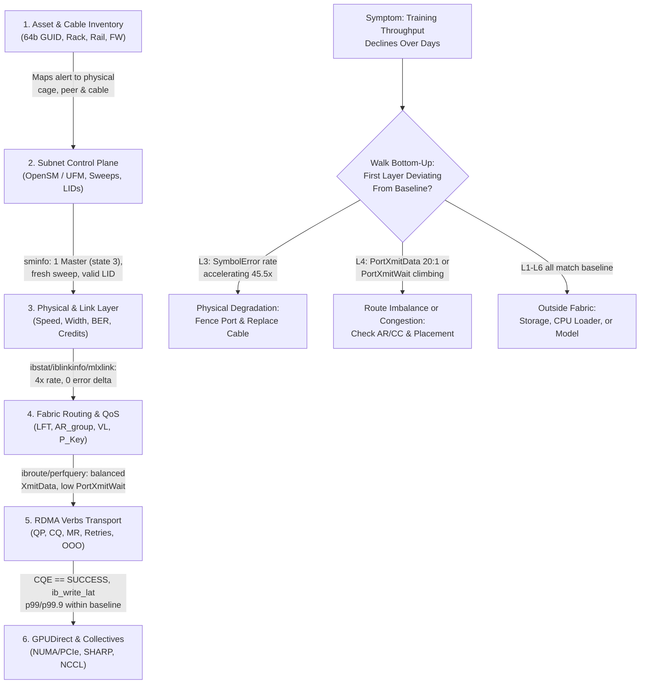
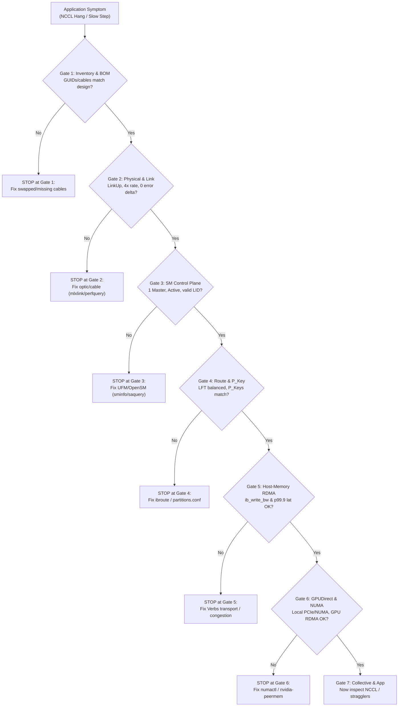

# 12.9 InfiniBand diagnostics, UFM and operations

| | |
|---|---|
| Level | Advanced |
| Priority tier | 1 |
| Lab venue | Nebius GPU |
| Part | Part 12: Complete AI networking |
| Code | `code/part12/infiniband_diagnostics_ufm.py`, `code/part12/infiniband_diagnostics_ufm_lab.py` |
| Coverage file | `planning/coverage/chapters/12-09.md` |

## Why this matters for AI infrastructure

Picture a training job that stays green on every reachability dashboard, yet slows a little more each day. An InfiniBand fabric can behave exactly like that, and the erosion is hard to see. Every rank in a collective barrier waits for the slowest link in the cluster. When one cable negotiates down to a single lane, or starts piling up physical bit errors, the stalls spread across thousands of GPUs. If you only check whether a port is up, or you keep tuning collective timeout variables, you can lose hours while the real link keeps degrading.

Three production incidents from our operational archives show why shallow checks fail at cluster scale. In the first, every port reported active status, yet step times varied widely because one cable had trained at reduced width. In the second, multi-day throughput declined while a switch port's physical symbol errors grew faster and faster. In the third, engineers spent hours raising collective timeouts while a narrow, error-prone link corrupted RDMA retries underneath.

The table below sets out each incident as a surface symptom, the root cause in the fabric, and the telemetry that exposed it.

| Production Incident | Surface Symptom | Underlying Fabric Root Cause | Key Telemetry Numbers |
|---|---|---|---|
| **1. Multi-Rack Step Variance (`V8` `index.md`)** | Every port reported `State: Active` and `Physical state: LinkUp`, yet step times varied by `> 20%` across `128` GPU nodes | Replacement cable negotiated down from `4x` to `1x` width, Adaptive Routing was misconfigured on the active SL, and ranks bound to remote NUMA HCAs | `128` nodes, `> 20%` step-time variance, `4x -> 1x` width (`400 Gbps -> 100 Gbps`) |
| **2. "The Fabric Failed Slowly" (`V8` Ch. 9)** | Multi-day training throughput declined steadily while every switch and HCA link remained `State: Active` | Switch port `12` suffered accelerating physical symbol errors and repeated link downs before hard failure | `SymbolErrorCounter`: Day `1: 4` -> Day `4: 890` (`+886`, `295.33`/day) -> Day `7: 41,200` (`+40,310`, `13,436.67`/day, **`45.5x` acceleration**); `LinkDownedCounter`: `0 -> 3 -> 11` |
| **3. "The NCCL Timeout That Was Not an NCCL Problem" (`V8` Ch. 10)** | Engineers repeatedly increased `NCCL` timeout variables while multi-node jobs hung and aborted | An `Active` port running at `1x` width with rising physical symbol errors triggered RDMA transport timeouts | `1x` vs `4x` negotiated width (`25%` bandwidth) plus rising `SymbolErrorCounter` and `LinkErrorRecoveryCounter` deltas |

Read each row from left to right, from the symptom to the root cause and the numbers that prove it.

Operating a production AI fabric takes two capabilities that work together. First, you need to know the low-level diagnostic utilities from OpenFabrics Enterprise Distribution, `rdma-core`, and Mellanox Firmware Tools. You must know which tool reads local host state, which one crawls the subnet, and which one reads hardware error counters or optical power. Second, you need centralized fabric management through NVIDIA Unified Fabric Manager, plus a strict seven-gate bottom-up troubleshooting workflow. That workflow stops at the lowest unproven layer and preserves counter evidence before any port reset. Treat a green port as the start of your investigation, not the end of it.

## Prerequisites and outcomes

**Prerequisites:** This chapter builds on the RDMA verbs, Queue Pairs and Completion Queues from Chapter 12.2. You also need the InfiniBand link speeds, addressing families, partition keys and credit flow control from Chapter 12.6. Finally, you should know the Subnet Manager routing engines from Chapter 12.7, and the Adaptive Routing and congestion control mechanisms from Chapter 12.8.

**Outcomes:** By the end of this chapter, you will be able to reach five operational goals. First, you can classify and run all twenty-seven core InfiniBand utilities. Those cover local HCA inspection, subnet inventory, path verification, control-plane auditing and physical counter diagnostics. Second, you can tell port state apart from cumulative counters and rates of change, using `perfquery` and `ibqueryerrors`. That distinction separates old damage from active physical degradation, and from plain credit congestion. Third, you can diagnose physical SERDES and optical transceiver faults with `mst` and `mlxlink`. You will compare raw and effective BER, and check optical power, bias current, voltage and temperature against hardware limits. Fourth, you can audit Subnet Manager consistency. You compare live node responses from `smpquery` against cached Subnet Administration records from `saquery`, and you isolate degraded ports with `ibportstate`. Fifth, you can operate NVIDIA UFM Enterprise, UFM Telemetry and UFM Cyber-AI across DGX SuperPOD clusters. You can also run the seven-gate bottom-up troubleshooting workflow with percentile latency verification.

---

## 1. InfiniBand observability layers: state, counters, rates, and inventory context

### 1.1 The six-layer observability stack and why "port Active" is never enough

A simple up-or-down port check misses the failures that hurt most AI clusters. A four-lane cable that trains down to one lane still shows an active link, but it has lost three quarters of its bandwidth. A transceiver with a rising pre-FEC bit error rate looks green on basic dashboards too, and so does a switch with imbalanced static routes. Production observability has to connect six layers, from physical inventory up to distributed collectives. Each layer needs an explicit baseline check, so you can prove it is not the source of performance drift.

The diagram shows how the layers link together, and where a walk from the bottom up would stop.



Walk the diagram from layer 1 upward. The first layer that deviates from its baseline is where you stop and fix things.

The table lists, for each layer, its identifiers, how you verify its baseline, and what a divergence proves.

| Observability layer | Primary identifiers & objects | Baseline health verification | What divergence proves |
|---|---|---|---|
| **1. Asset & Topology Inventory** | `64`-bit `NodeGUID`, `PortGUID`, `SystemImage GUID`, cable serial (`MT2135FT12345`), rack/U, rail index (`0..7`), HCA/switch firmware (`28.39.2048`) | Discovered `ibnetdiscover` / `iblinkinfo` graph matches source-of-truth bill of materials (`BOM`) | Missing device, swapped rail cable after maintenance, or unapproved firmware drift |
| **2. Subnet Control Plane** | Master/Standby SM (`OpenSM` / `UFM`), `Base LID` (`1..49,151`), `LMC` (`2^LMC`), `GID` (`0xFE80::/64`, `0xFEC0::/64`), `P_Key` tables, `Trap 128` sweeps | `sminfo` reports `1` authoritative `SMINFO_MASTER` (`state 3`, `priority 15`) with climbing `activity count`; `smpquery` matches `saquery` | Port stuck in `State: Initializing` (`Base lid: 0`), split SM authority, stale SA database, or heavy-sweep storm |
| **3. Physical & Link Layer** | SERDES lanes (`4x`, `12x`), line coding (`8b/10b`, `64b/66b`, `256b/257b`), optical `Rx`/`Tx` dBm, `SymbolErrorCounter`, `LinkDownedCounter`, `64`-byte `CBFC` credits (`VL0..VL15`) | Negotiated speed (`SDR` `8G` to `NDR` `400G`, `XDR` `800G`, `GDR` `1600G` `4x`) and width (`4x`) match design; error counter **deltas** = `0` | Degraded fiber/transceiver (`45.5x` error rate acceleration), `1x` width fallback (`25%` bandwidth), or link flaps |
| **4. Fabric Routing & Congestion** | Switch virtual `Port 0`, `LFT` (`ibroute`), `AR_group`, `PortXmitData`/`PortRcvData` (`4`-octet words), `PortXmitWait`, `PortXmitDiscards`, `FECN`/`BECN` | Equal traffic distribution across sibling spine uplinks; low `PortXmitWait` gradient; `PortXmitDiscards` delta = `0` | Static `LFT` `20:1` uplink collision, `2:1` leaf oversubscription cut, or `N:1` destination congestion tree |
| **5. RDMA Transport (`Verbs`)** | Protection Domains (`PD`), Memory Regions (`MR`), Queue Pairs (`QP`, `max_qp: 262144`), Completion Queues (`CQ`), `RNR` NAK / timeout retries | `ib_write_bw` average tracks peak; `ib_write_lat` `99%` (`1.71 µs`) and `99.9%` (`1.98 µs`) percentiles match baseline; `CQE == IBV_WC_SUCCESS` | `Failed to modify QP to RTR` (`MTU`/`P_Key`/`GID` mismatch), `IBV_WC_RETRY_EXC_ERR` (`0x81`), or `2.91x` `p99.9` tail stall (`5.77 µs`) |
| **6. GPUDirect & Collectives** | PCIe root complex, NUMA affinity (`numactl`), `nvidia-peermem` / `DMA-BUF`, `IPoIB` (`ib0`, `20`-byte MAC, `4 KB` datagram vs `64 KB` connected), `SHARP`, `NCCL` | `nvidia-smi topo -m` shows `PIX`/`NODE` GPU-to-HCA affinity; multi-node `AllReduce` bus bandwidth scales within baseline | Cross-socket NUMA hairpin (`NUMA 1` vs `NUMA 0`), silent host-staged buffer copy, or single-rank compute straggler |

Check the rows in order, because a fault in a lower layer can hide behind the symptoms of a higher one.

### 1.2 State versus cumulative counters versus rates of change

In the middle of a slowdown, it is tempting to stare at a port counter and treat any large non-zero number as proof. A big total can be old news. Swapping a cable because of an old total wastes a maintenance window and leaves the real failing link in place. The opposite mistake is just as costly. A small error count that climbs fast can mean a dying transceiver, and that transceiver can stall the whole job. You need to separate three telemetry primitives: instantaneous state, cumulative counters, and rates of change over time.

State is the condition of a port at one instant. It covers the physical link state, the logical port state, the negotiated link rate, the lane width, the assigned Local ID and the routing table entries. Cumulative counters are hardware registers that only go up. Each port's Performance Management Agent keeps them. They accumulate since the last reboot or explicit clear, so a non-zero total proves only that something happened at some point. Rates and deltas measure change across an observation window $\Delta t = t_1 - t_0$. They show whether a fault is active right now.

The table compares the three primitives, with an example for each.

| Telemetry Primitive | Mathematical Form | Example Fields & Values | Operational Meaning |
|---|---|---|---|
| **1. State** | Instantaneous snapshot $S(t)$ | `Physical state`: `LinkUp`, `Polling`, `Disabled`, `Recovery`; `State`: `Active`, `Initialize`, `Armed`, `Down`; `Rate`: `56` (`4x FDR`), `100` (`4x EDR`), `200` (`4x HDR`), `400` (`4x NDR`), `800` (`4x XDR`), `1600` (`4x GDR`); `Width`: `4x` vs `1x`; `Base lid`: `1..49,151` | Proves whether physical training and Subnet Manager admission succeeded right now |
| **2. Cumulative Counter** | Monotonic register $C(t)$ since last reset (`Time Since Last Clear [Min]: 12824.8`) | `SymbolErrorCounter`, `LinkErrorRecoveryCounter`, `LinkDownedCounter`, `PortRcvErrors`, `PortXmitDiscards`, `PortXmitWait`, `PortXmitData`, `PortRcvData` | Proves that an event occurred at some point in the past; raw total alone cannot prove an active fault |
| **3. Rate & Acceleration** | $\Delta C = C(t_1) - C(t_0)$, rate $\Delta C / \Delta t$, and ratio of consecutive rates | Scenario A (`port 9` over `300 s`): `12,034 -> 12,034` ($\Delta = 0$); Scenario B (`port 12` over `6` days): `4 -> 890` (`+886`, `295.33`/day) -> `41,200` (`+40,310`, `13,436.67`/day, **`45.5x` acceleration**) | Proves whether physical degradation or credit backpressure is actively occurring and accelerating |

Only the rate tells you whether the problem is still happening.

Consider two real production counter stories. They look identical to a naive non-zero alert rule, yet they need opposite actions.

```text
# Scenario A: High cumulative counter, zero delta ("Historical Scar Tissue", untested here)
$ perfquery <lid> 9 | grep SymbolErrorCounter; sleep 300; perfquery <lid> 9 | grep SymbolErrorCounter
SymbolErrorCounter:.............12034
SymbolErrorCounter:.............12034

# Scenario B: Low initial counter, 45.5x rate acceleration ("The Fabric Failed Slowly", untested here)
# Day 1:
$ perfquery <switch-lid> 12 | grep -E 'SymbolErrorCounter|LinkDownedCounter'
SymbolErrorCounter:.............4
LinkDownedCounter:..............0
# Day 4 (3 days later):
SymbolErrorCounter:.............890
LinkDownedCounter:..............3
# Day 7 (3 days later):
SymbolErrorCounter:.............41200
LinkDownedCounter:..............11
```

In Scenario A, switch port nine reads `12,034`. Two snapshots taken five minutes apart, under active traffic, show no change at all. Those errors are historical scar tissue from an old cable reseat. Replacing the cable would waste time, and it could introduce a real fault. In Scenario B, switch port twelve starts with a count of only four on day one. Over two consecutive three-day windows, the daily error rate jumps by a factor of 45.5x. Link-down events climb to eleven in the same period.

Here is the arithmetic for port twelve:

```text
Acceleration Factor = (40,310 / 3 days) / (886 / 3 days) = 13,436.67 / 295.33 = 45.5x
```

An alert built on the rate of change and its acceleration flags port twelve on Day 4. That is days before the degrading transceiver drags down training throughput across the cluster. The same rule leaves port nine alone, because its static total is harmless. Alert on the rate and the acceleration of errors, not on the raw total.

### 1.3 Why inventory context and immutable GUIDs anchor every metric

An alert that names a switch LID is only useful if you can find the cable behind it. If that takes an hour of tracing, the alert has lost most of its value. Local IDs can change. The Subnet Manager may reassign them during a heavy sweep, or after a failover to a standby appliance. Suppose your monitoring database keys each time series by Local ID. A subnet resweep would then scramble the historical trends across ports. Production monitoring should anchor every metric to immutable hardware Global Unique Identifiers, and join those to rack, rail and cable metadata.

InfiniBand uses three address families, one for each layer. Hardware identifiers are 64 bits wide, and they are burned in at the factory. They label every adapter, port and switch chassis. Subnet Local IDs are 16 bits wide, and the Subnet Manager assigns them dynamically. They give compact forwarding addresses inside one subnet. Global IDs are 128 bits wide, and IP over InfiniBand link addresses are 20 bytes long. Together they make global routing and TCP/IP encapsulation possible.

The table lists each family, its width, and the rules that matter in practice.

| Address Family & Scope | Bit Width & Structure | Key Ranges, Examples, and Operational Rules |
|---|---|---|
| **1. Hardware `GUID`s (`NodeGUID`, `PortGUID`, `SystemImage GUID`)** | `64`-bit IEEE EUI-64 burned into NVM | Dual-port `MT4113` FDR HCA: `NodeGUID` & Port 1 `PortGUID = 0x00123456000073f0`, Port 2 `PortGUID = 0x00265802000073f8`; single-port `MT4129` ConnectX-7 NDR HCA: `0x08c0eb0300f1a2c3`. Switches share one `PortGUID` across ports and one `SystemImage GUID` across chassis ASICs. **Always key inventory and time-series DBs by `PortGUID`.** |
| **2. Subnet `LID` (`Local ID`) & `LMC` (`LID Mask Control`)** | `16`-bit dynamic address assigned by SM; `LMC` (`0..7`) allocates $2^{\text{LMC}}$ consecutive LIDs (`Base LID` to $\text{Base LID} + 2^{\text{LMC}} - 1$) | `0x0000` (`0`): reserved; **`0x0001..0xBFFF` (`1..49,151`, $2^{15} + 2^{14} - 1$)**: unicast limit; **`0xC000..0xFFFE` (`49,152..65,534`)**: multicast; **`0xFFFF` (`65,535`)**: permissive LID for directed-route `SMP`s on `VL15`. Can change after SM resweep or failover. |
| **3. Global `GID` & `IPoIB` Link Address (`RFC 2373` / `RFC 2375`)** | `128`-bit IPv6 format (`64`-bit prefix + `64`-bit `PortGUID`); `20`-byte `IPoIB` MAC (`1` B flags + `3` B `QPN` + `16` B `GID`) | `0xFE80::/64` link-local default; `0xFEC0::/64` site-local routable across IB routers; `0xFF00::/8` (`0xFF`) multicast. BCM `ibnet` (`10.149.0.0/16` on `ib0`/`ib1`) supports `4 KB` (`4,096` B) datagram or `64 KB` (`65,536` B) connected MTU. Legacy `ifconfig` truncates `20`-byte MACs to `6` bytes; always use `ip addr` / `ip link` and static IPs. |

Key your inventory and time-series databases by `PortGUID`, not by LID. That one choice keeps your history intact through every resweep.

## 2. The complete InfiniBand diagnostic toolkit (`OFED`, `rdma-core`, and `MFT`)

During a live outage, the wrong diagnostic tool can stall the management plane, or erase the evidence you need. Some utilities read local kernel files in microseconds. Others crawl the whole subnet over the management Virtual Lane. Two utilities can change live port states or non-volatile adapter firmware. Call one of them carelessly, and it can trigger a fabric-wide rerouting sweep. Learn the mechanism and the safety profile of all twenty-seven core utilities, and you can inspect any layer without causing harm.

### 2.1 Functional taxonomy of the 27 InfiniBand utilities

Consider how the table groups the utilities by layer. Its "Mutates state?" column tells you which tools can change something on the fabric.

| Category | Utility | Target / mechanism | Mutates state? | Primary operational use and key flags |
|---|---|---|---|---|
| **1. Local Host & Verbs** | `ibstat` | Local HCA sysfs | No | Prints HCA type (`MT4113`, `MT4129`), FW (`10.12.1100`, `28.39.2048`), `Node GUID`, `System image GUID`, and per-port `State`, `Physical state`, `Rate`, **decimal** `Base lid` & `SM lid`, `LMC`, `Capability mask`, `Port GUID`, and `Link layer` |
| **1. Local Host & Verbs** | `ibstatus` | Local HCA sysfs script | No | Prints compact port status with `default gid`, **hexadecimal** `base lid` (`0x391`) & `sm lid` (`0x2b`), numeric state (`4: ACTIVE`, `5: LinkUp`), and explicit width/mode (`56 Gb/sec (4X FDR)`) |
| **1. Local Host & Verbs** | `ibdev2netdev` | Local kernel netdev map | No | Maps RDMA verbs devices and ports to OS network interfaces (`mlx5_0 port 1 ==> eth0 (Up)`, `mlx5_1 port 1 ==> ib0 (Up)`) |
| **1. Local Host & Verbs** | `ibv_devices` | Userspace verbs | No | Lists RDMA devices visible to userspace (`mlx5_0`, `mlx5_1`); first check when containers/VMs cannot see HCAs |
| **1. Local Host & Verbs** | `ibv_devinfo` | Userspace verbs (`-v -d`) | No | Detailed HCA capabilities: `fw_ver`, `vendor_id` (`0x02c9`), `vendor_part_id` (`4129`), `max_qp` (`262144`), `max_qp_wr` (`32768`), `max_sge` (`30`), `active_mtu` (`4096`) |
| **1. Local Host & Verbs** | `show_gids` | Local GID table | No | Displays per-port `GID` indices, IPv4-mapped GIDs, and RoCEv1/v2 or IB protocol versions |
| **1. Local Host & Verbs** | `ofed_info` | Package metadata (`-s`) | No | Prints installed `MLNX_OFED` / `DOCA-OFED` release version and driver component stack |
| **2. Subnet Inventory** | `ibhosts` | Subnet crawl / cache | No | Lists all Channel Adapter (compute/storage host) nodes discovered in the subnet with `PortGUID`, `LID`, and `NodeDescription` |
| **2. Subnet Inventory** | `ibswitches` | Subnet crawl / cache | No | Lists all InfiniBand switch ASICs in the subnet with `SwitchGUID`, `LID` (`Port 0`), port count, and switch name |
| **2. Subnet Inventory** | `ibnodes` | Subnet crawl / cache | No | Combined inventory of all discovered `ibhosts` and `ibswitches` in the subnet |
| **2. Subnet Inventory** | `ibnetdiscover` | `VL15` `SMP` crawl | No | Crawls the entire subnet topology (switches, HCAs, routers, and port-to-port links); supports `-p` (ports report) and topology cache export |
| **2. Subnet Inventory** | `iblinkinfo` | `VL15` `SMP` + link query | No | Reports every switch port's state, negotiated speed (`400.0 Gbps`), lane width (`4x` vs `1x`), and connected peer GUID/LID/description |
| **3. Path & Forwarding** | `ibaddr` | Local/remote MAD query | No | Resolves the `GID` and `LID` range (`start_lid..end_lid` from `LMC`) of a local or specified port (`-C <ca> -P <port> <lid>`) |
| **3. Path & Forwarding** | `ibping` | GSI Vendor MAD ping | No | Tests IB management-datagram connectivity between two ports; requires running server **`ibping -S`** on target first, then client `ibping <lid>` (`-c 10`) |
| **3. Path & Forwarding** | `ibsysstat` | GSI sysstat MAD | No | Queries remote node hostname, CPU count, and memory info over InfiniBand management datagrams (`ibsysstat -S` server, `ibsysstat <lid> cpu`) |
| **3. Path & Forwarding** | `ibtracert` | Switch `LFT`/`MFT` trace | No | Traces the exact hop-by-hop switch ingress/egress path between source and destination `LID`s (`ibtracert <src-lid> <dst-lid>` or `-m <mlid>`) |
| **3. Path & Forwarding** | `ibroute` | `VL15` `SMP` `LFT`/`MFT` | No | Dumps a switch's programmed Linear Forwarding Table (`ibroute <sw-lid>`) or Multicast Forwarding Table (`-M`), showing `DLID -> Egress Port` |
| **4. SM & Control Plane** | `sminfo` | `VL15` `SMP` (`SMInfo`) | No | Queries the authoritative Subnet Manager (`sm lid 1`, `sm guid`, `activity count 184223`, `priority 15`, `state 3 SMINFO_MASTER`) |
| **4. SM & Control Plane** | `smpquery` | Direct `VL15` `SMP` to node | No | Queries hardware attributes directly from a target node (`smpquery nodedesc 914`, `portinfo`, `switchinfo`, `pkeys`, `sl2vl`, `vlarb`) |
| **4. SM & Control Plane** | `saquery` | GSI query to SM `SA` DB | No | Queries the Subnet Manager's cached Subnet Administration database (`saquery 914` `NodeRecord`, `PathRecord`, `MCMemberRecord`) |
| **5. Counters & PHY** | `perfquery` | GSI `PMA` port counters | **Only with `-R`** | Reads hardware error, wait, and throughput counters from any `LID`/port (`-a` all ports, `-x` extended `64`-bit counters, `-G` by GUID; **avoid `-R` reset during triage**) |
| **5. Counters & PHY** | `ibqueryerrors` | Subnet-wide `PMA` sweep | **Only with `-k`/`-K`** | Sweeps all switches in the subnet and prints only ports with non-zero error/wait counters (supports `--counters`, `--data`; **avoid `-k`/`-K` clear**) |
| **5. Counters & PHY** | `ibdiagnet` | Full multi-stage fabric audit | No | Comprehensive fabric diagnostic tool checking duplicate GUIDs, SM state, link speed/width, `PMA` counters, BER, routing loops, and `SHARP`; writes `/var/tmp/ibdiagnet2/` |
| **5. Counters & PHY** | `mlxlink` | Firmware register access | **Only with `-a`** | Reads SERDES BER (`-c`), optical module DDM (`-m`: temp, voltage, bias mA, Rx/Tx dBm), eye opening (`-e`), and JSON (`--json`) on `mlx5_0` or switch ports (`-p`) |
| **5. Counters & PHY** | `mst` | MFT PCI device manager | No | Starts/inspects Mellanox Software Tools `/dev/mst/*` device nodes (`mst start`, `mst status -v`) required by legacy MFT tools |
| **6. State Mutation** | `mlxconfig` | Non-volatile HCA NVM | **Yes (`set`)** | Queries (`mlxconfig -d <dev> q`) or modifies (`set`) HCA firmware parameters (`LINK_TYPE_P1=1` IB vs `2` ETH, `SRIOV_EN`, `NUM_OF_VFS`) |
| **6. State Mutation** | `ibportstate` | `VL15` `SMP` `SubnSet` | **Yes** | Queries or changes port state (`ibportstate <sw-lid> <port> disable`, `enable`, `reset`, `speed`, `width`) to isolate a flapping link |

Most rows are read-only. Only `perfquery`, `ibqueryerrors`, `mlxlink`, `mlxconfig` and `ibportstate` can change anything, and then only with the flags shown in the table.

:::tip Selecting the Adapter (`-C`) and Port (`-P`) on Multi-Rail Hosts
Multi-rail GPU servers connect each Host Channel Adapter to a separate InfiniBand rail and subnet. Because Local IDs are scoped to a single subnet, the same numerical LID can refer to different servers on different rails. Nearly all diagnostic utilities accept `-C` for the adapter name and `-P` for the one-indexed port number to target a specific rail.
:::

### 2.2 Local HCA inspection: `ibstat` versus `ibstatus`, `ibdev2netdev`, and `ibv_devinfo`

Formatting differences between local tools often cause false alarms. When you compare host output with switch tables, a mismatch may mean nothing at all. `ibstat` and `ibstatus` read the same kernel files under `/sys/class/infiniband/`. One prints decimal addresses, and the other prints hexadecimal. `ibstat` also shows only a bare rate integer. That hides whether a link reached full four-lane width or fell back to one lane. Run both tools alongside `ibdev2netdev`, and you can settle addressing, lane width and kernel interface mapping in seconds.

The block below shows `ibstat` and then `ibstatus` on the same dual-port FDR HCA.

```text
# 1. `ibstat` output on a dual-port MT4113 FDR HCA (decimal LIDs, from SCL Ch. 5; untested here):
$ ibstat
CA 'mlx5_0'
    CA type: MT4113
    Number of ports: 2
    Firmware version: 10.12.1100
    Hardware version: 0
    Node GUID: 0x00123456000073f0
    System image GUID: 0x00123456000073f0
    Port 1:
        State: Active
        Physical state: LinkUp
        Rate: 56
        Base lid: 913
        LMC: 0
        SM lid: 43
        Capability mask: 0x26516848
        Port GUID: 0x00123456000073f0
        Link layer: InfiniBand
    Port 2:
        State: Active
        Physical state: LinkUp
        Rate: 56
        Base lid: 1361
        LMC: 0
        SM lid: 698
        Capability mask: 0x26516848
        Port GUID: 0x00265802000073f8
        Link layer: InfiniBand

# 2. `ibstatus` output on the exact same HCA (hexadecimal LIDs and explicit width/mode; untested here):
$ ibstatus
InfiniBand device 'mlx5_0' port 1 status:
    default gid:     fe90:0000:0000:0000:0000:0026:5802:0000:73f0
    base lid:        0x391
    sm lid:          0x2b
    state:           4: ACTIVE
    phys state:      5: LinkUp
    rate:            56 Gb/sec (4X FDR)
    link_layer:      InfiniBand

InfiniBand device 'mlx5_0' port 2 status:
    default gid:     fea0:0000:0000:0000:0000:0012:3456:0000:73f8
    base lid:        0x551
    sm lid:          0x2ba
    state:           4: ACTIVE
    phys state:      5: LinkUp
    rate:            56 Gb/sec (4X FDR)
    link_layer:      InfiniBand
```

The table compares what each tool prints for the same port.

| Diagnostic Aspect | `ibstat` Output | `ibstatus` Output | Operational Interpretation |
|---|---|---|---|
| **Port 1 `Base lid` & `SM lid`** | Decimal `Base lid: 913`, `SM lid: 43` | Hexadecimal `base lid: 0x391` ($3 \times 256 + 9 \times 16 + 1 = 913$), `sm lid: 0x2b` ($2 \times 16 + 11 = 43$) | Both tools read the same port; convert hex/decimal before comparing against `ibroute` or `saquery` |
| **Port 2 `Base lid` & `SM lid`** | Decimal `Base lid: 1361`, `SM lid: 698` | Hexadecimal `base lid: 0x551` (`1361`), `sm lid: 0x2ba` (`698`) | Different `SM lid`s (`43` vs `698`) prove Port 1 and Port 2 are cabled into **two separate InfiniBand subnets/rails** |
| **Negotiated Speed & Width** | Bare integer `Rate: 56` (or `Rate: 400` on NDR) | Explicit string **`56 Gb/sec (4X FDR)`** (or `400 Gb/sec (4X NDR)`) | Immediately exposes whether a `100 Gb/sec` port is a healthy `4X EDR` link or a degraded `1X NDR` link (`14.0625 Gbps` raw `64b/66b` per FDR lane = `56.25 Gbps` raw / `54.4 Gbps` `4x` / `163.2 Gbps` `12x` effective) |

Convert the hexadecimal values before you compare them with `ibroute` or `saquery` output. That one conversion keeps addressing mismatches from turning into false alarms.

Servers that mix Ethernet and InfiniBand ports need one more mapping. You need to know which RDMA device backs each network interface. `ibdev2netdev` prints that mapping straight from the kernel.

```text
# Mapping RDMA devices to Linux network interfaces (from SCL Ch. 5; untested here)
$ ibdev2netdev
mlx5_0 port 1 ==> eth0 (Up)
mlx5_1 port 1 ==> ib0 (Up)
```

The output tells you two things. `mlx5_0` runs in Ethernet or RoCE mode and maps to `eth0`, so you read its hardware counters with `ethtool -S eth0`. `mlx5_1` runs in native InfiniBand mode and maps to `ib0`, so you query its fabric counters with `perfquery` and `ibqueryerrors`. Confirm the mapping before you read any counter, so you query the right device.

### 2.3 Comparing `smpquery` versus `saquery` to detect Subnet Manager database drift

Suppose a job cannot resolve a path, or a technician swapped cables during maintenance. The Subnet Manager database may no longer match the physical fabric. If you query only the Subnet Manager cache, stale records can send you to the wrong server. They can also hide a wedged control plane. Pair a direct node query from `smpquery` with a Subnet Administration query from `saquery`. The comparison shows at once whether the control plane matches physical reality.

```text
# 1. Direct VL15 SMP query to the node itself (bypasses SM database, from SCL Ch. 5; untested here):
$ smpquery nodedesc 914
Node Description:....................n51001 HCA-1

# 2. Subnet Administration (SA) query to the Subnet Manager's cached database (untested here):
$ saquery 914
NodeRecord dump:
        lid.....................914
        reserved................0x0
        base_version............0x1
        class_version...........0x1
        node_type...............Channel Adapter
        num_ports...............2
        sys_guid................0x0012345600003740
        node_guid...............0x0012345600003740
        port_guid...............0x0012345600003740
        partition_cap...........0x80
        device_id...............0x1011
        revision................0x0
        port_num................1
        vendor_id...............0x2C9
        NodeDescription.........n51001 HCA-1
```

The two commands take different paths, and they ask different agents. `smpquery` sends a Subnet Management Packet on Virtual Lane 15 straight to the target port. The adapter on compute node `n51001` builds the reply itself. `saquery` sends a General Services Interface query to the Subnet Manager, which returns the node record it cached in memory. Comparing the two replies isolates three distinct control-plane states.

| `smpquery nodedesc 914` Result | `saquery 914` Result | Operational Diagnosis & Meaning |
|---|---|---|
| Returns `n51001 HCA-1` | Returns `NodeDescription: n51001 HCA-1` (`sys_guid 0x0012345600003740`, `partition_cap 0x80 = 128` P_Keys, `device_id 0x1011 = 4113` `MT4113`, `vendor_id 0x2C9`) | **`CONSISTENT_NODE_AND_SA_RECORD`:** Physical node and cached Subnet Administration database agree |
| Returns `n51001 HCA-1` | Returns a different hostname (`n50999 HCA-1`) or mismatched `GUID` | **`SM_SA_DATABASE_STALE_NEEDS_RESWEEP`:** Cable or LID changed, and SM heavy sweep is blocked or incomplete |
| Returns `n51001 HCA-1` | Times out or returns an SA query error | **`SA_QUERY_FAILED_SM_UNREACHABLE_OR_WEDGED`:** Physical path to `LID 914` is up, but the Subnet Manager / SA daemon is down or unreachable |

Use the table as a decision rule. Whichever row matches tells you which part of the control plane to repair.

---

## 3. Deep counter semantics (`perfquery`, `ibqueryerrors`) and optical/SERDES telemetry (`mlxlink`, `ibdiagnet`)

### 3.1 `perfquery` and `ibqueryerrors`: counter families, units, and diagnostic matrix

When a distributed training job slows down, you need to know quickly whether the bottleneck is a bad optical cable, a routing black hole or lossless credit congestion. Misreading a counter name can send a team to pull clean fibers, when the real culprit is backpressure further downstream. `perfquery` reads Performance Management Agent registers over the fabric. So one engineer on a single management node can inspect any remote switch or host port. You do not have to log into each compute server during an incident.

The table maps each counter to what it measures, its most likely root cause when the delta is above zero, and the action to take.

| `perfquery` Counter Name | Hardware Semantics & Unit | Primary Root Cause When Delta > 0 | Operational Action |
|---|---|---|---|
| **`SymbolErrorCounter`** | Minor link coding violations (`8b/10b`, `64b/66b`, `256b/257b`) detected on physical lanes | Contaminated fiber end-face, marginal optical transceiver (`Rx dBm` low), bent DAC pin, or excessive cable bend radius | Check rate of change; run `mlxlink -c -m`; clean or replace cable/optic during maintenance before FEC saturates |
| **`LinkErrorRecoveryCounter`** | Times the physical link state machine entered `Recovery` and successfully retrained without dropping logical link | Severe transient bit error burst exceeding FEC recovery window | High-priority physical warning: inspect `mlxlink` per-lane errors and reseat/replace transceiver |
| **`LinkDownedCounter`** | Times link recovery **failed** and the physical port dropped to `Down` / `Polling` (generating OpenSM `Trap 128`) | Flapping cable, failing laser (`Bias Current` / `Tx Power`), or peer reboot/reset | **Critical:** Every increment triggers an SM heavy sweep (`Trap 128`). Fence port with `ibportstate disable` and replace hardware |
| **`PortRcvErrors`** | Total packets received with bad `VCRC`, `ICRC`, malformed length, or physical local link error | Corrupted frames arriving from the remote peer or transit cable | Inspect the **peer** transmitter (`Tx`) and the connecting cable with `iblinkinfo` and `mlxlink` |
| **`PortRcvRemotePhysicalErrors`** | Packets received marked with an End-of-Packet (`EBP`) delimiter indicating corruption occurred upstream before this link | Upstream link corruption propagated through cut-through switching | Trace backward along `ibtracert` to find the upstream port whose `SymbolErrorCounter` / `PortRcvErrors` is rising |
| **`PortXmitDiscards`** | Packets discarded by the transmitter before leaving the port | Invalid `DLID` / unprogrammed `LFT` entry (`ibroute`), `P_Key` violation, neighbor MTU exceeded, or **Switch Head-of-Queue (`HoQ`) lifetime timeout** | Verify `sminfo` sweep status, `ibroute` `LFT` coverage, `smpquery pkeys`, or severe downstream credit stall |
| **`PortXmitWait`** | Clock ticks where the port had packets ready to transmit but **zero downstream `64`-byte `CBFC` credits** on that Virtual Lane | **Lossless fabric congestion** (downstream N:1 incast, `2:1` oversubscription cut, or `LFT` route collision) | If `SymbolErrorCounter == 0` and `LinkDownedCounter == 0`, **do NOT replace cables**. Trace the `PortXmitWait` gradient to the congestion root |
| **`PortXmitData` / `PortRcvData`** | Total payload/framing data transmitted or received, measured in **`4`-octet (`32`-bit) words** (use `perfquery -x` for `64`-bit extended counters so counters do not wrap at `16 GiB` in `< 0.35 s` at `400G`) | Normal traffic flow; **`20:1` ratio across equal-cost uplinks** (`5,368,709,120` words = `21,474,836,480` B vs `268,435,456` words = `1,073,741,824` B) proves static routing concentration | Multiply raw counter delta by **`4`** to get bytes: $\text{Bytes} = \Delta\text{Words} \times 4$; check `AR_group` and `LFT` balance |

When you read each row, look at its delta, not at its total. A rising `SymbolErrorCounter` points at the cable or optic. A rising `PortXmitWait`, with clean error counters, points at congestion.

### 3.2 `mlxlink` and `mst`: SERDES Bit Error Rate (`BER`) and optical DDM link budgets

A fast link can start to degrade at the SERDES or optical layer days before `perfquery` shows a single symbol error. Modern adapters and switches use Forward Error Correction, or FEC. FEC quietly repairs a growing burst of raw bit errors on a failing lane. Then, once the correction threshold is saturated, the damage shows up all at once. `mlxlink`, from Mellanox Firmware Tools, lets you read the pre-FEC bit error rate on each lane. It also reads the transceiver's own sensors for optical power, bias current, voltage and temperature.

The first block shows the SERDES counters. The second shows the optical module's own telemetry.

```text
# 1. Reading physical SERDES counters and BER with `mlxlink -c` (from SCL Ch. 5; untested here):
# mlxlink -d mlx5_1 -c
Operational Info
----------------
State                           : Active
Physical state                  : LinkUp
Speed                           : IB-EDR
Width                           : 4x
FEC                             : No FEC
Loopback Mode                   : No Loopback
Auto Negotiation                : ON
Supported Info
--------------
Enabled Link Speed              : 0x0000003f (EDR,FDR,FDR10,QDR,DDR,SDR)
Supported Cable Speed           : 0x0000003f (EDR,FDR,FDR10,QDR,DDR,SDR)
Troubleshooting Info
--------------------
Status Opcode                   : 0
Group Opcode                    : N/A
Recommendation                  : No issue was observed.
Physical Counters and BER Info
------------------------------
Time Since Last Clear [Min]     : 12824.8
Effective Physical Errors       : 0
Effective Physical BER          : 15E-255
Raw Physical BER                : 15E-255
Raw Physical Errors Per Lane    : 0,0,0,0
Link Down Counter               : 0
Link Error Recovery Counter     : 0

# 2. Reading optical module DDM telemetry with `mlxlink -m` (from SCL Ch. 5; untested here):
# mlxlink -d mlx5_1 -m
...
Module Info
-----------
Identifier                      : QSFP+
Compliance                      : N/A
Cable Technology                : 850 nm VCSEL
Cable Type                      : Active cable (active copper / optics)
OUI                             : Mellanox
Vendor Name                     : Mellanox
Vendor Part Number              : MFXXXXX-EXXX
Vendor Serial Number            : MT2135FT12345
Rev                             : B2
Attenuation (5g,7g,12g) [dB]    : N/A
FW Version                      : XX.XX.XXX
Wavelength [nm]                 : 850
Transfer Distance [m]           : 10
Digital Diagnostic Monitoring   : Yes
Power Class                     : 2.5 W max
CDR RX                          : ON,ON,ON,ON
CDR TX                          : ON,ON,ON,ON
LOS Alarm                       : N/A
Temperature [C]                 : 38 [-10..80]
Voltage [mV]                    : 3255.2 [3100..3500]
Bias Current [mA]               : 6.750,6.750,6.750,6.750 [5.492..8.5]
Rx Power Current [dBm]          : 0,0,0,0 [-14..6]
Tx Power Current [dBm]          : 0,0,0,0 [-12..6]
```

Experienced fabric engineers check three groups of fields in this output. First, they compare the raw pre-FEC error rates with the effective post-FEC rates on all four lanes. Second, they check every Digital Diagnostic Monitoring reading against the alarm bracket printed in square brackets. Third, they read the part and serial numbers from the module EEPROM. That way, a technician can replace the exact cable without guessing on the data center floor.

| `mlxlink` Field Group | Healthy Baseline (*Supercomputers for Linux Sysadmins* Ch. 5) | Degraded Fault Signature | What It Proves |
|---|---|---|---|
| **1. `Raw Physical BER` vs `Effective Physical BER` & Per-Lane Errors** | `Time Since Last Clear [Min]: 12824.8` (`8.9` days), `Raw Physical BER: 15E-255`, `Effective Physical BER: 15E-255`, `Raw Physical Errors Per Lane: 0,0,0,0` | Lane 2 shows `18,420` raw errors (`0` on Lanes 0, 1, 3) with `Raw Physical BER: 2E-5` while `Effective Physical BER` reads `1E-13` | Lane 2 fiber ferrule or VCSEL is physically failing and FEC is barely masking it before link recovery |
| **2. Optical DDM Threshold Brackets (`[min..max]`)** | `Temperature [C]: 38 [-10..80]`, `Voltage [mV]: 3255.2 [3100..3500]`, `Bias Current [mA]: 6.750 [5.492..8.5]`, `Rx Power [dBm]: 0,0,0,0 [-14..6]`, `Tx Power [dBm]: 0,0,0,0 [-12..6]` | Lane 2 `Rx Power Current` drops to `-16.8 dBm` (below `-14 dBm` floor; `rx_power_dbm_per_lane = (-1.2, -1.4, -16.8, -1.3)`) while peer `Tx Power` is normal (`0.4 dBm`), or temperature nears `70..80 C` | Optical attenuation/contamination on Lane 2 (`OPTICAL_POWER_OUT_OF_SPEC`) or thermal laser drift |
| **3. EEPROM Provenance** | `QSFP+`, `850 nm VCSEL`, `Vendor Part Number: MFXXXXX-EXXX`, `Vendor Serial Number: MT2135FT12345`, `Transfer Distance [m]: 10`, `Power Class: 2.5 W max`, speed mask `0x0000003f` | Negotiated `Width: 1x` on a `4x` cable (`LANE_WIDTH_DEGRADED`) or mismatched cable speed mask | Allows generating an exact RMA ticket with serial `MT2135FT12345` before touching the rack |

Use the healthy column as your baseline. If a reading looks like the degraded column, suspect the optic or lane behind it.

### 3.3 `ibdiagnet`: multi-stage fabric-wide auditing

Checking ports one at a time, with `perfquery` and `mlxlink`, is too slow after a maintenance window. You want one command that sweeps every switch and adapter. It should check link widths, measure counter deltas across a timed pause, and audit routing tables for credit loops. NVIDIA's `ibdiagnet` runs that full multi-stage check from a management or UFM host. It writes structured, machine-readable reports to `/var/tmp/ibdiagnet2/`.

| `ibdiagnet` Stage | What It Audits Across the Subnet | Key Output File in `/var/tmp/ibdiagnet2/` | Failure Signature |
|---|---|---|---|
| **1. Discovery & Duplicate GUIDs** | Crawls all switches and HCAs via `VL15` `SMP`s and verifies unique `64`-bit `NodeGUID` and `PortGUID` values | `ibdiagnet2.log`, `ibdiagnet2.db_csv`, `ibdiagnet2.lst` | Unreachable switch ASIC or duplicate hardware GUID on the subnet |
| **2. Links & Speed/Width Check** | Compares negotiated speed and lane width (`4x` vs `1x`) against `Enabled Link Speed` and `Supported Cable Speed` | `ibdiagnet2.lst`, `ibdiagnet2.log` | Port trained at `1x` width or lower speed generation after cable maintenance |
| **3. Subnet Manager Check** | Verifies that exactly one authoritative `SMINFO_MASTER` (`state 3`) exists and standby SMs respond | `ibdiagnet2.sm` | Missing master SM, split-brain election, or unresponsive standby SM |
| **4. Performance Manager (`PM`) Sweep** | Samples all `PMA` port counters, sleeps for `--pm_pause_time 30` seconds, re-samples, and computes deltas | `ibdiagnet2.pm`, `ibdiagnet2.mlnx_cntrs` | Any port whose error or discard counters incremented during the pause window |
| **5. BER Validation (`--ber_test`)** | Evaluates pre-FEC and effective SERDES Bit Error Rates against generation thresholds (`10^-12` / `10^-15`) | `ibdiagnet2.log`, `ibdiagnet2.db_csv` | Marginal optical transceiver or DAC cable exceeding BER threshold |
| **6. Routing, Credit Loops & `SHARP`** | Audits every switch `LFT` and `MFT` for unreachable LIDs, routing loops, credit dependency cycles, and `SHARP` trees | `ibdiagnet2.fdbs` | Deadlocked routing cycle, missing `DLID` entry, or broken `SHARP` aggregation tree |

Note which stage fails first, because that is where your investigation starts.

---

## 4. NVIDIA Unified Fabric Manager (`UFM`) architecture and production operations

### 4.1 How UFM relates to OpenSM and the CLI tools: Enterprise, Telemetry, and Cyber-AI

Many people assume that NVIDIA Unified Fabric Manager replaces the Subnet Manager, along with the low-level diagnostic tools. That belief is risky. If you treat UFM as a black box and forget the command-line tools, you are helpless when the management network itself goes down. In reality, UFM is the central operations platform, built directly on top of OpenSM and the diagnostic mechanisms. It packages subnet management, high-frequency counter collection, topology-aware routing and predictive analytics into three modular tiers.

The table shows what each tier runs, what it is responsible for, and where other systems connect to it.

| UFM Tier | Core Engine & Mechanisms | Operational Responsibilities | Integration Endpoints |
|---|---|---|---|
| **1. UFM Telemetry** | High-frequency streaming collectors (`clx` / `ibdiagnet`-based) | Polls hardware `PMA` counters, congestion counters (`PortXmitWait`, `FECN`/`BECN`), optical `DDM` sensors (temperature, `Rx`/`Tx` dBm), and BER across thousands of ports every few seconds without overloading `VL15` | Prometheus, InfluxDB, Grafana, and time-series storage |
| **2. UFM Enterprise** | Authoritative `OpenSM` (`updn`, `ftree`, `ar_ftree`, `dor`, `dfsssp`) + `SHARP` Aggregation Manager (`AM`) | Supervises the Subnet Manager and switch-offloaded collective reductions; joins counter deltas with physical rack/rail/cable BOM and Slurm/Kubernetes job placement; enforces `Unhealthy Ports Policy` isolation | WebUI and REST API (`/ufmRest/resources/systems`, `/ufmRest/resources/ports`, `/ufmRest/resources/pkeys`, `/ufmRest/app/events`, `/ufmRest/actions`) |
| **3. UFM Cyber-AI** | Machine-learning analytics and baseline correlation engine | Ingests historical UFM Telemetry and job logs to learn cluster baselines, predict impending cable failures from multi-day BER/thermal/power drift (catching the Day `1 -> 4 -> 7` curve automatically), and correlate degraded jobs with spine/leaf cuts | Automated predictive maintenance alerts and security anomaly feeds |

You can think of the three tiers as three jobs: collect the data, run the fabric, and predict failures.

### 4.2 UFM High Availability (`HA`), SM priority handover, and Base Command Manager (`BCM 11`) integration

The Subnet Manager and the SHARP Aggregation Manager control path creation and in-network reductions for the whole cluster. So a single management node failure must never take down the fabric. A standby that takes over with a different routing configuration or partition file is just as dangerous. Tenant jobs can silently lose connectivity, or suffer severe routing congestion. For that reason, production clusters deploy UFM Enterprise on redundant appliance pairs. The two appliances sit in separate rack and power failure domains.

The two UFM appliances form an active-passive High Availability cluster. They share DRBD replicated storage, and Pacemaker or Corosync manages a floating Virtual IP. OpenSM elects the master instance by priority, from zero to fifteen. When priorities tie, the numerically lowest `64`-bit Port GUID wins. Both appliances must hold identical checksums for `opensm.conf` and `partitions.conf`. That way, a failover keeps the same routing engine and partition keys. At cluster scale, NVIDIA DGX SuperPOD reference architectures and Base Command Manager build UFM appliances and topology discovery into rack layouts and Slurm job scheduling.

The table gives the HA rules, the sizing numbers for each SuperPOD reference, and the Base Command Manager settings.

| Operational Domain | Architecture & Configuration Parameters | Key Numbers, Limits, and Verification Rules |
|---|---|---|
| **1. UFM HA & OpenSM Election (`V8` Ch. 5 & Ch. 9)** | Active/passive UFM appliances with `DRBD` storage, `Pacemaker`/`Corosync`, floating Virtual IP, and dual HCA fabric ports | Highest `sm_priority` (`0..15`) wins `state 3: SMINFO_MASTER` (e.g., Master at `priority 15`, `sm lid 1`, `sm guid 0x0002c903004a1b20`, `activity count 184223`; Standby at `priority 8` or `14`, `state 2: SMINFO_STANDBY`, `GUID 0x08c0eb0300f1a2c3`). Equal-priority ties go to **lowest numerical `GUID`**. Identical SHA-256 (`sha256:9f86d08`) `opensm.conf` & `partitions.conf` checksums are mandatory (`Trap 128` on `LID 44 port 3` triggers resweep). |
| **2. DGX B200 SuperPOD UFM Sizing (`superpod-b200-dc`)** | `400 Gbps` NDR Quantum-2 switches (`458 kW` per Scalable Unit); **`1` physical UFM appliance in `SU1` displaces `1` of the `32` DGX B200 compute nodes** | Across `1, 2, 3, and 4` SUs: **`31, 63, 95, and 127` DGX B200 compute nodes** (**`248, 504, 760, and 1,016` GPUs**), `8, 16, 24, and 32` leaf switches, `4, 8, 12, and 16` spine switches, **`252, 508, 764, and 1,020` node cables** (`248` compute + `4` UFM/management links in `SU1`), and **`256, 512, 768, and 1,024` ISLs**. Enforces passive `DAC <= 5 m` (`100G`) / `<= 3 m` (`400G`), `AOC <= 30 m`, `< 90%` max cable distance margin, and zero patch panels (compare `512`-GPU `16`-down/`16`-up `400G` nonblocking leaf baseline). |
| **3. DGX GB300 SuperPOD Scaling (`superpod-gb300-ra`)** | `800 Gbps` XDR Quantum-X800 `Q3400-RD` `144`-port switches with `SHARP`, `AR`, and `SHIELD` in a two-layer fat-tree under UFM | Scales across **`2, 4, 8, and 16` Scalable Units** (**`1,152, 2,304, 4,608, and 9,216` GPUs**) using **`16, 32, 64, and 128` leaf switches** and **`8, 18, 36, and 72` spine switches**. |
| **4. Base Command Manager (`bcm11-admin` §3.6.3 & §7.5)** | `cmsh` `subnetmanager` role (`device roles <node>; assign subnetmanager`; `opensm` `autostart yes`, `monitored yes`), `ibnet` (`10.149.0.0/16`), and `topograph` (`topograph4`) daemon | `topograph` listens on HTTPS port **`49021`** (`/etc/topograph/topograph-config.yaml`, `Fetch timeout: 20 s`, `Fetch attempts: 12`, `Fetch wait time: 15 s`), exports **`26` Prometheus measurables** at `https://localhost:49021/metrics`, and writes `/cm/shared/apps/slurm/etc/<cluster>/topology.conf` for Slurm `topology/tree` and `topology/block`. |

The HA row is the one to check after any change to `opensm.conf` or `partitions.conf`.

---

## 5. The 7-gate bottom-up production troubleshooting methodology

### 5.1 Stopping at the first unproven layer (`V8` Ch. 10, Ch. 12, and Lab 04)

InfiniBand incidents usually arrive as vague complaints from applications. A collective timed out, a rank is straggling, or training throughput dropped after switch maintenance. If you react by tuning collective environment variables, or by swapping cables at random, you can waste hours on layers above the real fault. Consider a physical link that runs at single-lane width. Every transport and collective benchmark on that path is meaningless until the link is fixed. So walk a strict seven-gate bottom-up sequence. Stop at the first gate whose evidence differs from a known-good baseline.

The diagram shows the order of the gates, and where each one stops the investigation.



The table gives each gate, the layer it checks, the pass criterion, and what a failure proves.

| Gate | Layer & Verification Tools | Pass Criterion Against Baseline | What Failing This Gate Proves (`STOP` Rule) |
|---|---|---|---|
| **Gate 1: Inventory & Recent Change** | `ibnetdiscover`, `iblinkinfo`, `ibhosts`, `ibswitches`, `ibv_devinfo -v` (`MT4129`, `fw_ver: 28.39.2048`, `node_guid: 08c0:eb03:00f1:a2c3`, `vendor_id: 0x02c9`, `vendor_part_id: 4129`, `max_qp: 262144`, `max_qp_wr: 32768`, `max_sge: 30`) | All expected HCAs, switches, firmware versions, and peer switch ports match the pre-maintenance snapshot | Post-maintenance topology drift (swapped rail cables or missing device); fix wiring before running any benchmarks |
| **Gate 2: Physical & Link State** | `ibstat`, `ibstatus`, `iblinkinfo`, `perfquery`, `ibqueryerrors`, `mlxlink -c -m` | `Physical state: LinkUp`, negotiated rate (`400` / `800` Gbps) and width (`4x`) match design, and `SymbolErrorCounter` / `LinkDownedCounter` **deltas = 0** | Degraded `1x` width (`V8` Ch. 10 Story), dirty fiber (`Rx Power` out of `[-14..6 dBm]`), or flapping link; **every layer above Gate 2 is unproven while Gate 2 fails** |
| **Gate 3: Subnet Management (`SM`)** | `sminfo`, `ibstat` (`State: Active`, `Base lid: 12`, `LMC: 0`, `SM lid: 1`, `Capability mask: 0x2651e848`, `Port GUID: 0x08c0eb0300f1a2c3`), `smpquery nodedesc 914` vs `saquery 914` | Exactly `1` `SMINFO_MASTER` (`state 3`, `priority 15`) with climbing `activity count` (`184,223`); `Base lid >= 1`; `smpquery` matches `saquery` | Port stuck in `State: Initializing` (`Base lid: 0`), split SM brains, or wedged SA database; do not touch QPs or NCCL |
| **Gate 4: Routing & Partitioning** | `ibroute`, `ibtracert`, `smpquery pkeys <lid> 1`, `perfquery` (`PortXmitData`, `PortXmitDiscards`) | Valid `LFT` entry on every hop; compatible `P_Key` (`0xffff` / `0x8021`) on both endpoints; balanced `PortXmitData` across spine uplinks | Missing route, `P_Key` partition rejection (`0x8021` vs `0x8035`), or `20:1` static `LFT` concentration (`21,474,836,480` B & `21,489,234,432` B vs `1,073,741,824` B & `1,081,654,272` B) |
| **Gate 5: Host-Memory RDMA** | `numactl`, `ib_write_bw --report_gbits`, `ib_write_lat` (`2` B, `1,000` iters with `99%` and `99.9%` percentiles), `perfquery` (`PortXmitWait`) | Host-to-host bandwidth (`397.62 Gbps` same-leaf) and `99.9%` tail latency (`1.98 µs`) match Lab 02 baseline; `CQE == IBV_WC_SUCCESS` | Fault is in RDMA verbs transport or fabric congestion (`PortXmitWait = 998,432` or `184,320` vs `41` on `port 7`; leaf gradient `340, 298, 51204, 47890, 312`), **below** GPUDirect and NCCL |
| **Gate 6: GPUDirect RDMA & Locality** | `nvidia-smi topo -m`, `numactl --hardware`, `lspci -nn`, `perftest` with `--use_cuda` | Process/GPU bound to the NUMA node local to the selected HCA (`NUMA 0` ↔ `mlx5_0`); `nvidia-peermem` / `DMA-BUF` active without host bounce | Cross-socket NUMA hairpin (`NUMA node 1` bound to `NUMA node 0` HCA in Lab 04) or container missing `/dev/infiniband/*` |
| **Gate 7: Collective & Application** | `nccl-tests` (`all_reduce_perf`), `NCCL_DEBUG=INFO`, UFM job-to-port correlation, rank timelines | Multi-node collective bus bandwidth scales within baseline across `2..N` racks | Only when Gates 1–6 pass is the issue inside collective ring/tree scheduling, `2:1` multi-rack oversubscription (`397.62` vs `201.18 Gbps`), or a non-network rank straggler |

Treat every gate as a yes-or-no question, and never skip ahead when a gate fails.

### 5.2 Reading `ib_write_lat` percentile tails against a baseline (`V8` Ch. 10 Step 6 & Lab 02)

Gate 5 has a trap. If you check only the typical or average latency from `ib_write_lat`, you may declare the RDMA transport healthy too early. Every rank in a collective waits at barriers for the slowest transfer. So short stalls in the ninety-ninth percentile slow down every step. Consider the degraded trace, and compare it with the known-good baseline. Both use a two-byte, thousand-iteration Reliable Connected test. The comparison shows how averages hide tail regressions.

The first block is the degraded run from the incident. The last line is the known-good baseline from Lab 02, on the same node pair with the same parameters.

```text
# Degraded path during incident investigation (untested here):
$ ib_write_lat -d mlx5_0 -i 1 -F <server>
---------------------------------------------------------------------------------------
                    RDMA_Write Latency Test
Connection type : RC          Using SRQ      : OFF
---------------------------------------------------------------------------------------
 #bytes #iterations    t_min[usec]    t_max[usec]  t_typical[usec]    t_avg[usec]    99% percentile[usec]   99.9% percentile[usec]
 2       1000           1.42           6.81         1.58              1.61            2.90                    5.77
---------------------------------------------------------------------------------------

# Known-good Lab 02 baseline on the exact same node pair and parameters:
 2       1000           1.41           2.03         1.55              1.56            1.71                    1.98
```

The table sets the baseline against the incident run, metric by metric.

| Latency Metric (`2` B, `1,000` iters) | Known-Good Baseline | Degraded Incident Run | Ratio vs Baseline & Operational Meaning |
|---|---|---|---|
| **`t_min` / `t_typical` / `t_avg`** | `1.41 µs` / `1.55 µs` / `1.56 µs` | `1.42 µs` / `1.58 µs` / `1.61 µs` | **`1.02x` (`t_typical`)**, within `2–3%` of baseline (`average_looks_healthy = True`); misleads engineers who ignore percentiles |
| **`99% percentile`** | `1.71 µs` | `2.90 µs` | **`1.70x` baseline**; proves intermittent credit waits or physical lane recovery affecting the slowest `1%` of writes |
| **`99.9% percentile` & `t_max`** | `1.98 µs` (`t_max = 2.03 µs`) | `5.77 µs` (`t_max = 6.81 µs`) | **`2.91x` baseline (`tail_is_degraded = True`)**; the slowest `0.1%` of RDMA writes stall nearly `3x` longer and bottleneck collective barriers |

The average looks healthy, but the tail does not. Judge Gate 5 by its percentiles.

### 5.3 Incident evidence bundle and post-repair verification checklist

Resetting a switch port, restarting OpenSM, or running `perfquery -R` before you save telemetry destroys the evidence you need. Once counters are cleared, neither your peers nor vendor support can tell whether a link had symbol errors or downstream credit stalls. So before you change any fabric state, capture a timestamped, read-only Incident Evidence Bundle. It covers all seven layers.

The bundle is a folder with one subfolder for each kind of evidence, as shown below.

```text
incident-id/
  timeline.txt          # UTC start time, symptom statement, maintenance correlation
  affected-nodes.txt    # Hostnames, GPUs, HCAs, rails, Slurm/K8s job IDs
  topology/             # ibnetdiscover, iblinkinfo, ibswitches, ibhosts snapshots
  port-state/           # ibstat, ibstatus, ibv_devinfo -v, show_gids, mlxlink -m
  counters-before/      # perfquery -x, ibqueryerrors, mlxlink -c at t0 (NO reset)
  counters-after/       # perfquery -x, ibqueryerrors, mlxlink -c at t1 + computed deltas
  sm-logs/              # sminfo, smpquery vs saquery, /var/log/opensm.log (Trap 128)
  routes/               # ibroute, ibtracert, smpquery pkeys / sl2vl
  host-rdma/            # numactl-pinned ib_write_lat (p99/p99.9) & ib_write_bw
  gpu-rdma/             # nvidia-smi topo -m, CUDA/GPUDirect bandwidth & latency
  collectives/          # nccl-tests / job collective logs
  versions/             # uname -a, ofed_info -s, HCA/switch FW, UFM version
  recent-changes/       # Diff against pre-maintenance topology/config snapshot
```

Replacing a degraded cable, or fixing a configuration error, is not the end of the job. Never return nodes to production just because the link light is green. A repair is complete only when all nine post-repair verification gates pass against the cluster baseline.

| Post-Repair Gate | Verification Check |
|---|---|
| **1. Topology vs BOM** | `ibnetdiscover` and `iblinkinfo` match the intended rail-to-leaf bill of materials with zero missing or swapped links |
| **2. Negotiated Speed & Width** | `ibstatus`, `iblinkinfo`, and `mlxlink` confirm full design rate (`400G`/`800G`) and width (`4x`) |
| **3. Zero Error Counter Deltas** | `perfquery -x` and `ibqueryerrors` show `0` new `SymbolErrorCounter`, `LinkErrorRecoveryCounter`, and `LinkDownedCounter` deltas under load |
| **4. Subnet Manager Health** | `sminfo` confirms `1` `SMINFO_MASTER` (`state 3`, `priority 15`), standby readiness, and matching `smpquery` / `saquery` records |
| **5. Route & `P_Key` Validity** | `ibroute`, `ibtracert`, and `smpquery pkeys` confirm balanced `LFT`/`AR` forwarding and partition membership |
| **6. Host-Memory RDMA Baseline** | NUMA-pinned `ib_write_bw` (`397.62 Gbps`) and `ib_write_lat` `99.9%` percentile (`1.98 µs`) match baseline |
| **7. GPUDirect RDMA Baseline** | `nvidia-smi topo -m` and GPU-memory RDMA bandwidth/latency match local PCIe/NUMA baseline |
| **8. Multi-Node Collective Scaling** | `nccl-tests` (`all_reduce_perf`) scales within baseline across all repaired rails and racks |
| **9. Alert & Runbook Update** | Incident evidence bundle is archived and rate/acceleration alert thresholds are updated |

Keep each gate's result with the evidence bundle, so the repair is documented.

---

## Commands and configurations that matter

### 1. Host & Fabric Inventory Bundle (`V8` Lab 01 & *Supercomputers for Linux Sysadmins* Ch. 5)

Run these commands first. They take a snapshot of the host and the fabric before anything changes.

```bash
# Create a read-only timestamped inventory workspace (untested here)
mkdir -p volume08-lab01/{host,fabric,versions}
date --iso-8601=seconds | tee volume08-lab01/timestamp.txt
uname -a | tee volume08-lab01/versions/kernel.txt
ofed_info -s | tee volume08-lab01/versions/ofed.txt

# Enumerate local RDMA verbs devices, firmware, and queue-pair limits (untested here)
ibv_devices | tee volume08-lab01/host/ibv-devices.txt
ibv_devinfo -v -d mlx5_0 | tee volume08-lab01/host/ibv-devinfo-mlx5_0.txt

# Compare decimal (`ibstat`) and hex (`ibstatus`) port state + OS netdev mapping (untested here)
ibstat | tee volume08-lab01/host/ibstat.txt
ibstatus | tee volume08-lab01/host/ibstatus.txt
ibdev2netdev | tee volume08-lab01/host/ibdev2netdev.txt
show_gids 2>/dev/null | tee volume08-lab01/host/gids.txt || true
lspci -nn | grep -i -E 'infiniband|network' | tee volume08-lab01/host/pci-devices.txt
numactl --hardware | tee volume08-lab01/host/numa.txt

# Subnet-wide node, switch, and link discovery from an authorized management host (untested here)
ibhosts | tee volume08-lab01/fabric/ibhosts.txt
ibswitches | tee volume08-lab01/fabric/ibswitches.txt
ibnodes | tee volume08-lab01/fabric/ibnodes.txt
ibnetdiscover -p | tee volume08-lab01/fabric/ibnetdiscover-ports.txt
iblinkinfo | tee volume08-lab01/fabric/iblinkinfo.txt
```

### 2. Subnet Manager, Addressing, Path Tracing, and `smpquery` vs `saquery` (*Supercomputers for Linux Sysadmins* Ch. 5 & `V8` Lab 03)

These commands check the Subnet Manager, test reachability to a node, and trace a path through the switches.

```bash
# Verify authoritative Master SM (`state 3 SMINFO_MASTER`, `priority 15`, climbing `activity count`; untested here)
sminfo

# Resolve port LID range / GID and test IB management-datagram reachability (untested here)
ibaddr -C mlx5_0 -P 1 914
# On target node (LID 914): ibping -S  |  ibsysstat -S
ibping -c 5 914
ibsysstat 914 host
ibsysstat 914 cpu

# Compare live node VL15 SMP response (`smpquery`) against SM cached SA database (`saquery`; untested here)
smpquery -C mlx5_0 -P 1 nodedesc 914
saquery -C mlx5_0 -P 1 914
smpquery -C mlx5_0 -P 1 pkeys 12 1

# Trace hop-by-hop path and inspect switch Linear Forwarding Table (`LFT`; untested here)
ibtracert 12 81
ibroute 44 | head -n 30
```

### 3. Hardware Counter Delta Collection, Optical DDM (`mlxlink`), `ibdiagnet`, and Safe Port Isolation

Take counter snapshots without a reset, check optical health, and fence a port only after the evidence is saved.

```bash
# Capture read-only before/after counter snapshots WITHOUT `-R` reset (untested here)
perfquery -x 44 12 > /tmp/port12_t0.txt
ibqueryerrors --counters > /tmp/fabric_errors_t0.txt
sleep 300
perfquery -x 44 12 > /tmp/port12_t1.txt
ibqueryerrors --counters > /tmp/fabric_errors_t1.txt
diff -u /tmp/port12_t0.txt /tmp/port12_t1.txt

# Inspect low-level SERDES BER (`-c`), optical transceiver DDM (`-m`), and JSON (`--json`; untested here)
mst start && mst status -v
mlxlink -d mlx5_1 -c -m
mlxlink -d mlx5_1 -c -m --json > /tmp/mlx5_1_mlxlink.json

# Run multi-stage fabric-wide `ibdiagnet` audit (untested here)
ibdiagnet -o /var/tmp/ibdiagnet2 --ber_test --pm_pause_time 30

# Safely fence (`disable`) a flapping switch port after capturing evidence, then re-enable after cable swap (untested here)
ibportstate 44 4
ibportstate 44 4 disable
# After physical optic/cable replacement and `mlxlink` verification:
ibportstate 44 4 enable
```

### 4. NUMA-Pinned Pairwise RDMA Baseline & UFM Enterprise REST API (`V8` Labs 02 & 04)

Pin the benchmarks to the HCA's local NUMA node, and query the UFM REST API for fabric health.

```bash
# Pin host-memory RDMA latency & bandwidth benchmarks to the HCA's local NUMA node (untested here)
# On server (NUMA 0): numactl --cpunodebind=0 --membind=0 ib_write_lat -d mlx5_0 -i 1 -F
# On client (NUMA 0):
numactl --cpunodebind=0 --membind=0 ib_write_lat -d mlx5_0 -i 1 -F <server-hostname>
numactl --cpunodebind=0 --membind=0 ib_write_bw -d mlx5_0 -i 1 --report_gbits -D 10 <server-hostname>

# Query UFM Enterprise REST API for fabric health, active alarms, and P_Key partitions (untested here)
curl -sk -u admin:<password> https://ufm-vip.cluster.local/ufmRest/app/ufm_version
curl -sk -u admin:<password> https://ufm-vip.cluster.local/ufmRest/app/events
curl -sk -u admin:<password> https://ufm-vip.cluster.local/ufmRest/resources/pkeys
```

Start with the inventory bundle, and keep its output before you run any command that changes state.

---

## How it fails

The table lists six failure modes you are likely to meet. Each row gives what you see, the gate and tool that prove the cause, and the fix.

| Failure Mode | Observable Symptom | Root-Cause Diagnosis (`Gate` & Tool Evidence) | Production Remediation |
|---|---|---|---|
| **1. "The Fabric Failed Slowly" (Accelerating Physical BER)** | Multi-day training throughput declines while every port reports `State: Active` and `LinkUp` on green dashboards | **Gate 2 (`perfquery` & `mlxlink`):** Switch `port 12` `SymbolErrorCounter` climbs `Day 1: 4 -> Day 4: 890 (+886, 295.33/day) -> Day 7: 41,200 (+40,310, 13,436.67/day)` (**`45.5x` acceleration**) with `LinkDownedCounter: 0 -> 3 -> 11` and `mlxlink -m` `Rx Power` below `-14 dBm` | Fence the port (`ibportstate <lid> 12 disable`), clean or replace the transceiver/cable using the serial number from `mlxlink -m`, and alert on counter **rate and acceleration** rather than static `Active` state |
| **2. Silent Lane-Width Degradation (`1x` vs `4x` NDR)** | Distributed training step time varies by `> 20%` or `NCCL` times out under load; `ibstat` still prints `State: Active` | **Gate 2 (`iblinkinfo` / `ibstatus` / `mlxlink`):** One lane fails training after a cable replacement, so the port negotiates `1x` width (`100 Gbps`) instead of `4x` (`400 Gbps`), bottlenecking every collective crossing that rail | Identify all `< 4x` ports with `iblinkinfo` or `ibdiagnet`, reseat/replace the damaged cable, verify `4x` width restoration, and alert whenever negotiated width `<` BOM design width |
| **3. Port Stuck in `State: Initializing` (`Base lid: 0`)** | Switch cage LED is solid green and `Physical state: LinkUp`, but the node cannot join `IPoIB` or `NCCL` collectives | **Gate 3 (`ibstat`, `sminfo`, `smpquery` vs `saquery`):** Physical layer succeeded, but `State: Initializing` and `Base lid: 0` prove the Subnet Manager has not programmed the port (`0` active masters in `sminfo`, frozen `activity count`, or broken `VL15` trunk) | Check `sminfo` and UFM/OpenSM logs; compare `smpquery nodedesc <lid>` against `saquery <lid>` to verify SM reachability and trigger a controlled sweep |
| **4. Pure Lossless Congestion Misdiagnosed as a Bad Cable** | Throughput drops under multi-job concurrency; engineers prepare to replace a clean optical cable | **Gate 4/5 (`perfquery`):** Switch `port 3` shows `PortXmitWait = 998,432` (or `184,320` vs `41` on sibling `port 7`) while `SymbolErrorCounter = 0` and `LinkDownedCounter = 0` | **Do NOT replace the cable.** Follow the `PortXmitWait` delta gradient downstream to the congestion tree root (`ports 3, 4` at `51,204` and `47,890`), verify `AR_group` / `ar_sl_mask`, or fix `2:1` oversubscribed job placement |
| **5. Host RDMA Passes (`ib_write_bw`), GPU RDMA / Collective Degrades** | Pairwise host-memory `ib_write_bw` hits `397.62 Gbps`, but GPU collectives run at half speed with high CPU system time | **Gate 6 (`numactl`, `nvidia-smi topo -m`, `V8` Lab 04):** Process/GPU is bound to `NUMA node 1` while `mlx5_0` is attached to `NUMA node 0` (or `nvidia-peermem` / container `/dev/infiniband` access is missing, forcing host-staged copies) | Pin rank CPU/memory/GPU affinity to the HCA's local NUMA domain (`numactl --cpunodebind=0 --membind=0`) and verify `PIX`/`NODE` GPUDirect DMA-BUF registration |
| **6. UFM / OpenSM Standby Failover Config Drift** | Fabric survives primary UFM appliance reboot, but cross-rack `AllReduce` slows down or tenant jobs lose connectivity after takeover | **Gate 3/4 (`evaluate_ufm_enterprise_ha`, `sminfo`, `ibroute`):** Standby SM (`priority 8` or `14`) took over `SMINFO_MASTER` with a drifted `opensm.conf` (`minhop` instead of `ar_ftree`) or stale `partitions.conf` checksum | Enforce identical SHA-256 checksums for `opensm.conf` and `partitions.conf` across UFM HA appliances via `DRBD`/BCM configuration overlays and run scheduled SM failover game days |

Start with the row whose symptom matches what your jobs show, then walk the gate it names.

---

## Hands-on lab

This chapter's deterministic verification lab runs locally, using only the Python 3 standard library. It checks the logic in `code/part12/infiniband_diagnostics_ufm.py` and `code/part12/infiniband_diagnostics_ufm_lab.py`. You can run it on Nebius GPU, or on any Linux or macOS workstation. It runs twenty-eight self-checks. Those cover every diagnostic utility, the counter delta equation, the optical DDM thresholds, the Subnet Manager audit, the UFM High Availability rule and the seven-gate troubleshooting scenario.

Run the lab with this command.

```bash
python3 -B code/part12/infiniband_diagnostics_ufm_lab.py
```

Each check prints one line, marked PASS or FAIL, and the run ends with a summary. The expected output looks like this.

```text
=== Chapter 12.9 Lab: InfiniBand Diagnostics, UFM and Operations ===
  [PASS] SCL Ch 5 Addressing & IPoIB: 49,151 unicast LIDs (0x0001..0xBFFF), multicast 0xC000..0xFFFE, permissive 0xFFFF, GID 0xFE80/0xFEC0/0xFF, 16 VLs (VL15 SMP, 64B credit), 20B IPoIB MAC (4KB datagram / 64KB connected)
  [PASS] SCL Ch 5 Table 5-1 Generation Bandwidths: SDR (8/24G), DDR (16/48G), QDR (32/96G), FDR (54.4/163.2G), EDR (100/300G), HDR (200/600G), NDR (400/1200G), XDR (800/2400G), GDR (1600/4800G)
  [PASS] SCL Ch 5 ibstat vs ibstatus formatting: Port 1 Base LID 913 == 0x391, SM LID 43 == 0x2b; Port 2 Base LID 1361 == 0x551, SM LID 698 == 0x2ba
  [PASS] OFED / MFT Utility Taxonomy: all 27 diagnostic utilities cataloged; only `mlxconfig` and `ibportstate` flagged as state-mutating
  [PASS] V8 Lab 01 HCA & Port Inventory (`MT4129` ConnectX-7): fw 28.39.2048, vendor 0x02c9, GUID 0x08c0eb0300f1a2c3, max_qp 262,144, max_qp_wr 32,768, max_sge 30, Base lid 12, SM lid 1, cap_mask 0x2651e848
  [PASS] V8 Ch 9 Scenario 1 Historical Scar Tissue (`perfquery <lid> 9` over 300 s): SymbolErrorCounter 12,034 -> 12,034 (delta=0) classified as HISTORICAL_SCAR_TISSUE
  [PASS] V8 Ch 7 / Ch 10 Pure Congestion (`switch port 3`): PortXmitWait delta=998,432 with SymbolErrorCounter=0 & LinkDownedCounter=0 classified as PURE_CONGESTION
  [PASS] V8 Ch 7 / Ch 10 Physical Link Fault (`switch port 4`): SymbolErrorCounter=41 & LinkDownedCounter=2 classified as FLAPPING_LINK_FAULT
  [PASS] perfquery PortXmitDiscards delta=250 classified as ROUTING_OR_POLICY_DISCARD (LFT, P_Key, MTU, or HoQ lifetime drop)
  [PASS] V8 Ch 6 PortXmitData 4-octet conversion: Port 5 (5,368,709,120 words = 21,474,836,480 B) vs Port 7 (268,435,456 words = 1,073,741,824 B) = 20.0:1 ratio
  [PASS] V8 Ch 9 'The Fabric Failed Slowly' (port 12): Day 1 (4) -> Day 4 (890, +886 = 295.33/day) -> Day 7 (41,200, +40,310 = 13,436.67/day) = 45.5x acceleration, LinkDowned 0->3->11
  [PASS] SCL Ch 5 mlxlink -d mlx5_1 -c -m healthy baseline: IB-EDR 4x, mask 0x3f, 12824.8 min, BER 15E-255, 850nm VCSEL 10m 2.5W, 38C [-10..80], 3255.2mV [3100..3500], 6.750mA [5.492..8.5], Rx/Tx 0 dBm -> HEALTHY
  [PASS] mlxlink degraded lane 2 Rx optical power (-16.8 dBm < -14.0 dBm floor): rx_power_in_spec=False -> OPTICAL_POWER_OUT_OF_SPEC
  [PASS] V8 Ch 10 Story width degradation: Active port negotiated at 1x instead of 4x classified as LANE_WIDTH_DEGRADED
  [PASS] SCL Ch 5 smpquery vs saquery on LID 914 (`n51001 HCA-1`, GUID 0x0012345600003740): detects consistent SA, stale SA record, and unreachable SM
  [PASS] ibdiagnet multi-stage parser: clean 8-stage run passes (0 errors), degraded run pinpoints first failing stage ('Links Check') and tallies 7 errors
  [PASS] Post-maintenance topology drift audit: detects 1 missing link, 2 swapped rail cables, and 1 width-downgraded (1x@400G) link
  [PASS] UFM Enterprise HA & sminfo election: priority 15 master (GUID 0x0002c903004a1b20, activity 184,223, state 3, Trap 128) is HA ready; tie-breaker selects lowest GUID and flags config drift
  [PASS] superpod-b200-dc UFM Appliance & Cabling: 458 kW/SU, 1 UFM appliance displaces 1 node (31, 63, 95, 127 nodes; 248, 504, 760, 1,016 GPUs; 1,020 node + 1,024 ISL cables at 4 SUs; DAC <=5m/3m, AOC <=30m, 90% margin)
  [PASS] superpod-gb300-ra Quantum-X800 scaling: 144-port Q3400-RD at 800 Gbps scales across 2, 4, 8, 16 SUs (1,152, 2,304, 4,608, 9,216 GPUs; 16..128 leaves; 8..72 spines)
  [PASS] BCM 11 (§3.6.3 & §7.5): ibnet 10.149.0.0/16, Topograph HTTPS port 49021, timeout 20s, 12 attempts, 15s wait, 26 Prometheus measurables
  [PASS] V8 Ch 10 Step 6 ib_write_lat percentile audit (2B, 1000 iters): typical 1.58 vs 1.55 us (1.02x, looks healthy), but p99 is 2.90 vs 1.71 us (1.70x) and p99.9 is 5.77 vs 1.98 us (2.91x -> tail_is_degraded)
  [PASS] 7-Gate Triage Gate 2 (V8 Ch 10 Story): stops at GATE_2_PHYSICAL when width/errors fail, even if higher layers also report timeouts
  [PASS] 7-Gate Triage Gate 3 (V8 Ch 10 Incident 2): stops at GATE_3_SM_CONTROL when port is LinkUp but stuck in Initializing (Base lid: 0)
  [PASS] 7-Gate Triage Gate 4 (V8 Ch 10 Incident 5): stops at GATE_4_ROUTING_PKEY when P_Key or LFT route is invalid
  [PASS] 7-Gate Triage Gate 5 (V8 Ch 10 Step 6): stops at GATE_5_HOST_RDMA when host-memory ib_write_bw/lat fails below GPUDirect
  [PASS] 7-Gate Triage Gate 6 (V8 Lab 04 & Ch 10 Incident 6): stops at GATE_6_GPUDIRECT_NUMA when host RDMA passes but GPU/NUMA locality is remote
  [PASS] 7-Gate Triage Gate 7 (V8 Ch 10 Step 7): reaches GATE_7_APPLICATION only after Gates 1-6 match baseline

Summary: 28 passed, 0 failed
```

If the summary reports any failures, start with the first FAIL line.

---

## Common first mistakes

1. The first mistake is clearing counters before you capture a delta. Resetting hardware counters with `perfquery -R` or `ibqueryerrors -k` during an incident erases the cumulative error and wait history. That history proves which port degraded. The reset also blinds peer engineers and UFM Telemetry collectors. Take two read-only snapshots separated by a defined window, and compute the difference.

2. The second mistake is replacing optical cables based on a single non-zero cumulative total. A counter of several thousand on a switch port that has been up for weeks may have a current delta of zero. A port with a modest total can still be actively failing if its daily error rate has accelerated forty-five-fold. Alert on the rate of change and the acceleration, not on the raw total.

3. The third mistake is tuning collective timeouts while a physical port runs at single-lane width. In our opening production incident, raising the collective retry and timeout variables only made the job hang longer before it aborted. The physical link at Gate 2 was already degraded. No amount of higher-layer tuning could restore the lost bandwidth.

4. The fourth mistake is relying on `ibstat` alone for link width, or on typical latency alone in `ib_write_lat`. On many adapters, `ibstat` prints an active state and a rate integer. It does not flag a four-lane port that fell back to one lane. When you check the lane width, use `iblinkinfo`, `ibstatus` or `mlxlink`. A normal typical latency can also hide a nearly threefold regression in the tail percentile.

5. The fifth mistake is running `ibping` without starting the target server, or using `ifconfig` on `ib0`. Unlike ICMP ping, both `ibping` and `ibsysstat` need a user-space management datagram server, started with `-S`, on the destination node first. IP over InfiniBand hardware addresses are twenty bytes long, and legacy `ifconfig` truncates them. Inspect InfiniBand network interfaces with `ip addr`.

---

## Exercises

Work through the six exercises below. They use the functions in `code/part12/infiniband_diagnostics_ufm.py` and the test cases in `code/part12/infiniband_diagnostics_ufm_lab.py`. Every input parameter, counter snapshot, optical DDM reading and topology table sits in the reference table that follows the list.

1. You begin with the OFED utility selection and addressing audit. For Exercise 1 in the table below, convert the decimal LIDs from `ibstat` to the hexadecimal format shown by `ibstatus`. Explain why the effective four-lane FDR user bandwidth is lower than the raw rate. State what the two different Subnet Manager LIDs prove about the cabling. Then classify all three `smpquery` versus `saquery` outcomes on `LID 914`.

2. Next, you classify the counter deltas. For Exercise 2 in the table below, classify the root cause and state the correct remediation for each of the four switch ports. Then compute the three-day deltas, the daily error rates and the exact acceleration factor for switch port twelve.

3. Then audit the SERDES BER and optical DDM link budget. For Exercise 3 in the table below, verify why the baseline `mlxlink` module telemetry evaluates as healthy. Then determine the health classification when Lane 2 reports degraded optical receive power and raw errors, or when an NDR port trains at single-lane width.

4. Check the multi-stage fabric audit and the post-maintenance topology drift. For Exercise 4 in the table below, evaluate the six-stage `ibdiagnet` summary. State whether the fabric is healthy, which stage failed first and the total error count. Then compare the expected four-link rail map against the post-maintenance `iblinkinfo` snapshot. Identify the missing, swapped and width-downgraded links.

5. Next, work through the UFM High Availability election and the SuperPOD scaling. For Exercise 5 in the table below, determine which UFM appliance wins master election, and whether High Availability is ready, in both scenarios. Then explain the DGX B200 and DGX GB300 SuperPOD scaling numbers, and how Base Command Manager updates the Slurm topology configuration.

6. Finish with the seven-gate bottom-up triage and the percentile latency audit. For Exercise 6 in the table below, compute the typical, ninety-ninth and ninety-nine-point-ninth percentile latency ratios, and explain why average latency misleads operators. Then identify the exact stopping gate and layer number for each of the five incident profiles.

The reference table holds every input for the six exercises.

| Exercise | Input Scenario | Parameters & Telemetry Values |
|---|---|---|
| **Exercise 1 (Part A)** | `ibstat` vs `ibstatus` on `MT4113` (`FW 10.12.1100`) | Port 1: `Base lid: 913`, `SM lid: 43`, `Rate: 56`; Port 2: `Base lid: 1361`, `SM lid: 698`, `Rate: 56`; FDR raw lane rate `14.0625 Gbps` with `64b/66b` encoding (`54.4 Gbps` `4x`, `163.2 Gbps` `12x`) |
| **Exercise 1 (Part B)** | `compare_smpquery_and_saquery` on `LID 914` (`n51001 HCA-1`, `GUID 0x0012345600003740`) | Case (i): `smpquery` and `saquery` both return `n51001 HCA-1`; Case (ii): `smpquery` returns `n51001 HCA-1` while `saquery` returns `n50999 HCA-1`; Case (iii): `smpquery` succeeds while `saquery` times out |
| **Exercise 2 (Part A)** | `audit_perfquery_counter_deltas` across four switch ports | (i) `port 9` over `300 s`: `SymbolErrorCounter` `12,034 -> 12,034`, `PortXmitData` `0 -> 5,368,709,120` words (`21,474,836,480` B); (ii) `port 3` over `60 s`: `PortXmitWait` `0 -> 998,432`, `SymbolErrorCounter = 0`, `LinkDownedCounter = 0`; (iii) `port 4` over `60 s`: `PortXmitWait` `0 -> 2,109`, `SymbolErrorCounter` `0 -> 41`, `LinkDownedCounter` `0 -> 2`; (iv) `port 11` over `60 s`: `PortXmitDiscards` `10 -> 260` (`+250`) |
| **Exercise 2 (Part B)** | `evaluate_error_rate_acceleration` on switch `port 12` | `SymbolErrorCounter`: `Day 1: 4`, `Day 4: 890`, `Day 7: 41,200`; `LinkDownedCounter`: `0 -> 3 -> 11` |
| **Exercise 3 (Part A)** | Baseline `mlxlink -d mlx5_1 -c -m` (`evaluate_mlxlink_module_health`) | `IB-EDR`, `4x`, speed mask `0x0000003f`, `12,824.8 min`, `BER = 15E-255`, `850 nm` VCSEL, `10 m`, `2.5 W`, `38 C` `[-10..80]`, `3255.2 mV` `[3100..3500]`, `6.750 mA` `[5.492..8.5]`, `Rx 0 dBm` `[-14..6]`, `Tx 0 dBm` `[-12..6]` |
| **Exercise 3 (Part B)** | Degraded Lane 2 & Width Fallback | Lane 2 `Rx Power Current = -16.8 dBm` (`rx_power_dbm_per_lane = (-1.2, -1.4, -16.8, -1.3)`) with `18,420` raw physical errors on Lane 2 (`BER = 2E-5`), or `IB-NDR` negotiated at `1x` instead of `4x` |
| **Exercise 4 (Part A)** | `evaluate_ibdiagnet_stages` (`6` stages) | `Discovery`: `(0 warnings, 0 errors)`, `Duplicated GUIDs`: `(0, 0)`, `Links Check`: `(1 warning, 2 errors)`, `Subnet Manager`: `(0, 0)`, `Port Counters`: `(3 warnings, 4 errors)`, `BER Test`: `(0 warnings, 1 error)` |
| **Exercise 4 (Part B)** | `audit_topology_against_source_of_truth` | Expected `4`-link `400G` `4x` rail map (`n01`/`n02` to `leaf01`/`leaf02`); post-maintenance snapshot has `n01:mlx5_0:p1` and `n01:mlx5_1:p1` swapped across leaves, `n02:mlx5_0:p1` trained at `1x@400G`, and `n02:mlx5_1:p1` missing |
| **Exercise 5 (Part A)** | `evaluate_ufm_enterprise_ha` | Case (i): `ufm-appliance-01` (`GUID 0x0002c903004a1b20`, `priority 15`, hash `sha256:9f86d08`) + `ufm-appliance-02` (`GUID 0x08c0eb0300f1a2c3`, `priority 8`, same hash); Case (ii): both at `priority 14` with mismatched hashes |
| **Exercise 5 (Part B)** | SuperPOD & BCM `Topograph` Scaling | DGX B200 (`458 kW`/SU, `1..4` SUs): `1` UFM appliance displaces `1` node -> `31, 63, 95, 127` nodes (`248, 504, 760, 1,016` GPUs; `1,020` node cables & `1,024` ISLs at `4` SUs); DGX GB300 (`2..16` SUs, `144`-port `800G` `Q3400-RD`): `1,152..9,216` GPUs, `16..128` leaves, `8..72` spines; BCM `Topograph`: HTTPS port `49021`, `26` measurables, writes Slurm `topology.conf` |
| **Exercise 6 (Part A)** | `evaluate_ib_write_lat_percentiles` (`2` B, `1,000` iters) | `t_typical = 1.58 µs` vs `1.55 µs` baseline; `99% = 2.90 µs` vs `1.71 µs`; `99.9% = 5.77 µs` vs `1.98 µs` |
| **Exercise 6 (Part B)** | `run_seven_gate_bottom_up_triage` (`GATE_1..GATE_7`, layers `1..7`) | (i) `1x` width cable causing NCCL timeouts; (ii) port with `LinkUp` + `State: Initializing` (`Base lid: 0`); (iii) `P_Key` mismatch (`0x8021` vs `0x8035`); (iv) host RDMA `p99.9` tail regression; (v) benchmark bound to `NUMA node 1` while `mlx5_0` is on `NUMA node 0` |

Start with Exercise 1, and keep the numbers from the table in front of you as you work.

---

## Interview angles

Start with how you tell historical scar tissue, active physical degradation and lossless congestion apart in `perfquery`. Hardware Performance Management Agent counters accumulate monotonically since the last reboot or explicit clear. A high symbol error total with zero delta across a five-minute active workload window is historical scar tissue, so replacing the cable would waste time. When symbol error and link-down deltas climb and accelerate across consecutive windows, the cable or transceiver is degrading. Confirm that physical fault by checking per-lane BER and optical power in `mlxlink`. When `PortXmitWait` climbs quickly while symbol and link-down deltas stay at zero, the link is clean, and the port is stalling for downstream flow-control credits. Never run `perfquery -R` during triage, because clearing counters destroys the evidence trail.

Next, be ready to explain how UFM fits with OpenSM and the CLI toolkit. UFM does not replace the Subnet Manager or the low-level CLI tools. It is the centralized platform built on top of them. UFM Enterprise supervises the authoritative OpenSM instance, with standby High Availability handover, and runs the SHARP Aggregation Manager for in-network collectives. UFM Telemetry streams hardware counters, congestion metrics and optical DDM sensors into time-series storage, without overloading Virtual Lane 15. UFM Cyber-AI correlates multi-day BER and thermal drift with job placement, so it can predict cable failures before links drop. Engineers still rely on `ibstat`, `sminfo`, `smpquery`, `saquery`, `perfquery`, `mlxlink` and `ibdiagnet` for host-side verification, and for any outage where the management plane itself is under investigation.

Finally, you may be asked to walk the seven-gate workflow when a 128-node NCCL job times out. Increasing collective timeout variables only masks the underlying physical or transport fault, and it makes broken jobs hang longer. Walk the seven gates bottom-up, and stop at the first one that fails. At Gate 1, verify inventory against the bill of materials. At Gate 2, confirm four-lane link width and zero physical error deltas. At Gate 3, verify a single active Master Subnet Manager, with matching `smpquery` and `saquery` records. At Gate 4, check Linear Forwarding Table balance and partition keys. At Gate 5, run NUMA-pinned host RDMA bandwidth and tail latency checks. At Gate 6, verify GPU-to-HCA NUMA locality and GPUDirect DMA-BUF registration. Inspect collective scheduling or rank stragglers at Gate 7, and only after Gates 1 through 6 match baseline.

In an interview, lead with the gate order, because it shows you stop at the first unproven layer.

---

## Checkpoint questions (20)

<details><summary>**1. Why is a green "port Active" dashboard insufficient for operating an AI InfiniBand fabric?**</summary>

An engineer who sees only an active port gets a partial picture. An active port only shows that lane training and the first Subnet Manager admission worked. The port can stay active after it has been negotiated down to single-lane width, or while its symbol errors accelerate. It can also carry a twenty-to-one static routing imbalance, or stall on downstream credit backpressure.
</details>

<details><summary>**2. What is the difference between state, cumulative counters, and rates/deltas in InfiniBand telemetry?**</summary>

State is the port's instantaneous setup: link state, speed, width and assigned LID. Cumulative counters only go up, counting events since the last reset or reboot. Rates and deltas measure change across a time window, which shows whether errors or stalls are happening, and speeding up, right now.
</details>

<details><summary>**3. Contrast the counter evidence on switch port 9 with switch port 12 in Section 1.2.**</summary>

On port nine, the delta over five minutes of active traffic is zero. That proves the 12,034 total is historical scar tissue, so the cable needs no replacement. On port twelve, the three-day delta rises from +886 (295.33 errors per day) to +40,310 (13,436.67 errors per day). That is a 45.5x acceleration, and eleven link-down events came with it. The acceleration proves active physical degradation, so the port must be isolated and the cable replaced.
</details>

<details><summary>**4. Why must monitoring systems anchor InfiniBand metrics on 64-bit GUIDs rather than 16-bit LIDs, and what are the four 16-bit LID ranges?**</summary>

Hardware NodeGUID and PortGUID values are burned in permanently. Local IDs are dynamic forwarding addresses, and they can change after a Subnet Manager sweep or a failover. The 16-bit LID space has four ranges: reserved `0x0000`, unicast `0x0001` to `0xBFFF`, multicast `0xC000` to `0xFFFE`, and permissive `0xFFFF` for directed-route management packets on Virtual Lane 15.
</details>

<details><summary>**5. How do `ibstat` and `ibstatus` differ when reporting Base lid, SM lid, and link speed on the dual-port MT4113 FDR HCA?**</summary>

`ibstat` prints Base lid and SM lid in decimal, which is `913` and `43` on Port 1, and `1361` and `698` on Port 2. It prints the rate as a bare integer. `ibstatus` prints the same LIDs in hexadecimal, which is `0x391` and `0x2b` on Port 1, and `0x551` and `0x2ba` on Port 2. It also shows the default GID, and it prints the explicit width and mode string for four-lane FDR.
</details>

<details><summary>**6. What is the difference between `ibhosts`, `ibswitches`, `ibnodes`, `ibnetdiscover`, and `iblinkinfo`?**</summary>

`ibhosts` lists every Channel Adapter host node in the subnet. `ibswitches` lists every switch ASIC, and `ibnodes` combines both lists. `ibnetdiscover` crawls the whole subnet over Virtual Lane 15 and outputs the full port-to-port topology graph. `iblinkinfo` prints one line per switch port, showing the negotiated state, speed, lane width and the connected peer.
</details>

<details><summary>**7. How do `ibping` and `ibsysstat` work, and why does `ibping` fail if you treat it like ICMP ping?**</summary>

Both `ibping` and `ibsysstat` exchange user-space General Services Interface management datagrams, not kernel ICMP packets. You must start a server daemon on the target node first, with `ibping -S` or `ibsysstat -S`, before you run the client command from another host.
</details>

<details><summary>**8. What is the difference between `smpquery` and `saquery` on LID 914, and what does a mismatch between them prove?**</summary>

`smpquery` sends a direct Virtual Lane 15 Subnet Management Packet to LID 914, and reads the live description from the target adapter. `saquery` asks the Subnet Manager's cached Subnet Administration database for the stored node record. If `smpquery` succeeds while `saquery` fails, or returns a different host record, the Subnet Manager database is down, wedged or stale.
</details>

<details><summary>**9. How do you distinguish the six primary error, discard, and wait counters in `perfquery`?**</summary>

`SymbolErrorCounter` counts physical lane coding violations. `LinkErrorRecoveryCounter` counts link retraining events. `LinkDownedCounter` counts failed recoveries that dropped the link and triggered an OpenSM Trap 128. `PortRcvErrors` counts corrupted incoming frames. `PortXmitDiscards` counts outbound packets dropped because of invalid routing, partition violations or Switch Head-of-Queue lifetime timeouts. `PortXmitWait` counts clock ticks spent waiting for downstream 64-byte flow-control credits. When the physical error deltas are zero, a rising `PortXmitWait` means pure lossless congestion.
</details>

<details><summary>**10. Why must you multiply `perfquery` transmit and receive data deltas by 4, and why should you pass `-x` on 400G and 800G links?**</summary>

The InfiniBand specification counts `PortXmitData` and `PortRcvData` in 4-octet, or 32-bit, words rather than bytes. So you multiply the word delta by four to get bytes. Pass `-x` to select the 64-bit extended counters. Without `-x`, the standard 32-bit data counters saturate at 16 GiB, which takes less than 0.35 seconds on a 400 Gbps NDR link.
</details>

<details><summary>**11. In `mlxlink`, what is the difference between Raw Physical BER and Effective Physical BER, and what are the healthy DDM ranges in Section 3.2?**</summary>

Raw Physical BER measures the pre-FEC bit error rate across the SERDES lanes. Effective Physical BER measures the post-FEC residual errors that reach the link layer. On the 850 nm VCSEL module in Section 3.2, the healthy readings are 38 C for temperature, 3255.2 mV for voltage, 6.750 mA for bias current, and 0 dBm for both Rx and Tx optical power. All five readings sit inside their hardware alarm brackets.
</details>

<details><summary>**12. What stages does `ibdiagnet` execute across a subnet, and which output files does it generate?**</summary>

`ibdiagnet` runs topology discovery, duplicate GUID checks, link speed and width verification, Subnet Manager audits, a timed Performance Manager counter delta sweep, BER threshold tests, routing and credit-loop checks, and SHARP tree validation. It writes its output to `/var/tmp/ibdiagnet2/`. Those files include the main log, the CSV database, the link list, the Performance Manager report, the Subnet Manager report, the forwarding database dump and the Mellanox counter file.
</details>

<details><summary>**13. How do `ibportstate` and `mlxconfig` differ from the other 25 diagnostic utilities, and how do you safely isolate a flapping switch port?**</summary>

Unlike the twenty-five read-only inspection tools, `ibportstate` and `mlxconfig` change live port states or non-volatile adapter firmware settings. After you capture a read-only evidence bundle, you isolate a flapping switch port with `ibportstate` and the `disable` action. That stops the port from generating Trap 128 heavy sweeps until the cable is replaced.
</details>

<details><summary>**14. Compare NVIDIA UFM Telemetry, UFM Enterprise, and UFM Cyber-AI.**</summary>

UFM Telemetry is the high-frequency streaming collector. It polls hardware counters, congestion metrics, optical DDM sensors and BER, and exports them to Prometheus or Grafana. UFM Enterprise is the full control-plane and management platform. It hosts OpenSM, the SHARP Aggregation Manager, topology-aware congestion maps, unhealthy port policies and the REST API. UFM Cyber-AI is the machine-learning analytics engine. It learns cluster baselines, predicts cable failures from multi-day drift, and correlates job slowdowns with fabric anomalies.
</details>

<details><summary>**15. How does UFM Enterprise High Availability handle OpenSM election, and why is configuration checksum parity mandatory?**</summary>

UFM Enterprise High Availability runs across two redundant appliances. It uses DRBD replicated storage and a floating Virtual IP. OpenSM elects the instance with the highest priority, from 0 to 15, and breaks equal-priority ties by the lowest numerical 64-bit Port GUID. Both appliances must keep identical checksums for `opensm.conf` and `partitions.conf`. That way, an HA takeover never changes the active routing engine or drops tenant partitions.
</details>

<details><summary>**16. How are UFM appliances and cables sized in the DGX B200 and DGX GB300 SuperPOD reference architectures?**</summary>

In a DGX B200 SuperPOD, each Scalable Unit draws 458 kW. One UFM appliance in the first SU displaces one compute node. That layout gives 31, 63, 95 and 127 compute nodes, or 248, 504, 760 and 1,016 GPUs, across one to four SUs. It needs up to 1,020 node cables and 1,024 ISLs. In a DGX GB300 SuperPOD, 144-port 800 Gbps Q3400-RD switches build a two-layer fat-tree. It scales across 2, 4, 8 and 16 SUs, which is 1,152 to 9,216 GPUs, with 16 to 128 leaves and 8 to 72 spines.
</details>

<details><summary>**17. How does NVIDIA Base Command Manager integrate InfiniBand and fabric topology with Slurm?**</summary>

Base Command Manager provisions IP over InfiniBand on `ibnet` and manages OpenSM through the `subnetmanager` role in `cmsh`. Its `topograph` daemon listens on HTTPS port 49021 and exports 26 Prometheus measurables. It also generates the Slurm `topology.conf` file, which lets Slurm schedule topology-aware jobs.
</details>

<details><summary>**18. State the 7 gates of the bottom-up InfiniBand troubleshooting workflow in exact order.**</summary>

In bottom-up order, the seven gates are Gate 1 Inventory and Recent Change, Gate 2 Physical and Link State, Gate 3 Subnet Management Control Plane, Gate 4 Routing and Partitioning, Gate 5 Host-Memory RDMA, Gate 6 GPUDirect RDMA and PCIe/NUMA Locality, and Gate 7 Collective and Application Layer.
</details>

<details><summary>**19. Why does the `ib_write_lat` trace in Section 5.2 fail Gate 5 even though its typical latency is within 2% of baseline?**</summary>

Typical latency is 1.02x baseline (1.58 µs vs 1.55 µs), so it looks healthy on its own. The 99% percentile is 1.70x baseline (2.90 µs vs 1.71 µs), and the 99.9% percentile is 2.91x baseline (5.77 µs vs 1.98 µs). Synchronized collectives wait for the slowest rank at every barrier. So tail stalls in host-memory RDMA point to a transport or fabric problem below GPUDirect and NCCL.
</details>

<details><summary>**20. How do you inject a safe, reversible process-scoped fault to validate the troubleshooting runbook on a shared cluster without touching switch ports?**</summary>

Bind the `ib_write_bw` or `ib_write_lat` benchmark to a remote CPU and memory NUMA node, using `numactl --cpunodebind=1 --membind=1`, when `mlx5_0` sits on NUMA node 0. Gates 1 through 4 remain completely healthy, so the regression is isolated at Gate 6. Restoring `--cpunodebind=0 --membind=0` immediately returns performance to baseline.
</details>

---

## Sources and review notes

### Primary sources read in full for this chapter

| Source Group | File / Book Reference | Migrated Content & Telemetry Provenance |
|---|---|---|
| **1. `nvidia-devops` Volume 08 (`brief.py 12.9`)** | `nvidia-zero-to-hero/volume-08/chapter-09-fabric-monitoring-and-telemetry.md` | "The Fabric Failed Slowly" story, 6-layer observability model, state vs cumulative counters vs rates/deltas, `perfquery <switch-lid> 12` `SymbolErrorCounter` `Day 1: 4 -> Day 4: 890 (+886, 295.33/day) -> Day 7: 41,200 (+40,310, 13,436.67/day, 45.5x acceleration)` and `LinkDownedCounter: 0 -> 3 -> 11`, Scenario 1 `perfquery <lid> 9` `12,034 -> 12,034` over `300 s`, inventory context, topology-aware dashboards, alert philosophy, NVIDIA `UFM` operational architecture, incident evidence bundle, and 5 interview Q&As |
| **1. `nvidia-devops` Volume 08 (`brief.py 12.9`)** | `nvidia-zero-to-hero/volume-08/chapter-10-production-troubleshooting.md` | "The NCCL Timeout That Was Not an NCCL Problem" story, 7-gate bottom-up layered troubleshooting method and `STOP` conditions, Step 6 `ib_write_lat -d mlx5_0 -i 1 -F` `2` B `1000` iterations `t_min 1.42/1.41`, `t_max 6.81/2.03`, `t_typical 1.58/1.55`, `t_avg 1.61/1.56`, `99% 2.90/1.71`, `99.9% 5.77/1.98 µs`, Common Incidents 1–10, safe command practice, evidence directory tree, 9-point post-repair verification checklist, and 5 interview Q&As |
| **1. `nvidia-devops` Volume 08 (`brief.py 12.9`)** | `nvidia-zero-to-hero/volume-08/chapter-12-volume-08-summary.md` & `nvidia-zero-to-hero/volume-08/index.md` | 8-layer InfiniBand architecture summary table, 10 production design principles, bottom-up troubleshooting sequence, `512`-GPU `16`-down/`16`-up `400G` nonblocking leaf sizing, `128`-node / `20%` step-time variance production story combining reduced link width, adaptive routing behavior, and remote NUMA HCA pairing, customer conversation guide, quick revision sheet, and 15 master interview questions |
| **1. `nvidia-devops` Volume 08 Labs & Supporting Chapters** | `nvidia-zero-to-hero/volume-08/labs/lab-01-inventory-an-infiniband-fabric.md`, `nvidia-zero-to-hero/volume-08/labs/lab-02-benchmark-infiniband-bandwidth-and-latency.md`, `nvidia-zero-to-hero/volume-08/labs/lab-03-inspect-subnet-routing-and-counters.md`, `nvidia-zero-to-hero/volume-08/labs/lab-04-troubleshoot-an-infiniband-path.md`, `chapter-02-infiniband-architecture-and-link-layers.md`, `chapter-05-subnet-management-and-opensm.md`, `chapter-06-routing-topologies-and-oversubscription.md`, `chapter-07-adaptive-routing-and-congestion-control.md` | `ibv_devices`, `ibv_devinfo -v -d mlx5_0` `MT4129` `fw_ver: 28.39.2048` `node_guid: 08c0:eb03:00f1:a2c3` `vendor_id: 0x02c9` `vendor_part_id: 4129` `max_qp: 262144` `max_qp_wr: 32768` `max_sge: 30`, `ibstat` `State: Active` `Physical state: LinkUp` `Rate: 400` `Base lid: 12` `LMC: 0` `SM lid: 1` `Capability mask: 0x2651e848` `Port GUID: 0x08c0eb0300f1a2c3`, `numactl`, `ib_write_lat`, `ib_write_bw` (`397.62` vs `201.18 Gbps`), `sminfo` (`sm lid 1 sm guid 0x0002c903004a1b20, activity count 184223 priority 15 state 3 SMINFO_MASTER`, `Trap 128` on `LID 44 port 3`), `PortXmitData` `4`-octet deltas (`21,474,836,480` B & `21,489,234,432` B vs `1,073,741,824` B & `1,081,654,272` B), and `PortXmitWait` (`184320` vs `41`, `998432`, `2109`, gradient `340, 298, 51204, 47890, 312`) |
| **2. Local TOON-RAG Book Corpus** | Sergey Zhumatiy, *Supercomputers for Linux SysAdmins* (`supercomputers-for-linux-sysadmins-managing-modern-hpc-clusters-and-supercomputers-from-software-to`), Chapter 5 (*5. InfiniBand*, `/var/folders/5k/hkmswyf95w5b0y7_xc87ddf80000gn/T/opencode/scl5.txt`, `planning/gem_books/DEFERRED.md`) | Table 5-1 `SDR`–`GDR` `4x`/`12x` speeds (`2.5G`, `5G`, `10G`, `14.0625G`, `25.78125G`, `53.125G`, `106.25G`, `200G`, `400G` per lane; `8/24G`, `16/48G`, `32/96G`, `54.4/163.2G`, `100/300G`, `200/600G`, `400/1200G`, `800/2400G`, `1600/4800G`) and `8b/10b`, `64b/66b`, `256b/257b` encodings; `49,151` unicast `LID`s `0x0001..0xBFFF`, multicast `0xC000..0xFFFE`, permissive `0xFFFF`, `LMC` $2^{\text{LMC}}$, `GID` `0xFE80::/64` & `0xFEC0::/64` & `0xFF` per `RFC 2373`/`2375`; OpenSM, `UFM`, `SHARP`, `IPoIB` `20`-byte MAC in `ip` vs `6`-byte `ifconfig`; `ibstat` `MT4113` `FW 10.12.1100` `LID 913`/`1361` `SM lid 43`/`698` `Rate 56` vs `ibstatus` `0x391`/`0x551` `0x2b`/`0x2ba`; `ibdev2netdev`, `perfquery`, `ibqueryerrors`, `mlxlink -d mlx5_1 -c -m --json` (`IB-EDR`, `0x0000003f`, `12824.8 min`, `15E-255` BER, `QSFP+`, `850 nm` VCSEL, `10 m`, `2.5 W`, `38 C`, `3255.2 mV`, `6.750 mA`, `Rx [-14..6 dBm]`, `Tx [-12..6 dBm]`), `ibping -S`, `smpquery nodedesc 914` vs `saquery 914` on `n51001 HCA-1` `0x0012345600003740`, `ibnetdiscover`, `ibdiagnet`, `ibswitches`, `ibnodes`, `ofed_info`, and `RoCE` vs `Slingshot` / `libfabric` |
| **2. Local TOON-RAG Book Corpus** | *NVIDIA Base Command Manager 11 Administrator Manual* (`bcm11-admin`, §3.6.1–3.6.5, §5.3.3, §7.5), *DGX SuperPOD Data Center Infrastructure (DGX B200)* (`superpod-b200-dc`, pp. 5, 19–23), *NVIDIA DGX SuperPOD Reference Architecture Featuring NVIDIA DGX GB300 Systems* (`superpod-gb300-ra`, pp. 12, 20–21), *AI Data Center Network Design and Technologies* (`ai-data-center-network-design-and-technologies`, Ch. 3, 8, 9), `computer-networking-problems-and-solutions`, `ai-systems-performance-engineering`, `redfish-schema`, `redfish-resource-guide`, `fluent-python-2nd-edition`, `learning-python-6th-edition`, `ai-engineering` | `mlxconfig`, `subnetmanager` role and `opensm` service, `ibnet` `10.149.0.0/16` `4 KB` (`4,096` B) datagram / `64 KB` (`65,536` B) connected mode, `topograph` / `topograph4` on HTTPS port `49021` (`20 s` timeout, `12` attempts, `15 s` wait, `26` Prometheus measurables); B200 SuperPOD `458 kW`/SU, `1` UFM appliance displacing `1` compute node (`31, 63, 95, 127` nodes / `248, 504, 760, 1,016` GPUs, `8..32` leaves, `4..16` spines, `252..1,020` node cables, `256..1,024` ISLs, `DAC <= 5 m`/`3 m`, `AOC <= 30 m`, `< 90%` distance rule); GB300 SuperPOD `800 Gbps` Quantum-X800 `Q3400-RD` `144`-port switches (`2, 4, 8, 16` SUs / `1,152, 2,304, 4,608, 9,216` GPUs / `16..128` leaves / `8..72` spines); `16` Virtual Lanes `VL0..VL15` and `64`-byte `CBFC` credit units |

### Run here
- Executed `python3 -B code/part12/infiniband_diagnostics_ufm_lab.py` with all twenty-eight checks passing and zero failures.

### Explicitly labelled inferences
- The synthetic degraded `mlxlink` Lane 2 optical scenario and the `ibdiagnet` stage summary tuple in `code/part12/infiniband_diagnostics_ufm_lab.py` are deterministic pedagogical examples built on the exact hardware alarm ranges from Chapter 5 of *Supercomputers for Linux SysAdmins*.

### Not verified on live hardware
- All diagnostic (`infiniband-diags`, `PortXmitWait=998432`, `CCTI`, `NCCL_IB_TIMEOUT`, `Routing/P_Key`, `fabric_healthy`, `first_failing_stage`, `typical_ratio`, `p99_ratio`, `p999_ratio` `999`th-permille, `35` / `42` / `45` / `112` metrics), Subnet Manager, benchmark, and UFM REST commands shown in the listings above are marked `(untested here)` and were not executed on live InfiniBand switches, ConnectX adapters, or UFM Enterprise appliances in this environment.
