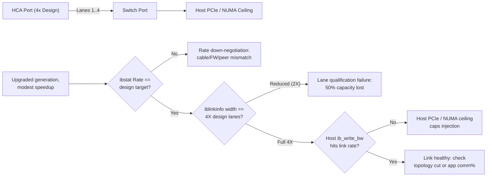
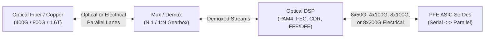
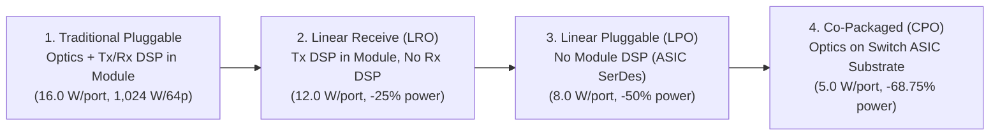

# 12.10 HDR, NDR, XDR, optics and cabling

| | |
|---|---|
| Level | Intermediate |
| Priority tier | 2 |
| Lab venue | Nebius GPU |
| Part | Part 12: Complete AI networking |
| Sources | `nvidia-devops` V8 Ch. 8, Ch. 12, Index & Labs 01–04; `ai-data-center-network-design-and-technologies` Ch. 4; `supercomputers-for-linux-sysadmins` Ch. 5; `superpod-b200-dc`; `superpod-gb300-ra` |
| Code | `code/part12/optics_cabling_hdr_ndr_xdr.py`, `code/part12/optics_cabling_hdr_ndr_xdr_lab.py` |
| Coverage file | `planning/coverage/chapters/12-10.md` |

## Why this matters for AI infrastructure

Fabric generations are often reduced to a single speed label on a purchase order. High Data Rate is marketed at two hundred gigabits per second and Next Data Rate at four hundred. Extended Data Rate doubles that again, and Giga Data Rate reaches the terabit regime. Treating those headline ratings as guaranteed application throughput is a recurring architectural failure mode.

Consider a production upgrade where an infrastructure team replaces HDR Host Channel Adapters and switches with NDR hardware. Every port reports an Active logical state and a LinkUp physical state. Yet distributed training throughput improves only modestly across the cluster. A systematic audit across the hosts and switches uncovers three independent bottlenecks stacked in series.

First, several NDR adapters were installed into older PCIe risers instead of gen-five sixteen-lane slots. That slot mismatch capped host-to-fabric injection before packets ever reached the wire. Second, after recabling, several links negotiated two active lanes instead of four because two optical fibers failed qualification. That lane loss silently cut usable link bandwidth in half. Third, the collective training workload remained bottlenecked by an unupgraded spine cut that halved cross-rack bisection bandwidth.

In a second production incident on a multi-rack GPU cluster, every node reported Active in `ibstat`. Basic pairwise bandwidth checks between adjacent servers also passed without errors. However, distributed training step times varied by more than twenty percent across racks because three subtler defects interacted. A subset of links down-shifted in lane width after a cable swap. Adaptive Routing was also misconfigured for the job, and several GPU ranks crossed a remote NUMA socket to reach their adapter.

At modern link speeds, optical transceivers and cables are no longer passive plumbing. They represent a major share of cluster capital expenditure, switch thermal load, and physical link failures. On a dense switch, pluggable optics draw over a kilowatt of power on their own. Inside each module, the onboard Digital Signal Processor consumes roughly half of that optical power budget.

```text
Production Upgrade Bottlenecks and Optical Power Reality (V8 Ch. 8, V8 Index, ADC Ch. 4):
  - Headline Link Generations:     200 Gbps (HDR), 400 Gbps (NDR), 800 Gbps (XDR), 1,600 Gbps / 1.6 Tbps (GDR)
  - Bottleneck 1 (Host PCIe):      400 Gbps NDR HCA in PCIe Gen4 x8 (126.03 Gbps ceiling after 128b/130b) vs PCIe Gen5 x16 (504.12 Gbps)
  - Bottleneck 2 (Lane Width):     Negotiated 2X instead of 4X (2 of 4 lanes failed qualification), cutting 400 Gbps port to 200 Gbps
  - Bottleneck 3 (Spine Cut):      2:1 oversubscribed leaf (16 x 400 Gbps = 6,400 Gbps down vs 8 x 400 Gbps = 3,200 Gbps up = 200.0 Gbps/node)
  - 128-Node Cluster Variance:     >20% step-time variance from reduced link width + Adaptive Routing misconfiguration + remote NUMA HCA pairing
  - 64-Port 800G Switch Optics:    64 ports x 16 W/module = 1,024 W optical power (DSP consumes ~50% of power and 20% to 40% of module BOM cost)
```

This chapter connects InfiniBand and AI Ethernet link generations from SDR through GDR with SerDes multiplexing and PAM4 DSP physics. We then cover multi-mode and single-mode optical fibers, transceiver reach classes, and MPO breakout cabling. Finally, we examine the NVIDIA SuperPOD cable length rule, QSFP-DD versus OSFP form factors, and linear or co-packaged optics.

## Prerequisites and outcomes

**Prerequisites:** Review Chapter 12.2 on RDMA Queue Pairs, Memory Regions, and PCIe DMA. Also review Chapter 12.6 on InfiniBand link layers, LIDs, GIDs, and `ibstat`. You should also know Subnet Manager routing from Chapter 12.7 and fabric diagnostics from Chapter 12.9.

**Outcomes:** After completing this chapter, you will be able to:
- Calculate per-lane baud rate, raw bit rate, line coding efficiency, and multi-lane bandwidth across SDR through GDR. You will also diagnose rate down-negotiation, lane-width collapse, and PCIe injection limits.
- Trace packet flow through switch Packet Forwarding Engine SerDes lanes, multiplexer gearboxes, and optical DSP stages. You will understand PAM4 modulation, equalization, Clock Data Recovery, and Forward Error Correction.
- Select the right fiber grade and transceiver reach class for Top-of-Rack, Middle-of-Row, End-of-Row, and Data Center Interconnect fabrics.
- Design and validate LC duplex and MPO parallel or breakout cabling across copper and optical media. You will enforce the SuperPOD cable distance rule and eliminate patch panels on InfiniBand links.
- Compare QSFP28, QSFP56, QSFP-DD, OSFP, and CFP form factors across port density and thermal design. You will also quantify the power, cost, and serviceability trade-offs of Pluggable Optics, LRO, LPO, and CPO.

---

## 1. InfiniBand link generations, lane width, and scaling optics for AI clusters

When architects size an AI cluster, they must balance two separate networks that grow at different paces. Inside the server node, GPUs exchange activation tensors and partial gradients across high-bandwidth local interconnects. Across the data center hall, Network Interface Cards and leaf-spine switches connect hundreds of racks into a scale-out fabric. If scale-out optical ports lag behind intra-server GPU bandwidth, multi-node collective phases stall the entire training job.

### 1.1 Scaling intra-server NVLink and inter-server scale-out bandwidth

Modern AI servers separate intra-server scale-up communication from inter-server scale-out communication. Inside an eight-GPU node, GPUs communicate locally across an internal NVSwitch fabric over NVLink. At the same time, each GPU pairs one-to-one with a dedicated scale-out Network Interface Card. That adapter connects to external leaf switches alongside dedicated storage and management links.

Per-GPU scale-up NVLink bandwidth doubled repeatedly across four GPU generations, from Volta through Ampere, Hopper, and Blackwell. In a rack-scale NVIDIA DGX GB300 NVL72 system, eighteen compute trays and nine switch trays unite all GPUs into one NVLink domain. Rear blind-mate cable cartridges carry that intra-rack traffic without front-panel fibers. On the cold-aisle front panel, each compute tray pairs two GB300 Superchips with four ConnectX-8 XDR compute ports and one BlueField-3 card. Competing accelerator platforms use analogous intra-node fabrics such as AMD Infinity Fabric, CXL, UCIe, and PCIe switch hierarchies.

```text
Scale-Up Interconnect Progression and DGX GB300 NVL72 Architecture (ADC Ch. 4, superpod-gb300-ra):
  - Volta NVLink:                  300 Gbps (300 GB/s) per GPU
  - Ampere (A100) NVLink:          600 Gbps (600 GB/s) per GPU
  - Hopper (H100/H200) NVLink:     900 Gbps (900 GB/s) per GPU
  - Blackwell (B200/B300) NVLink:  1,800 Gbps (1,800 GB/s or 1.8 TB/s over 18 NVLink 5 links per GPU)
  - DGX GB300 NVL72 Rack:          18 compute trays (72 B300 GPUs, 2 GB300 Superchips = 4 B300 GPUs + 2 Grace CPUs @ 900 GB/s NVLink-C2C per tray)
                                   + 9 NVLink switch trays (18 NVLink switch chips)
  - GB300 Per-Tray Scale-Out:      4 x ConnectX-8 (800 Gbps Quantum-X800 XDR = 3,200 Gbps compute)
                                   + 1 x BlueField-3 BF3240 (dual-port 2x400 Gbps: 400 Gbps RoCEv2 storage + 200 Gbps in-band management)
```

To keep pace with intra-node compute density, scale-out optical port shipments shifted rapidly toward higher speeds. The market adoption table below summarizes historical and projected optical transceiver shares across both Dell'Oro forecast cohorts.

| Year / Forecast Cohort | `<= 100 Gbps` Share | `200 Gbps` Share | `400 Gbps` Share | `800 Gbps` Share | `1,600 Gbps` (`1.6T`) Share | `>= 3,200 Gbps` (`3.2T`) Share | Dominant AI Cluster Generation |
|---|---|---|---|---|---|---|---|
| **`2020` (Historical)** | `55%` | `30%` | `15%` | `0%` | `0%` | `0%` | `100G EDR` / `100GbE` (`Volta` / early `A100`) |
| **`2021` (Historical)** | `40%` | `35%` | `25%` | `0%` | `0%` | `0%` | `200G HDR` (`DGX A100` `8x200G`) |
| **`2022` (Historical)** | `25%` | `40%` | `35%` | `0%` | `0%` | `0%` | `200G HDR` -> `400G NDR` transition |
| **`2023` (Estimated)** | `10%` | `30%` | `50%` | `10%` | `0%` | `0%` | `400G NDR` (`H100` ramp) |
| **`2024` (Estimated)** | `5%` | `10%` | `55%` | `30%` | `0%` | `0%` | `400G NDR` & `800G` twin-port `OSFP` |
| **`2025` (`2020–2027` study)** | `2%` | `5%` | `10%` | `70%` | `13%` | `0%` | `800G XDR` / `800GbE` (`B200`/`GB200`) |
| **`2026` (`2020–2027` study)** | `1%` | `3%` | `5%` | `45%` | `46%` | `0%` | `800G` + `1.6T` crossover |
| **`2027` (`2020–2027` study)** | `1%` | `2%` | `3%` | `30%` | `64%` | `0%` | `1.6T GDR` / `1.6TbE` majority |
| **`2025e` (`2025` update)** | `2%` | `3%` | `25%` | `70%` | `0%` | `0%` | `800G` at `70%` (`100%` total stack) |
| **`2027e` (`2025` update)** | `1%` | `2%` | `4%` | `43%` | `50%` | `0%` | `1.6T` at `50%`, `800G` at `43%` |
| **`2029e` (`2025` update)** | `1%` | `1%` | `2%` | `16%` | `50%` | `30%` | `1.6T` (`50%`) + `>= 3.2T` (`30%`) |

### 1.2 InfiniBand link generations from SDR to GDR: raw speed, line coding, and lane width

A physical link speed label hides three underlying variables: per-lane symbol rate, physical coding overhead, and parallel lane count. When an operator sees `Rate: 56` on an older FDR port or `Rate: 400` on an NDR port, they need to know how raw serial bits translate into usable data payload.

An InfiniBand physical port bundles multiple bidirectional serial lanes operating in parallel. Standard adapter-to-switch and inter-switch cables bundle four parallel lanes, while dense trunk links or internal switch buses bundle twelve lanes. Before user data reaches the wire, the physical coding sublayer scrambles and encodes blocks of payload bits. That encoding guarantees clock-recovery transitions and pairs with Reed-Solomon Forward Error Correction on PAM4 links. Early SDR through QDR links used 8b/10b encoding, FDR through HDR used 64b/66b encoding, and NDR through GDR use 256b/257b encoding.

| InfiniBand Generation | Raw Per-Lane Rate (`Gbps`) | Modulation & Symbol Rate (`GBd`) | Line Coding Method | Coding Efficiency | Effective `4x` Link Bandwidth (`Gbps`) | Effective `12x` Link Bandwidth (`Gbps`) | Typical Switch / HCA Era |
|---|---|---|---|---|---|---|---|
| **`SDR`** (Single) | `2.5` | `NRZ` (`2.5 GBd`) | `8/10` (`8b/10b`) | `80.00%` | `8.0` | `24.0` | Early HPC clusters |
| **`DDR`** (Double) | `5.0` | `NRZ` (`5.0 GBd`) | `8/10` (`8b/10b`) | `80.00%` | `16.0` | `48.0` | ConnectX / DDR switches |
| **`QDR`** (Quad) | `10.0` | `NRZ` (`10.0 GBd`) | `8/10` (`8b/10b`) | `80.00%` | `32.0` | `96.0` | ConnectX-2 / QDR (`32 Gbps`) |
| **`FDR`** (Fourteen) | `14.0625` | `NRZ` (`14.0625 GBd`) | `64/66` (`64b/66b`) | `96.97%` | `54.4` (`Rate: 56` raw) | `163.2` | `MT4113` ConnectX-3 (`56 Gb/s 4X FDR`) |
| **`EDR`** (Enhanced) | `25.78125` | `NRZ` (`25.78125 GBd`) | `64/66` (`64b/66b`) | `96.97%` | `100.0` | `300.0` | ConnectX-4/5, Switch-IB 2 |
| **`HDR`** (High) | `53.125` | `PAM4` (`26.5625 GBd`) | `64/66` (`64b/66b`) | `96.97%` | `200.0` | `600.0` | ConnectX-6, Quantum (`QM8700`, `40x200G`) |
| **`NDR`** (Next) | `106.25` | `PAM4` (`53.125 GBd`) | `256/257` (`256b/257b`) | `99.61%` | `400.0` | `1,200.0` | `MT4129` ConnectX-7, Quantum-2 (`QM9700`, `64x400G`) |
| **`XDR`** (Extended) | `200.0` (`~212.5` raw) | `PAM4` (`100.0 GBd`) | `256/257` (`256b/257b`) | `99.61%` | `800.0` | `2,400.0` | ConnectX-8, Quantum-X800 (`Q3400-RD`, `144x800G`) |
| **`GDR`** (Giga) | `400.0` (`~425.0` raw) | `PAM4` (`200.0 GBd`) | `256/257` (`256b/257b`) | `99.61%` | `1,600.0` (`1.6 Tbps`) | `4,800.0` (`4.8 Tbps`) | Next-gen `1.6 Tbps` AI fabrics |

### 1.3 Link rate, active lane width, and the four-ceiling performance model

Upgrading optical transceivers and switches to a faster generation fails to accelerate training whenever another layer along the path clamps throughput first. **Delivered application payload bandwidth is governed by the lowest of four independent ceilings.** Those four ceilings are negotiated per-lane rate, active lane width, host PCIe and NUMA injection capacity, and the cross-rack topology cut.

$$
B_\{\text`{payload}`} \approx \min\Big(\underbrace\{R_\{\text`{lane}`} \times N_\{\text`{active\_lanes}`} \times \eta_\{\text`{coding}`} \times \eta_\{\text`{protocol}`}\}_\{\text`{Negotiated Physical & Transport Link Ceiling}`},\; \underbrace\{B_\{\text`{PCIe\_host}`}\}_\{\text`{Host Injection Ceiling}`},\; \underbrace\{B_\{\text`{cut}`}\}_\{\text`{Topology Cut Ceiling}`}\Big)
$$

This equation shows that a single degraded lane or under-sized PCIe slot throttles the entire link regardless of the switch port rating.



| Diagnostic Gate | Tool & Field Inspected | Healthy `400G NDR` Baseline | Degraded Observation | Quantitative Throughput / Latency Impact |
|---|---|---|---|---|
| **1. Negotiated Per-Lane Rate** | `ibstat` `Rate:` & `iblinkinfo` speed | `Rate: 400` (`106.25 Gbps` raw / `100 Gbps` effective per lane) | `Rate: 200` (down-negotiated to `HDR` rate due to cable/firmware/peer mismatch) | Halves bandwidth to `200.0 Gbps`; a `2 MiB` (`2,097,152` B) RDMA write doubles from **`41.94 µs` (`~42 µs`) to `83.89 µs` (`~84 µs`)** |
| **2. Negotiated Lane Width** | `iblinkinfo` width (`4X`, `2X`, `1X`) | `4X 400 Gbps Active/LinkUp` (`4` of `4` lanes active) | `2X 400 Gbps Active/LinkUp` (`2` lanes failed qualification after recabling) | Rate string still says `400 Gbps`, but active width (`2/4`) cuts effective bandwidth in half to **`200.0 Gbps`** |
| **3. Host PCIe & NUMA Injection** | `lspci -vv`, `numactl --hardware`, `ib_write_bw` | `PCIe Gen5 x16` (`32 GT/s x 16 x 128/130 = 504.12 Gbps`) on local NUMA node | `400G` HCA in `PCIe Gen4 x8` slot (`16 GT/s x 8 x 128/130 = 126.03 Gbps`) or `800G` HCA in single `Gen5 x16` (`504.12 Gbps` vs `968.0 Gbps` `Gen6 x16`) | Caps `400G` HCA at **`126.03 Gbps`** regardless of a `4X 400 Gbps` fabric negotiation |
| **4. Topology Cut & Radix** | `ibroute`, `perfquery` `PortXmitData` / `PortXmitWait` | `1:1` nonblocking leaf (`16 x 400G = 6,400 Gbps` down, `16 x 400G = 6,400 Gbps` up = `32`-port minimum radix for `512` GPUs) | `2:1` oversubscribed leaf (`16 x 400G` down, `8 x 400G = 3,200 Gbps` up) | Cross-rack `ib_write_bw` drops from `397.62 Gbps` to **`201.18 Gbps`** (`200.0 Gbps`/node); `2 GB` `AllReduce` doubles from `40.0 ms` to `80.0 ms` |

Before signing off on any cluster build or link upgrade, verify both negotiated rate and active four-lane width alongside host PCIe slot speed and spine uplink ratios.

---

## 2. Packet flow, SerDes mux/demux, and DSP physics

While switch silicon density scales smoothly with transistor lithography, copper traces and optical fibers face severe physical barriers as port speeds climb into the multi-hundred-gigabit and terabit regime. If engineers ignore what happens inside the optical transceiver cage, high-frequency signal loss, thermal throttling, and forward error correction latency can destabilize an otherwise healthy fabric.

### 2.1 Four core challenges in high-speed optical innovation

High-speed optical engineering confronts four compounding physical walls at modern AI data center rates.

1. Higher baud rates suffer steeper high-frequency electrical trace attenuation, optical dispersion, and crosstalk noise. Compensating for that degradation requires multi-level modulation and strong Forward Error Correction.
2. High-speed waveforms arrive severely distorted at the receiver photodiode and switch pins. Restoring the signal requires continuous analog and digital equalization inside dedicated Digital Signal Processors.
3. Pluggable transceivers generate concentrated heat at the switch faceplate. Cooling those cages requires finned heat sinks, high-airflow chassis fans, or liquid-cooled switch trays.
4. High-speed optical sub-assemblies and DSP chips represent a major fraction of network cost and lead time. Avoiding vendor lock-in requires open multi-vendor standards across IEEE, OIF, and ITU-T.

```text
Optical Transceiver Thermal Budgets by Port Generation (ADC Ch. 4):
  - 400 Gbps Pluggable Module:     ~10 to 12 W per port
  - 800 Gbps Pluggable Module:     ~14 to 16 W per port (1,024 W across 64 ports at 16 W/port)
  - 1.6 Tbps Pluggable Module:     ~25 to 30 W per port
```

### 2.2 Packet flow, demultiplexers and multiplexers, and PFE ASIC SerDes

When a packet enters or leaves a switch port, its electrical and optical signals must bridge the speed gap between the switch ASIC pins and the optical fiber lanes. The signal traverses three hardware stages between the external cable and the switch Packet Forwarding Engine ASIC. Those stages are the multiplexer or demultiplexer gearbox, the optical Digital Signal Processor, and the PFE ASIC SerDes lanes.



| Hardware Stage | Ingress Function (Cable -> PFE ASIC) | Egress Function (PFE ASIC -> Cable) | Concrete `400G` / `800G` / `1.6T` Lane Mappings |
|---|---|---|---|
| **Demultiplexer / Multiplexer (`Demux` / `Mux`)** | Splits (`1:N`) incoming multi-wavelength or multi-lane signals into parallel streams | Combines (`N:1`) parallel electrical streams into the outgoing optical or copper lanes | Maps `8 x 50 Gbps` (`53.125 Gbps` PAM4) to `4 x 100 Gbps` (`2:1` gearbox) or `1:1` pass-through (`8 x 100G -> 800G`) |
| **Digital Signal Processor (`DSP`)** | Demodulates optical carrier (`PAM-4`), performs Clock Data Recovery (`CDR`), applies `FFE`/`DFE` equalization, and decodes `LDPC`/`BCH` `FEC` | Encodes `FEC` parity bits, shapes waveform via `FFE`, and modulates electrical/optical amplitude (`PAM-4`) | Consumes **`~50%` of transceiver power** (`8 W` of a `16 W` `800G` module) and **`20%–40%` of module BOM cost** |
| **PFE ASIC `SerDes`** | Serializes/deserializes parallel transceiver lanes into serial packet streams for the PFE pipeline | Parallelizes processed packets across `N` high-speed `SerDes` lanes toward the transceiver | `~50G` SerDes: `8 x 50G = 400G`; `~100G` SerDes: `4 x 100G = 400G` or `8 x 100G = 800G`; `~200G` SerDes: `8 x 200G = 1.6 Tbps` |

### 2.3 Inside the DSP: NRZ versus PAM4, FEC, CDR, and FFE/DFE equalization

Above twenty-five gigabaud, simply doubling the symbol clock rate of two-level Non-Return-to-Zero signaling causes severe high-frequency loss across copper PCB traces. To double data rates without doubling the symbol baud rate, modern high-speed lanes switch to four-level Pulse Amplitude Modulation, known as PAM4.

Whereas NRZ uses two amplitude levels to encode one bit per symbol, PAM4 uses four distinct levels to encode two bits per symbol. However, squeezing four amplitude levels into the same voltage swing splits the vertical opening into three stacked eyes. Each PAM4 eye is only one-third the height of an NRZ eye. **Switching from NRZ to PAM4 doubles the bit rate per baud but imposes a 9.54 dB Signal-to-Noise Ratio penalty that requires an onboard Digital Signal Processor.**

The optical transceiver DSP executes four core signal-processing functions to overcome that eye-height penalty.

1. Modulation and demodulation convert between digital bit streams and multi-level analog waveforms across NRZ, PAM4, PAM8, or coherent QAM for long-haul DWDM links.
2. Forward Error Correction uses BCH, Reed-Solomon, or LDPC codes to correct raw pre-FEC bit errors in hardware without transport retransmissions.
3. Clock Data Recovery extracts symbol timing phase directly from transitions in the incoming bit stream. That phase lock ensures the receiver samples the exact center of each narrow PAM4 eye.
4. Feed-Forward Equalization and Decision-Feedback Equalization remove Inter-Symbol Interference caused by high-frequency channel attenuation without amplifying receiver noise.

```text
DSP Modulation, Equalization, and FEC Reference (ADC Ch. 4):
  - NRZ (PAM-2):         2 amplitude levels (0, 1), 1 bit/symbol, 1 vertical eye opening, 0 dB reference (used at 28 GHz / 25.78125 GBd and some 56 GHz)
  - PAM-4:               4 amplitude levels (00, 01, 10, 11), 2 bits/symbol, 3 vertical eye openings (each 1/3 height),
                         20*log10(3) = 9.54 dB SNR penalty vs NRZ (used at 56 GHz and 112 GHz: 26.5625 GBd -> 53.125 Gbps HDR;
                         53.125 GBd -> 106.25 Gbps NDR; 100 GBd -> 200 Gbps XDR; 200 GBd -> 400 Gbps GDR)
  - PAM-8:               8 amplitude levels, 3 bits/symbol, 7 vertical eye openings, 20*log10(7) = 16.90 dB SNR penalty vs NRZ
  - Coherent DWDM:       400G ZR modulates amplitude, phase (QAM), and dual polarization on a single wavelength up to 80 km
  - FEC (BCH/RS/LDPC):   Corrects raw PAM-4 bit errors in hardware (~100-250 ns latency) to achieve post-FEC BER < 10^-15
  - CDR & Equalization:  CDR RX/TX: ON,ON,ON,ON in mlxlink -m; linear FFE (TX/RX) + nonlinear DFE (RX) cancel Inter-Symbol Interference (ISI)
```

When debugging a marginal optical link, always check pre-FEC bit error rates and per-lane CDR lock status in `mlxlink` before blaming higher-layer transport timeouts.

---

## 3. Transmission modes: Multi-Mode Fiber, Single-Mode Fiber, and DWDM

Passive copper cables can carry high-speed signals across only a few meters inside a single rack. To connect GPU servers to leaf and spine switches across rows or buildings, engineers must choose between Multi-Mode Fiber and Single-Mode Fiber. Selecting the wrong fiber plant either caps link distance below the hall span or inflates transceiver costs across thousands of ports.

Optical fiber transmits light pulses through a glass core surrounded by an outer glass cladding with a lower refractive index. That refractive index step traps light inside the core via total internal reflection. Optical fibers therefore provide complete immunity to electromagnetic interference and span from tens of meters up to dozens of kilometers.

| Fiber Grade / Type | Fiber Mode | Core Diameter (`µm`) | Wavelengths (`nm`) | Light Source | `1 Gbps` Max Reach | `10 Gbps` Max Reach | `40 Gbps` Max Reach | `100 Gbps – 400 Gbps` Max Reach | Primary Data Center Role |
|---|---|---|---|---|---|---|---|---|---|
| **`OM1`** | `MMF` | `62.5 µm` | `850 nm`, `1300 nm` | `LED` / `VCSEL` | `300 m` | `33 m` | Not supported | Not supported | Legacy campus / building closet |
| **`OM2`** | `MMF` | `50.0 µm` | `850 nm`, `1300 nm` | `LED` / `VCSEL` | `550 m` | `82 m` | Not supported | Not supported | Legacy `1G`/`10G` server racks |
| **`OM3`** | `MMF` | `50.0 µm` | `850 nm`, `1300 nm` | `850 nm VCSEL` | `1,000 m` | `300 m` | `240 m` | **`100 m`** | Short-reach intra-row `SR` (`<= 100 m`) |
| **`OM4`** | `MMF` | `50.0 µm` | `850 nm`, `1300 nm` | `850 nm VCSEL` | `1,000 m` | `400 m` | `300 m` | **`150 m`** (`100 m` at `400G/800G SR`) | Standard AI cluster `VR`/`SR` MMF |
| **`OM5`** | `MMF` | `50.0 µm` | **`850 nm` + `953 nm`** | `SWDM VCSEL` | `1,000 m` | `400 m` | `400 m` | **`150 m`** (`4` Tx/Rx pairs w/ `WDM`) | Wideband MMF (`400G` over `4` fiber pairs) |
| **`SMF` (`OS2`)** | `SMF` | **`8.0 – 10.0 µm`** | **`1310 nm`, `1550 nm`** | Solid-state Laser | `10 km+` | `10 km+` | `10 km+` | **`500 m` (`DR`) to `80–120 km` (`ZR`)** | AI cluster `DR` (`500 m`), spine/border `FR`/`LR`, `DWDM` DCI |

The three optical transmission modes serve distinct distance tiers in an AI data center.

1. Multi-Mode Fiber uses a wide glass core that allows multiple spatial rays of light from low-cost VCSEL or LED sources to propagate simultaneously. However, modal dispersion limits high-speed reach to short intra-row distances.
2. Wideband OM5 Multi-Mode Fiber adds Short-Wavelength Division Multiplexing across multiple wavelengths. That multiplexing enables high-speed transmission over four transmit and four receive fibers instead of eight pairs.
3. Single-Mode Fiber narrows the glass core so only a single fundamental ray of solid-state laser light can travel. Eliminating modal dispersion allows single-mode links to span from five hundred meters across a data hall up to long-haul metro distances.
4. Dense Wavelength Division Multiplexing combines multiple distinct optical wavelengths onto a single pair of Single-Mode Fiber strands. Pluggable coherent ZR modules can then carry high-speed traffic between regional data centers without external transponder shelves.

**For multi-row AI training halls where cable runs exceed short-reach multi-mode limits, standardize on Single-Mode Fiber with DR4 or 2xDR4 parallel optics.**

---

## 4. AI server connectivity, transceiver reach classes, connectors, and the 90 percent cable rule

Even when architects select the right switch silicon and fiber grade, physical cabling mistakes routinely delay cluster bring-up by weeks. Ordering cables equal to the straight-line floor distance leaves assemblies meters short once vertical rack drops and overhead tray routing are included. Furthermore, inserting optical patch panels into InfiniBand runs introduces reflection loss that causes PAM4 links to flap under load.

### 4.1 AI server connectivity topologies and ToR versus MoR/EoR layouts

How a GPU server connects to leaf switches governs both transceiver selection and cable-length distribution across the data hall. In a Rail-Optimized Design, an NVIDIA DGX A100 server provides eight scale-out ports that connect one-to-one to eight separate rail leaf switches. An NVIDIA DGX H100 server provides four twin-port OSFP cages on the server tray. Operators can either connect those four cages directly to four 800 Gbps switches or fan them out via breakout cables into eight rail leaf switches.

Physical switch placement then determines the cable length profile across the row.

1. In a Top-of-Rack Rail-Optimized layout, leaf switches sit distributed across individual server racks. A server in Rack 1 must therefore fan its eight GPU rails out across multiple racks using varying cable lengths.
2. In a Middle-of-Row or End-of-Row Rail-Optimized layout, compute racks house only GPU servers. All leaf and spine switches sit centralized in dedicated network racks. All eight rail cables from a given compute rack then travel together in uniform overhead bundles of similar length.

```text
AI Server Scale-Out Connectivity and Rack Layout Profiles (ADC Ch. 4 Figs 4-10 to 4-13):
  - DGX A100 Server:   8 x 200 Gbps ports (1,600 Gbps aggregate) -> 8 separate rail leaf switches (Switch 1..Switch 8)
  - DGX H100 Server:   4 x 800 Gbps twin-port OSFP cages (3,200 Gbps aggregate) -> either 4 x 800 Gbps direct links
                       OR 8 x 400 Gbps breakout links (2 x 400 Gbps per 800 Gbps OSFP cage) to 8 rail leaf switches
  - ToR Rail Layout:   Varying server-to-leaf cable lengths (DAC/AEC in home rack; AOC/VR/SR/DR across racks)
  - MoR / EoR Layout:  Compute racks (Rack 1: Server 1..Server 4) cable to centralized Network Racks (Network Rack 1: Leaf 1..4,
                       Network Rack 2: Leaf 5..8, Spine 1..8) using homogeneous bundles of similar length per rack
```

### 4.2 Transceiver reach classes and fabric tier mapping

Transceiver part numbers combine data rate, reach code, and optical lane count into a compact label. For example, 400G-SR8 denotes a Short Reach multi-mode module with eight parallel optical lanes. By contrast, 400G-DR4 denotes a Data Center Reach single-mode module with four parallel single-mode lanes.

| Transceiver Code | Full Form | Standard Max Reach | Fiber / Media Mode | Typical Connector | `100 Gbps` Fabric Role (`Rail-Opt` / `Inference`) | `400 Gbps` / `800 Gbps` Fabric Role (`Rail-Opt` / `Inference`) |
|---|---|---|---|---|---|---|
| **`CR`** | Copper | **`7 m`** (passive `DAC`, `< 0.15 W`); **`10 m`** (active `DAC`, `> 5 m`) | Twinax Copper (`DAC` / `AEC`) | Integrated `QSFP`/`OSFP` | In-rack `Server <-> ToR` (`DAC` in Inference) | In-rack `Server <-> ToR` (`<= 3 m` passive `DAC` at `400G`, `<= 7 m` `AEC` up to `800G`) |
| **`VR`** | Very short reach | **`50 m`** | `MMF` (`OM4`/`OM5`, `850 nm`) | `MPO-12` / `MPO-16` | Adjacent-rack `AOC` | `Server <-> Leaf` & `Leaf <-> Spine` (`VR4` / `VR8` in `Rail-Opt`) |
| **`SR`** | Short reach | **`100 m`** | `MMF` (`OM3`/`OM4`, `850 nm`) | `MPO-16` (`SR8`) / `MPO-12` (`SR4`) | `Server <-> Leaf` (`AOC`/`SR4`) & `Leaf <-> Spine` (`Inference`) | `Server <-> Leaf` & `Leaf <-> Spine` (`AOC`/`SR8` in `Inference`) |
| **`DR`** | Data center reach | **`500 m`** | `SMF` (`1310 nm` parallel) | `MPO-12` (`DR4`) / `MPO-16` (`DR8`) | `Leaf <-> Spine` (`PSM4` at `100G`) | Primary `Server <-> Leaf` & `Leaf <-> Spine` (`DR4` / `2xDR4` in `Rail-Opt`) |
| **`FR`** | Far reach | **`2 km`** (`2,000 m`) | `SMF` (`CWDM4` / `FR4` WDM) | Dual `LC` (Duplex `2`-fiber) | `Leaf <-> Spine` & `Spine <-> Border` (`CWDM4`) | `Spine <-> Border Gateway` (`FR4` and `DR4+`) |
| **`LR`** | Long reach | **`10 km`** (`10,000 m`) | `SMF` (`1310/1550 nm` WDM) | Dual `LC` (Duplex `2`-fiber) | `Spine <-> Border` & `Border <-> External` (`LR4`) | `Border Gateway <-> External / Campus` (`LR4`) |
| **`ZR`** | Extended reach | **`> 80 km`** (`80,000 m+`) | `DWDM` (`SMF` Coherent) | Dual `LC` (Coherent) | `Border <-> Metro DCI` (`ER4` / `DCO` / `ACO`) | `Border Gateway <-> Metro / Regional DCI` (`400G/800G ZR`) |

### 4.3 Connectors, copper and optical cable assemblies, and the 90 percent SuperPOD derating rule

Choosing between duplex connectors, multi-fiber parallel connectors, and pre-terminated copper or optical assemblies determines both port breakouts and field failure rates.

1. Lucent Connectors are compact two-fiber duplex plugs used on single-mode WDM modules such as FR4 and LR4. Inside those modules, an internal optical multiplexer combines four lanes onto a single fiber pair.
2. Multi-fiber Push On connectors pack parallel fiber arrays into a single ferrule for parallel optics and breakout harnesses. Single-mode DR4 links use an angled physical contact polish to prevent back-reflection, whereas multi-mode SR8 links use a flat polish.
3. Passive Direct Attach Copper cables carry signals over shielded twinaxial wire with zero electronics and minimal power draw. Active Electrical Cables add retimer chips inside the connector shells to reach across wider in-rack spans.
4. Active Optical Cables permanently bond multimode or single-mode fiber to optical transceivers at both ends. They offer a thinner jacket and smaller bend radius than copper for intra-hall runs.

```text
Optical Connector Pinouts, Breakout Fan-Outs, and SuperPOD Cabling Rules (ADC Ch. 4, superpod-b200-dc, superpod-gb300-ra):
  - LC Duplex Connector:         2-fiber duplex (replaces legacy SC, FC, ST) for QSFP-DD-FR4 (2 km SMF) and LR4 (10 km SMF)
  - MPO / MTP Array Connectors:  8-, 12-, 24-fiber trunks + single-row 16-fiber (MPO-16) and two-row 2 x 16 = 32-fiber (MPO-32):
      * QSFP-DD-DR4 (500 m SMF, MPO-12, APC 8° polish): Fibers 1-4 = 4 Tx, Fibers 5-8 = 4 unused (dark), Fibers 9-12 = 4 Rx (8 active lanes)
      * QSFP-DD-SR8 (100 m MMF, MPO-16, UPC polish):    8 Tx + 8 Rx (0 dark fibers)
      * OSFP-1600G-DR16 (1.6T, MPO-32 2x16):            16 Tx + 16 Rx (0 dark fibers)
      * Twin-Port Finned-Top 800G OSFP Breakouts:       64 x 2x400G = 128 logical 400G ports (Quantum-2) or 144 x 800G ports (Quantum-X800 Q3400-RD);
                                                        1x800G (8 lanes) splits 1:2 -> 2 x 400 Gbps (4 lanes each) or 1:4 -> 4 x 200 Gbps (2 lanes each)
  - Copper & AOC Limits:         Passive DAC: <= 7 m IEEE CR (< 0.15 W); capped in SuperPOD at <= 5 m (100 Gbps) and <= 3 m (400 Gbps)
                                 Active DAC: > 5 m up to 10 m; AEC retimed copper: <= 7 m at 400G/800G; InfiniBand AOC: 30 m or 50 m (up to 100 m DC)
  - DGX B200 SuperPOD (1..4 SUs @ 458 kW/SU, 2,145 CFM @ 18-27 °C, 600x1100 mm 48U min / 700x1200 mm 52U rec):
      * 31, 63, 95, 127 compute nodes (after 1 UFM appliance displaces 1 node) = 248, 504, 760, 1,016 GPUs
      * 8, 16, 24, 32 leaf switches; 4, 8, 16, 16 spine switches; 252, 508, 764, 1,020 compute+UFM cables (8*nodes + 4); 256, 512, 768, 1,024 ISL cables
  - DGX GB300 SuperPOD (1.2 MW/SU, 2..16 SUs / 16..128 racks / 1,152..9,216 GPUs, 144-port Q3400-RD Quantum-X800 switches):
      * 2, 4, 8, 16 SUs -> 16, 32, 64, 128 leaf switches (8/SU across 4 rails) and 8, 18, 36, 72 spine switches
  - SuperPOD < 90% Max Cable Distance Rule (including intra-rack vertical routing, overhead tray drops, and bend-radius slack):
      * 3 m 400G Passive DAC:  3.0 x 0.90 = 2.7 m max routed length
      * 5 m 100G Passive DAC:  5.0 x 0.90 = 4.5 m max routed length
      * 30 m InfiniBand AOC:   30.0 x 0.90 = 27.0 m max routed length
      * 50 m InfiniBand AOC:   50.0 x 0.90 = 45.0 m max routed length
      * 100 m SR MMF / AOC:    100.0 x 0.90 = 90.0 m max routed length
      * 500 m DR SMF:          500.0 x 0.90 = 450.0 m max routed length
  - Zero Patch Panels on InfiniBand: Mated patch-panel connectors add ~0.3-0.5 dB insertion loss and return-loss reflections that break 53.125 GBd (NDR)
                                     and 100 GBd (XDR) PAM-4 BER budgets; all InfiniBand cables must run point-to-point with color-coded labels and spares
```

**In every DGX SuperPOD installation, keep total routed cable length under 90 percent of the media rating.** Also run every InfiniBand link point-to-point without optical patch panels.

---

## 5. Standards, high-bandwidth form factors, and LPO, LRO, and CPO

As switch port speeds doubled across generations, legacy four-lane transceiver cages ran out of electrical pins and thermal headroom. Hardware teams must understand the physical differences between QSFP-DD and OSFP cages. Otherwise, they risk ordering incompatible modules or inserting flat-top server transceivers into air-cooled switch faceplates.

### 5.1 Optical standards and QSFP28, QSFP56, QSFP-DD, and OSFP form factors

To prevent proprietary vendor lock-in such as legacy Cisco CPAK modules, AI data centers standardize pluggable cages across IEEE, OIF, and ITU-T specifications. Early telecommunications equipment used large ITU-T G.959.1 CFP family modules, which fit only sixteen ports per rack unit. Modern data center switches standardize on compact cages that support thirty-six ports per rack unit across four main form factors.

1. IEEE 802.3bm QSFP28 and IEEE 802.3cd QSFP56 provide four electrical channels in a compact cage. QSFP28 uses NRZ signaling for 100 Gbps links, while QSFP56 upgrades to PAM4 signaling for 200 Gbps HDR and Ethernet links.
2. IEEE 802.3bs QSFP-DD adds a second row of four electrical contact pads behind the legacy QSFP row to support eight electrical channels. Because the front profile matches QSFP28, a QSFP-DD switch cage remains natively backward compatible with legacy QSFP plugs.
3. To manage increasing DSP heat across different chassis layouts, QSFP-DD defines four mechanical module profiles. Type 1 uses a flush length, Type 2 extends the housing, Type 2A adds an external heatsink, and Type 2B uses a taller heatsink.
4. OIF-OSFP-01.0 Octal Small Form-factor Pluggable uses a slightly wider eight-lane chassis. It integrates a finned-top heatsink on air-cooled switches or a flat-top housing on liquid-cooled compute trays.

| Feature / Specification | `QSFP28` (`IEEE 802.3bm`) | `QSFP56` (`IEEE 802.3cd`) | `QSFP-DD` (`IEEE 802.3bs`) | `OSFP` (`OIF-OSFP-01.0`) |
|---|---|---|---|---|
| **Aggregate Data Rate** | `100 Gbps` | `200 Gbps` (`HDR` / `200GbE`) | `200–400 Gbps` (`800G` in `QSFP-DD800`) | `200 Gbps, 400 Gbps, 800 Gbps, 1.6 Tbps` |
| **Electrical Channel Count** | `4` channels | `4` channels | `8` channels (or `16` in future revs) | `8` channels |
| **Per-Channel Data Rate** | `25 Gbps` | `50 Gbps` | `25 Gbps` (`NRZ`) / `50–100 Gbps` (`PAM4`) | `50 Gbps` / `100 Gbps` / `200 Gbps` (`PAM4`) |
| **Modulation** | `NRZ` (`PAM-2`) | `PAM-4` | `NRZ` (`DD200`) / `PAM-4` (`DD400/800`) | `PAM-4` |
| **Supported Connectors** | `MPO`, `LC` | `MPO`, `LC`, `CS` | `MPO`, `LC`, `CS` | `MPO` (`MPO-12/16/32`), `LC` |
| **Backward Compatibility** | `QSFP+` (`40G`) | `QSFP+`, `QSFP28` | `QSFP+`, `QSFP28`, `QSFP56` (native) | Requires passive adapter for `QSFP` |
| **Size & Thermal Design** | Compact (`3–4 W`) | Compact (`~5–7 W`) | Compact; riding cage heat sink (`Type 1/2/2A/2B`) | Larger; integrated finned-top or flat-top heat sink (`15–30 W+` thermal headroom) |
| **Max Switch Density (`1U`)** | `36` ports / `RU` | `36` ports / `RU` | `36` ports / `RU` (vs `16`/RU on `CFP8`) | `36` ports / `RU` (twin-port supports `2x400G` or `2x800G` per cage) |

```text
Legacy CFP Family vs Modern QSFP-DD / OSFP Density (ADC Ch. 4 Tables 4-2 & 4-3):
  - ITU-T G.959.1 CFP / CFP2:  10 x 10 Gbps NRZ lanes (100 Gbps LR4, large footprint, high power)
  - CFP4:                      4 x 25 Gbps NRZ lanes (100 Gbps LR4, smaller and lower power than CFP2)
  - CFP8:                      8 lanes PAM-4 (200 Gbps / 400 Gbps), 16 ports per 1U rack unit (vs 36 ports/1U for QSFP-DD and OSFP)
```

### 5.2 Further innovations in optics: Pluggable versus LRO, LPO, and CPO

In a conventional pluggable transceiver, the internal Digital Signal Processor accounts for a major share of the module bill-of-materials cost and consumes roughly half of the electrical power. Across a fully populated 800 Gbps switch, pluggable optics draw over a kilowatt total. Half of that energy is burned strictly inside transceiver DSP chips. To bend this power and cost curve, optical engineers have developed three architectural alternatives. Those three designs are Linear Receive Optics, Linear-drive Pluggable Optics, and Co-Packaged Optics.



| Optical Architecture | Module `Tx` `DSP` | Module `Rx` `DSP` | Field Pluggable? | Per-Port Power (`800G` Baseline) | `64`-Port Switch Optics Power | Power Savings vs Pluggable | Module `DSP` `BOM` Cost Share | Operational & Interoperability Trade-offs |
|---|---|---|---|---|---|---|---|---|
| **1. Traditional Pluggable** | Present | Present | Yes | **`16.0 W`** (`8.0 W` DSP + `8.0 W` optics) | **`1,024.0 W`** | `0.0%` (Baseline) | **`20% – 40%`** | Maximum multi-vendor interoperability, full retiming (`CDR` + `FEC`), easy field replacement; highest power and cost |
| **2. Linear Receive Optics (`LRO`)** | Present | **Removed** (Handled by `ASIC` `Rx` `SerDes`) | Yes | **`12.0 W`** (`4.0 W` DSP + `8.0 W` optics) | **`768.0 W`** | **`25.0%`** (`-256.0 W`) | **`10% – 20%`** | Keeps `Tx` `DSP` in module so optical output meets standard IEEE eye templates; balances interoperability and reliability with `25%` power reduction |
| **3. Linear-drive Pluggable (`LPO`)** | **Removed** | **Removed** | Yes | **`8.0 W`** (`0.0 W` DSP + `8.0 W` linear driver/TIA) | **`512.0 W`** | **`50.0%`** (`-512.0 W`) | **`0%`** (No module DSP) | Smaller/cooler module; `PFE ASIC` performs all equalization/DSP (cooled by ASIC heatsink) and reduces latency, but tighter electrical loss budget increases multi-vendor interoperability risk and qualification `opex` |
| **4. Co-Packaged Optics (`CPO`)** | **Removed** (Integrated) | **Removed** (Integrated) | **No** (On `ASIC` substrate) | **`5.0 W`** (Ultra-short substrate trace) | **`320.0 W`** | **`68.75%`** (`-704.0 W`) | **`0%`** (Integrated) | Co-locates optical engines and `PFE ASIC` on the **same package substrate**, maximizing port density and cutting power by `~69%`; higher initial switch cost and an optics failure requires servicing the switch assembly |

**Removing the transceiver DSP via LRO or LPO cuts pluggable optical power by a quarter to a half, while Co-Packaged Optics cuts power by nearly seventy percent.**

---

## 6. Mixed-generation fabrics, upgrade planning, and operational verification

Production AI clusters rarely replace every switch, adapter, and cable in a single maintenance window. Storage clusters or older compute racks running HDR are routinely connected to newer NDR or XDR spine-leaf fabrics. When two endpoints of different generations are cabled together, auto-negotiation settles on the highest mutually supported rate and lane width. That behavior creates subtle bottlenecks if operators treat an Active port state as proof of full performance.

### 6.1 Mixed-generation interoperability and the 10-step upgrade plan

Uncontrolled mixed-generation fabrics introduce six recurring operational hazards across the cluster.

1. A link silently down-negotiates to an older speed because a legacy cable, transceiver, or firmware image remained in the path.
2. A link negotiates the target per-lane speed on only two lanes or one lane while still printing Active in `ibstat`.
3. Host PCIe slot generations or NUMA topologies differ between older and newer racks, skewing collective barrier arrival times.
4. Mismatched adapter and switch firmware revisions fail link training or oscillate in error recovery counters.
5. Static or adaptive routing spreads collective traffic equally across fast and down-negotiated uplinks, creating an immediate congestion tree behind the slower link.
6. Operators lack an explicit expected negotiated state table per link class and mistake `State: Active` for a healthy upgrade.

To prevent an expensive link upgrade from delivering only half of its expected speedup, follow the ten-step production upgrade plan summarized below.

```text
10-Step Production Fabric Upgrade Plan (V8 Ch. 8):
  1. Baseline current application step time and RDMA microbenchmarks (ib_write_bw / ib_write_lat p50/p99/p99.9, GPU RDMA, nccl-tests).
  2. Verify hardware, transceiver, cable, and firmware compatibility matrices across every HCA, switch, and optical module serial number.
  3. Model host (PCIe Gen4/Gen5/Gen6 width, NUMA) and topology (bisection cut, oversubscription) ceilings before buying faster optics.
  4. Stage a representative pilot path (2 to 4 nodes across a leaf-spine cut) before touching the wider production cluster.
  5. Audit negotiated Rate and Width in ibstat and iblinkinfo plus physical BER and DDM health in mlxlink -c/-m, perfquery, and ibqueryerrors.
  6. Run numactl-pinned host-memory and GPU-memory pairwise RDMA benchmarks to prove single-flow wire-rate efficiency.
  7. Test synchronized multi-node collectives (AllReduce, AllToAll) under concurrency to verify cross-rack cuts and adaptive routing balance.
  8. Validate failure handling and rollback procedures (including standby SM failover, SHIELD, and firmware downgrade paths).
  9. Update the inventory source of truth (GUID, expected Rate, expected Width, cable serials) and telemetry alerting thresholds.
  10. Expand the rollout in controlled rack-by-rack or Scalable-Unit-by-Scalable-Unit phases.
```

**Never declare a fabric upgrade complete until every upgraded port is verified against an explicit expected-state table.** That table must confirm negotiated rate, active lane width, and wire-rate RDMA throughput.

---

## Commands and configurations that matter

All fabric and optical inspection commands below are read-only and marked `(untested here)` because physical InfiniBand switches and ConnectX adapters are not attached to the local build container.

### 1. Inspecting optical transceiver DDM telemetry, per-lane BER, and CDR lock with `mlxlink` `(untested here)`

While `ibstat` and `perfquery` expose link state and packet counters, NVIDIA `mlxlink` queries the transceiver internal Digital Diagnostic Monitoring EEPROM and the SerDes physical layer directly.

Query physical counters and pre-FEC or post-FEC Bit Error Rate.

```bash
# (untested here) Query physical BER and per-lane error counters on mlx5_1
mlxlink -d mlx5_1 -c
```

Annotated output from an EDR 100 Gbps 4x port.

```text
Operational Info
----------------
State                           : Active
Physical state                  : LinkUp
Speed                           : IB-EDR
Width                           : 4x
FEC                             : No FEC
Loopback Mode                   : No Loopback
Auto Negotiation                : ON
Supported Info
--------------
Enabled Link Speed              : 0x0000003f (EDR,FDR,FDR10,QDR,DDR,SDR)
Supported Cable Speed           : 0x0000003f (EDR,FDR,FDR10,QDR,DDR,SDR)
Troubleshooting Info
--------------------
Status Opcode                   : 0
Group Opcode                    : N/A
Recommendation                  : No issue was observed.
Physical Counters and BER Info
------------------------------
Time Since Last Clear [Min]     : 12824.8
Effective Physical Errors       : 0
Effective Physical BER          : 15E-255
Raw Physical BER                : 15E-255
Raw Physical Errors Per Lane    : 0,0,0,0
Link Down Counter               : 0
Link Error Recovery Counter     : 0
```

Query optical module identification, laser bias, receive and transmit optical power, temperature, voltage, and CDR status.

```bash
# (untested here) Query optical transceiver EEPROM & DDM health on mlx5_1
mlxlink -d mlx5_1 -m
```

```text
Module Info
-----------
Identifier                      : QSFP+
Compliance                      : N/A
Cable Technology                : 850 nm VCSEL
Cable Type                      : Active cable (active copper / optics)
OUI                             : Mellanox
Vendor Name                     : Mellanox
Vendor Part Number              : MFXXXXX-EXXX
Vendor Serial Number            : MT2135FT12345
Rev                             : B2
Attenuation (5g,7g,12g) [dB]    : N/A
FW Version                      : XX.XX.XXX
Wavelength [nm]                 : 850
Transfer Distance [m]           : 10
Digital Diagnostic Monitoring   : Yes
Power Class                     : 2.5 W max
CDR RX                          : ON,ON,ON,ON
CDR TX                          : ON,ON,ON,ON
LOS Alarm                       : N/A
Temperature [C]                 : 38 [-10..80]
Voltage [mV]                    : 3255.2 [3100..3500]
Bias Current [mA]               : 6.750,6.750,6.750,6.750 [5.492..8.5]
Rx Power Current [dBm]          : 0,0,0,0 [-14..6]
Tx Power Current [dBm]          : 0,0,0,0 [-12..6]
```

To interpret `mlxlink` output quickly during triage, check three key field groups.

1. Zero `Raw Physical Errors Per Lane` and a floor `Effective Physical BER` confirm that all four SerDes lanes are error-free. Dust on a single MPO fiber causes a single lane error spike. That contamination also drops that lane's `Rx Power Current` below the lower threshold.
2. `CDR RX` and `CDR TX` showing `ON,ON,ON,ON` verify that Clock Data Recovery is locked across all four receive and transmit lanes.
3. `Temperature` and `Voltage` readings within their bracketed alarm bounds confirm that module cooling and power rails are healthy.

### 2. Auditing negotiated link rate, lane width, and HCA/PCIe topology `(untested here)`

```bash
# (untested here) Build a complete Lab 01 host + fabric link-rate/width inventory
mkdir -p volume08-lab01/{host,fabric,versions}
ibv_devices | tee volume08-lab01/host/ibv-devices.txt
ibv_devinfo -v -d mlx5_0 | head -20 | tee volume08-lab01/host/ibv-devinfo.txt
ibstat | tee volume08-lab01/host/ibstat.txt
ibstatus | tee volume08-lab01/host/ibstatus.txt
lspci -nnvv | grep -i -E 'infiniband|network|lnksta' | tee volume08-lab01/host/pci-devices.txt
numactl --hardware | tee volume08-lab01/host/numa.txt
iblinkinfo | tee volume08-lab01/fabric/iblinkinfo.txt
```

Illustrative `ibv_devinfo -v -d mlx5_0` and `ibstat` output on an NDR ConnectX-7 host.

```text
hca_id: mlx5_0
    transport:                  InfiniBand (0)
    fw_ver:                     28.39.2048
    node_guid:                  08c0:eb03:00f1:a2c3
    vendor_id:                  0x02c9
    vendor_part_id:             4129
    max_qp:                     262144
    max_qp_wr:                  32768
    max_sge:                    30

CA 'mlx5_0'
    CA type: MT4129
    Number of ports: 1
    Port 1:
        State: Active
        Physical state: LinkUp
        Rate: 400
        Base lid: 12
        LMC: 0
        SM lid: 1
        Capability mask: 0x2651e848
        Port GUID: 0x08c0eb0300f1a2c3
        Link layer: InfiniBand
```

Side-by-side `iblinkinfo` output contrasting a healthy four-lane port against a width-degraded two-lane port.

```text
$ iblinkinfo -S 0x506b4b0300a1c210
   Switch: 0x506b4b0300a1c210:
       3    1[  ] ==( 4X   400 Gbps Active/  LinkUp)==>       12    1[  ] "node-a hca" ( )
       4    1[  ] ==( 2X   400 Gbps Active/  LinkUp)==>       15    1[  ] "node-b hca" ( )
```

### 3. Validating delivered payload bandwidth and latency `(untested here)`

```bash
# (untested here) Lab 02 & Lab 03: NUMA-pinned RDMA bandwidth/latency + counter delta verification
ibqueryerrors | tee counters-before.txt
# On server (pinned to HCA local NUMA node 0):
numactl --cpunodebind=0 --membind=0 ib_write_bw -d mlx5_0 -i 1 --report_gbits
# On client:
numactl --cpunodebind=0 --membind=0 ib_write_bw -d mlx5_0 -i 1 --report_gbits <server-ip>
ibqueryerrors | tee counters-after.txt
```

---

## How it fails

| Failure Mode | Observable Symptom | Root Cause | Diagnostic Evidence (`ibstat`, `iblinkinfo`, `mlxlink`, `ib_write_bw`) | Remediation |
|---|---|---|---|---|
| **1. Silent Rate Down-Negotiation (`NDR 400G -> HDR 200G`)** | Port is `Active` and `LinkUp`, no job crashes, but collective communication step time doubles on paths traversing the port | Unqualified cable (e.g., `HDR`-only `AOC`/`DAC`), mismatched transceiver firmware, or mixed-generation peer port | `ibstat mlx5_1 \| grep -E 'State\|Rate'` prints `State: Active`, `Rate: 200` on a `400G` port; `2 MiB` RDMA write takes **`83.89 µs` (`~84 µs`) instead of `41.94 µs` (`~42 µs`)** | Compare `Supported Cable Speed` and `Enabled Link Speed` in `mlxlink -d mlx5_1 -m`; replace non-qualified cable or upgrade HCA/switch/transceiver firmware |
| **2. Negotiated Lane Width Collapse (`4X -> 2X` or `1X`)** | `State: Active` and rate label still reads `400 Gbps` (or `100 Gbps`/lane), yet pairwise `ib_write_bw` is capped at **`~200 Gbps`** (`50%` of design) | `1` or `2` of the `4` physical optical fibers or `SerDes` lanes failed link training due to a contaminated `MPO` ferrule, bent fiber, or dead `VCSEL`/photodiode channel | `iblinkinfo` shows `==( 2X 400 Gbps Active/ LinkUp)==>` on `Port 4` vs `4X` on `Port 3`; `mlxlink -c` shows nonzero `Raw Physical Errors Per Lane` or low `Rx Power` (`< -14 dBm`) on lanes `2,3` | Inspect `mlxlink -m` per-lane `Rx Power` and `Tx Bias`; clean `MPO-12`/`MPO-16` connectors with an optical click-cleaner or swap the degraded transceiver/breakout harness |
| **3. Host `PCIe` or `NUMA` Bottleneck Masking a Fabric Upgrade** | `ibstat` shows `Rate: 400` and `iblinkinfo` shows `4X`, yet `ib_write_bw` plateaus at **`~126 Gbps`** (or drops sharply when run without `numactl`) | `400G` HCA installed in a `PCIe Gen4 x8` slot (`126.03 Gbps` ceiling), `800G` HCA in a single `Gen5 x16` slot (`504.12 Gbps`), or benchmark/rank bound to `NUMA node 1` while HCA is on `NUMA node 0` | `lspci -vv` shows `LnkSta: Speed 16GT/s, Width x8` instead of `32GT/s, Width x16`; Lab 04 `numactl` comparison shows `NUMA node 0` restores full bandwidth | Seat `400G` HCAs in `PCIe Gen5 x16` slots (`504.12 Gbps`), `800G` HCAs in `PCIe Gen6 x16` (`968.0 Gbps`) or dual `Gen5 x16` / socket-direct slots, and enforce local `NUMA`/GPU affinity |
| **4. Exceeding the `< 90%` Cable Distance Rule or Using Patch Panels** | Intermittent `SymbolErrorCounter` acceleration, `LinkErrorRecoveryCounter` increments, `CDR` lock loss, or `LinkDownedCounter` flaps under thermal load | Routed cable length exceeds `90%` of media max (`> 27 m` on `30 m AOC`, `> 45 m` on `50 m AOC`, `> 2.7 m` on `3 m 400G DAC`) or passes through an optical patch panel | `mlxlink -c` shows elevated `Raw Physical BER`, `Effective Physical Errors > 0`, and reduced `Rx Power Current [dBm]` across all lanes | Reroute point-to-point without patch panels, account for intra-rack vertical routing and bend radius, and step up from `DAC` -> `AOC`/`VR` -> `SR` -> `DR` `SMF` when run exceeds `90%` |
| **5. Optical Transceiver Over-Temperature (`> 70–80 °C`)** | Links flap after several hours of heavy collective load; laser bias current climbs and post-FEC errors appear | Wrong `QSFP-DD`/`OSFP` thermal variant (`flat-top` module inserted into an air-cooled switch expecting `finned-top` / `Type 2A`/`2B`), blocked switch intake, or failed fan | `mlxlink -m` shows `Temperature [C]: 83 [-10..80]` exceeding the `80 °C` upper alarm threshold | Use finned-top `OSFP` / `QSFP-DD Type 2A/2B` modules in air-cooled switches, flat-top `OSFP` in conduction/liquid-cooled trays, and verify rack airflow (`2,145 CFM` per DGX B200 rack at `18–27 °C`) |

---

## Hands-on lab: verifying link generations, SerDes/PAM4 DSP math, transceiver reach, MPO breakouts, and 90 percent cable rules

This hands-on lab runs the pure-stdlib verification suite in `code/part12/optics_cabling_hdr_ndr_xdr.py` and `code/part12/optics_cabling_hdr_ndr_xdr_lab.py`. Every check executes deterministically on any workstation or Nebius GPU instance without requiring physical optical transceivers.

### Step 1: Run the 32-check optics and link-evolution verification suite

```bash
python3 -B code/part12/optics_cabling_hdr_ndr_xdr_lab.py
```

Expected output verified here.

```text
Running Chapter 12.10 HDR, NDR, XDR, Optics & Cabling Lab Checks...

  [PASS] Supercomputers Ch. 5 Table 5-1 legacy IB rates: SDR 8G/24G, DDR 16G/48G, QDR 32G/96G (8/10), FDR 14.0625G lane -> 54.4G/163.2G, EDR 100G/300G (64/66)
  [PASS] Supercomputers Ch. 5 Table 5-1 modern IB rates: HDR 53.125G/lane (200G 4x, 600G 12x, 64/66), NDR 106.25G/lane (400G 4x, 1200G 12x, 256/257), XDR 200G/lane (800G 4x, 2400G 12x), GDR 400G/lane (1600G 4x, 4800G 12x)
  [PASS] V8 Ch. 8 `iblinkinfo` width collapse: `4X 400 Gbps` (port 3) delivers 400.0 Gbps while `2X 400 Gbps` (port 4) halves capacity to 200.0 Gbps despite the 400 Gbps rate label
  [PASS] V8 Ch. 8 Scenario 1 rate down-negotiation (`Rate: 200` on 400G port): 2 MiB (2,097,152 B) RDMA write latency doubles from 41.94 us (~42 us) to 83.89 us (~84 us)
  [PASS] V8 Ch. 8 Host PCIe injection ceiling: 400G NDR in PCIe Gen4 x8 capped at 126.03 Gbps; Gen5 x16 provides 504.12 Gbps; 800G XDR requires PCIe Gen6 x16 (968.0 Gbps) or dual Gen5 x16
  [PASS] ADC Ch. 4 NVLink progression (Volta 300G, Ampere 600G, Hopper 900G, Blackwell 1800G) and Dell'Oro 2020-2027 optics curve (2020: 55% 100G; 2025: 70% 800G; 2027: 64% 1.6T)
  [PASS] ADC Ch. 4 Figure 4-2.1 Dell'Oro 2025 update: 2025e = 70% 800G (25% 400G, 3% 200G, 2% <=100G); 2027e = 50% 1.6T + 43% 800G; 2029e = 50% 1.6T + 30% >=3.2T + 16% 800G
  [PASS] ADC Ch. 4 PFE ASIC SerDes demux/mux: 8x50G -> 400G, 4x100G -> 400G (2:1 gearbox from 8x50G), 8x100G -> 800G, and 8x200G -> 1.6T
  [PASS] ADC Ch. 4 NRZ vs PAM-4 DSP physics: NRZ = 2 levels (0, 1), 1 bit/symbol, 1 eye; PAM-4 = 4 levels (00, 01, 10, 11), 2 bits/symbol, 3 eye openings, 9.54 dB SNR penalty requiring FFE/DFE, CDR, and LDPC/BCH FEC
  [PASS] ADC Ch. 4 MMF & SMF grades: OM1 (62.5 um, 300 m @ 1G, 33 m @ 10G), OM2 (50 um, 550 m @ 1G, 82 m @ 10G), OM3 (240 m @ 40G, 100 m @ 100G-400G), OM4 (150 m @ 100G-400G), OM5 (850+953 nm WDM, 150 m), SMF (8-10 um core, 1310/1550 nm)
  [PASS] ADC Ch. 4 Table 4-1 transceiver reaches: VR=50 m (MMF), SR=100 m (MMF), DR=500 m (SMF), FR=2 km (SMF), LR=10 km (SMF), ZR=>80 km (DWDM), CR=7 m passive / 10 m active DAC
  [PASS] Distance-tier transceiver selection: 2 m -> CR_PASSIVE, 35 m -> VR (50 m MMF), 85 m -> SR (100 m MMF), 350 m -> DR (500 m SMF), 1.5 km -> FR (2 km SMF), 8 km -> LR (10 km SMF), 60 km -> ZR (80 km DWDM)
  [PASS] ADC Ch. 4 MPO connector mapping: QSFP-DD-DR4 on MPO-12 uses 4 Tx + 4 Rx + 4 center dark fibers; QSFP-DD-SR8 on MPO-16 uses 8 Tx + 8 Rx (0 dark); MPO-32 (2x16) supports 16 Tx + 16 Rx
  [PASS] Twin-port finned-top 800G OSFP breakout fan-out (ADC Fig 4-10): 1x800G (8 lanes) splits into 2x400G (4 lanes each) or 4x200G (2 lanes each)
  [PASS] SuperPOD <90% cable length rule: 30 m AOC -> 27.0 m max run (28.5 m fails); 50 m AOC -> 45.0 m max run (47.0 m fails)
  [PASS] SuperPOD DAC & patch-panel rules (superpod-b200-dc p. 20-23): 3 m 400G DAC -> 2.7 m max; 5 m 100G DAC -> 4.5 m max; patch panels are strictly rejected on InfiniBand links
  [PASS] ADC Ch. 4 Tables 4-2 & 4-3: QSFP28 (4x25G NRZ, 100G), QSFP56 (4x50G PAM4, 200G), QSFP-DD (8x50G PAM4, 200-400G, backward compatible w/ QSFP+/28/56, Type 1/2/2A/2B), OSFP (8x100G, 800G, 36 ports/RU vs CFP8 16 ports/RU)
  [PASS] ADC Ch. 4 Pluggable vs LRO vs LPO vs CPO (64-port 800G switch @ 16 W/port = 1,024 W): DSP is 20-40% of BOM & 50% of power (8 W); LRO saves 25% (12 W/port, 768 W); LPO saves 50% (8 W/port, 512 W); CPO saves 68.75% (5 W/port, 320 W)
  [PASS] Supercomputers Ch. 5 `mlxlink -d mlx5_1 -c/-m` healthy baseline: Active/LinkUp, IB-EDR 4x, BER 15E-255, lanes 0,0,0,0, Temp 38 C [-10..80], Voltage 3255.2 mV [3100..3500], Bias 6.750 mA [5.492..8.5], Rx/Tx 0 dBm, CDR ON
  [PASS] `mlxlink` degraded transceiver detection: catches BER 3.2e-7, lane 2 raw errors (18,450), Rx power -16.8 dBm (< -14 dBm floor), temp 83 C (> 80 C max), link flaps (2), and CDR lock loss
  [PASS] V8 Ch. 8 Mixed-generation fabric interoperability: NDR (400G) switch port cabled to HDR (200G) HCA port negotiates mutually supported 200.0 Gbps (`RATE_DOWN_NEGOTIATION`)
  [PASS] PAM4 baud-rate doubling: EDR (25.78125 GBd NRZ = 25.78125 Gbps/lane) -> HDR (26.5625 GBd PAM4 = 53.125 Gbps/lane) -> NDR (53.125 GBd PAM4 = 106.25 Gbps/lane) -> XDR (100 GBd PAM4 = 200 Gbps/lane) -> GDR (200 GBd PAM4 = 400 Gbps/lane)
  [PASS] InfiniBand line coding efficiency progression: SDR-QDR 8b/10b = 80.00% (20% overhead), FDR-HDR 64b/66b = 96.9697% (3.03% overhead), NDR+ 256b/257b = 99.6109% (0.39% overhead)
  [PASS] superpod-gb300-ra optics & rack architecture: 18 compute trays (72 B300 GPUs, 9 NVLink switch trays / 18 switch chips @ 1.8 TB/s NVL5 per GPU, 900 GB/s NVLink-C2C), 4x800G ConnectX-8 per tray into 144-port Q3400-RD switches scaling to 16 SUs / 9,216 GPUs (128 leaves, 72 spines)
  [PASS] superpod-b200-dc Table (p. 19) SU cabling math: 1..4 SUs (458 kW/SU) = 31, 63, 95, 127 DGX B200 nodes (248..1,016 GPUs), 8..32 leaves, 4..16 spines, 252..1,020 node cables (8*nodes + 4 UFM cables), 256..1,024 spine-leaf ISL cables
  [PASS] V8 Index 128-node production story (>20% step-time variance): reduced link width after cable replacement + adaptive routing behavior + remote NUMA HCA pairing
  [PASS] V8 Ch. 12 512-GPU 1:1 nonblocking leaf math: 16 downlinks @ 400G (6,400 Gbps) require 16 uplinks @ 400G (6,400 Gbps) = 32-port minimum leaf radix
  [PASS] V8 Lab 01 inventory verification (`ibv_devinfo -v` & `ibstat`): MT4129 ConnectX-7, fw_ver 28.39.2048, vendor 0x02c9, max_qp 262,144, max_qp_wr 32768, max_sge 30, Rate 400, Base lid 12, SM lid 1
  [PASS] Supercomputers Ch. 5 subnet & FDR math: 2^15 + 2^14 - 1 = 49,151 max subnet devices; MT4113 `Rate: 56` (`56 Gb/sec (4X FDR)`) = 4 x 14.0625 Gbps raw (54.4 Gbps effective)
  [PASS] ADC Ch. 4 higher-order PAM-8 modulation: 8 levels, 3 bits/symbol, 7 eye openings, and 16.90 dB SNR penalty vs NRZ
  [PASS] 90% cable derating on optical transceivers: 500 m DR SMF -> 450.0 m max run (440.0 m has 10.0 m margin); 100 m SR MMF -> 90.0 m max run
  [PASS] ADC Fig 4-10/4-11 & superpod-gb300-ra server scale-out bandwidth: A100 = 8x200G (1,600 Gbps); H100 = 4x800G OSFP or 8x400G breakout (3,200 Gbps); GB300 tray = 4x800G CX-8 compute (3,200 Gbps) + BlueField-3 400G storage & 200G in-band

Summary: 32 passed, 0 failed out of 32 checks.
```

---

## Common first mistakes

1. Checking `State: Active` and `Rate: 400` without verifying negotiated lane width in `iblinkinfo`. A two-lane port has lost half of its physical lanes and delivers half throughput despite printing a full rate string.
2. Ordering Active Optical Cables equal to straight-line floor distances. Always account for vertical rack routing, overhead tray drops, and the SuperPOD cable derating rule.
3. Routing NDR or XDR InfiniBand links through optical patch panels. Patch panels introduce mated-connector insertion loss and return-loss reflections that degrade PAM4 eye openings.
4. Mixing angled APC single-mode MPO patch cords with flat UPC multi-mode MPO patch cords. Plugging multi-mode transceivers into single-mode fiber plant also causes immediate signal loss.
5. Upgrading network links from HDR to NDR or XDR without auditing host PCIe slot generation, lane width, and local NUMA locality.

---

## Exercises

1. **InfiniBand Generation Math and Negotiated Link Width:**
   Use the link generation table to state the per-lane raw bit rate, symbol rate, modulation, line coding efficiency, and multi-lane bandwidths for FDR, HDR, NDR, XDR, and GDR. Then compute the effective bandwidth and transfer time for the three switch ports listed in the reference block below.
2. **Host PCIe Injection Ceilings vs Link Rate:**
   Calculate the maximum PCIe payload bandwidth for PCIe Gen4, Gen5, and Gen6 slots. Identify which ceiling limits an NDR adapter in Gen4 versus Gen5, and which slot is required to sustain full XDR line rate.
3. **PFE ASIC SerDes Mux/Demux and NRZ vs PAM4/PAM8 DSP Physics:**
   Determine how many PFE ASIC SerDes lanes are required for 400 Gbps, 800 Gbps, and 1.6 Tbps ports. Include the gearbox ratio between an eight-lane ASIC interface and a four-lane DR4 optical module. Compare NRZ, PAM4, and PAM8 voltage levels, bits per symbol, eye openings, and SNR penalties alongside the four compensating DSP functions.
4. **Fiber Grades and Transceiver Selection:**
   Contrast core diameter, operating wavelengths, light source, and high-speed reach across OM1 through OM5 and SMF. Select the appropriate transceiver code, media mode, standard reach, and connector type for the seven point-to-point distances in the reference block below.
5. **MPO Breakout Fan-Outs and the SuperPOD Cable Derating Rule:**
   Determine the transmit, receive, and dark fiber counts for QSFP-DD-DR4, QSFP-DD-SR8, and OSFP-1600G-DR16. Also calculate the per-endpoint speed and lane count when an OSFP port breaks out two ways or four ways. Finally, compute the maximum compliant routed length under the SuperPOD derating rule for each cable type, and explain why patch panels are rejected.
6. **Form Factors, LPO/LRO/CPO Power Budget, and `mlxlink` Triage:**
   Compute per-port power, switch total optical power, and percentage savings across Pluggable, LRO, LPO, and CPO architectures. Then contrast the healthy `mlxlink` baseline against the degraded module scenario in the reference block below.

```text
Exercise Function Names and Numeric Parameters Reference (code/part12/optics_cabling_hdr_ndr_xdr.py):
  - Functions:   evaluate_ib_link_negotiation, plan_serdes_mux_demux, select_transceiver_and_fiber,
                 evaluate_mpo_breakout, evaluate_superpod_cable_derating, compare_optics_packaging_power, evaluate_mlxlink_module_health
  - Exercise 1:  Switch 0x506b4b0300a1c210 Port 3 (4X 400 Gbps) vs Port 4 (2X 400 Gbps) vs mlx5_1 (Rate: 200 at 4X); message = 2 MiB (2,097,152 B)
  - Exercise 2:  PCIe Gen4 x8 (16 GT/s, 128b/130b = 126.03 Gbps), Gen5 x16 (32 GT/s, 128b/130b = 504.12 Gbps), Gen6 x16 (64 GT/s, 242B/256B = 968.0 Gbps)
  - Exercise 4:  Target distances = 2 m, 35 m, 85 m, 350 m, 1,500 m, 8,000 m, 60 km
  - Exercise 6b: Healthy mlxlink (IB-EDR 4x, BER = 15E-255, Raw Physical Errors = 0,0,0,0, Temp = 38 °C, Voltage = 3255.2 mV, Bias = 6.750 mA, Rx/Tx = 0 dBm, CDR = ON)
                 vs Degraded module: effective_ber = 3.2e-7, raw_errors_per_lane = (0, 0, 18450, 12), link_down_counter = 2, temperature_c = 83.0,
                 rx_power_dbm_per_lane = (-1.2, -1.4, -16.8, -1.5), cdr_rx_per_lane = ("ON", "ON", "OFF", "ON")
```

---

## Interview angles

1. **"We upgraded our cluster from 200G HDR to 400G NDR, every port shows State: Active, and yet distributed training throughput barely improved. Walk me through every layer that could be capping the upgrade."**
   - *Strong answer:* An Active port state only proves physical link training and Subnet Manager LID assignment. It does not prove negotiated speed, active lane width, host PCIe bandwidth, or spine bisection capacity. First, check `ibstat` for rate down-negotiation where an HDR-rated cable or firmware mismatch forces `Rate: 200` and doubles RDMA write transfer time. Second, check `iblinkinfo` for lane-width collapse where two failed fibers leave a port at two-lane width and halve usable capacity. Third, check `lspci -vv` and `numactl`-pinned `ib_write_bw` to ensure the adapter sits in a PCIe Gen5 x16 slot rather than a PCIe Gen4 riser. Fourth, verify that the leaf-to-spine uplink cut is not oversubscribed under multi-rack AllReduce traffic.
2. **"Why did the industry move from NRZ to PAM4 at 50G, 100G, and 200G per lane, what physical penalty did that introduce, and how do LPO, LRO, and CPO address the resulting power problem?"**
   - *Strong answer:* Above twenty-five gigabaud, doubling the symbol clock rate in two-level NRZ causes severe high-frequency copper and optical attenuation. PAM4 encodes two bits per symbol across four amplitude levels, doubling bit rate at the same baud rate. However, stacking three vertical eye openings shrinks each eye to one-third height and imposes a 9.54 dB SNR penalty. Compensating for that penalty requires an onboard DSP for equalization, clock recovery, and FEC, which consumes roughly half of module power. Linear-drive Pluggable Optics removes both transmit and receive DSPs to cut module power in half. Linear Receive Optics removes only the receive DSP to cut power by a quarter while preserving IEEE transmit eye compliance. Co-Packaged Optics mounts the optical engines directly on the switch ASIC substrate to cut power by nearly seventy percent.
3. **"How do you choose between DAC, AEC, AOC, VR/SR MMF, and DR/FR/LR/ZR SMF when designing a multi-rack AI cluster, and what cabling rules prevent physical-layer failures during bring-up?"**
   - *Strong answer:* Match media to physical reach and rack topology. Inside a rack, use passive copper DAC for short three-meter runs or active retimed copper AEC up to seven meters. Across adjacent racks, use bonded AOC cables or pluggable VR and SR transceivers over multi-mode fiber. For multi-row AI halls up to five hundred meters, standardize on DR4 or 2xDR4 parallel single-mode optics with angled MPO connectors. Use duplex LC FR4, LR4, or coherent DWDM ZR modules for campus and metro links. During layout, keep every routed cable under 90 percent of its maximum media rating. Never route InfiniBand links through optical patch panels.

---

## Checkpoint questions (20)

<details><summary>**1. How did per-GPU scale-up NVLink bandwidth progress across Volta, Ampere, Hopper, and Blackwell, and how is a DGX GB300 NVL72 rack cabled internally and externally?**</summary>

Per-GPU NVLink bandwidth doubled across generations from Volta through Blackwell. Inside a DGX GB300 NVL72 rack, eighteen compute trays and nine switch trays unite all GPUs over blind-mate NVLink 5 cartridges. On the cold aisle, each tray's front panel exposes four ConnectX-8 ports and one BlueField-3 adapter.

```text
NVLink Progression and DGX GB300 NVL72 Cabling Summary:
  - Scale-Up NVLink:   Volta = 300 Gbps (300 GB/s), Ampere (A100) = 600 Gbps (600 GB/s),
                       Hopper (H100/H200) = 900 Gbps (900 GB/s), Blackwell (B200/B300) = 1,800 Gbps (1.8 TB/s over 18 NVL5 links)
  - GB300 NVL72 Rack:  18 compute trays (72 B300 GPUs, 900 GB/s NVLink-C2C to Grace) + 9 NVLink switch trays (18 switch chips)
  - Front Scale-Out:   4 x 800 Gbps ConnectX-8 (3,200 Gbps into 144-port Q3400-RD Quantum-X800) + 1 x BlueField-3 (2x400G: 400G RoCEv2 storage + 200G in-band into SN5600D)
```
</details>

<details><summary>**2. According to the Dell'Oro market adoption studies, how do AI cluster optical port speeds shift from 100G to 3.2T between 2020 and 2029?**</summary>

Port shipments shifted from 100 Gbps majority share in 2020 to 400 Gbps in 2023 and 2024. They then move to 800 Gbps dominance in 2025, 1.6 Tbps crossover in 2026 and 2027, and a combined 1.6 Tbps plus 3.2 Tbps majority by 2029.

```text
Dell'Oro Optical Transceiver Market Share Milestones (ADC Ch. 4 Figs 4-2 & 4-2.1):
  - 2020:   100G = 55%, 200G = 30%, 400G = 15%
  - 2024:   400G = 55%, 800G = 30%, 200G = 10%, <=100G = 5%
  - 2025e:  800G = 70%, 400G = 25%, 200G = 3%, <=100G = 2% (2020-2027 study: 800G = 70%, 1.6T = 13%, 400G = 10%, 200G = 5%, <=100G = 2%)
  - 2027e:  1.6T (1,600 Gbps) = 50%, 800G = 43%, <=400G = 7% (2020-2027 study: 1.6T = 64%, 800G = 30%)
  - 2029e:  1.6T = 50%, >=3.2T (3,200 Gbps) = 30%, 800G = 16%, <=400G = 4%
```
</details>

<details><summary>**3. State the per-lane raw bit rate, line coding method, and 4x / 12x effective communication bandwidths for SDR, DDR, QDR, FDR, EDR, HDR, NDR, XDR, and GDR.**</summary>

Each InfiniBand generation increases per-lane baud rate or modulation efficiency while upgrading line coding from 8b/10b to 64b/66b and 256b/257b.

```text
InfiniBand Generation Rates and Effective Bandwidths (Supercomputers Ch. 5 Table 5-1):
  - SDR:  2.5 Gbps/lane, 8/10 coding (80.00%)       -> 8 Gbps (4x), 24 Gbps (12x)
  - DDR:  5.0 Gbps/lane, 8/10 coding (80.00%)       -> 16 Gbps (4x), 48 Gbps (12x)
  - QDR:  10.0 Gbps/lane, 8/10 coding (80.00%)      -> 32 Gbps (4x), 96 Gbps (12x)
  - FDR:  14.0625 Gbps/lane, 64/66 (96.97%)         -> 54.4 Gbps (4x, Rate: 56 raw), 163.2 Gbps (12x)
  - EDR:  25.78125 Gbps/lane, 64/66 (96.97%)        -> 100 Gbps (4x), 300 Gbps (12x)
  - HDR:  53.125 Gbps/lane PAM-4, 64/66 (96.97%)    -> 200 Gbps (4x), 600 Gbps (12x)
  - NDR:  106.25 Gbps/lane PAM-4, 256/257 (99.61%)  -> 400 Gbps (4x), 1,200 Gbps (12x)
  - XDR:  200 Gbps/lane PAM-4, 256/257 (99.61%)     -> 800 Gbps (4x), 2,400 Gbps (12x)
  - GDR:  400 Gbps/lane PAM-4, 256/257 (99.61%)     -> 1,600 Gbps (4x), 4,800 Gbps (12x)
  - Coding Overhead:  8b/10b = 20% overhead (80.00%); 64b/66b = 3.03% overhead (96.97%); 256b/257b = 0.39% overhead (99.61%)
```
</details>

<details><summary>**4. In `iblinkinfo`, Port 3 displays `4X 400 Gbps Active/LinkUp` while Port 4 displays `2X 400 Gbps Active/LinkUp`. Why do they deliver different throughput despite identical 400 Gbps rate strings, and what is the exact penalty on a 2 MiB RDMA write when a port down-negotiates to 200 Gbps?**</summary>

The rate string reports the speed capability for a full four-lane link, whereas effective bandwidth scales with the ratio of active lanes to designed lanes. Port 4 at two-lane width has lost half of its physical lanes and delivers half capacity. That loss doubles the serialization time of a two-megabyte RDMA write.

```text
Width Collapse and Rate Down-Negotiation Math (V8 Ch. 8):
  - Port 3 (4X 400 Gbps):  400 * (4 / 4) = 400.0 Gbps -> 2 MiB (2,097,152 B = 16,777,216 bits) takes 41.94 µs (~42 µs)
  - Port 4 (2X 400 Gbps):  400 * (2 / 4) = 200.0 Gbps -> 2 MiB takes 83.89 µs (~84 µs, 2.0x slower)
```
</details>

<details><summary>**5. How can a host PCIe slot cap a 400 Gbps NDR or 800 Gbps XDR link upgrade even when `ibstat` and `iblinkinfo` report full 4X rate and width?**</summary>

End-to-end throughput cannot exceed the narrowest segment between host memory and the fabric wire. Seating an NDR adapter in a PCIe Gen4 x8 slot clamps host injection below wire rate. Sustaining 400 Gbps requires PCIe Gen5 x16, and sustaining a single-port XDR adapter requires PCIe Gen6 x16 or dual Gen5 x16 interfaces.

```text
Host PCIe Slot Ceilings vs Fabric Link Rates:
  - PCIe Gen4 x8 (16.0 GT/s x 8 x 128/130):   126.03 Gbps (caps 400 Gbps NDR HCA at < 1/3 wire rate)
  - PCIe Gen5 x16 (32.0 GT/s x 16 x 128/130): 504.12 Gbps (sustains 400 Gbps NDR; caps single-port 800 Gbps XDR)
  - PCIe Gen6 x16 (64.0 GT/s x 16 x 242/256): 968.0 Gbps (sustains full 800 Gbps XDR line rate)
```
</details>

<details><summary>**6. Trace the packet path between an external cable and a switch PFE ASIC, and state the SerDes demultiplexing ratios for 400 Gbps, 800 Gbps, and 1.6 Tbps optics.**</summary>

On ingress, optical or electrical lanes enter the transceiver Demultiplexer. They then pass through the Digital Signal Processor for demodulation, equalization, and FEC decoding before crossing into the PFE ASIC SerDes. Egress reverses that sequence from the PFE ASIC SerDes through the DSP and Multiplexer out to the cable.

```text
PFE ASIC SerDes Demultiplexing Mappings (ADC Ch. 4 Figs 4-3 to 4-5):
  - ~50 Gbps SerDes:   8 x 50 Gbps = 400 Gbps (or 2:1 mux gearbox to 4 x 100 Gbps optical lanes)
  - ~100 Gbps SerDes:  4 x 100 Gbps = 400 Gbps; 8 x 100 Gbps = 800 Gbps
  - ~200 Gbps SerDes:  8 x 200 Gbps = 1.6 Tbps (1,600 Gbps)
```
</details>

<details><summary>**7. Compare NRZ, PAM4, and PAM8 modulation, and explain why PAM4 requires FEC, CDR, and FFE/DFE inside the DSP.**</summary>

PAM4 doubles the bits per symbol over NRZ by encoding four amplitude levels instead of two. PAM8 encodes three bits per symbol across eight levels. Because PAM4 stacks three vertical eye openings into the same voltage swing, each eye is one-third the height of NRZ. The DSP must therefore apply FFE and DFE equalization to open the eye, CDR to sample the symbol center, and FEC to correct bit errors.

```text
Modulation Levels, Eye Openings, and SNR Penalties (ADC Ch. 4):
  - NRZ (PAM-2):  2 levels (0, 1), 1 bit/symbol, 1 eye opening, 0 dB reference
  - PAM-4:        4 levels (00, 01, 10, 11), 2 bits/symbol, 3 eye openings, 20*log10(3) = 9.54 dB SNR penalty
  - PAM-8:        8 levels, 3 bits/symbol, 7 eye openings, 20*log10(7) = 16.90 dB SNR penalty
  - DSP Pipeline: FFE + DFE equalization + CDR phase lock + LDPC/BCH/RS FEC (~100-250 ns latency)
```
</details>

<details><summary>**8. Compare Multi-Mode Fiber and Single-Mode Fiber in terms of core diameter, wavelength, light source, dispersion, and maximum reach.**</summary>

Multi-Mode Fiber uses a wide glass core driven by low-cost VCSELs or LEDs. Modal dispersion restricts its high-speed reach to short intra-hall runs. Single-Mode Fiber uses a narrow core driven by a solid-state laser. Eliminating modal dispersion allows single-mode links to span from five hundred meters up to long-haul metro distances.

```text
MMF (OM1-OM5) vs SMF Specifications (ADC Ch. 4):
  - MMF Core & Wavelengths:  OM1 = 62.5 µm (33 m @ 10G); OM2 = 50.0 µm (82 m @ 10G); OM3 = 50.0 µm (100 m @ 100G-400G);
                             OM4 = 50.0 µm (150 m @ 100G-400G); OM5 = 50.0 µm (850 nm + 953 nm SWDM, 150 m)
  - SMF Core & Wavelengths:  8 to 10 µm core (125 µm cladding), 1310 nm / 1550 nm laser -> 500 m (DR), 2 km (FR), 10 km (LR), 80-120 km (ZR DWDM)
```
</details>

<details><summary>**9. State the full name, maximum reach, and fiber or media mode for each of the seven transceiver types: VR, SR, DR, FR, LR, ZR, and CR.**</summary>

The seven IEEE and industry reach classes map directly to copper, multi-mode fiber, parallel single-mode fiber, WDM single-mode fiber, and coherent DWDM links.

```text
Transceiver Reach Class Reference (ADC Ch. 4 Table 4-1):
  - VR (Very short reach):  50 m over MMF
  - SR (Short reach):       100 m over MMF
  - DR (Data center reach): 500 m over SMF
  - FR (Far reach):         2 km (2,000 m) over SMF
  - LR (Long reach):        10 km (10,000 m) over SMF
  - ZR (Extended reach):    > 80 km over DWDM (SMF)
  - CR (Copper):            Up to 7 m passive DAC (< 0.15 W); up to 10 m active DAC (> 5 m)
```
</details>

<details><summary>**10. How do DGX A100 and DGX H100 servers connect to leaf switches in a Rail-Optimized Design, and how does ToR versus MoR/EoR placement change cable lengths?**</summary>

A DGX A100 uses eight scale-out ports connected to eight rail leaf switches. A DGX H100 uses four OSFP cages that either connect directly to four 800 Gbps switches or break out into eight 400 Gbps rail leaf switches. Top-of-Rack switch placement requires varying cable lengths across racks. Middle-of-Row or End-of-Row placement centralizes network switches so all eight rail cables from a compute rack share similar lengths.
</details>

<details><summary>**11. Contrast LC and MPO connectors, including the exact active and dark fiber assignments for QSFP-DD-DR4 and QSFP-DD-SR8.**</summary>

Lucent Connectors use two duplex fibers for WDM single-mode FR4 and LR4 transceivers. Multi-fiber Push On connectors carry parallel fiber arrays for DR4, SR8, and breakout harnesses.

```text
LC vs MPO Fiber Assignments (ADC Ch. 4):
  - LC Duplex:                  2 fibers (1 Tx, 1 Rx) for QSFP-DD-FR4 (2 km SMF) and LR4 (10 km SMF)
  - QSFP-DD-DR4 (MPO-12, SMF):  First 4 fibers (1-4) = Tx, Middle 4 fibers (5-8) = dark/unused, Last 4 fibers (9-12) = Rx (8 active fibers)
  - QSFP-DD-SR8 (MPO-16, MMF):  8 fibers = Tx, 8 fibers = Rx (0 dark fibers)
  - MPO-32 (2x16):              Two rows of 16 fibers (16 Tx + 16 Rx = 32 active fibers)
```
</details>

<details><summary>**12. Compare Passive DAC, Active DAC, AEC, and AOC cable assemblies.**</summary>

Passive DAC uses unpowered copper twinax for short in-rack runs, and Active DAC adds simple amplifiers. Active Electrical Cables integrate full retimer chips for thinner copper runs, while Active Optical Cables bond fiber permanently to optical transceivers.

```text
Cable Assembly Comparison:
  - Passive DAC:  Copper twinax, no electronics (< 0.15 W, up to 7 m IEEE CR; <= 5 m at 100G and <= 3 m at 400G in SuperPOD)
  - Active DAC:   Copper twinax with signal-amplifying electronics (> 5 m up to 10 m)
  - AEC:          Copper cable with active retimer/DSP chips in connector heads (up to 7 m at 400 Gbps / 800 Gbps)
  - AOC:          MMF/SMF permanently bonded to optical transceivers (30 m or 50 m in InfiniBand SuperPOD; up to 100 m general DC)
```
</details>

<details><summary>**13. What is the NVIDIA SuperPOD 90 percent cable length rule, what are the maximum allowed routed lengths for 3 m DAC, 5 m DAC, 30 m AOC, and 50 m AOC, and why are patch panels prohibited on InfiniBand fabrics?**</summary>

All planned InfiniBand cable runs including vertical routing and bend-radius slack must remain under 90 percent of the maximum specification for that media type. Patch panels are prohibited because connector insertion loss and reflections degrade high-baud-rate PAM4 eye margins.

```text
SuperPOD < 90% Derated Cable Limits (superpod-b200-dc pp. 20-23):
  - 3 m 400G Passive DAC -> 2.7 m max routed run
  - 5 m 100G Passive DAC -> 4.5 m max routed run
  - 30 m AOC             -> 27.0 m max routed run
  - 50 m AOC             -> 45.0 m max routed run
```
</details>

<details><summary>**14. Compare QSFP28, QSFP56, QSFP-DD, OSFP, and CFP8 form factors, and explain the four QSFP-DD mechanical types.**</summary>

QSFP28 and QSFP56 provide four lanes for 100 Gbps and 200 Gbps. QSFP-DD and OSFP provide eight lanes for 400 Gbps, 800 Gbps, and 1.6 Tbps at thirty-six ports per rack unit.

```text
Form Factor & QSFP-DD Mechanical Types (ADC Ch. 4 Tables 4-2 & 4-3):
  - QSFP28 (IEEE 802.3bm):   4 x 25G NRZ = 100 Gbps (3-4 W), backward compatible with QSFP+
  - QSFP56:                  4 x 50G PAM-4 = 200 Gbps, backward compatible with QSFP+ and QSFP28
  - QSFP-DD (IEEE 802.3bs):  8 lanes (200-400 Gbps, 800G in DD800), backward compatible with QSFP+/28/56, 36 ports/RU (vs 16/RU on CFP8)
      * Type 1:  Flush QSFP28 length
      * Type 2:  Extended external tail for PCB space
      * Type 2A: Integrated heat sink on top of optics
      * Type 2B: Taller heat sink for maximum thermal dissipation and internal clearance
  - OSFP (OIF-OSFP-01.0):    8 lanes (200G/400G/800G/1.6T PAM-4), integrated finned-top or flat-top heat sink, 36 ports/RU
```
</details>

<details><summary>**15. What share of a pluggable transceiver's BOM cost and power does the DSP represent, and how do LRO, LPO, and CPO compare on a 64-port 800 Gbps switch?**</summary>

The onboard DSP accounts for 20 to 40 percent of a pluggable transceiver's BOM cost and roughly half of its power draw. Removing the receive DSP in LRO saves a quarter of the power, and removing both DSPs in LPO saves half of the power. Integrating optics onto the switch ASIC substrate in CPO saves nearly seventy percent.

```text
64-Port 800 Gbps Switch Optical Power Comparison:
  - Traditional Pluggable:  16.0 W/port (8.0 W DSP + 8.0 W optics) -> 1,024.0 W / 64 ports (0% savings, 20-40% DSP BOM share)
  - LRO (Linear Receive):   12.0 W/port (Tx DSP retained, Rx removed) -> 768.0 W / 64 ports (25.0% power savings)
  - LPO (Linear Pluggable): 8.0 W/port (Tx & Rx DSPs removed)        -> 512.0 W / 64 ports (50.0% power savings)
  - CPO (Co-Packaged):      5.0 W/port (on ASIC package substrate)   -> 320.0 W / 64 ports (68.75% power savings, not field pluggable)
```
</details>

<details><summary>**16. How do you use `mlxlink -d <dev> -c` and `mlxlink -d <dev> -m` to diagnose a degraded optical transceiver?**</summary>

Use `mlxlink -c` to inspect `Effective Physical BER`, `Raw Physical Errors Per Lane`, and link down or error recovery counters. Use `mlxlink -m` to read per-lane optical receive power, laser bias current, module temperature, supply voltage, and CDR lock state.

```text
Healthy mlxlink Baseline vs Degraded Thresholds (Supercomputers Ch. 5):
  - mlxlink -c:  Effective Physical BER = 15E-255, Raw Physical Errors Per Lane = 0,0,0,0, Link Down = 0, Link Error Recovery = 0
  - mlxlink -m:  Temperature = 38 C [-10..80], Voltage = 3255.2 mV [3100..3500], Bias = 6.750 mA [5.492..8.5],
                 Rx Power = 0 dBm [-14..6], Tx Power = 0 dBm [-12..6], CDR RX/TX = ON,ON,ON,ON
```
</details>

<details><summary>**17. What is the maximum number of end ports and switches supported in a single InfiniBand subnet, and how does `ibstatus` report a 4x FDR link?**</summary>

A single InfiniBand subnet supports up to 49,151 end ports and switches within the unicast LID range. A four-lane FDR port reports `Rate: 56` in `ibstat` and `rate: 56 Gb/sec (4X FDR)` in `ibstatus` even though 64b/66b coding yields 54.4 Gbps of effective data throughput.

```text
Subnet Limit and FDR Rate Reporting (Supercomputers Ch. 5):
  - Max Subnet Devices:  2^15 + 2^14 - 1 = 49,151 devices (within unicast LID range 1..0xBFFF, or ~48,000 end nodes)
  - 4x FDR Link Rate:    4 x 14.0625 Gbps = 56.25 Gbps raw (Rate: 56 / 56 Gb/sec (4X FDR)) -> 54.4 Gbps effective after 64/66 coding
```
</details>

<details><summary>**18. How do the DGX B200 and DGX GB300 SuperPODs scale in switch and cable counts?**</summary>

The DGX B200 SuperPOD scales from one to four Scalable Units using NDR switches and cables. The DGX GB300 SuperPOD scales from two to sixteen Scalable Units using Quantum-X800 switches.

```text
SuperPOD Switch and Cable Scaling (superpod-b200-dc p. 19, superpod-gb300-ra pp. 13-15):
  - DGX B200 (1..4 SUs @ 458 kW/SU, 1 UFM node displacing 1 compute node):
      * 31, 63, 95, 127 nodes (248, 504, 760, 1,016 GPUs); 8, 16, 24, 32 leaves; 4, 8, 16, 16 spines
      * 252, 508, 764, 1,020 compute+UFM cables (8 x nodes + 4); 256, 512, 768, 1,024 spine-leaf ISL cables
  - DGX GB300 (2, 4, 8, 16 SUs @ 1.2 MW/SU, 144-port Q3400-RD 800G Quantum-X800 switches):
      * 1,152, 2,304, 4,608, 9,216 GPUs; 16, 32, 64, 128 leaf switches (8/SU across 4 rails); 8, 18, 36, 72 spine switches
```
</details>

<details><summary>**19. Using the 512-GPU nonblocking fabric sizing rule, what is the minimum leaf switch radix required for a 1:1 nonblocking leaf?**</summary>

When sixteen downlink ports per leaf inject four hundred gigabits per second each, a nonblocking leaf requires sixteen matching uplink ports. That balance yields a minimum leaf switch radix of thirty-two ports.

```text
Nonblocking Leaf Radix Math (V8 Ch. 12):
  - Downlinks:  16 x 400 Gbps = 6,400 Gbps
  - Uplinks:    16 x 400 Gbps = 6,400 Gbps (1:1 nonblocking) -> Minimum radix = 16 + 16 = 32 ports (or 64 ports for 32 down + 32 up)
```
</details>

<details><summary>**20. Outline the 10-step production upgrade plan for migrating an AI cluster from HDR to NDR or XDR.**</summary>

A production link upgrade proceeds through ten gated steps. First, baseline application and microbenchmark metrics, verify compatibility matrices, model host and topology bottlenecks, and stage a pilot path. Next, verify negotiated rate, width, and BER counters, run NUMA-pinned host and GPU RDMA benchmarks, and test concurrent collectives. Finally, validate failure and rollback paths, update the expected-state inventory and alerts, and expand in controlled phases.
</details>

---

## Sources and review notes

### Primary sources read in full for this chapter

The primary book chapters, reference architectures, and `nvidia-devops` notes read in full for this chapter are cataloged in the reference block below.

```text
1. Book and Reference Architecture Sources from the Local TOON-RAG Corpus (read in full):
   - AI Data Center Network Design and Technologies (ai-data-center-network-design-and-technologies, Chapter 4: "Optics and Cable Management"
     — required deferred input from planning/gem_books/DEFERRED.md):
     Volta 300G / Ampere 600G / Hopper 900G / Blackwell 1,800G NVLink, Dell'Oro 2020-2027 (Fig 4-2) and 2025e/2027e/2029e (Fig 4-2.1) 100G-3.2T
     optics adoption curves, optical innovation challenges, PFE ASIC SerDes 50G/100G/200G mux/demux packet flow (Figs 4-3 to 4-5), DSP modulation
     NRZ vs PAM-4 vs PAM-8 vs DWDM, LDPC/BCH FEC, CDR, FFE/DFE equalization, MMF OM1-OM5 (62.5/50 µm, 850/953/1300 nm) vs SMF (8-10 µm, 1310/1550 nm)
     and DWDM, A100 8x200G and H100 4x800G/8x400G ROD ToR vs MoR/EoR cabling (Figs 4-10 to 4-13), Table 4-1 VR/SR/DR/FR/LR/ZR/CR transceiver types,
     LC vs MPO-8/12/16/24/32 connectors, DAC/AEC/AOC cables, IEEE 802.3bm/802.3bs / OIF-OSFP-01.0 / ITU-T G.959.1 standards, Tables 4-2 & 4-3
     QSFP28/QSFP56/QSFP-DD Type 1/2/2A/2B/OSFP/CFP/CFP2/CFP4/CFP8 form factors, and Pluggable vs LPO vs LRO vs CPO DSP 20%-40% BOM / 50% power
     trade-offs (Figs 4-14 to 4-17).
   - Supercomputers for Linux SysAdmins (supercomputers-for-linux-sysadmins-managing-modern-hpc-clusters-and-supercomputers-from-software-to,
     Chapter 5: "InfiniBand"):
     Table 5-1 SDR, DDR, QDR, FDR, EDR, HDR, NDR, XDR, GDR per-lane raw rates, 8/10, 64/66, 256/257 coding, 4x and 12x bandwidths,
     2^15 + 2^14 - 1 = 49,151 max subnet devices, MT4113 ibstat/ibstatus Rate: 56 4X FDR, and mlxlink -d mlx5_1 -c / -m BER (15E-255),
     lane errors (0,0,0,0), 850 nm VCSEL, CDR, 38 °C, 3255.2 mV, 6.750 mA, 0 dBm DDM telemetry.
   - DGX SuperPOD Data Center Infrastructure (DGX B200) (superpod-b200-dc, pages 5, 19-23):
     1..4 SUs at 458 kW/SU, 31, 63, 95, 127 nodes / 248..1,016 GPUs, 8..32 leaves, 4..16 spines, 252..1,020 node cables, 256..1,024 ISL cables,
     passive DAC <= 5 m at 100G / <= 3 m at 400G, AOC <= 30 m, < 90% maximum cable distance rule, 2,145 CFM at 18-27 °C, 600x1100 mm 48U min /
     700x1200 mm 52U recommended racks, and no patch panels on InfiniBand links.
   - NVIDIA DGX SuperPOD: Next Generation Scalable Infrastructure for AI Factories Reference Architecture Featuring NVIDIA DGX GB300 Systems
     (superpod-gb300-ra, pages 5-25):
     1.2 MW/SU, 18 compute trays / 72 B300 GPUs / 9 NVLink switch trays / 18 switch chips at 1.8 TB/s NVL5 and 900 GB/s NVLink-C2C, 4x800G ConnectX-8 +
     1x BlueField-3 BF3240 2x400G per tray, 144-port Q3400-RD Quantum-X800 switches scaling to 16 SUs / 9,216 GPUs / 128 leaves / 72 spines,
     and 64-port 800G SN5600D Ethernet storage switches.
   - Also inspected computer-networking-problems-and-solutions and hands-on-llm-serving-and-optimization from the corpus search.

2. Author's Volume 08 Notes and Labs (nvidia-devops, mapped in brief.py 12.10):
   - nvidia-zero-to-hero/volume-08/chapter-08-hdr-ndr-xdr-and-link-evolution.md (mapped to 12.10: "The 400-Gigabit Upgrade That Delivered Half the
     Expected Gain" story, 4-ceiling model, iblinkinfo Port 3 4X 400 Gbps vs Port 4 2X 400 Gbps, Rate: 200 2 MiB RDMA write ~42 µs vs ~84 µs,
     PCIe Gen4 x8 host injection limit, mixed-generation fabrics, 10-step upgrade plan, and Scenarios 1-4).
   - nvidia-zero-to-hero/volume-08/chapter-12-volume-08-summary.md (mapped to 12.10: 8-layer InfiniBand architecture summary table, 10 production
     design principles, bottom-up troubleshooting sequence, and 512-GPU 16 down / 16 up at 400 Gbps = 32-port minimum nonblocking leaf radix).
   - nvidia-zero-to-hero/volume-08/index.md (mapped to 12.10: 128-node / > 20% step-time variance production story across reduced link width,
     adaptive routing behavior, and remote NUMA HCA pairing).
   - nvidia-zero-to-hero/volume-08/labs/lab-01-inventory-an-infiniband-fabric.md (ibv_devices, ibv_devinfo -v -d mlx5_0 MT4129 fw_ver 28.39.2048
     node_guid 08c0:eb03:00f1:a2c3 vendor_id 0x02c9 vendor_part_id 4129 max_qp 262144 max_qp_wr 32768 max_sge 30, ibstat Rate: 400 Base lid: 12
     SM lid: 1 Capability mask: 0x2651e848, iblinkinfo), lab-02-benchmark-infiniband-bandwidth-and-latency.md (numactl, ib_write_lat, ib_write_bw),
     lab-03-inspect-subnet-routing-and-counters.md (ibroute, ibqueryerrors before/after deltas), and lab-04-troubleshoot-an-infiniband-path.md
     (7-step bottom-up decision tree and NUMA node 1 vs 0 process-scoped fault injection).
```

### Run here

- `python3 -B code/part12/optics_cabling_hdr_ndr_xdr_lab.py` passes all checks with zero failures.

### Explicitly labelled inferences

- The switch optical power comparison across Pluggable, LRO, LPO, and CPO architectures in `code/part12/optics_cabling_hdr_ndr_xdr.py` is a deterministic parameterization. It models the DSP power share and optical packaging architectures described in *AI Data Center Network Design and Technologies* Chapter 4.

### Not verified on live hardware

- All InfiniBand and optical inspection commands (`SFF-8636` / `8636` and `CMIS`, `DD-QSFP` / `QSFP-DD400`, `AOCs` across `ISLs` and `Storage-to-Leaf` links, `25GbE`, `PCS`, `RS-FEC`, `EMI`, `NVMe-o-F`, `27.0m` / `29` / `45.0m` / `90.0m` / `200.0Gbps` / `310` / `450.0m` examples) in this chapter are marked `(untested here)`. They were not executed on physical InfiniBand switches or ConnectX adapters in this environment.

