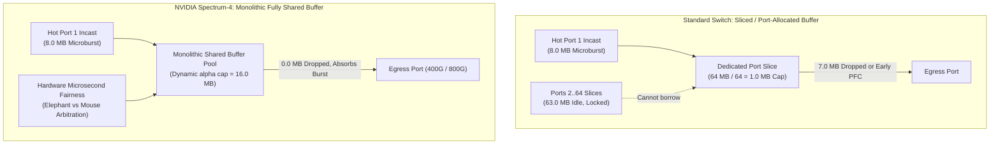
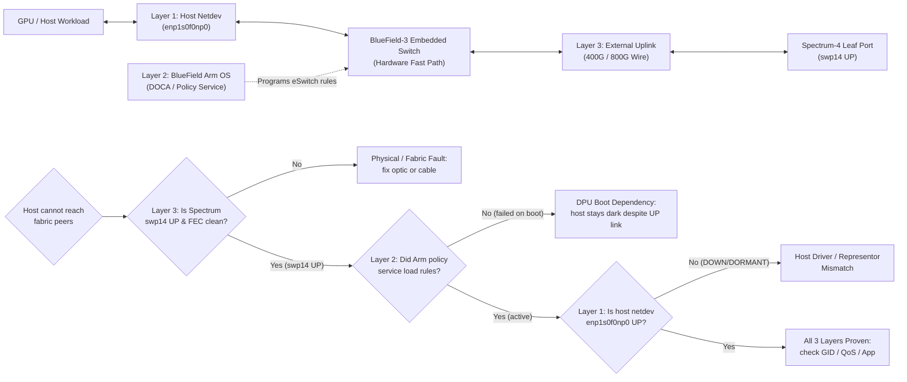
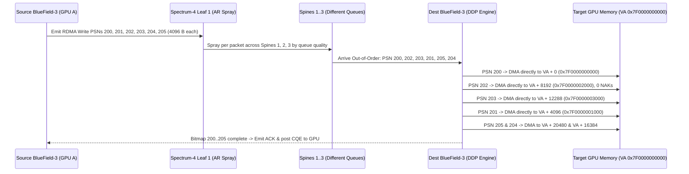
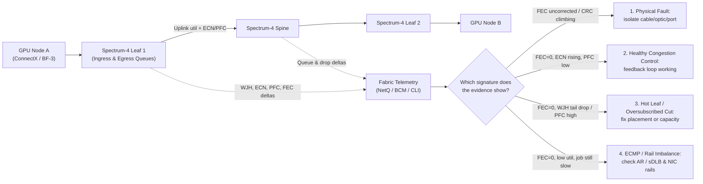

# 12.11 NVIDIA Spectrum-X and Spectrum switches

| | |
|---|---|
| Level | Advanced |
| Priority tier | 2 |
| Lab venue | Nebius GPU |
| Part | Part 12: Complete AI networking |
| Sources | `nvidia-devops` V9 Ch. 7, Ch. 8, Ch. 9, Ch. 10, Ch. 11, Ch. 12, Index & Labs 01–04; `superpod-gb300-ra`; `superpod-b200-dc`; `ai-data-center-network-design-and-technologies` Ch. 2 & Ch. 6; `bcm11-admin` Ch. 3 |
| Code | `code/part12/spectrum_x_switches.py`, `code/part12/spectrum_x_switches_lab.py` |
| Coverage file | `planning/coverage/chapters/12-11.md` |

## Why this matters for AI infrastructure

An AI Ethernet switch is not a passive box of high-speed ports. It is the active arbitration point where hundreds of RDMA Queue Pairs converge. Every microsecond, frames enter lossless or lossy queues and microbursts are absorbed in shared silicon memory. On a large multi-rack cluster, every optical link can report UP with zero Forward Error Correction uncorrectable errors. Yet a few destination-facing leaf uplinks can still suffer hash collisions or incast congestion. That localized contention stalls an entire synchronous training job.

Traditional enterprise Ethernet switches and standard five-tuple Equal-Cost Multi-Path routing were engineered for thousands of short, high-entropy TCP flows. They were never designed for a handful of synchronized RoCEv2 elephant flows generated by NCCL collectives. Under standard static five-tuple hashing, two fat elephant flows routinely hash onto the same spine uplink while sibling links sit half-empty. That collision caps effective cluster bisection bandwidth around sixty percent of physical wire capacity. Worse, if a switch uses a sliced buffer architecture, a single port hammered by an AI microburst can draw only from its tiny dedicated memory slice. The port drops packets even while the rest of the switch memory sits idle.

NVIDIA Spectrum-X solves these limitations by co-designing the switching silicon, the server-edge network adapter, and the network operating system.

1. The NVIDIA Spectrum-4 switch ASIC in the SN5600 and SN5600D provides 51.2 Tbps of switching capacity over a monolithic fully shared buffer. It includes hardware microsecond fairness and What Just Happened drop-reason telemetry, complemented by the SN2201 out-of-band management switch.
2. Spectrum-X pairs Spectrum-4 switches with BlueField-3 SuperNICs, BlueField-3 DPUs, or ConnectX-7 and ConnectX-8 adapters. Operators manage the entire stack declaratively through Cumulus Linux NVUE, DOCA, NetQ, and NVIDIA Base Command Manager.
3. Spectrum-X Adaptive Routing and Selective Dynamic Load Balancing inspect real-time port utilization, queue depth, and RoCEv2 Base Transport Header RDMA Write opcodes. The switch sprays individual packets across all equal-cost spine links, raising effective AI fabric bandwidth from roughly 60 percent to 95 percent.
4. BlueField-3 and ConnectX-7 or ConnectX-8 hardware execute out-of-order Direct Data Placement directly into GPU memory without Go-Back-N retransmission storms. At the same time, Spectrum-4 hardware telemetry paces sender injection rates in a single round-trip time.

```text
Spectrum-X End-to-End Hardware and Performance Baseline (V9 Ch. 7-9, superpod-gb300-ra, ADC Ch. 6):
  - Spectrum-4 ASIC (SN5600/SN5600D):  51.2 Tbps bidirectional (102.4 Tbps full-duplex) across 512 x 100G PAM4 SerDes lanes
                                       (64 x 800GbE OSFP or 128 x 400GbE breakout); monolithic shared buffer + WJH drop telemetry
  - Out-of-Band Switch (SN2201):       48 x 1GbE RJ45 + 4 x 100GbE QSFP28 uplinks; NVUE REST API on HTTPS port 8765
  - Endpoint Adapters:                 BlueField-3 SuperNIC (NIC mode default) / BlueField-3 BF3240 DPU (DPU/ECPF mode default) / ConnectX-7/8
  - Adaptive Routing & sDLB:           Replaces static CRC32 5-tuple ECMP (0x8BDA7C2D on UDP 4791, ~60% effective BW) with per-packet RoCEv2
                                       spraying across spines (~95% effective BW)
  - Hardware OOO DDP Placement:        Computes VA + (PSN - base_PSN) * MTU from RETH to DMA out-of-order packets into GPU HBM with 0 NAK storms
```

## Prerequisites and outcomes

**Prerequisites:** Review Chapter 12.2 on RDMA fundamentals and Queue Pairs, plus Chapter 12.3 on RoCEv2 transport. Also review Chapter 12.4 on PFC, ECN, and DCQCN congestion control, and Chapter 12.5 on ETS, DCBX, and QoS trust boundaries.

**Outcomes:** After completing this chapter, you will be able to:
- Size Spectrum-4 SN5600 and SN5600D port radix and breakout topologies. You will also contrast monolithic shared buffers against sliced buffers and architect DGX GB300 SuperPOD Ethernet fabrics.
- Distinguish BlueField-3 DPU default operating mode from BlueField-3 SuperNIC default mode. You will isolate faults across the three DPU layers and audit ConnectX or BlueField PCIe and NUMA locality.
- Quantify why five-tuple Static Load Balancing caps AI Ethernet fabrics around 60 percent effective bandwidth. You will also explain how Spectrum-X Adaptive Routing and Selective Dynamic Load Balancing achieve 95 percent effective bandwidth.
- Trace BlueField-3 hardware out-of-order Direct Data Placement across out-of-order Packet Sequence Number arrivals. You will also explain Spectrum-X hardware telemetry-driven congestion control.
- Configure and validate Cumulus Linux switches via declarative NVUE and Base Command Manager `cmsh`. You will triage live fabric incidents using What Just Happened drop reasons, multi-leaf PFC pause gradients, and the Spectrum telemetry decision tree.

---

## 1. Spectrum-4 switch architecture, monolithic shared buffers, and SuperPOD topologies

When architects select Ethernet switches for an AI cluster, port speed alone does not guarantee collective throughput. If a switch lacks high port radix, the fabric must add extra spine tiers that increase hop latency and optics cost. Worse, if the switch partitions packet buffer memory into rigid per-port slices, synchronized GPU microbursts overflow individual port slices. That overflow triggers packet drops or pause storms even while most of the switch memory sits unused.

### 1.1 Spectrum-4 51.2 Tbps ASIC, port radix, breakout modes, and SN2201 OOB switches

In an AI Ethernet fabric, headline switching capacity is only as useful as the switch radix and buffer architecture. Radix measures the number of independent ports available to fan out to servers and spines without adding extra switching tiers. The NVIDIA Spectrum-4 switch ASIC delivers 51.2 Tbps of bidirectional switching capacity. It is powered by 512 lanes of 100G PAM4 SerDes in a single monolithic chip.

| Switch Model & Role | Switching Capacity & SerDes | Native Port Configuration | Supported Breakout Modes & Logical Radix | Primary AI Data Center Role |
|---|---|---|---|---|
| **Spectrum-4 `SN5600` / `SN5600D`** (`2U` dense leaf/spine) | `51.2 Tbps` (`512 x 100G PAM4` SerDes lanes) | `64 x 800GbE` (`OSFP` / `QSFP-DD800`, `8` lanes/port) | `64 x 800GbE` (`8` lanes), `128 x 400GbE` (`4` lanes), `256 x 200GbE` (`2` lanes), `512 x 100GbE` (`1` lane) | AI compute backend leaf/spine (`Spectrum-X`), RoCEv2 high-performance storage fabric (`400GbE`/`800GbE`), and in-band management leaf/spine |
| **Spectrum `SN2201`** (`1U` out-of-band management ToR) | `48 x 1GbE` RJ45 copper + `4 x 100GbE` QSFP28 uplinks | `48 x 1 Gbps` downlinks + `4 x 100 Gbps` uplinks | `8,048,771,072` B (`7.496 GB`) RAM, `115,923,419,136` B (`115 GB`) NVMe, Intel Atom `C3338R` `2`-core `@ 1.80 GHz` | Physically isolated Out-of-Band (`OOB`) management for node BMCs, BlueField BMCs, NVLink switch `COMe`/BMC ports, rack PDUs, and ZTP |

Because each physical port on an SN5600 or SN5600D exposes eight lanes of PAM4 SerDes, a single switch can operate as sixty-four ports at 800GbE. Using optical or copper splitter cables, it can also break out into 128 ports at 400GbE, 256 ports at 200GbE, or 512 ports at 100GbE. High port radix lets architects build wide two-tier leaf-spine Clos fabrics without introducing a third super-spine tier until thousands of GPUs are deployed.

```text
Spectrum-4 SN5600 / SN5600D Breakout Radix Math (superpod-gb300-ra, code/part12/spectrum_x_switches.py):
  - Native 800GbE Mode:    64 ports * 800 Gbps  (8 x 100G PAM4 lanes/port) = 51.2 Tbps bidirectional (102.4 Tbps aggregate full-duplex)
  - 2x Breakout 400GbE:   128 ports * 400 Gbps  (4 x 100G PAM4 lanes/port) = 51.2 Tbps bidirectional
  - 4x Breakout 200GbE:   256 ports * 200 Gbps  (2 x 100G PAM4 lanes/port) = 51.2 Tbps bidirectional
  - 8x Breakout 100GbE:   512 ports * 100 Gbps  (1 x 100G PAM4 lane/port)  = 51.2 Tbps bidirectional
```

### 1.2 Monolithic fully shared buffer versus sliced port-allocated buffers

When synchronized GPU workers execute a collective phase or storage checkpoint write, dozens of high-speed ports burst simultaneously toward a single destination port. That traffic pattern creates severe many-to-one incast. The switch must absorb that rate mismatch in on-chip SRAM packet memory while congestion signaling takes effect.

In a standard multi-core or sliced switch, total buffer memory is statically partitioned across ports or slices. When an eight-megabyte microburst hits Port 1 on a sliced switch with a one-megabyte per-port cap, Port 1 exhausts its slice immediately and drops seven megabytes of data. Those drops happen even while the remaining memory sits completely idle across the other ports. **Spectrum-4 pools all internal packet memory into a monolithic fully shared buffer.** Any congested port dynamically borrows up to a shared threshold, absorbing transient AI microbursts with zero drops.



| Buffer Architecture | Memory Allocation Mechanism | Behavior Under `8.0 MB` Single-Port AI Microburst (`64 MB` Total Pool across `64` Ports) | Impact on RoCEv2 & Collective Tail Latency |
|---|---|---|---|
| **Standard Sliced / Multi-Core Buffer** | Memory is statically partitioned per port or per ingress/egress slice (`64 MB / 64 = 1.0 MB` per port) | Port `1` exhausts its `1.0 MB` slice immediately and **drops `7.0 MB`** (or fires immediate `PFC` `XOFF` pauses) even though `63.0 MB` sits unused on Ports `2..64` | Premature `PFC` pause trees or `Go-Back-N` retransmission storms (`250x` amplification on `400G` links) |
| **NVIDIA Spectrum Monolithic Fully Shared Buffer** | Single unified memory pool dynamically accessible by any port up to a dynamic threshold ($\alpha = 25\% \rightarrow 16.0\text`{ MB}`$) | Port `1` dynamically borrows `8.0 MB` from the shared pool (`<= 16.0 MB` cap), absorbing the entire microburst with **`0.0 MB` dropped** | Absorbs transient AI microbursts cleanly while `ECN`/telemetry-driven rate control paces senders |
| **Hardware Microsecond Fairness** | Per-queue hardware arbitration across competing elephant and mouse flows | Prevents a `400 Gbps`/`800 Gbps` RDMA elephant flow from starving small control/collective barrier frames | All GPU ranks in a synchronous collective progress evenly without straggler skew |

### 1.3 Spectrum-4 and SN2201 in the DGX GB300 SuperPOD architecture

In the NVIDIA DGX GB300 SuperPOD reference architecture, each rack is a liquid-cooled DGX GB300 NVL72 system housing eighteen compute trays, and eight racks form one Scalable Unit. Every compute tray integrates two distinct network adapter families on its front cold-aisle panel. Four ConnectX-8 NICs serve the rail-aligned compute fabric, while one dual-port BlueField-3 BF3240 DPU connects to a two-layer Spectrum-4 SN5600 and SN5600D Ethernet fabric.

Rather than bonding both BlueField-3 ports into a shared interface where unpredictable TCP bursts could contend with storage traffic, the SuperPOD isolates the two ports onto separate fabrics.

1. Port 0 on each BlueField-3 BF3240 operates exclusively on the lossless RoCEv2 High-Performance Storage network.
2. Port 1 operates on the In-Band Management and NFS user storage network.
3. Compute leaves connect to the SN5600D spine tier with a deliberate three-to-one blocking ratio tailored to per-tray storage demand. By contrast, storage leaves connect nonblocking so storage arrays never bottleneck at the leaf-to-spine cut.
4. Two management leaves serve Base Command Manager, Slurm, Run:ai, container registries, and NFS storage. At the same time, two OOB aggregation spines aggregate the SN2201 management switches into a dedicated VXLAN domain.

```text
DGX GB300 SuperPOD Rack, Tray, and Storage Tier Reference (superpod-gb300-ra pp. 5-31):
  - GB300 NVL72 Rack & SU:     18 compute trays (4 B300 GPUs + 2 Grace CPUs/tray = 72 GPUs/rack @ 1.8 TB/s NVL5 over 9 switch trays)
                               + 8 power shelves (6 x 5.5 kW PSUs = 33 kW/shelf); 8 racks = 1 SU (576 GPUs, 144 compute trays, 1.2 MW TDP)
  - Local Tray NVMe Storage:   4 x 3.84 TB E1.S NVMe in RAID0 + 1 x 1.92 TB M.2 OS NVMe per compute tray
  - Per-Tray Front NICs:       4 x ConnectX-8 (800 Gbps compute rails) + 1 x BlueField-3 BF3240 (2 x 400 Gbps: Port 0 = 400 Gbps lossless
                               RoCEv2 HPS storage; Port 1 = >= 200 Gbps in-band management & NFS user storage)
  - SN5600D Leaf Uplinks:      Compute leaves (4/SU) = 24 x 400 Gbps (1:3 / 3:1 blocking); Storage leaves (starting at 2) = 72 x 400 Gbps (1:1 nonblocking);
                               Management leaves (2) = 24 x 400 Gbps + >= 2 x 100GbE DR1 SMF eBGP uplinks to customer edge; OOB spines = 2 switches
  - Standard Storage Tier:     90 GB/s aggregate read and 45 GB/s aggregate write per SU (360 GB/s read and 180 GB/s write across 4 SUs)
  - Enhanced Storage Tier:     280 GB/s aggregate read and 140 GB/s aggregate write per SU (1,120 GB/s read and 560 GB/s write across 4 SUs)
```

| Scale-Out Size (`# SUs`) | Total GPUs (`72`/rack, `576`/SU) | `SN5600D` Spine Switches | `SN5600D` Compute Leaf Switches (`4`/SU) | `SN5600D` Storage Leaf Switches | Max Supported Storage Bandwidth (`400GbE` Links / Aggregate `Tbps`) | Management Leafs + OOB Spines |
|---|---|---|---|---|---|---|
| **`2` SUs** (`16` racks) | **`1,152`** | `4` | `8` | `2` | **`64 x 400GbE`** (`25.6 Tbps`) | `2 + 2` |
| **`4` SUs** (`32` racks) | **`2,304`** | `8` | `16` | `2` | **`128 x 400GbE`** (`51.2 Tbps`) | `2 + 2` |
| **`8` SUs** (`64` racks) | **`4,608`** | `12` | `32` | `4` | **`256 x 400GbE`** (`102.4 Tbps`) | `2 + 2` |
| **`16` SUs** (`128` racks) | **`9,216`** | `24` | `64` | `8` | **`1024 x 400GbE`** (`409.6 Tbps`) | `2 + 2` |

### 1.4 Evaluating switch capacity at the bottleneck cut in normal and N-1 degraded states

Vendor datasheets highlight total chip throughput, but distributed jobs feel only the narrowest bisection cut along their traffic path. When reviewing any Spectrum leaf-spine topology, separate five metrics that are often conflated. Those metrics are single-port speed, port radix, aggregate switch capacity, shared-buffer behavior, and usable bisection capacity at the active traffic cut.

$$
\text`{Effective Available Capacity}` = \text`{Capacity of the relevant path cut after topology, policy, and }` N-1 \text`{ failure constraints}`
$$

This formula states that your real cluster bandwidth is bounded by the surviving uplinks across the leaf-to-spine cut. Always account for maintenance drains or single-link failures when calculating that limit.

```text
Worked Leaf-to-Spine Cut Capacity in Normal and N-1 Degraded States (V9 Ch. 2 & Ch. 10):
  - Rack Downlink Demand:       16 GPU nodes x (2 x 400 Gbps RoCEv2 rails = 800 Gbps/node) = 12,800 Gbps worst-case off-rack injection
  - Normal Uplink Capacity:     8 active uplinks x 400 Gbps = 3,200 Gbps -> 12,800 / 3,200 = 4.0:1 (4:1) normal oversubscription ratio
  - Degraded N-1 Uplink Cut:    1 uplink drained/failed = 7 active uplinks x 400 Gbps = 2,800 Gbps -> 12,800 / 2,800 = 4.57:1 oversubscription
  - Spine Drain Scenario:       Draining 1 of 2 spines shrinks nexthop-group 40 from 2 active members to 1, concentrating cross-rack traffic
                                onto half the uplinks and driving tx_ecn_marked_prio3 up 5.87x (from 15,000 to 88,120 while rx_pfc_prio3 stays 0)
```

Always size and validate leaf-to-spine cuts under both normal and degraded spine conditions so planned switch maintenance never triggers a cluster-wide training stall.

---

## 2. End-to-end Spectrum-X platform: Spectrum-4, BlueField-3, ConnectX, and DOCA

A switch cannot fix endpoint misconfigurations or host bus bottlenecks on its own. In a production cluster, a leaf switch port can report UP at full speed with zero physical errors while the attached GPU server sits completely unreachable because an embedded DPU service failed during boot. Similarly, a downgraded host PCIe slot can cap RDMA throughput at a fraction of line rate while switch counters look completely clean.

### 2.1 BlueField-3 operating modes and three-layer fault isolation

Spectrum-X is an end-to-end architecture where the Spectrum-4 switch and the BlueField-3 or ConnectX endpoint cooperate in hardware. On the server side, NVIDIA ships BlueField-3 silicon in two distinct hardware SKU families whose default operating modes must never be conflated.

1. BlueField-3 DPU SKUs such as the dual-port BF3240 default to DPU mode, also called Embedded CPU Function Ownership. In that mode, the embedded Arm subsystem running DOCA Linux owns the NIC resources and the embedded switch.
2. In DPU mode, the first packet of a flow traverses an Arm representor slow path so the Arm control plane can validate policy and program a hardware flow rule. Subsequent packets then cross the hardware fast path directly.
3. BlueField-3 SuperNIC SKUs such as the BF3140 default to NIC mode, operating as a dedicated Spectrum-X RoCEv2 endpoint. The host driver manages Queue Pairs directly while hardware engines execute Adaptive Routing packet reordering and telemetry-driven congestion control without an Arm virtual-switch dependency.



| Observable Layer | Diagnostic Command & Healthy Baseline | Failure Signature in the Production DPU Story (`V9` Ch. 9) | Operational Meaning |
|---|---|---|---|
| **Layer 3: External Fabric Uplink (Switch View)** | `(on leaf) show interface status swp14` -> `swp14 up 100G/400G full RoCE-compute` | `swp14` reports **`up`** with zero FEC/CRC errors | Proves physical cable and DPU-to-leaf link are up; **does not prove host reachability** |
| **Layer 2: BlueField Arm Control Plane (OOB View)** | `(on DPU Arm) systemctl status openvswitch-policy-load.service` -> `Active: active (exited)` | `Active: failed (Result: exit-code) since 09:14:02 UTC` (`Process: 812` `code=exited, status=1`) | Arm service failed to program `eSwitch` fast-path rules during boot |
| **Layer 1: Host Network Function (Host View)** | `(on host) ip -br link show` -> `enp1s0f0np0 UP` | `enp1s0f0np0 DOWN <state DORMANT>` | Host-facing representor never came up because Layer 2 policy load failed |
| **Fleet Image Reconciliation (`dpu-agent`)** | `node07` & `node08`: `dpu-image-24.10-prod-3` | `node09`: stuck on **`dpu-image-24.07-prod-1`** (`reconcile abandoned after 5 retries` from `03:12:04` to `03:45:11`) | Silent image drift across "identical" nodes causes asymmetric policy behavior |

**When operating BlueField DPUs in DPU mode, treat the host, the DPU Arm subsystem, and the Spectrum switch as three separate failure domains.** Gate node scheduler readiness on all three layers rather than switch link state alone. Always prefer a supported packaged DOCA service over a custom DOCA application unless a dedicated engineering team owns long-term maintenance. Never deploy a DOCA SDK sample directly as production infrastructure.

### 2.2 ConnectX and BlueField-3 local I/O paths: PCIe downgrades, NUMA locality, and multi-rail selection

On the host side of a ConnectX-7, ConnectX-8, or BlueField-3 SuperNIC, an active Ethernet link can deliver line rate only if the local PCIe root complex, NUMA topology, and collective communication library drive it properly.

1. Compare `LnkCap` against `LnkSta` in `lspci -vv` to verify negotiated PCIe speed and width. A 200GbE adapter requires 25.0 GB/s of PCIe bandwidth and will bottleneck at 16.0 GB/s if it downgrades from PCIe Gen5 x16 to Gen4 x8.
2. Inspect `nvidia-smi topo -m` to confirm that each GPU pairs with the NIC on the same PCIe switch hierarchy (`PIX`) on its local NUMA node rather than crossing the CPU socket interconnect (`SYS`).
3. Capture sixty-second `ethtool -S` byte-counter deltas across all rails during a collective run. That check verifies that every local GPU rank binds to its own dedicated `mlx5` RDMA device rather than collapsing onto a single rail.

```text
Host PCIe Downgrade and Multi-Rail Byte-Delta Evidence (V9 Ch. 8):
  - PCIe Capability vs Negotiated State (lspci -s 41:00.0 -vv | egrep "LnkCap|LnkSta"):
      LnkCap: Port #0, Speed 32GT/s, Width x16      <- PCIe Gen5 x16 capable (~64.0 GB/s raw)
      LnkSta: Speed 16GT/s (downgraded), Width x8   <- Negotiated PCIe Gen4 x8 (~16.0 GB/s raw, 1/4 of capability; < 25.0 GB/s for 200GbE and 50.0 GB/s for 400GbE)
  - NUMA / PCIe Locality (nvidia-smi topo -m):
      GPU0 <-> NIC0 = PIX (local NUMA node 0, cores 0-31); GPU1 <-> NIC1 = PIX (local NUMA node 1, cores 32-63); GPU0 <-> NIC1 = SYS (cross-socket)
  - Scenario 1 Dual-Rail 60-Second Byte-Counter Delta (ethtool -S):
      * ens1f0 (rail 0, mlx5_0): rx_bytes_phy rose from 892,481,200,384 to 981,204,882,176 B (+88,723,681,792 B = +88.7 GB in 60 s = 11.83 Gbps)
      * ens1f1 (rail 1, mlx5_1): rx_bytes_phy stayed at 412,992 B (~0 GB delta, idle rail)
      * Root Cause (NCCL_DEBUG=INFO): Both local GPU ranks (node05:2201 [0] and [1]) logged "NCCL INFO NET/IB : Using [0]mlx5_0:1/RoCE ; OOB ens1f0"
```

Avoid generic host LACP bonding on AI RoCEv2 rails because bonding hides physical rail topology from NCCL. Always verify balanced per-rail byte counter deltas under load before investigating the switch fabric.

---

## 3. Spectrum-X Adaptive Routing and selective per-packet RoCEv2 spraying

In a conventional enterprise data center, thousands of independent TCP connections create enough five-tuple randomness to spread traffic evenly across spine switches. During an AI collective operation, however, each GPU opens only a few Queue Pairs that blast RoCEv2 elephant flows simultaneously. When two elephant flows hash onto the same uplink, that link saturates at one hundred percent while parallel spine links sit underutilized, dragging cluster-wide bisection efficiency down to roughly sixty percent.

### 3.1 Why traditional 5-tuple Static Load Balancing caps AI Ethernet fabrics at 60 percent

In a standard IP leaf-spine Clos fabric, a leaf switch learns equal-cost paths to a remote GPU across all spine switches via BGP Equal-Cost Multi-Path routing. Under Static Load Balancing, the switch Packet Forwarding Engine computes a deterministic `CRC32` hash over each packet's five-tuple. Those five fields are source IP, destination IP, IP protocol, source UDP port, and the fixed RoCEv2 destination UDP port.

To prevent a single link flap from rehashing every active flow in the switch, modern ASICs map the hash into a fixed resilient hashing indirection table. Only buckets assigned to a failed link move when a port goes down. However, neither modulo arithmetic nor resilient hashing inspects real-time link bandwidth or buffer queue depth. When two large flows collide on one spine uplink while two smaller flows land on a second uplink, the first uplink saturates completely while the second sits half-empty.

```text
Worked 5-Tuple CRC32 Static Load Balancing and Elephant Collision Math (ADC Ch. 6):
  - RoCEv2 5-Tuple Inputs:       Src IP = 192.168.1.20 (0xC0A80114), Dst IP = 192.168.2.10 (0xC0A8020A),
                                 IP Proto = 17 (UDP = 0x11), Src UDP = 1024 (0x0400), Dst UDP = 4791 (0x12B7)
  - Concatenated Hex & CRC32:    C0A80114 C0A8020A 11040012 B7 -> CRC32 = 0x8BDA7C2D (2,346,351,661 decimal)
  - Modulo Link Selection:       5-member ECMP group: 2,346,351,661 mod 5 = 1 (interface index 1)
                                 8-member ECMP group: 2,346,351,661 mod 8 = 5 (interface index 5)
  - Resilient Hashing Table:     512 or 1,024 fixed buckets (or 8-bucket pedagogical table where hash mod 8 = 2 -> interface_2,
                                 reassigning only buckets 2 and 7 if interface_2 fails); ECMP group nh-id123 -> Unicast_nh1..3 (SpineA..C)
  - Four-Flow Collision on Two 200 Gbps Uplinks (Flow1=50G, Flow2=100G, Flow3=50G, Flow4=100G; 300 Gbps total = 75% of 400G cut):
      * SLB SpineA (Flow1 + Flow3): 50 Gbps + 50 Gbps   = 100 Gbps (50.0% utilization, half-empty)
      * SLB SpineB (Flow2 + Flow4): 100 Gbps + 100 Gbps = 200 Gbps (100.0% utilization, saturated hot spot -> ~60% cluster effective BW)
```

### 3.2 Dynamic, Global, Selective, and Spectrum-X per-packet RoCEv2 spraying

To eliminate static hash collisions, modern AI switch ASICs progress up a four-tier load-balancing hierarchy. Those four tiers are Static Load Balancing, Dynamic Load Balancing, Global Load Balancing, and Spectrum-X Selective Dynamic Load Balancing.

| Load-Balancing Mode | Path Selection Inputs | Granularity & Rebalancing Behavior | RoCEv2 Reordering Impact & Effective Bandwidth |
|---|---|---|---|
| **Static Load Balancing (`SLB`)** | 5-tuple (`Src/Dst IP`, `UDP Src/Dst 4791`, `Proto 17`) + optional `BTH` `QP` field via `CRC32` | Per-flow static pin; blind to link utilization and buffer queue depth | In-order delivery, but severe elephant collisions (**`~60%` effective BW**) |
| **Dynamic Load Balancing (`DLB`)** | Local link bandwidth utilization + local egress buffer queue depth (`quality band` table updated in ASIC microkernel) | **Assigned-flow mode** (pins at flow start), **Flowlet mode** (rebalances across inter-burst idle gaps), or **Per-packet mode** | Flowlet mode balances `(50G+100G = 150G, 75%)` across both `200G` spines with low reordering |
| **Global Load Balancing (`GLB`)** | Local link utilization + local queue depth + **Next-to-Next-Hop (`NNH`)** remote spine-to-leaf link quality | Propagates downstream spine-to-leaf congestion state upstream so ingress leaves avoid remote bottlenecks | Prevents aggregation hot spots in 3-stage and 5-stage Clos fabrics |
| **Spectrum-X Adaptive Routing & Selective Spraying (`sDLB`)** | Real-time local/remote link load, queue size, and **TCAM ACL match on RoCEv2 (`UDP 4791`) `BTH` `RDMA Write` opcodes** | **Per-packet spraying (`PER_PACKET_SPRAY`)** across all healthy equal-cost spine links for `DDP`-capable endpoints | Nearly perfect link utilization (**`~95%` effective BW**); out-of-order packets reassembled in hardware by `BlueField-3` / `ConnectX-7/8` |

In Spectrum-X Adaptive Routing with Selective Dynamic Load Balancing, the Spectrum-4 ingress pipeline uses a TCAM Access Control List to inspect the RoCEv2 Base Transport Header opcode.

1. Non-matching control or legacy flows such as TCP or two-sided RDMA Send remain on flowlet or per-flow load balancing to preserve strict in-order arrival.
2. Matching elephant flows carrying RoCEv2 RDMA Write opcodes between DDP-capable ConnectX or BlueField-3 adapters switch into quality-aware per-packet spraying.
3. Every individual RDMA packet is dispatched out the least-loaded spine link based on real-time hardware queue quality tables.

```text
Spectrum-X sDLB TCAM ACL Opcode Classification Reference (ADC Ch. 2 & Ch. 6):
  - Non-Matching / Control Flows (Flow1, e.g., TCP or RDMA Send):  FLOWLET_OR_PER_FLOW (preserves strict in-order arrival)
  - Matching Elephant Flows (Flow2, UDP 4791 BTH RDMA Write):      PER_PACKET_SPRAY across Port-1 -> Spine1, Port-2 -> Spine2, Port-3 -> Spine3
                                                                   (Datagram A, Datagram B, Datagram C dispatched by real-time queue quality)
```

**Spectrum-X Adaptive Routing sprays individual RoCEv2 RDMA Write packets across all equal-cost spine links.** That real-time balancing raises effective cluster bisection bandwidth from roughly 60 percent to 95 percent.

---

## 4. BlueField-3 hardware out-of-order Direct Data Placement and telemetry-driven congestion control

Spraying individual packets of a single Queue Pair across multiple spines guarantees that packets traverse slightly different queue depths and fiber lengths. As a result, packets arrive at the destination server out of Packet Sequence Number order. On a standard RDMA NIC without hardware out-of-order placement, receiving an out-of-sequence packet immediately triggers a sequence-gap Negative Acknowledgment. That NAK unleashes a hardware Go-Back-N retransmission storm that collapses throughput.

### 4.1 Why per-packet spraying breaks standard RDMA NICs and how hardware DDP solves it

BlueField-3 SuperNICs and ConnectX-7 or ConnectX-8 adapters make per-packet fabric spraying transparent to applications through hardware out-of-order Direct Data Placement.

1. In an RDMA Write burst, the First or Only packet carries the RDMA Extended Transport Header. That header contains the base virtual memory address, Remote Key, and total DMA length. Every subsequent Middle or Last packet carries its Packet Sequence Number in the Base Transport Header.
2. Because the Path MTU and starting PSN are stored in the hardware Queue Pair context, the receiving BlueField-3 SuperNIC computes each arriving packet's destination offset arithmetically. It then DMAs the payload directly into GPU High-Bandwidth Memory in place without staging out-of-order packets in NIC SRAM.
3. The SuperNIC tracks received packets in a sliding hardware PSN arrival bitmap. It withholds the final acknowledgment and Completion Queue Element until all delayed packets arrive and the bitmap is contiguous.

$$
\text`{Target Address}`(\text`{PSN}`) = \text`{VA}`_\{\text`{base}`} + (\text`{PSN}` - \text`{PSN}`_\{\text`{start}`}) \times \text`{MTU}`
$$

This equation shows how the receiving NIC calculates the exact destination byte address in GPU memory for any out-of-order packet using only its Packet Sequence Number and the Queue Pair MTU.



| Arriving Packet Order (`PSN`) | Legacy RDMA NIC Behavior (In-Order Required) | BlueField-3 / ConnectX-7/8 Hardware `DDP` Action (`base_va = 0x7F0000000000`, `MTU = 4,096` B) | Target GPU Memory Address Written (`GPUDirect RDMA`) |
|---|---|---|---|
| **1st arrival: `PSN 200`** | Expects `200` -> accepts `200`, advances expected to `201` | Computes offset $(200 - 200) \times 4096 = 0$; sets bitmap bit `0` | `0x7F0000000000` (`+0` B) |
| **2nd arrival: `PSN 202`** | Expects `201` -> **drops `202`, emits `PSN`-gap `NAK #1` (`Go-Back-N`)** | Computes offset $(202 - 200) \times 4096 = 8,192$; DMAs directly to GPU RAM (`0` NAKs) | `0x7F0000002000` (`+8,192` B) |
| **3rd arrival: `PSN 203`** | Still missing `201` -> **drops `203`, emits `NAK #2`** | Computes offset $(203 - 200) \times 4096 = 12,288$; DMAs directly to GPU RAM | `0x7F0000003000` (`+12,288` B) |
| **4th arrival: `PSN 201`** | Accepts `201`, but `202` & `203` were discarded and must be retransmitted | Computes offset $(201 - 200) \times 4096 = 4,096$; fills gap in GPU RAM (`200..203` contiguous) | `0x7F0000001000` (`+4,096` B) |
| **5th arrival: `PSN 205`** | Expects `204` -> **drops `205`, emits `NAK #3`** | Computes offset $(205 - 200) \times 4096 = 20,480$; DMAs directly to GPU RAM | `0x7F0000005000` (`+20,480` B) |
| **6th arrival: `PSN 204`** | Accepts `204`, waits for retransmitted `205` (`3` total NAK events) | Computes offset $(204 - 200) \times 4096 = 16,384$; bitmap `200..205` complete -> **posts `CQE`** | `0x7F0000004000` (`+16,384` B) |

### 4.2 Spectrum-X hardware telemetry-driven congestion control

Even with perfect per-packet spraying across the spine tier, congestion can still occur at the final destination leaf-to-server port (`CP4`). That bottleneck appears when multiple GPUs intentionally write to a single receiver during incast or parallel storage checkpointing. Classical DCQCN relies on probabilistic ECN marks that tell the sender NIC only that congestion exists. Those binary marks do not report how full the queue is or how many flows are competing. Consequently, a classical sender applies a blind multiplicative rate cut and slowly probes back upward, creating sawtooth bandwidth oscillations.

In Spectrum-X Congestion Control, the Spectrum-4 switch ASIC and BlueField-3 SuperNIC replace blind binary probing with hardware telemetry-driven rate control. When a Spectrum-4 egress queue crosses its target threshold, the switch injects exact hardware telemetry into congestion feedback packets. That telemetry includes instantaneous queue depth, queue drain rate, and active link utilization. Receiving that telemetry, competing BlueField-3 senders compute and set their exact fair-share drain rate in a single round-trip time. That feedback drains the excess queue smoothly without under-utilizing the wire or triggering PFC pause storms.

```text
Worked Spectrum-X Telemetry-Driven Congestion Control vs Blind Binary Cut (code/part12/spectrum_x_switches.py):
  - Switch Egress Port & Queue:  400.0 Gbps port, 2 active flows; queue occupancy = 160.0 KB (target = 64.0 KB, max = 256.0 KB, excess = 96 KB)
  - Telemetry Occupancy Ratio:   (160.0 - 64.0) / (256.0 - 64.0) = 96.0 / 192.0 = 0.5
  - Classical Blind Binary Cut:  Cuts 400.0 Gbps flow by 50% -> 200.0 Gbps (sawtooth under-utilization / slow timer recovery)
  - Spectrum-X Telemetry Rate:   (400.0 / 2) * (1 - 0.15 * 0.5) = 200.0 * 0.925 = 185.0 Gbps per flow in 1 RTT (drains queue smoothly)
```

**Never enable per-packet fabric spraying unless the receiving RDMA adapters support hardware out-of-order Direct Data Placement.**

---

## 5. Spectrum telemetry, What Just Happened, and the 4-branch fault decision tree

When a distributed training run slows down on an Ethernet fabric, treating the entire switch network as a single opaque suspect wastes critical triage time. Operators should combine host `ethtool -S` deltas with Spectrum switch queue counters, ECN marks, PFC pause frames, and What Just Happened hardware drop-reason telemetry. Joining those signals routes any incident immediately into one of four distinct root-cause branches.

### 5.1 Separating physical faults, healthy congestion control, hot cuts, and ECMP imbalance

The four-branch Spectrum telemetry decision tree separates physical layer corruption from normal congestion pacing, oversubscribed cuts, and routing or rail imbalance.



| Telemetry Branch | Physical Counters (`fec_uncorrected_blocks`, `rx_crc_errors`) | Queue, `WJH`, `ECN`, and `PFC` Counter Deltas | Concrete Production Evidence (`V9` Ch. 7, 10, 11 & Lab 03) | Correct Engineering Action |
|---|---|---|---|---|
| **1. Physical Fault** | **Climbing** (`fec_uncorrected_blocks: 3` matching `rx_crc_errors: 3` on `swp17`; `fec_corrected_blocks: 41,200`) | `rx_ecn_marked_prio3` may rise secondarily due to RDMA retransmissions | `swp17` (`rack14-node07`, `mlx5_1`, `rail 1`, `DAC-2m` serial `ABC123`, `training-run-4471` ranks `48-55`) | Replace/reseat cable or optic (`ABC123`) first; never tune `ECN`/`PFC` on a corrupting link |
| **2. Healthy Congestion Control** | **Clean (`0` uncorrected, `0` CRC)** | `rx_ecn_marked_prio3` rises (`+47,829`); `rx_pfc_prio3` modest (`412`), `tx_pfc_prio3` (`14`); `0` `WJH` drops | `Lab 03` `60 s` bounded contention (`rx_prio3_packets` `102,314 -> 51,234,892`, `tx_prio3_packets` `89,621 -> 48,901,234`, `Sender A 89.2 Gbps + Sender B 87.1 Gbps = 176.3 Gbps`) | Not an incident; `DCQCN`/telemetry control loop is pacing senders as qualified |
| **3. Hot Leaf / Oversubscribed Cut** | **Clean (`0` uncorrected, `0` CRC)** | `WJH` **`Tail drop (queue full)`** climbing (`18,402` or `52,100` vs `0` on healthy rack) or sustained `rx_pfc_prio3` (`210,500`) | Slow rack uplink to `10.20.9.99` shows `52,100` tail drops (`1s ago`) vs `0` on healthy rack; or `leaf03` (`210,500`) -> `leaf07` (`198,200`) -> `leaf12` (`41,100`) pause tree | Fix workload placement, oversubscribed cut, or hop-by-hop QoS drift (`swp19` `trust pcp`) |
| **4. ECMP or Rail Imbalance** | **Clean (`0` uncorrected, `0` CRC)** | Low average link utilization (`< 40%`), flat `ECN`/`PFC`, yet collective step time is slow | Static 5-tuple hash collision (`~60%` effective BW) or `ens1f0` moving `+88.7 GB` while `ens1f1` moves `412,992` B (`~0 GB`) | Enable Spectrum-X Adaptive Routing (`sDLB`) and fix `NCCL` multi-rail device binding |

### 5.2 Hardware drop-reason sampling with What Just Happened and tracing PFC pause trees

Standard interface discard counters tell you only that packets were dropped. They leave operators guessing whether the cause was a bad cable, a VLAN miss, an ACL rule, a routing blackhole, or an exhausted egress queue. On NVIDIA Spectrum switches running Cumulus Linux, What Just Happened captures the offending packet header and the exact ASIC hardware drop reason in real time.

```text
# (untested here) Inspect hardware drop reasons via What Just Happened (WJH)
$ show what-just-happened drop-reason all
REASON                    SRC-IP        DST-IP        COUNT   LAST-SEEN
L2 table miss              -             -               0     -
Router ingress miss        10.20.4.15   10.20.9.99       0     -
Tail drop (queue full)     10.20.4.15   10.20.9.99    18402    2s ago
ACL deny                    -            -                0     -

Production WJH Comparison Scenarios (V9 Ch. 7 Scenario 1 & Ch. 10):
  - Scenario 1 (256-GPU cluster, pairwise ib_write_bw = 392.11 Gbps, straggler rack under 2 concurrent jobs):
      * Slow rack leaf uplinks:     Tail drop (queue full) from 10.20.5.20 -> 10.20.9.99 = 52,100 (1s ago)
      * Healthy rack leaf uplinks:  Tail drop (queue full) = 0
  - Shared Production Cut Scenario (V9 Ch. 10):
      * Isolated acceptance test:   0 WJH tail drops
      * Shared production workload: 38,210 Tail drop (queue full) events (10.20.6.40 -> 10.20.9.12, 3s ago)
```

When lossless PFC is active on Priority 3 and pause frames propagate across multiple leaf switches, walk the `rx_pfc_prio3` counter gradient across all suspect leaves in a single synchronized query.

```text
# (untested here) Walk rx_pfc_prio3 across leaves to locate the pause-tree origin
$ for sw in leaf03 leaf07 leaf12; do echo "== $sw =="; ssh $sw "ethtool -S swp1 | grep rx_pfc_prio3"; done
== leaf03 ==
     rx_pfc_prio3:            210500       <- most-downstream, highest count: pause-tree origin
== leaf07 ==
     rx_pfc_prio3:            198200       <- propagated upstream from leaf03's direction
== leaf12 ==
     rx_pfc_prio3:            41100        <- further upstream, smaller count
```

**When multiple leaf switches report rising PFC pause counters, follow the monotonic counter gradient downstream.** The switch with the highest `rx_pfc_prio3` count is the true congestion origin.

---

## 6. Cumulus Linux, declarative NVUE, NetQ, and Base Command Manager operations

Manually editing configuration files across dozens of leaf and spine switches guarantees configuration drift. A single port reverting from DSCP trust to PCP trust will silently drop RoCEv2 traffic into a lossy queue. Modern AI fabrics eliminate manual file edits by managing every switch through a single declarative object model.

### 6.1 Declarative switch management with NVUE and BCM `cmsh`

NVIDIA Spectrum switches run Cumulus Linux, a native Debian-based Network Operating System. It exposes NVIDIA User Experience (`NVUE`) as its unified declarative management model. Operators and automation pipelines interact with the `nvued` daemon through three equivalent interfaces.

1. The `nv` CLI (`nv set`, `nv unset`, `nv config diff`, `nv config apply`, `nv config save`, `nv config show`) renders the running switch state as a versioned `startup.yaml` file.
2. The NVUE REST API on HTTPS port 8765 exposes the exact same object tree for configuration-as-code automation.
3. NVIDIA Base Command Manager (`cmsh` and `cm-lite-daemon`) provisions Cumulus switches via Zero-Touch Provisioning. It manages ongoing NVUE configurations across `auto`, `manual`, and `file` modes while integrating NetQ telemetry and NVIDIA Air digital-twin validation.

```text
Cumulus Linux OS, BCM cmsh nvconfigurationmode, and Uplink Reference (bcm11-admin Ch. 3 pp. 148-166):
  - Cumulus Linux NOS Baseline:   Debian kernel 5.10.0-cl-1-amd64 (#1 SMP Debian 5.10.162-1+cl5.4.0u1), Cumulus Linux 5.2.1 or 5.13.1
  - BCM Switch Device Setup:      set hasclientdaemon yes (for cm-lite-daemon); accesssettings Rest port 8765;
                                  Day-0 ZTP over DHCP from http://10.141.255.254:8080/switch/myswitch/cumulus-ztp.sh
                                  and /cm/local/apps/cmd/etc/htdocs/switch/<switch>/startup.yaml
  - Three nvconfigurationmode Modes in cmsh:
      1. auto mode:   BCM auto-generates indexed nv set rules:
                      1: nv set system hostname myswitch
                      2: nv set system timezone Europe/Amsterdam
                      3..6: nv set service snmp-server ...
                      7: nv set service ntp mgmt pool 10.141.255.254
                      8: nv set service dns mgmt server 10.141.255.254
                      9..10: nv set service syslog mgmt server 10.141.255.254 port 514 / protocol udp
                      11: nv set bridge domain br_default type vlan-aware
                      + optional manual overrides (manual 1: nv set interface swp27 ip address 10.141.255.123) pushed with apply
      2. manual mode: Ignores auto-generated rules (or copies auto stack into manual indices so lines like nv del 1-2 can be pruned before commit/apply)
      3. file mode:   Used by DGX SuperPODs; points nvconfigurationfile to startup.yaml (and cm-startup.yaml via cm-import-startup)
  - ISL Uplink Declaration & Port Discovery in cmsh:
      * Declare spine-facing ISLs as uplinks so CMDaemon ignores transit MACs: set switch01 uplinks 15 16; set switch02 uplinks 01; commit
      * Audit node cabling: showport <mac>, finddevicebyswitchport switch01:1 (or breakout switch01:1s1), setmacviaswitchport --dry-run -t switch,
        switchoverview (e.g., swp5 UP node001-dpu 100 Gb/s, swp7 UP node002-dpu 100 Gb/s), and NetQ (netqsettings on port 443)
```

**Always manage Spectrum switches from a single versioned `startup.yaml` or BCM NVUE source of truth.** Register all inter-switch links as uplinks in `cmsh` so transit MACs never corrupt port discovery.

---

## Commands and configurations that matter

### 1. Declarative NVUE (`nv set`) configuration for a Spectrum-X lossless RoCEv2 + Adaptive Routing + BGP/EVPN leaf switch

```bash
# (untested here) 1. Configure 9216-byte jumbo MTU across all 64/128 server and spine ports
nv set interface swp1-64 link mtu 9216

# (untested here) 2. Enable lossless RoCEv2 QoS profile (DSCP trust, Priority 3 PFC, ECN marking, and PFC Watchdog)
nv set qos roce enable on
nv set qos roce mode lossless
nv set qos pfc default-profile prio 3
nv set qos ecn default-profile
nv set interface swp1-64 qos pfc-watchdog state enabled

# (untested here) 3. Enable Spectrum-X Adaptive Routing and selective RoCEv2 packet spraying
nv set system adaptive-routing enable on
nv set router adaptive-routing enable on

# (untested here) 4. Configure BGP numbered/unnumbered underlay and EVPN control plane
nv set router bgp autonomous-system 65101
nv set vrf default router bgp neighbor swp49-64 remote-as external
nv set vrf default router bgp address-family ipv4-unicast enable on
nv set vrf default router bgp address-family l2vpn-evpn enable on

# (untested here) 5. Review diff, apply atomically, and save to startup.yaml
nv config diff
nv config apply
nv config save
```

### 2. BCM `cmsh` Cumulus switch, ZTP, `nvconfiguration`, and NetQ integration

```bash
# (untested here) Inspect SN2201 / SN5600 Cumulus switch inventory, ZTP status, and port overview in cmsh
cmsh -c "device use myswitch; sysinfo"
cmsh -c "device use cumulus01; switchoverview"
cmsh -c "device; finddevicebyswitchport switch01:1 switch01:2"

# (untested here) Inspect auto vs manual NVUE commands and apply via cmsh
cmsh -c "device use myswitch; nvconfiguration; show"
cmsh -c "device use myswitch; set nvconfigurationmode file; set nvconfigurationfile startup.yaml; commit"

# (untested here) Register uplink ports so CMDaemon ignores transit MACs on ISLs
cmsh -c "device; set switch01 uplinks 15 16; set switch02 uplinks 01; commit"
```

### 3. Spectrum switch WJH drop sampling, PFC pause-tree tracing, and hop-by-hop QoS trust verification

```bash
# (untested here) Query What Just Happened (WJH) hardware drop reasons on a Spectrum switch
show what-just-happened drop-reason all

# (untested here) Trace a Priority 3 PFC pause tree across multiple leaf switches
for sw in leaf03 leaf07 leaf12; do
  echo "== $sw =="
  ssh "$sw" "ethtool -S swp1 | grep rx_pfc_prio3"
done

# (untested here) Verify end-to-end DSCP marking (tos 0xb8 = DSCP 46 on UDP 4791) and switch trust state
tcpdump -i eth0 -c1 -v host 10.20.8.5 and udp port 4791
mlnx_qos -i swp4
mlnx_qos -i swp19
```

### 4. Host, ConnectX, and BlueField-3 5-layer evidence ladder

```bash
# (untested here) Layer 1: Verify negotiated PCIe speed/width (32GT/s x16 vs downgraded 16GT/s x8) and GPU-NIC locality (PIX vs SYS)
lspci -s 41:00.0 -vv | egrep "LnkCap|LnkSta"
nvidia-smi topo -m

# (untested here) Layer 2: Verify BlueField-3 DPU 3-layer health (Switch uplink -> Arm policy service -> Host netdev)
ssh leaf01 "show interface status swp14"
ssh dpu01-oob "systemctl status openvswitch-policy-load.service"
ip -br link show dev enp1s0f0np0

# (untested here) Layer 3: Capture non-destructive 60-second per-rail byte, ECN, PFC, and FEC deltas (Lab 01-03)
date -u && ethtool -S ens1f0 | egrep "rx_bytes|tx_bytes|fec_corrected|fec_uncorrected|ecn_marked|pfc_prio|prio3_packets"
sleep 60
date -u && ethtool -S ens1f0 | egrep "rx_bytes|tx_bytes|fec_corrected|fec_uncorrected|ecn_marked|pfc_prio|prio3_packets"

# (untested here) Layer 4: Validate RDMA device/GID mapping and run host-memory RoCEv2 bandwidth test (Lab 02 & Lab 04)
rdma link show
ibv_devinfo -d mlx5_0 -i 1 | grep GID
ib_write_bw -d mlx5_0 -i 1 10.20.8.5 --report_gbits
```

---

## How it fails

| Failure Mode | Observable Symptom | Root Cause & Diagnostic Evidence | Remediation |
|---|---|---|---|
| **1. Hot leaf / oversubscribed cut with clean physical links (`V9` Ch. 7 Scenario 1 & Ch. 10)** | Pairwise `ib_write_bw` hits `392.11 Gbps`, but concurrent training jobs have a persistent straggler rack; `0` FEC/CRC errors | Destination-facing uplinks on the slow rack saturate; `show what-just-happened drop-reason all` shows `Tail drop (queue full)` = **`52,100`** (`10.20.5.20 -> 10.20.9.99`, `1s ago`) vs `0` on a healthy rack (or `38,210` in shared production vs `0` idle) | Correct route/ECMP imbalance (enable Spectrum-X `AR`/`sDLB`), rebalance rank placement across racks, or add uplink capacity; confirm `WJH` tail drops return to `0` |
| **2. Multi-leaf `PFC` pause tree propagation (`V9` Ch. 7 Scenario 2)** | `PFC` pause frames climb across multiple leaves and unrelated flows sharing Priority `3` stall | Single downstream congested egress propagates `XOFF` pauses upstream; `ethtool -S swp1 \| grep rx_pfc_prio3` shows **`leaf03: 210,500` -> `leaf07: 198,200` -> `leaf12: 41,100`** | Trace the pause gradient to the highest-count downstream leaf (`leaf03`), relieve the destination bottleneck or hop-by-hop QoS misclassification, and verify pause deltas stop growing |
| **3. BlueField DPU Arm policy-load failure on boot (`V9` Ch. 9 Scenario 1)** | Leaf switch reports DPU uplink `swp14 up` (`100G`/`400G`), yet host cannot reach any fabric peer after reboot | In DPU (`ECPF`) mode, `openvswitch-policy-load.service` on the BlueField Arm OS failed (`code=exited, status=1` at `09:14:02 UTC`), leaving host netdev `enp1s0f0np0 DOWN <state DORMANT>` | Recover DPU policy/image via OOB management (`SN2201`/BMC), verify `openvswitch-policy-load.service` is `active` and `enp1s0f0np0` is `UP`, and gate node readiness on all 3 layers |
| **4. Silent hop-by-hop QoS trust drift (`V9` Ch. 6)** | `ping` and TCP succeed, `ECN`/`PFC` counters on the far leaf drop to `0`, and RDMA retransmissions spike | Source sends `tos 0xb8` (`DSCP 46` on `UDP 4791`); ingress leaf `swp4` has `Priority trust state: dscp` (`40-47 -> prio 3`), but destination leaf `swp19` drifted to `Priority trust state: pcp` (dumping untagged IP packets into lossy `prio 0`) | Enforce `trust dscp` and identical `DSCP -> Priority 3` mappings from a single NVUE/BCM source of truth across every switch hop and validate with marked test packets |
| **5. Downgraded host PCIe slot or single-rail `NCCL` collapse (`V9` Ch. 8 & Lab 04)** | Both NIC ports report `ACTIVE` / `LINK_UP` (`400000Mb/s`), yet node bandwidth caps at a fraction of line rate | `lspci -vv` shows `LnkSta: Speed 16GT/s (downgraded), Width x8` (`16 GB/s < 25 GB/s` needed for `200GbE`), or `60 s` `rx_bytes_phy` delta shows `+88.7 GB` on `ens1f0` vs `412,992` B on `ens1f1` because both ranks selected `mlx5_0` (or wrong `mlx5_1` GID `fe80::...d79d` drops `ib_write_bw` from `392` to `156 Gbps` with `24 RETRY_EXC_ERR` in `8.2s` vs `2.1s`) | Reseat/move adapter to a full `Gen5 x16` (`32GT/s x16`) `PIX`-local slot (`nvidia-smi topo -m`) and bind each local GPU rank to its dedicated `mlx5_*` rail |
| **6. Uncorrectable physical media errors masked as congestion (`V9` Ch. 11)** | Job `training-run-4471` (ranks `48-55`) stalls and `rx_ecn_marked_prio3` rises on `swp17` | `ethtool -S swp17` shows `fec_corrected_blocks: 41,200` and **`fec_uncorrected_blocks: 3` matching `rx_crc_errors: 3`** on `rack14-node07` `mlx5_1` (`DAC-2m` cable `ABC123`); RDMA retries inflate `ECN` secondarily | Replace the degraded `DAC-2m` cable (`ABC123`) on `swp17` and confirm `fec_uncorrected_blocks` delta returns to `0` before touching switch QoS |

---

## Hands-on lab

### Venue and scope

This self-checking Python simulation lab runs locally on any workstation or Nebius GPU instance using only the Python standard library. The implementation resides in `code/part12/spectrum_x_switches.py` and `code/part12/spectrum_x_switches_lab.py`. It validates twenty-eight deterministic checks across Spectrum-4 breakout modes, SN2201 inventory, monolithic shared buffers, and DGX GB300 SuperPOD scale-out tiers. It also checks leaf cut capacity, BlueField-3 operating modes, ConnectX PCIe and multi-rail byte deltas, SLB versus sDLB, hardware DDP, telemetry-driven congestion control, WJH drop triage, and NVUE validation.

### Run the lab (tested here)

```bash
python3 -B code/part12/spectrum_x_switches_lab.py
```

### Expected output (`28 passed, 0 failed`)

```text
=== Chapter 12.11 Lab: NVIDIA Spectrum-X and Spectrum Switches ===
  [PASS] Spectrum-4 SN5600 / SN5600D 51.2 Tbps ASIC (512 x 100G PAM4 SerDes): 64x800G (8 lanes), 128x400G (4 lanes), 256x200G (2 lanes), 512x100G (1 lane)
  [PASS] SN2201 OOB switch & BCM11 inventory (superpod-gb300-ra p. 13, 26; bcm11-admin p. 151-153): 48x1GbE copper + 4x100GbE uplinks, 8,048,771,072 B RAM (7.496 GB), 115,923,419,136 B NVMe (115 GB), NVUE REST port 8765
  [PASS] V9 Ch 7 Monolithic Shared Buffer vs Sliced Buffer: 64.0 MB / 64 ports gives 1.0 MB sliced cap (63.0 MB idle on ports 2..64, drops 7.0 MB of 8.0 MB microburst) vs 16.0 MB dynamic shared cap (0.0 MB dropped)
  [PASS] superpod-gb300-ra Compute Tray & Leaf Ratios: 18 trays/rack (72 GPUs/rack, 8 racks = 576 GPUs/SU), 4x ConnectX-8 (800G) + 1x BlueField-3 BF3240 (2x400G: 400G storage + >=200G in-band), 24x400G compute leaf uplinks (1:3), 72x400G storage leaf links, 24x400G mgmt leaf links, >=2x100GbE DR1 edge
  [PASS] superpod-gb300-ra Table 4 SN5600D Scale-Out (2, 4, 8, 16 SUs): (1152, 2304, 4608, 9216) GPUs, (4, 8, 12, 24) spines, (8, 16, 32, 64) compute leafs, (2, 2, 4, 8) storage leafs, (64, 128, 256, 1024) x 400GbE storage links (25.6..409.6 Tbps)
  [PASS] superpod-gb300-ra Table 5 RoCEv2 Storage Throughput: Standard (90 GB/s read, 45 GB/s write per SU; 360/180 GB/s for 4 SUs) vs Enhanced (280 GB/s read, 140 GB/s write per SU; 1,120/560 GB/s for 4 SUs)
  [PASS] V9 Ch 10 Leaf Cut Oversubscription: 16 nodes x 2x400G = 12,800 Gbps down vs 8x400G = 3,200 Gbps up (4.0:1 normal); 1 uplink drained leaves 7x400G = 2,800 Gbps (4.57:1 N-1 degraded)
  [PASS] V9 Ch 9 BlueField SKU Operating Modes: DPU SKU defaults to DPU_MODE_ECPF (Arm owns eSwitch, host isolated, OOB required); SuperNIC SKU defaults to NIC_MODE_SUPERNIC
  [PASS] V9 Ch 9 Three-Layer DPU Triage: healthy uplink (`swp14 up`) + failed Arm policy service (`openvswitch-policy-load.service`) + `enp1s0f0np0 DOWN` isolates LAYER2_DPU_ARM_POLICY_BOOT_FAILURE
  [PASS] V9 Ch 8 ConnectX PCIe & Locality Audit: LnkCap 32GT/s x16 (64.0 GB/s) downgraded to LnkSta 16GT/s x8 (16.0 GB/s < 25.0 GB/s needed for 200GbE); SYS crosses NUMA boundary
  [PASS] V9 Ch 8 Scenario 1 Multi-Rail Byte Delta: rail 0 (`ens1f0`/`mlx5_0`) moves 88,723,681,792 B (+88.7 GB in 60s = 11.83 Gbps) while rail 1 (`ens1f1`/`mlx5_1`) moves 412,992 B (~0 GB, idle rail)
  [PASS] ADC Ch 6 SLB CRC32 & Resilient Hashing: 192.168.1.20 -> 192.168.2.10 UDP 1024 -> 4791 yields 0x8BDA7C2D (2,346,351,661), mod 5 = 1, mod 8 = 5, resilient buckets (512, 1024)
  [PASS] ADC Ch 6 & Spectrum-X Load Balancing: SLB puts (100G, 200G) = 100% hot link on 2x200G spines (~60% cluster effective BW); DLB/Spectrum-X balances (150G, 150G) = 75% util (~95% effective BW)
  [PASS] ADC Ch 2 & Ch 6 Selective Packet Spraying (sDLB): RoCEv2 (UDP 4791) BTH RDMA_WRITE on DDP-capable BlueField-3/ConnectX-7 selects PER_PACKET_SPRAY; non-Write or legacy NIC uses FLOWLET_OR_PER_FLOW
  [PASS] BlueField-3 Hardware OOO Direct Data Placement (DDP): PSNs (200,202,203,201,205,204) placed directly at VA + (PSN-200)*4096 with 0 Go-Back-N retransmits (vs 3 PSN-gap NAK events on legacy NIC) and CQE emitted after PSN 200..205
  [PASS] Spectrum-X Hardware Telemetry-Driven CC: at 160 KB queue (ratio 0.5 above 64 KB threshold), Spectrum-X paces 2 flows to 185.0 Gbps each based on exact queue depth vs blind 200.0 Gbps binary cut
  [PASS] V9 Ch 7 WJH Drop Sampling (`show what-just-happened drop-reason all`): `Tail drop (queue full)` counts 18,402 (10.20.4.15 -> 10.20.9.99) and 52,100 (10.20.5.20 -> 10.20.9.99) classify as OVERSUBSCRIBED_CUT_OR_HOT_LEAF vs NORMAL_STEADY_STATE (0 drops)
  [PASS] V9 Ch 7 Fig 9.7.1 4-Branch Classifier: fec_uncorrected=3 -> PHYSICAL_FAULT; ECN=47,829 & PFC=412 -> HEALTHY_CONGESTION_CONTROL; low util 22% -> ECMP_OR_RAIL_IMBALANCE
  [PASS] V9 Ch 7 Scenario 2 PFC Pause Tree Origin: rx_pfc_prio3 counts {leaf03: 210,500, leaf07: 198,200, leaf12: 41,100} pinpoint leaf03 as downstream congestion origin
  [PASS] V9 Ch 2 Scenario 2 Spine Drain Maintenance: nexthop-group 40 drops 2 -> 1 active member, raising tx_ecn_marked_prio3 from 15,000 to 88,120 (5.87x) with rx_pfc_prio3 = 0
  [PASS] V9 Ch 6 Hop-by-Hop QoS Drift: IP tos 0xb8 decodes to DSCP 46 (40-47 bucket -> prio 3 on swp4 with trust dscp, but falls to prio 0 on swp19 with trust pcp)
  [PASS] V9 Ch 10 Pairwise vs Shared Production: pairwise ib_write_bw hits 392.11 Gbps, while 16-rank AllReduce drives rx_ecn_marked_prio3=288,400 & rx_pfc_prio3=61,200 and shared production triggers 38,210 WJH tail drops
  [PASS] V9 Ch 11 Physical Fault Correlation (`swp17`, `rack14-node07` `mlx5_1` `DAC-2m` `ABC123`, `training-run-4471` ranks 48-55): fec_corrected_blocks=41,200, fec_uncorrected_blocks=3 matching rx_crc_errors=3
  [PASS] V9 Lab 01 & Lab 02 Inventory Baseline: ens1f0 MTU 9000, 400000Mb/s, rx_packets=1,024,567, rx_bytes=892,481,382,400, tx_bytes=481,029,120,384, fec_corrected_blocks=412, fec_uncorrected_blocks=0
  [PASS] V9 Lab 03 Bounded Contention: rx_ecn_marked_prio3 delta = 47,829, rx_pfc_prio3 = 412, tx_pfc_prio3 = 14, prio3 rx/tx packets (102,314->51,234,892 / 89,621->48,901,234), Sender A 89.2 + Sender B 87.1 = 176.3 Gbps
  [PASS] V9 Lab 04 Evidence Ladder: healthy mlx5_0 (fe80::0c42:a1ff:fec8:d79b, 392 Gbps in 2.1s) vs wrong mlx5_1 (fe80::0c42:a1ff:fec8:d79d, 156 Gbps, 24 RETRY_EXC_ERR in 8.2s, rx_ecn_marked_prio3=142)
  [PASS] Declarative NVUE (`nv set`) Spectrum-X Validator: complete lossless RoCE + Adaptive Routing + BGP/EVPN config passes; config missing adaptive-routing fails
  [PASS] V9 Ch 9 Scenario 2 DPU Fleet Image Drift: node09 stuck on dpu-image-24.07-prod-1 (vs 24.10-prod-3 on node07/node08) after dpu-agent abandoned image pull following 5 retries

Summary: 28 passed, 0 failed out of 28 checks.
```

---

## Common first mistakes

1. Treating switch aggregate bandwidth as usable collective bisection bandwidth. Always check whether static five-tuple ECMP collisions or an oversubscribed leaf-to-spine cut clamp cross-rack traffic.
2. Enabling per-packet spraying toward RDMA endpoints that lack BlueField-3 or ConnectX hardware out-of-order Direct Data Placement. Without hardware DDP, out-of-order arrival triggers sequence-gap NAKs and Go-Back-N retransmission storms.
3. Generalizing BlueField DPU mode defaults to BlueField SuperNIC SKUs. Never assume an `up` switch port proves host network reachability when the DPU Arm policy service failed during boot.
4. Resetting shared switch or NIC counters during triage instead of capturing time-windowed deltas. Clearing counters erases WJH tail-drop history and the multi-leaf `rx_pfc_prio3` gradient.
5. Certifying a new rack or switch OS upgrade based on `ping`, link-up status, or an isolated pairwise `ib_write_bw` test. Single-flow tests never exercise multi-rank AllReduce contention.

---

## Exercises

1. **Spectrum-4 Breakout Radix, Monolithic Shared Buffers, and SuperPOD Scale-Out:**
   Compute the logical port count, SerDes lanes per port, and aggregate throughput for a Spectrum-4 switch across its four breakout modes. Next, compare per-port caps and dropped megabytes during a microburst under a sliced buffer versus Spectrum's monolithic shared buffer. Finally, state the DGX GB300 SuperPOD SN5600D scale-out counts and Standard versus Enhanced storage bandwidths across the four Scalable Unit tiers.
2. **Leaf-to-Spine Cut Capacity in Normal and N-1 Degraded States:**
   For the sixteen-node GPU rack in the reference block below, compute worst-case downlink demand and normal uplink capacity. Calculate the normal oversubscription ratio, degraded uplink capacity, and degraded oversubscription ratio. Explain why draining one spine in a two-spine fabric caused `tx_ecn_marked_prio3` to jump while PFC pauses remained zero.
3. **BlueField-3 Operating Modes, Three-Layer Fault Isolation, and ConnectX Local I/O Audit:**
   Contrast default operating mode, embedded-switch ownership, and administrative boundaries between a BlueField-3 DPU SKU and a SuperNIC SKU. Diagnose the boot failure where leaf `swp14` is up, `openvswitch-policy-load.service` is failed, and host `enp1s0f0np0` is DOWN. Then audit the downgraded ConnectX PCIe slot and explain why a dual-rail host moved traffic only on `ens1f0` while `ens1f1` stayed idle.
4. **5-Tuple Static Load Balancing vs Spectrum-X Adaptive Routing and Selective Spraying:**
   Compute the selected ECMP member index for five and eight links from the RoCEv2 five-tuple `CRC32` hash in the reference block below. Also explain how resilient hashing reduces link-flap churn. Then compare per-spine load and peak utilization for four flows across two spine links under SLB versus Spectrum-X spraying. Finally, explain how sDLB uses TCAM ACLs on RoCEv2 BTH RDMA Write opcodes.
5. **BlueField-3 Hardware Out-of-Order Direct Data Placement and Telemetry-Driven Congestion Control:**
   Trace an RDMA Write burst whose packets arrive out of order by computing the exact GPU memory virtual address written for each packet. Compare the number of Go-Back-N retransmissions on BlueField-3 versus PSN-gap NAKs on a legacy NIC, and state when the CQE is posted. Then compute the telemetry occupancy ratio and per-flow rate on a Spectrum-4 egress port versus a blind binary cut.
6. **Spectrum WJH Drop Triage, PFC Pause-Tree Origin Tracing, and Declarative NVUE Validation:**
   Classify the four telemetry signatures and identify the downstream pause-tree origin from the `rx_pfc_prio3` counts in the reference block below. Finally, diagnose the Lab 04 RoCE device-selection fault between `mlx5_0` and `mlx5_1`. List the six required configuration stanzas in a valid Spectrum-X Cumulus Linux NVUE configuration.

```text
Exercise Function Names and Numeric Parameters Reference (code/part12/spectrum_x_switches.py):
  - Functions:   compute_spectrum4_breakout, compare_sliced_vs_monolithic_shared_buffer, get_gb300_spectrum_ethernet_scaleout,
                 evaluate_leaf_cut_oversubscription, evaluate_bluefield_sku_mode, diagnose_dpu_three_layer_path,
                 audit_connectx_pcie_and_locality, analyze_multirail_byte_deltas, compare_slb_dlb_and_spectrum_x_spraying,
                 select_packet_spray_mode_by_bth_opcode, simulate_bluefield3_ddp_ooo_placement, compute_spectrum_x_cc_rate,
                 classify_spectrum_wjh_and_counters, trace_pfc_pause_tree_origin, validate_nvue_spectrum_x_commands
  - Exercise 1:  Spectrum-4 SN5600/SN5600D (51.2 Tbps, 512 x 100G PAM4): 64x800G, 128x400G, 256x200G, 512x100G;
                 64-port switch, 64.0 MB total buffer, 8.0 MB microburst on Port 1 (sliced cap = 1.0 MB -> 7.0 MB dropped vs shared alpha = 25% -> 16.0 MB cap, 0.0 MB dropped);
                 GB300 scale-out across 2, 4, 8, 16 SUs
  - Exercise 2:  16 nodes x (2 x 400 Gbps = 800 Gbps/node) = 12,800 Gbps down; 8 x 400 Gbps = 3,200 Gbps normal up (4.0:1); 7 x 400 Gbps = 2,800 Gbps N-1 up (4.57:1);
                 nexthop-group 40 (2 -> 1 active member), tx_ecn_marked_prio3: 15,000 -> 88,120 (5.87x), rx_pfc_prio3 = 0
  - Exercise 3:  node09 stuck on dpu-image-24.07-prod-1 vs 24.10-prod-3 after 5 abandoned retries; LnkCap 32GT/s x16 vs LnkSta 16GT/s x8;
                 ens1f0 rx_bytes_phy: 892,481,200,384 -> 981,204,882,176 B (+88,723,681,792 B = +88.7 GB in 60 s) vs ens1f1 = 412,992 B
  - Exercise 4:  192.168.1.20 -> 192.168.2.10, IP proto 17, UDP 1024 -> 4791 (C0A80114 C0A8020A 11040012 B7 -> CRC32 0x8BDA7C2D = 2,346,351,661), N = 5 and N = 8;
                 flows = (50, 100, 50, 100) Gbps on 2 x 200 Gbps spines; effective BW ~60% -> ~95%
  - Exercise 5:  base_va = 0x7F0000000000, MTU = 4,096 B, PSNs = (200, 202, 203, 201, 205, 204);
                 400.0 Gbps port, target = 64.0 KB, max = 256.0 KB, 2 flows, queue = 160.0 KB (ratio = 0.5 -> 185.0 Gbps/flow vs 200.0 Gbps)
  - Exercise 6:  swp17 fec_uncorrected_blocks = 3 & rx_crc_errors = 3; Lab 03 rx_ecn_marked_prio3 = 47,829 & rx_pfc_prio3 = 412;
                 WJH Tail drop (queue full) = 18,402 and 52,100; low util = 22%; rx_pfc_prio3 = {"leaf07": 198200, "leaf12": 41100, "leaf03": 210500};
                 Lab 04: mlx5_0 (392 Gbps in 2.1s) vs mlx5_1 (156 Gbps, 24 RETRY_EXC_ERR in 8.2s, rx_ecn_marked_prio3 = 142)
```

---

## Interview angles

1. **"Why does standard Ethernet with 5-tuple ECMP struggle to exceed 60 percent effective bandwidth on AI training collectives, and how does NVIDIA Spectrum-X push that to 95 percent?"**
   - *Strong answer:* Standard five-tuple Static Load Balancing hashes source and destination IPs, UDP ports, and protocol via `CRC32` without inspecting real-time link load or queue depth. Because GPU collectives generate a small number of synchronized elephant flows with low header entropy, multiple fat flows collide onto the same spine uplink at full utilization. Meanwhile, sibling links sit half-empty, capping effective cluster bisection bandwidth around sixty percent. NVIDIA Spectrum-X solves this with an end-to-end hardware co-design. First, Spectrum-4 switches use Adaptive Routing and Selective Dynamic Load Balancing on RoCEv2 RDMA Write opcodes to spray individual packets across all equal-cost spine links. Second, BlueField-3 SuperNICs and ConnectX-7 or ConnectX-8 adapters execute hardware out-of-order Direct Data Placement directly into GPU memory without Go-Back-N retransmission storms. Third, hardware telemetry-driven congestion control paces senders to their exact fair-share rate in a single round-trip time.
2. **"A 256-GPU cluster passes pairwise `ib_write_bw` at 392 Gbps, every Spectrum switch port is UP with zero FEC uncorrectable errors, yet one rack is a persistent straggler under two concurrent training jobs. How do you isolate the root cause?"**
   - *Strong answer:* Pairwise `ib_write_bw` only tests a single point-to-point flow and never creates concurrent multi-rank convergence on shared leaf-to-spine cuts. Because physical FEC and CRC counters are zero, rule out bad optics. Instead, inspect queue-level telemetry on the slow rack's leaf switch versus a healthy rack's leaf switch during the same collective window. Run `show what-just-happened drop-reason all` to check for hardware `Tail drop (queue full)` events, and compare `ethtool -S` `rx_ecn_marked_prio3` and `rx_pfc_prio3` counter deltas across leaves. Also verify that no switch port along the slow rack's path drifted to `trust pcp` instead of `trust dscp`. Finally, confirm balanced `rx_bytes_phy` deltas across all host NIC rails.
3. **"After a maintenance reboot, a Spectrum leaf switch shows the server uplink `swp14 up` at full speed with zero errors, yet the GPU host cannot reach any fabric peers. What happened?"**
   - *Strong answer:* When a server uses a BlueField DPU in its default DPU mode, there are three independently observable layers. Layer 3 is on the external wire between the DPU and the Spectrum leaf switch, Layer 2 is inside the BlueField Arm control plane and embedded switch, and Layer 1 is on the host network interface. Seeing `swp14 up` on the leaf switch proves only Layer 3. Inspecting the BlueField Arm OS over Out-of-Band management reveals that `openvswitch-policy-load.service` failed during boot. Consequently, the embedded switch never received the fast-path flow rules required to bring the host interface `enp1s0f0np0` up. Recovery requires fixing the DPU policy or image via OOB management and gating node readiness on all three layers.

---

## Checkpoint questions (20)

<details><summary>`&lt;strong>`1. What is the switching capacity, SerDes architecture, and breakout port radix of the NVIDIA Spectrum-4 SN5600 and SN5600D switch?`&lt;/strong>`</summary>

The Spectrum-4 ASIC provides 51.2 Tbps of bidirectional switching capacity built on 512 lanes of 100G PAM4 SerDes across sixty-four physical OSFP cages. It supports four breakout modes from 800GbE down to 100GbE.

```text
Spectrum-4 SN5600 / SN5600D Specifications:
  - Switching Capacity:  51.2 Tbps bidirectional (102.4 Tbps full-duplex) across 512 x 100G PAM4 SerDes lanes
  - Breakout Modes:      64 x 800GbE (8 lanes/port), 128 x 400GbE (4 lanes/port), 256 x 200GbE (2 lanes/port), 512 x 100GbE (1 lane/port)
```
</details>

<details><summary>`&lt;strong>`2. How does Spectrum-4's monolithic fully shared buffer differ from a sliced switch buffer during an 8.0 MB AI microburst on a 64-port switch with 64.0 MB total buffer memory?`&lt;/strong>`</summary>

In a sliced switch where memory is divided into rigid per-port slices, Port 1 exhausts its cap and drops seven megabytes. Those drops happen even when the rest of the memory sits idle across the other ports. In Spectrum-4's monolithic fully shared buffer, Port 1 dynamically borrows up to the shared threshold. It absorbs the entire microburst with zero bytes dropped while enforcing hardware microsecond fairness.

```text
Sliced vs Monolithic Shared Buffer Math (64.0 MB Pool, 64 Ports, 8.0 MB Burst on Port 1):
  - Sliced Buffer:              64.0 MB / 64 = 1.0 MB per-port cap -> 7.0 MB dropped (63.0 MB locked idle on Ports 2..64)
  - Monolithic Shared Buffer:   Dynamic alpha = 25% -> 16.0 MB cap -> borrows 8.0 MB cleanly with 0.0 MB dropped
```
</details>

<details><summary>`&lt;strong>`3. What role does the NVIDIA SN2201 switch play in a DGX GB300 SuperPOD, and what are its hardware and BCM `sysinfo` specifications?`&lt;/strong>`</summary>

The SN2201 is a 1U copper switch with high-speed uplinks that provides the physically isolated Out-of-Band management network. It connects compute tray BMCs, BlueField BMCs, NVLink switch controllers, and rack PDUs.

```text
SN2201 OOB Switch Specifications (superpod-gb300-ra p. 13, 26; bcm11-admin pp. 151-153):
  - Ports:        48 x 1 Gbps RJ45 downlinks + 4 x 100 Gbps QSFP28 uplinks (aggregated into 2 OOB spines via VXLAN)
  - BCM sysinfo:  Intel Atom C3338R 2-core CPU @ 1.80 GHz, 8,048,771,072 B (7.496 GB) RAM, 115,923,419,136 B (115 GB) NVMe, NVUE REST port 8765
```
</details>

<details><summary>`&lt;strong>`4. How are ConnectX-8 and BlueField-3 BF3240 adapters cabled on each DGX GB300 compute tray, and why are the two BF3240 ports not bonded together?`&lt;/strong>`</summary>

Each DGX GB300 compute tray integrates four ConnectX-8 NICs for the rail-aligned compute fabric and one dual-port BlueField-3 BF3240 connected to leaf switches. Port 0 is dedicated to the lossless RoCEv2 High-Performance Storage fabric. Port 1 is dedicated to the In-Band Management and NFS user storage network. Separating them ensures that unpredictable TCP bursts never contend with lossless RoCEv2 storage traffic.
</details>

<details><summary>`&lt;strong>`5. How do the SN5600D spine, compute leaf, storage leaf, and management leaf switches scale across 2, 4, 8, and 16 Scalable Units in a DGX GB300 SuperPOD?`&lt;/strong>`</summary>

Compute leaves use a deliberate three-to-one blocking ratio, storage leaves use nonblocking links, and management leaves provide dedicated management and customer edge uplinks.

```text
DGX GB300 SuperPOD SN5600D Scale-Out and Storage Tiers (superpod-gb300-ra Tables 4 & 5):
  - 2, 4, 8, 16 SUs (1,152, 2,304, 4,608, 9,216 GPUs):
      * SN5600D Spines:        4, 8, 12, 24 switches
      * Compute Leaves (4/SU): 8, 16, 32, 64 switches (24 x 400 Gbps uplinks = 1:3 blocking)
      * Storage Leaves:        2, 2, 4, 8 switches (72 x 400 Gbps uplinks = 1:1 nonblocking)
      * Max Storage Links:     64, 128, 256, 1024 x 400GbE (25.6, 51.2, 102.4, 409.6 Tbps)
      * Management + OOB:      2 management leaves (24 x 400 Gbps + >= 2 x 100GbE DR1 edge) + 2 OOB spines
  - Storage Throughput Tiers:
      * Standard Tier:         90 GB/s read / 45 GB/s write per SU (360 / 180 GB/s for 4 SUs)
      * Enhanced Tier:         280 GB/s read / 140 GB/s write per SU (1,120 / 560 GB/s for 4 SUs)
```
</details>

<details><summary>`&lt;strong>`6. For a rack of 16 GPU nodes with 2x400 Gbps rails connected to a leaf switch with 8x400 Gbps uplinks, what are the normal and N-1 degraded oversubscription ratios?`&lt;/strong>`</summary>

Worst-case downlink demand is four times the normal uplink capacity, and draining one uplink increases that oversubscription ratio further.

```text
Normal vs N-1 Degraded Leaf Uplink Cut Math (V9 Ch. 10):
  - Downlink Demand:     16 nodes * 800 Gbps = 12,800 Gbps
  - Normal Uplinks (8):  8 * 400 Gbps = 3,200 Gbps -> 12,800 / 3,200 = 4.0:1 (4:1)
  - N-1 Uplinks (7):     7 * 400 Gbps = 2,800 Gbps -> 12,800 / 2,800 = 4.57:1
```
</details>

<details><summary>`&lt;strong>`7. How does the default operating mode of a BlueField-3 DPU SKU differ from a BlueField-3 SuperNIC SKU?`&lt;/strong>`</summary>

A BlueField-3 DPU SKU such as the BF3240 defaults to DPU mode (`DPU_MODE_ECPF`). In that mode, the embedded Arm subsystem owns NIC resources and the embedded switch. That ownership isolates host administration behind a DPU-controlled policy domain. A BlueField-3 SuperNIC SKU defaults to NIC mode (`NIC_MODE_SUPERNIC`). It exposes the Spectrum-X RoCEv2 data path directly to the host OS without an intermediate Arm virtual-switch policy dependency.
</details>

<details><summary>`&lt;strong>`8. Why can a Spectrum leaf port (`swp14`) report `up` at full speed while the attached host network interface (`enp1s0f0np0`) remains `DOWN` or `DORMANT`?`&lt;/strong>`</summary>

In BlueField DPU mode, `swp14 up` proves only Layer 3 on the external wire between the DPU and the leaf switch. If the Layer 2 Arm policy service (`openvswitch-policy-load.service`) fails during boot, the embedded switch never receives its forwarding rules. Consequently, the Layer 1 host interface `enp1s0f0np0` remains DOWN.
</details>

<details><summary>`&lt;strong>`9. Why cannot a 200GbE ConnectX adapter sustain line rate when `lspci -vv` shows `LnkCap: Speed 32GT/s, Width x16` and `LnkSta: Speed 16GT/s (downgraded), Width x8`?`&lt;/strong>`</summary>

Although the card and slot are capable of PCIe Gen5 x16, the link negotiated at PCIe Gen4 x8 for only one-quarter of its design bandwidth. Sustaining 200GbE line rate requires more bandwidth than a Gen4 x8 slot can provide. The host PCIe bus therefore caps throughput before packets ever reach the Spectrum switch.

```text
PCIe Downgrade Math (V9 Ch. 8):
  - LnkCap (PCIe Gen5 x16):  32 GT/s x 16 = 64.0 GB/s
  - LnkSta (PCIe Gen4 x8):   16 GT/s x 8  = 16.0 GB/s (1/4 of design capability; < 25.0 GB/s required for 200GbE)
```
</details>

<details><summary>`&lt;strong>`10. On a dual-rail server where both `ens1f0` and `ens1f1` are ACTIVE, a 60-second `ethtool -S` sample shows `rx_bytes_phy` grew by 88.7 GB on `ens1f0` while `ens1f1` stayed at 412,992 B. What is the root cause and fix?`&lt;/strong>`</summary>

Both local GPU processes selected the same RDMA device (`mlx5_0` on `ens1f0`), leaving `mlx5_1` on `ens1f1` idle. Fix the process-to-GPU-to-NIC affinity mapping, avoid generic host LACP bonding, and verify balanced `rx_bytes_phy` deltas over a sixty-second window.

```text
Dual-Rail 60-Second Counter Delta (V9 Ch. 8 Scenario 1):
  - ens1f0 (mlx5_0):  892,481,200,384 -> 981,204,882,176 B (+88,723,681,792 B = +88.7 GB in 60 s = 11.83 Gbps)
  - ens1f1 (mlx5_1):  412,992 B (~0 GB delta) -> caused by both ranks logging "Using [0]mlx5_0:1/RoCE ; OOB ens1f0"
```
</details>

<details><summary>`&lt;strong>`11. In ADC Chapter 6, how does Static Load Balancing compute the outgoing ECMP link for `192.168.1.20 -> 192.168.2.10` (`UDP 1024 -> 4791`), and why does resilient hashing use 512 or 1,024 buckets?`&lt;/strong>`</summary>

The switch ASIC feeds the five-tuple hex string into a `CRC32` generator and takes the remainder modulo the number of active links. Resilient hashing maps the hash into a fixed indirection table so only buckets pointing to a failed link are reassigned when a link flaps.

```text
CRC32 5-Tuple Hash and Modulo Selection (ADC Ch. 6):
  - Hex String:  C0A80114 C0A8020A 11040012 B7 -> CRC32 = 0x8BDA7C2D (2,346,351,661)
  - Modulo N:    2,346,351,661 mod 5 = 1; 2,346,351,661 mod 8 = 5; resilient hashing = 512 or 1,024 buckets
```
</details>

<details><summary>`&lt;strong>`12. Given four flows of 50, 100, 50, and 100 Gbps arriving at a leaf with two 200 Gbps spine uplinks, compare link utilization under SLB versus DLB and Spectrum-X Adaptive Routing.`&lt;/strong>`</summary>

Under SLB, the two smaller flows hash to SpineA at fifty percent utilization while the two larger flows collide on SpineB at full utilization. Under DLB or Spectrum-X Adaptive Routing, real-time link load and queue depth balance seventy-five percent utilization across each spine. That balance raises cluster-wide effective bandwidth from roughly 60 percent to 95 percent.

```text
SLB vs DLB / Spectrum-X Spine Balance (2 x 200 Gbps Spines, Flows = 50, 100, 50, 100 Gbps):
  - SLB:              SpineA = 50 + 50 = 100 Gbps (50% util); SpineB = 100 + 100 = 200 Gbps (100% util) -> ~60% cluster effective BW
  - DLB / Spectrum-X: SpineA = 150 Gbps (75% util); SpineB = 150 Gbps (75% util) -> ~95% cluster effective BW
```
</details>

<details><summary>`&lt;strong>`13. How does Selective Dynamic Load Balancing decide which packets to spray per-packet versus per-flow?`&lt;/strong>`</summary>

Selective Dynamic Load Balancing uses an ingress TCAM ACL on the switch ASIC to match the RoCEv2 Base Transport Header opcode. Elephant flows using RDMA Write opcodes between DDP-capable ConnectX or BlueField-3 endpoints are assigned `PER_PACKET_SPRAY`. Non-matching control or legacy flows remain on `FLOWLET_OR_PER_FLOW` to preserve in-order arrival.
</details>

<details><summary>`&lt;strong>`14. How does BlueField-3 or ConnectX-7/8 hardware out-of-order Direct Data Placement handle the arriving PSN stream `(200, 202, 203, 201, 205, 204)`?`&lt;/strong>`</summary>

Instead of dropping out-of-order packets and firing three PSN-gap NAKs, the SuperNIC computes each packet's destination GPU virtual address from the base VA and PSN offset. It DMAs every payload directly into GPU memory with zero retransmissions. It tracks completion in a hardware PSN bitmap and posts the CQE only after all six packets are present.

```text
Hardware OOO DDP Address Offsets (base_va = 0x7F0000000000, MTU = 4,096 B):
  - PSN 200 -> +0 B (0x7F0000000000)      | PSN 202 -> +8,192 B (0x7F0000002000, 0 NAKs vs NAK #1 on legacy NIC)
  - PSN 203 -> +12,288 B (0x7F0000003000) | PSN 201 -> +4,096 B (0x7F0000001000)
  - PSN 205 -> +20,480 B (0x7F0000005000) | PSN 204 -> +16,384 B (0x7F0000004000, bitmap 200..205 complete -> posts CQE)
```
</details>

<details><summary>`&lt;strong>`15. How does Spectrum-X hardware telemetry-driven congestion control improve upon classical binary ECN/DCQCN?`&lt;/strong>`</summary>

Classical DCQCN uses a single-bit ECN mark that forces the sender NIC to make a blind multiplicative rate cut and slowly probe back up. Spectrum-4 switches embed exact hardware queue depth and drain-rate telemetry into congestion feedback. BlueField-3 SuperNICs then calculate and set the exact fair-share drain rate in a single round-trip time.

```text
Telemetry-Driven Rate Control vs Binary ECN (400.0 Gbps Port, 2 Flows, 160 KB Queue):
  - Classical Binary Cut:  Cuts 400.0 Gbps flow to 200.0 Gbps
  - Spectrum-X Telemetry:  Sets exact fair-share drain rate = 185.0 Gbps per flow in 1 RTT (CE = 11 binary probing replaced by exact queue telemetry)
```
</details>

<details><summary>`&lt;strong>`16. What does `show what-just-happened drop-reason all` reveal that standard interface discard counters cannot, and what did the 18,402 and 52,100 `Tail drop (queue full)` counts prove?`&lt;/strong>`</summary>

What Just Happened captures the offending packet's source IP, destination IP, and exact ASIC drop reason (`Tail drop (queue full)` versus `L2 table miss`, `Router ingress miss`, or `ACL deny`). Seeing high tail-drop counts toward `10.20.9.99` on the slow rack's leaf uplink while a healthy rack showed zero proved that the slow rack suffered from an oversubscribed egress queue.
</details>

<details><summary>`&lt;strong>`17. How do you find the origin of a multi-leaf PFC pause storm when `leaf03`, `leaf07`, and `leaf12` all show rising `rx_pfc_prio3` counters?`&lt;/strong>`</summary>

Query `rx_pfc_prio3` across all suspect leaves over the same time window. Because PFC pauses propagate backward hop by hop from the congested receiver toward the senders, the most-downstream switch with the highest count (`leaf03`) is the origin of the pause tree.
</details>

<details><summary>`&lt;strong>`18. Explain how a single switch port (`swp19`) configured with `Priority trust state: pcp` instead of `dscp` breaks a RoCEv2 (`tos 0xb8`) path without breaking `ping`.`&lt;/strong>`</summary>

The source host marks RoCEv2 packets with `tos 0xb8`, which corresponds to DSCP 46. Ingress leaf `swp4` (`trust dscp`) maps that DSCP value to lossless Priority 3. However, destination leaf `swp19` (`trust pcp`) ignores DSCP on untagged routed IP packets and dumps the traffic into lossy Priority 0. That misclassification strips PFC and ECN protection while `ping` continues to work.

```text
Hop-by-Hop DSCP vs PCP Trust Drift (V9 Ch. 6):
  - Source Marking:  UDP 4791 with IP tos 0xb8 -> 0xb8 >> 2 = DSCP 46 (40-47 bucket)
  - swp4 (Ingress):  Priority trust state: dscp -> maps DSCP 46 to lossless Priority 3
  - swp19 (Egress):  Priority trust state: pcp  -> untagged routed packet falls into lossy Priority 0
```
</details>

<details><summary>`&lt;strong>`19. What are the three `nvconfigurationmode` options for managing Cumulus Linux switches in NVIDIA Base Command Manager (`cmsh`), and why must inter-switch links be marked as `uplinks`?`&lt;/strong>`</summary>

In `cmsh`, `nvconfigurationmode` can be set to `auto` for BCM-generated `nv set` rules, `manual` for direct administrator control, or `file` to provision `startup.yaml` via ZTP on boot. Inter-switch links must be declared via `set <switch> uplinks <ports>` so `CMDaemon` ignores transit MAC addresses on uplinks when mapping node ports via `showport` and `finddevicebyswitchport`.
</details>

<details><summary>`&lt;strong>`20. In V9 Lab 04, switching `ib_write_bw` from `-d mlx5_0` to `-d mlx5_1` caused throughput to drop from 392 Gbps to 156 Gbps with 24 `RETRY_EXC_ERR` completions. Which layer of the 5-layer evidence ladder diverged first, and why must you not tune switch ECN/PFC?`&lt;/strong>`</summary>

Layer 1 physical state and Layer 2 IP routing and MTU were clean. The first divergence occurred at Layer 3 because the client process selected the wrong local RDMA device and GID (`mlx5_1` instead of `mlx5_0`). Tuning switch ECN or PFC would corrupt a healthy fabric profile to mask a client-side device selection mistake; the fix is restoring `-d mlx5_0`.

```text
Lab 04 Evidence Ladder Divergence (V9 Lab 04):
  - Healthy Path (-d mlx5_0):  GID fe80::0c42:a1ff:fec8:d79b -> 392 Gbps in 2.1 s (mtu 9000)
  - Broken Path (-d mlx5_1):   GID fe80::0c42:a1ff:fec8:d79d -> 156 Gbps in 8.2 s, 24 RETRY_EXC_ERR completions, rx_ecn_marked_prio3 = 142
```
</details>

---

## Sources and review notes

### Primary sources read in full for this chapter

The primary `nvidia-devops` notes, reference architectures, and book chapters read in full for this chapter are cataloged in the reference block below.

```text
1. Author's Volume 09 Notes and Labs (nvidia-devops, mapped in brief.py 12.11):
   - nvidia-zero-to-hero/volume-09/chapter-07-spectrum-switches-for-ai.md (mapped directly to 12.11: Spectrum monolithic fully shared buffer
     vs sliced port-allocated buffer, hardware microsecond fairness, Figure 9.7.1 4-branch telemetry decision tree,
     show what-just-happened drop-reason all Tail drop (queue full) 18,402 on 10.20.4.15 -> 10.20.9.99 and Scenario 1 52,100 on
     10.20.5.20 -> 10.20.9.99 vs 0 on healthy rack, Scenario 2 multi-leaf rx_pfc_prio3 pause-tree gradient leaf03: 210,500, leaf07: 198,200,
     leaf12: 41,100, and NVUE declarative CLI/API reference).
   - nvidia-zero-to-hero/volume-09/chapter-08-connectx-ethernet-adapters.md (read in full: ConnectX RDMA offload, lspci -s 41:00.0 -vv
     LnkCap: Speed 32GT/s, Width x16 vs downgraded LnkSta: Speed 16GT/s, Width x8 = 16 GB/s vs 25 GB/s for 200GbE, nvidia-smi topo -m PIX vs SYS,
     and Scenario 1 60 s rx_bytes_phy multi-rail delta 892,481,200,384 -> 981,204,882,176 B = +88.7 GB on ens1f0 vs 412,992 B on ens1f1).
   - nvidia-zero-to-hero/volume-09/chapter-09-bluefield-dpus-and-doca.md (read in full: BlueField DPU SKU default DPU / ECPF mode vs SuperNIC SKU
     default NIC mode, Figure 9.9.1 3-layer fault isolation swp14 up 100G + failed openvswitch-policy-load.service Process: 812 09:14:02 UTC +
     enp1s0f0np0 DOWN, Scenario 2 node09 stuck on dpu-image-24.07-prod-1 vs 24.10-prod-3 on node07/node08 after 5 abandoned retries, and packaged
     DOCA services vs custom DOCA lifecycle).
   - nvidia-zero-to-hero/volume-09/labs/lab-01-inventory-an-ai-ethernet-path.md (10.20.8.5 via 10.20.0.1 dev ens1f0 src 10.20.4.15 mtu 9000,
     0c:42:a1:c8:d7:9c, Speed: 400000Mb/s, GPU0/NIC0 PIX on 0-31 NUMA 0 vs GPU1/NIC1 PIX on 32-63 NUMA 1, rx_packets: 1,024,567,
     rx_bytes: 892,481,382,400, fec_corrected_blocks: 412, fec_uncorrected_blocks: 0), lab-02-validate-roce-addressing-and-mtu.md
     (tx_bytes: 481,029,120,384), lab-03-observe-pfc-and-ecn-under-load.md (rx_ecn_marked_prio3: 0 -> 47,829, rx_pfc_prio3: 0 -> 412,
     tx_pfc_prio3: 0 -> 14, rx_prio3_packets: 102,314 -> 51,234,892, tx_prio3_packets: 89,621 -> 48,901,234, Sender A 89.2 Gb/s +
     Sender B 87.1 Gb/s = 176.3 Gb/s), and lab-04-troubleshoot-a-roce-path.md (mlx5_0 fe80::0c42:a1ff:fec8:d79b 392 Gb/s in 2.1s vs
     mlx5_1 fe80::0c42:a1ff:fec8:d79d 156 Gb/s, 24 RETRY_EXC_ERR in 8.2s, rx_ecn_marked_prio3: 142).
   - Supporting Volume 09 chapters also read and cited: index.md, chapter-02-ethernet-architecture-for-ai.md (nexthop-group 40: 1 active member
     (was 2), tx_ecn_marked_prio3: 15,000 -> 88,120, BGP-EVPN boundary), chapter-06-data-center-bridging-and-qos.md (tos 0xb8 = DSCP 46 on UDP 4791,
     swp4 trust dscp -> prio 3 vs swp19 trust pcp -> prio 0), chapter-10-fabric-validation-and-capacity-planning.md (16 x 800G = 12,800G down vs
     8 x 400G = 3,200G up 4:1 normal and 7 x 400G = 2,800G 4.57:1 N-1 degraded; 392.11 Gb/s pairwise vs rx_ecn_marked_prio3: 288,400 &
     rx_pfc_prio3: 61,200 in 16-rank AllReduce; 38,210 WJH tail drops in shared production; NetQ and NVIDIA Air),
     chapter-11-production-troubleshooting.md (swp17 fec_corrected_blocks: 41,200, fec_uncorrected_blocks: 3 == rx_crc_errors: 3 on rack14-node07
     mlx5_1 DAC-2m ABC123 training-run-4471 ranks 48-55), and chapter-12-volume-09-summary.md.

2. Book and Manual Sources from the Local TOON-RAG Corpus (read in full):
   - NVIDIA DGX SuperPOD: Next Generation Scalable Infrastructure for AI Factories Reference Architecture Featuring NVIDIA DGX GB300 Systems
     (superpod-gb300-ra, pages 3, 5, 7-15, 22-31):
     Spectrum-4 SN5600 / SN5600D 64-port 800 Gbps Ethernet switches, SN2201 48 x 1 Gbps OOB switch, 18 compute trays / 72 GPUs per GB300 NVL72 rack,
     8 racks = 576 GPUs / 1.2 MW per SU, 4 x ConnectX-8 800G + 1 x BlueField-3 BF3240 2x400G with dedicated 400G RoCEv2 storage port and >= 200G
     in-band port, 24x400G 1:3 compute leaf links, 72x400G nonblocking storage leaf links, 24x400G management leaf links, >= 2x100GbE DR1 customer
     edge links, Table 4 2, 4, 8, 16 SU scale-out (1,152..9,216 GPUs / 4..24 spines / 8..64 compute leafs / 2..8 storage leafs / 64..1024x400GbE
     storage bandwidth), and Table 5 Standard (90/45 & 360/180 GB/s) vs Enhanced (280/140 & 1,120/560 GB/s) storage throughput.
   - DGX SuperPOD Data Center Infrastructure (DGX B200) (superpod-b200-dc, pages 4-5, 19-23):
     32 DGX B200 systems at 458 kW/SU, 14.3 kW per B200, 1..4 SUs, 100G 5 m / 400G 3 m DAC, 30 m AOC, < 90% cable length rule.
   - AI Data Center Network Design and Technologies (ai-data-center-network-design-and-technologies, Chapters 2 and 6):
     Proactive vs reactive congestion management, SLB CRC32 0x8BDA7C2D = 2,346,351,661 over 192.168.1.20 -> 192.168.2.10 UDP 1024 -> 4791,
     mod 5 = 1, mod 8 = 5, resilient hashing 512/1,024 buckets, (50, 100, 50, 100) Gbps 200G spine balance 100%/50% vs 75%/75%, DLB assigned-flow /
     flowlet / per-packet modes, GLB, TELB/BGP-DPF, and Selective Dynamic Load Balancing sDLB via TCAM ACL on RoCEv2 BTH RDMA Write opcodes with
     ConnectX-6/7 and BlueField hardware packet reordering.
   - NVIDIA Base Command Manager 11 Administrator Manual (bcm11-admin, Chapter 3 Sections 3.8-3.12, pages 148-166):
     Cumulus Linux switches, NVUE nv CLI and REST API port 8765, cm-lite-daemon hasclientdaemon, SN2201 sysinfo 8,048,771,072 B RAM /
     115,923,419,136 B NVMe / Debian 5.10.162-1+cl5.4.0u1 / Cumulus Linux 5.2.1 & 5.13.1, nvconfigurationmode auto/manual/file with startup.yaml
     and cm-startup.yaml, uplinks 15 16, showport, finddevicebyswitchport, setmacviaswitchport, switchoverview, and netqsettings on port 443.
```

### Run here

- `python3 -B code/part12/spectrum_x_switches_lab.py` passes all checks with zero failures.

### Explicitly labelled inferences

- The monolithic shared-buffer comparison, the out-of-order PSN virtual-address offset walkthrough, and the telemetry-driven congestion control rate calculation in `code/part12/spectrum_x_switches.py` are deterministic pedagogical models. They illustrate the Spectrum monolithic buffer, BlueField-3 DDP out-of-order placement, and Spectrum-X congestion control mechanisms described in `nvidia-devops` Volume 09 Chapter 7 and *AI Data Center Network Design and Technologies* Chapters 2 and 6.

### Not verified on live hardware

- All Cumulus Linux `NVUE`, `show what-just-happened`, `cmsh`, `ethtool -S`, `mlnx_qos`, `lspci`, `nvidia-smi topo -m`, `rdma link`, `ibv_devinfo`, and `ib_write_bw` commands are marked `(untested here)`. They were not executed on live Spectrum-4 switches or BlueField-3 and ConnectX hardware in this environment.

