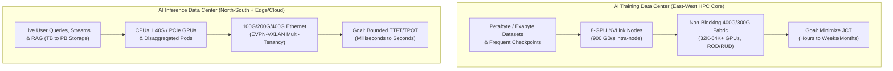
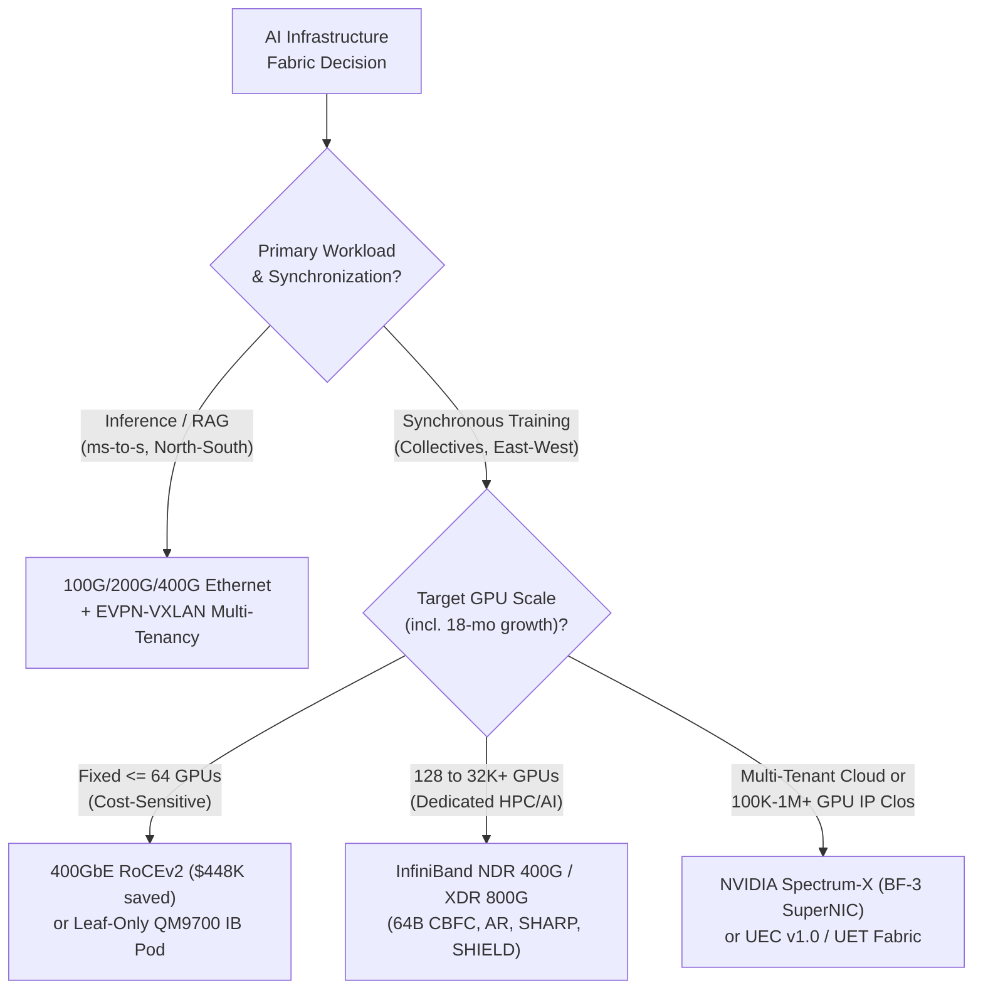

```mermaid
flowchart TB
    subgraph IBStack["1. InfiniBand (Quantum-2 / X800)"]
        IB1["LRH (16b LID) + BTH + Payload"] --> IB2["Link: 64B CBFC Credits (16 VLs)"]
        IB2 --> IB3["Fabric: OpenSM/UFM + AR + SHARP"]
    end
    subgraph RoCEStack["2. Standard RoCEv2 Ethernet"]
        R1["Eth + IP + UDP 4791 + IB BTH"] --> R2["Link: 802.1Qbb PFC (8 Prios)"]
        R2 --> R3["Fabric: BGP + SLB/DLB/GLB + DCQCN"]
    end
    subgraph SpecXStack["3. NVIDIA Spectrum-X Ethernet"]
        SX1["RoCEv2 + SuperNIC Hardware DDP"] --> SX2["Link: Shared Buffer + Narrow PFC"]
        SX2 --> SX3["Fabric: Spectrum-4 AR + Telemetry CC"]
    end
    subgraph UECStack["4. Ultra Ethernet (UEC v1.0 / UET)"]
        U1["UDP 49150 or IP 253 + PDS + SES"] --> U2["Link: Optional 32-VC CBFC + LLR"]
        U2 --> U3["Fabric: NSCC / RCCC (256B) + INC"]
    end
```

# 12.12 Ethernet versus InfiniBand: a design decision guide

| | |
|---|---|
| Level | Intermediate |
| Priority tier | 2 |
| Lab venue | Nebius GPU |
| Part | Part 12: Complete AI networking |
| Sources used | `ADC` Ch. 2, Ch. 9, Ch. 12; `V9` Ch. 1–12, `index.md`, `labs/lab-01..04`; `V21` Ch. 2, Ch. 3, Ch. 12; `bcm11-admin` §3.6.2 |
| Coverage file | `planning/coverage/chapters/12-12.md` |
| Claim ledger | `planning/ledgers/12-12.md` |
| Companion code | `code/part12/ethernet_vs_infiniband.py`, `code/part12/ethernet_vs_infiniband_lab.py` |

## Why this matters for AI infrastructure

An engineering team can build a fast Ethernet fabric that passes every link test and saturates an isolated benchmark. Yet that same fabric can still freeze a multi-node training job the moment a second workload starts. Conversely, an infrastructure team can propose an expensive InfiniBand fabric for a small cluster without checking the payback period. At sixty-four GPUs, the upfront hardware premium takes ten years of compute savings to recover. When the interconnect does not match the cluster scale and workload pattern, either training jobs stall or capital is wasted.

Choosing between InfiniBand, Standard RoCEv2, NVIDIA Spectrum-X, and the Ultra Ethernet Consortium specification is a foundational decision in an AI Factory. The right answer never comes from a generic slogan about port speeds. It is a systems engineering calculation that balances six concrete factors. You must weigh workload synchronization, flow control physics, adapter capabilities, storage isolation, operational maturity, and three-year Total Cost of Ownership.

```text
Motivating benchmark and cost comparison baselines:
- Isolated pairwise ib_write_bw on 400GbE: 392.11 Gbps with 0% ping packet loss
- 64-GPU upfront fabric cost: $15,000/node InfiniBand NDR ($960,000) vs $8,000/node 400GbE ($512,000)
- Upfront CapEx premium: $448,000 -> requires 244.14 seven-day runs (10.17 years at 24 runs/year) to break even
- Four fabric architectures: Quantum-2 NDR 400 Gbps / Quantum-X800 XDR 800 Gbps, Standard RoCEv2, Spectrum-X, UEC v1.0 / UET
```

## Prerequisites and outcomes

**Prerequisites:** Review Chapters 12.1 through 12.5 for AI traffic collectives, RDMA verbs, RoCEv2 transport, PFC, ECN, DCQCN, and Data Center Bridging QoS. Also review Chapters 12.6 through 12.11 for InfiniBand fundamentals, OpenSM and UFM routing, CBFC, Adaptive Routing, SHIELD, optics, and NVIDIA Spectrum-X.

**Outcomes:** After completing this chapter, you will be able to:
1. Contrast the workload and network requirements of AI training data centers against AI inference data centers. You will also explain why synchronized collectives turn microsecond queue spikes into cluster-wide stalls.
2. Compare InfiniBand, Standard RoCEv2, NVIDIA Spectrum-X, and Ultra Ethernet across transport headers, flow control, routing schemes, and in-network collectives.
3. Configure and audit ConnectX Virtual Protocol Interconnect personality switching via `mlxconfig` and NVIDIA Base Command Manager `cmsh`. You will also verify PCIe locality and BlueField-3 operating modes.
4. Execute the sixty-four-GPU and one-hundred-twenty-eight-GPU H100 TCO and break-even math. You will separate upfront capital deltas from per-run collective overhead and nonlinear scale risks.
5. Apply the seven-stage AI fabric validation and troubleshooting ladder to commission or debug production clusters.

---

## 1. Workload-backward design: AI training versus inference fabrics

### 1.1 Why synchronized collectives expose the fabric on the critical path

Traditional enterprise data center traffic is asynchronous and uncorrelated. Thousands of independent web flows start and finish at random times. A brief queue spike delays only a single user request while the rest of the fleet runs normally. Distributed AI training behaves like a synchronized military convoy where every participating GPU hits a collective barrier together. Because no rank can start the next step until the slowest rank finishes, tail latency governs Job Completion Time.

| Training Step Scenario (64-GPU Llama-70B) | Compute Baseline | Exposed AllReduce Time | Total Step Time | Communication Overhead |
|---|---|---|---|---|
| **Fast interconnect baseline** | `500 ms` forward + `1,000 ms` backward = `1,500 ms` | `5 ms` | `1,505 ms` | `0.3%` |
| **Congested interconnect tail** | `500 ms` forward + `1,000 ms` backward = `1,500 ms` | `200 ms` | `1,700 ms` | `13%` |

This barrier synchronization creates five workload challenges that break conventional Ethernet switching assumptions:

1. **Low entropy at the network layer:** In rail-aligned pod communication, source and destination IP address pairs are sparse and repetitive.
2. **Low entropy at the transport layer:** Every RoCEv2 packet uses the fixed UDP destination port 4791 to signal an InfiniBand Base Transport Header. Even when the UDP source port comes from a Queue Pair, static five-tuple ECMP hashing frequently collides. Multiple heavy GPU flows land on the same spine uplink while adjacent links sit idle.
3. **Simultaneous and sequential low-entropy flowlets:** Two concurrent transfers between the same GPU pair may differ only inside the Base Transport Header. Two consecutive jobs can also reuse the exact same GPU pair. Both cases look like a single flow to a shallow-parsing switch unless rebalanced across flowlet gaps.
4. **Line-rate elephant flows:** Through GPUDirect RDMA and GPUDirect Storage, each server drives its network adapters at full line rate during every collective phase.
5. **Synchronized microbursts and incast:** Gradient synchronization and checkpointing generate sharp east-west spikes where many senders converge on one egress queue simultaneously. Five-minute utilization averages smooth out sub-millisecond bursts completely. A port can report low average utilization on a dashboard while its egress queue overflows or emits sustained pause frames.

```text
Microburst vs dashboard averaging telemetry (V9 Ch. 1):
- Line-rate NIC injection: 400 Gbps (50 GB/s) or 800 Gbps (100 GB/s) at 100% duty cycle during collectives
- Microburst duration: 100 us to 1 ms spikes invisible on 5-minute polling averages (e.g., 20% reported utilization)
- Switch counter evidence over 90 s: rx_pfc_prio3 jumps from 0 to 118,344 while rx_ecn_marked_prio3 jumps from 412 to 198,220
```

### 1.2 AI training data centers versus AI inference data centers

When architects treat all AI workloads as identical, they misallocate capital across the data center. They either buy expensive lossless fabrics for simple query serving or deploy oversubscribed leaf switches for synchronous foundation model training. Separating AI training data centers from AI inference data centers clarifies which network properties actually belong on the critical path.



| Dimension | AI Training Data Center (`ADC` Ch. 2 & `V21` Ch. 2) | AI Inference Data Center (`ADC` Ch. 2 Fig. 2-1 & `V21` Ch. 12) |
|---|---|---|
| **Primary objective & timescale** | Minimize **Job Completion Time (`JCT`)** and time-to-train across synchronous iterations lasting **hours to weeks or months**. | Minimize **Time to First Token (`TTFT`)** and response latency (**milliseconds to seconds**) at lowest cost per million tokens (`$0.70/1M tokens` at `2,000 QPS` on `408` GPUs). |
| **Dataset & storage footprint** | **Petabytes (`PB`) to Exabytes (`EB`)** of curated training data plus high-bandwidth burst writes for model checkpoints. | **Terabytes (`TB`) to Petabytes (`PB`)** of live query context, vector databases, and Retrieval-Augmented Generation (`RAG` / agentic `RAG`). |
| **Compute node architecture** | Dense `8`-GPU `HGX`/`DGX` nodes (`H100 SXM5` at `700 W`, `989 TFLOPS` BF16, `900 GB/s` `NVLink 4`, `$285,000`/node) or `72`-GPU `GB200 NVL72` liquid-cooled racks (`1.8 TB/s` `NVLink 5`). | Lower-power CPUs, PCIe GPUs (`L40S` `350 W` at `$8,000` or `H100 PCIe` `350 W` at `$20,000`, `64 GB/s` `PCIe Gen5 x16`), or multi-node disaggregated prefill/decode pools. |
| **Dominant traffic pattern** | **East-West** synchronous collectives (`AllReduce`, `AllToAll`) across `32,000` to `64,000+` (`100,000+`) GPU ports at `400G`/`800G`/`1.6T`. | **North-South** client query/response + East-West microservice, KV-cache, and `RAG` lookups over `100G` and `200G` (or `400G`) data center switches. |
| **Topology & oversubscription** | `1:1` non-blocking **Rail-Optimized Design (`ROD`)** or **Rail-Unified Design (`RUD`)** (or slight leaf-to-spine undersubscription in shallow-buffer packet-spraying fabrics). | Standard 3-stage IP Clos, collapsed 2-switch spine for edge sites, or hybrid cloud with `EVPN-VXLAN` multi-tenancy and edge security/firewalls. |
| **Natural fabric fit** | **InfiniBand (`NDR`/`XDR`)**, **NVIDIA Spectrum-X**, or finely tuned **lossless `RoCEv2` / `UET`** backend compute fabric. | **Standard Ethernet (`TCP/IP` + `EVPN-VXLAN`)** for frontend/edge/RAG, plus **`RoCEv2`/`Spectrum-X`/`IB`** inside disaggregated multi-node inference pods. |

### 1.3 Core advantages of InfiniBand versus Ethernet in AI training clusters

Before examining packet headers, every infrastructure architect must understand the structural trade-off between InfiniBand and Ethernet. InfiniBand was purpose-built from the wire up for deterministic, lossless cluster computing. Ethernet evolved as a universal, multi-vendor IP network that can be adapted for RDMA.

- **Why teams choose InfiniBand:**
  1. **Sub-microsecond cut-through latency:** Native InfiniBand switches achieve ultra-low port-to-port latency. Forwarding uses a compact Local Route Header and a simple Local Identifier lookup rather than deep IP header parsing.
  2. **Native lossless Credit-Based Flow Control:** Buffer credits are exchanged in hardware at the link layer across dedicated Virtual Lanes. A sender never transmits a packet unless the downstream port has already advertised enough free buffer credits. Buffer overflow drops are prevented by design.
  3. **Turnkey vertical integration and in-network computing:** Centralized Subnet Management via OpenSM or UFM coordinates the entire fabric. Fine-grained hardware Adaptive Routing, autonomous SHIELD self-healing, and switch-resident SHARP collective aggregation deliver predictable scaling without manual threshold tuning.
- **Why teams choose Ethernet:**
  1. **Cost-effectiveness and multi-vendor supply chain:** Commodity switches, optics, and NICs are available from multiple merchant-silicon and systems vendors. This diversity avoids single-vendor lock-in and protocol gateways.
  2. **Operational simplicity and unified skill sets:** Operations teams use standard IP routing such as BGP and EVPN-VXLAN alongside familiar Linux automation tools. They also gain unified frontend-to-backend observability rather than maintaining a separate InfiniBand administration silo.
  3. **Ecosystem compatibility and hyperscale reach:** Standard Kubernetes, PyTorch, TensorFlow, and enterprise storage services run natively over IP and Ethernet. While a single InfiniBand subnet is bounded by its sixteen-bit address space, IP Clos fabrics scale past one hundred thousand GPUs.
  4. **Topology and multi-tenant flexibility:** Ethernet natively supports EVPN-VXLAN virtual routing, hardware firewalling, and link encryption across shared compute, storage, and service roles.

```text
InfiniBand vs Ethernet structural constants (ADC Ch. 2 & Ch. 9):
- Switch port-to-port latency: ~300 ns on native InfiniBand vs ~800 ns on standard Ethernet switches
- InfiniBand addressing & lanes: 8-byte LRH with 16-bit LID (49,151 unicast ports / ~48,000 nodes max per subnet)
- InfiniBand CBFC credits: 1 credit = 64 bytes across 16 Virtual Lanes (VL0..VL14 data, 8..12 active queues, VL15 SMP)
- InfiniBand SHIELD failover: ~10 us autonomous switch failover vs ~500 ms software sweeps
- Ethernet scale & multi-tenancy: EVPN-VXLAN Route Type 5 IP VRFs and MAC-VRFs, scaling to 100,000+ and 1,000,000+ GPUs
```

---

## 2. Four-way architectural deep dive: InfiniBand vs Standard RoCEv2 vs Spectrum-X vs UET

### 2.1 End-to-end protocol stack and congestion-control comparison

When teams compare fabrics using marketing labels alone, they miss the hardware mechanisms that govern an incast burst. The evolution of AI networking is a convergence between InfiniBand's deterministic transport loops and Ethernet's scale-out IP routing. Comparing all four architectures side by side reveals how each stack handles encapsulation, flow control, multipathing, and collective offload.



| Architectural Dimension | 1. InfiniBand (`Quantum-2` / `Quantum-X800`) | 2. Standard `RoCEv2` (`IEEE 802.1Qbb` + `DCQCN`) | 3. NVIDIA `Spectrum-X` (`Spectrum-4` + `BlueField-3`) | 4. Ultra Ethernet (`UEC Spec v1.0` / `UET`) |
|---|---|---|---|---|
| **Target cluster scale (`ADC` Table 12-4)** | `< 100,000` GPUs (`49,151` unicast `LID`s / `~48,000` nodes per single `16`-bit `LID` subnet) | `> 100,000` GPUs (routed Layer 3 IPv4/IPv6 Clos) | `> 100,000` GPUs (rail-optimized 2-tier/3-tier IP Clos) | `~1,000,000+` endpoints (5-stage / 7-stage IP Clos, Dragonfly+) |
| **Wire encapsulation** | `LRH` (`8 B`, `S-LID`/`D-LID`) + optional `GRH` (`40 B`) + `BTH` (`12 B`) + `ETH`/`RETH` + Payload + `ICRC` (`4 B`) + `VCRC` (`2 B`) | `Ethernet II` + `IPv4`/`IPv6` + `UDP` (`DST PORT 4791`) + `IB BTH` (`12 B`) + Payload + `Ethernet FCS` | `RoCEv2` (`UDP 4791` + `BTH`) with hardware out-of-order sequence tracking | **Option A:** `Eth` + `IP` + `UDP` (`DST PORT 49150`, dynamic `SRC PORT` entropy) + `UET PDS` + `UET SES`. **Option B:** `Eth` + `IP` (`Protocol 253`) + `PDS` (with `Entropy` field) + `SES` |
| **Switch port-to-port latency (`ADC` Ch. 9)** | `~300 ns` cut-through | `~800 ns` store-and-forward / cut-through | `~800 ns` class (`Spectrum-4` monolithic shared buffer) | `~800 ns` class standard / UEC-ready Ethernet switches |
| **Link-level flow control** | Mandatory hardware **Credit-Based Flow Control (`CBFC`)**: `64 B` credit units in `LLH` across `16` VLs (`VL0..VL14` data + `VL15` `SMP`) | Reactive **`IEEE 802.1Qbb PFC`**: `8` priorities (`0..7`), `Xoff`/`Xon` pause quanta frames | Monolithic shared buffer + narrowly scoped `PFC` backstop on `1` RoCE priority (e.g., `prio 3`) | Optional link-level **`CBFC`** across **`32` Virtual Channels (`VCs`)** via `64B/66B` PCS `CtlOS` (`CP_Update`) + optional **Link Layer Retry (`LLR`)** |
| **End-to-end congestion control** | Hardware `FECN` (switch mark) $\rightarrow$ `BECN` (receiver notify) $\rightarrow$ HCA `CCTI` rate table | **`DCQCN`**: Switch `RED`/`ECN` sets IP `CE = 11` $\rightarrow$ Receiver sends `CNP` (`IP ECN = 01`) $\rightarrow$ Sender NIC rate cut | Hardware-coordinated `Spectrum-4` congestion telemetry + `BlueField-3 SuperNIC` RTT/ECN rate control | **1. `NSCC`** (sender RTT + ECN congestion window via `ACK_CC` / `NACK`). **2. `RCCC`** (receiver-managed **`256 B`** credits in `24`-bit `ACK_CC`). **3. Switch Packet Trimming** |
| **Proactive load balancing & multipathing** | Centralized `OpenSM`/`UFM` `LFT` + fine-grained per-packet **Adaptive Routing (`AR`)** + **`SHIELD`** (`10 µs` autonomous failover) | **1. `SLB`** (`5`-tuple CRC32). **2. `DLB`** (local link/queue utilization + flowlets). **3. `GLB`** (next-to-next-hop `NNH` spine quality). **4. `sDLB`** (`BTH` `Write` opcode spraying) + flow pinning | Per-packet `Spectrum-X` Adaptive Routing across all spine rails + `BlueField-3` **Direct Data Placement (`DDP`)** hardware reordering | Dynamic UDP source port or `PDS Entropy` mutation on `NACK`, plus `128 B` deep switch parsing of `SES` (`JobID`, `PIDonFEP`, `Resource Index`) |
| **Packet delivery modes (`ADC` Table 12-2 & 12-4)** | `RC` (Reliable Connected, in-order + `ConnectX` OOO buffer), `UC`, `UD` | `RC` (in-order go-back-to-$N$ or `ConnectX-6/7` `Write` OOO), `UC`, `UD` | `RC` with hardware OOO `DDP` into GPU memory | **`ROD`** (Reliable Ordered), **`RUD`** (Reliable Unordered), **`RUDI`** (Reliable Unordered Idempotent), **`UUD`** (Unreliable Unordered, no `PSN`/`ACK`) |
| **In-Network Collectives (`INC`)** | Production **`SHARP`** trees in `Quantum` switches (`2x–5x` collective speedup) | None (host `xCCL` / `NCCL` Ring & Tree only) | Topology-aware `NCCL` rail alignment + `NVLink SHARP` (`NVLS`) intra-rack | **`UEC INC`**: `INC Manager` (`IM` via `gRPC` OOB) + switch `sFEP` `INC Agents` + `Libfabric` (`fi_collective`) |
| **Built-in transport security** | `16`-bit `P_Key` partition table (`0x8000` full-member bit); `N/A` payload crypto in Table 12-4 | External (`MACsec` / `IPsec` + `VLAN`/`VRF`) | `EVPN-VXLAN` + `BlueField-3` host-edge isolation + hardware `IPsec`/`MACsec` | Built-in **Transport Security Sublayer (`TSS`)** with `AES-GCM` `ICV` trailer after payload (mutually exclusive with optional `UET CRC`) |
| **Deployment readiness (`ADC` Table 12-4)** | Deployed in production networks; low NIC vendor diversity | Deployed in production networks; high NIC/switch vendor diversity | Deployed in production AI Factories (`Spectrum-4` + `BlueField-3`) | Spec `v1.0` released **June 11, 2025** (`70+` members); first pilot deployments expected **late 2026** |

### 2.2 Why Standard RoCEv2 requires coordinated proactive and reactive control loops

In Standard RoCEv2, wrapping an InfiniBand transport header inside UDP allows packets to cross any Layer 3 Ethernet fabric. However, standard Ethernet lacks a link-layer credit loop. If an egress queue overflows and drops a single frame on a traditional reliable connection, the sender must retransmit the entire in-flight window. That retransmission stalls the collective step. Conversely, relying solely on link-level pause frames causes upstream switches to freeze one after another in a cascading pause tree.

To prevent both packet drops and pause deadlocks, an AI Ethernet fabric combines proactive load balancing with reactive congestion control:

1. **Proactive Load Balancing Pyramid:**
   - **Static Load Balancing:** Hashes the standard five-tuple header. It preserves strict packet ordering per flow, but remains blind to link utilization and polarizes under low-entropy GPU flows.
   - **Dynamic Load Balancing:** Monitors local link bandwidth and egress queue depth in real time. It steers new flows and flowlet bursts onto healthier links.
   - **Global Load Balancing:** Extends dynamic balancing by incorporating next-to-next-hop spine quality. Leaf switches can then route around remote spine-to-leaf hotspots.
   - **Selective Dynamic Load Balancing:** Inspects the Base Transport Header opcode to identify large RDMA Write elephant flows. It sprays their packets across all uplinks while the destination NIC reorders them in hardware.
2. **Reactive DCQCN Loop:**
   - **Step 1 — ECN Early Warning:** A switch egress queue crosses its marking threshold well before the buffer fills. The switch sets the IP Explicit Congestion Notification bits and forwards the packet normally.
   - **Step 2 — CNP Reflection:** The destination NIC detects the congestion mark and sends a high-priority Congestion Notification Packet back to the source server.
   - **Step 3 — Rate Cut and Recovery:** The source NIC hardware throttles the offending flow's injection rate. It gradually restores speed once notification packets stop arriving.
   - **Step 4 — PFC Last-Resort Backstop:** Sometimes an incast burst fills the receive buffer faster than the round-trip ECN loop can slow the sender. Only then does the switch emit an IEEE 802.1Qbb pause frame upstream, reserving headroom for in-flight frames until the queue drains.

```text
RoCEv2 DCQCN and PFC buffer contract (ADC Ch. 2 Fig. 2-3..2-5 & V9 Ch. 4-5):
- SLB 5-tuple: Src IP, Dst IP, Src Port, Dst Port 4791, Protocol 17
- ECN wire marking: Switch RED/ECN sets 2-bit IP ECN field to 11 (CE) around ~50% queue depth
- CNP reflection: Receiver sends CNP with IP ECN bits 01; sender increments np_cnp_handled, cuts rp_current_rate, recovers via rp_byte_reset
- Priority 3 buffer allocation (swp12): 65,536 bytes out of 262,144-byte port receive buffer
- Xoff threshold: 49,152 bytes (75.0%) -> leaves 16,384 bytes (25.0%) of in-flight headroom
- Xon threshold: 32,768 bytes (50.0%) -> provides a 16,384-byte (25.0%) hysteresis band
```

### 2.3 How Ultra Ethernet redesigns the Ethernet stack for one million GPUs

Standard RoCEv2 works well when carefully engineered, but manual threshold tuning and go-back-to-N retransmission become fragile at hyperscale. Released by more than seventy vendors under the Linux Foundation, the Ultra Ethernet Specification redesigns the RDMA transport layer. It preserves standard IP Clos switches in the underlay while introducing modern endpoint delivery semantics:

1. **Libfabric API, Semantic Sublayer, and Packet Delivery Sublayer:**
   - Applications express memory registration and collective operations through Libfabric using three service profiles: AI Base, AI Full, and HPC.
   - Every Fabric Endpoint establishes logical sessions called Packet Delivery Contexts managed by the Packet Delivery Sublayer.
   - Instead of a single Queue Pair number, the Semantic Sublayer header carries a three-part identifier for job, process, and resource index.
2. **Two wire encapsulations:**
   - **UET over UDP:** Uses destination port 49150 and dynamically mutates the UDP source port whenever congestion feedback reports a hot path.
   - **UET over Native IP:** Strips the eight-byte UDP header completely using IP Protocol 253. It places an explicit entropy field inside the delivery header so switches parsing the first 128 bytes hash directly on job fields.
3. **Four negotiated Packet Delivery Modes with selective retry:**
   - Rather than flushing an entire window after a drop, receivers buffer out-of-order packets and request retransmission of only the missing sequence number.
   - **Reliable Ordered Delivery:** Guarantees in-order delivery to the application using NIC reorder buffers for MPI and control traffic.
   - **Reliable Unordered Delivery:** Tracks sequence numbers with selective acknowledgments while placing payloads straight into GPU memory out of order for bulk AI transfers.
   - **Reliable Unordered Delivery Idempotent:** Allows operations like gradient updates to be safely retried or overwritten multiple times without waiting for recovery timers.
   - **Unreliable Unordered Delivery:** Omits sequence numbers, acknowledgments, and encryption for lowest-latency telemetry.
4. **Dual-layer Congestion Management:**
   - **Network Signal Congestion Control:** Adjusts the sender congestion window using round-trip time and ECN feedback carried in acknowledgment packets.
   - **Receiver Credit Congestion Control:** Grants explicit receiver buffer credits in 256-byte units inside the acknowledgment header. This credit loop prevents incast overflow on lossy fabrics without switch pause frames.
   - **Switch Packet Trimming:** When a switch buffer overflows on a trimmable traffic class, the switch trims the payload and forwards the compact header on a high-priority queue. The destination then immediately requests selective retransmission.
   - **Optional Link-Layer CBFC and Link Layer Retry:** Negotiated via LLDP for greenfield links, doubling InfiniBand's sixteen lanes to thirty-two Virtual Channels. Link Layer Retry replays corrupted frames hop by hop before end-to-end timers expire.

```text
Ultra Ethernet v1.0 specification details (ADC Ch. 12, Fig. 12-3 & Tables 12-1..12-4):
- Release milestone: June 11, 2025 across 70+ members; pilot deployments late 2026
- Libfabric interfaces: fi_mr (memory regions / RKEYs) and fi_collective across AI Base, AI Full, and HPC profiles
- PDC handshake (Fig. 12-3): FEP A sends Pds.flags.syn with PSN=101, SPDCID=201; FEP B replies ACK=101, SPDCID=301, DPDCID=201; FEP A sends data PSN=102, SPDCID=201, DPDCID=301
- SES 3-tuple: {JobID, PIDonFEP, Resource Index (RI)} + Message ID, Buffer offset, Request length (ROD shares 1 PDC per {JobID, src PIDonFEP, dst PIDonFEP, RI, TC})
- Wire headers: UDP DST PORT 49150 (dynamic SRC PORT) or IP Protocol 253 (8 B UDP stripped, 128 B switch parse depth) + optional AES-GCM TSS ICV or UET CRC
- Congestion & link loops: NSCC (ACK_CC / NACK), RCCC (req_cc_state -> 256 B credits in 24-bit ACK_CC), 32-VC CBFC (64B/66B PCS CtlOS CP_Update CC/CF), LLR MAC preamble sequence replay
```

---

## 3. ConnectX VPI adapters, BlueField-3 DPUs, and host locality

### 3.1 ConnectX VPI personality switching and BCM precedence

Buying dual-personality network adapters does not help if half the nodes boot into Ethernet mode while the other half wait for an InfiniBand Subnet Manager. NVIDIA ConnectX-6, ConnectX-7, and ConnectX-8 Virtual Protocol Interconnect adapters use the same physical ASIC and optical cage to speak either native InfiniBand or Ethernet RoCEv2. The port personality is stored in non-volatile firmware configuration and controlled per port with `mlxconfig`:

- **InfiniBand personality (`LINK_TYPE_P1=1`):** Configures Port 1 as a native InfiniBand Host Channel Adapter. The port waits for OpenSM or UFM on Virtual Lane 15 to assign a Local Identifier, exposes `ib0`, and uses hardware 64-byte flow control credits.
- **Ethernet personality (`LINK_TYPE_P1=2`):** Configures Port 1 as an Ethernet NIC such as `ens1f0np0` or `eth0`. The port brings up its link autonomously via Ethernet auto-negotiation without a Subnet Manager. It populates RoCEv2 GID entries from host IP interfaces and relies on DSCP classification, DCQCN, and PFC.

In clusters managed by NVIDIA Base Command Manager, persistent `mlxconfig` parameters are declared using `MLX_` extra values. When settings conflict across cluster levels, the management daemon resolves them using a strict three-tier precedence hierarchy. Interface-level overrides win over node-level settings, which win over category-level defaults. Changes written to firmware remain pending until a cold reboot, and operators verify the resolved policy beforehand using `cmsh`.

```text
ConnectX VPI and BCM 11 configuration rules (bcm11-admin §3.6.2):
- LINK_TYPE_P1=1 (IB): waits for VL15 SMP, ibstat transitions LinkUp -> Active, 20-byte IPoIB address
- LINK_TYPE_P1=2 (ETH): autonomous link-up, populates show_gids v1/v2 table
- BCM extra_values parameters: MLX_link_type_p1, MLX_num_vfs 16, MLX_KEEP_ETH_LINK_UP_P1 true
- BCM precedence order: category.extra_values < node.extra_values < interface.extra_values
- Verification command: cmsh -c "device; mlxconfig node001 --desired"
```

### 3.2 PCIe link negotiation, NUMA locality, and multi-rail binding

Even when every switch port is lossless and congestion-free, a server can still bottleneck at a fraction of line rate inside its own motherboard. Whether a ConnectX port runs in InfiniBand or Ethernet mode, the internal server path from GPU HBM memory through the PCIe switch to the NIC DMA engine must match the wire speed:

1. **PCIe Generation and Lane Width:** A `PCIe Gen5 x16` slot is required to saturate a 400 Gbps ConnectX-7 port at full line rate. If a riser card issue or BIOS bifurcation setting downgrades that slot to `PCIe Gen4 x8`, the adapter is physically capped well below wire speed before a single packet reaches the switch.
2. **GPU-to-NIC Topology Affinity:** On a multi-socket server, a GPU and NIC sharing a local PCIe switch report `PIX` affinity with zero CPU traversal. A GPU talking to a NIC on the second socket reports `SYS` affinity across the inter-socket interconnect. Assigning rails by Linux interface name order rather than `PIX` locality silently throttles GPUDirect RDMA.
3. **Multi-Rail Device Selection Collisions:** On a multi-rail node, both ports can show active links while poorly configured job scripts bind all local ranks to the first RDMA device. The second rail then sits completely idle. Furthermore, traditional Linux NIC bonding (`bond0`) must never be used on multi-rail AI compute paths because it hides physical rail topology from NCCL.

```text
Host PCIe and multi-rail diagnostic signatures (V9 Ch. 8):
- Healthy PCIe Gen5 x16: Speed 32GT/s, Width x16 -> ~63-64 GB/s per direction (~504-512 Gbps, saturates 400 Gbps / 50 GB/s NIC)
- Downgraded PCIe Gen4 x8 (lspci -s 41:00.0 -vv): LnkCap 32GT/s x16, but LnkSta Speed 16GT/s (downgraded), Width x8 -> ~16 GB/s (~128 Gbps) ceiling, capping 200 Gbps (25 GB/s) or 400 Gbps (50 GB/s) ports
- 60-second multi-rail byte-counter delta (V9 Ch. 8 Scenario 1):
  * ens1f0 rx_bytes_phy: 892,481,200,384 -> 981,204,882,176 (+88.7 GB)
  * ens1f1 rx_bytes_phy: +412,992 bytes (~0 GB) because both ranks selected [0]mlx5_0:1/RoCE ; OOB ens1f0
```

### 3.3 BlueField-3 DPUs versus SuperNICs: host-edge trust and failure domains

In Ethernet AI Factories and multi-tenant clouds, treating a DPU like a simple NIC leads to baffling outages. The switch port can report a healthy link while the host operating system cannot send a single packet. Architects must distinguish between the two BlueField-3 operating models:

- **BlueField DPU Mode (`ECPF`):** The embedded Arm cores and DOCA operating system own the NIC resources and the internal embedded switch (`eSwitch`). Host traffic traverses representors on the Arm cores to program hardware offload rules into the fast path. This creates a three-layer administrative boundary between the host interface, the DPU Arm control plane, and the external switch uplink. If a DPU image rollout fails to load its virtual switch policy at boot, the leaf switch sees its uplink stay up while the host interface remains dark.
- **BlueField SuperNIC Mode (`NIC`):** The adapter operates as a dedicated high-rate RoCEv2 endpoint paired one-to-one with each GPU on the compute rail. It handles hardware Direct Data Placement packet reordering and Spectrum-X congestion control without interposing an Arm virtual-switch control plane.
- **Production Node Split:** Dense eight-GPU servers combine both roles. Eight ConnectX-7 or BlueField-3 SuperNIC adapters serve the East-West GPU compute rails, while two BlueField-3 DPUs in `ECPF` mode handle North-South storage and tenant management.

```text
BlueField-3 DPU vs SuperNIC operational split (V9 Ch. 9 & V21 Ch. 2):
- 3-layer DPU (ECPF) boundary: (1) Host OS interface enp1s0f0np0, (2) DPU Arm service openvswitch-policy-load.service, (3) Switch uplink swp14 (100G/400G)
- Image drift signature: dpu-image-24.07-prod-1 vs dpu-image-24.10-prod-3 after 5 failed pull retries leaves swp14 up while enp1s0f0np0 is DOWN / DORMANT
- DGX / HGX H100 node adapter layout: 8x ConnectX-7 (400 Gbps) East-West compute rails + 2x BlueField-3 DPUs North-South storage/management + 1x OOB BMC port
```

---

## 4. Storage networks, TCO economics, and the 64-GPU break-even model

### 4.1 AI storage network transport: InfiniBand vs NVMe-o-RDMA vs NVMe-o-TCP

If GPUs wait on slow dataset reads or stall for minutes while writing multi-terabyte model checkpoints, the fastest compute fabric still sits idle. An AI training cluster requires a high-bandwidth storage fabric alongside its compute fabric. Architects must choose between local NVMe drives, InfiniBand RDMA storage, Ethernet RoCEv2 RDMA storage, and Ethernet TCP storage based on latency, lossless requirements, and replication distance.

| Storage Metric / Capability | Local `PCIe Gen5` NVMe SSD | `InfiniBand` Storage (`NVMe-o-RDMA` / `GDS`) | Ethernet `NVMe-o-RDMA` (`RoCEv2` / `GDS`) | Ethernet `NVMe-o-TCP` / `(P)NFS` |
|---|---|---|---|---|
| **Switch / bus access latency (`ADC` Ch. 9)** | `~100 ns` (`PCIe Gen5` `32 GT/s`, `~63 Gbps` / `64 GB/s` `x16`) | `~300 ns` per IB switch hop (`700–900 ns` over `1–3` hops) | `~800 ns` per Ethernet switch hop (`~66%` lower write latency than TCP) | Millisecond / multi-microsecond kernel socket + TCP stack |
| **Discovery & transport ports** | Local PCIe bus (`SQE`/`CQE` in host driver) | `TCP 8009` discovery (`RDMA_PRTYPE = 02`) $\rightarrow$ native `IB LRH/BTH` (`1:1` `SQ/CQ` per `QP`) | `TCP 8009` discovery (`RDMA_PRTYPE = 04`, vs `05` iWARP) $\rightarrow$ `UDP 4420` CM $\rightarrow$ `UDP 4791` `BTH` | `TCP 8009` (`ICReq PDU` $\rightarrow$ `CapsuleCmd` `0x01` / `CapsuleResp` + `H2CData` `0x03` / `C2HData` `0x04`, `PRP1/PRP2` `64-bit` or `SGL`, `9,000 B` jumbo MTU) |
| **Lossless fabric required?** | N/A (local PCIe bus) | **Yes** (native `64 B` `CBFC` credits across `16` VLs) | **Yes** (`PFC` + `ECN`/`DCQCN`, tuned separately from compute `DCQCN` for `1:3` oversubscription) | **No** (runs over lossy IP core; ideal for `>= 40 km` inter-site WAN replication with deep-buffer switches) |
| **`GPUDirect Storage` (`GDS`) support** | **Yes** (`cudaMalloc` + `cuFileBufRegister` pins GPU memory directly to NVMe) | **Yes** (zero-copy DMA between GPU HBM and remote SSD, bypassing host CPU and system RAM) | **Yes** (supported natively by `WekaFS` over `RoCEv2`, `VAST` `NFS-over-RDMA`, `Lustre`, `GPFS`, `BeeGFS`) | **No** (`GPUDirect Storage` requires RDMA transport—either native `InfiniBand` or `RoCEv2`) |
| **Redundancy & multi-tenancy (`ADC` Fig. 9-5..9-8)** | Server-local only (not scalable across cluster) | Physical **Fab A / Fab B** dual-fabric separation (logical virtualization limited; `<= 10 km` spec optics) | Physical **Fab A / Fab B** or Logical **EVPN-VXLAN** (`Route Type 5` / `MAC-VRF`) with `1:3` leaf-spine oversubscription | Logical IP Clos, `2`-switch collapsed edge, or hybrid cloud tiering (`WekaFS` Tier 1 RDMA + Tier 2 `S3` over `HTTPS`/`IPsec` firewall) |

### 4.2 The 128-GPU and 64-GPU H100 TCO and break-even calculation

When finance challenges an interconnect budget, senior architects do not rely on intuition or vendor slides. They compute the amortized cost of a GPU-hour and compare the upfront capital delta between InfiniBand and Ethernet against the dollar value of the training hours saved.

$$\text`{3-Year TCO}` = \$5.26\text`{M}` + (3 \times \$644\text`{K}`) \approx \$7.19\text`{M}`, \qquad \text`{Cost per GPU-Hour}` = \frac\{\$7.19\text`{M}`}\{128\text`{ GPU}` \times 8,760\text`{ hr}` \times 3\text`{ yr}`} \approx \mathbf\{\$2.14/\text`{GPU-hour}`}$$

```text
3-Year TCO and 64-GPU interconnect break-even derivation (V21 Ch. 2 Part 3.2, Part 6 & Ch. 12):
1. 128-GPU (16-Node) DGX H100 SXM5 Baseline:
   - Config A (8x H100 80GB SXM5): $240,000 GPUs ($30,000/GPU, 989 TFLOPS BF16 / 1,979 TFLOPS FP8, 3.35 TB/s HBM3, 700 W, $30/BF16 TFLOP, 900 GB/s NVLink) + $30,000 CPU/2 TB DDR5/30 TB NVMe + $10,000 (8x ConnectX-7 400G + 2x BlueField-3) + $5,000 assembly = $285,000/node ($35,625/GPU, 7,912 TFLOPS peak / ~6,500 TFLOPS practical at 80%, 10.2 kW)
   - Config B (8x H100 PCIe): 756 TFLOPS BF16, 350 W, $20,000/GPU, 64 GB/s PCIe Gen5 x16 = $215,000/node ($26,875/GPU, ~25% cheaper for independent inference; vs H200 141 GB, 4.8 TB/s at $40K or L40S 48 GB, 362 TFLOPS at $8K)
   - 16-Node CapEx: 16 x $285K ($4.56M) + $400K fabric + $200K racks/PDUs/cooling + $100K install = $5.26M CapEx
   - Annual OpEx: 163 kW at $0.12/kWh ($171.6K electricity) + $400K (2 FTEs) + $52.6K support + $20K software = $644K/year
   - 3-Year TCO: $7.19M -> $2.14/GPU-hour ($22/TFLOP-year at 107,603 TFLOPS = 107.6 PFLOPS, 85% of 126,592 TFLOPS peak)
   - Larger fleet reference (V21 Ch. 12): 1,200 GPUs = $44M CapEx + $26.2M 3-yr OpEx = $70.2M TCO ($19.5K/GPU-year, $19.7K/PFLOP-year); 408 inference GPUs at 2,000 QPS = $18.1K/day = $0.70/1M tokens

2. 64-GPU Interconnect Showdown: InfiniBand NDR ($15,000) vs 400GbE RoCEv2 ($8,000):
   - Upfront CapEx delta: ($15,000 - $8,000) x 64 = $7,000 x 64 = $448,000 upfront savings with Ethernet ($960,000 IB vs $512,000 ETH)
   - Iteration step overhead: 100 ms compute + 2 ms IB AllReduce = 102 ms (2% overhead) vs 10 ms ETH AllReduce = 110 ms (10% overhead) -> 8% throughput loss (7.84% exact step-time increase)
   - Per-run impact (Llama-70B, 7 days = 168 hours on 64 GPUs): 168 h x 8% = 13.44 h (~13.4 extra hours -> 181.4 hours = 7.56 days total)
   - Extra compute cost per run: $2.14/GPU-h x 64 GPUs x 13.4 h = $1,835.11 (~$1,835/run)
   - Annual & 3-year extra compute cost (24 runs/year = 2 runs/month): $1,835 x 24 = $44,040/year (~$44K/year) -> $132,120 (~$132K) over 3 years
   - Sensitivity for 2 runs/year of a 100B-class model (2x gradients -> 30 ms ETH AllReduce = 130 ms vs 102 ms IB = 27% overhead): 27% x $2.14 x 64 x 168 x 2 = $12,425/year (~$12K/year, or ~$36K over 3 years -> ~$168K combined)
   - Break-even threshold: $448,000 / $1,835 = 244.14 runs (10.17 years at 24 runs/year)
```

This arithmetic yields a clear, defensible engineering verdict. Over three years, the extra compute time from slower Ethernet collectives stays well below the upfront Ethernet hardware savings. If the cluster will permanently stay at or below 64 GPUs, a single 64-port `QM9700` switch in 32 OSFP cages or a single leaf-only 400GbE pod suffices, making 400GbE RoCEv2 economically sound. However, if the cluster will expand to 128 or 256 GPUs within 18 months, buy InfiniBand NDR/XDR or Spectrum-X on Day 1. Multi-rack RoCEv2 congestion, pause trees, debugging outages, and a mid-life fabric retrofit rapidly cost more than the initial savings.

---

## 5. Workload-driven fabric decision matrix and the 7-stage validation ladder

### 5.1 End-to-end decision tree: matching workload, scale, and tenancy to the right fabric

When advising an infrastructure review board, architects fail when they recommend a fabric without locking down four constraints first. You must evaluate workload synchronization, target GPU scale including eighteen-month expansion, multi-tenant security boundaries, and wide-area storage replication distance. Only then can you select the right switch architecture.



| Deployment Scenario | Primary Compute Fabric | Storage Network Transport | Host-Edge Adapter & Mode | Architectural Justification |
|---|---|---|---|---|
| **1. Fixed `<= 64`-GPU Research / Fine-Tuning Pod** | `400GbE` `RoCEv2` (or `1`-tier leaf-only `Quantum-2 QM9700` `64`-port NDR pod) | `NVMe-o-RDMA` (`RoCEv2` or `IB`) or `NVMe-o-TCP` (`100G`/`200G`) | `ConnectX-7` (`LINK_TYPE_P1=2` ETH or `=1` IB) in `NIC` mode | Upfront `$448,000` Ethernet savings (`$8K` vs `$15K` per unit) exceeds the `~$132,120` 3-year `AllReduce` overhead (`24` runs/yr at `$1,835`/run) if scale stays `<= 64` GPUs. |
| **2. Dedicated Foundation Model Training (`128` to `32,000+` GPUs)** | **InfiniBand NDR (`400G`) / XDR (`800G`)** `2`-tier or `3`-tier Rail-Optimized Fat-Tree | Dedicated `InfiniBand` or `RoCEv2` `GPUDirect Storage` (`WekaFS`, `VAST`, `Lustre`) | `8× ConnectX-7/8` (`LINK_TYPE_P1=1` IB) compute rails + `2× BlueField-3` storage/in-band | `~300 ns` switch latency, lossless `64 B` `CBFC` across `16` VLs, hardware `AR`, `SHARP` (`2x–5x` collective offload), and `10 µs` `SHIELD` self-healing eliminate tail-latency stalls. |
| **3. Enterprise / Cloud Multi-Tenant AI Factory (`256` to `100,000+` GPUs)** | **NVIDIA `Spectrum-X`** (`Spectrum-4` shared-buffer switches + `BlueField-3` SuperNICs) | Physical or Logical **Fab A / Fab B** (`EVPN-VXLAN` `RT5`, `1:3` oversubscribed `NVMe-o-RDMA` / `GDS`) | `8× BlueField-3 SuperNIC` (`NIC` mode) compute rails + `2× BlueField-3 DPU` (`ECPF` mode) host edge | Combines standard `BGP`/`EVPN` routing and `NetQ`/`NVUE` operations with hardware packet spraying, `DDP` out-of-order placement, and `ECPF` zero-trust tenant isolation. |
| **4. Next-Gen Hyperscale IP Clos (`100,000` to `1,000,000+` GPUs)** | **Ultra Ethernet (`UEC` `v1.0` / `UET`)** over `800G`/`1.6T` 5-stage IP Clos or Dragonfly+ | `UET` storage profile / `NVMe-o-RDMA` + cloud `S3` tiering | `UEC`-compliant `400G`/`800G` FEPs supporting `Libfabric` (`ROD`/`RUD`/`RUDI`), `NSCC`/`RCCC`, and `TSS` | Scales past InfiniBand's `49,151`-port (`~48,000`-node) single-subnet `16`-bit `LID` ceiling with `256 B` `RCCC` receiver credits, packet trimming, `32`-VC `CBFC`, and `UEC INC`. |
| **5. Multi-Region Inference, Edge & Long-Haul DR (`>= 40 km` WAN)** | `100G`/`200G`/`400G` **Ethernet IP Clos** or `2`-switch collapsed spine (`EVPN-VXLAN`) | **`NVMe-o-TCP`** (`TCP 8009`, `9,000 B` MTU, deep-buffer switches) + `S3` over `HTTPS`/`IPsec` firewall | `L40S` (`$8K`) or `H100 PCIe` (`$20K`) + `100G`/`200G` Ethernet NICs / `BlueField-3 DPU` | `DCQCN`/`PFC` cannot maintain lossless backpressure across `>= 40 km` WAN links (and IB optics spec stops at `10 km`); `NVMe-o-TCP` adapts gracefully on lossy IP cores. |

### 5.2 Capacity planning at the bottleneck cut and the 7-stage validation ladder

A topology diagram is not a capacity model. If a cluster is only tested under normal link states with a single pairwise benchmark, the first spine maintenance window will trigger severe congestion. Every AI fabric must be sized at its bottleneck cut under both normal and degraded states. It must also be commissioned using a strict seven-stage validation ladder:

```text
Bottleneck-cut arithmetic and degraded-state impact (V9 Ch. 2 & Ch. 10):
- 16-node rack downlink demand: 16 nodes x 2 rails x 400 Gbps (800 Gbps/node) = 12,800 Gbps
- Normal-state uplink capacity (8 uplinks): 8 x 400 Gbps = 3,200 Gbps -> 4.00:1 oversubscription
- Degraded N-1 uplink capacity (1 uplink drained, 7 active): 7 x 400 Gbps = 2,800 Gbps -> 4.57:1 oversubscription
- 2-spine ECMP drain impact (nexthop-group 40, V9 Ch. 2 Scenario 2): active members drop 2 -> 1, driving tx_ecn_marked_prio3 up ~6x from ~15,000 to 88,120 per window
```

| Validation Stage | Layer Under Test | Verification Tools & Target Criteria |
|---|---|---|
| **Stage 1: Physical & Link Layer** | Optics, DAC/AOC serials, lane lock, FEC/CRC | Verify `400000Mb/s`, `Full` duplex, and zero `fec_uncorrected_blocks` or `rx_crc_errors` deltas via `ethtool`, `mlxlink`, or `iblinkinfo`. |
| **Stage 2: IP, Addressing & Path MTU** | Rail routing, jumbo MTU, RDMA link & GIDs | Confirm `ip route get <peer-ip>` uses the right rail with `mtu 9000` (RoCEv2) or `active_mtu 4096` (IB), plus `rdma link show` and `show_gids` (`v2`). |
| **Stage 3: QoS, Trust & Buffer Contract** | DSCP wire marking, trust mode, PFC hysteresis, ETS | Confirm `tcpdump` shows `tos 0xb8` (`0xb8 >> 2 = 46`, DSCP 46), `mlnx_qos` trusts `dscp`, single-priority PFC (`enabled 0 0 0 1 0 0 0 0`), `49,152 B` / `32,768 B` thresholds on `65,536 B`, and non-starving `ETS`/`dwrr`. |
| **Stage 4: Host-Memory RDMA Verbs** | Point-to-point QP state machine & wire bandwidth | Run `ib_write_bw` and `ib_write_lat` across all rail pairs (`392.11 Gbps` on `400GbE`), confirming `IBV_WC_SUCCESS` and zero `RETRY_EXC_ERR`. |
| **Stage 5: GPUDirect RDMA & Locality** | PCIe Gen5 x16 negotiation & NUMA switch affinity | Confirm `nvidia-smi topo -m` shows `PIX` or `NV18` (not `SYS`), `lspci -vv` shows `LnkSta: Speed 32GT/s, Width x16`, and GPU-buffer RDMA hits line rate. |
| **Stage 6: Multi-Node Collective Matrix** | All-rail ring/tree collectives & rail balance | Run `all_reduce_perf` and `alltoall_perf` across message sizes while checking equal byte growth on `ethtool -S ens1f0` vs `ens1f1`. |
| **Stage 7: Contention & N-1 Cut Drill** | Overlapping jobs & single-uplink/spine maintenance | Run two or more jobs while draining one uplink or spine; audit `rx_ecn_marked_prio3`, `rx_pfc_prio3`, `np_cnp_handled`, and `show what-just-happened drop-reason all`. |

A passing isolated collective never validates a skipped contention or degraded-state check. Each stage builds on the one below it.

---

## Commands and configurations that matter

### 1. Switching ConnectX VPI personality via `mlxconfig` and BCM `cmsh`

```bash
# (untested here) — Query current & default/next-boot VPI link personality on a ConnectX-7 adapter:
mst status -v
mlxconfig -d 0000:03:00.0 -e query | grep -E "LINK_TYPE_P1|LINK_TYPE_P2|NUM_OF_VFS|SRIOV_EN"

# Switch Port 1 & Port 2 from InfiniBand (1) to Ethernet RoCEv2 (2) and allocate 16 SR-IOV VFs:
mlxconfig -y -d 0000:03:00.0 set LINK_TYPE_P1=2 LINK_TYPE_P2=2 SRIOV_EN=1 NUM_OF_VFS=16

# Or switch Port 1 back to native InfiniBand (1):
mlxconfig -y -d 0000:03:00.0 set LINK_TYPE_P1=1

# In NVIDIA Base Command Manager (BCM 11 cmsh), inspect & declare persistent MLX_ policy
# (precedence: category.extra_values < node.extra_values < interface.extra_values):
cmsh -c "device; mlxconfig node001 --adapters"
cmsh -c "device; use node001; interfaces; use ib0; set -e MLX_link_type_p1 IB; commit"
cmsh -c "device; mlxconfig node001 --desired"
```

### 2. Host locality, RDMA GID table, and PCIe negotiation audit

```bash
# (untested here) — 1. Verify PCIe Gen5 x16 (32 GT/s, x16) vs downgraded Gen4 x8 (16 GT/s, x8):
lspci -s 41:00.0 -vv | egrep "LnkCap|LnkSta"
# Healthy:    LnkCap: Port #0, Speed 32GT/s, Width x16  /  LnkSta: Speed 32GT/s, Width x16
# Downgraded: LnkSta: Speed 16GT/s (downgraded), Width x8  (caps 200G/400G NIC at ~16 GB/s)

# 2. Verify GPU-to-NIC PCIe switch locality (PIX = same PCIe switch; SYS = crosses NUMA socket):
nvidia-smi topo -m

# 3. Verify RDMA kernel module (mlx5_ib), netdev mapping, MTU 9000, route, and RoCEv2 GID table:
lsmod | grep mlx5
rdma link show
ibv_devinfo -d mlx5_0 -i 1
show_gids
ip route get 10.20.8.5
ip link show dev ens1f0
ethtool ens1f0 | egrep "Speed|Duplex|Link"
```

### 3. QoS classification, PFC headroom, DCQCN, and Spectrum WJH telemetry

```bash
# (untested here) — 1. Verify wire DSCP marking (tos 0xb8 -> 0xb8 >> 2 = DSCP 46) on UDP port 4791:
tcpdump -i eth0 -c 1 -v host 10.20.8.5 and udp port 4791

# 2. Inspect switch/NIC trust state (dscp vs pcp), PFC enabled mask, buffer thresholds, and ETS/strict TSA:
mlnx_qos -i swp12
# Verify: Priority trust state: dscp
#         enabled  0 0 0 1 0 0 0 0  (ONLY prio 3 enabled; prio 0/6 not sharing pause domain)
#         Buffer size: 65536 bytes, Xoff: 49152 bytes (75%), Xon: 32768 bytes (50%)

# 3. Sample time-windowed ECN marks, PFC pauses, prio0 discards, and physical FEC/CRC deltas:
date -u && ethtool -S ens1f0 | egrep "ecn_marked|pfc_prio|rx_prio0_discard|fec_uncorrected|rx_crc_errors|rx_bytes_phy"

# 4. Verify sender-side DCQCN CNP reception and rate-limiter response on ConnectX:
mlx5_cnp_stats -d mlx5_0
# Compare switch rx_ecn_marked_prio3 delta (e.g. +312) against sender np_cnp_handled (+298) and rp_byte_reset

# 5. On NVIDIA Spectrum switches, inspect What Just Happened (WJH) hardware drop reasons and ECMP groups:
show what-just-happened drop-reason all
show ip ecmp-groups | grep 10.20.0.0/16

# 6. Check BlueField-3 DPU 3-layer readiness (Switch uplink -> DPU Arm policy service -> Host representor):
show interface status swp14
systemctl status openvswitch-policy-load.service
ip -br link show dev enp1s0f0np0
```

---

## How it fails

When a distributed training run slows down or aborts on an Ethernet or VPI fabric, guessing at switch thresholds wastes hours. Walk the seven-stage diagnostic ladder from the physical cable up to the collective bottleneck cut to isolate the exact failure domain:

| Failure mode | Exact CLI symptom & counter signature | Root cause | Production resolution & verification |
|---|---|---|---|
| **1. Physical Uncorrectable FEC & Secondary `ECN` Inflation (`V9` Ch. 11)** | `ethtool -S swp17` shows `fec_corrected_blocks: 41200`, **`fec_uncorrected_blocks: 3`**, and **`rx_crc_errors: 3`** (matching `3` exactly), while `rx_ecn_marked_prio3` rises secondarily. | A degraded DAC cable (`DAC-2m`, serial `ABC123` on `rack14-node07` `mlx5_1` rail `1`) drops `3` unrecoverable frames; RDMA retransmissions add load that triggers secondary `ECN` marks. | Join `swp17` to node/job inventory (`training-run-4471`, ranks `48–55`), replace the cable/optic before touching `QoS`, and verify `fec_uncorrected_blocks` delta stays `0`. |
| **2. Silent `NCCL` Socket Fallback (`mlx5_ib` Missing, `V9` Ch. 2 Scenario 1)** | `ping` works, job runs at `<10%` speed; `NCCL_DEBUG=INFO` logs `NET/IB : No device found` and **`NET/Socket : Using [0]eth0:10.20.4.15`**. `rdma link show` returns `0` with empty output. | Low-level NIC driver (`mlx5_core`) loaded, but the RDMA verbs module (`mlx5_ib`) failed to load or VPI `LINK_TYPE_P1` mismatched expected stack. | Load/qualify the complete `DOCA-OFED` / `mlx5_ib` driver set, verify `rdma link show` lists `state ACTIVE physical_state LINK_UP`, and confirm `NCCL` logs `NET/IB : Using [0]mlx5_0:1/RoCE`. |
| **3. `Ping` Works, `RoCE` Fails at `QP to RTR` (`GID` / `MTU` Drift, `V9` Ch. 3 & 11)** | `ping -c3 10.20.8.5` shows `0% packet loss`, but `ib_write_bw -d mlx5_0 10.20.8.5` aborts with **`Failed to modify QP to RTR`** (or Lab 04 `mlx5_1` injection drops `392.11 -> 156.0 Gbps` with `24` `RETRY_EXC_ERR`). | Host hardcoded `-g 1` (`GID index 1`) across hosts where `show_gids` mapped index `1` to base `eth0` on one node and VLAN `eth0.100` (or `v1` `fe80::`) on the peer, or an intermediate hop lacked `mtu 9000`. | Select `GID` by verified `v2` IPv4/IPv6 + netdev context rather than raw table index, enforce `mtu 9000` on every routed hop, and verify `ib_write_bw` completes at `~392 Gbps`. |
| **4. `DSCP` vs `PCP` Trust Drift & `Prio 0` Drops (`V9` Ch. 6 Scenario 1)** | `PFC` is enabled on `prio 3`, yet RDMA retries spike. `tcpdump` confirms `tos 0xb8` (`DSCP 46`) and leaf `swp4` trusts `dscp`, but destination leaf `swp19` shows **`Priority trust state: pcp`**, **`rx_prio0_discard: 18420`**, and `rx_pfc_prio3: 0`. | `swp19` ignores `DSCP` and looks for an `802.1Q` `PCP` tag; routed untagged `RoCEv2` packets fall into lossy `priority 0` (best effort) where `18,420` frames tail-drop without ever triggering `prio 3` `PFC`. | Generate switch `QoS` from a single machine-readable source of truth, set `Priority trust state: dscp` across all leaves/spines, and verify `rx_prio0_discard` delta returns to `0`. |
| **5. `PFC` Pause Contamination (`prio 6`) & `Strict` Scheduler Starvation (`V9` Ch. 1 & 6)** | SSH/monitoring stalls during training bursts with `0` packet drops. `mlnx_qos -i swp12` shows **`enabled 0 0 0 1 0 0 1 0`** (`prio 3` and `prio 6` both `PFC`-enabled with `prio 6` sharing `tc2` `1,2,4,5,6,7`), or `tc1` (`prio 3`) uses **`tsa: strict`** over `tc0` (`dwrr`, `weight: 5`). | Either `prio 6` pauses `tc2` (blocking management traffic sharing `tc2`), or `tsa: strict` on `RoCE` `tc1` starves `dwrr` control-plane traffic during sustained collective bursts. | Scope `PFC` strictly to `priority 3` (`enabled 0 0 0 1 0 0 0 0`) and give infrastructure/control traffic an `ETS`-guaranteed minimum bandwidth class rather than leftover `dwrr` weight behind `strict` `RoCE`. |
| **6. Concurrent-Job Bottleneck Cut, Pause Trees & `WJH` Tail Drops (`V9` Ch. 1, 5, 7, 10)** | Pairwise `ib_write_bw` hits `392.11 Gbps`, but starting Job `2` causes `rx_pfc_prio3` to jump `0 -> 118,344` (`rx_ecn_marked_prio3: 412 -> 198,220`), or `rx_ecn_marked_prio3: 412,880` with `np_cnp_handled: 409,500` stays at `rp_current_rate: 98Gbps`, or `WJH` logs **`Tail drop (queue full)`** (`18,402` / `52,100` / `38,210`), or `rx_pfc_prio3` propagates `leaf03 (210,500) -> leaf07 (198,200) -> leaf12 (41,100)`. | Multiple jobs converge on a `4:1` (`4.57:1` `N-1`) oversubscribed leaf uplink cut or a `1`-spine drained ECMP group (`tx_ecn_marked_prio3: 88,120`). Tracing highest `rx_pfc_prio3` downstream isolates `leaf03` as the root bottleneck. | Fix job placement, ECMP/adaptive load balancing, or uplink cut capacity first; verify `WJH` tail drops return to `0` and `rx_pfc_prio3` flattens while `rx_ecn_marked_prio3` handles bursts proactively. |
| **7. BlueField-3 DPU `Arm` Boot Race / Image Drift (`V9` Ch. 9 Scenarios 1–2)** | Switch port `swp14` is `up` (`100G`), yet host interface `enp1s0f0np0` is `DOWN` (`DORMANT`) after reboot; or `node09` runs stale `dpu-image-24.07-prod-1` (vs `24.10-prod-3` on `node07/08`) after `dpu-agent` abandoned `5` image-pull retries. | In `ECPF` (`DPU`) mode, `openvswitch-policy-load.service` on the BlueField `Arm` subsystem failed (`status=1`), leaving the embedded switch without forwarding rules despite a healthy physical uplink. | Gate node readiness on all `3` layers (`swp14 up`, `Arm` policy service active, and host `enp1s0f0np0 UP`), and reconcile drifted DPU images via immutable canary rollouts with out-of-band BMC recovery. |

---

## Hands-on lab

This chapter includes a deterministic, self-checking Python simulation in `code/part12/ethernet_vs_infiniband.py` and `code/part12/ethernet_vs_infiniband_lab.py`. It verifies the four-way architectural matrix, ConnectX VPI and PCIe locality rules, the sixty-four-GPU and one-hundred-twenty-eight-GPU TCO equations, and the seven-stage incident classifier.

### Run the lab (tested here)

```bash
python3 -B code/part12/ethernet_vs_infiniband_lab.py
```

```text
=== Chapter 12.12 Lab: Ethernet versus InfiniBand Design Decision Guide ===
  [PASS] ADC Ch 2/9/12 4-way architectural matrix: InfiniBand (<100K GPUs, 300 ns) vs Standard RoCEv2 (>100K, 800 ns) vs Spectrum-X vs UET (~1M GPUs)
  [PASS] ADC Ch 9 & Ch 12 flow control: IB 16 VLs (8..12 active queues, 64B CBFC credits in LLH, 16-bit LID 48,000/49,151 nodes) vs 8 PFC prios vs 32 UEC VCs & 256B RCCC credits (24-bit ACK_CC)
  [PASS] ADC Ch 12 UEC v1.0 (2025-06-11, 70+ vendors): UDP 49150 vs IP proto 253, 128B switch parse depth, ROD/RUD/RUDI/UUD modes, TSS security, and INC over gRPC
  [PASS] ADC Ch 9 storage constants: 100 ns PCIe Gen5 SSD (32 GT/s, ~63 Gbps x16), 300 ns IB vs 800 ns ETH switch (700-900 ns 1-3 hop), 66% lower RDMA write latency, TCP 8009 / UDP 4420 / UDP 4791, RDMA_PRTYPE 02/04/05, 40 km WAN vs 10 km IB spec
  [PASS] ConnectX VPI LINK_TYPE_P1=1 (IB) + BCM11 §3.6.2 precedence (category < node < interface) + PCIe Gen5 x16 (64.0 >= 50.0 GB/s) + PIX locality -> HEALTHY_ENDPOINT_AND_LOCALITY
  [PASS] V9 Ch 8 ConnectX-7 (LINK_TYPE_P1=2 ETH): LnkSta 16GT/s x8 (16.0 < 25.0 GB/s for 200GbE), SYS NUMA crossing, and ens1f0 (+88.7 GB) vs ens1f1 (412,992 B) collision
  [PASS] Edge-case validation: evaluate_connectx_vpi_and_locality rejects LINK_TYPE_P1 not in {1, 2}
  [PASS] V21 Ch 2 GPU & Node table: H100 SXM5 (80GB, 3.35 TB/s, 989 BF16 / 1,979 FP8 TFLOPS, 700W, $30K, $30/TFLOP, 900 GB/s NVLink, $285K/node = $35,625/GPU, 10.2 kW) vs H100 PCIe (756 TFLOPS, 350W, $20K, $215K/node = $26,875/GPU) vs H200 (141GB, 4.8 TB/s, $40K) vs L40S (48GB, 362 TFLOPS, $8K)
  [PASS] V21 Ch 2 Part 6 64-GPU CapEx delta: IB NDR ($15K * 64 = $960K) vs 400GbE ($8K * 64 = $512K) -> $7K * 64 = $448,000 upfront savings
  [PASS] V21 Ch 2 Part 6 AllReduce step math: 100 ms base + 2 ms IB (102 ms, 2.0%) vs 10 ms ETH (110 ms, 10.0%) -> 8.0% throughput loss (7.84% exact step slowdown)
  [PASS] V21 Ch 2 Part 6 Llama-70B 7-day (168 h) run penalty: +13.4 h (181.4 h / 7.56 days) * 64 GPUs * $2.14/GPU-hr = $1,835/run -> $44,040/yr (24 runs) -> $132,120 over 3 yrs (< $448,000)
  [PASS] V21 Ch 2 Part 6 multi-model 2x gradient growth: 30 ms ETH AllReduce -> 130 ms vs 102 ms IB (27% overhead) -> ~$12,425/yr (~$12K/yr) for 2 extra runs
  [PASS] V9 Ch 10 16-node rack cut: 16 * 800 Gb/s = 12,800 Gb/s downlink vs 8 * 400 Gb/s = 3,200 Gb/s normal uplink (4.00:1) and 7 * 400 Gb/s = 2,800 Gb/s N-1 uplink (4.57:1)
  [PASS] V9 Ch 4 mlnx_qos prio 3 buffer (65,536 B): Xoff 49,152 B (75.0%), Xon 32,768 B (50.0%), in-flight headroom 16,384 B (25.0%), hysteresis gap 16,384 B (25.0%)
  [PASS] Workload selector (Inference + 50 km WAN + multi-tenant): selects Ethernet EVPN-VXLAN + NVMe-o-TCP (>=40 km) + BlueField-3 ECPF DPU mode
  [PASS] Workload selector (Fixed 64-GPU training): selects 400GbE RoCEv2 (or single-pod leaf-only IB NDR) + NVMe-o-RDMA/GDS + SuperNIC/NIC mode
  [PASS] Workload selector (64 GPUs growing to 512 GPUs): selects InfiniBand NDR/XDR Fat-Tree with AR, SHARP, and SHIELD
  [PASS] Workload selector (Multi-tenant 100K-GPU AI cloud): selects Spectrum-X / UEC with BlueField-3 ECPF host-edge isolation
  [PASS] V9 Ch 11 swp17 physical fault: fec_uncorrected_blocks=3 == rx_crc_errors=3 -> GATE1_PHYSICAL_LINK_OR_CABLE_FAULT
  [PASS] V9 Ch 9 BlueField DPU outage: swp14 UP + openvswitch-policy-load.service failed -> GATE1_DPU_ARM_POLICY_LOAD_FAILURE
  [PASS] V9 Ch 2 Scenario 1: mlx5_core loaded without mlx5_ib (rdma link show empty) -> GATE2_MISSING_RDMA_VERBS_DEVICE_SOCKET_FALLBACK
  [PASS] V9 Ch 3 & Ch 11: ping 0% loss but ib_write_bw 'Failed to modify QP to RTR' -> GATE3_ROCE_GID_OR_PATH_MTU_RTR_FAILURE
  [PASS] V9 Ch 6 swp19 trust drift: tos 0xb8 (DSCP 46) into PCP-trust switch -> rx_prio0_discard=18,420 -> GATE4_QOS_TRUST_MODE_DRIFT_PRIO0_DROPS
  [PASS] V9 Ch 1 Scenario 2 mlnx_qos swp12: PFC enabled on prio 3 AND prio 6 (sharing tc2) -> GATE4_BROAD_PFC_PAUSE_DOMAIN_CONTAMINATION
  [PASS] V9 Ch 6 Scenario 2: tc1 prio 3 scheduled 'strict' over dwrr weight 5 management tc0 -> GATE4_STRICT_PRIORITY_MANAGEMENT_STARVATION
  [PASS] V9 Ch 5 healthy ECN/DCQCN loop: 312 switch ECN marks -> 298 CNPs handled -> 0 PFC pauses -> GATE5_HEALTHY_PROACTIVE_ECN_DCQCN_LOOP
  [PASS] V9 Ch 5 Fig 9.5.1 broken feedback: switch ECN marks climb (15,000) while np_cnp_handled=0 -> GATE5_BROKEN_CNP_RETURN_OR_NIC_DCQCN_DISABLED
  [PASS] V9 Ch 5 Scenario 1: rx_ecn_marked=412,880 + rx_pfc_prio3=93,100 + np_cnp_handled=409,500 at 98 Gbps -> GATE5_CONGESTED_CUT_OR_WEAK_DCQCN_THROTTLE
  [PASS] V9 Ch 7 & Ch 10 Spectrum WJH: Tail drop (queue full) 52,100 / 18,402 / 38,210 -> GATE6_OVERSUBSCRIBED_LEAF_UPLINK_TAIL_DROP

Summary: 29 passed, 0 failed (total 29)
```

### Live cluster workflow on a Nebius GPU or RoCEv2 testbed

When executing the four Volume 09 operational labs on a live GPU cluster, follow the read-only and nonproduction safety gates summarized below:

```text
Volume 09 Labs 01-04 operational workflow (untested here):
1. Lab 01 (lab-01-inventory-an-ai-ethernet-path.md):
   - Commands: ip -br link show dev ens1f0, rdma link show, ibv_devinfo -l, ip route get 10.20.8.5 (mtu 9000), ethtool ens1f0 (Speed: 400000Mb/s, Duplex: Full), nvidia-smi topo -m (GPU0-NIC0 PIX vs GPU0-NIC1 SYS)
   - Baseline counters (ethtool -S ens1f0): rx_bytes: 892481382400, fec_corrected_blocks: 412, fec_uncorrected_blocks: 0

2. Lab 02 (lab-02-validate-roce-addressing-and-mtu.md):
   - Snapshot UTC timestamp 2026-08-07T14:32:15Z and tx_bytes: 481029120384
   - Verify ibv_devinfo -d mlx5_0 -i 1 and show_gids (v2 context, e.g., 0000:0000:0000:0000:0000:ffff:0a14:040f for 10.20.4.15)
   - Run host-memory ib_write_bw smoke test without modifying shared switch policy

3. Lab 03 (lab-03-observe-pfc-and-ecn-under-load.md):
   - Idle baseline (14:35:22Z): rx_ecn_marked_prio3: 0, rx_pfc_prio3: 0, tx_pfc_prio3: 0, rx_prio3_packets: 102314, tx_prio3_packets: 89621
   - After 60 s of 2-sender contention (14:36:30Z): rx_ecn_marked_prio3: 47829, rx_pfc_prio3: 412, tx_pfc_prio3: 14, rx_prio3_packets: 51234892, tx_prio3_packets: 48901234, Sender A = 89.2 Gbps, Sender B = 87.1 Gbps

4. Lab 04 (lab-04-troubleshoot-a-roce-path.md):
   - Healthy baseline (ib_write_bw -d mlx5_0 -i 1): 392.11 Gbps in 2.1 s, 0 retries
   - Process-scoped fault (-d mlx5_1 -i 1): drops to 156 Gbps in 8.2 s, 24 RETRY_EXC_ERR completions, rx_ecn_marked_prio3: 142, GID[3] mismatch fe80::0c42:a1ff:fec8:d79d/64 vs d79b/64
   - Recovery: restore -d mlx5_0 without touching switch PFC/ECN settings
```

---

## Common first mistakes

1. **Describing RoCEv2 as InfiniBand over Ethernet or assuming `ping` proves readiness:** RoCEv2 carries RDMA verbs over routed UDP/IP. Ethernet routing, jumbo MTU, GID selection, DSCP trust boundaries, DCQCN, and PFC headroom must all be engineered and verified hop by hop.
2. **Enabling PFC across all eight priorities just in case:** PFC pauses an entire priority lane on a link, not an individual flow. Enabling PFC on priority 6 alongside priority 3 or mapping SSH traffic into a paused class turns a GPU microburst into a control-plane outage.
3. **Treating VLAN segmentation as queue isolation:** A VLAN separates Layer 2 forwarding domains. However, unless DSCP or PCP classification maps packets into separate internal priorities and egress queues, multiple VLANs still contend inside the exact same best-effort switch buffer.
4. **Using Linux host NIC bonding (`bond0`) across multi-rail GPU compute ports:** Standard bonding hashes flows across NIC ports without awareness of `PIX` versus `SYS` GPU-to-NIC PCIe locality. It also hides rail-aligned leaf switches from NCCL.
5. **Forcing a sixty-four-GPU collective calculation to justify InfiniBand CapEx on compute hours alone:** At sixty-four GPUs, the three-year extra compute cost on Ethernet stays well below the upfront InfiniBand premium. Claiming otherwise destroys credibility with finance when the real justification is predictable scaling past 128 GPUs and avoiding mid-life fabric swaps.
6. **Assuming a green DPU switch uplink means the host has network connectivity:** On a BlueField DPU in `ECPF` mode, the external uplink, the Arm control plane service, and the host representor are three independent failure domains. Each layer must be health-checked separately.

---

## Exercises

1. **Four-Way Fabric Architecture & Credit/Flow-Control Math (`ADC` Ch. 2, Ch. 9, Ch. 12):**
   Using `build_fabric_comparison_matrix`:
   - (a) Compare InfiniBand, Standard RoCEv2, NVIDIA Spectrum-X, and Ultra Ethernet across target scale, switch latency, wire encapsulation, switch parse depth, and in-network collectives.
   - (b) Contrast link-level and end-to-end credit and flow control across the four fabrics. Include Virtual Lanes, buffer credit sizes, PFC priorities, DCQCN markings, and Ultra Ethernet congestion mechanisms.

2. **ConnectX VPI Personality, BCM Precedence & Host Locality (`V9` Ch. 8 & `bcm11-admin` §3.6.2):**
   Using `evaluate_connectx_vpi_and_locality`:
   - (a) State the exact `mlxconfig` values for `LINK_TYPE_P1` to select native InfiniBand versus Ethernet. Also resolve which setting wins in `cmsh` when category, node, and interface extra values conflict.
   - (b) Evaluate why adapter `0000:41:00.0` fails three readiness checks when its PCIe link downgrades, its topology affinity shows `SYS`, and its byte counter delta is skewed onto `ens1f0`.

3. **128-GPU & 64-GPU H100 TCO and Break-Even Calculation (`V21` Ch. 2 Part 3.2 & Part 6):**
   Using `calculate_64gpu_ib_vs_roce_tco`:
   - (a) From the sixteen-node DGX H100 SXM5 reference, verify the amortized cost per GPU-hour and cost per TFLOP-year. Then contrast the SXM5 node configuration with the PCIe node configuration.
   - (b) For a sixty-four-GPU H100 cluster comparing InfiniBand NDR against 400GbE on a seven-day Llama-70B run, compute the upfront CapEx savings and per-run cost. Also compute the one-year and three-year extra compute cost, the sensitivity for two larger-model runs, and the break-even run count.

4. **Rack Bottleneck-Cut Sizing & PFC Buffer Hysteresis Math (`V9` Ch. 4 & Ch. 10):**
   Using `compute_rack_cut_and_pfc_buffer`:
   - (a) Calculate downlink demand, normal uplink capacity, normal oversubscription ratio, degraded uplink capacity, and degraded oversubscription ratio for a sixteen-node dual-rail rack when one uplink is drained.
   - (b) Given `mlnx_qos -i swp12` priority 3 buffer parameters, compute the pause threshold percentage, resume threshold percentage, in-flight headroom, and hysteresis gap. Explain what happens if the hysteresis gap is too narrow.

5. **AI Storage Network Architecture & Protocol State Machines (`ADC` Ch. 9):**
   - (a) Compare local PCIe Gen5 SSDs, InfiniBand storage, Ethernet NVMe-o-RDMA, and NVMe-o-TCP across GPUDirect Storage support, fabric oversubscription, and wide-area replication distance.
   - (b) Trace the NVMe-o-RDMA over RoCEv2 initialization and data transfer sequence against NVMe-o-TCP capsules and memory descriptors.

6. **Production Incident Triage Across the 7-Stage Validation Ladder (`V9` Ch. 1–11 & Labs 01–04):**
   Using `diagnose_v9_ethernet_incident`, identify the failing validation gate, root cause, and exact fix for the four production telemetry scenarios in `code/part12/ethernet_vs_infiniband_lab.py`.

```text
Exercise input parameters and expected reference values:
- Ex 1: Scale (<100,000 IB, >100,000 RoCEv2/Spectrum-X, ~1,000,000 UET); Latency (300 ns IB vs 800 ns ETH); Headers (UDP 4791, UDP 49150, IP Protocol 253 with 128 B parse depth); Flow control (16 VLs, 8..12 active queues, 64 B CBFC credits, 16-bit LID 48,000/49,151 nodes vs 8 PFC prios + DCQCN CE=11/CNP 01 vs 32 UEC VCs in 64B/66B CtlOS CP_Update + 256 B RCCC credits in 24-bit ACK_CC + NSCC + packet trimming + LLR)
- Ex 2: LINK_TYPE_P1=1 (IB) vs =2 (ETH); category.extra_values < node.extra_values < interface.extra_values; 0000:41:00.0 (200 Gbps = 25.0 GB/s, LnkCap 32GT/s x16 vs LnkSta 16GT/s x8 = 16.0 GB/s, SYS, ens1f0 +88.7 GB = 892,481,200,384 -> 981,204,882,176 vs ens1f1 412,992 B)
- Ex 3: 16 nodes / 128 GPUs ($285,000/node = $35,625/GPU, $5.26M CapEx, $644K/yr OpEx, $7.19M 3-yr TCO, 107,603 TFLOPS sustained -> $2.14/GPU-hr, $22/TFLOP-yr; Config A 989 TFLOPS, 900 GB/s NVLink, 700 W vs Config B $215,000/node = $26,875/GPU, 756 TFLOPS, 64 GB/s PCIe Gen5, 350 W); 64 GPUs ($15,000 IB vs $8,000 ETH = $448,000 saved; 100 ms + 2 ms IB vs 10 ms ETH = 8% loss -> +13.4 h on 168 h = $1,835/run, $44,040/yr at 24 runs, $132,120/3-yr; 30 ms ETH = 27% overhead -> $12,425/yr for 2 runs; 244.14 runs / 10.17 yrs break-even)
- Ex 4: 16 nodes x 2 x 400 Gbps = 12,800 Gbps down; 8 x 400 Gbps = 3,200 Gbps (4.00:1) normal; 7 x 400 Gbps = 2,800 Gbps (4.57:1) N-1; 65,536 B buffer -> Xoff 49,152 B (75.0%), Xon 32,768 B (50.0%), 16,384 B (25.0%) headroom and hysteresis
- Ex 5: ~100 ns PCIe Gen5, ~300 ns IB, ~800 ns ETH (66% lower RDMA write latency), cudaMalloc + cuFileBufRegister, 1:3 oversubscription, >= 40 km WAN vs 10 km IB; TCP 8009 discovery (RDMA_PRTYPE 04 RoCEv2 vs 02 IB / 05 iWARP) -> UDP 4420 RDMA_CM -> UDP 4791 BTH 1:1 SQ/CQ vs TCP 8009 ICReq PDU -> CapsuleCmd 0x01, H2CData 0x03, C2HData 0x04, 64-bit PRP1/PRP2 vs SGL, 0x02 read / 0x01 write
- Ex 6: (a) swp17 fec_corrected_blocks: 41200, fec_uncorrected_blocks: 3, rx_crc_errors: 3; (b) swp14 up 100G + enp1s0f0np0 DOWN/DORMANT + openvswitch-policy-load.service failed; (c) tos 0xb8 (DSCP 46) + swp19 Priority trust state: pcp + rx_prio0_discard: 18420; (d) rx_pfc_prio3 leaf03 (210,500) -> leaf07 (198,200) -> leaf12 (41,100) + WJH Tail drop (queue full) 52,100
```

---

## Interview angles

1. **"Finance wants to save $448,000 on our new 64-GPU H100 cluster by buying 400GbE instead of InfiniBand NDR. How do you advise the VP of Infrastructure?"**
   - *Strong answer:* Walk through the three-year TCO math first. On a seven-day Llama-70B run, an eight percent collective overhead on Ethernet adds 13.4 hours per run. That costs $1,835 per run or $132,120 over three years at twenty-four runs per year. State candidly that raw collective compute savings do not pay back the $448,000 upfront premium at sixty-four GPUs. Then pivot to the real architectural question: if the cluster is permanently capped at sixty-four GPUs, 400GbE is defensible. However, if it will expand to 128 or 256 GPUs within eighteen months, buy InfiniBand or Spectrum-X now to avoid nonlinear congestion stalls and a mid-life fabric swap.
2. **"Why does an AI Ethernet fabric with low average link utilization, zero link errors, and full-speed pairwise `ib_write_bw` still stall when a second training job starts?"**
   - *Strong answer:* Pairwise `ib_write_bw` tests a single point-to-point flow, and five-minute utilization graphs smooth out sub-millisecond collective incast bursts completely. When two synchronized jobs share an oversubscribed leaf uplink cut or collide via low-entropy UDP 4791 ECMP hashing, egress queues fill in microseconds. Prove it by sampling per-priority queue counters every two seconds with `ethtool -S`. Healthy proactive control shows rising ECN marks with zero PFC pauses and matching sender CNPs handled. A stressed cut shows climbing PFC pauses alongside hardware tail drops.
3. **"How do InfiniBand, Standard RoCEv2, and Ultra Ethernet prevent buffer overflow, and why did Ultra Ethernet introduce new transport and credit loops?"**
   - *Strong answer:* InfiniBand uses link-layer 64-byte credits across sixteen Virtual Lanes so senders never overflow a downstream buffer. Standard RoCEv2 retrofits lossless behavior onto UDP 4791 using reactive IEEE 802.1Qbb PFC across eight priorities plus DCQCN. That design suffers from go-back-to-N retransmission stalls, low-entropy ECMP hashing, and pause trees. Ultra Ethernet solves this with selective retry, out-of-order Direct Data Placement modes, and dynamic source-port mutation on congestion feedback. It also adds sender-side NSCC, receiver-side 256-byte RCCC credits, switch packet trimming, and optional thirty-two-channel link-layer CBFC and Link Layer Retry.

---

## Checkpoint questions (20)

<details><summary>**1. How do the primary network objectives and dataset scales of AI training data centers differ from AI inference data centers?**</summary>

AI training data centers process petabytes to exabytes of data over hours to weeks or months. They require non-blocking East-West fabrics that minimize Job Completion Time across synchronized collectives. AI inference data centers process live queries and RAG lookups in milliseconds to seconds, prioritizing low Time to First Token, frontend-to-backend switching, edge security, and EVPN-VXLAN multi-tenancy.
</details>

<details><summary>**2. Why does Standard RoCEv2 suffer from low packet entropy at both Layer 3 and Layer 4 in AI training clusters?**</summary>

At Layer 3, rail-aligned GPU communications use a small, repetitive set of source and destination IP addresses. At Layer 4, every RoCEv2 frame uses the fixed UDP destination port 4791 to identify the encapsulated InfiniBand Base Transport Header. Static QP-derived UDP source ports do not change during a session, causing five-tuple static ECMP to hash multiple elephant flows onto the same uplink.
</details>

<details><summary>**3. What are simultaneous and sequential flowlets in an AI fabric, and how do DLB, GLB, and sDLB improve upon Static Load Balancing?**</summary>

Simultaneous flowlets are concurrent flows between the same GPU pair whose entropy differs only inside the Base Transport Header. Sequential flowlets are back-to-back job flows between the same GPU pair that a switch mistakes for a single flow. DLB steers flows and flowlets using local link bandwidth and queue occupancy. GLB incorporates next-to-next-hop downstream spine link quality, and sDLB matches RDMA Write opcodes to spray elephant flows per packet across all paths.
</details>

<details><summary>**4. How do ECN and PFC interact inside the DCQCN control loop, and what counter signature separates healthy congestion control from a stressed queue?**</summary>

ECN is proactive and end-to-end: when a switch queue crosses its marking threshold, it sets the IP ECN bits to `11`. The receiver reflects a CNP (`01`) to the sender NIC, and the sender cuts its injection rate (`np_cnp_handled`). PFC is reactive and hop-local, pausing an entire priority lane only when buffer occupancy crosses `Xoff`. Rising `rx_ecn_marked_prio3` (`+312`) with `np_cnp_handled` (`+298`) and `rx_pfc_prio3 = 0` proves the proactive loop is working. Climbing `rx_pfc_prio3` (`118,344`) proves the queue filled faster than ECN could slow senders.
</details>

<details><summary>**5. In `mlnx_qos`, why is there a gap between the `Xoff` threshold and the `Xon` threshold on a priority 3 buffer?**</summary>

On a `65,536-byte` buffer, the `16,384 bytes` (`25%`) above `Xoff` (`49,152 bytes`, `75%`) is in-flight headroom. It is reserved to absorb frames already in transit on the cable after the PFC pause frame is transmitted. The `16,384-byte` (`25%`) gap between `Xoff` and `Xon` (`32,768 bytes`, `50%`) is hysteresis, preventing the port from oscillating rapidly between paused and unpaused states.
</details>

<details><summary>**6. How does InfiniBand's link-layer flow control differ from IEEE 802.1Qbb PFC and UEC's link-layer CBFC?**</summary>

InfiniBand uses mandatory hardware Credit-Based Flow Control across 16 Virtual Lanes, exchanging 64-byte receive buffer credits in the Link Layer Header before transmission. Standard Ethernet PFC reactively pauses up to 8 priorities. Ultra Ethernet defines an optional link-layer CBFC that scales to 32 Virtual Channels and exchanges credit counts (`CP_Update`) out-of-band inside modified `64B/66B` PCS Control Ordered Sets (`CtlOS`).
</details>

<details><summary>**7. What are the two packet encapsulation formats defined by Ultra Ethernet Transport, and why is 128-byte switch parsing depth important?**</summary>

Ultra Ethernet supports UDP encapsulation on destination port `49150` with dynamic source port mutation on congestion NACKs. It also supports Native IP encapsulation using IP Protocol `253`, which removes the UDP header and places an explicit Entropy field inside the PDS header. Because modern switch silicon parses up to `128 bytes` deep, UET headers place the PDS Entropy and SES fields (`JobID`, `PIDonFEP`, `Resource Index`) within that `128-byte` window.
</details>

<details><summary>**8. Compare the four UET packet delivery modes (`ROD`, `RUD`, `RUDI`, and `UUD`) and their target workloads.**</summary>

- **ROD (Reliable Ordered Delivery):** In-order reliable delivery using receiver reorder buffers for HPC, MPI, and serialized control flows.
- **RUD (Reliable Unordered Delivery):** Selective-retry reliable delivery with out-of-order Direct Data Placement into GPU memory for bulk AI model-parallel transfers.
- **RUDI (Reliable Unordered Delivery Idempotent):** Allows safe multiple retries or overwrites by one or multiple senders without NACK stalls for RMA writes and AI gradient updates.
- **UUD (Unreliable Unordered Delivery):** Best-effort fire-and-forget with no sequence numbers, acknowledgments, or encryption for telemetry and inference logs.
</details>

<details><summary>**9. How do NSCC, RCCC, and Switch Packet Trimming work together in the UEC v1.0 congestion architecture?**</summary>

NSCC is a sender-driven congestion window regulated by RTT and ECN feedback in `ACK_CC` and NACK packets. RCCC is a receiver-driven credit scheme where targets grant explicit credits in units of `256 bytes` inside a 24-bit `ACK_CC` field based on available receive pool space. Packet Trimming cuts the payload off congested frames on trimmable traffic classes and forwards the compact header on a high-priority queue to trigger selective retransmission.
</details>

<details><summary>**10. How do UEC In-Network Collectives compare to NVIDIA InfiniBand SHARP and host-side xCCL libraries?**</summary>

Host xCCL libraries execute collective reductions on host and GPU resources with the network acting as a passive transport. Both InfiniBand SHARP and UEC INC offload collective tree aggregation into switch silicon. UEC INC coordinates switch `sFEP` agents via an out-of-band gRPC INC Manager and Libfabric `fi_collective`, cutting leaf-to-spine data movement and bounding tail latency.
</details>

<details><summary>**11. How do you switch an NVIDIA ConnectX VPI adapter between InfiniBand and Ethernet modes, and how does BCM `cmsh` resolve conflicting `MLX_` settings?**</summary>

Use `mlxconfig -d <pci-bdf> set LINK_TYPE_P1=1` for InfiniBand or `LINK_TYPE_P1=2` for Ethernet, followed by a cold reboot. In NVIDIA Base Command Manager `cmsh`, persistent `MLX_` settings follow the strict precedence `category.extra_values < node.extra_values < interface.extra_values`, verified via `cmsh -c "device; mlxconfig <node> --desired"`.
</details>

<details><summary>**12. Why can a ConnectX-7 port reporting `LinkUp` at 200 Gbps or 400 Gbps still be capped at 16 GB/s on the host?**</summary>

Inspect `lspci -vv` on the host adapter. It may show `LnkCap: Speed 32GT/s, Width x16` (`PCIe Gen5 x16`, `~64 GB/s`) alongside `LnkSta: Speed 16GT/s (downgraded), Width x8` (`PCIe Gen4 x8` due to riser wiring or bifurcation). In that state, the local PCIe slot caps DMA throughput at `~16 GB/s`, well below the `25 GB/s` required for 200GbE or `50 GB/s` required for 400G, without incrementing any switch error counters.
</details>

<details><summary>**13. How does a BlueField-3 DPU in `ECPF` mode differ operationally from `SuperNIC` mode during boot and incident response?**</summary>

In `ECPF` mode, the embedded Arm OS owns the NIC and `eSwitch`, creating three independent layers: external switch uplink (`swp14`), Arm policy service (`openvswitch-policy-load.service`), and host representor (`enp1s0f0np0`). If the Arm policy service fails at boot, `swp14` stays up while the host stays `DOWN / DORMANT`. In `SuperNIC` (`NIC`) mode, the host controls the RoCE data path directly without an intermediate Arm virtual-switch dependency.
</details>

<details><summary>**14. Compare local PCIe Gen5 SSDs, InfiniBand storage, Ethernet NVMe-o-RDMA, and NVMe-o-TCP across switch latency, ports, and GPUDirect Storage support.**</summary>

Local PCIe Gen5 SSDs have `~100 ns` latency. Networked storage switches add `~300 ns` per hop on InfiniBand and `~800 ns` per hop on Ethernet (`700–900 ns` over 1 to 3 hops). Both native IB (`RDMA_PRTYPE = 02`) and RoCEv2 NVMe-o-RDMA (`RDMA_PRTYPE = 04`, `TCP 8009` discovery to `UDP 4420` CM to `UDP 4791` BTH, `~66%` lower write latency) require a lossless fabric and support GPUDirect Storage. NVMe-o-TCP (`TCP 8009` capsules) runs on lossy IP networks including `>= 40 km` WAN links, but does not support GPUDirect Storage.
</details>

<details><summary>**15. Walk through the exact 3-year TCO and GPU-hour cost derivation for a 128-GPU DGX H100 SXM5 cluster.**</summary>

Sixteen nodes at `$285,000`/node (`$35,625`/GPU) cost `$4.56M`, plus `$400K` fabric, `$200K` racks and cooling, and `$100K` install for `$5.26M` CapEx. Annual OpEx (`$171.6K` power at `163 kW` and `$0.12/kWh` + `$400K` for 2 FTEs + `$52.6K` support + `$20K` software) is `$644K`/year. Total 3-year TCO is `$7.19M`, which divided by `128 * 8,760 * 3` GPU-hours yields `$2.14` per GPU-hour (`$22` per TFLOP-year at `107,603 TFLOPS` sustained).
</details>

<details><summary>**16. Why does the 64-GPU H100 AllReduce overhead calculation yield $1,835 per run and $132,120 over 3 years, and what does that prove about buying InfiniBand at 64 GPUs?**</summary>

Saving `$7,000`/unit (`$15K` IB vs `$8K` 400GbE) across 64 GPUs saves `$448,000` upfront. An `8%` AllReduce penalty (`10 ms` ETH vs `2 ms` IB on a `100 ms` step) adds `13.4` hours to a `168`-hour Llama-70B run (`181.4` hours total). At `$2.14`/GPU-hour across 64 GPUs, that costs `$1,835`/run, or `$44,040`/year at 24 runs/year and `$132,120` over 3 years (`244.14` runs or `10.17` years to break even). Thus, pure collective compute math does not justify InfiniBand at a permanently fixed 64-GPU scale; InfiniBand is justified when scaling past 128 to 256 GPUs.
</details>

<details><summary>**17. What are the normal and N-1 degraded oversubscription ratios of a 16-node dual-rail rack with eight 400 Gbps leaf-to-spine uplinks?**</summary>

Worst-case downlink injection demand is `16 * 800 Gbps = 12,800 Gbps`. With all 8 uplinks active (`3,200 Gbps`), the normal oversubscription ratio is `4.00:1`. With 1 uplink drained for maintenance (`7 * 400 = 2,800 Gbps`), the degraded oversubscription ratio is `4.57:1`.
</details>

<details><summary>**18. How do you diagnose a switch port where `rx_prio0_discard` climbs while `rx_pfc_prio3` remains zero, even though the host marks packets with `tos 0xb8`?**</summary>

`tos 0xb8` shifts right by 2 bits (`0xb8 >> 2 = 46`) to DSCP 46. If `mlnx_qos` on the destination leaf port (`swp19`) is misconfigured with `Priority trust state: pcp` instead of `dscp`, the switch ignores the IP DSCP field on untagged routed packets. Those frames fall into default priority 0 and tail-drop (`rx_prio0_discard: 18,420`) without ever entering the PFC-protected priority 3 queue.
</details>

<details><summary>**19. During an incident, `rx_pfc_prio3` is 210,500 on `leaf03`, 198,200 on `leaf07`, and 41,100 on `leaf12`. How do you identify the root bottleneck?**</summary>

PFC pause frames propagate upstream in the direction opposite to data flow. When walking the pause tree across leaves in the same time window, find the switch furthest downstream toward the receiver with the highest pause count (`leaf03` at `210,500`). That switch is the origin of the congestion tree, whereas smaller counts further upstream (`leaf07` at `198,200` and `leaf12` at `41,100`) are secondary propagation symptoms.
</details>

<details><summary>**20. What is the difference between NVIDIA UFM, NetQ, NVUE, and NVIDIA Air when operating InfiniBand versus Ethernet AI fabrics?**</summary>

- **UFM (Unified Fabric Manager):** Centralized InfiniBand subnet management, telemetry, adaptive routing, and SHARP orchestration platform.
- **NetQ:** Fleet-wide Ethernet fabric validation and telemetry platform that continuously audits BGP and ECMP membership, QoS drift, and interface counters.
- **NVUE (NVIDIA User Experience):** Declarative, API-driven object-model configuration interface for Cumulus Linux on Spectrum switches.
- **NVIDIA Air:** Pre-deployment digital-twin simulation platform used to validate Ethernet topology, cabling, and routing configurations before physical rack commissioning.
</details>

---

## Sources and review notes

The primary book chapters, mapped Volume 09 and Volume 21 source files, and verification notes for this chapter are cataloged below.

```text
1. Primary book sources read in full from the local corpus:
   - AI Data Center Network Design and Technologies (ai-data-center-network-design-and-technologies):
     * Chapter 2 ("The Common-Man View" of AI Data Center Fabrics, /var/folders/5k/hkmswyf95w5b0y7_xc87ddf80000gn/T/opencode/adc_ch2.txt): Read in full and incorporated (DONE in planning/gem_books/DEFERRED.md). Covers AI Training Data Centers (PB/EB datasets, hours to weeks/months) vs AI Inference Data Centers (ms to s, TTFT, TB/PB, 100G/200G switches, edge/RAG, EVPN-VXLAN multi-tenancy, Figure 2-1), InfiniBand vs Ethernet for AI Training Data Centers, Advantages of InfiniBand (<1 us latency, native RDMA, HCA, thousand-node scale) vs Advantages of Ethernet (cost-effectiveness, simplicity, compatibility with Kubernetes/PyTorch/TensorFlow, topology flexibility), RoCEv2 low network/transport entropy (UDP 4791, BTH), simultaneous and sequential flowlets, 32,000 and 64,000+ GPU radix, ROD vs RUD and shallow-buffer leaf-to-spine undersubscription, proactive vs reactive congestion management (Figure 2-2), Load-Balancing Pyramid (SLB, DLB, GLB with NNH, sDLB with BTH opcode matching, flow pinning, Figure 2-3), spine rail congestion (8 switches/rail, Figure 2-4), and DCQCN (ECN IP bits 11 -> CNP IP ECN 01 vs PFC queue pause quanta, Figure 2-5).
     * Chapter 9 (Storage Network Design and Technologies, /var/folders/5k/hkmswyf95w5b0y7_xc87ddf80000gn/T/opencode/adc_ch9.txt): Read in full. Covers PCIe Gen5 (32 GT/s, ~63 Gbps x16, ~100 ns local SSD latency) vs ~300 ns InfiniBand switch latency vs ~800 ns Ethernet switch latency (700-900 ns over 1-3 hops), Physical vs Logical vs Collapsed vs Hybrid Cloud Fab A / Fab B storage topologies (1:3 oversubscription, >= 40 km WAN replication over NVMe-o-TCP vs <= 10 km IB spec), Table 9-1 (Object vs Block vs File), NVMe-o-TCP (TCP 8009, ICReq PDU, CapsuleCmd 0x01, H2CData 0x03, C2HData 0x04, 0x02 read / 0x01 write, 64-bit PRP1/PRP2 vs SGL, 9,000 B MTU), NVMe-o-RDMA (RDMA_PRTYPE 02 IB / 04 RoCEv2 / 05 iWARP, UDP 4420 CM -> UDP 4791 BTH, 66% lower write latency), WekaFS/VAST/Lustre/GPFS/BeeGFS, GPUDirect Storage (cudaMalloc + cuFileBufRegister, PyTorch v2.7.0+), InfiniBand storage (16-bit LID up to 48,000 end nodes, LRH/GRH/BTH/ETH/ICRC/VCRC, 16 VLs with 8..12 queues, 64 B CBFC credits in LLH), and Table 9-2 ((P)NFS vs NVMe-o-TCP vs NVMe-o-RDMA vs InfiniBand).
     * Chapter 12 (Ultra Ethernet Consortium (UEC), /var/folders/5k/hkmswyf95w5b0y7_xc87ddf80000gn/T/opencode/adc_ch12.txt): Read in full. Covers Ultra Ethernet Specification v1.0 (June 11, 2025, 70+ vendors, 100,000+ to 1,000,000+ GPUs, Table 12-1), UEC Working Groups (Physical, Link, Transport, Software, Storage, Compliance, Management, Performance & Debug), AI Base / AI Full / HPC profiles over Libfabric (fi_mr, fi_collective), FEP/FA/PDC/PDS/SES (JobID, PIDonFEP, Resource Index), UET over UDP (DST PORT 49150) vs UET over native IP (Protocol 253 + PDS Entropy, 128 B switch parse depth), TSS (AES-GCM ICV vs UET CRC), Table 12-2 (ROD, RUD, RUDI, UUD), NSCC, RCCC (256 B credits in 24-bit ACK_CC), 32-VC CBFC (64B/66B CtlOS / CP_Update), Packet Trimming, LLR, Table 12-3 (UEC INC with sFEP agents and gRPC INC Manager vs xCCL), and Table 12-4 (InfiniBand vs RoCEv2 vs UET).
   - NVIDIA Base Command Manager 11 Administrator Manual (bcm11-admin, §3.6.2): Read for cmsh mlxconfig and MLX_ extra_values precedence (category.extra_values < node.extra_values < interface.extra_values, MLX_num_vfs 16, MLX_link_type_p1).

2. All 17 mapped nvidia-devops Volume 09 files read in full and migrated (planning/MIGRATION_MAP.md):
   - nvidia-zero-to-hero/volume-09/index.md
   - nvidia-zero-to-hero/volume-09/chapter-01-why-ethernet-for-ai-is-different.md (rx_pfc_prio3: 0 -> 118,344, rx_ecn_marked_prio3: 412 -> 198,220, mlnx_qos swp12 prio 3 & prio 6 sharing tc2)
   - nvidia-zero-to-hero/volume-09/chapter-02-ethernet-architecture-for-ai.md (nvidia-smi topo -m PIX vs SYS NV18, NCCL NET/Socket fallback when mlx5_ib is missing, nexthop-group 40 2 -> 1 spine drain tx_ecn_marked_prio3: 15,000 -> 88,120, BGP-EVPN coexistence)
   - nvidia-zero-to-hero/volume-09/chapter-03-rocev2-and-rdma-over-ethernet.md (UDP 4791, IBV_WC_SUCCESS / RETRY_EXC_ERR / REM_ACCESS_ERR / LOC_LEN_ERR, show_gids v1/v2 eth0 vs eth0.100 0000:0000:0000:0000:0000:ffff:0a14:040f 10.20.4.15)
   - nvidia-zero-to-hero/volume-09/chapter-04-priority-flow-control.md (IEEE 802.3x vs 802.1Qbb, mlnx_qos 262,144 B receive buffer, 65,536 B prio 3 buffer, Xoff 49,152 B = 75%, Xon 32,768 B = 50%, 16,384 B = 25% headroom and hysteresis)
   - nvidia-zero-to-hero/volume-09/chapter-05-ecn-and-dcqcn.md (RFC 3168, rx_ecn_marked_prio3: 84,200 -> 84,512 delta 312, mlx5_cnp_stats np_cnp_handled: 298, np_ecn_marked_roce_packets: 305, rp_byte_reset: 1; Scenario 1 rx_ecn_marked_prio3: 412,880, rx_pfc_prio3: 93,100, np_cnp_handled: 409,500, rp_current_rate: 98Gbps)
   - nvidia-zero-to-hero/volume-09/chapter-06-data-center-bridging-and-qos.md (tcpdump tos 0xb8 -> DSCP 46 via 0xb8 >> 2 = 46, swp4 dscp trust 40-47 -> prio 3 vs swp19 pcp trust drift causing rx_prio0_discard: 18,420, and tsa: strict on tc1 starving tsa: dwrr, weight: 5 on tc0)
   - nvidia-zero-to-hero/volume-09/chapter-07-spectrum-switches-for-ai.md (Spectrum monolithic shared buffer, What Just Happened (WJH) Tail drop (queue full) 18,402 and 52,100 vs 0, pause tree leaf03: 210,500 -> leaf07: 198,200 -> leaf12: 41,100, and NVUE)
   - nvidia-zero-to-hero/volume-09/chapter-08-connectx-ethernet-adapters.md (lspci -s 41:00.0 LnkCap: 32GT/s x16 vs LnkSta: 16GT/s x8 ~16 GB/s vs 25 GB/s for 200GbE, and 60 s rx_bytes_phy delta 892,481,200,384 -> 981,204,882,176 = +88.7 GB on ens1f0 vs 412,992 B on ens1f1)
   - nvidia-zero-to-hero/volume-09/chapter-09-bluefield-dpus-and-doca.md (ECPF DPU mode vs SuperNIC NIC mode, swp14 up 100G + openvswitch-policy-load.service failed + enp1s0f0np0 DOWN/DORMANT, and node09 dpu-image-24.07-prod-1 vs 24.10-prod-3 drift)
   - nvidia-zero-to-hero/volume-09/chapter-10-fabric-validation-and-capacity-planning.md (7-stage validation ladder, 16 nodes x 800 Gb/s = 12,800 Gb/s downlink vs 8x400G = 3,200 Gb/s 4:1 normal and 7x400G = 2,800 Gb/s 4.57:1 N-1 cut, ib_write_bw 392.11 Gb/s vs 16-rank all-reduce rx_ecn_marked_prio3: 288,400 / rx_pfc_prio3: 61,200, WJH 38,210, NetQ, and NVIDIA Air)
   - nvidia-zero-to-hero/volume-09/chapter-11-production-troubleshooting.md (swp17 fec_corrected_blocks: 41,200, fec_uncorrected_blocks: 3 == rx_crc_errors: 3 on rack14-node07 mlx5_1 DAC-2m ABC123 training-run-4471 ranks 48-55, and ping 0% vs Failed to modify QP to RTR)
   - nvidia-zero-to-hero/volume-09/chapter-12-volume-09-summary.md (8 design principles, dedicated vs shared vs DPU-managed patterns, and troubleshooting order)
   - nvidia-zero-to-hero/volume-09/labs/lab-01-inventory-an-ai-ethernet-path.md
   - nvidia-zero-to-hero/volume-09/labs/lab-02-validate-roce-addressing-and-mtu.md
   - nvidia-zero-to-hero/volume-09/labs/lab-03-observe-pfc-and-ecn-under-load.md
   - nvidia-zero-to-hero/volume-09/labs/lab-04-troubleshoot-a-roce-path.md

3. Supporting nvidia-devops Volume 21 files read in full and cited:
   - nvidia-zero-to-hero/volume-21/chapter-02-gpu-compute-cluster-design.md (A100/H100/H200/L40S/GB200 NVL72 table, Config A $285,000 8xH100 SXM5 vs Config B $215,000 8xH100 PCIe, 128-GPU $7.19M 3-yr TCO = $2.14/GPU-hour, and Part 6 64-GPU IB NDR $15K vs 400GbE $8K = $448K delta, 2 ms vs 10 ms AllReduce, 8% loss = 13.4 extra hours on 168-hour Llama-70B, $1,835/run, $44K/year at 24 runs/year, $132K over 3 years, and 30 ms / 27% / $12K/year larger-model math).
   - nvidia-zero-to-hero/volume-21/chapter-03-high-speed-networking-architecture.md (500 ms forward + 1,000 ms backward = 1,500 ms step + 5 ms 0.3% vs 200 ms 13% exposed AllReduce).
   - nvidia-zero-to-hero/volume-21/chapter-12-cost-optimization-and-resource-efficiency.md (408 GPUs at 2,000 QPS = $18.1K/day = $0.70 per million tokens; 1,200 GPUs = $44M CapEx + $26.2M OpEx = $70.2M 3-yr TCO = $19.5K/GPU-year).
```

The companion simulation and its 29 self-checks (`code/part12/ethernet_vs_infiniband.py` and `code/part12/ethernet_vs_infiniband_lab.py`) were executed and verified locally. Host and switch hardware commands (`100GbE` to `800GbE`, `SDR` / `HDR`, `RoCEv1`, `SACK`, `QPair` `RDMA_WRITE`, `AllGather` / `ReduceScatter`, `OpenMPI` / `MPICH`, `RCCL`, `nccl-tests`, `NVConfig`, `iproute2` on `eth1`, `99` / `112` metrics, cross-referenced with Chapters `9.10` and `9.11`) and multi-node fabric benchmark outputs are derived from the cited source texts and marked `(untested here)` where not executed on live switch hardware in this build environment.
