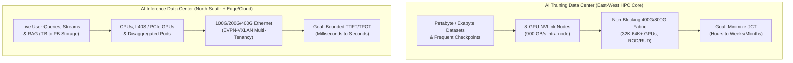
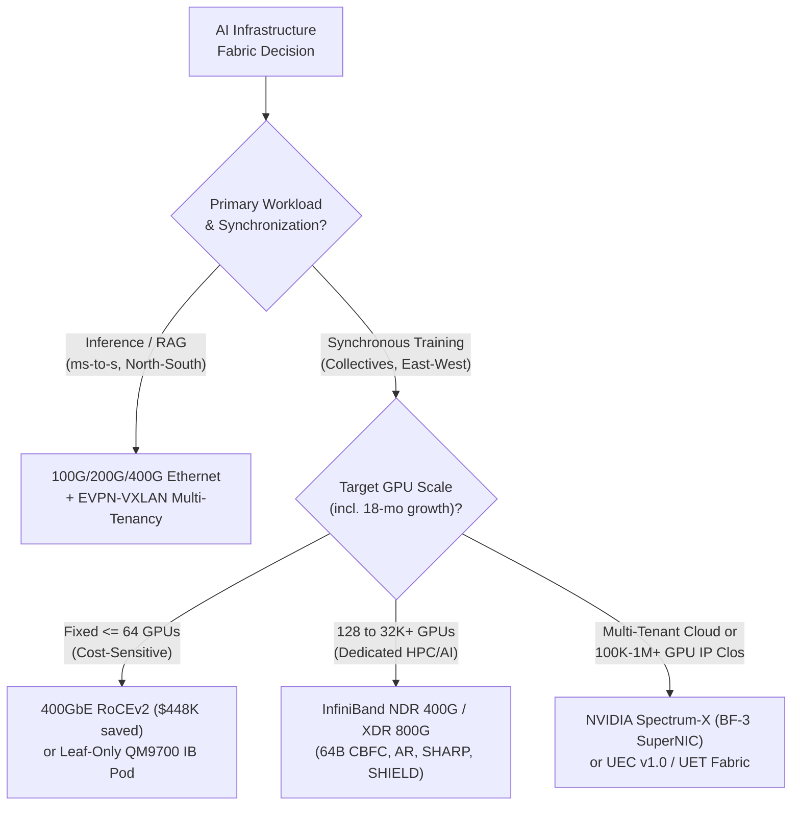

# 12.12 Ethernet versus InfiniBand: a design decision guide

| | |
|---|---|
| Level | Intermediate |
| Priority tier | 2 |
| Lab venue | Nebius GPU |
| Part | Part 12: Complete AI networking |
| Sources used | `ADC` Ch. 2, Ch. 9, Ch. 12; `V9` Ch. 1–12, `index.md`, `labs/lab-01..04`; `V21` Ch. 2, Ch. 3, Ch. 12; `bcm11-admin` §3.6.2 |
| Coverage file | `planning/coverage/chapters/12-12.md` |
| Claim ledger | `planning/ledgers/12-12.md` |
| Companion code | `code/part12/ethernet_vs_infiniband.py`, `code/part12/ethernet_vs_infiniband_lab.py` |

## Why this matters for AI infrastructure

An engineering team can build an Ethernet fabric that passes every link test and saturates an isolated benchmark. The same fabric can still freeze a multi-node training job the moment a second workload starts. An isolated benchmark is one pair of servers talking alone, and it tells you nothing about what happens when a second job shares the same spine. The opposite mistake costs just as much. A team proposes an expensive InfiniBand fabric for a small cluster without checking the payback period. At sixty-four GPUs, the upfront hardware premium takes ten years of compute savings to recover. Payback period is the time it takes the savings to cover the extra cost. When the interconnect does not match the cluster scale and workload pattern, either training jobs stall or capital is wasted.

Choosing between InfiniBand, Standard RoCEv2, NVIDIA Spectrum-X, and the Ultra Ethernet Consortium specification is one of the foundational decisions in an AI Factory. An AI Factory is the name NVIDIA uses for a whole data center built to produce AI output. A slogan about port speeds will not give you the answer. You get it by running a systems engineering calculation. Think of it like buying a truck. The engine size matters, but so do the load you haul, the roads you drive and what the fuel costs over five years. That calculation weighs six concrete factors: workload synchronization, flow control physics, adapter capabilities, storage isolation, operational maturity, and three-year Total Cost of Ownership.

The chapter's motivating numbers come from a benchmark and a cost comparison, and they set the scale for everything that follows. Each number in the block below is a starting point for a calculation, not a verdict. Keep track of which ones came from a measurement and which ones came from a price list, because the two age differently.

```text
Motivating benchmark and cost comparison baselines:
- Isolated pairwise ib_write_bw on 400GbE: 392.11 Gbps with 0% ping packet loss
- 64-GPU upfront fabric cost: $15,000/node InfiniBand NDR ($960,000) vs $8,000/node 400GbE ($512,000)
- Upfront CapEx premium: $448,000 -> requires 244.14 seven-day runs (10.17 years at 24 runs/year) to break even
- Four fabric architectures: Quantum-2 NDR 400 Gbps / Quantum-X800 XDR 800 Gbps, Standard RoCEv2, Spectrum-X, UEC v1.0 / UET
```

The break-even figure is the one to remember. At 24 runs a year, the InfiniBand premium needs about ten years to pay for itself. Start with the cluster scale and the payback math, because the rest of the decision depends on them. If the payback is longer than the life of the hardware, the premium needs a different justification, such as a workload that cannot run on Ethernet at all.

## Prerequisites and outcomes

You should arrive with the earlier networking chapters behind you. This chapter compares fabrics, so it assumes you already know what the protocols do.

**Prerequisites:** Review Chapters 12.1 through 12.5 for AI traffic collectives, RDMA verbs, RoCEv2 transport, PFC, ECN, DCQCN, and Data Center Bridging QoS. Also review Chapters 12.6 through 12.11 for InfiniBand fundamentals, OpenSM and UFM routing, CBFC, Adaptive Routing, SHIELD, optics, and NVIDIA Spectrum-X.

**Outcomes:** The chapter walks through five decisions in order. It starts by contrasting the workload and network needs of AI training data centers with those of AI inference data centers, and it explains why synchronized collectives turn microsecond queue spikes into cluster-wide stalls. It then compares InfiniBand, Standard RoCEv2, NVIDIA Spectrum-X and Ultra Ethernet across transport headers, flow control, routing schemes and in-network collectives. Next it covers ConnectX Virtual Protocol Interconnect personality switching through `mlxconfig` and NVIDIA Base Command Manager `cmsh`, along with PCIe locality and BlueField-3 operating modes. After that comes the sixty-four-GPU and one-hundred-twenty-eight-GPU H100 TCO and break-even math, which separates upfront capital deltas from per-run collective overhead and nonlinear scale risks. The chapter closes with the seven-stage AI fabric validation and troubleshooting ladder, which you can apply when you commission or debug a production cluster.

---

## 1. Workload-backward design: AI training versus inference fabrics

### 1.1 Why synchronized collectives expose the fabric on the critical path

Think about an ordinary enterprise data center. Thousands of independent web flows start and finish at random times. A brief queue spike delays one user request while the rest of the fleet runs normally. Distributed AI training does not work that way. It behaves like a synchronized military convoy, where every participating GPU reaches a collective barrier at the same moment. No rank can start the next step until the slowest rank finishes, so tail latency governs Job Completion Time. Tail latency means the slowest few percent of the waits, and Job Completion Time is how long the whole job takes to finish. One straggler sets the pace for thousands of GPUs.

The table below shows what one slow collective does to a single training step on 64 GPUs running Llama-70B. Compute stays at 1,500 ms in both rows. Only the exposed AllReduce time changes. Exposed AllReduce time is the part of the collective that the GPUs cannot hide behind useful compute, so it is the part that costs you. Read the two rows side by side, and the overhead column tells the story on its own. The compute column stays fixed on purpose, so the only thing that changes is the time the GPUs spend waiting. That is the lesson of the table. The fabric does not make the GPUs faster. It decides how often they sit idle while the others catch up.

When you present a table like this to a non-network audience, start with the wait, not the bandwidth. A manager can picture an idle GPU far more easily than a number of gigabits per second.

| Training Step Scenario (64-GPU Llama-70B) | Compute Baseline | Exposed AllReduce Time | Total Step Time | Communication Overhead |
|---|---|---|---|---|
| **Fast interconnect baseline** | `500 ms` forward + `1,000 ms` backward = `1,500 ms` | `5 ms` | `1,505 ms` | `0.3%` |
| **Congested interconnect tail** | `500 ms` forward + `1,000 ms` backward = `1,500 ms` | `200 ms` | `1,700 ms` | `13%` |

Consider what happens when the exposed AllReduce time grows from 5 ms to 200 ms. That single change raises the overhead from 0.3% to 13%. One slow collective, repeated on every step, adds up to a large share of the run. Barrier synchronization also creates five challenges, and each one breaks an assumption that conventional Ethernet switching makes. Entropy here means how much variety the packet headers show. Low entropy means the headers look almost the same, so a switch cannot spread them out easily.

1. **Low entropy at the network layer:** In rail-aligned pod communication, source and destination IP address pairs are sparse and repetitive. The same few pairs carry nearly all the traffic, so a hash has very little to work with.
2. **Low entropy at the transport layer:** Every RoCEv2 packet carries the fixed UDP destination port 4791, which tells the switch that an InfiniBand Base Transport Header follows. Even when the UDP source port comes from a Queue Pair, static five-tuple ECMP hashing often collides. Several heavy GPU flows can land on the same spine uplink while the links next to it sit idle. A Queue Pair is the send and receive endpoint pair that an RDMA connection uses.
3. **Simultaneous and sequential low-entropy flowlets:** Two transfers between the same GPU pair can differ only inside the Base Transport Header. Two back-to-back jobs can also reuse the exact same pair. A shallow-parsing switch sees both cases as a single flow unless the traffic is rebalanced across flowlet gaps. A shallow parser reads only the outer headers, so it misses the detail that would tell the two transfers apart.
4. **Line-rate elephant flows:** GPUDirect RDMA and GPUDirect Storage let each server drive its network adapters at full line rate during every collective phase. GPUDirect RDMA moves data from a GPU to the network card without a detour through host memory, and GPUDirect Storage does the same for storage. Line rate means the link is running as fast as it can, which is good for the job and bad for any traffic that shares the link.
5. **Synchronized microbursts and incast:** Gradient synchronization and checkpointing create sharp east-west spikes. Many senders aim at one egress queue at the same moment. A five-minute average smooths those bursts away completely. That is why a port can look lightly loaded on a dashboard while its egress queue overflows or keeps emitting pause frames. A pause frame is the signal a receiver sends to ask the sender to stop for a moment.

```text
Microburst vs dashboard averaging telemetry (V9 Ch. 1):
- Line-rate NIC injection: 400 Gbps (50 GB/s) or 800 Gbps (100 GB/s) at 100% duty cycle during collectives
- Microburst duration: 100 us to 1 ms spikes invisible on 5-minute polling averages (e.g., 20% reported utilization)
- Switch counter evidence over 90 s: rx_pfc_prio3 jumps from 0 to 118,344 while rx_ecn_marked_prio3 jumps from 412 to 198,220
```

Read the counters rather than the average. Over 90 seconds, the priority-3 pause counter went from 0 to 118,344. Plan your monitoring around short windows, because a five-minute average hides the bursts that stall training. A good habit is to sample the same counters twice, a short interval apart, and look at the difference. A counter that keeps climbing tells you something is still happening, even if the average looks calm.

### 1.2 AI training data centers versus AI inference data centers

Picture a budget meeting where every AI workload gets the same network design. Some teams buy expensive lossless fabrics for simple query serving. Others deploy oversubscribed leaf switches for synchronous foundation model training. Both mistakes come from treating two different kinds of AI data center as one. Separating them clarifies which network properties actually belong on the critical path. Training is a long, synchronized job where every GPU waits on the others. Inference is a stream of short requests where each user waits on one answer.

The diagram shows both data centers from input to goal.



The table compares the two designs one dimension at a time.

| Dimension | AI Training Data Center (`ADC` Ch. 2 & `V21` Ch. 2) | AI Inference Data Center (`ADC` Ch. 2 Fig. 2-1 & `V21` Ch. 12) |
|---|---|---|
| **Primary objective & timescale** | Minimize **Job Completion Time (`JCT`)** and time-to-train across synchronous iterations lasting **hours to weeks or months**. | Minimize **Time to First Token (`TTFT`)** and response latency (**milliseconds to seconds**) at lowest cost per million tokens (`$0.70/1M tokens` at `2,000 QPS` on `408` GPUs). |
| **Dataset & storage footprint** | **Petabytes (`PB`) to Exabytes (`EB`)** of curated training data plus high-bandwidth burst writes for model checkpoints. | **Terabytes (`TB`) to Petabytes (`PB`)** of live query context, vector databases, and Retrieval-Augmented Generation (`RAG` / agentic `RAG`). |
| **Compute node architecture** | Dense `8`-GPU `HGX`/`DGX` nodes (`H100 SXM5` at `700 W`, `989 TFLOPS` BF16, `900 GB/s` `NVLink 4`, `$285,000/node) or 72-GPU GB200 NVL72 liquid-cooled racks (1.8 TB/s NVLink 5). | Lower-power CPUs, PCIe GPUs (L40S 350 W at $8,000` or `H100 PCIe` `350 W` at `$20,000`, `64 GB/s` `PCIe Gen5 x16`), or multi-node disaggregated prefill/decode pools. |
| **Dominant traffic pattern** | **East-West** synchronous collectives (`AllReduce`, `AllToAll`) across `32,000` to `64,000+` (`100,000+`) GPU ports at `400G`/`800G`/`1.6T`. | **North-South** client query/response + East-West microservice, KV-cache, and `RAG` lookups over `100G` and `200G` (or `400G`) data center switches. |
| **Topology & oversubscription** | `1:1` non-blocking **Rail-Optimized Design (`ROD`)** or **Rail-Unified Design (`RUD`)** (or slight leaf-to-spine undersubscription in shallow-buffer packet-spraying fabrics). | Standard 3-stage IP Clos, collapsed 2-switch spine for edge sites, or hybrid cloud with `EVPN-VXLAN` multi-tenancy and edge security/firewalls. |
| **Natural fabric fit** | **InfiniBand (`NDR`/`XDR`)**, **NVIDIA Spectrum-X**, or finely tuned **lossless `RoCEv2` / `UET`** backend compute fabric. | **Standard Ethernet (`TCP/IP` + `EVPN-VXLAN`)** for frontend/edge/RAG, plus **`RoCEv2`/`Spectrum-X`/`IB`** inside disaggregated multi-node inference pods. |

Notice that training optimizes for job completion time, while inference optimizes for response latency. A training job is judged by the day it finishes, and an inference service is judged by the response a user sees in the next second. The two timelines are so different that they rarely share a good fabric design, even when they share a building. That difference drives almost every row. Decide which side of the table your cluster sits on before you choose a fabric. A cluster that mixes both, such as a training fleet that also serves a chatbot, needs two fabric decisions and a clear boundary between them. Do not assume one network can serve both goals equally well.

### 1.3 Core advantages of InfiniBand versus Ethernet in AI training clusters

Before you look at packet headers, you need the structural trade-off between the two technologies. InfiniBand was built from the wire up for deterministic, lossless cluster computing. Ethernet started as a universal, multi-vendor IP network and was later adapted for RDMA. That history explains most of the trade-offs below.

Why teams choose InfiniBand:

1. **Sub-microsecond cut-through latency:** Native InfiniBand switches reach ultra-low port-to-port latency. They forward packets with a compact Local Route Header and a simple Local Identifier lookup. They never need to parse deep IP headers.
2. **Native lossless Credit-Based Flow Control:** The link layer exchanges buffer credits in hardware, across dedicated Virtual Lanes. A sender waits until the downstream port has advertised enough free credits, so it never sends a packet the receiver cannot hold. Overflow drops are prevented by design.
3. **Turnkey vertical integration and in-network computing:** One subnet manager, OpenSM or UFM, coordinates the whole fabric. Hardware Adaptive Routing, autonomous SHIELD self-healing, and SHARP collective aggregation inside the switches give predictable scaling. You do not have to tune thresholds by hand.

Why teams choose Ethernet:

1. **Cost-effectiveness and a multi-vendor supply chain:** Switches, optics, and NICs come from several merchant-silicon and systems vendors. That variety avoids single-vendor lock-in and the need for protocol gateways.
2. **Operational simplicity and unified skill sets:** Operations teams can use standard IP routing, such as BGP and EVPN-VXLAN, with the Linux automation tools they already know. They also get one view from frontend to backend, instead of running a separate InfiniBand administration silo.
3. **Ecosystem compatibility and hyperscale reach:** Kubernetes, PyTorch, TensorFlow, and enterprise storage run natively over IP and Ethernet. A single InfiniBand subnet is limited by its sixteen-bit address space. IP Clos fabrics, by contrast, scale past one hundred thousand GPUs.
4. **Topology and multi-tenant flexibility:** Ethernet supports EVPN-VXLAN virtual routing, hardware firewalling, and link encryption natively. One fabric can be shared across compute, storage, and service roles.

The constants below put numbers on that trade-off.

```text
InfiniBand vs Ethernet structural constants (ADC Ch. 2 & Ch. 9):
- Switch port-to-port latency: ~300 ns on native InfiniBand vs ~800 ns on standard Ethernet switches
- InfiniBand addressing & lanes: 8-byte LRH with 16-bit LID (49,151 unicast ports / ~48,000 nodes max per subnet)
- InfiniBand CBFC credits: 1 credit = 64 bytes across 16 Virtual Lanes (VL0..VL14 data, 8..12 active queues, VL15 SMP)
- InfiniBand SHIELD failover: ~10 us autonomous switch failover vs ~500 ms software sweeps
- Ethernet scale & multi-tenancy: EVPN-VXLAN Route Type 5 IP VRFs and MAC-VRFs, scaling to 100,000+ and 1,000,000+ GPUs
```

InfiniBand wins on latency and credit-based losslessness, while Ethernet wins on scale and ecosystem. Decide early whether your cluster needs the first set of properties or whether openness and reach matter more. A lossless fabric never drops packets on purpose, and it gets that by making the sender wait for permission. Ethernet can do the same, but it has to bolt the feature on, which is part of why the two families feel so different to operate. Ask yourself which failure you would rather explain to your management: a fabric that is slightly slower and easy to scale, or one that is fast and needs a specialist to run.

---

## 2. Four-way architectural deep dive: InfiniBand vs Standard RoCEv2 vs Spectrum-X vs UET

### 2.1 End-to-end protocol stack and congestion-control comparison

If you compare fabrics by their marketing labels alone, you will miss the hardware mechanisms that decide what happens during an incast burst. AI networking is converging. InfiniBand's deterministic transport loops are meeting Ethernet's scale-out IP routing. Put the four stacks side by side and you can see how each one handles encapsulation, flow control, multipathing, and collective offload. Encapsulation is the set of headers wrapped around your payload, and each stack wraps it differently. Think of four shipping companies using four different boxes, tape patterns and label formats for the same parcel.

The diagram shows each stack from the top layer down. Read each subgraph as one column of a comparison table. The top box is how the packet is wrapped, the middle box is how the link holds traffic back when it is busy, and the bottom box is how the fabric chooses a path and reacts to congestion.

```mermaid
flowchart TB
    subgraph IBStack["1. InfiniBand (Quantum-2 / X800)"]
        IB1["LRH (16b LID) + BTH + Payload"] --> IB2["Link: 64B CBFC Credits (16 VLs)"]
        IB2 --> IB3["Fabric: OpenSM/UFM + AR + SHARP"]
    end
    subgraph RoCEStack["2. Standard RoCEv2 Ethernet"]
        R1["Eth + IP + UDP 4791 + IB BTH"] --> R2["Link: 802.1Qbb PFC (8 Prios)"]
        R2 --> R3["Fabric: BGP + SLB/DLB/GLB + DCQCN"]
    end
    subgraph SpecXStack["3. NVIDIA Spectrum-X Ethernet"]
        SX1["RoCEv2 + SuperNIC Hardware DDP"] --> SX2["Link: Shared Buffer + Narrow PFC"]
        SX2 --> SX3["Fabric: Spectrum-4 AR + Telemetry CC"]
    end
    subgraph UECStack["4. Ultra Ethernet (UEC v1.0 / UET)"]
        U1["UDP 49150 or IP 253 + PDS + SES"] --> U2["Link: Optional 32-VC CBFC + LLR"]
        U2 --> U3["Fabric: NSCC / RCCC (256B) + INC"]
    end
```



The table below sets the four architectures against each other, one dimension per row. Read it by row, because each row answers a question an operator will ask, such as how packets are wrapped or how load spreads across links. Start with the first two rows, because they tell you what the switch must be able to read. Then read the flow-control row, which tells you how the fabric avoids drops. The last rows cover the features that vary most between vendors, such as collectives in the network and transport security. A row that reads like a list of acronyms is still answering one of those three questions, so read it slowly.

| Architectural Dimension | 1. InfiniBand (`Quantum-2` / `Quantum-X800`) | 2. Standard `RoCEv2` (`IEEE 802.1Qbb` + `DCQCN`) | 3. NVIDIA `Spectrum-X` (`Spectrum-4` + `BlueField-3`) | 4. Ultra Ethernet (`UEC Spec v1.0` / `UET`) |
|---|---|---|---|---|
| **Target cluster scale (`ADC` Table 12-4)** | `< 100,000` GPUs (`49,151` unicast `LID`s / `~48,000` nodes per single `16`-bit `LID` subnet) | `> 100,000` GPUs (routed Layer 3 IPv4/IPv6 Clos) | `> 100,000` GPUs (rail-optimized 2-tier/3-tier IP Clos) | `~1,000,000+` endpoints (5-stage / 7-stage IP Clos, Dragonfly+) |
| **Wire encapsulation** | `LRH` (`8 B`, `S-LID`/`D-LID`) + optional `GRH` (`40 B`) + `BTH` (`12 B`) + `ETH`/`RETH` + Payload + `ICRC` (`4 B`) + `VCRC` (`2 B`) | `Ethernet II` + `IPv4`/`IPv6` + `UDP` (`DST PORT 4791`) + `IB BTH` (`12 B`) + Payload + `Ethernet FCS` | `RoCEv2` (`UDP 4791` + `BTH`) with hardware out-of-order sequence tracking | **Option A:** `Eth` + `IP` + `UDP` (`DST PORT 49150`, dynamic `SRC PORT` entropy) + `UET PDS` + `UET SES`. **Option B:** `Eth` + `IP` (`Protocol 253`) + `PDS` (with `Entropy` field) + `SES` |
| **Switch port-to-port latency (`ADC` Ch. 9)** | `~300 ns` cut-through | `~800 ns` store-and-forward / cut-through | `~800 ns` class (`Spectrum-4` monolithic shared buffer) | `~800 ns` class standard / UEC-ready Ethernet switches |
| **Link-level flow control** | Mandatory hardware **Credit-Based Flow Control (`CBFC`)**: `64 B` credit units in `LLH` across `16` VLs (`VL0..VL14` data + `VL15` `SMP`) | Reactive **`IEEE 802.1Qbb PFC`**: `8` priorities (`0..7`), `Xoff`/`Xon` pause quanta frames | Monolithic shared buffer + narrowly scoped `PFC` backstop on `1` RoCE priority (e.g., `prio 3`) | Optional link-level **`CBFC`** across **`32` Virtual Channels (`VCs`)** via `64B/66B` PCS `CtlOS` (`CP_Update`) + optional **Link Layer Retry (`LLR`)** |
| **End-to-end congestion control** | Hardware `FECN` (switch mark) $\rightarrow$ `BECN` (receiver notify) $\rightarrow$ HCA `CCTI` rate table | **`DCQCN`**: Switch `RED`/`ECN` sets IP `CE = 11` $\rightarrow$ Receiver sends `CNP` (`IP ECN = 01`) $\rightarrow$ Sender NIC rate cut | Hardware-coordinated `Spectrum-4` congestion telemetry + `BlueField-3 SuperNIC` RTT/ECN rate control | **1. `NSCC`** (sender RTT + ECN congestion window via `ACK_CC` / `NACK`). **2. `RCCC`** (receiver-managed **`256 B`** credits in `24`-bit `ACK_CC`). **3. Switch Packet Trimming** |
| **Proactive load balancing & multipathing** | Centralized `OpenSM`/`UFM` `LFT` + fine-grained per-packet **Adaptive Routing (`AR`)** + **`SHIELD`** (`10 µs` autonomous failover) | **1. `SLB`** (`5`-tuple CRC32). **2. `DLB`** (local link/queue utilization + flowlets). **3. `GLB`** (next-to-next-hop `NNH` spine quality). **4. `sDLB`** (`BTH` `Write` opcode spraying) + flow pinning | Per-packet `Spectrum-X` Adaptive Routing across all spine rails + `BlueField-3` **Direct Data Placement (`DDP`)** hardware reordering | Dynamic UDP source port or `PDS Entropy` mutation on `NACK`, plus `128 B` deep switch parsing of `SES` (`JobID`, `PIDonFEP`, `Resource Index`) |
| **Packet delivery modes (`ADC` Table 12-2 & 12-4)** | `RC` (Reliable Connected, in-order + `ConnectX` OOO buffer), `UC`, `UD` | `RC` (in-order go-back-to-$N$ or `ConnectX-6/7` `Write` OOO), `UC`, `UD` | `RC` with hardware OOO `DDP` into GPU memory | **`ROD`** (Reliable Ordered), **`RUD`** (Reliable Unordered), **`RUDI`** (Reliable Unordered Idempotent), **`UUD`** (Unreliable Unordered, no `PSN`/`ACK`) |
| **In-Network Collectives (`INC`)** | Production **`SHARP`** trees in `Quantum` switches (`2x–5x` collective speedup) | None (host `xCCL` / `NCCL` Ring & Tree only) | Topology-aware `NCCL` rail alignment + `NVLink SHARP` (`NVLS`) intra-rack | **`UEC INC`**: `INC Manager` (`IM` via `gRPC` OOB) + switch `sFEP` `INC Agents` + `Libfabric` (`fi_collective`) |
| **Built-in transport security** | `16`-bit `P_Key` partition table (`0x8000` full-member bit); `N/A` payload crypto in Table 12-4 | External (`MACsec` / `IPsec` + `VLAN`/`VRF`) | `EVPN-VXLAN` + `BlueField-3` host-edge isolation + hardware `IPsec`/`MACsec` | Built-in **Transport Security Sublayer (`TSS`)** with `AES-GCM` `ICV` trailer after payload (mutually exclusive with optional `UET CRC`) |
| **Deployment readiness (`ADC` Table 12-4)** | Deployed in production networks; low NIC vendor diversity | Deployed in production networks; high NIC/switch vendor diversity | Deployed in production AI Factories (`Spectrum-4` + `BlueField-3`) | Spec `v1.0` released **June 11, 2025** (`70+` members); first pilot deployments expected **late 2026** |

### 2.2 Why Standard RoCEv2 requires coordinated proactive and reactive control loops

Picture a collective step where a single frame is dropped. In Standard RoCEv2, the InfiniBand transport header rides inside UDP, so packets can cross any Layer 3 Ethernet fabric. A Layer 3 fabric routes by IP address, which means it can span many switches and subnets. The catch is that standard Ethernet has no link-layer credit loop. A credit loop means the sender only transmits when the receiver has announced room for it. On a traditional reliable connection, one dropped frame forces the sender to retransmit the entire in-flight window, and that retransmission stalls the collective step. Pause frames do not solve everything either, and you should not rely on them alone. Doing so makes upstream switches freeze one after another in a cascading pause tree. The fix is to combine several smaller tools, each covering a gap the others leave.

If you want to prevent both packet drops and pause deadlocks, you need an AI Ethernet fabric that combines proactive load balancing with reactive congestion control. Proactive means the fabric spreads traffic before a queue builds. Reactive means it slows senders after a queue starts to fill. Each side needs the other.

1. **Proactive Load Balancing Pyramid:**
   - **Static load balancing** hashes the standard five-tuple header. It keeps packets in order for each flow, but it cannot see link utilization, and it polarizes when GPU flows have low entropy.
   - **Dynamic load balancing** watches local link bandwidth and egress queue depth in real time. It steers new flows and flowlet bursts onto the healthier links.
   - **Global load balancing** goes one step further by looking at next-to-next-hop spine quality. Leaf switches can then route around remote spine-to-leaf hotspots.
   - **Selective dynamic load balancing** reads the Base Transport Header opcode to find large RDMA Write elephant flows. It sprays their packets across all uplinks, and the destination NIC puts them back in order in hardware.
2. **Reactive DCQCN Loop:**
   - **Step 1, ECN early warning:** A switch egress queue crosses its marking threshold well before the buffer fills. The switch sets the IP Explicit Congestion Notification bits and forwards the packet normally.
   - **Step 2, CNP reflection:** The destination NIC sees the congestion mark and sends a high-priority Congestion Notification Packet back to the source server.
   - **Step 3, rate cut and recovery:** The source NIC hardware throttles the flow's injection rate. It restores speed gradually once notification packets stop arriving.
   - **Step 4, PFC as the last-resort backstop:** Sometimes an incast burst fills the receive buffer faster than the round-trip ECN loop can slow the sender. Only then does the switch emit an IEEE 802.1Qbb pause frame upstream, reserving headroom for in-flight frames until the queue drains.

The four steps are a ladder, and each rung is cheaper than the one above it. ECN handles most congestion with a single mark and a rate cut. Pause is slower and blunter, because it stops a whole priority on a link, so it should be rare. When you see pause counters climbing steadily, that is a sign the earlier rungs are not doing their job. Check the marking threshold and the sender's rate response before you look at anything else.

```text
RoCEv2 DCQCN and PFC buffer contract (ADC Ch. 2 Fig. 2-3..2-5 & V9 Ch. 4-5):
- SLB 5-tuple: Src IP, Dst IP, Src Port, Dst Port 4791, Protocol 17
- ECN wire marking: Switch RED/ECN sets 2-bit IP ECN field to 11 (CE) around ~50% queue depth
- CNP reflection: Receiver sends CNP with IP ECN bits 01; sender increments np_cnp_handled, cuts rp_current_rate, recovers via rp_byte_reset
- Priority 3 buffer allocation (swp12): 65,536 bytes out of 262,144-byte port receive buffer
- Xoff threshold: 49,152 bytes (75.0%) -> leaves 16,384 bytes (25.0%) of in-flight headroom
- Xon threshold: 32,768 bytes (50.0%) -> provides a 16,384-byte (25.0%) hysteresis band
```

As you read these buffer numbers, notice the design at work. Consider the pause threshold: pause fires at 49,152 bytes, which leaves 16,384 bytes of headroom for frames already on the wire. The fabric needs that headroom to avoid drops while the sender slows down. Think of the buffer as a bathtub. ECN is the early warning when the water rises, pause is the call to turn the tap off, and the headroom is the space above the water line that catches the splash from the tap that is still running. The Xon threshold is the level at which the tap can safely turn back on. Keeping a gap between the two stops the sender from switching on and off every few microseconds.

### 2.3 How Ultra Ethernet redesigns the Ethernet stack for one million GPUs

Standard RoCEv2 works well when you engineer it carefully. At hyperscale, manual threshold tuning and go-back-to-N retransmission become fragile. Fragile here means small changes in load or cabling cause large changes in behavior, and an operator has to retune by hand. The Ultra Ethernet Specification tackles that problem. More than seventy vendors released it under the Linux Foundation, and it redesigns the RDMA transport layer. The Linux Foundation is the open-source body that hosts the project. It keeps standard IP Clos switches in the underlay while adding modern endpoint delivery semantics. The underlay is the physical switching network, and the endpoint semantics are the rules the two ends of a connection follow:

1. **Libfabric API, Semantic Sublayer, and Packet Delivery Sublayer:**
   - Applications express memory registration and collective operations through Libfabric. Three service profiles are available: AI Base, AI Full, and HPC.
   - Each Fabric Endpoint opens logical sessions called Packet Delivery Contexts, and the Packet Delivery Sublayer manages them.
   - Instead of a single Queue Pair number, the Semantic Sublayer header carries a three-part identifier for job, process, and resource index.
2. **Two wire encapsulations:**
   - **UET over UDP** uses destination port 49150 and mutates the UDP source port whenever congestion feedback reports a hot path.
   - **UET over Native IP** removes the eight-byte UDP header and uses IP Protocol 253. It places an explicit entropy field in the delivery header, so switches that parse the first 128 bytes can hash directly on job fields.
3. **Four negotiated Packet Delivery Modes with selective retry:** Instead of flushing a whole window after a drop, the receiver buffers out-of-order packets and asks only for the missing sequence number.
   - **Reliable Ordered Delivery** guarantees in-order delivery to the application, using NIC reorder buffers for MPI and control traffic.
   - **Reliable Unordered Delivery** tracks sequence numbers with selective acknowledgments. It places payloads straight into GPU memory out of order, which suits bulk AI transfers.
   - **Reliable Unordered Delivery Idempotent** lets operations such as gradient updates be retried or overwritten safely, without waiting for recovery timers.
   - **Unreliable Unordered Delivery** drops sequence numbers, acknowledgments, and encryption in exchange for the lowest latency, which suits telemetry.
4. **Dual-layer Congestion Management:**
   - **Network Signal Congestion Control** adjusts the sender's congestion window using round-trip time and ECN feedback carried in acknowledgments.
   - **Receiver Credit Congestion Control** grants explicit receiver buffer credits in 256-byte units inside the acknowledgment header. That loop prevents incast overflow on lossy fabrics without switch pause frames.
   - **Switch Packet Trimming** works like this: when a trimmable traffic class overflows, the switch trims the payload and forwards the compact header on a high-priority queue. The destination then immediately requests selective retransmission.
   - **Optional Link-Layer CBFC and Link Layer Retry** are negotiated via LLDP for greenfield links, doubling InfiniBand's sixteen lanes to thirty-two Virtual Channels. Link Layer Retry replays corrupted frames hop by hop before end-to-end timers expire.

```text
Ultra Ethernet v1.0 specification details (ADC Ch. 12, Fig. 12-3 & Tables 12-1..12-4):
- Release milestone: June 11, 2025 across 70+ members; pilot deployments late 2026
- Libfabric interfaces: fi_mr (memory regions / RKEYs) and fi_collective across AI Base, AI Full, and HPC profiles
- PDC handshake (Fig. 12-3): FEP A sends Pds.flags.syn with PSN=101, SPDCID=201; FEP B replies ACK=101, SPDCID=301, DPDCID=201; FEP A sends data PSN=102, SPDCID=201, DPDCID=301
- SES 3-tuple: {JobID, PIDonFEP, Resource Index (RI)} + Message ID, Buffer offset, Request length (ROD shares 1 PDC per {JobID, src PIDonFEP, dst PIDonFEP, RI, TC})
- Wire headers: UDP DST PORT 49150 (dynamic SRC PORT) or IP Protocol 253 (8 B UDP stripped, 128 B switch parse depth) + optional AES-GCM TSS ICV or UET CRC
- Congestion & link loops: NSCC (ACK_CC / NACK), RCCC (req_cc_state -> 256 B credits in 24-bit ACK_CC), 32-VC CBFC (64B/66B PCS CtlOS CP_Update CC/CF), LLR MAC preamble sequence replay
```

Ultra Ethernet also changes the rules for who must wait. In the older designs, the switch and the NIC were tightly coupled, and a tuning change on one side often needed a matching change on the other. The UEC design moves more of the decisions to the endpoints and gives each endpoint a clear signal to act on. That is a large shift in operations, so teams adopting it should expect new runbooks and new counters to learn.

The delivery mode is negotiated rather than fixed, so one fabric can carry several modes at once. When you plan a fabric, choose the mode that matches each traffic class, and do not assume one setting covers the whole fabric. A practical way to choose is to ask what the application can tolerate. Bulk gradient data can arrive out of order if the adapter can place it, while a control message usually needs to arrive in order. Telemetry can even tolerate loss, because the next sample will replace it.

---

## 3. ConnectX VPI adapters, BlueField-3 DPUs, and host locality

### 3.1 ConnectX VPI personality switching and BCM precedence

Picture a cluster where half the nodes boot into Ethernet mode, while the other half wait for an InfiniBand Subnet Manager. The Subnet Manager is the software that hands out addresses on an InfiniBand network, so nodes stuck in the wrong personality never get one. The fix starts with knowing which personality each port is set to. A personality is the protocol a port speaks, and it is chosen at the firmware level rather than in the operating system. Think of it like a phone that can be switched between two SIM cards, where the choice must be made before the phone connects to a network. NVIDIA ConnectX-6, ConnectX-7, and ConnectX-8 Virtual Protocol Interconnect adapters can speak either native InfiniBand or Ethernet RoCEv2. They use the same physical ASIC and optical cage for both. The port personality lives in non-volatile firmware configuration, and you control it per port with `mlxconfig`:

- **InfiniBand personality (`LINK_TYPE_P1=1`):** Port 1 becomes a native InfiniBand Host Channel Adapter. The port waits for OpenSM or UFM on Virtual Lane 15 to assign a Local Identifier. It then exposes `ib0` and uses hardware 64-byte flow control credits.
- **Ethernet personality (`LINK_TYPE_P1=2`):** Port 1 becomes an Ethernet NIC, such as `ens1f0np0` or `eth0`. The link comes up on its own through Ethernet auto-negotiation, with no Subnet Manager needed. The port fills its RoCEv2 GID entries from the host IP interfaces, and it relies on DSCP classification, DCQCN, and PFC.

In clusters managed by NVIDIA Base Command Manager, you declare persistent `mlxconfig` parameters as `MLX_` extra values. Settings can conflict across cluster levels, and the management daemon resolves them with a strict three-tier precedence. An interface-level override wins over a node-level setting, which in turn wins over a category-level default. Changes written to firmware stay pending until a cold reboot, so check the resolved policy with `cmsh` before you reboot.

```text
ConnectX VPI and BCM 11 configuration rules (bcm11-admin §3.6.2):
- LINK_TYPE_P1=1 (IB): waits for VL15 SMP, ibstat transitions LinkUp -> Active, 20-byte IPoIB address
- LINK_TYPE_P1=2 (ETH): autonomous link-up, populates show_gids v1/v2 table
- BCM extra_values parameters: MLX_link_type_p1, MLX_num_vfs 16, MLX_KEEP_ETH_LINK_UP_P1 true
- BCM precedence order: category.extra_values < node.extra_values < interface.extra_values
- Verification command: cmsh -c "device; mlxconfig node001 --desired"
```

These rules describe what healthy looks like. An InfiniBand port reaches Active only after the VL15 handshake. VL15 is the management virtual lane that carries Subnet Manager traffic, so the handshake is the port asking for an address. An Ethernet port brings its GID table up on its own, so you can check it without a Subnet Manager. A GID is the global identifier that RoCEv2 uses in place of a LID, and the table lists the GIDs your host can use.

When you change a personality, expect a reboot or a firmware reset before the new setting takes effect. Write the change down with the port's serial number, so the next engineer can see what was set and why. A short note in the change log is enough, as long as it names the port, the old personality, the new personality and the date. Keep the note with the serial number of the adapter, because a card can move to a different node after a repair, and the port name then points to the wrong machine. Without that note, the next person to see a half-configured node will spend an hour rediscovering the same facts.

The precedence rules in the BCM block matter for the same reason. When two places set the same parameter, the one closest to the port wins. That rule is simple to state and easy to forget, so write it next to the config, where the next person will read it.

### 3.2 PCIe link negotiation, NUMA locality, and multi-rail binding

Suppose every switch port is lossless and congestion-free. A server can still run at a fraction of line rate, because the bottleneck sits inside its own chassis. The internal path does not care which mode the port runs in. Data travels from GPU HBM memory, through the PCIe switch, to the NIC DMA engine, and every hop on that path has to keep up with the wire speed. HBM is the high-bandwidth memory on the GPU, and DMA is the direct copy engine that moves data without the CPU touching each byte. Think of the path as a chain of doorways. The narrowest doorway sets the crowd flow, however wide the hallway beyond it is.

1. **PCIe generation and lane width:** A `PCIe Gen5 x16` slot is needed to saturate a 400 Gbps ConnectX-7 port at full line rate. A riser card fault or a BIOS bifurcation setting can downgrade that slot to `PCIe Gen4 x8`. The adapter is then capped well below wire speed before a single packet reaches the switch.
2. **GPU-to-NIC topology affinity:** On a multi-socket server, a GPU and a NIC that share a local PCIe switch report `PIX` affinity with zero CPU traversal. A GPU that talks to a NIC on the second socket reports `SYS` affinity, which crosses the inter-socket interconnect. If you assign rails by Linux interface name order instead of `PIX` locality, you silently throttle GPUDirect RDMA.
3. **Multi-rail device selection collisions:** On a multi-rail node, both ports can show active links while a poorly configured job script binds every local rank to the first RDMA device. The second rail then sits completely idle. Traditional Linux NIC bonding, `bond0`, must never be used on multi-rail AI compute paths, because it hides the physical rail topology from NCCL.

```text
Host PCIe and multi-rail diagnostic signatures (V9 Ch. 8):
- Healthy PCIe Gen5 x16: Speed 32GT/s, Width x16 -> ~63-64 GB/s per direction (~504-512 Gbps, saturates 400 Gbps / 50 GB/s NIC)
- Downgraded PCIe Gen4 x8 (lspci -s 41:00.0 -vv): LnkCap 32GT/s x16, but LnkSta Speed 16GT/s (downgraded), Width x8 -> ~16 GB/s (~128 Gbps) ceiling, capping 200 Gbps (25 GB/s) or 400 Gbps (50 GB/s) ports
- 60-second multi-rail byte-counter delta (V9 Ch. 8 Scenario 1):
  * ens1f0 rx_bytes_phy: 892,481,200,384 -> 981,204,882,176 (+88.7 GB)
  * ens1f1 rx_bytes_phy: +412,992 bytes (~0 GB) because both ranks selected [0]mlx5_0:1/RoCE ; OOB ens1f0
```

Think of these signatures as the measurements a mechanic takes before saying a car is fit for a long drive. Each reading covers one part, and a healthy engine with a flat tire still gets you nowhere. A host can have a perfect slot and still send all its traffic down one rail, and a host with two good rails can still sit in a downgraded slot. You need both readings before you can say the host is ready.

Read these signatures as a checklist. A link running at 16GT/s on a Gen5 slot means the slot has been downgraded. A rail whose byte counter barely moves, like `ens1f1` in the 60-second sample, is idle. Check the PCIe line first, because a downgraded slot caps the rail no matter what the switch says. Then check the byte counters, because they show whether the job actually uses both rails. The two checks together tell you whether the problem is the slot, the binding or the fabric.

### 3.3 BlueField-3 DPUs versus SuperNICs: host-edge trust and failure domains

Picture an outage where the switch port shows a healthy link, yet the host cannot send a single packet. That happens when a DPU is treated like a simple NIC. In Ethernet AI Factories and multi-tenant clouds, that mistake produces baffling outages. Architects must tell apart the two BlueField-3 operating models:

The two modes differ in who owns the network path inside the card. Read the two bullets below as two answers to one question: when a packet enters the card, who decides what happens to it? In DPU mode the Arm subsystem answers, and in SuperNIC mode the host answers. That single difference changes what you check during boot, what you check during an incident, and which team gets paged.

- **BlueField DPU Mode (`ECPF`):** The embedded Arm cores and the DOCA operating system own the NIC resources and the internal embedded switch, `eSwitch`. Host traffic passes through representors on the Arm cores, which program hardware offload rules into the fast path. That creates a three-layer administrative boundary: the host interface, the DPU Arm control plane, and the external switch uplink. If a DPU image rollout fails to load its virtual switch policy at boot, the leaf switch keeps its uplink up while the host interface stays dark.
- **BlueField SuperNIC Mode (`NIC`):** The adapter works as a dedicated high-rate RoCEv2 endpoint, paired one-to-one with each GPU on the compute rail. It handles Direct Data Placement packet reordering in hardware, along with Spectrum-X congestion control. No Arm virtual-switch control plane sits in between.
- **Production node split:** Dense eight-GPU servers combine both roles. Eight ConnectX-7 or BlueField-3 SuperNIC adapters serve the East-West GPU compute rails. Two BlueField-3 DPUs in `ECPF` mode handle North-South storage and tenant management.

```text
BlueField-3 DPU vs SuperNIC operational split (V9 Ch. 9 & V21 Ch. 2):
- 3-layer DPU (ECPF) boundary: (1) Host OS interface enp1s0f0np0, (2) DPU Arm service openvswitch-policy-load.service, (3) Switch uplink swp14 (100G/400G)
- Image drift signature: dpu-image-24.07-prod-1 vs dpu-image-24.10-prod-3 after 5 failed pull retries leaves swp14 up while enp1s0f0np0 is DOWN / DORMANT
- DGX / HGX H100 node adapter layout: 8x ConnectX-7 (400 Gbps) East-West compute rails + 2x BlueField-3 DPUs North-South storage/management + 1x OOB BMC port
```

A useful way to remember the DPU boundary is to think of a building with a security desk in the lobby. The switch uplink is the street door, the Arm subsystem is the security desk that checks each visitor, and the host interface is the office upstairs. A visitor can reach the lobby and still never reach the office if the desk is closed. The three layers in that boundary are where you look first. If the uplink is up and the host interface is down, start at the DPU Arm service rather than the switch. That order saves a lot of time, because the switch counters will look healthy in exactly the case where the host is cut off. A host that reads dark on a healthy uplink is a classic sign that the layer in the middle failed.

Think of the mode as a job title rather than a setting. A card in DPU mode is hired to run a small operating system that manages the network for the host, and a card in SuperNIC mode is hired to move packets and nothing more. Hiring the wrong one for the job creates friction on every shift. Choose the mode before you buy the card, not after. A SuperNIC in a slot meant for a DPU, or a DPU in a slot planned for a NIC, can change the whole boot and operations plan. Write down which mode each card runs, and keep that record with the rest of the node inventory.

---

## 4. Storage networks, TCO economics, and the 64-GPU break-even model

### 4.1 AI storage network transport: InfiniBand vs NVMe-o-RDMA vs NVMe-o-TCP

Suppose your GPUs wait on slow dataset reads, or they stall for minutes while writing multi-terabyte model checkpoints. The fastest compute fabric in the world still sits idle. A training cluster therefore needs a high-bandwidth storage fabric next to its compute fabric. You have four options: local NVMe drives, InfiniBand RDMA storage, Ethernet RoCEv2 RDMA storage, and Ethernet TCP storage. Choose among them by latency, lossless requirements, and replication distance. NVMe-o is NVMe over a network, meaning the SSD protocol is carried across the wire, and RDMA or TCP is the transport underneath it. Think of the four options as four ways to reach the same warehouse, each with a different road, toll and distance.

The table compares the four options on latency, lossless needs, GPUDirect support, and redundancy. Read the rows in the order the choice forces on you. Latency comes first, then whether the network must be lossless, then whether GPUDirect Storage is available, and last the redundancy design.

| Storage Metric / Capability | Local `PCIe Gen5` NVMe SSD | `InfiniBand` Storage (`NVMe-o-RDMA` / `GDS`) | Ethernet `NVMe-o-RDMA` (`RoCEv2` / `GDS`) | Ethernet `NVMe-o-TCP` / `(P)NFS` |
|---|---|---|---|---|
| **Switch / bus access latency (`ADC` Ch. 9)** | `~100 ns` (`PCIe Gen5` `32 GT/s`, `~63 Gbps` / `64 GB/s` `x16`) | `~300 ns` per IB switch hop (`700–900 ns` over `1–3` hops) | `~800 ns` per Ethernet switch hop (`~66%` lower write latency than TCP) | Millisecond / multi-microsecond kernel socket + TCP stack |
| **Discovery & transport ports** | Local PCIe bus (`SQE`/`CQE` in host driver) | `TCP 8009` discovery (`RDMA_PRTYPE = 02`) $\rightarrow$ native `IB LRH/BTH` (`1:1` `SQ/CQ` per `QP`) | `TCP 8009` discovery (`RDMA_PRTYPE = 04`, vs `05` iWARP) $\rightarrow$ `UDP 4420` CM $\rightarrow$ `UDP 4791` `BTH` | `TCP 8009` (`ICReq PDU` $\rightarrow$ `CapsuleCmd` `0x01` / `CapsuleResp` + `H2CData` `0x03` / `C2HData` `0x04`, `PRP1/PRP2` `64-bit` or `SGL`, `9,000 B` jumbo MTU) |
| **Lossless fabric required?** | N/A (local PCIe bus) | **Yes** (native `64 B` `CBFC` credits across `16` VLs) | **Yes** (`PFC` + `ECN`/`DCQCN`, tuned separately from compute `DCQCN` for `1:3` oversubscription) | **No** (runs over lossy IP core; ideal for `>= 40 km` inter-site WAN replication with deep-buffer switches) |
| **`GPUDirect Storage` (`GDS`) support** | **Yes** (`cudaMalloc` + `cuFileBufRegister` pins GPU memory directly to NVMe) | **Yes** (zero-copy DMA between GPU HBM and remote SSD, bypassing host CPU and system RAM) | **Yes** (supported natively by `WekaFS` over `RoCEv2`, `VAST` `NFS-over-RDMA`, `Lustre`, `GPFS`, `BeeGFS`) | **No** (`GPUDirect Storage` requires RDMA transport—either native `InfiniBand` or `RoCEv2`) |
| **Redundancy & multi-tenancy (`ADC` Fig. 9-5..9-8)** | Server-local only (not scalable across cluster) | Physical **Fab A / Fab B** dual-fabric separation (logical virtualization limited; `<= 10 km` spec optics) | Physical **Fab A / Fab B** or Logical **EVPN-VXLAN** (`Route Type 5` / `MAC-VRF`) with `1:3` leaf-spine oversubscription | Logical IP Clos, `2`-switch collapsed edge, or hybrid cloud tiering (`WekaFS` Tier 1 RDMA + Tier 2 `S3` over `HTTPS`/`IPsec` firewall) |

Notice that only the NVMe-o-TCP option runs without a lossless fabric. That makes it the choice for long-distance replication, while the RDMA options need a lossless network to deliver GPUDirect Storage. In practice, you pick the storage path first and then size the network around it. A storage team that asks for the fastest path often needs GPUDirect Storage, which means an RDMA transport and a lossless network. A storage team that asks for distance first may accept TCP, and the network can then stay simpler. The two answers lead to two different fabrics, so settle the question before you draw the diagram.

The redundancy row matters just as much as speed. A dual-fabric design doubles the cabling and the switches, but it keeps one failure from taking the whole storage path down. A single logical fabric with EVPN-VXLAN is cheaper, but a bad configuration can reach across both halves. Pick the level of separation that matches how much you fear a shared mistake.

### 4.2 The 128-GPU and 64-GPU H100 TCO and break-even calculation

When finance questions an interconnect budget, a senior architect does not answer with intuition or vendor slides. Instead, the architect computes the cost of a GPU-hour. Then the architect sets the upfront price gap against the value of the training hours saved. The first formula gives the cost of one GPU-hour for the 128-GPU baseline.

$$\text{3-Year TCO} = \$5.26\text{M} + (3 \times \$644\text{K}) \approx \$7.19\text{M}, \qquad \text{Cost per GPU-Hour} = \frac{\$7.19\text{M}}{128\text{ GPU} \times 8,760\text{ hr} \times 3\text{ yr}} \approx \mathbf{\$2.14/\text{GPU-hour}}$$

Read the result as a price tag for each GPU-hour. The supporting figures for the baseline and the comparison sit in the block below. The formula divides the three-year cost by the number of GPU-hours the cluster can deliver in that time, so every idle hour raises the real price. Keep that in mind when a fabric upgrade promises more throughput. A faster network only lowers the price per useful hour if the GPUs spend more of their time computing.

Two other points help when you read the block. The first is that the CapEx line includes both the nodes and the fabric, so the fabric choice shows up directly in the total. The second is that the OpEx line is a per-year figure, so a three-year total multiplies it by three. Check both before you compare your own quote with this one.

```text
3-Year TCO and 64-GPU interconnect break-even derivation (V21 Ch. 2 Part 3.2, Part 6 & Ch. 12):
1. 128-GPU (16-Node) DGX H100 SXM5 Baseline:
   - Config A (8x H100 80GB SXM5): $240,000 GPUs ($30,000/GPU, 989 TFLOPS BF16 / 1,979 TFLOPS FP8, 3.35 TB/s HBM3, 700 W, $30/BF16 TFLOP, 900 GB/s NVLink) + $30,000 CPU/2 TB DDR5/30 TB NVMe + $10,000 (8x ConnectX-7 400G + 2x BlueField-3) + $5,000 assembly = $285,000/node ($35,625/GPU, 7,912 TFLOPS peak / ~6,500 TFLOPS practical at 80%, 10.2 kW)
   - Config B (8x H100 PCIe): 756 TFLOPS BF16, 350 W, $20,000/GPU, 64 GB/s PCIe Gen5 x16 = $215,000/node ($26,875/GPU, ~25% cheaper for independent inference; vs H200 141 GB, 4.8 TB/s at $40K or L40S 48 GB, 362 TFLOPS at $8K)
   - 16-Node CapEx: 16 x $285K ($4.56M) + $400K fabric + $200K racks/PDUs/cooling + $100K install = $5.26M CapEx
   - Annual OpEx: 163 kW at $0.12/kWh ($171.6K electricity) + $400K (2 FTEs) + $52.6K support + $20K software = $644K/year
   - 3-Year TCO: $7.19M -> $2.14/GPU-hour ($22/TFLOP-year at 107,603 TFLOPS = 107.6 PFLOPS, 85% of 126,592 TFLOPS peak)
   - Larger fleet reference (V21 Ch. 12): 1,200 GPUs = $44M CapEx + $26.2M 3-yr OpEx = $70.2M TCO ($19.5K/GPU-year, $19.7K/PFLOP-year); 408 inference GPUs at 2,000 QPS = $18.1K/day = $0.70/1M tokens

2. 64-GPU Interconnect Showdown: InfiniBand NDR ($15,000) vs 400GbE RoCEv2 ($8,000):
   - Upfront CapEx delta: ($15,000 - $8,000) x 64 = $7,000 x 64 = $448,000 upfront savings with Ethernet ($960,000 IB vs $512,000 ETH)
   - Iteration step overhead: 100 ms compute + 2 ms IB AllReduce = 102 ms (2% overhead) vs 10 ms ETH AllReduce = 110 ms (10% overhead) -> 8% throughput loss (7.84% exact step-time increase)
   - Per-run impact (Llama-70B, 7 days = 168 hours on 64 GPUs): 168 h x 8% = 13.44 h (~13.4 extra hours -> 181.4 hours = 7.56 days total)
   - Extra compute cost per run: $2.14/GPU-h x 64 GPUs x 13.4 h = $1,835.11 (~$1,835/run)
   - Annual & 3-year extra compute cost (24 runs/year = 2 runs/month): $1,835 x 24 = $44,040/year (~$44K/year) -> $132,120 (~$132K) over 3 years
   - Sensitivity for 2 runs/year of a 100B-class model (2x gradients -> 30 ms ETH AllReduce = 130 ms vs 102 ms IB = 27% overhead): 27% x $2.14 x 64 x 168 x 2 = $12,425/year (~$12K/year, or ~$36K over 3 years -> ~$168K combined)
   - Break-even threshold: $448,000 / $1,835 = 244.14 runs (10.17 years at 24 runs/year)
```

Walk through the comparison in three steps. First, the price gap adds up to $448,000 in upfront savings. Second, slower collectives cost a throughput share, and an 8% loss stretches a seven-day run by about 13.4 hours. Third, at $2.14 per GPU-hour, that lost time costs about $1,835 per run. Each step uses the output of the one before it, so an error early in the chain carries through to the verdict. Check the first step against the price list before you trust the rest.

Divide the upfront saving by the cost of one run, and you get the break-even point. That is the moment the slower runs have used up the saving, so you can check the arithmetic step by step. $448,000 divided by $1,835 is 244.14 runs. At 24 runs a year, that takes 10.17 years to recover.

The arithmetic gives a clear verdict. Over three years, the extra compute time from slower Ethernet collectives stays well below the upfront Ethernet hardware savings. If the cluster will permanently stay at or below 64 GPUs, a single `QM9700` switch is enough. A single leaf-only 400GbE pod works too. Either way, 400GbE RoCEv2 is economically sound. If the cluster will grow to 128 or 256 GPUs within 18 months, buy InfiniBand NDR/XDR or Spectrum-X on Day 1. Multi-rack RoCEv2 congestion, pause trees, debugging outages, and a mid-life fabric retrofit rapidly cost more than the initial savings.

A common planning mistake is to size the fabric for the first phase only. A cluster that starts at 64 GPUs and grows to 256 needs cabling, spines and optics planned for the larger number from the start, even if only the smaller part is bought on day one. Ask the procurement team which parts can be added later without a redesign. The answer tells you how much of the decision is really reversible.

The number to pin down before you buy is your GPU count 18 months from now, because it decides which side of the 128-GPU line you land on. A useful check is to recompute the break-even with your own price quotes and your own run count, because both numbers move from one vendor and one year to the next. If the payback still lands beyond the life of the hardware, the cheaper fabric is the right call. If it lands well inside that life, the premium is paying for itself.

Notice what the calculation does not include. It leaves out the cost of an outage during a critical training run, the cost of an engineer who learns a new fabric, and the cost of a mid-life retrofit. Those costs are real, and the deeper sections of this chapter describe how they show up. Treat the break-even number as the floor of the decision, not the whole answer.

---

## 5. Workload-driven fabric decision matrix and the 7-stage validation ladder

### 5.1 End-to-end decision tree: matching workload, scale, and tenancy to the right fabric

Picture an infrastructure review board asking you for a fabric recommendation. A recommendation made without fixing four constraints first is only a guess. You must evaluate workload synchronization, target GPU scale including eighteen-month expansion, multi-tenant security boundaries, and wide-area storage replication distance. Only after those four are settled can you select the right switch architecture.



The decision tree starts with one question, which is whether the workload is synchronous training or latency-sensitive inference. Once that is answered, the scale decides the branch, and the scale branch decides the fabric family. Follow the arrows from the top, and each box names the fabric you would evaluate next.

The table turns that decision tree into five deployment scenarios. Each row names the compute fabric, the storage transport, the adapter mode, and the reason for the choice.

| Deployment Scenario | Primary Compute Fabric | Storage Network Transport | Host-Edge Adapter & Mode | Architectural Justification |
|---|---|---|---|---|
| **1. Fixed `<= 64`-GPU Research / Fine-Tuning Pod** | `400GbE` `RoCEv2` (or `1`-tier leaf-only `Quantum-2 QM9700` `64`-port NDR pod) | `NVMe-o-RDMA` (`RoCEv2` or `IB`) or `NVMe-o-TCP` (`100G`/`200G`) | `ConnectX-7` (`LINK_TYPE_P1=2` ETH or `=1` IB) in `NIC` mode | Upfront `$448,000 Ethernet savings ($8K` vs `$15K per unit) exceeds the ~$132,120` 3-year `AllReduce` overhead (`24` runs/yr at `$1,835`/run) if scale stays `<= 64` GPUs. |
| **2. Dedicated Foundation Model Training (`128` to `32,000+` GPUs)** | **InfiniBand NDR (`400G`) / XDR (`800G`)** `2`-tier or `3`-tier Rail-Optimized Fat-Tree | Dedicated `InfiniBand` or `RoCEv2` `GPUDirect Storage` (`WekaFS`, `VAST`, `Lustre`) | `8× ConnectX-7/8` (`LINK_TYPE_P1=1` IB) compute rails + `2× BlueField-3` storage/in-band | `~300 ns` switch latency, lossless `64 B` `CBFC` across `16` VLs, hardware `AR`, `SHARP` (`2x–5x` collective offload), and `10 µs` `SHIELD` self-healing eliminate tail-latency stalls. |
| **3. Enterprise / Cloud Multi-Tenant AI Factory (`256` to `100,000+` GPUs)** | **NVIDIA `Spectrum-X`** (`Spectrum-4` shared-buffer switches + `BlueField-3` SuperNICs) | Physical or Logical **Fab A / Fab B** (`EVPN-VXLAN` `RT5`, `1:3` oversubscribed `NVMe-o-RDMA` / `GDS`) | `8× BlueField-3 SuperNIC` (`NIC` mode) compute rails + `2× BlueField-3 DPU` (`ECPF` mode) host edge | Combines standard `BGP`/`EVPN` routing and `NetQ`/`NVUE` operations with hardware packet spraying, `DDP` out-of-order placement, and `ECPF` zero-trust tenant isolation. |
| **4. Next-Gen Hyperscale IP Clos (`100,000` to `1,000,000+` GPUs)** | **Ultra Ethernet (`UEC` `v1.0` / `UET`)** over `800G`/`1.6T` 5-stage IP Clos or Dragonfly+ | `UET` storage profile / `NVMe-o-RDMA` + cloud `S3` tiering | `UEC`-compliant `400G`/`800G` FEPs supporting `Libfabric` (`ROD`/`RUD`/`RUDI`), `NSCC`/`RCCC`, and `TSS` | Scales past InfiniBand's `49,151`-port (`~48,000`-node) single-subnet `16`-bit `LID` ceiling with `256 B` `RCCC` receiver credits, packet trimming, `32`-VC `CBFC`, and `UEC INC`. |
| **5. Multi-Region Inference, Edge & Long-Haul DR (`>= 40 km` WAN)** | `100G`/`200G`/`400G` **Ethernet IP Clos** or `2`-switch collapsed spine (`EVPN-VXLAN`) | **`NVMe-o-TCP`** (`TCP 8009`, `9,000 B` MTU, deep-buffer switches) + `S3` over `HTTPS`/`IPsec` firewall | `L40S` (`$8K) or H100 PCIe ($20K`) + `100G`/`200G` Ethernet NICs / `BlueField-3 DPU` | `DCQCN`/`PFC` cannot maintain lossless backpressure across `>= 40 km` WAN links (and IB optics spec stops at `10 km`); `NVMe-o-TCP` adapts gracefully on lossy IP cores. |

Use the scenario column as a starting point, then check the justification column against your own numbers. The scenario only holds while your scale and tenancy stay where the table assumes they will. Read the table from the top down, because each row moves further from the small pod. The compute fabric changes first, then the storage path, then the adapter mode. A design that jumps straight to row four for a 64-GPU lab has skipped the reasoning that makes the choice safe.

### 5.2 Capacity planning at the bottleneck cut and the 7-stage validation ladder

A topology diagram shows where the links go, but it does not show whether they can carry the load. Suppose a cluster is tested only under normal link states, using one pairwise benchmark. The first spine maintenance window will then trigger severe congestion. Size every AI fabric at its bottleneck cut, under both normal and degraded states. Then commission it with a strict seven-stage validation ladder:

```text
Bottleneck-cut arithmetic and degraded-state impact (V9 Ch. 2 & Ch. 10):
- 16-node rack downlink demand: 16 nodes x 2 rails x 400 Gbps (800 Gbps/node) = 12,800 Gbps
- Normal-state uplink capacity (8 uplinks): 8 x 400 Gbps = 3,200 Gbps -> 4.00:1 oversubscription
- Degraded N-1 uplink capacity (1 uplink drained, 7 active): 7 x 400 Gbps = 2,800 Gbps -> 4.57:1 oversubscription
- 2-spine ECMP drain impact (nexthop-group 40, V9 Ch. 2 Scenario 2): active members drop 2 -> 1, driving tx_ecn_marked_prio3 up ~6x from ~15,000 to 88,120 per window
```

Losing one uplink is enough to move the oversubscription from 4.00:1 to 4.57:1. That is why the degraded state belongs in your sizing, not only the normal one. Work through the seven stages below in order, since each stage assumes the one beneath it is healthy. Stage 1 proves the wire, Stage 2 proves the addresses, and Stage 3 proves the priority settings. Only after those three pass does it make sense to measure RDMA throughput, because a throughput number built on a broken wire tells you nothing.

| Validation Stage | Layer Under Test | Verification Tools & Target Criteria |
|---|---|---|
| **Stage 1: Physical & Link Layer** | Optics, DAC/AOC serials, lane lock, FEC/CRC | Verify `400000Mb/s`, `Full` duplex, and zero `fec_uncorrected_blocks` or `rx_crc_errors` deltas via `ethtool`, `mlxlink`, or `iblinkinfo`. |
| **Stage 2: IP, Addressing & Path MTU** | Rail routing, jumbo MTU, RDMA link & GIDs | Confirm `ip route get <peer-ip>` uses the right rail with `mtu 9000` (RoCEv2) or `active_mtu 4096` (IB), plus `rdma link show` and `show_gids` (`v2`). |
| **Stage 3: QoS, Trust & Buffer Contract** | DSCP wire marking, trust mode, PFC hysteresis, ETS | Confirm `tcpdump` shows `tos 0xb8` (`0xb8 >> 2 = 46`, DSCP 46), `mlnx_qos` trusts `dscp`, single-priority PFC (`enabled 0 0 0 1 0 0 0 0`), `49,152 B` / `32,768 B` thresholds on `65,536 B`, and non-starving `ETS`/`dwrr`. |
| **Stage 4: Host-Memory RDMA Verbs** | Point-to-point QP state machine & wire bandwidth | Run `ib_write_bw` and `ib_write_lat` across all rail pairs (`392.11 Gbps` on `400GbE`), confirming `IBV_WC_SUCCESS` and zero `RETRY_EXC_ERR`. |
| **Stage 5: GPUDirect RDMA & Locality** | PCIe Gen5 x16 negotiation & NUMA switch affinity | Confirm `nvidia-smi topo -m` shows `PIX` or `NV18` (not `SYS`), `lspci -vv` shows `LnkSta: Speed 32GT/s, Width x16`, and GPU-buffer RDMA hits line rate. |
| **Stage 6: Multi-Node Collective Matrix** | All-rail ring/tree collectives & rail balance | Run `all_reduce_perf` and `alltoall_perf` across message sizes while checking equal byte growth on `ethtool -S ens1f0` vs `ens1f1`. |
| **Stage 7: Contention & N-1 Cut Drill** | Overlapping jobs & single-uplink/spine maintenance | Run two or more jobs while draining one uplink or spine; audit `rx_ecn_marked_prio3`, `rx_pfc_prio3`, `np_cnp_handled`, and `show what-just-happened drop-reason all`. |

Stages 4 through 6 build on each other in a simple way. A single RDMA pair (Stage 4) proves one path can carry the traffic. Local GPU placement (Stage 5) proves the path starts at the right place. A multi-node collective (Stage 6) proves many paths can carry traffic at once without one of them starving. Stage 7 then adds the stress of a second job and a drained uplink. Each stage asks a harder question than the one before it, so a failure at any stage tells you which kind of problem to fix.

Do not count an isolated benchmark as a pass. A collective that succeeds alone tells you nothing about contention or a drained uplink, and those are exactly what Stage 7 exists to test. Keep the results of every stage in one place, with the date and the cable serials, so that the next incident can be compared with a known good run.

---

## Commands and configurations that matter

The commands in this section cover four jobs that come up on every new fabric. The first sets the personality of each adapter port. The second checks host locality, which tells you whether the adapter sits next to the GPU it serves. The third sets the QoS and priority state on the host and the switch. The fourth checks the BlueField-3 path from the uplink to the host. Every block is written to be read before it is run. Each one carries an `(untested here)` marker, which means these commands were not run on live hardware in this build. Confirm the exact flags against your firmware and switch release before you use them.

### 1. Switching ConnectX VPI personality via `mlxconfig` and BCM `cmsh`

```bash
# (untested here) — Query current & default/next-boot VPI link personality on a ConnectX-7 adapter:
mst status -v
mlxconfig -d 0000:03:00.0 -e query | grep -E "LINK_TYPE_P1|LINK_TYPE_P2|NUM_OF_VFS|SRIOV_EN"

# Switch Port 1 & Port 2 from InfiniBand (1) to Ethernet RoCEv2 (2) and allocate 16 SR-IOV VFs:
mlxconfig -y -d 0000:03:00.0 set LINK_TYPE_P1=2 LINK_TYPE_P2=2 SRIOV_EN=1 NUM_OF_VFS=16

# Or switch Port 1 back to native InfiniBand (1):
mlxconfig -y -d 0000:03:00.0 set LINK_TYPE_P1=1

# In NVIDIA Base Command Manager (BCM 11 cmsh), inspect & declare persistent MLX_ policy
# (precedence: category.extra_values < node.extra_values < interface.extra_values):
cmsh -c "device; mlxconfig node001 --adapters"
cmsh -c "device; use node001; interfaces; use ib0; set -e MLX_link_type_p1 IB; commit"
cmsh -c "device; mlxconfig node001 --desired"
```

### 2. Host locality, RDMA GID table, and PCIe negotiation audit

Run these checks on each host before the first job lands on it. Start with the PCIe link, because a downgraded slot is the cheapest problem to confirm and the most common one to miss. Then check the topology, so each GPU is paired with the adapter on its own PCIe switch. Last, confirm that the RDMA stack sees the device and that the GID table lists the address you expect.

```bash
# (untested here) — 1. Verify PCIe Gen5 x16 (32 GT/s, x16) vs downgraded Gen4 x8 (16 GT/s, x8):
lspci -s 41:00.0 -vv | egrep "LnkCap|LnkSta"
# Healthy:    LnkCap: Port #0, Speed 32GT/s, Width x16  /  LnkSta: Speed 32GT/s, Width x16
# Downgraded: LnkSta: Speed 16GT/s (downgraded), Width x8  (caps 200G/400G NIC at ~16 GB/s)

# 2. Verify GPU-to-NIC PCIe switch locality (PIX = same PCIe switch; SYS = crosses NUMA socket):
nvidia-smi topo -m

# 3. Verify RDMA kernel module (mlx5_ib), netdev mapping, MTU 9000, route, and RoCEv2 GID table:
lsmod | grep mlx5
rdma link show
ibv_devinfo -d mlx5_0 -i 1
show_gids
ip route get 10.20.8.5
ip link show dev ens1f0
ethtool ens1f0 | egrep "Speed|Duplex|Link"
```

### 3. QoS classification, PFC headroom, DCQCN, and Spectrum WJH telemetry

These checks follow the packet from the sender's marking to the switch's queue. Confirm the marking first, because a packet that arrives with the wrong priority is headed for the wrong queue no matter how well the rest is tuned. Then confirm the trust setting and the pause domain. Last, sample the counters over a short window, so you can see whether the congestion loop is healthy or stressed.

```bash
# (untested here) — 1. Verify wire DSCP marking (tos 0xb8 -> 0xb8 >> 2 = DSCP 46) on UDP port 4791:
tcpdump -i eth0 -c 1 -v host 10.20.8.5 and udp port 4791

# 2. Inspect switch/NIC trust state (dscp vs pcp), PFC enabled mask, buffer thresholds, and ETS/strict TSA:
mlnx_qos -i swp12
# Verify: Priority trust state: dscp
#         enabled  0 0 0 1 0 0 0 0  (ONLY prio 3 enabled; prio 0/6 not sharing pause domain)
#         Buffer size: 65536 bytes, Xoff: 49152 bytes (75%), Xon: 32768 bytes (50%)

# 3. Sample time-windowed ECN marks, PFC pauses, prio0 discards, and physical FEC/CRC deltas:
date -u && ethtool -S ens1f0 | egrep "ecn_marked|pfc_prio|rx_prio0_discard|fec_uncorrected|rx_crc_errors|rx_bytes_phy"

# 4. Verify sender-side DCQCN CNP reception and rate-limiter response on ConnectX:
mlx5_cnp_stats -d mlx5_0
# Compare switch rx_ecn_marked_prio3 delta (e.g. +312) against sender np_cnp_handled (+298) and rp_byte_reset

# 5. On NVIDIA Spectrum switches, inspect What Just Happened (WJH) hardware drop reasons and ECMP groups:
show what-just-happened drop-reason all
show ip ecmp-groups | grep 10.20.0.0/16

# 6. Check BlueField-3 DPU 3-layer readiness (Switch uplink -> DPU Arm policy service -> Host representor):
show interface status swp14
systemctl status openvswitch-policy-load.service
ip -br link show dev enp1s0f0np0
```

---

## How it fails

Picture a distributed training run that slows down or aborts on an Ethernet or VPI fabric. The on-call engineer sees a stalled job, a few red graphs and a Slack thread full of guesses. In that moment the urge is to change a threshold and hope. Resist it, because a threshold change can hide the evidence you need. If you start guessing at switch thresholds, you can lose hours. Work up the seven-stage diagnostic ladder instead, from the physical cable to the collective bottleneck cut. That order isolates the exact failure domain:

| Failure mode | Exact CLI symptom & counter signature | Root cause | Production resolution & verification |
|---|---|---|---|
| **1. Physical Uncorrectable FEC & Secondary `ECN` Inflation (`V9` Ch. 11)** | `ethtool -S swp17` shows `fec_corrected_blocks: 41200`, **`fec_uncorrected_blocks: 3`**, and **`rx_crc_errors: 3`** (matching `3` exactly), while `rx_ecn_marked_prio3` rises secondarily. | A degraded DAC cable (`DAC-2m`, serial `ABC123` on `rack14-node07` `mlx5_1` rail `1`) drops `3` unrecoverable frames; RDMA retransmissions add load that triggers secondary `ECN` marks. | Join `swp17` to node/job inventory (`training-run-4471`, ranks `48–55`), replace the cable/optic before touching `QoS`, and verify `fec_uncorrected_blocks` delta stays `0`. |
| **2. Silent `NCCL` Socket Fallback (`mlx5_ib` Missing, `V9` Ch. 2 Scenario 1)** | `ping` works, job runs at `<10%` speed; `NCCL_DEBUG=INFO` logs `NET/IB : No device found` and **`NET/Socket : Using [0]eth0:10.20.4.15`**. `rdma link show` returns `0` with empty output. | Low-level NIC driver (`mlx5_core`) loaded, but the RDMA verbs module (`mlx5_ib`) failed to load or VPI `LINK_TYPE_P1` mismatched expected stack. | Load/qualify the complete `DOCA-OFED` / `mlx5_ib` driver set, verify `rdma link show` lists `state ACTIVE physical_state LINK_UP`, and confirm `NCCL` logs `NET/IB : Using [0]mlx5_0:1/RoCE`. |
| **3. `Ping` Works, `RoCE` Fails at `QP to RTR` (`GID` / `MTU` Drift, `V9` Ch. 3 & 11)** | `ping -c3 10.20.8.5` shows `0% packet loss`, but `ib_write_bw -d mlx5_0 10.20.8.5` aborts with **`Failed to modify QP to RTR`** (or Lab 04 `mlx5_1` injection drops `392.11 -> 156.0 Gbps` with `24` `RETRY_EXC_ERR`). | Host hardcoded `-g 1` (`GID index 1`) across hosts where `show_gids` mapped index `1` to base `eth0` on one node and VLAN `eth0.100` (or `v1` `fe80::`) on the peer, or an intermediate hop lacked `mtu 9000`. | Select `GID` by verified `v2` IPv4/IPv6 + netdev context rather than raw table index, enforce `mtu 9000` on every routed hop, and verify `ib_write_bw` completes at `~392 Gbps`. |
| **4. `DSCP` vs `PCP` Trust Drift & `Prio 0` Drops (`V9` Ch. 6 Scenario 1)** | `PFC` is enabled on `prio 3`, yet RDMA retries spike. `tcpdump` confirms `tos 0xb8` (`DSCP 46`) and leaf `swp4` trusts `dscp`, but destination leaf `swp19` shows **`Priority trust state: pcp`**, **`rx_prio0_discard: 18420`**, and `rx_pfc_prio3: 0`. | `swp19` ignores `DSCP` and looks for an `802.1Q` `PCP` tag; routed untagged `RoCEv2` packets fall into lossy `priority 0` (best effort) where `18,420` frames tail-drop without ever triggering `prio 3` `PFC`. | Generate switch `QoS` from a single machine-readable source of truth, set `Priority trust state: dscp` across all leaves/spines, and verify `rx_prio0_discard` delta returns to `0`. |
| **5. `PFC` Pause Contamination (`prio 6`) & `Strict` Scheduler Starvation (`V9` Ch. 1 & 6)** | SSH/monitoring stalls during training bursts with `0` packet drops. `mlnx_qos -i swp12` shows **`enabled 0 0 0 1 0 0 1 0`** (`prio 3` and `prio 6` both `PFC`-enabled with `prio 6` sharing `tc2` `1,2,4,5,6,7`), or `tc1` (`prio 3`) uses **`tsa: strict`** over `tc0` (`dwrr`, `weight: 5`). | Either `prio 6` pauses `tc2` (blocking management traffic sharing `tc2`), or `tsa: strict` on `RoCE` `tc1` starves `dwrr` control-plane traffic during sustained collective bursts. | Scope `PFC` strictly to `priority 3` (`enabled 0 0 0 1 0 0 0 0`) and give infrastructure/control traffic an `ETS`-guaranteed minimum bandwidth class rather than leftover `dwrr` weight behind `strict` `RoCE`. |
| **6. Concurrent-Job Bottleneck Cut, Pause Trees & `WJH` Tail Drops (`V9` Ch. 1, 5, 7, 10)** | Pairwise `ib_write_bw` hits `392.11 Gbps`, but starting Job `2` causes `rx_pfc_prio3` to jump `0 -> 118,344` (`rx_ecn_marked_prio3: 412 -> 198,220`), or `rx_ecn_marked_prio3: 412,880` with `np_cnp_handled: 409,500` stays at `rp_current_rate: 98Gbps`, or `WJH` logs **`Tail drop (queue full)`** (`18,402` / `52,100` / `38,210`), or `rx_pfc_prio3` propagates `leaf03 (210,500) -> leaf07 (198,200) -> leaf12 (41,100)`. | Multiple jobs converge on a `4:1` (`4.57:1` `N-1`) oversubscribed leaf uplink cut or a `1`-spine drained ECMP group (`tx_ecn_marked_prio3: 88,120`). Tracing highest `rx_pfc_prio3` downstream isolates `leaf03` as the root bottleneck. | Fix job placement, ECMP/adaptive load balancing, or uplink cut capacity first; verify `WJH` tail drops return to `0` and `rx_pfc_prio3` flattens while `rx_ecn_marked_prio3` handles bursts proactively. |
| **7. BlueField-3 DPU `Arm` Boot Race / Image Drift (`V9` Ch. 9 Scenarios 1–2)** | Switch port `swp14` is `up` (`100G`), yet host interface `enp1s0f0np0` is `DOWN` (`DORMANT`) after reboot; or `node09` runs stale `dpu-image-24.07-prod-1` (vs `24.10-prod-3` on `node07/08`) after `dpu-agent` abandoned `5` image-pull retries. | In `ECPF` (`DPU`) mode, `openvswitch-policy-load.service` on the BlueField `Arm` subsystem failed (`status=1`), leaving the embedded switch without forwarding rules despite a healthy physical uplink. | Gate node readiness on all `3` layers (`swp14 up`, `Arm` policy service active, and host `enp1s0f0np0 UP`), and reconcile drifted DPU images via immutable canary rollouts with out-of-band BMC recovery. |

Each row pairs a symptom with its counter signature, a root cause, and a fix. A useful habit is to write the counter values down in the incident notes before anyone changes a setting, so the before and after can be compared later. Match what you see against the symptom column before you change any setting, so you fix the cause rather than the symptom. The first three rows are about the physical and addressing layers, and they should be cleared before anyone touches QoS. Rows four and five are about priority settings, which are easy to change and easy to get wrong. Rows six and seven are about the fabric shape and the DPU boot path, and they look healthy from the switch side in exactly the cases that hurt most.

A common thread runs through all seven rows. Each symptom looks like a network problem, but the evidence points to one specific layer. Read the counter column before the symptom column, because the counter tells you which layer to open first.

---

## Hands-on lab

This chapter ships a deterministic, self-checking Python simulation in `code/part12/ethernet_vs_infiniband.py` and `code/part12/ethernet_vs_infiniband_lab.py`. You can run it without a cluster. It checks the four-way architectural matrix, the ConnectX VPI and PCIe locality rules, the sixty-four-GPU and one-hundred-twenty-eight-GPU TCO equations, and the seven-stage incident classifier.

### Run the lab (tested here)

Run the script from the repository root. It prints one PASS or FAIL line per check, followed by a summary. The `-B` flag stops Python from writing cache files into the repository. The output below shows the lines you should expect, and each line names the chapter rule it checks, so a failure points you back to the right section.

```bash
python3 -B code/part12/ethernet_vs_infiniband_lab.py
```

```text
=== Chapter 12.12 Lab: Ethernet versus InfiniBand Design Decision Guide ===
  [PASS] ADC Ch 2/9/12 4-way architectural matrix: InfiniBand (<100K GPUs, 300 ns) vs Standard RoCEv2 (>100K, 800 ns) vs Spectrum-X vs UET (~1M GPUs)
  [PASS] ADC Ch 9 & Ch 12 flow control: IB 16 VLs (8..12 active queues, 64B CBFC credits in LLH, 16-bit LID 48,000/49,151 nodes) vs 8 PFC prios vs 32 UEC VCs & 256B RCCC credits (24-bit ACK_CC)
  [PASS] ADC Ch 12 UEC v1.0 (2025-06-11, 70+ vendors): UDP 49150 vs IP proto 253, 128B switch parse depth, ROD/RUD/RUDI/UUD modes, TSS security, and INC over gRPC
  [PASS] ADC Ch 9 storage constants: 100 ns PCIe Gen5 SSD (32 GT/s, ~63 Gbps x16), 300 ns IB vs 800 ns ETH switch (700-900 ns 1-3 hop), 66% lower RDMA write latency, TCP 8009 / UDP 4420 / UDP 4791, RDMA_PRTYPE 02/04/05, 40 km WAN vs 10 km IB spec
  [PASS] ConnectX VPI LINK_TYPE_P1=1 (IB) + BCM11 §3.6.2 precedence (category < node < interface) + PCIe Gen5 x16 (64.0 >= 50.0 GB/s) + PIX locality -> HEALTHY_ENDPOINT_AND_LOCALITY
  [PASS] V9 Ch 8 ConnectX-7 (LINK_TYPE_P1=2 ETH): LnkSta 16GT/s x8 (16.0 < 25.0 GB/s for 200GbE), SYS NUMA crossing, and ens1f0 (+88.7 GB) vs ens1f1 (412,992 B) collision
  [PASS] Edge-case validation: evaluate_connectx_vpi_and_locality rejects LINK_TYPE_P1 not in {1, 2}
  [PASS] V21 Ch 2 GPU & Node table: H100 SXM5 (80GB, 3.35 TB/s, 989 BF16 / 1,979 FP8 TFLOPS, 700W, $30K, $30/TFLOP, 900 GB/s NVLink, $285K/node = $35,625/GPU, 10.2 kW) vs H100 PCIe (756 TFLOPS, 350W, $20K, $215K/node = $26,875/GPU) vs H200 (141GB, 4.8 TB/s, $40K) vs L40S (48GB, 362 TFLOPS, $8K)
  [PASS] V21 Ch 2 Part 6 64-GPU CapEx delta: IB NDR ($15K * 64 = $960K) vs 400GbE ($8K * 64 = $512K) -> $7K * 64 = $448,000 upfront savings
  [PASS] V21 Ch 2 Part 6 AllReduce step math: 100 ms base + 2 ms IB (102 ms, 2.0%) vs 10 ms ETH (110 ms, 10.0%) -> 8.0% throughput loss (7.84% exact step slowdown)
  [PASS] V21 Ch 2 Part 6 Llama-70B 7-day (168 h) run penalty: +13.4 h (181.4 h / 7.56 days) * 64 GPUs * $2.14/GPU-hr = $1,835/run -> $44,040/yr (24 runs) -> $132,120 over 3 yrs (< $448,000)
  [PASS] V21 Ch 2 Part 6 multi-model 2x gradient growth: 30 ms ETH AllReduce -> 130 ms vs 102 ms IB (27% overhead) -> ~$12,425/yr (~$12K/yr) for 2 extra runs
  [PASS] V9 Ch 10 16-node rack cut: 16 * 800 Gb/s = 12,800 Gb/s downlink vs 8 * 400 Gb/s = 3,200 Gb/s normal uplink (4.00:1) and 7 * 400 Gb/s = 2,800 Gb/s N-1 uplink (4.57:1)
  [PASS] V9 Ch 4 mlnx_qos prio 3 buffer (65,536 B): Xoff 49,152 B (75.0%), Xon 32,768 B (50.0%), in-flight headroom 16,384 B (25.0%), hysteresis gap 16,384 B (25.0%)
  [PASS] Workload selector (Inference + 50 km WAN + multi-tenant): selects Ethernet EVPN-VXLAN + NVMe-o-TCP (>=40 km) + BlueField-3 ECPF DPU mode
  [PASS] Workload selector (Fixed 64-GPU training): selects 400GbE RoCEv2 (or single-pod leaf-only IB NDR) + NVMe-o-RDMA/GDS + SuperNIC/NIC mode
  [PASS] Workload selector (64 GPUs growing to 512 GPUs): selects InfiniBand NDR/XDR Fat-Tree with AR, SHARP, and SHIELD
  [PASS] Workload selector (Multi-tenant 100K-GPU AI cloud): selects Spectrum-X / UEC with BlueField-3 ECPF host-edge isolation
  [PASS] V9 Ch 11 swp17 physical fault: fec_uncorrected_blocks=3 == rx_crc_errors=3 -> GATE1_PHYSICAL_LINK_OR_CABLE_FAULT
  [PASS] V9 Ch 9 BlueField DPU outage: swp14 UP + openvswitch-policy-load.service failed -> GATE1_DPU_ARM_POLICY_LOAD_FAILURE
  [PASS] V9 Ch 2 Scenario 1: mlx5_core loaded without mlx5_ib (rdma link show empty) -> GATE2_MISSING_RDMA_VERBS_DEVICE_SOCKET_FALLBACK
  [PASS] V9 Ch 3 & Ch 11: ping 0% loss but ib_write_bw 'Failed to modify QP to RTR' -> GATE3_ROCE_GID_OR_PATH_MTU_RTR_FAILURE
  [PASS] V9 Ch 6 swp19 trust drift: tos 0xb8 (DSCP 46) into PCP-trust switch -> rx_prio0_discard=18,420 -> GATE4_QOS_TRUST_MODE_DRIFT_PRIO0_DROPS
  [PASS] V9 Ch 1 Scenario 2 mlnx_qos swp12: PFC enabled on prio 3 AND prio 6 (sharing tc2) -> GATE4_BROAD_PFC_PAUSE_DOMAIN_CONTAMINATION
  [PASS] V9 Ch 6 Scenario 2: tc1 prio 3 scheduled 'strict' over dwrr weight 5 management tc0 -> GATE4_STRICT_PRIORITY_MANAGEMENT_STARVATION
  [PASS] V9 Ch 5 healthy ECN/DCQCN loop: 312 switch ECN marks -> 298 CNPs handled -> 0 PFC pauses -> GATE5_HEALTHY_PROACTIVE_ECN_DCQCN_LOOP
  [PASS] V9 Ch 5 Fig 9.5.1 broken feedback: switch ECN marks climb (15,000) while np_cnp_handled=0 -> GATE5_BROKEN_CNP_RETURN_OR_NIC_DCQCN_DISABLED
  [PASS] V9 Ch 5 Scenario 1: rx_ecn_marked=412,880 + rx_pfc_prio3=93,100 + np_cnp_handled=409,500 at 98 Gbps -> GATE5_CONGESTED_CUT_OR_WEAK_DCQCN_THROTTLE
  [PASS] V9 Ch 7 & Ch 10 Spectrum WJH: Tail drop (queue full) 52,100 / 18,402 / 38,210 -> GATE6_OVERSUBSCRIBED_LEAF_UPLINK_TAIL_DROP

Summary: 29 passed, 0 failed (total 29)
```

### Live cluster workflow on a Nebius GPU or RoCEv2 testbed

The four operational labs in this chapter's series run on a live GPU cluster, and they are the step after the local simulation. These steps were not run on a live cluster in this build, so the output blocks show what the lab notes record, not a fresh run. Stay inside the read-only and nonproduction safety gates summarized below, because these steps touch real hardware. Lab 01 is read-only, and it establishes the baseline the later labs compare against. Lab 02 and Lab 03 add traffic, so run them only in a window your team has agreed on. Lab 04 is the one where you may be tempted to change a switch setting, and that is the moment to stop and restore the original device choice first.

```text
Volume 09 Labs 01-04 operational workflow (untested here):
1. Lab 01 (lab-01-inventory-an-ai-ethernet-path.md):
   - Commands: ip -br link show dev ens1f0, rdma link show, ibv_devinfo -l, ip route get 10.20.8.5 (mtu 9000), ethtool ens1f0 (Speed: 400000Mb/s, Duplex: Full), nvidia-smi topo -m (GPU0-NIC0 PIX vs GPU0-NIC1 SYS)
   - Baseline counters (ethtool -S ens1f0): rx_bytes: 892481382400, fec_corrected_blocks: 412, fec_uncorrected_blocks: 0

2. Lab 02 (lab-02-validate-roce-addressing-and-mtu.md):
   - Snapshot UTC timestamp 2026-08-07T14:32:15Z and tx_bytes: 481029120384
   - Verify ibv_devinfo -d mlx5_0 -i 1 and show_gids (v2 context, e.g., 0000:0000:0000:0000:0000:ffff:0a14:040f for 10.20.4.15)
   - Run host-memory ib_write_bw smoke test without modifying shared switch policy

3. Lab 03 (lab-03-observe-pfc-and-ecn-under-load.md):
   - Idle baseline (14:35:22Z): rx_ecn_marked_prio3: 0, rx_pfc_prio3: 0, tx_pfc_prio3: 0, rx_prio3_packets: 102314, tx_prio3_packets: 89621
   - After 60 s of 2-sender contention (14:36:30Z): rx_ecn_marked_prio3: 47829, rx_pfc_prio3: 412, tx_pfc_prio3: 14, rx_prio3_packets: 51234892, tx_prio3_packets: 48901234, Sender A = 89.2 Gbps, Sender B = 87.1 Gbps

4. Lab 04 (lab-04-troubleshoot-a-roce-path.md):
   - Healthy baseline (ib_write_bw -d mlx5_0 -i 1): 392.11 Gbps in 2.1 s, 0 retries
   - Process-scoped fault (-d mlx5_1 -i 1): drops to 156 Gbps in 8.2 s, 24 RETRY_EXC_ERR completions, rx_ecn_marked_prio3: 142, GID[3] mismatch fe80::0c42:a1ff:fec8:d79d/64 vs d79b/64
   - Recovery: restore -d mlx5_0 without touching switch PFC/ECN settings
```

Notice the order of the Lab 04 story. The healthy run comes first, then the broken run on the other device, and only then the recovery. The recovery step names the one thing to restore and the one thing to leave alone. A recovery that changes the switch settings as well would hide what actually fixed the problem, so keep the change as small as the evidence allows.

When you run these four labs on your own cluster, record the time, the job name and the cable serials next to each counter snapshot. A later incident will then have a known good baseline to compare against, and the comparison is often the fastest way to find the one counter that moved.

---

## Common first mistakes

Each mistake below has cost a team real time, and each one comes from a sensible-sounding shortcut. Read them as a short list of shortcuts to avoid.

1. **Calling RoCEv2 InfiniBand over Ethernet, or trusting `ping` as proof of readiness.** RoCEv2 carries RDMA verbs over routed UDP/IP. A working `ping` does not prove the path is ready. Ping uses ordinary packets, and RDMA needs the lossless class, the right MTU and a valid GID to work. You have to engineer and verify routing, jumbo MTU, GID selection, DSCP trust boundaries, DCQCN, and PFC headroom, hop by hop.
2. **Enabling PFC on all eight priorities just in case.** PFC pauses a whole priority lane on a link, not one flow. If you enable it on priority 6 alongside priority 3, or map SSH traffic into a paused class, a GPU microburst can turn into a control-plane outage. Enable only the priority your RDMA traffic uses, and leave the rest alone.
3. **Treating VLAN segmentation as queue isolation.** A VLAN separates Layer 2 forwarding domains, and nothing more. Unless DSCP or PCP classification maps packets into separate internal priorities and egress queues, the VLANs still contend inside the same best-effort switch buffer. Two networks on one set of queues are still one traffic jam.
4. **Using Linux host NIC bonding (`bond0`) across multi-rail GPU compute ports.** Standard bonding spreads flows across NIC ports without knowing whether a GPU and NIC share a PCIe switch (`PIX`) or cross sockets (`SYS`). It also hides the rail-aligned leaf switches from NCCL. A rail that NCCL cannot see is a rail that NCCL cannot use on purpose.
5. **Forcing a sixty-four-GPU collective calculation to justify InfiniBand CapEx on compute hours alone.** At sixty-four GPUs, the three-year extra compute cost on Ethernet stays well below the upfront InfiniBand premium. Claiming otherwise damages your credibility with finance. The real justification is predictable scaling past 128 GPUs and avoiding mid-life fabric swaps.
6. **Trusting a green DPU uplink.** On a BlueField DPU in `ECPF` mode, the external uplink, the Arm control plane service, and the host representor are three independent failure domains. Check each layer on its own. Only then call the host network healthy. A green uplink is one of three lights, and the other two can still be red.

---

## Exercises

Work through these six exercises in order, and check each answer against the numbers in the block at the end. The exercises move from the architecture, to the host, to the money, to the switch buffers, to the storage path, and finally to the incident. That order mirrors how a real design review runs, so the habits carry over to the job. If you get stuck on a number, look it up in that block first. Each exercise begins with a situation, and then asks a short series of questions. Write down each answer before you move on, because the order of the questions is the order you would use on the job.

1. **Compare the four fabrics, then do the credit math.** A review board wants one table that compares the four fabrics. Start with the `build_fabric_comparison_matrix` function. Set InfiniBand, Standard RoCEv2, NVIDIA Spectrum-X and Ultra Ethernet side by side. Which target scale does each one serve? What switch latency does each one show? How is each one wrapped on the wire? How deep does each switch parse? Which in-network collectives does each support? Next, explain how each fabric controls flow at the link level. Which Virtual Lanes or priorities does it use? How large are its credits or buffers? Finally, explain how each one controls congestion end to end, including the Ultra Ethernet mechanisms.

2. **Work through ConnectX personality, BCM precedence, and host locality.** A node boots with the wrong personality on one port, and the cluster manager disagrees with the node about the setting. Use the `evaluate_connectx_vpi_and_locality` function for this one. Which exact `mlxconfig` values select native InfiniBand and Ethernet for `LINK_TYPE_P1`? When the category, node and interface extra values disagree, which setting wins in `cmsh`? Adapter `0000:41:00.0` fails three readiness checks. Why does a downgraded PCIe link matter? Why does a topology affinity of `SYS` matter? Why does a byte counter that is skewed onto `ens1f0` matter?

3. **Run the 128-GPU and 64-GPU H100 TCO and break-even numbers.** Finance wants the cost of a GPU-hour before it approves the budget. Use the `calculate_64gpu_ib_vs_roce_tco` function. Start from the sixteen-node DGX H100 SXM5 reference, and verify the amortized cost per GPU-hour. Then verify the cost per TFLOP-year. How does the SXM5 node configuration differ from the PCIe node configuration? Next, take the sixty-four-GPU cluster that compares InfiniBand NDR with 400GbE over a seven-day Llama-70B run. What are the upfront CapEx savings? What is the per-run cost? What are the one-year and three-year extra compute costs? What is the sensitivity for two larger-model runs? What is the break-even run count?

4. **Size a rack's bottleneck cut and its PFC buffer.** A sixteen-node dual-rail rack is about to go into service, and someone asks how much headroom it has. Use the `compute_rack_cut_and_pfc_buffer` function. For that rack, what is the downlink demand? What is the normal uplink capacity? What is the normal oversubscription ratio? If you drain one uplink, what is the degraded uplink capacity? What is the degraded oversubscription ratio? Next, take the priority 3 buffer parameters from `mlnx_qos -i swp12`. What pause threshold percentage do they give? What resume threshold percentage do they give? How much in-flight headroom is left? How wide is the hysteresis gap? What happens if that gap is too narrow?

5. **Compare the storage transports, then trace their state machines.** A storage team asks which transport to choose for a new checkpoint store. Compare local PCIe Gen5 SSDs, InfiniBand storage, Ethernet NVMe-o-RDMA and NVMe-o-TCP. Which of them support GPUDirect Storage? How much fabric oversubscription can each one tolerate? How far can each one replicate across a wide-area link? Next, trace how an NVMe-o-RDMA session over RoCEv2 starts up and moves data. Then set that sequence against the NVMe-o-TCP capsules and memory descriptors, and ask where the two sequences differ.

6. **Triage four production incidents with the 7-stage ladder.** Four telemetry snapshots arrive from an on-call shift, and each one needs a gate, a cause and a fix. Use `diagnose_v9_ethernet_incident` to work through the four production telemetry scenarios in `code/part12/ethernet_vs_infiniband_lab.py`. For each scenario, which validation gate fails? What is the root cause? What is the exact fix?

```text
Exercise input parameters and expected reference values:
- Ex 1: Scale (<100,000 IB, >100,000 RoCEv2/Spectrum-X, ~1,000,000 UET); Latency (300 ns IB vs 800 ns ETH); Headers (UDP 4791, UDP 49150, IP Protocol 253 with 128 B parse depth); Flow control (16 VLs, 8..12 active queues, 64 B CBFC credits, 16-bit LID 48,000/49,151 nodes vs 8 PFC prios + DCQCN CE=11/CNP 01 vs 32 UEC VCs in 64B/66B CtlOS CP_Update + 256 B RCCC credits in 24-bit ACK_CC + NSCC + packet trimming + LLR)
- Ex 2: LINK_TYPE_P1=1 (IB) vs =2 (ETH); category.extra_values < node.extra_values < interface.extra_values; 0000:41:00.0 (200 Gbps = 25.0 GB/s, LnkCap 32GT/s x16 vs LnkSta 16GT/s x8 = 16.0 GB/s, SYS, ens1f0 +88.7 GB = 892,481,200,384 -> 981,204,882,176 vs ens1f1 412,992 B)
- Ex 3: 16 nodes / 128 GPUs ($285,000/node = $35,625/GPU, $5.26M CapEx, $644K/yr OpEx, $7.19M 3-yr TCO, 107,603 TFLOPS sustained -> $2.14/GPU-hr, $22/TFLOP-yr; Config A 989 TFLOPS, 900 GB/s NVLink, 700 W vs Config B $215,000/node = $26,875/GPU, 756 TFLOPS, 64 GB/s PCIe Gen5, 350 W); 64 GPUs ($15,000 IB vs $8,000 ETH = $448,000 saved; 100 ms + 2 ms IB vs 10 ms ETH = 8% loss -> +13.4 h on 168 h = $1,835/run, $44,040/yr at 24 runs, $132,120/3-yr; 30 ms ETH = 27% overhead -> $12,425/yr for 2 runs; 244.14 runs / 10.17 yrs break-even)
- Ex 4: 16 nodes x 2 x 400 Gbps = 12,800 Gbps down; 8 x 400 Gbps = 3,200 Gbps (4.00:1) normal; 7 x 400 Gbps = 2,800 Gbps (4.57:1) N-1; 65,536 B buffer -> Xoff 49,152 B (75.0%), Xon 32,768 B (50.0%), 16,384 B (25.0%) headroom and hysteresis
- Ex 5: ~100 ns PCIe Gen5, ~300 ns IB, ~800 ns ETH (66% lower RDMA write latency), cudaMalloc + cuFileBufRegister, 1:3 oversubscription, >= 40 km WAN vs 10 km IB; TCP 8009 discovery (RDMA_PRTYPE 04 RoCEv2 vs 02 IB / 05 iWARP) -> UDP 4420 RDMA_CM -> UDP 4791 BTH 1:1 SQ/CQ vs TCP 8009 ICReq PDU -> CapsuleCmd 0x01, H2CData 0x03, C2HData 0x04, 64-bit PRP1/PRP2 vs SGL, 0x02 read / 0x01 write
- Ex 6: (a) swp17 fec_corrected_blocks: 41200, fec_uncorrected_blocks: 3, rx_crc_errors: 3; (b) swp14 up 100G + enp1s0f0np0 DOWN/DORMANT + openvswitch-policy-load.service failed; (c) tos 0xb8 (DSCP 46) + swp19 Priority trust state: pcp + rx_prio0_discard: 18420; (d) rx_pfc_prio3 leaf03 (210,500) -> leaf07 (198,200) -> leaf12 (41,100) + WJH Tail drop (queue full) 52,100
```

---

## Interview angles

These questions come up when a decision is about to be signed, so the answers need numbers and a clear recommendation. Each strong answer below shows the calculation first and the architecture second. That order keeps the discussion anchored to money and risk rather than to brand preference.

1. **"Finance wants to save $448,000 on our new 64-GPU H100 cluster by buying 400GbE instead of InfiniBand NDR. How do you advise the VP of Infrastructure?"**
   - *Strong answer:* Start with the three-year TCO math, and show the steps out loud so the VP can check each one. On a seven-day Llama-70B run, an eight percent collective overhead on Ethernet adds 13.4 hours per run. At twenty-four runs per year, that is $1,835 per run, or $132,120 over three years. Be candid that the raw collective compute cost does not repay the $448,000 upfront premium at sixty-four GPUs. Then move to the real architectural question. If your cluster stays capped at sixty-four GPUs, 400GbE is defensible. If it will grow to 128 or 256 GPUs within eighteen months, buy InfiniBand or Spectrum-X now. That avoids nonlinear congestion stalls and a mid-life fabric swap. A good closing line for the VP is that the decision depends on the GPU count eighteen months out, not on today's price list.
2. **"Why does an AI Ethernet fabric with low average link utilization, zero link errors, and full-speed pairwise `ib_write_bw` still stall when a second training job starts?"**
   - *Strong answer:* Pairwise `ib_write_bw` tests one flow. Five-minute utilization graphs smooth out sub-millisecond collective incast bursts completely. When two synchronized jobs share an oversubscribed leaf uplink cut, or collide through low-entropy UDP 4791 ECMP hashing, the egress queues fill in microseconds. You can prove it by sampling per-priority queue counters every two seconds with `ethtool -S`. Healthy proactive control shows rising ECN marks, zero PFC pauses, and matching sender CNPs handled. A stressed cut shows climbing PFC pauses alongside hardware tail drops. In your answer, name the two signals you would check first and say why each one matters, so the interviewer hears a method rather than a list of counters.
3. **"How do InfiniBand, Standard RoCEv2, and Ultra Ethernet prevent buffer overflow, and why did Ultra Ethernet introduce new transport and credit loops?"** This question tests whether you can explain the mechanism, not just list the features. Start from the simplest one, which is credits, and then show what each later design added and why.
   - *Strong answer:* InfiniBand uses 64-byte link-layer credits. Those credits span sixteen Virtual Lanes, so senders never overflow a downstream buffer. Standard RoCEv2 retrofits lossless behavior onto UDP 4791 with reactive IEEE 802.1Qbb PFC across eight priorities, plus DCQCN. That design suffers from go-back-to-N retransmission stalls, low-entropy ECMP hashing, and pause trees. Ultra Ethernet tackles these with selective retry, out-of-order Direct Data Placement modes, and dynamic source-port mutation on congestion feedback. It also adds sender-side NSCC, receiver-side 256-byte RCCC credits, switch packet trimming, and optional thirty-two-channel link-layer CBFC and Link Layer Retry.

---

## Checkpoint questions (20)

<details><summary>**1. How do the primary network objectives and dataset scales of AI training data centers differ from AI inference data centers?**</summary>

Training data centers handle petabytes to exabytes of data, and a run can last hours to weeks or months. They need non-blocking East-West fabrics that minimize Job Completion Time across synchronized collectives. Inference data centers handle live queries and RAG lookups, measured in milliseconds to seconds. Their priorities are a low Time to First Token, frontend-to-backend switching, edge security, and EVPN-VXLAN multi-tenancy.
</details>

<details><summary>**2. Why does Standard RoCEv2 suffer from low packet entropy at both Layer 3 and Layer 4 in AI training clusters?**</summary>

At Layer 3, rail-aligned GPU traffic uses a small, repetitive set of source and destination IP addresses. At Layer 4, every RoCEv2 frame carries the fixed UDP destination port 4791, which identifies the encapsulated InfiniBand Base Transport Header. Static QP-derived UDP source ports stay the same for a whole session. As a result, five-tuple static ECMP can hash several elephant flows onto the same uplink.
</details>

<details><summary>**3. What are simultaneous and sequential flowlets in an AI fabric, and how do DLB, GLB, and sDLB improve upon Static Load Balancing?**</summary>

Simultaneous flowlets are concurrent flows between the same GPU pair, whose entropy differs only inside the Base Transport Header. Sequential flowlets are back-to-back job flows between the same GPU pair, which a switch mistakes for a single flow. DLB steers flows and flowlets using local link bandwidth and queue occupancy. GLB adds the quality of next-to-next-hop downstream spine links. sDLB matches RDMA Write opcodes, so it can spray elephant flows per packet across all paths.
</details>

<details><summary>**4. How do ECN and PFC interact inside the DCQCN control loop, and what counter signature separates healthy congestion control from a stressed queue?**</summary>

ECN works proactively and end to end. When a switch queue crosses its marking threshold, the switch sets the IP ECN bits to 11. The receiver then reflects a CNP (01) back to the sender NIC, and the sender cuts its injection rate, which shows up in `np_cnp_handled`. PFC works reactively and hop by hop. It pauses an entire priority lane only when buffer occupancy crosses Xoff. For example, a rise in `rx_ecn_marked_prio3` (+312) alongside `np_cnp_handled` (+298), with `rx_pfc_prio3` at 0, shows the proactive loop working. A climbing `rx_pfc_prio3` (118,344) shows that the queue filled faster than ECN could slow the senders.
</details>

<details><summary>**5. In `mlnx_qos`, why is there a gap between the `Xoff` threshold and the `Xon` threshold on a priority 3 buffer?**</summary>

On a 65,536-byte buffer, the 16,384 bytes (25%) above Xoff (49,152 bytes, 75%) is in-flight headroom. It absorbs frames that are already on the cable when the PFC pause frame goes out. The 16,384-byte (25%) gap between Xoff and Xon (32,768 bytes, 50%) is hysteresis. It stops the port from flapping rapidly between paused and unpaused states.
</details>

<details><summary>**6. How does InfiniBand's link-layer flow control differ from IEEE 802.1Qbb PFC and UEC's link-layer CBFC?**</summary>

InfiniBand uses mandatory hardware Credit-Based Flow Control across 16 Virtual Lanes. Receive buffer credits, in 64-byte units, travel in the Link Layer Header before a sender transmits. Standard Ethernet PFC reacts after the fact, pausing up to 8 priorities. Ultra Ethernet defines an optional link-layer CBFC that scales to 32 Virtual Channels. It exchanges credit counts (`CP_Update`) out-of-band inside modified 64B/66B PCS Control Ordered Sets (`CtlOS`).
</details>

<details><summary>**7. What are the two packet encapsulation formats defined by Ultra Ethernet Transport, and why is 128-byte switch parsing depth important?**</summary>

Ultra Ethernet supports UDP encapsulation on destination port 49150. The source port mutates dynamically when congestion NACKs arrive. It also supports Native IP encapsulation, which uses IP Protocol 253. That format drops the UDP header and places an explicit Entropy field inside the PDS header. Modern switch silicon parses up to 128 bytes deep, so UET places the PDS Entropy and SES fields (`JobID`, `PIDonFEP`, `Resource Index`) inside that 128-byte window, where switches can see them.
</details>

<details><summary>**8. Compare the four UET packet delivery modes (`ROD`, `RUD`, `RUDI`, and `UUD`) and their target workloads.**</summary>
- **ROD (Reliable Ordered Delivery):** Delivers in order, using receiver reorder buffers. It suits HPC, MPI, and serialized control flows.
- **RUD (Reliable Unordered Delivery):** Retries only what was lost, and places data out of order straight into GPU memory. It suits bulk AI model-parallel transfers.
- **RUDI (Reliable Unordered Delivery Idempotent):** Lets one or more senders retry or overwrite data safely, without NACK stalls. It suits RMA writes and AI gradient updates.
- **UUD (Unreliable Unordered Delivery):** Best effort, fire and forget. There are no sequence numbers, acknowledgments, or encryption. It suits telemetry and inference logs.
</details>

<details><summary>**9. How do NSCC, RCCC, and Switch Packet Trimming work together in the UEC v1.0 congestion architecture?**</summary>

NSCC is sender-driven. It sizes a congestion window using RTT and ECN feedback carried in `ACK_CC` and NACK packets. RCCC is receiver-driven. Targets grant explicit credits in units of 256 bytes, inside a 24-bit `ACK_CC` field, based on how much receive pool space is free. Packet Trimming cuts the payload off congested frames on trimmable traffic classes. It forwards the compact header on a high-priority queue, which triggers selective retransmission.
</details>

<details><summary>**10. How do UEC In-Network Collectives compare to NVIDIA InfiniBand SHARP and host-side xCCL libraries?**</summary>

Host xCCL libraries run collective reductions on host and GPU resources, and the network acts as a passive transport. Both InfiniBand SHARP and UEC INC move collective tree aggregation into switch silicon. UEC INC coordinates switch sFEP agents through an out-of-band gRPC INC Manager and Libfabric `fi_collective`. That cuts leaf-to-spine data movement and bounds tail latency.
</details>

<details><summary>**11. How do you switch an NVIDIA ConnectX VPI adapter between InfiniBand and Ethernet modes, and how does BCM `cmsh` resolve conflicting `MLX_` settings?**</summary>

Run `mlxconfig -d <pci-bdf> set LINK_TYPE_P1=1` for InfiniBand, or `LINK_TYPE_P1=2` for Ethernet, then cold reboot. In NVIDIA Base Command Manager, `cmsh` applies persistent `MLX_` settings with strict precedence: `category.extra_values` < `node.extra_values` < `interface.extra_values`, so the interface value wins. Verify the result with `cmsh -c "device; mlxconfig <node> --desired"`.
</details>

<details><summary>**12. Why can a ConnectX-7 port reporting `LinkUp` at 200 Gbps or 400 Gbps still be capped at 16 GB/s on the host?**</summary>

If you look at `lspci -vv` on the host adapter, it may show `LnkCap: Speed 32GT/s, Width x16` (PCIe Gen5 x16, ~64 GB/s) next to `LnkSta: Speed 16GT/s (downgraded), Width x8`, which is PCIe Gen4 x8 caused by riser wiring or bifurcation. In that state the PCIe slot caps DMA throughput at ~16 GB/s. That is well below the 25 GB/s a 200GbE port needs, or the 50 GB/s a 400G port needs. Switch error counters will not show it.
</details>

<details><summary>**13. How does a BlueField-3 DPU in `ECPF` mode differ operationally from `SuperNIC` mode during boot and incident response?**</summary>

In ECPF mode, the embedded Arm OS owns the NIC and eSwitch, which creates three independent layers: the external switch uplink (swp14), the Arm policy service (`openvswitch-policy-load.service`), and the host representor (enp1s0f0np0). If the Arm policy service fails at boot, swp14 stays up while the host stays `DOWN / DORMANT`. In SuperNIC (NIC) mode, the host drives the RoCE data path directly, with no Arm virtual-switch dependency in between.
</details>

<details><summary>**14. Compare local PCIe Gen5 SSDs, InfiniBand storage, Ethernet NVMe-o-RDMA, and NVMe-o-TCP across switch latency, ports, and GPUDirect Storage support.**</summary>

Picture a read that stays on the local bus. Local PCIe Gen5 SSDs have ~100 ns latency. Networked storage adds ~300 ns per hop on InfiniBand and ~800 ns per hop on Ethernet, which is 700–900 ns over 1 to 3 hops. Both native IB (`RDMA_PRTYPE = 02`) and RoCEv2 NVMe-o-RDMA (`RDMA_PRTYPE = 04`, with TCP 8009 discovery, then UDP 4420 CM, then UDP 4791 BTH) need a lossless fabric and support GPUDirect Storage. The RoCEv2 path has about ~66% lower write latency. NVMe-o-TCP (TCP 8009 capsules) runs on lossy IP networks, including >= 40 km WAN links, but it does not support GPUDirect Storage.
</details>

<details><summary>**15. Walk through the exact 3-year TCO and GPU-hour cost derivation for a 128-GPU DGX H100 SXM5 cluster.**</summary>

Suppose you build a sixteen-node cluster. Sixteen nodes at `$285,000 per node ($35,625` per GPU) cost `$4.56M. Add $400K` for fabric, `$200K for racks and cooling, and $100K` for install, and CapEx comes to `$5.26M. Annual OpEx is $644K` per year. It breaks down as `$171.6K for power at 163 kW and $0.12/kWh`, plus `$400K for 2 FTEs, $52.6K` for support, and `$20K for software. Total 3-year TCO is $7.19M`. Divide that by `128 * 8,760 * 3` GPU-hours, and you get `$2.14 per GPU-hour, or $22` per TFLOP-year at `107,603 TFLOPS` sustained.
</details>

<details><summary>**16. Why does the 64-GPU H100 AllReduce overhead calculation yield $1,835 per run and $132,120 over 3 years, and what does that prove about buying InfiniBand at 64 GPUs?**</summary>

Saving `$7,000 per unit ($15K` IB against `$8K 400GbE) across 64 GPUs saves $448,000` upfront. An 8% AllReduce penalty (10 ms ETH against 2 ms IB on a 100 ms step) adds 13.4 hours to a 168-hour Llama-70B run, for 181.4 hours in total. At `$2.14 per GPU-hour across 64 GPUs, that costs $1,835` per run. At 24 runs a year, it comes to `$44,040 a year, or $132,120` over 3 years. Break-even takes 244.14 runs, or 10.17 years. So pure collective compute math does not justify InfiniBand at a permanently fixed 64-GPU scale. InfiniBand is justified once you scale past 128 to 256 GPUs.
</details>

<details><summary>**17. What are the normal and N-1 degraded oversubscription ratios of a 16-node dual-rail rack with eight 400 Gbps leaf-to-spine uplinks?**</summary>

Worst-case downlink injection demand is 16 * 800 Gbps = 12,800 Gbps. With all 8 uplinks active (3,200 Gbps), the normal oversubscription ratio is 4.00:1. Drain one uplink for maintenance, and you have 7 * 400 = 2,800 Gbps. That gives a degraded oversubscription ratio of 4.57:1.
</details>

<details><summary>**18. How do you diagnose a switch port where `rx_prio0_discard` climbs while `rx_pfc_prio3` remains zero, even though the host marks packets with `tos 0xb8`?**</summary>

`tos 0xb8` shifts right by 2 bits (0xb8 >> 2 = 46) to give DSCP 46. If `mlnx_qos` on the destination leaf port (swp19) shows `Priority trust state: pcp` instead of `dscp`, the switch ignores the IP DSCP field on untagged routed packets. Those frames drop into default priority 0 and tail-drop (rx_prio0_discard: 18,420) without ever reaching the PFC-protected priority 3 queue.
</details>

<details><summary>**19. During an incident, `rx_pfc_prio3` is 210,500 on `leaf03`, 198,200 on `leaf07`, and 41,100 on `leaf12`. How do you identify the root bottleneck?**</summary>

PFC pause frames travel upstream, opposite to the direction of data flow. When you walk the pause tree across leaves in the same time window. Find the switch farthest downstream, toward the receiver, with the highest pause count. Here that is leaf03 at 210,500. It is the origin of the congestion tree. The smaller counts further upstream, leaf07 at 198,200 and leaf12 at 41,100, are secondary propagation symptoms.
</details>

<details><summary>**20. What is the difference between NVIDIA UFM, NetQ, NVUE, and NVIDIA Air when operating InfiniBand versus Ethernet AI fabrics?**</summary>
- **UFM (Unified Fabric Manager):** A central platform for InfiniBand subnet management, telemetry, adaptive routing, and SHARP orchestration.
- **NetQ:** A fleet-wide platform for Ethernet fabric validation and telemetry. It continuously audits BGP and ECMP membership, QoS drift, and interface counters.
- **NVUE (NVIDIA User Experience):** A declarative, API-driven, object-model configuration interface for Cumulus Linux on Spectrum switches.
- **NVIDIA Air:** A pre-deployment digital-twin simulator. You use it to validate Ethernet topology, cabling, and routing before the physical rack is commissioned.
</details>

---

## Sources and review notes

The primary book chapters, mapped Volume 09 and Volume 21 source files, and verification notes for this chapter are cataloged below.

```text
1. Primary book sources read in full from the local corpus:
   - AI Data Center Network Design and Technologies (ai-data-center-network-design-and-technologies):
     * Chapter 2 ("The Common-Man View" of AI Data Center Fabrics, /var/folders/5k/hkmswyf95w5b0y7_xc87ddf80000gn/T/opencode/adc_ch2.txt): Read in full and incorporated (DONE in planning/gem_books/DEFERRED.md). Covers AI Training Data Centers (PB/EB datasets, hours to weeks/months) vs AI Inference Data Centers (ms to s, TTFT, TB/PB, 100G/200G switches, edge/RAG, EVPN-VXLAN multi-tenancy, Figure 2-1), InfiniBand vs Ethernet for AI Training Data Centers, Advantages of InfiniBand (<1 us latency, native RDMA, HCA, thousand-node scale) vs Advantages of Ethernet (cost-effectiveness, simplicity, compatibility with Kubernetes/PyTorch/TensorFlow, topology flexibility), RoCEv2 low network/transport entropy (UDP 4791, BTH), simultaneous and sequential flowlets, 32,000 and 64,000+ GPU radix, ROD vs RUD and shallow-buffer leaf-to-spine undersubscription, proactive vs reactive congestion management (Figure 2-2), Load-Balancing Pyramid (SLB, DLB, GLB with NNH, sDLB with BTH opcode matching, flow pinning, Figure 2-3), spine rail congestion (8 switches/rail, Figure 2-4), and DCQCN (ECN IP bits 11 -> CNP IP ECN 01 vs PFC queue pause quanta, Figure 2-5).
     * Chapter 9 (Storage Network Design and Technologies, /var/folders/5k/hkmswyf95w5b0y7_xc87ddf80000gn/T/opencode/adc_ch9.txt): Read in full. Covers PCIe Gen5 (32 GT/s, ~63 Gbps x16, ~100 ns local SSD latency) vs ~300 ns InfiniBand switch latency vs ~800 ns Ethernet switch latency (700-900 ns over 1-3 hops), Physical vs Logical vs Collapsed vs Hybrid Cloud Fab A / Fab B storage topologies (1:3 oversubscription, >= 40 km WAN replication over NVMe-o-TCP vs <= 10 km IB spec), Table 9-1 (Object vs Block vs File), NVMe-o-TCP (TCP 8009, ICReq PDU, CapsuleCmd 0x01, H2CData 0x03, C2HData 0x04, 0x02 read / 0x01 write, 64-bit PRP1/PRP2 vs SGL, 9,000 B MTU), NVMe-o-RDMA (RDMA_PRTYPE 02 IB / 04 RoCEv2 / 05 iWARP, UDP 4420 CM -> UDP 4791 BTH, 66% lower write latency), WekaFS/VAST/Lustre/GPFS/BeeGFS, GPUDirect Storage (cudaMalloc + cuFileBufRegister, PyTorch v2.7.0+), InfiniBand storage (16-bit LID up to 48,000 end nodes, LRH/GRH/BTH/ETH/ICRC/VCRC, 16 VLs with 8..12 queues, 64 B CBFC credits in LLH), and Table 9-2 ((P)NFS vs NVMe-o-TCP vs NVMe-o-RDMA vs InfiniBand).
     * Chapter 12 (Ultra Ethernet Consortium (UEC), /var/folders/5k/hkmswyf95w5b0y7_xc87ddf80000gn/T/opencode/adc_ch12.txt): Read in full. Covers Ultra Ethernet Specification v1.0 (June 11, 2025, 70+ vendors, 100,000+ to 1,000,000+ GPUs, Table 12-1), UEC Working Groups (Physical, Link, Transport, Software, Storage, Compliance, Management, Performance & Debug), AI Base / AI Full / HPC profiles over Libfabric (fi_mr, fi_collective), FEP/FA/PDC/PDS/SES (JobID, PIDonFEP, Resource Index), UET over UDP (DST PORT 49150) vs UET over native IP (Protocol 253 + PDS Entropy, 128 B switch parse depth), TSS (AES-GCM ICV vs UET CRC), Table 12-2 (ROD, RUD, RUDI, UUD), NSCC, RCCC (256 B credits in 24-bit ACK_CC), 32-VC CBFC (64B/66B CtlOS / CP_Update), Packet Trimming, LLR, Table 12-3 (UEC INC with sFEP agents and gRPC INC Manager vs xCCL), and Table 12-4 (InfiniBand vs RoCEv2 vs UET).
   - NVIDIA Base Command Manager 11 Administrator Manual (bcm11-admin, §3.6.2): Read for cmsh mlxconfig and MLX_ extra_values precedence (category.extra_values < node.extra_values < interface.extra_values, MLX_num_vfs 16, MLX_link_type_p1).

2. All 17 mapped nvidia-devops Volume 09 files read in full and migrated (planning/MIGRATION_MAP.md):
   - nvidia-zero-to-hero/volume-09/index.md
   - nvidia-zero-to-hero/volume-09/chapter-01-why-ethernet-for-ai-is-different.md (rx_pfc_prio3: 0 -> 118,344, rx_ecn_marked_prio3: 412 -> 198,220, mlnx_qos swp12 prio 3 & prio 6 sharing tc2)
   - nvidia-zero-to-hero/volume-09/chapter-02-ethernet-architecture-for-ai.md (nvidia-smi topo -m PIX vs SYS NV18, NCCL NET/Socket fallback when mlx5_ib is missing, nexthop-group 40 2 -> 1 spine drain tx_ecn_marked_prio3: 15,000 -> 88,120, BGP-EVPN coexistence)
   - nvidia-zero-to-hero/volume-09/chapter-03-rocev2-and-rdma-over-ethernet.md (UDP 4791, IBV_WC_SUCCESS / RETRY_EXC_ERR / REM_ACCESS_ERR / LOC_LEN_ERR, show_gids v1/v2 eth0 vs eth0.100 0000:0000:0000:0000:0000:ffff:0a14:040f 10.20.4.15)
   - nvidia-zero-to-hero/volume-09/chapter-04-priority-flow-control.md (IEEE 802.3x vs 802.1Qbb, mlnx_qos 262,144 B receive buffer, 65,536 B prio 3 buffer, Xoff 49,152 B = 75%, Xon 32,768 B = 50%, 16,384 B = 25% headroom and hysteresis)
   - nvidia-zero-to-hero/volume-09/chapter-05-ecn-and-dcqcn.md (RFC 3168, rx_ecn_marked_prio3: 84,200 -> 84,512 delta 312, mlx5_cnp_stats np_cnp_handled: 298, np_ecn_marked_roce_packets: 305, rp_byte_reset: 1; Scenario 1 rx_ecn_marked_prio3: 412,880, rx_pfc_prio3: 93,100, np_cnp_handled: 409,500, rp_current_rate: 98Gbps)
   - nvidia-zero-to-hero/volume-09/chapter-06-data-center-bridging-and-qos.md (tcpdump tos 0xb8 -> DSCP 46 via 0xb8 >> 2 = 46, swp4 dscp trust 40-47 -> prio 3 vs swp19 pcp trust drift causing rx_prio0_discard: 18,420, and tsa: strict on tc1 starving tsa: dwrr, weight: 5 on tc0)
   - nvidia-zero-to-hero/volume-09/chapter-07-spectrum-switches-for-ai.md (Spectrum monolithic shared buffer, What Just Happened (WJH) Tail drop (queue full) 18,402 and 52,100 vs 0, pause tree leaf03: 210,500 -> leaf07: 198,200 -> leaf12: 41,100, and NVUE)
   - nvidia-zero-to-hero/volume-09/chapter-08-connectx-ethernet-adapters.md (lspci -s 41:00.0 LnkCap: 32GT/s x16 vs LnkSta: 16GT/s x8 ~16 GB/s vs 25 GB/s for 200GbE, and 60 s rx_bytes_phy delta 892,481,200,384 -> 981,204,882,176 = +88.7 GB on ens1f0 vs 412,992 B on ens1f1)
   - nvidia-zero-to-hero/volume-09/chapter-09-bluefield-dpus-and-doca.md (ECPF DPU mode vs SuperNIC NIC mode, swp14 up 100G + openvswitch-policy-load.service failed + enp1s0f0np0 DOWN/DORMANT, and node09 dpu-image-24.07-prod-1 vs 24.10-prod-3 drift)
   - nvidia-zero-to-hero/volume-09/chapter-10-fabric-validation-and-capacity-planning.md (7-stage validation ladder, 16 nodes x 800 Gb/s = 12,800 Gb/s downlink vs 8x400G = 3,200 Gb/s 4:1 normal and 7x400G = 2,800 Gb/s 4.57:1 N-1 cut, ib_write_bw 392.11 Gb/s vs 16-rank all-reduce rx_ecn_marked_prio3: 288,400 / rx_pfc_prio3: 61,200, WJH 38,210, NetQ, and NVIDIA Air)
   - nvidia-zero-to-hero/volume-09/chapter-11-production-troubleshooting.md (swp17 fec_corrected_blocks: 41,200, fec_uncorrected_blocks: 3 == rx_crc_errors: 3 on rack14-node07 mlx5_1 DAC-2m ABC123 training-run-4471 ranks 48-55, and ping 0% vs Failed to modify QP to RTR)
   - nvidia-zero-to-hero/volume-09/chapter-12-volume-09-summary.md (8 design principles, dedicated vs shared vs DPU-managed patterns, and troubleshooting order)
   - nvidia-zero-to-hero/volume-09/labs/lab-01-inventory-an-ai-ethernet-path.md
   - nvidia-zero-to-hero/volume-09/labs/lab-02-validate-roce-addressing-and-mtu.md
   - nvidia-zero-to-hero/volume-09/labs/lab-03-observe-pfc-and-ecn-under-load.md
   - nvidia-zero-to-hero/volume-09/labs/lab-04-troubleshoot-a-roce-path.md

3. Supporting nvidia-devops Volume 21 files read in full and cited:
   - nvidia-zero-to-hero/volume-21/chapter-02-gpu-compute-cluster-design.md (A100/H100/H200/L40S/GB200 NVL72 table, Config A $285,000 8xH100 SXM5 vs Config B $215,000 8xH100 PCIe, 128-GPU $7.19M 3-yr TCO = $2.14/GPU-hour, and Part 6 64-GPU IB NDR $15K vs 400GbE $8K = $448K delta, 2 ms vs 10 ms AllReduce, 8% loss = 13.4 extra hours on 168-hour Llama-70B, $1,835/run, $44K/year at 24 runs/year, $132K over 3 years, and 30 ms / 27% / $12K/year larger-model math).
   - nvidia-zero-to-hero/volume-21/chapter-03-high-speed-networking-architecture.md (500 ms forward + 1,000 ms backward = 1,500 ms step + 5 ms 0.3% vs 200 ms 13% exposed AllReduce).
   - nvidia-zero-to-hero/volume-21/chapter-12-cost-optimization-and-resource-efficiency.md (408 GPUs at 2,000 QPS = $18.1K/day = $0.70 per million tokens; 1,200 GPUs = $44M CapEx + $26.2M OpEx = $70.2M 3-yr TCO = $19.5K/GPU-year).
```

The companion simulation and its 29 self-checks (`code/part12/ethernet_vs_infiniband.py` and `code/part12/ethernet_vs_infiniband_lab.py`) were executed and verified locally. Host and switch hardware commands (`100GbE` to `800GbE`, `SDR` / `HDR`, `RoCEv1`, `SACK`, `QPair` `RDMA_WRITE`, `AllGather` / `ReduceScatter`, `OpenMPI` / `MPICH`, `RCCL`, `nccl-tests`, `NVConfig`, `iproute2` on `eth1`, `99` / `112` metrics, cross-referenced with Chapters `9.10` and `9.11`) and multi-node fabric benchmark outputs are derived from the cited source texts and marked `(untested here)` where not executed on live switch hardware in this build environment.
