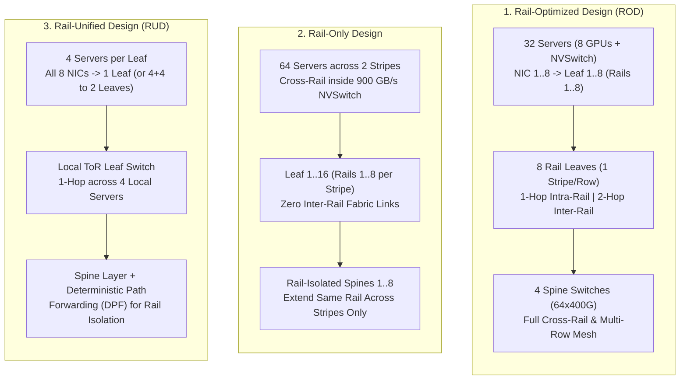
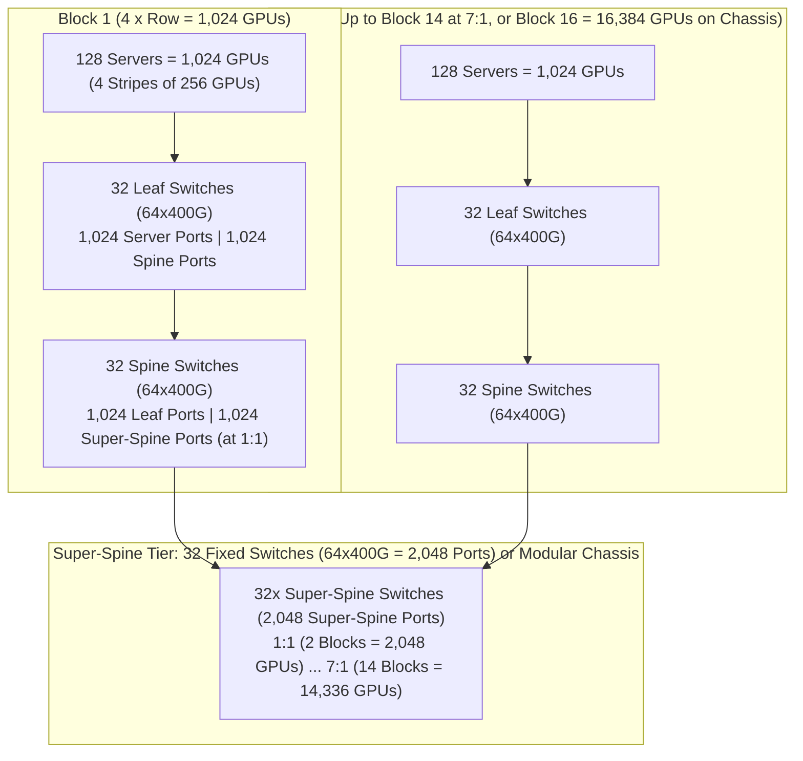
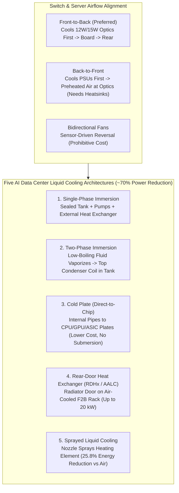

# 12.13 Fabric design: topology, oversubscription and scale

| | |
|---|---|
| Level | Advanced |
| Priority tier | 1 |
| Lab venue | Nebius GPU |
| Part | Part 12: Complete AI networking |
| Sources used | `ADC` Ch. 3, Ch. 5; `V7` Ch. 11; `V8` Ch. 6, Ch. 11; `V9` Ch. 10; `superpod-gb300-ra`; `bcm11-admin` §7.5 |
| Coverage file | `planning/coverage/chapters/12-13.md` |
| Claim ledger | `planning/ledgers/12-13.md` |
| Companion code | `code/part12/fabric_design_scale.py`, `code/part12/fabric_design_scale_lab.py` |

## Why this matters for AI infrastructure

Picture a training run that suddenly takes twice as long as it did last week. Nothing crashed, and the GPUs look busy, but every collective step now waits on the network. The cause can sit in the fabric, because a cluster behaves the way its wiring allows.

An AI cluster is not a pile of switches joined by whatever fiber happens to reach. It is a physical communication graph. Its bisection cuts, hop counts, cable spans, and thermal limits decide how much throughput the cluster delivers. Those limits determine whether thousands of GPUs act like one supercomputer or like isolated islands that keep stalling each other.

If an architect accepts an enterprise oversubscription ratio for a multi-rack job, cross-rack bandwidth drops in half. That bottleneck doubles collective time on every step. Worse, routing a storage checkpoint burst over the compute switches fills buffers and stalls every rank in the job.

Designing an AI fabric means solving physical, topological, and facility constraints at the same time. You choose between Rail-Optimized Design, Rail-Only Design, and Rail-Unified Design. You also decide where the leaf switches go across high-power GPU racks: Top-of-Rack, Middle-of-Row, or End-of-Row. Beyond rack wiring, you size three-stage and five-stage Clos networks and evaluate Scheduled Fabrics, Dragonfly, Torus, and Multi-Planar architectures. Finally, you budget switch power, optical transceiver heat, fan airflow directions, and liquid cooling.

The block below lists the baseline numbers this chapter works from. Most of them come back in the sections that follow.

```text
Motivating fabric bottleneck and facility baselines:
- Scale range: 1,024, 9,216, or 128,000 GPUs
- 2:1 leaf oversubscription penalty (512-GPU job): 16 x 400G = 6,400 Gbps downlinks vs 8 x 400G = 3,200 Gbps uplinks -> caps nodes at 200 Gbps and doubles a 2 GB AllReduce from 40 ms to 80 ms
- Single-spine maintenance loss (1 of 2 spines down): leaf drops to 4 x 400G = 1,600 Gbps uplinks (4:1 oversubscription, 100 Gbps per node)
- Storage checkpoint collision: 100 GB parallel file system burst on shared switches stalls collective barriers
- Rack & switch thermal envelope: 48 kW to 60 kW GPU racks, 3 kW switches, 15 W OSFP optics, 64/128/256 B Scheduled Fabric cells, 800G -> 4x200G Multi-Planar breakout
```

## Prerequisites and outcomes

Before you start, review Chapters 9.6, 9.8, and 9.9. They cover SuperPOD Scalable Units, the B200 and GB300 reference architectures, and the five logical network segments. Then review Chapters 12.1 through 12.12, which cover AI collectives, RDMA, RoCEv2, PFC, ECN, DCQCN, QoS, InfiniBand routing, optics, Spectrum-X, and the InfiniBand versus Ethernet guide.

By the end of this chapter, you will be able to do five things:

1. Map the three AI/ML lifecycle stages onto the three server-attached fabrics, and explain why storage and compute planes must be physically isolated.
2. Contrast Rail-Optimized Design, Rail-Only Design, and Rail-Unified Design across GPU-to-leaf wiring and hop latency, and evaluate Deterministic Path Forwarding and single-leaf failure blast radius.
3. Compare Top-of-Rack, Middle-of-Row, and End-of-Row leaf placements across rack space, power, cooling, intra-rack cabling, and maximum cable spans.
4. Calculate exact switch and port counts for three-stage and five-stage Clos fabrics across fixed and modular chassis spines.
5. Evaluate Scheduled Fabrics, Dragonfly, Torus, and Multi-Planar architectures alongside power efficiency, switch airflow directions, and liquid cooling.

---

## 1. AI workload lifecycle, server port roles, and Rail-Optimized vs Rail-Only vs RUD architectures

### 1.1 The three AI/ML processing stages and three server-attached fabrics

Put dataset ingestion, gradient synchronization, and live user queries on one converged network, and they all compete for the same switch queues. Before you fix that, it helps to see how an AI workload moves through its lifecycle. The lifecycle shows why modern GPU servers split these flows across separate physical ports.

An AI workload passes through three stages, and the last one feeds back into the first.

1. Data gathering and preprocessing come first. Raw data is collected from distributed sources, cleaned of errors, missing values, and inconsistencies, and tagged with labels. Inference output quality depends directly on input data quality, so this stage feeds curated datasets into training.
2. Model selection and training come next. Candidate algorithms are trained iteratively across parameter sets, using supervised, expert-guided, or reinforcement learning, until model accuracy converges.
3. Deployment and monitoring close the loop. The trained model serves external inference requests in production and is watched continuously for drift. It then loops back to data gathering for periodic fine-tuning on newer datasets.

To keep these stages from interfering with each other, an AI server exposes three classes of network ports. Each class connects to its own data center fabric.

The training backend fabric uses dedicated high-speed NICs, one for each of the server's eight GPUs. Two NICs per GPU would be technically feasible. Optics cost, NIC power, and switch port scalability favor one NIC per GPU, though. The one-to-one mapping also removes server-side port redundancy and multi-homing overhead.

The storage fabric is a low-latency, lossless network. It is either InfiniBand or a three-stage or five-stage RoCEv2 Clos. It connects NVMe and BlueField DPU storage ports to high-capacity storage arrays.

The inference frontend fabric carries northbound traffic. That covers CPU-to-CPU communication, external user inference requests, and cluster services. It is typically built as a collapsed three-stage or five-stage enterprise Clos fabric.

The block below lists the speed tier and fabric type for each port class.

```text
Server port mapping and speed tiers (ADC Ch. 3):
- Training (GPU-mapped) NIC speeds: 200 Gbps, 400 Gbps, or 800 Gbps mapped 1:1 to 8 GPUs (A100, H100, B200, or AMD MI)
- Storage (NVMe/DPU-mapped) ports: Lossless InfiniBand or 3-stage/5-stage RoCEv2 Clos
- Inference (CPU-mapped) ports: Collapsed 3-stage or 5-stage enterprise/cloud Clos
```

Match each traffic flow to its port class before you assign it to a fabric.

### 1.2 Why storage and multi-tenant traffic cannot share the compute fabric or oversubscribed uplinks

Architects who come from enterprise cloud environments often try two shortcuts. They cut spine links in half to save money, or they run storage traffic over the compute switches. In a synchronous AI training cluster, both shortcuts fail as soon as the load arrives.

Start with the 1,024-GPU non-blocking fat-tree. A single 64-port switch cannot connect 1,024 GPUs directly. Half of each leaf's ports must face servers, and the other half must face the spine tier, which keeps the ratio one-to-one and non-blocking. Connecting 128 eight-GPU servers therefore takes four rail-optimized leaf groups. Those groups total 32 leaf switches and 16 spine switches.

Now consider the multi-tenant trap. Suppose an organization splits a 1,024-GPU cluster into two 512-GPU departmental partitions. It then cuts spine links in half, assuming the two departments will never burst at the same time. A single 512-GPU training job, though, synchronizes at the end of every step. That drives all 512 GPUs to full line rate in the same microsecond. On a two-to-one oversubscribed leaf, per-node cross-leaf bandwidth drops in half, and collective time doubles on every step. Losing one of two spines degrades that leaf to four-to-one.

The storage collision is the third trap. Routing a parallel file system over the same switches used for GPU collectives destroys tail latency, even when aggregate bandwidth looks sufficient. Writing a massive model checkpoint floods switch buffers. Lossless flow control prevents drops, but tiny, latency-sensitive collective packets still queue behind multi-kilobyte storage frames. Separating traffic onto different Virtual Lanes helps only partly, because the physical wire is still shared. Production clusters therefore attach a physically separate storage fabric to the BlueField-3 DPUs.

The block below shows the arithmetic behind each trap.

```text
Production oversubscription and shared-fabric failure math (V7 Ch. 11 Scenarios 1-3, V8 Ch. 6 & Ch. 11 Scenario 3):
- 1,024-GPU (128 DGX H100) 1:1 Fat-Tree on 64-port 400G QM9700 switches:
  * Per leaf: 32 downlinks (12,800 Gbps) + 32 uplinks (12,800 Gbps) = 1:1 non-blocking
  * Total switches: 4 leaf groups x 8 leaves = 32 leaf switches; 32 leaves x 32 uplinks / 64 ports = 16 spine switches
- 2:1 Oversubscribed Leaf Trap (512-GPU synchronous job):
  * Normal 2:1 state: 16 x 400G = 6,400 Gbps downlinks vs 8 x 400G = 3,200 Gbps uplinks -> 200 Gbps (25 GB/s) per node vs 400 Gbps (50 GB/s), doubling 2 GB ring AllReduce from 40 ms to 80 ms
  * Degraded 1-spine loss (1 of 2 spines offline): 4 uplinks = 1,600 Gbps -> 4:1 oversubscription (100 Gbps per node)
- Storage / Inference Subnet Collision (100 GB model checkpoint burst):
  * Isolated baseline p99 inference latency: 1.8 ms
  * Shared default SL/VL p99 latency: 14.2 ms (7.89x spike)
  * Separated SLs/VLs on shared physical wire: 3.1 ms (physical Multi-Plane DPU isolation required)
```

Read the 2:1 case as a worked example. The leaf has 16 downlinks at 400G, which adds up to 6,400 Gbps. It has only 8 uplinks at 400G, which is 3,200 Gbps. Each node therefore gets 200 Gbps instead of 400 Gbps, and a 2 GB AllReduce takes 80 ms instead of 40 ms.

Keep compute, storage, and multi-tenant traffic on separate fabrics, and size the uplinks for the job that will actually run. If you size a fabric this way, you can check the 2:1 arithmetic against your own leaf radix before the first rack goes in.

### 1.3 Rail-Optimized Design vs Rail-Only vs Rail-Unified Design

Once a job spans more than one server, the wiring decides how traffic moves. Choose the wrong attachment model, and you either run long inter-rack cables or risk losing a whole eight-GPU server when one Top-of-Rack switch reboots.

Inside each eight-GPU server, an internal high-speed switch such as NVIDIA NVSwitch gives each GPU 900 GB/s of intra-node bandwidth. That internal fabric carries all traffic inside the box. East-west traffic leaves the box through the eight GPU-mapped NICs, and those NICs connect under one of three leaf-attachment architectures.



The table compares the three designs one dimension at a time. Use it as a lookup when you choose a design.

| Architectural Dimension | Rail-Optimized Design (`ROD`) | Rail-Only Design | Rail-Unified Design (`RUD`) |
|---|---|---|---|
| **GPU-to-leaf wiring** | `1:1` mapping: `GPU i` (`NIC i`) of every server connects to **`Leaf i` (`Rail i`)**; `8` leaves form `1` **row** or **stripe**. | `1:1` `GPU i -> Leaf i` within each stripe; spines only connect **`Rail i` in Stripe A to `Rail i` in Stripe B** (`32 x 400G` for `1:1`). | All `8` NICs of a server connect to **`1` leaf** (or `4` NICs to each of `2` leaves); `4` servers (`32` GPUs) share `1` leaf. |
| **Spineless (`leaf-only`) cluster limit** | **`256` GPUs** (`32` servers $\times$ `8` GPUs) using `32 x 400G` downlinks/leaf, or **`512` GPUs** (`64` servers) using all `64 x 400G` ports as downlinks. | **`256` GPUs** (single stripe) or multi-stripe rail extension via rail-dedicated spines with zero cross-rail spine cables. | **`32` GPUs** (`4` servers) on a single `32`-downlink leaf before requiring spine switches. |
| **Intra-rail vs inter-rail network hops** | **Intra-rail:** `1` hop (via local rail leaf).<br/>**Inter-rail:** `2` hops (leaf $\rightarrow$ spine $\rightarrow$ leaf; latency is `2x` intra-rail). | **Intra-rail:** `1` hop (same stripe) or `2` hops (across stripes).<br/>**Inter-rail:** `0` fabric hops (routed via internal **`900 GB/s` `NVSwitch`**). | **`1` hop** (both intra-rail and inter-rail) among the **`4` servers** on the same leaf; **`2` hops** via spine to all other servers. |
| **Special routing / switch requirement** | Standard rail-aligned fat-tree / `eBGP` or `OpenSM` ftree routing. | Collective library (`NCCL` `PXN`) must route all cross-rail traffic through intra-node `NVSwitch`. | Requires **Deterministic Path Forwarding (`DPF`)** on leaves/spines to segregate rails sharing the same switch; can also switch intra-server GPU traffic on nodes lacking an internal `NVSwitch`. |
| **Single-leaf failure blast radius** | Degrades **`1` of `8` rails** (`12.5%` bandwidth loss); all servers retain `7` working rails. | Fault is strictly contained to **`1` rail**; cannot propagate across rails, simplifying troubleshooting. | If all `8` NICs land on `1` leaf, a single leaf failure **completely isolates the entire server** (`8` GPUs offline). |
| **Cabling complexity & media** | High: every server fans out `8` cables across `8` distinct rail leaves in the row. | Medium: same leaf fan-out, but simpler spine cabling and isolated rail fault domains. | **Lowest:** all `8` server links stay inside the rack (`ToR`), enabling low-cost copper **`DAC`** or **`AEC`** cables. |

You will meet these three designs again when you choose leaf placement in the next section. The trade-off is clear once you read across the rows. Rail-Unified has the lowest cabling cost, but a single leaf failure can take a whole server offline. Rail-Optimized limits the damage to one rail out of eight, at the price of longer cabling.

---

## 2. Rack engineering and leaf physical placement: ToR, MoR, and EoR

### 2.1 Rack dimensions, server U-heights, and the 48 kW to 60 kW power jump

Before you place leaf switches in a row, check the rack against facility power and cooling. Packing eight-GPU servers into a standard enterprise rack without checking power density trips breakers. It can also starve the switches of cooling air.

The block below compares a standard enterprise rack with the rack an AI server needs.

```text
Rack geometry and power density specifications (ADC Ch. 3 & Ch. 5):
- Standard data center rack dimensions: 19 inches wide x 36 inches deep x 42U tall
- NVIDIA DGX H100 form factor: 19 inches wide x 35.3 inches deep x 8U tall (vs 6U tall for DGX A100)
- Server capacity per 42U rack: 4 or 5 DGX H100 servers plus a leaf switch
- AI rack power budget: 48 kW to 60 kW per rack
- Traditional enterprise rack budget: 20 kW to 25 kW average (10 kW to 25 kW range; most legacy halls run at 16 kW to 18 kW)
```

The gap is the point. An AI rack needs 48 kW to 60 kW, while many legacy halls run at 16 kW to 18 kW. A rack that was fine for enterprise servers can fail the moment you fill it with GPUs.

### 2.2 Comparing ToR, MoR, and EoR across an 8-rack stripe

Where you mount the leaf switches changes three things: how many racks you need, how much heat each compute rack produces, and how far the cables must reach. Take a Rail-Optimized stripe of eight compute racks, with four servers in each rack. Every server runs eight cables to eight different leaf switches. There are three ways to place those leaves.

With Top-of-Rack, one leaf switch sits at the top of each of the eight compute racks, next to four servers. Spines can go in two separate spine racks or inside the compute racks. In Rail-Optimized Design, each server connects to its local leaf and then reaches across the other seven racks to the remaining rail leaves. Top-of-Rack is the best match for Rail-Unified Design. All eight NICs of the four local servers plug into their own rack's switch, using short intra-rack Direct Attach Copper or Active Electrical Cable assemblies.

With Middle-of-Row, four compute racks sit on the left and four on the right of one or two dedicated network racks in the middle of the row. No switches sit inside the compute racks, so switch power and heat stay out of the compute rack budget. The compute racks need no intra-rack server-to-switch cabling. The worst-case cable run from the outer compute racks to the center is the shortest of any Rail-Optimized layout.

With End-of-Row, all eight compute racks sit next to each other. The eight leaf switches and eight spine switches go into one or two dedicated network racks at the end of the row. Like Middle-of-Row, End-of-Row takes switch power and cooling out of the compute racks, and it removes intra-rack switch cabling. Every server in a given rack uses the same cable length. The catch is distance. Cables from the farthest compute rack must cross the whole row, which makes the span the longest of the three.

The table compares the three placements on space, power, cooling, cabling, and cable span.

| Design Criterion | Top-of-Rack (`ToR`) | Middle-of-Row (`MoR`) | End-of-Row (`EoR`) |
|---|---|---|---|
| **Rack space requirement** | **Less** (`8` compute racks; spines in-rack or in `2` spine racks) | **More** (`8` compute racks + `1–2` middle switch racks = `9–10` racks) | **More** (`8` compute racks + `1–2` end switch racks = `9–10` racks) |
| **Power requirement per compute rack** | **More** (servers + `1–2` switches in the same rack) | **Less** (compute racks power only the `4` GPU servers) | **Less** (compute racks power only the `4` GPU servers) |
| **Cooling requirement per compute rack** | **More** (must cool switch ASIC + `64` optics alongside GPUs) | **Less** (switch thermal load isolated to middle network racks) | **Less** (switch thermal load isolated to end network racks) |
| **Cabling within the compute rack** | **Varying lengths** connecting servers to the local switch in each rack | **No server-to-switch cabling within compute racks** | **No server-to-switch cabling within compute racks** |
| **Cabling across the racks (`ROD`)** | Each server connects to `1` leaf switch in each of the `8` racks in the row | Varying cable lengths per rack based on distance to middle racks; all `4` servers in a given rack use the **same** cable length | Varying cable lengths per rack based on distance to end racks; all `4` servers in a given rack use the **same** cable length |
| **Maximum cable length (`ROD`)** | **To span `8` racks** | **To span `6` racks** (`5`–`6` racks) | **To span `10` racks** |
| **Best fit for `RUD` with copper `DAC`/`AEC`** | **Ideal** (all `8` NICs terminate inside the same rack) | Not optimal for intra-rack `DAC` | Not optimal for intra-rack `DAC` |

If you plan copper cables under Rail-Unified Design, check Top-of-Rack first. Middle-of-Row gives the shortest maximum span for Rail-Optimized wiring, so it is the placement to check first when cable reach is the limit.

---

## 3. 3-stage and 5-stage Clos scaling: port arithmetic, chassis spines, and oversubscription

### 3.1 3-stage Clos scaling up to 2,048 GPUs and 9,216 GPUs

Picture a cluster that has outgrown its single row of eight leaf switches. You need a spine tier to add more racks. Once you add it, the fabric becomes a two-tier leaf-spine network. Switching theory calls this a three-stage Clos, because packets pass through an ingress leaf, a spine, and an egress leaf. If you miscalculate the port count on the spine switches, you hit a hard ceiling. Adding one more rack then means recabling into a five-stage fabric.

With fixed 64-port 400 Gbps switches at one-to-one non-blocking oversubscription, each leaf gives 32 ports to servers and 32 to spines. Once the cluster reaches 64 leaf switches across eight rows, those leaves use every port on each 64-port spine. That radix limit caps a three-stage Clos of 64-port switches at 2,048 GPUs.

Work through the spine count to see why. Each of the 64 leaves has 32 spine-facing ports, so the fabric needs 2,048 spine-facing ports in total. A 64-port spine provides 64 ports, so 32 spines cover them. Replacing those fixed spines with 256-port modular chassis spines cuts the spine count by fourfold. Upgrading to 144-port 800 Gbps switches takes a three-stage non-blocking Clos all the way to 9,216 GPUs across 16 Scalable Units.

The table lists each configuration, from one row up to the largest GB300 build.

| 3-Stage Clos Configuration | Switch Radix & Speed | Rows / SUs | GPUs (`NICs`) | Server-Facing Ports | Spine-Facing Ports | Leaf Switches | Spine Switches |
|---|---|---|---|---|---|---|---|
| **Base Unit (`1` GPU / `1` Server)** | `400G` | — | `1` / `8` | `1` / `8` | — | — | — |
| **`1 x Row` (`32` Servers)** | `64 x 400G` | `1` Row | **`256`** | `256` | `256` | **`8`** | **`4`** |
| **`2 x Row` (`64` Servers)** | `64 x 400G` | `2` Rows | **`512`** | `512` | `512` | **`16`** | **`8`** |
| **`4 x Row` (`128` Servers)** | `64 x 400G` | `4` Rows | **`1,024`** | `1,024` | `1,024` | **`32`** | **`16`** |
| **`8 x Row` (Max `64x400G` 3-Stage)** | `64 x 400G` | `8` Rows | **`2,048`** | `2,048` | `2,048` | **`64`** | **`32`** |
| **`8 x Row` (Chassis Spine `256x400G`)** | `64x400G` Leaf / `256x400G` Spine | `8` Rows | **`2,048`** | `2,048` | `2,048` | **`64`** | **`8` (Chassis)** |
| **`GB300` `2 / 4 / 8 / 16` SUs (`Q3400-RD`)** | `144 x 800G` | `2..16` SUs | **`1,152..9,216`** | `1,152..9,216` | `1,152..9,216` | **`16 / 32 / 64 / 128`** | **`8 / 18 / 36 / 72`** |

Read each row as one leaf radix and one spine count. The last row shows how 144-port switches push the same design to 9,216 GPUs.

### 3.2 5-stage Clos: 1,024-GPU blocks and 1:1 to 7:1 super-spine oversubscription

Suppose your target is 32K, 64K, or 128K GPUs. A three-stage Clos cannot hold that many leaves, so you need a five-stage Clos built from standardized blocks, which some vendors call bricks. Packets now pass through an ingress leaf, an ingress spine, a super-spine, an egress spine, and an egress leaf.

A common mistake is to assume a five-stage block holds 2,048 GPUs, just like a three-stage pod. In a five-stage Clos, each 64-port spine must reserve half its ports for the Super-Spine tier. That leaves only 32 ports for leaves in its block. One block therefore holds four rows, which is 1,024 GPUs, thirty-two leaf switches, and thirty-two spine switches.

The Super-Spine tier decides how many blocks you can join. With a fixed Super-Spine tier of thirty-two switches, which gives 2,048 ports, you can attach two blocks at one-to-one. You can scale up to fourteen blocks at a seven-to-one super-spine oversubscription ratio. That works when job placement and DCQCN bound the inter-block traffic.

Work the block count with the numbers, one step at a time. Each block adds 1,024 GPUs. Thirty-two blocks give 32,768 GPUs, which is the 32K case. Keep that picture in mind when you read the table, because every row is just a different number of blocks.

The block below holds the block and leaf math for hyperscale builds.

```text
5-stage Clos block and hyperscale leaf counts (ADC Ch. 3 Fig. 3-11..3-13):
- Hyperscale leaf switch counts: 32K, 64K, or 128K GPUs require 8K, 16K, or 32K leaf switches
- 1 x Block (Brick) = 4 x Row = 1,024 GPUs (128 servers, 32 leaves of 64x400G, 32 spines of 64x400G, 1,024 super-spine ports)
- 32K GPU cluster (32,768 GPUs): requires 32 blocks of 1,024 GPUs
- Fixed 32-switch Super-Spine tier (32 x 64 = 2,048 super-spine ports): connects 2k blocks (2,048k GPUs) at k:1 oversubscription for k = 1..7
```

The diagram shows how the blocks attach to the Super-Spine tier.



The table walks through each Super-Spine mode, from 1:1 to 7:1 and then the chassis options.

| Super-Spine Mode & Ratio | Blocks (`1,024` GPUs/Block) | Rows (`256` GPUs/Row) | Total GPUs (`NICs`) | Server-Facing Ports | Spine-Facing Ports | Super-Spine-Facing Ports | Leaf Switches (`64x400G`) | Spine Switches (`64x400G`) | Super-Spine Switches |
|---|---|---|---|---|---|---|---|---|---|
| **Single Block (`1 x Block`)** | `1` | `4` | **`1,024`** | `1,024` | `1,024` | `1,024` | `32` | `32` | — |
| **Fixed `64x400G` Super-Spine (`1:1`)** | `2` | `8` | **`2,048`** | `2,048` | `2,048` | **`2,048`** | `64` | `64` | **`32`** |
| **Fixed `64x400G` Super-Spine (`2:1`)** | `4` | `16` | **`4,096`** | `4,096` | `4,096` | **`2,048`** | `128` | `128` | **`32`** |
| **Fixed `64x400G` Super-Spine (`3:1`)** | `6` | `24` | **`6,144`** | `6,144` | `6,144` | **`2,048`** | `192` | `192` | **`32`** |
| **Fixed `64x400G` Super-Spine (`4:1`)** | `8` | `32` | **`8,192`** | `8,192` | `8,192` | **`2,048`** | `256` | `256` | **`32`** |
| **Fixed `64x400G` Super-Spine (`5:1`)** | `10` | `40` | **`10,240`** | `10,240` | `10,240` | **`2,048`** | `320` | `320` | **`32`** |
| **Fixed `64x400G` Super-Spine (`6:1`)** | `12` | `48` | **`12,288`** | `12,288` | `12,288` | **`2,048`** | `384` | `384` | **`32`** |
| **Fixed `64x400G` Super-Spine (`7:1`)** | `14` | `56` | **`14,336`** | `14,336` | `14,336` | **`2,048`** | `448` | `448` | **`32`** |
| **Chassis Super-Spine (`1:1`, `8K` Scale)** | `8` | `32` (`2xRow`/sub-pod) | **`8,192`** | `8,192` | `8,192` | **`8,192`** | `256` (`16`/unit) | `256` (`8`/unit) | **Chassis (`1:1`)** |
| **Chassis Super-Spine (`1:1`, `16K` Scale)** | `16` | `64` | **`16,384`** | `16,384` | `16,384` | **`16,384`** | `512` (`64`/unit) | `512` (`32`/unit) | **Chassis (`1:1`)** |

The fixed Super-Spine tier sets the ceiling. Choose the oversubscription ratio before you buy switches, because that ratio decides how many blocks you can attach.

---

## 4. Beyond standard Clos: Scheduled Fabrics, Dragonfly, Torus, and Multi-Planar Scale-Out

### 4.1 Scheduled Fabric: fixed-size cells and Virtual Output Queueing

Picture two large RDMA flows that hash onto the same spine link. That link congests while its neighbors sit idle. Worse, when one destination port congests, packets waiting at the front of an ingress buffer block unrelated packets behind them. A Scheduled Fabric addresses both problems.

Cisco Silicon One and Broadcom's Jericho3-AI leaf silicon, paired with Ramon3 spine silicon, make a Scheduled Fabric possible. It extends the cell-switched backplane of a modular router chassis across the whole data center pod. Think of the leaves as linecards and the spines as the backplane.

When an RDMA packet reaches an ingress leaf, the leaf slices it into uniform fixed-size cells. It sprays those cells evenly across every spine. The egress leaf reassembles them into the original packet, in exact order, before the packet reaches the destination server. Segmentation and reassembly happen only at the fabric edges. That keeps link utilization near 100 percent, without hash polarization on elephant flows.

Virtual Output Queueing handles the blocking problem. Every ingress leaf keeps a separate virtual queue for each egress port in the fabric. A hardware scheduler grants transmission credits only when the target egress port has buffer space. This credit loop keeps congestion inside the flow that causes it. It also gives tighter control than the reactive rate cuts of DCQCN.

The design has costs you need to weigh. Cell headers and padding add overhead. Each scheduled pod has a scaling boundary. Failures need specialized reconvergence. Heavy credit contention can add latency, and each block locks you to one silicon vendor.

Padding is the cost you can measure most easily. The block below works out the cell counts for a 1,500-byte packet and a 4,100-byte packet.

```text
Scheduled Fabric cell segmentation and VOQ arithmetic (ADC Ch. 3 Fig. 3-24):
- Silicon implementations: Broadcom Jericho3-AI (leaf / linecard) + Ramon3 (spine / backplane), Cisco Silicon One
- Cell sizes: 64, 128, or 256 bytes
- 1,500-byte packet on 128-byte cells: ceil(1500 / 128) = 12 cells = 1,536 wire bytes (2.40% padding overhead)
- 4,100-byte packet on 256-byte cells: ceil(4100 / 256) = 17 cells = 4,352 wire bytes
- Total VOQs per ingress leaf (1,024 egress endpoints x 8 traffic classes): 8,192 VOQs
```

Take the 1,500-byte case step by step. The packet needs 12 cells of 128 bytes, which is 1,536 bytes on the wire. The extra 36 bytes are padding, and that works out to 2.40 percent overhead.

A Scheduled Fabric earns its place when your packet sizes keep the padding low and you accept one silicon vendor per pod.

### 4.2 Low-diameter alternatives: Dragonfly and Torus topologies

Once a cluster reaches tens of thousands of GPUs, a five-stage or seven-stage Clos adds switch hops at every tier. Each hop brings more optical transceiver cost and more serialization latency. Two supercomputing topologies try to cut the hop count, or to remove the upper switch tiers altogether.

Dragonfly organizes switches into modular groups, and the groups link to each other through a direct global full mesh. Inside a group, you can choose one of two layouts. A full-graph mesh links every node directly to every other node in the group. A Clos or Butterfly+ bipartite layout is the other option, where spines form the global full mesh.

Dragonfly's main gain is a smaller diameter. Its worst case is three switch-to-switch hops, compared with four hops in a five-stage Clos. It also lowers the global fiber count. The weakness is that adversarial traffic can saturate the single direct link between two groups. Dragonfly therefore relies on Adaptive Routing to send overflow traffic through an intermediate group, which makes the path non-minimal.

Torus networks connect each node directly to its neighbors along a grid. Edge nodes wrap around to the opposite edge, which closes each ring. A one-dimensional ring uses two links per node. The eight rail leaves of a stripe can link directly this way, without a spine tier. A two-dimensional grid uses four links per node, and a three-dimensional cube uses six.

Torus removes the spine and super-spine tiers, and it suits parallel jobs that map onto nearest-neighbor three-dimensional stencils or pipeline rings. The cost is higher average hop counts. Its deadlock-avoidance routing also gets complicated for arbitrary all-to-all traffic.

The formulas below give the hop and link counts behind these claims.

```text
Dragonfly and Torus graph formulas (ADC Ch. 3 Fig. 3-27..3-35):
- Dragonfly (DF / DF+) diameter: 3 switch-to-switch hops (local intra-group hop -> 1 global link -> remote intra-group hop) vs 4 hops in a 5-stage Clos
- Dragonfly global full-mesh link count for G groups: G * (G - 1) / 2 -> for 8 groups, 8 * 7 / 2 = 28 direct inter-group links
- 1D Torus (Ring): 2 links/node (left/right neighbor + wrap-around; max hops = floor(N/2); can link Leaf 1 <-> Leaf 2 ... <-> Leaf 8 <-> Leaf 1)
- 2D Torus (X, Y Grid): 4 links/node (max hops for N x N grid = 2 * floor(N/2))
- 3D Torus (X, Y, Z Cube): 6 links/node (+X/-X, +Y/-Y, +Z/-Z + wrap-around; for an 8 x 8 x 8 = 512-node cube, max hops = 3 * (8 / 2) = 12 hops)
```

The 512-node cube at the end of the block shows the cost of Torus. Its worst case is 12 hops, which is why the topology suits neighbor-only traffic.

### 4.3 Multi-Planar Scale-Out architectures, shuffle cables, and LPO/LRO optics

Above 100,000 GPUs, a single unified five-stage control plane and data plane creates a huge blast radius. One route-plane bug or one spine anomaly can disturb the entire fabric. Multi-Planar Scale-Out splits the fabric into two or four fully independent planes. Each plane has its own control plane and data plane.

Breakout is how each GPU reaches several planes. Instead of plugging an 800 Gbps NIC into one 800G leaf port, a breakout cable splits it into four 200 Gbps lanes, and each lane goes to a different plane. A 64-port 800 Gbps Top-of-Rack leaf then serves 128 server downlinks at 200 Gbps. The breakout doubles the GPUs attached to each leaf, and the remaining ports stay as spine uplinks.

From the application's point of view, the NIC still presents one 800 Gbps queue pair, so PyTorch and NCCL see no change. The source NIC firmware sprays that single flow's packets across all four planes at once. The destination NIC reorders them in hardware before it posts completions. If a whole plane fails, the job keeps reachability to every GPU and continues on the surviving planes without interruption.

Each plane can hold several rail groups, and several multi-planar domains can meet at a high-radix Super-Spine layer. Ethernet bridging loops are a risk across multi-homed server ports. To avoid them, multi-tenant AI clouds usually run a pure Layer 3 IP fabric underlay, and they add dynamic ACLs and RADIUS tenant profiles on top.

Breakout multiplies the fiber. Splitting each 800G port into four 200G lanes quadruples the strand count. Architects handle that fan-out with shuffle cables, which cross-wire plane links inside a passive optical cassette. They pair the cables with Linear Pluggable Optics and Linear Receive Optics. Removing one or both onboard DSPs from the optical module cuts transceiver power and heat. Switch fans can then spin slower, which leaves more facility megawatts for the GPUs.

The block below gives the breakout ratios, the plane-failure math, and the optics power draw.

```text
Multi-Planar breakout and optics specifications (ADC Ch. 3 Fig. 3-36..3-39):
- NIC breakout: 1 x 800 Gbps GPU NIC -> 4 x 200 Gbps lanes across Fabric Planes FP1, FP2, FP3, FP4
- 64 x 800 Gbps ToR leaf split: 32 x 800G ports broken out 4:1 into 128 x 200 Gbps server downlinks + 32 x 800 Gbps (or 64 x 400 Gbps) spine uplinks
- Plane failure resilience:
  * 1 of 4 planes down (e.g., FP1 fails): 75.0% (600 Gbps) capacity remains active with zero job interruption
  * 2 of 4 planes down: 50.0% (400 Gbps) capacity remains active
- Multi-domain & rail options: Rail A and Rail B within each plane; FP1a/FP2a and FP1b/FP2b domains linked via Super-Spine for >100K GPUs
- Optical power reduction: Traditional pluggables use 2 DSPs (12 W to 15 W per module); LPO removes both DSPs, LRO removes 1 DSP
```

Losing one plane of four still leaves 75.0 percent of capacity, or 600 Gbps. That is the resilience argument in one number. The cost is fiber, so count the strands before you commit to a multi-planar design.

---

## 5. Inference data center architecture, production design gates, and Slurm Topograph scheduling

### 5.1 Inference data center placement and fabric requirements

Inference planning starts from a different question than training. Training asks how fast the cluster can synchronize gradients. Inference asks how large the model is and how many users query it at the same time. Those two answers decide where inference runs.

Inference can run in five kinds of places. A phone or laptop serves a single user locally. Edge sites, such as manufacturing plants, retail stores, or regional points of presence, serve local multi-user streams. Enterprise data centers run focused domain models on modest GPU pools. Cloud data centers serve high-query-rate public or multi-tenant APIs. Some facilities sit alongside training data centers, sharing checkpoint storage and lifecycle pipelines with the training pods.

Most inference models fit on one GPU or one eight-GPU server. Rail alignment is therefore usually unnecessary in an inference data center. Traffic typically rides standard TCP/IP, using gRPC and HTTP, rather than RDMA over a conventional collapsed three-stage or five-stage enterprise Clos. The picture changes when a frontier Mixture-of-Experts or long-context model needs multi-node disaggregated prefill. Decode inference then moves its east-west traffic to RDMA over a non-blocking Clos or rail-optimized pod.

Start with the model footprint and the query volume, because those two numbers set the placement. You can then put inference on the frontend fabric by default, and move it to RDMA only when the model forces the change.

### 5.2 The 7-input production design gate, capacity cuts, and Slurm Topograph

Teams often buy switches before they measure collective traffic. Then the expansion plan arrives, or a link fails, and the cluster stalls on oversubscribed uplinks. Sometimes it runs out of spine ports on the first expansion. A production architecture review should check seven measured inputs before anyone picks switch counts or oversubscription ratios. You can use the seven inputs as a checklist before you order any hardware.

The first two inputs cover the business and the workload. Start with service level agreements, multi-tenancy boundaries, and a funded three-year growth timeline. Then measure the workload's communication pattern. That means the collective fraction of step time, the AllReduce versus AllToAll mix, and the message sizes.

Next, look at scale and growth. Compare the GPU count on Day 1 with the count on Day 2, so expansion does not exhaust spine ports and force a disruptive recable. Set the performance target as a required scaling-efficiency curve and a tail latency ceiling.

Reliability comes next. Confirm the surviving capacity after a degraded link or switch. Dual redundant OpenSM hosts should sit in separate power domains, with independent out-of-band management. Then ask about operations and skills, including how many in-house InfiniBand or RoCE fabric specialists you have and which telemetry tools they use. The last input is cost and facility constraints. Those include rack power and cooling limits, and the price gap between your budget and a non-blocking design.

Once the topology is built, verify the physical cut capacity, audit how evenly uplinks carry routes, and connect the fabric to the job scheduler. Even on a five-stage Clos with oversubscribed super-spines, a job runs at full non-blocking speed when its ranks stay inside one block. NVIDIA Base Command Manager Topograph discovers the physical switch tree. It then configures Slurm to pack communicating ranks inside the same 1,024-GPU block or 32-server rail leaf before they cross spines.

The block below holds the leaf radix math, the route balance evidence, and the Topograph settings.

```text
Production leaf radix, uplink balance, and BCM Topograph parameters (V8 Ch. 6 & Ch. 11, V9 Ch. 10, bcm11-admin §7.5):
1. Leaf Radix & Cut Survival Math:
   - Day 1 to Day 2 growth examples: 8 DGX systems growing to 32, or 128 GPUs expanding to 512 GPUs
   - 16 single-rail 400 Gbps endpoints/rack (256 ports across 16 racks): 16 x 400 = 6,400 Gbps downlink -> 1:1 non-blocking requires 16 x 400G uplinks (minimum 32-port leaf switch vs 24-port leaf forcing 8 uplinks = 3,200 Gbps = 2:1 oversubscription)
   - 16 dual-rail 800 Gbps nodes/rack: 12,800 Gbps downlink vs 8 x 400G (3,200 Gbps) = 4.00:1 normal, and 7 x 400G (2,800 Gbps) = 4.57:1 N-1 degraded
   - OOB management: Independent 1 GbE out-of-band management network + dual redundant OpenSM hosts in separate power domains

2. Route Balance vs Topology Drawings (V8 Ch. 6 Scenarios 1 & 3):
   - InfiniBand perfquery <leaf-lid> <port> (PortXmitData in 4-octet units x 4 = bytes; never run perfquery -R in production):
     * Uplink port 5: 21,474,836,480 B (~21.48 GB)
     * Uplink port 6: 21,489,234,432 B (~21.48 GB)
     * Uplink port 7: 1,073,741,824 B (~1.08 GB)
     * Uplink port 8: 1,081,654,272 B (~1.08 GB) -> 19.9:1 (~20:1) static routing imbalance
   - Paired ib_write_bw (2,097,152 B = 2 MiB): 397.62 Gbps same-leaf vs 201.18 Gbps cross-rack (1.98x drop proving a 2:1 cross-rack cut)

3. BCM 11 Topograph Service (/etc/topograph/topograph-config.yaml):
   - HTTPS port: TCP 49021 (exports 26 Prometheus measurables at https://localhost:49021/metrics)
   - Timers & paging: Fetch timeout = 20 s, Fetch attempts = 12, Fetch wait time = 15 s, RequestAggregationDelay = 15 s, PageSize = 100
   - Cloud & physical discovery: InfiniBand/Ethernet switch trees or AWS p5.48xlarge (ec2:DescribeInstanceTopology), OCI, GCP -> writes /cm/shared/apps/slurm/etc/<cluster>/topology.conf for Slurm topology/tree or topology/block
```

Size the leaves from the Day 2 count, not the Day 1 count. Otherwise the first expansion forces a recable.

---

## 6. Thermal and power efficiency considerations for AI network fabrics

### 6.1 Global data center power split, PUE, DGX H100 PSUs, and switch + optics power

Ignore the power and heat of switches and optical transceivers, and your rack PDUs can trip. High-speed optics can also throttle thermally above 70 degrees Celsius. Data centers use a substantial share of global electricity. Cooling is the second-largest consumer after the IT hardware itself. Cooling efficiency is measured with Power Usage Effectiveness, or PUE.

$$\text{PUE} = \frac{\text{Total Data Center Facility Power}}{\text{IT Computing Equipment Power}}, \qquad \text{Ideal PUE} = \mathbf{1.0}$$

PUE is the facility's total power divided by the power that goes to IT equipment. An ideal PUE of 1.0 means the facility adds no overhead beyond the IT load.

When you budget an AI rack, you should add the switch chassis and all 64 pluggable optical modules to the server power. Treat the optics as part of the rack load, not as a rounding error. Pluggable transceiver power has nearly quintupled from 100G to 800G modules. That adds almost a full kilowatt of heat to every 64-port switch.

The block below works through the power for one switch and for three rack loads.

```text
Data center, server, switch, and optics power breakdown (ADC Ch. 5):
- Global & facility power split: ~2% of global electricity; IT equipment = 40% to 45%, cooling system = 35% to 40%, power distribution/UPS/lighting = 15% to 25%
- DGX H100 PSU redundancy math: 6 PSUs rated at 3.3 kW each in 4 + 2 redundancy -> 4 x 3.3 kW = 13.2 kW full operating load (vs 3 x 3.3 = 9.9 kW single-feed limit in 3+3 shelf analyses against a 10.2 kW peak rating)
- 64 x 400 Gbps switch chassis budget (e.g., Juniper QFX5230): 3 kW (3,000 W)
- Pluggable optical transceiver max power draw across 64 ports (4.69x jump from QSFP28 to OSFP):
  * QSFP28 (100G): 3.2 W per module -> 64 ports = 204.8 W
  * QSFP56-DD (400G): 12 W per module -> 64 ports = 768.0 W
  * OSFP (400G / 800G): 15 W per module -> 64 ports = 960.0 W (0.96 kW)
- Combined 64-port OSFP switch power: 3.0 kW chassis + 0.96 kW optics = 3.96 kW per switch
- Total ToR rack power examples:
  * 1 DGX H100 (13.2 kW) + 1 OSFP switch (3.96 kW) = 17.16 kW IT load
  * 4 DGX H100 (4 x 13.2 = 52.8 kW) + 1 OSFP switch (3.96 kW) = 56.76 kW IT load (70.95 kW facility power at PUE = 1.25, inside 48 kW to 60 kW envelope)
  * 5 DGX H100 (5 x 13.2 = 66.0 kW) + 1 OSFP switch (3.96 kW) = 69.96 kW IT load
```

Four DGX H100 servers and one OSFP switch give 56.76 kW of IT load. That sits inside the 48 kW to 60 kW envelope. At a PUE of 1.25, the facility draw reaches 70.95 kW.

### 6.2 Switch fan airflow options and the five liquid cooling technologies

Mount a switch with the wrong fan direction, and it blows hot power-supply exhaust across the temperature-sensitive front-panel optics. Heavy collective runs then cause link flaps. Likewise, trying to cool a 56 kW GPU rack with room air conditioning fails quickly. You need to match the switch airflow to the cooling method, so the two work together.

Three fan airflow options are available. Each one moves air through the switch in a different order, and that order decides which parts get the coolest air.

With Front-to-Back airflow, cool cold-aisle air enters the front port panel. It passes the front-panel optical transceivers first, then crosses the switch ASIC and exits at the rear. High-power optics are the most temperature-sensitive parts of a switch. That is why Front-to-Back is the preferred direction for AI clusters.

With Back-to-Front airflow, air enters at the back and cools the power supplies first. By the time it reaches the front-panel optics, it has already been heated by the PSU and the switch ASIC. Back-to-Front switches often need extra heat sinks on their optics. Every device in the rack must also share the same airflow direction.

Bidirectional fans reverse direction in real time, based on thermal sensors. You do not need to pick a fan SKU at procurement. The mechanical redesign makes them too expensive for most deployments.

The diagram summarizes the airflow options and the five liquid cooling architectures.



Liquid cooling can reduce data center cooling power consumption by roughly 70 percent. The market for it is projected to surpass USD $3 billion by 2026. The table compares the five methods by how they move heat, what they require, and how far they scale.

| Liquid Cooling Technology | Heat Transfer Mechanism | Hardware & Facility Impact | Efficiency, Capacity & Hyperscaler Adoption |
|---|---|---|---|
| **1. Single-Phase Immersion Cooling** | Entire rack/server is submerged in dielectric liquid inside a sealed tank; **pumps circulate heated liquid to an external water-cooled heat exchanger** and return cooled fluid to the tank. | Requires facility-wide tank layout and immersion-qualified servers, switches, and sealed optics. | High heat removal for extreme-density racks; fluid remains in liquid phase throughout the loop. |
| **2. Two-Phase Immersion Cooling** | Equipment is submerged in a low-boiling-point dielectric fluid that **boils into rising gas** on contact with hot chips, condenses into droplets on a **cold-water condenser tube at the top of the tank**, and rains back down. | **No external heat exchanger or circulation pump needed** (both phases occur inside the sealed tank); requires specialized fluid selection. | Highest latent-heat transfer efficiency; deployed in production environments by **Microsoft**. |
| **3. Cold Plate (`Direct-to-Chip`) Liquid Cooling** | Cool liquid flows through internal manifolds and small tubes to **cold plates mounted directly on CPUs, GPUs, memory, or switch ASICs**, then exits to an external CDU/heat exchanger. | **Equipment is not submerged**; lower cost than immersion and allows mixing liquid-cooled GPU nodes with air-cooled/RDHx switches in the same hall. | Industry standard for high-density AI pods; used by **Google (`TPU` pods)** and adopted by **Meta** and **NVIDIA (`NVL72`)**. |
| **4. Rear-Door Heat Exchanger (`RDHx` / `AALC`)** | A radiator coil door mounted on the back of a standard **Front-to-Back air-cooled rack** absorbs heat from exhaust air into chilled water loops connected to cooling towers. | **Simplest retrofit:** requires **zero modification to servers or switches** (Air-Assisted Liquid Cooling), only chilled-water plumbing to the rack door. | Cools up to **`20 kW` per rack** at standard chilled-water design temperatures; less efficient than immersion or cold plates; adopted alongside cold plates by **Meta**. |
| **5. Sprayed Liquid Cooling** | Targeted nozzles installed inside modified chassis **spray dielectric coolant directly onto the surface of heating elements**, draining warm fluid to a heat exchanger. | Requires chassis modification to mount internal spray nozzles, but **uses significantly less coolant** than tank immersion. | Reduces total data center energy consumption by **`25.8%`** compared with air-cooled data centers. |

If your hall runs at the 16 kW to 18 kW common in legacy halls, a 56.76 kW rack is far beyond what it can supply. A 56.76 kW rack is also far above the 20 kW that a rear-door exchanger can handle. For racks in that range, the cold plate or immersion options fit better. Choose Front-to-Back airflow for switches in AI racks, and match the cooling method to the rack's power tier.

---

## Commands and configurations that matter

The commands below help you check the physical wiring and the bandwidth of a live fabric. Run them in order, starting with the rail layout inside the node.

### 1. Inspecting physical rail locality, InfiniBand port counters, and paired `ib_write_bw` cut bandwidth

Start with the rail layout. Then read the uplink counters, and finish with a bandwidth test that separates a leaf-local path from a cross-rack path.

```bash
# 1. Verify 1:1 GPU-to-NIC-to-PIX rail alignment inside an 8-GPU node (untested here)
nvidia-smi topo -m
rdma link show

# 2. Sample InfiniBand leaf uplink PortXmitData (in 4-octet units; multiply by 4 for bytes)
# NEVER pass -R in production (resets shared telemetry counters). (untested here)
for p in 5 6 7 8; do
  echo -n "uplink port $p: "
  perfquery 44 "$p" | awk '/PortXmitData/ {print $NF * 4 " bytes"}'
done
# Example V8 Ch 6 Scenario 1 output showing 20:1 static routing imbalance:
# uplink port 5: 21474836480 bytes  (~21.47 GB)
# uplink port 6: 21489234432 bytes  (~21.49 GB)
# uplink port 7: 1073741824 bytes   (~1.07 GB)
# uplink port 8: 1081654272 bytes   (~1.08 GB)

# 3. Isolate leaf-local vs spine-crossing oversubscription with paired 2 MiB ib_write_bw runs (untested here)
# Same-leaf pair -> 397.62 Gb/sec; Cross-rack pair (2:1 leaf) -> 201.18 Gb/sec
ib_write_bw -d mlx5_0 -s 2097152 -n 5000 --report_gbits 10.20.4.16
```

### 2. Configuring Multi-Planar ToR port breakouts and RoCEv2 QoS on NVIDIA Cumulus NVUE

The next commands split the leaf ports into 200G server downlinks and 800G uplinks, then turn on RoCEv2 QoS. The audit lines at the end show whether the uplinks are marking congestion and dropping packets.

```bash
# Break out ports swp1..swp32 on a 64x800G ToR leaf into 128 x 200G server downlinks
# while keeping swp33..swp64 as 32 x 800G (or 64 x 400G) spine uplinks (untested here)
nv set interface swp1-32 link breakout 4x200G
nv set interface swp33-64 link speed 800G
nv set qos roce enable on
nv config apply

# Audit uplink ECN marking, PFC pause frames, and What Just Happened (WJH) tail drops (untested here)
ethtool -S swp33 | egrep 'rx_pfc_prio3|tx_ecn_marked_prio3|rx_prio0_discard'
nv show platform software wjh drop-reason
```

### 3. Configuring BCM 11 Topograph for block- and rail-aware Slurm scheduling

The last group points Slurm at the Topograph service and checks that the service is answering. Once it runs, Slurm can place jobs by block and rail.

```bash
# Configure Slurm topology/tree or topology/block via BCM 11 Topograph (bcm11-admin §7.5) (untested here)
cmsh -c "wlm use slurm; topologysettings; set topologyplugin tree; set topologysource topograph; commit"

# Inspect /etc/topograph/topograph-config.yaml and scrape the 26 Prometheus measurables (untested here)
cat /etc/topograph/topograph-config.yaml
# http: :49021 | fetch_timeout: 20s | fetch_attempts: 12 | fetch_wait: 15s | page_size: 100
curl -sk https://localhost:49021/metrics | head -n 30
```

---

## How it fails

Use this table when a cluster scales slowly across racks, stalls during checkpoint writes, or shuts down optics. Start with the symptom you see, not the hardware you suspect. Find the row that matches it. You can confirm the cause with the telemetry column before you change the topology. If you see the same symptom again, check the telemetry evidence first. The root cause and the telemetry evidence show whether the problem is in the topology or in the facility.

| Failure Mode | Symptom | Root Cause & Telemetry Evidence | Fix |
|---|---|---|---|
| **1. `2:1` Leaf Oversubscription & `N-1` Spine Loss (`V7` Ch. 11 Scen. 2 & `V8` Ch. 6)** | Single-rack jobs run at full speed, but `512`-GPU multi-rack jobs see `2x` slower `AllReduce` (`4x` slower during spine maintenance). | Leaf has `16 x 400G` (`6,400 Gbps`) downlinks but only `8 x 400G` (`3,200 Gbps`) uplinks (`2:1`), capping cross-rack rate at `200 Gbps`/node (`ib_write_bw` drops from **`397.62 Gbps`** same-leaf to **`201.18 Gbps`** cross-rack, and `2 GB` `AllReduce` jumps from **`40 ms` to `80 ms`**). Losing `1` of `2` spines leaves `4` uplinks (`1,600 Gbps` = **`4:1`**). | Mandate `1:1` non-blocking uplinks (`32` down : `32` up on `64`-port leaves) for synchronous training pods, or use BCM `Topograph` (`topology/block`) to pack jobs inside `1:1` blocks. |
| **2. Storage Checkpoint Collision on Compute Fabric (`V7` Ch. 11 Scen. 3 & `V8` Ch. 11 Scen. 3)** | `AllReduce` step time spikes unpredictably every `15`–`30` minutes during `100 GB` checkpoint writes, or co-located inference `p99` latency jumps **`7.89x`**. | `100 GB` storage bursts fill lossless switch buffers ahead of collective packets. On a shared `SL`/`VL`, inference `p99` latency jumps from **`1.8 ms` to `14.2 ms`** (`3.1 ms` even with separated `VL`s due to shared physical wire contention). | Enforce a **Multi-Plane Topology**: isolate storage onto dedicated `400G` `RoCEv2`/IB switches wired to unbonded `BlueField-3` DPU ports, leaving `ConnectX-7`/`8` compute NICs exclusively for GPU collectives. |
| **3. `20:1` Static Routing Uplink Polarization (`V8` Ch. 6 Scenario 1)** | A `1:1` non-blocking fat-tree shows severe collective slowdowns even though half of the spine uplinks sit nearly idle. | Static `LID` assignment or `5`-tuple `SLB` hashing maps multiple GPU flows onto `2` of `4` uplinks: `PortXmitData` byte deltas show **`21,474,836,480 B`** and **`21,489,234,432 B`** on ports `5–6` vs **`1,073,741,824 B`** and **`1,081,654,272 B`** on ports `7–8` (**`19.9:1` / `~20:1` skew**). | Enable hardware **Adaptive Routing (`AR`)** / `ftree` rail-aligned routing on InfiniBand or **`sDLB`/`GLB`** packet spraying on Ethernet (`Spectrum-X` / Scheduled Fabric `VOQ`). |
| **4. Rail-Unified (`RUD`) Single-Leaf Server Isolation (`ADC` Ch. 3 Fig. 3-15)** | A single ToR leaf switch reboot or PSU failure drops an entire `8`-GPU server out of a training job instead of degrading bandwidth by `12.5%`. | All `8` GPU NICs of the server were cabled to a single local ToR leaf under `RUD` without `4+4` dual-leaf split or `ROD` `8`-leaf striping. | Use **`ROD`** (`1` NIC per rail leaf across `8` leaves) so a leaf loss only affects `1/8` rails, or split `RUD` connections `4 + 4` across `2` leaves with Deterministic Path Forwarding (`DPF`). |
| **5. Multi-Planar NIC Out-of-Order (`OOO`) Reassembly Disabled (`ADC` Ch. 3 Fig. 3-36)** | After breaking out `800G` NICs into `4 x 200G` across `FP1..FP4`, RDMA throughput collapses with `PSN` sequence errors and retransmissions. | Packets sprayed across `4` independent fabric planes arrive out of order at the target NIC, but hardware `OOO` packet coalescing/reassembly is disabled in NIC firmware or `xCCL`. | Enable hardware `OOO` sequence reassembly on the ConnectX/BlueField SuperNIC so packets from `FP1..FP4` are reordered in hardware before RDMA application delivery. |
| **6. Back-to-Front (`B2F`) Optics Thermal Throttling & Rack Cooling Overload (`ADC` Ch. 5)** | `400G`/`800G` `OSFP` (`15 W`) transceivers log high-temp alarms (`>70°C`) and link flaps in a `56.76 kW` ToR rack cooled by a `20 kW` `RDHx` door. | Switch uses **Back-to-Front (`B2F`)** fans (pushing preheated PSU/ASIC exhaust over front-panel `15 W` optics), and rack IT load (`56.76 kW`) exceeds the **`20 kW` `RDHx`** limit by `2.84x`. | Standardize on **Front-to-Back (`F2B`)** switch airflow (or `LPO`/`LRO` dsp-less optics), move switches to `MoR`/`EoR` racks if compute racks are power-capped, and deploy **Direct-to-Chip Cold Plate** or **Immersion** cooling for `48–60+ kW` racks. |

---

## Hands-on lab

Run the reference lab for this chapter. It lives in `code/part12/fabric_design_scale_lab.py` and runs 28 deterministic self-checks. The checks cover the rail designs, leaf placement, three-stage and five-stage Clos scaling, Scheduled Fabric cell overhead, Dragonfly and Torus hop math, Multi-Planar breakout resilience, oversubscription telemetry, thermal budgets, and BCM Topograph. Every check should print PASS, and the summary line should show zero failures. If you see a FAIL, compare that check with the section it cites before you change any code. The output below is what a clean run looks like.

```bash
python3 -B code/part12/fabric_design_scale_lab.py
```

Expected output:

```text
=== Chapter 12.13 Lab: Fabric Design: Topology, Oversubscription and Scale ===
  [PASS] ADC Ch 3 ROD vs Rail-Only vs RUD: ROD (1-hop intra-rail, 2-hop inter-rail via spine, 1/8 rail failure blast radius)
  [PASS] ADC Ch 3 Rail-Only & RUD: Rail-Only (0 network hops inter-rail, handled via 900 GB/s NVSwitch) vs RUD (requires DPF, single leaf failure isolates all 8 GPUs)
  [PASS] ADC Ch 3 & Ch 5 rack physical dimensions & power: 19 in x 36 in x 42U rack, DGX H100 (19 in x 35.3 in x 8U) vs DGX A100 (6U), 4-5 servers/rack = 48-60 kW vs 10-25 kW (16-18 / 20-25 kW avg) traditional
  [PASS] ADC Ch 3 Table 3-1 ToR vs MoR vs EoR cable span across an 8-rack (32-server, 256-GPU) row: ToR = 8 racks (Less space, More power/cooling, ideal for RUD DAC/AEC), MoR = 6 racks (shortest span), EoR = 10 racks (longest span)
  [PASS] ADC Ch 3 Fig 3-9 & V7 Ch 11 Scenario 1 (64x400G 3-stage Clos): 1 row = 256 GPUs (8L/4S), 2 rows = 512 GPUs (16L/8S), 4 rows = 1,024 GPUs (128 DGX H100, 32L/16S), max 8 rows = 2,048 GPUs (64L/32S)
  [PASS] ADC Ch 3 Fig 3-10 chassis-based 256x400G spine: 2,048 GPUs with 64 leaves and 8 chassis spines (1/4 of 32 fixed spines)
  [PASS] superpod-gb300-ra Table 3 (144x800G Q3400-RD 2-tier/3-stage Clos): (2, 4, 8, 16) SUs -> (1,152, 2,304, 4,608, 9,216) GPUs, (16, 32, 64, 128) leaves, (8, 18, 36, 72) spines
  [PASS] ADC Ch 3 Fig 3-11 5-stage Clos block/brick: 4 rows = 1 block = 1,024 GPUs (32 leaf switches, 32 spine switches of 64x400G, 1,024 super-spine-facing ports)
  [PASS] ADC Ch 3 Fig 3-12 5-stage Clos 1:1..7:1 super-spine oversubscription: (2,048..14,336 GPUs, 2..14 blocks, 8..56 rows, 64..448 leaves/spines, fixed 32 super-spines = 2,048 super-spine ports)
  [PASS] ADC Ch 3 Fig 3-13 5-stage Clos with chassis-based super-spine at 1:1 oversubscription: 2,048 (2 blocks), 8,192 (8 blocks), and 16,384 GPUs (16 blocks = 64 rows, 16,384 super-spine ports)
  [PASS] ADC Ch 3 Fig 3-24 Scheduled Fabric (Jericho3-AI/Ramon3 & Silicon One): 64/128/256-byte cell spraying + Virtual Output Queueing (VOQ) eliminates HoL blocking
  [PASS] ADC Ch 3 Dragonfly (DF/DF+ full-graph vs Butterfly+ bipartite intra-group, max 3 hops vs 4 in 5-stage Clos) & 1D/2D/3D Torus node degrees (2, 4, 6 links/node)
  [PASS] ADC Ch 3 Fig 3-36 Multi-Planar Scale-Out: 800G NIC -> 4x200G across FP1..FP4, 64x800G ToR -> 128x200G downlinks + 32x800G (or 64x400G) uplinks, 75% surviving BW on 1-plane failure, NIC OOO reassembly
  [PASS] V7 Ch 11 Scenario 1 & 2 + V8 Ch 6 Worked Example: 1:1 non-blocking (12,800G down : 12,800G up -> 400G/node, 2 GB AllReduce = 40 ms) vs 2:1 oversubscribed leaf (6,400G down : 3,200G up -> 200G/node, 2 GB AllReduce = 80 ms; 1-spine loss -> 4:1)
  [PASS] V9 Ch 10 Rack Cut capacity arithmetic: 16 nodes x 800G = 12,800 Gbps downlink vs 8x400G = 3,200 Gbps normal (4.00:1) and 7x400G = 2,800 Gbps N-1 degraded (4.57:1)
  [PASS] V8 Ch 6 Scenario 1 & 3 telemetry: PortXmitData (4-octet units) ports 5-6 (~21.48 GB) vs ports 7-8 (~1.08 GB) = 19.9:1 (~20:1) imbalance; paired ib_write_bw (2,097,152 B) = 397.62 Gbps same-leaf vs 201.18 Gbps cross-rack
  [PASS] V7 Ch 11 Scenario 3 & V8 Ch 11 Scenario 3: 100 GB checkpoint burst / shared VL inflates inference p99 latency 1.8 ms -> 14.2 ms (7.89x); separated SL/VL recovers to 3.1 ms
  [PASS] ADC Ch 5 facility power & hardware draw: ~2% global power, 40-45% IT / 35-40% cooling split, ideal PUE 1.0, DGX H100 6x3.3 kW PSUs (4+2 redundancy = 13.2 kW), 3 kW QFX5230 64x400G switch, 3.2 W QSFP28 / 12 W QSFP56-DD / 15 W OSFP optics
  [PASS] ADC Ch 5 rack thermal budget & liquid cooling metrics: 4x13.2 kW servers (52.8 kW) + 1x(3.0 kW + 64x15 W = 3.96 kW) switch = 56.76 kW IT (70.95 kW @ PUE 1.25); ~70% liquid cooling power reduction, >$3B by 2026, 20 kW RDHx, 25.8% sprayed liquid energy reduction
  [PASS] BCM 11 §7.5 Topograph service parameters: HTTPS port 49021, Fetch timeout 20 s, 12 attempts, 15 s wait, 15 s aggregation delay, PageSize 100, 26 Prometheus measurables
  [PASS] ADC Ch 3 Fig 3-6 spineless 8-leaf stripe scale: 8 leaves x 32 downlinks = 256 GPUs (32 servers) with uplinks reserved; 8 leaves x 64 downlinks = 512 GPUs (64 servers) spineless rail-only
  [PASS] ADC Ch 3 extreme-scale 5-stage/7-stage Clos leaf counts: 32K, 64K, and 128K GPU clusters deploy 8K, 16K, or 32K leaf switches
  [PASS] V8 Ch 11 Scenario 2 leaf-radix arithmetic: 16 single-rail 400G endpoints/rack = 6,400 Gbps downlink; 1:1 non-blocking requires 16x400G uplinks (32-port minimum radix vs 24-port leaf forcing 16:8 = 2:1 oversubscription)
  [PASS] ADC Ch 3 Fig 3-36..3-39 Multi-Planar 2-plane failure resilience: 2 of 4 planes down preserves 50.0% (400 Gbps) capacity per 800G NIC
  [PASS] ADC Ch 5 64-port switch optics power progression: 64xQSFP28 (3.2 W) = 204.8 W, 64xQSFP56-DD (12 W) = 768.0 W, 64xOSFP (15 W) = 960.0 W (4.69x QSFP28)
  [PASS] ADC Ch 5 cooling tier thresholds: 17.16 kW rack fits RDHx (<= 20.0 kW); 5xDGX H100 + 1 switch = 69.96 kW (> 60 kW) requires Cold Plate or Single/Two-Phase Immersion
  [PASS] ADC Ch 3 Scheduled Fabric 128B cell segmentation on 1,500B packet: ceil(1500/128) = 12 cells (1,536B wire, 2.40% padding overhead)
  [PASS] ADC Ch 3 Fig 3-27 Dragonfly full-graph mesh math: 8 nodes/groups require 8*7/2 = 28 direct mesh links (1-hop direct reachability)

Summary: 28 passed, 0 failed
```

---

## Common first mistakes

Most early fabric designs go wrong in the same few places. Each mistake below is easy to make when you count from the server side and forget the spine side. You are most likely to hit them on a whiteboard sketch, long before any hardware arrives. Read each item as a check you can run on your own design before you sign off on it.

1. Sizing five-stage Clos blocks at 2,048 GPUs instead of 1,024 GPUs when you use 64-port spines. In a three-stage Clos, all 64 ports of a spine face leaves. In a five-stage Clos, each 64-port spine inside a block must reserve 32 ports for Super-Spine uplinks. That leaves only 32 ports for leaves, so a five-stage block holds four rows, which is 1,024 GPUs, 32 leaves, and 32 spines.
2. Confusing Rail-Only Design with Rail-Unified Design. Rail-Only still wires each GPU to its matching rail leaf across eight leaves. It drops the cross-rail links from the fabric, though, and relies on the server's internal NVSwitch for cross-rail hops. Rail-Unified wires all eight NICs of a server into one or two local Top-of-Rack leaves. That design needs Deterministic Path Forwarding, and a single leaf failure can isolate the whole server.
3. Assuming End-of-Row has shorter cable runs than Top-of-Rack in a Rail-Optimized stripe. Across an eight-rack compute stripe, Middle-of-Row has the shortest maximum cable span, at six racks. Top-of-Rack comes second at eight racks, and End-of-Row needs the longest cables, spanning ten racks.
4. Ordering Back-to-Front switches for racks full of high-power pluggable optics. Back-to-Front airflow cools the rear power supplies first, then blows preheated exhaust across the front-panel optics. That exhaust triggers optical thermal alarms unless you fit extra heatsinks. Specify Front-to-Back airflow.
5. Leaving optics power out of the rack budget. A 64-port switch with a 3.0 kW chassis draw adds nearly a full kilowatt of transceiver power once you fill it with 64 OSFP modules.

---

## Exercises

Work these exercises with a pencil and the reference values at the end of the section. Each one asks you to derive a number yourself before you check it against the block.

1. Rail architecture and leaf placement trade-offs.
   - (a) Take a 32-server stripe of eight-GPU servers, each with an internal NVSwitch. Compare Rail-Optimized, Rail-Only, and Rail-Unified designs on GPU-to-leaf mapping and hop counts. Then compare single-leaf failure blast radius and the Deterministic Path Forwarding requirements.
   - (b) Now install those 32 servers four per rack across eight racks. Rank Top-of-Rack, Middle-of-Row, and End-of-Row by maximum cable span. Compare the power and cooling load per compute rack, and say which placements suit copper DAC or AEC cables under Rail-Unified Design.
2. Three-stage Clos port and switch arithmetic.
   - (a) Using 64-port 400 Gbps switches at one-to-one non-blocking oversubscription, calculate the server count, GPU count, port counts, leaf switches, and spine switches for one, two, four, and eight rows. Then state the spine count when you use 256-port modular chassis spines.
   - (b) Compare that 64-port three-stage limit with an NVIDIA GB300 SuperPOD built from 144-port 800 Gbps `Q3400-RD` switches, across two, four, eight, and sixteen Scalable Units.
3. Five-stage Clos 1,024-GPU block design and Super-Spine oversubscription.
   - (a) Explain why a five-stage Clos block built from 64-port switches contains exactly four rows. Then state how many blocks and leaf switches a hyperscale cluster needs.
   - (b) Start with a fixed Super-Spine tier of 32 switches. Compute the blocks, rows, GPUs, leaf switches, and spine switches for every ratio from one-to-one through seven-to-one. Then contrast the results with a chassis-based super-spine.
4. Scheduled Fabrics, Dragonfly, Torus, and Multi-Planar breakouts.
   - (a) In a Scheduled Fabric that uses fixed-size cells and Virtual Output Queueing, calculate the cell count, wire bytes, and padding overhead for a standard packet and a larger one. Then compute the total fabric VOQs across egress endpoints and traffic classes.
   - (b) Compare worst-case switch-to-switch hops and per-node link degrees across five-stage Clos, Dragonfly, and Torus. Then calculate the port split and surviving bandwidth when one or two planes fail in a four-plane Multi-Planar architecture.
5. Production oversubscription, N-1 cut survival, uplink skew, and shared-VL interference.
   - (a) Compute the oversubscription ratios, per-node cross-leaf bandwidth, and collective time for the single-rail and dual-rail rack configurations. Do this under normal and degraded spine or uplink states.
   - (b) Given `perfquery` `PortXmitData` byte deltas, paired `ib_write_bw` results, and shared-versus-separated Virtual Lane inference tail latencies, diagnose each bottleneck. State the architectural fix for each one.
6. Data center power, optics thermal budget, airflow, and liquid cooling selection.
   - (a) Calculate the total switch and optics power across all three transceiver generations. Then calculate the total IT and facility power for a Top-of-Rack deployment.
   - (b) Explain why Front-to-Back airflow is preferred over Back-to-Front and Bidirectional fans. Then select the right cooling technology for each rack power tier.

The block below gives the reference values to check your answers against.

```text
Exercise input parameters and expected reference values:
- Ex 1: 32 servers / 256 GPUs, 900 GB/s NVSwitch, 12.5% (1/8 rails vs 7/8 surviving); 19" x 36" x 42U racks, DGX H100 = 19" x 35.3" x 8U vs DGX A100 = 6U, 48-60 kW/rack vs 20-25 kW traditional; max cable span MoR = 6 racks, ToR = 8 racks, EoR = 10 racks
- Ex 2: 64 x 400G (32 down + 32 up): 1xRow = 32 servers / 256 GPUs (8L/4S), 2xRow = 64 servers / 512 GPUs (16L/8S), 4xRow = 128 servers / 1,024 GPUs (32L/16S), 8xRow = 256 servers / 2,048 GPUs (64L/32S, or 8 spines on 256x400G chassis); Q3400-RD 144x800G (72 down + 72 up, 576 GPUs & 8 leaves/SU): 2, 4, 8, 16 SUs = 1,152, 2,304, 4,608, 9,216 GPUs, 16, 32, 64, 128 leaves, 8, 18, 36, 72 spines
- Ex 3: 1 x Block = 4 x Row = 1,024 GPUs (32L, 32S, 1,024 super-spine ports); 32K GPUs = 32 blocks; 32K/64K/128K GPUs = 8K/16K/32K leaves; 32 fixed super-spines (2,048 ports) across 1:1..7:1 = 2..14 blocks (8..56 rows) = 2,048..14,336 GPUs (64..448 L/S); chassis super-spine 1:1 at 2,048, 8,192, and 16,384 GPUs (16 blocks = 64 rows, 512L/512S)
- Ex 4: 64/128/256 B cells; 1,500 B on 128 B = 12 cells (1,536 B wire, 2.40% overhead); 4,100 B on 256 B = 17 cells (4,352 B wire); 1,024 endpoints x 8 TCs = 8,192 VOQs; 5-stage Clos = 4 hops, Dragonfly = 3 hops (8 groups = 28 mesh links), 1D/2D/3D Torus = 2/4/6 links/node (8x8x8 = 512 nodes, 12 max hops); 64x800G ToR -> 128x200G down + 32x800G (64x400G) up, 75.0% (600 Gbps) on 1-plane loss, 50.0% (400 Gbps) on 2-plane loss
- Ex 5: 16 x 400G = 6,400 Gbps down vs 8 x 400G = 3,200 Gbps up (2:1, 200 Gbps/node, 2 GB AllReduce 40 ms -> 80 ms; 1-spine loss -> 4 uplinks = 1,600 Gbps = 4:1, 100 Gbps/node); 16 x 800G = 12,800 Gbps down vs 8x400G = 3,200 Gbps (4.00:1) & 7x400G = 2,800 Gbps (4.57:1); PortXmitData 21,474,836,480 B & 21,489,234,432 B (~21.48 GB) vs 1,073,741,824 B & 1,081,654,272 B (~1.08 GB, 19.9:1 / ~20:1 skew); ib_write_bw 2,097,152 B = 397.62 Gbps vs 201.18 Gbps; p99 1.8 ms -> 14.2 ms (7.89x) -> 3.1 ms
- Ex 6: ~2% global power, 40%-45% IT vs 35%-40% cooling, DGX H100 6x3.3 kW (4+2 = 13.2 kW), 3.0 kW QFX5230 switch, 64 optics = 204.8 W (QSFP28 3.2 W) / 768.0 W (QSFP56-DD 12 W) / 960.0 W (OSFP 15 W, 4.69x, 3.96 kW total switch); 4 servers + 1 switch = 56.76 kW IT (70.95 kW @ PUE 1.25); 17.16 kW fits 20 kW RDHx, 56.76 kW uses Cold Plate, 69.96 kW (5 servers) uses Cold Plate or Immersion (~70% cooling power savings, 25.8% Sprayed Liquid total DC energy reduction)
```

---

## Interview angles

1. **"You are given a blank check to design a 1,024-GPU DGX H100 training cluster using 64-port 400G NDR switches. Walk me through the exact port counts, switch counts, and why 2:1 spine oversubscription or shared storage routing will break it."**
   - *What they are testing:* Whether you can derive a two-tier Rail-Optimized fat-tree from first principles.
   - *Model answer:* Each DGX H100 has eight compute NICs, one per rail. A 64-port leaf splits its ports evenly. Half face the servers, and half face the spines, which keeps the ratio one-to-one and non-blocking. One rail-optimized row of leaves therefore holds 32 servers. Scaling to four rows gives the counts in the table below.

   | Build | GPUs | Leaf switches | Spine switches |
   |---|---|---|---|
   | One row | 256 | 8 | 4 |
   | Four rows | 1,024 | 32 | 16 |

   Now cut the spines to two-to-one. A 512-GPU job running a synchronous AllReduce drops from 400 Gbps to 200 Gbps per node. A 2 GB AllReduce then takes 80 ms instead of 40 ms. Losing one of the two spines pushes the cut to four-to-one. Storage needs its own path, too. Checkpoint bursts of 100 GB fill lossless buffers and raise tail latency by nearly eightfold on shared Virtual Lanes. So storage belongs on a separate physical fabric attached to the BlueField-3 DPUs.
   - *What they are testing:* Whether you can explain the numbers, not just recite them.
2. **"How do you scale 64-port 400G switches past 2,048 GPUs, and what happens to switch counts as super-spine oversubscription increases from 1:1 to 7:1?"**
   - *What they are testing:* Mastery of three-stage versus five-stage Clos radix limits and block math.
   - *Model answer:* A three-stage Clos of 64-port switches tops out at 2,048 GPUs, with 64 leaves and 32 spines. At that size, the leaves use every port on each spine. To scale further, you add a Super-Spine tier and build a five-stage Clos. Each spine in a block now gives half its ports to the Super-Spine, so a block holds four rows. With a fixed tier of 32 super-spines, the ratio sets how many blocks you can attach.

   | Ratio | Blocks | GPUs | Leaves and spines |
   |---|---|---|---|
   | 1:1 | 2 | 2,048 | 64 each |
   | 2:1 | 4 | 4,096 | 128 each |
   | 4:1 | 8 | 8,192 | 256 each |
   | 7:1 | 14 | 14,336 | 448 each |

   You then use DCQCN and Slurm Topograph to pack jobs inside blocks. For one-to-one non-blocking up to 16,384 GPUs across 16 blocks, you move to high-radix chassis-based super-spines.
3. **"Compare Multi-Planar Scale-Out and Scheduled Fabrics against a traditional 5-stage Clos."**
   - *What they are testing:* Next-generation hyperscale AI fabric architectures.
   - *Model answer:* A Scheduled Fabric treats leaves as linecards and spines as a cell backplane. It slices packets into cells of 64, 128, or 256 bytes and sprays them across all spines. Virtual Output Queueing removes head-of-line blocking. The cost is cell padding and single-vendor pod lock-in. A Multi-Planar architecture breaks each 800G server NIC into four 200G links. Each link goes to one of four independent fabric planes, and each plane has its own control plane. A 64-port 800G ToR switch can then serve 128 GPU downlinks at 200G and 32 spine uplinks at 800G. Source NIC firmware sprays one RDMA Queue Pair across all four planes, and the destination NIC reorders the packets in hardware. If a whole plane fails, 75 percent of capacity stays online, and the job keeps running.

---

## Checkpoint questions (20)

Read each question first and answer it in your own words. Then compare your answer with the one below, which keeps the key facts in plain language.

<details><summary>**1. What are the three stages of AI/ML workload processing, and how do they map to the three network fabrics attached to a GPU server?**</summary>

The three stages are data gathering and preprocessing, model selection and training, and deployment and monitoring, which feeds back into data gathering. Suppose you map them onto a server. You then get three fabrics. The storage fabric runs on NVMe and DPU ports, the training backend fabric runs on GPU-mapped ports, and the inference frontend fabric runs on CPU-mapped northbound ports.
</details>

<details><summary>**2. Why do most 8-GPU training servers deploy 1 NIC per GPU rather than 2 NICs per GPU?**</summary>

Two NICs per GPU is technically possible. But if you add up the extra cost and power of optical transceivers, NICs, PCIe lanes, and switch ports, plus the multi-homing complexity, one dedicated NIC per GPU becomes the standard cost-performance sweet spot.
</details>

<details><summary>**3. How do Rail-Optimized Design, Rail-Only Design, and Rail-Unified Design differ in GPU-to-leaf connectivity and hop count?**</summary>

In Rail-Optimized Design, GPU i connects to Leaf i. Intra-rail traffic takes 1 hop through the rail leaf, and inter-rail traffic takes 2 hops through the spine. In Rail-Only Design, the spines only extend the same rail across stripes, so there are zero inter-rail fabric links. Cross-rail traffic takes 0 network hops because it runs through the server's internal 900 GB/s NVSwitch. In Rail-Unified Design, all 8 NICs of a server connect to one local leaf. If you split them 4+4 across two leaves, the 4 servers on the same leaf communicate in 1 hop, and servers on other leaves take 2 hops through the spine.
</details>

<details><summary>**4. Why does Rail-Unified Design require Deterministic Path Forwarding, and what is its failure blast radius?**</summary>

A single Rail-Unified leaf carries all 8 rails at once, so it must use Deterministic Path Forwarding to separate rail traffic across its uplinks. Otherwise rails can collide on the same path. The bigger risk is the blast radius. If all 8 NICs of a server terminate on one ToR leaf and that leaf fails, the whole 8-GPU server goes offline. In Rail-Optimized Design, losing one leaf degrades only 1 of 8 rails.
</details>

<details><summary>**5. What are the physical dimensions and rack power budgets of standard data center racks versus DGX A100 and DGX H100 AI racks?**</summary>

A standard data center rack is 19 inches wide, 36 inches deep, and 42U tall. Its traditional power budget runs from 10 kW to 25 kW, with 16 to 18 kW or 20 to 25 kW as the typical averages. A DGX A100 is 6U tall. A DGX H100 is 19 inches wide, 35.3 inches deep, and 8U tall. If you host 4 or 5 DGX H100 servers plus a leaf switch in one 42U rack, you need 48 kW to 60 kW.
</details>

<details><summary>**6. Across an 8-rack Rail-Optimized row, how do Top-of-Rack, Middle-of-Row, and End-of-Row compare in cable span and rack power?**</summary>

- **ToR:** Uses less rack space, with 8 racks, but more power and cooling per compute rack. It has varying intra-rack cables and spans up to 8 racks in ROD. It is the best match for RUD with copper DAC or AEC.
- **MoR:** Places the switches in 1 or 2 middle racks. That costs more rack space, but compute racks draw less power and need less cooling, and there is no intra-rack switch cabling. Its maximum cable span is the shortest, at 6 racks (5 to 6 racks).
- **EoR:** Places the switches in 1 or 2 end racks. It also costs more rack space, with less power and cooling per compute rack and no intra-rack switch cabling. Its maximum cable span is the longest, at 10 racks.
</details>

<details><summary>**7. How many GPUs can an 8-leaf Rail-Optimized stripe support without a spine layer?**</summary>

With 8 leaf switches that each use 32 x 400G as downlinks, the stripe supports 256 GPUs, which is 32 servers of 8 GPUs. Suppose instead that all 64 x 400G ports on each of the 8 leaves are downlinks, with no spine tier. The spineless cluster then scales to 512 GPUs, which is 64 servers of 8 GPUs.
</details>

<details><summary>**8. What is the maximum non-blocking GPU scale of a 3-stage Clos built from 64-port 400 Gbps switches, and how does a 256-port chassis spine change the switch count?**</summary>

Each leaf uses 64 x 400G ports, with 32 down and 32 up. A 3-stage Clos grows from 1 row (256 GPUs, 8 leaves and 4 spines) to 2 rows (512 GPUs, 16 leaves and 8 spines) and then to 4 rows (1,024 GPUs, 32 leaves and 16 spines). The maximum is 8 rows, or 2,048 GPUs, which takes 64 leaf switches and 32 spine switches. If you replace the 64-port spines with 256 x 400 Gbps chassis spines, the spine count drops fourfold, from 32 to 8.
</details>

<details><summary>**9. How does a 2-tier Clos scale when built with 144-port 800 Gbps switches in a GB300 SuperPOD?**</summary>

Each 144-port Q3400-RD leaf provides 72 downlinks and 72 uplinks, with 8 leaves per 576-GPU Scalable Unit. Across 2, 4, 8, and 16 Scalable Units, the 2-tier non-blocking Clos scales to 1,152, 2,304, 4,608, and 9,216 GPUs. It uses 16, 32, 64, and 128 leaf switches, and 8, 18, 36, and 72 spine switches.
</details>

<details><summary>**10. What is a Block in a 5-stage Clos of 64-port switches, and how many leaf switches are required for 32K, 64K, and 128K GPU clusters?**</summary>

In a 5-stage Clos, each 64 x 400G spine in a block reserves 32 ports for Super-Spine uplinks and 32 for leaves. One Block therefore equals 4 rows, or 1,024 GPUs. It has 1,024 server ports, 1,024 spine ports, 1,024 super-spine ports, 32 leaf switches, and 32 spine switches. If you build a 32K GPU cluster, you need 32 blocks. Hyperscale clusters of 32K, 64K, or 128K GPUs deploy 8K, 16K, or 32K leaf switches.
</details>

<details><summary>**11. With 32 fixed 64-port Super-Spine switches, how does a 5-stage Clos scale from 1:1 to 7:1 oversubscription?**</summary>

At a ratio of k:1, with k running from 1 to 7, the 32 fixed super-spines (2,048 ports) interconnect 2k blocks. That gives 8k rows, 2,048k GPUs, 64k leaves, and 64k spines. The fabric scales from 2,048 GPUs at 1:1 (2 blocks, 64 leaves and 64 spines) up to 14,336 GPUs at 7:1 (14 blocks, 448 leaves and 448 spines). A chassis-based super-spine keeps 1:1 oversubscription at 2,048, 8,192, and 16,384 GPUs, which is up to 16 blocks or 64 rows.
</details>

<details><summary>**12. How does a Scheduled Fabric work, and what are its cell sizes and constraints?**</summary>

A Scheduled Fabric treats the leaves as linecards and the spines as a backplane. Ingress leaves slice packets into fixed-size cells of 64, 128, or 256 bytes. They spray the cells across all spine links and reassemble them at the egress leaf. Virtual Output Queueing keeps a separate ingress queue for each destination egress port across the fabric, which removes head-of-line blocking. If you deploy one, watch the cell padding overhead, which is 2.40% for a 1500B packet in 128B cells. You also face scaling limits, complex failure reconvergence, and single-vendor lock-in per pod.
</details>

<details><summary>**13. How do Dragonfly and Torus topologies reduce hop counts or switch port costs compared to a 5-stage Clos?**</summary>

Dragonfly connects modular switch groups through a global full mesh between groups. With Adaptive Routing, its worst-case diameter drops to 3 hops, from the 4 switch-to-switch hops of a 5-stage Clos. Torus connects each node directly to its neighbors, with edge wrap-around loops. It uses 2 links per node in a 1D ring, 4 links per node in a 2D grid, or 6 links per node in a 3D cube. For example, if your traffic stays with nearest neighbors, those links lower the switch port cost.
</details>

<details><summary>**14. How does a Multi-Planar Scale-Out architecture double leaf GPU radix and survive a full plane failure?**</summary>

Each server's 800 Gbps NIC breaks out into 4 x 200 Gbps links, which wire to 4 independent fabric planes (FP1..FP4) with disjoint control planes. A 64 x 800G ToR switch can then provide 128 x 200G server downlinks and 32 x 800G spine uplinks. The source NIC firmware sprays each flow across all 4 planes, and the target NIC reassembles the out-of-order packets in hardware. If one plane fails, 75.0% (600 Gbps) of the bandwidth stays active, and the job keeps running.
</details>

<details><summary>**15. What are Shuffle Cables, Linear Pluggable Optics, and Linear Receive Optics, and why are they paired with Multi-Planar fabrics?**</summary>

Shuffle cables bundle multiple fibers into one harness that cross-connects and shuffles the plane links internally. That tames the fourfold cabling fan-out of 4 x 200G breakouts. Linear Pluggable Optics removes both onboard Digital Signal Processors from an optical link, and Linear Receive Optics removes one. Removing those DSPs cuts transceiver power and heat, so the switch fans run slower and more power is left for the GPUs.
</details>

<details><summary>**16. What does a 2:1 leaf oversubscription ratio do to a 2 GB AllReduce across 16 400G nodes, and how do `PortXmitData` and paired `ib_write_bw` expose fabric bottlenecks?**</summary>

With 16 x 400G = 6,400 Gbps of downlinks and 8 x 400G = 3,200 Gbps of uplinks (2:1), per-node cross-leaf bandwidth drops from 400 Gbps to 200 Gbps. That cut doubles a 2 GB AllReduce from 40 ms to 80 ms. If one of two spines fails, the ratio degrades to 4:1, or 1,600 Gbps. Paired `ib_write_bw` runs with 2,097,152 B isolate this cut, showing 397.62 Gbps same-leaf against 201.18 Gbps cross-rack. `PortXmitData` from `perfquery` exposes static routing polarization. Ports 5 and 6 carry about 21.48 GB each, against about 1.08 GB on ports 7 and 8. That is a 19.9:1 imbalance.
</details>

<details><summary>**17. Why must storage checkpoint traffic and low-latency inference be isolated from training collectives?**</summary>

A 100 GB model checkpoint write floods lossless switch buffers. Even without packet drops, collective or inference frames queue behind storage frames. When training and inference shared a Virtual Lane, inference p99 latency rose 7.89x, from 1.8 ms to 14.2 ms. Separating the Virtual Lanes only partly recovered p99, to 3.1 ms. If you want the contention gone, use dedicated physical storage switches wired to BlueField-3 DPUs.
</details>

<details><summary>**18. What percentage of data center power goes to IT equipment versus cooling, how is PUE defined, and how much power do DGX H100 PSUs, 64x400G switches, and pluggable optics draw?**</summary>

Data centers use about 2% of global power. Of that, 40% to 45% goes to IT equipment, and 35% to 40% goes to cooling. PUE is the total facility power divided by the IT equipment power, and its ideal value is 1.0. A DGX H100 with 6 x 3.3 kW PSUs in 4 + 2 redundancy draws 13.2 kW. A 64 x 400G switch draws 3 kW. Optics draw up to 3.2 W for QSFP28, 12 W for QSFP56-DD, and 15 W for OSFP. Sixty-four OSFP modules add up to 960 W, which makes 3.96 kW per switch in total.
</details>

<details><summary>**19. Why is Front-to-Back airflow preferred over Back-to-Front and Bidirectional fans in AI switches?**</summary>

With Front-to-Back airflow, cool intake air enters the front port panel. It cools the temperature-sensitive 12 W and 15 W optical transceivers first, then passes over the switch board. Back-to-Front cools the rear PSUs first and blows preheated air over the optics last, so you would need extra optic heatsinks. Bidirectional fans can reverse direction in real time based on sensors, but the cost of that is prohibitively high.
</details>

<details><summary>**20. Compare the five liquid cooling technologies in Chapter 5 across mechanism, rack capacity, energy savings, and cloud provider adoption.**</summary>

Liquid cooling can cut cooling power by about 70%.
1. **Single-Phase Immersion:** The rack is submerged in a sealed tank, and pumps circulate the fluid to an external water heat exchanger.
2. **Two-Phase Immersion (Microsoft):** The rack is submerged in a low-boiling fluid that vaporizes and condenses on a cold-water tube at the top of the tank. No external heat exchanger is needed.
3. **Cold Plate / Direct-to-Chip (Google TPU, Meta, NVIDIA):** Internal tubes carry coolant to cold plates on CPUs, GPUs, and ASICs, so the chassis is not submerged.
4. **Rear-Door Heat Exchanger (RDHx / AALC, Meta):** A chilled-water radiator door sits on a standard Front-to-Back air-cooled rack. It needs zero server modification and cools up to 20 kW per rack.
5. **Sprayed Liquid Cooling:** Internal nozzles spray coolant onto the heating elements. It uses less fluid, and it cuts total data center energy consumption by 25.8% compared with air cooling.
</details>

---

## Sources and review notes

The primary book chapters, reference architecture tables, administrator manual sections, and mapped Volume 07, Volume 08, and Volume 09 source files (`HGX` vs `SuperMicro`, `MoE`, `CBFC`, `SHIELD`, `UFM`, `EVPN-VXLAN` `MAC-VRF`, cross-referenced with Chapters `2.4`, `9.1`, `9.14`, and `12.7`) for this chapter are cataloged below.

```text
1. Primary book sources read in full from the local corpus:
   - AI Data Center Network Design and Technologies (ai-data-center-network-design-and-technologies, Chapter 3: Network Design Considerations and Chapter 5: Thermal and Power Efficiency Considerations, read in full from /tmp/w/aidc-ch3.txt and /tmp/w/aidc-ch5.txt):
     * Covers AI/ML lifecycle stages, Storage/Training/Inference fabrics, ROD vs Rail-Only vs RUD, 900 GB/s NVSwitch, Deterministic Path Forwarding DPF, 19"x36"x42U racks, DGX H100 8U 48-60 kW vs DGX A100 6U, ToR/MoR/EoR Table 3-1 8/6/10-rack cable spans, 3-stage 2,048-GPU Clos and 256x400G chassis spine, 5-stage 1,024-GPU blocks across 1:1-7:1 super-spine oversubscription up to 14,336 GPUs and 16,384-GPU chassis super-spine, 32K/64K/128K GPU 8K/16K/32K leaf counts, Scheduled Fabric 64/128/256 B cells + VOQ on Jericho3-AI/Ramon3 and Silicon One, Dragonfly DF/DF+ full-graph vs Butterfly+, 1D/2D/3D Torus 2/4/6 links, Multi-Planar 800G -> 4x200G breakout across FP1..FP4, 64x800G ToR 128x200G downlinks, shuffle cables, LPO/LRO, 2% global power, 40%-45% IT / 35%-40% cooling split, PUE, DGX H100 6x3.3 kW 4+2 = 13.2 kW, 3 kW QFX5230 switch, 3.2 W QSFP28 / 12 W QSFP56-DD / 15 W OSFP, F2B/B2F/Bidirectional airflow, and 5 liquid cooling methods: Single-Phase Immersion, Two-Phase Immersion, Cold Plate, 20 kW RDHx/AALC, and 25.8% Sprayed Liquid Cooling.
   - NVIDIA DGX SuperPOD: Next Generation Scalable Infrastructure for AI Factories Reference Architecture Featuring NVIDIA DGX GB300 Systems (superpod-gb300-ra, Table 3, p. 21):
     * Covers 144 x 800 Gbps Q3400-RD 2-tier / 3-stage Clos scaling across 2, 4, 8, 16 SUs to 1,152, 2,304, 4,608, 9,216 GPUs with 16, 32, 64, 128 leaves and 8, 18, 36, 72 spines.
   - NVIDIA Base Command Manager 11 Administrator Manual (bcm11-admin, §7.5):
     * Covers Topograph service on HTTPS port 49021, 20 s fetch timeout, 12 attempts, 15 s wait/aggregation delay, PageSize = 100, and 26 Prometheus measurables generating Slurm topology.conf for topology/tree and topology/block.

2. Mapped and cross-referenced nvidia-devops chapters read in full and cited:
   - Mapped directly to 12.13 (brief.py 12.13): nvidia-zero-to-hero/volume-07/chapter-11-production-design-scenarios.md (Scenario 1 128 DGX H100 = 1,024 GPUs on 64-port 400G NDR switches in a 1:1 non-blocking 2-tier Rail-Optimized Fat-Tree with 32 leaves across 4 leaf groups and 16 spines; Scenario 2 Multi-Tenant 2:1 Bandwidth Trap on 512-GPU synchronous AllReduce; Scenario 3 Storage Subnet Collision from a 100 GB model checkpoint burst and the Multi-Plane DPU isolation mandate).
   - Supporting nvidia-devops Volume 08 & Volume 09 chapters:
     * nvidia-zero-to-hero/volume-08/chapter-06-routing-topologies-and-oversubscription.md (16 x 400G = 6,400 Gbps downlinks vs 8 x 400G = 3,200 Gbps uplinks 2:1 -> 200 Gbps/node, 2 GB AllReduce 40 ms -> 80 ms, 1-spine loss 2:1 -> 4:1, Scenario 1 PortXmitData 21,474,836,480 B & 21,489,234,432 B vs 1,073,741,824 B & 1,081,654,272 B ~20:1 imbalance, Scenario 3 paired ib_write_bw 397.62 Gbps vs 201.18 Gbps)
     * nvidia-zero-to-hero/volume-08/chapter-11-production-design-scenarios.md (7-input architecture decision framework, 16-rack 256-GPU 32-port vs 24-port leaf radix sizing, and Scenario 3 shared vs separated VL inference p99 latency 1.8 ms -> 14.2 ms -> 3.1 ms)
     * nvidia-zero-to-hero/volume-09/chapter-10-fabric-validation-and-capacity-planning.md (16 x 800G = 12,800 Gbps rack downlink vs 8 x 400G = 3,200 Gbps 4.00:1 normal and 7 x 400G = 2,800 Gbps 4.57:1 N-1 cut)
```
