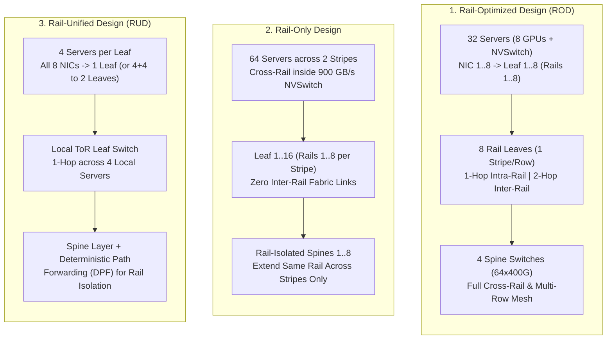
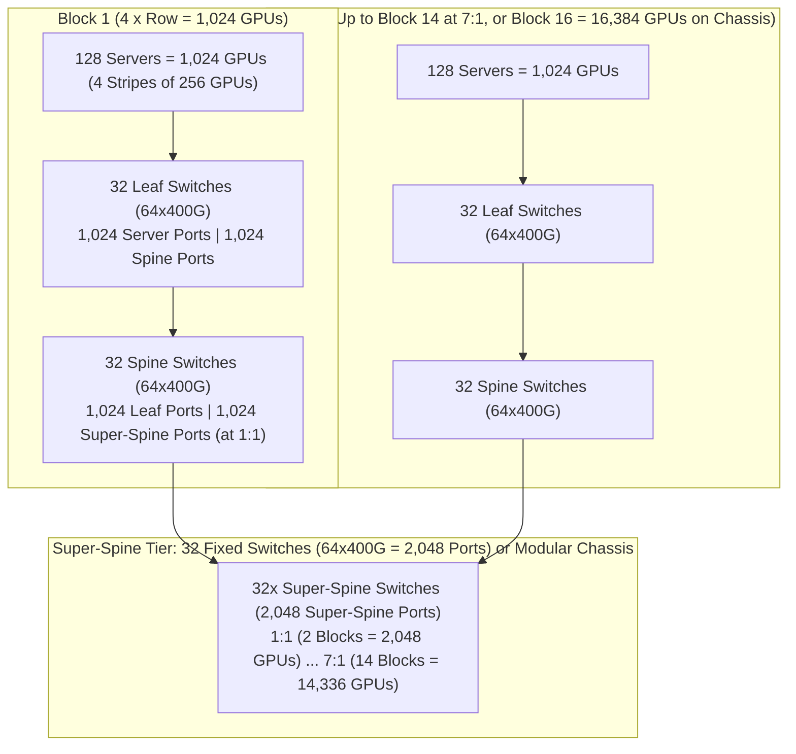
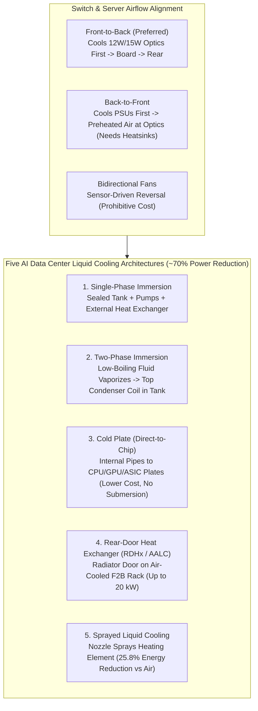

# 12.13 Fabric design: topology, oversubscription and scale

| | |
|---|---|
| Level | Advanced |
| Priority tier | 1 |
| Lab venue | Nebius GPU |
| Part | Part 12: Complete AI networking |
| Sources used | `ADC` Ch. 3, Ch. 5; `V7` Ch. 11; `V8` Ch. 6, Ch. 11; `V9` Ch. 10; `superpod-gb300-ra`; `bcm11-admin` §7.5 |
| Coverage file | `planning/coverage/chapters/12-13.md` |
| Claim ledger | `planning/ledgers/12-13.md` |
| Companion code | `code/part12/fabric_design_scale.py`, `code/part12/fabric_design_scale_lab.py` |

## Why this matters for AI infrastructure

An AI cluster is not a pile of switches connected by arbitrary fiber paths. It is a physical communication graph whose bisection cuts, hop counts, cable spans, and thermal limits govern cluster throughput. Those constraints determine whether thousands of GPUs behave like a single supercomputer or a collection of stalled islands. If an architect accepts an enterprise oversubscription ratio for a multi-rack job, cross-rack bandwidth drops in half. That bottleneck doubles collective time on every step. Worse, routing a storage checkpoint burst over the compute switches fills buffers and stalls every rank in the job.

Designing an AI fabric requires solving physical, topological, and facility constraints at the same time. Architects must choose between Rail-Optimized Design, Rail-Only Design, and Rail-Unified Design. They must also place leaf switches at Top-of-Rack, Middle-of-Row, or End-of-Row across high-power GPU racks. Beyond rack wiring, they must size three-stage and five-stage Clos networks and evaluate Scheduled Fabrics, Dragonfly, Torus, and Multi-Planar architectures. Finally, they must budget switch power, optical transceiver heat, fan airflow directions, and liquid cooling.

```text
Motivating fabric bottleneck and facility baselines:
- Scale range: 1,024, 9,216, or 128,000 GPUs
- 2:1 leaf oversubscription penalty (512-GPU job): 16 x 400G = 6,400 Gbps downlinks vs 8 x 400G = 3,200 Gbps uplinks -> caps nodes at 200 Gbps and doubles a 2 GB AllReduce from 40 ms to 80 ms
- Single-spine maintenance loss (1 of 2 spines down): leaf drops to 4 x 400G = 1,600 Gbps uplinks (4:1 oversubscription, 100 Gbps per node)
- Storage checkpoint collision: 100 GB parallel file system burst on shared switches stalls collective barriers
- Rack & switch thermal envelope: 48 kW to 60 kW GPU racks, 3 kW switches, 15 W OSFP optics, 64/128/256 B Scheduled Fabric cells, 800G -> 4x200G Multi-Planar breakout
```

## Prerequisites and outcomes

**Prerequisites:** Review Chapters 9.6, 9.8, and 9.9 for SuperPOD Scalable Units, B200 and GB300 reference architectures, and the five logical network segments. Also review Chapters 12.1 through 12.12 for AI collectives, RDMA, RoCEv2, PFC, ECN, DCQCN, QoS, InfiniBand routing, optics, Spectrum-X, and the InfiniBand versus Ethernet guide.

**Outcomes:** After completing this chapter, you will be able to:
1. Map the three AI/ML lifecycle stages onto the three server-attached fabrics. You will also explain why storage and compute planes must be physically isolated.
2. Contrast Rail-Optimized Design, Rail-Only Design, and Rail-Unified Design across GPU-to-leaf wiring and hop latency. You will also evaluate Deterministic Path Forwarding and single-leaf failure blast radius.
3. Compare Top-of-Rack, Middle-of-Row, and End-of-Row leaf placements across rack space, power, cooling, intra-rack cabling, and maximum cable spans.
4. Calculate exact switch and port counts for three-stage and five-stage Clos fabrics across fixed and modular chassis spines.
5. Evaluate Scheduled Fabrics, Dragonfly, Torus, and Multi-Planar architectures alongside power efficiency, switch airflow directions, and liquid cooling.

---

## 1. AI workload lifecycle, server port roles, and Rail-Optimized vs Rail-Only vs RUD architectures

### 1.1 The three AI/ML processing stages and three server-attached fabrics

When all cluster traffic is dumped onto a single converged network, dataset ingestion, gradient synchronization, and live user queries fight for the same switch queues. Understanding how an AI workload moves through its lifecycle clarifies why modern GPU servers separate these flows across distinct physical ports.

Processing an AI workload moves through three continuous stages with a closed retraining feedback loop:
1. **Data gathering and preprocessing:** Raw data is collected from distributed sources, cleaned of errors, missing values, and inconsistencies, and tagged with labels. Because inference output quality depends directly on input data quality, this stage feeds curated datasets into training.
2. **Model selection and training:** Candidate algorithms are trained iteratively across parameter sets via supervised, expert-guided, or reinforcement learning until model accuracy converges.
3. **Deployment and monitoring with a retraining loop:** The trained model is deployed to production systems to serve external inference requests and monitored continuously for drift. It then loops back to the data-gathering stage for periodic fine-tuning on newer datasets.

To support these three stages without cross-traffic interference, an AI server exposes three distinct classes of network ports connected to three specialized data center fabrics:
- **Training backend fabric:** Dedicated high-speed NICs mapped one-to-one to the server's eight GPUs. While two NICs per GPU are technically feasible, optics cost, NIC power, and switch port scalability favor one NIC per GPU. This one-to-one mapping eliminates server-side port redundancy and multi-homing overhead.
- **Storage fabric:** Low-latency, lossless InfiniBand or three-stage and five-stage RoCEv2 Clos fabric connecting NVMe and BlueField DPU storage ports to high-capacity storage arrays.
- **Inference frontend fabric:** Northbound ports used for CPU-to-CPU communication, external user inference requests, and cluster services, typically built as a collapsed three-stage or five-stage enterprise Clos fabric.

```text
Server port mapping and speed tiers (ADC Ch. 3):
- Training (GPU-mapped) NIC speeds: 200 Gbps, 400 Gbps, or 800 Gbps mapped 1:1 to 8 GPUs (A100, H100, B200, or AMD MI)
- Storage (NVMe/DPU-mapped) ports: Lossless InfiniBand or 3-stage/5-stage RoCEv2 Clos
- Inference (CPU-mapped) ports: Collapsed 3-stage or 5-stage enterprise/cloud Clos
```

### 1.2 Why storage and multi-tenant traffic cannot share the compute fabric or oversubscribed uplinks

Architects coming from enterprise cloud environments often propose cutting spine links in half to save money or converging storage traffic onto the compute switches. In a synchronous AI training cluster, both shortcuts fail immediately under load:

1. **The 1,024-GPU Non-Blocking Fat-Tree:** A single 64-port switch cannot connect 1,024 GPUs directly. Half of each leaf's ports must face servers while the other half face the spine tier to preserve a one-to-one non-blocking ratio. Connecting 128 eight-GPU servers requires four rail-optimized leaf groups totaling 32 leaf switches and 16 spine switches.
2. **The Multi-Tenant 2:1 Bandwidth Trap:** Suppose an organization splits a 1,024-GPU cluster into two 512-GPU departmental partitions. It then cuts spine links in half on the assumption that two departments will not burst together. A single 512-GPU training job synchronizes at the end of every step, driving all 512 GPUs at full line rate in the same microsecond. On a two-to-one oversubscribed leaf, per-node cross-leaf bandwidth drops in half, doubling collective time on every step. Worse, losing one of two spines degrades the leaf to four-to-one.
3. **The Storage Subnet Collision:** Routing a parallel file system over the same switches used for GPU collectives destroys tail latency even when aggregate bandwidth looks sufficient. Writing a massive model checkpoint floods switch buffers; lossless flow control prevents drops, but tiny, latency-sensitive collective packets queue behind multi-kilobyte storage frames. Separating traffic onto different Virtual Lanes only partially helps because physical wire contention remains. Production clusters therefore attach a physically separate storage fabric to the BlueField-3 DPUs.

```text
Production oversubscription and shared-fabric failure math (V7 Ch. 11 Scenarios 1-3, V8 Ch. 6 & Ch. 11 Scenario 3):
- 1,024-GPU (128 DGX H100) 1:1 Fat-Tree on 64-port 400G QM9700 switches:
  * Per leaf: 32 downlinks (12,800 Gbps) + 32 uplinks (12,800 Gbps) = 1:1 non-blocking
  * Total switches: 4 leaf groups x 8 leaves = 32 leaf switches; 32 leaves x 32 uplinks / 64 ports = 16 spine switches
- 2:1 Oversubscribed Leaf Trap (512-GPU synchronous job):
  * Normal 2:1 state: 16 x 400G = 6,400 Gbps downlinks vs 8 x 400G = 3,200 Gbps uplinks -> 200 Gbps (25 GB/s) per node vs 400 Gbps (50 GB/s), doubling 2 GB ring AllReduce from 40 ms to 80 ms
  * Degraded 1-spine loss (1 of 2 spines offline): 4 uplinks = 1,600 Gbps -> 4:1 oversubscription (100 Gbps per node)
- Storage / Inference Subnet Collision (100 GB model checkpoint burst):
  * Isolated baseline p99 inference latency: 1.8 ms
  * Shared default SL/VL p99 latency: 14.2 ms (7.89x spike)
  * Separated SLs/VLs on shared physical wire: 3.1 ms (physical Multi-Plane DPU isolation required)
```

### 1.3 Rail-Optimized Design vs Rail-Only vs Rail-Unified Design

Inside each eight-GPU server, an internal high-speed switch such as NVIDIA NVSwitch provides 900 GB/s per GPU of intra-node bandwidth. That internal fabric handles all communication within the box. Once a job spans multiple servers, east-west traffic exits through the eight GPU-mapped NICs under one of three leaf-attachment architectures. Choosing the wrong attachment model either forces long inter-rack cables or risks dropping an entire eight-GPU server offline when a single Top-of-Rack switch reboots.



| Architectural Dimension | Rail-Optimized Design (`ROD`) | Rail-Only Design | Rail-Unified Design (`RUD`) |
|---|---|---|---|
| **GPU-to-leaf wiring** | `1:1` mapping: `GPU i` (`NIC i`) of every server connects to **`Leaf i` (`Rail i`)**; `8` leaves form `1` **row** or **stripe**. | `1:1` `GPU i -> Leaf i` within each stripe; spines only connect **`Rail i` in Stripe A to `Rail i` in Stripe B** (`32 x 400G` for `1:1`). | All `8` NICs of a server connect to **`1` leaf** (or `4` NICs to each of `2` leaves); `4` servers (`32` GPUs) share `1` leaf. |
| **Spineless (`leaf-only`) cluster limit** | **`256` GPUs** (`32` servers $\times$ `8` GPUs) using `32 x 400G` downlinks/leaf, or **`512` GPUs** (`64` servers) using all `64 x 400G` ports as downlinks. | **`256` GPUs** (single stripe) or multi-stripe rail extension via rail-dedicated spines with zero cross-rail spine cables. | **`32` GPUs** (`4` servers) on a single `32`-downlink leaf before requiring spine switches. |
| **Intra-rail vs inter-rail network hops** | **Intra-rail:** `1` hop (via local rail leaf).<br/>**Inter-rail:** `2` hops (leaf $\rightarrow$ spine $\rightarrow$ leaf; latency is `2x` intra-rail). | **Intra-rail:** `1` hop (same stripe) or `2` hops (across stripes).<br/>**Inter-rail:** `0` fabric hops (routed via internal **`900 GB/s` `NVSwitch`**). | **`1` hop** (both intra-rail and inter-rail) among the **`4` servers** on the same leaf; **`2` hops** via spine to all other servers. |
| **Special routing / switch requirement** | Standard rail-aligned fat-tree / `eBGP` or `OpenSM` ftree routing. | Collective library (`NCCL` `PXN`) must route all cross-rail traffic through intra-node `NVSwitch`. | Requires **Deterministic Path Forwarding (`DPF`)** on leaves/spines to segregate rails sharing the same switch; can also switch intra-server GPU traffic on nodes lacking an internal `NVSwitch`. |
| **Single-leaf failure blast radius** | Degrades **`1` of `8` rails** (`12.5%` bandwidth loss); all servers retain `7` working rails. | Fault is strictly contained to **`1` rail**; cannot propagate across rails, simplifying troubleshooting. | If all `8` NICs land on `1` leaf, a single leaf failure **completely isolates the entire server** (`8` GPUs offline). |
| **Cabling complexity & media** | High: every server fans out `8` cables across `8` distinct rail leaves in the row. | Medium: same leaf fan-out, but simpler spine cabling and isolated rail fault domains. | **Lowest:** all `8` server links stay inside the rack (`ToR`), enabling low-cost copper **`DAC`** or **`AEC`** cables. |

---

## 2. Rack engineering and leaf physical placement: ToR, MoR, and EoR

### 2.1 Rack dimensions, server U-heights, and the 48 kW to 60 kW power jump

Before placing leaf switches in a data center row, an architect must reconcile physical rack geometry with facility power and cooling limits. Packing eight-GPU servers into standard enterprise racks without checking power density trips breakers or starves switches of cooling air.

```text
Rack geometry and power density specifications (ADC Ch. 3 & Ch. 5):
- Standard data center rack dimensions: 19 inches wide x 36 inches deep x 42U tall
- NVIDIA DGX H100 form factor: 19 inches wide x 35.3 inches deep x 8U tall (vs 6U tall for DGX A100)
- Server capacity per 42U rack: 4 or 5 DGX H100 servers plus a leaf switch
- AI rack power budget: 48 kW to 60 kW per rack
- Traditional enterprise rack budget: 20 kW to 25 kW average (10 kW to 25 kW range; most legacy halls run at 16 kW to 18 kW)
```

### 2.2 Comparing ToR, MoR, and EoR across an 8-rack stripe

In a Rail-Optimized stripe of eight compute racks housing four servers per rack, every server must run eight cables to eight different leaf switches. Where those eight leaf switches and their spine switches are physically mounted changes the total rack count. The per-rack thermal load, and the maximum cable reach across the row:

1. **Top-of-Rack (ToR):** One leaf switch is installed at the top of each of the eight compute racks alongside four servers. Spines can sit in two separate spine racks or inside the compute racks. In Rail-Optimized Design, each server connects to its local leaf and reaches across the other seven racks to hit the remaining rail leaves, spanning all eight racks. When combined with Rail-Unified Design, Top-of-Rack is ideal. All eight NICs of the four local servers plug into their own rack's switch using short intra-rack Direct Attach Copper or Active Electrical Cable assemblies.
2. **Middle-of-Row (MoR):** Four compute racks on the left and four on the right flank one or two dedicated network racks in the middle of the row. No switches sit inside the compute racks. Because switches live in dedicated middle racks, switch power and heat do not add to the compute rack budget. No intra-rack server-to-switch cabling is needed in the compute racks. And the worst-case cable run from the outer compute racks to the center switch racks is the shortest of any Rail-Optimized layout.
3. **End-of-Row (EoR):** All eight compute racks sit consecutively. The eight leaf switches and eight spine switches are installed in one or two dedicated network racks at the end of the row. Like Middle-of-Row, End-of-Row removes switch power and cooling from the compute racks and eliminates intra-rack switch cabling. All four servers within any given rack also use identical cable lengths. However, cables from the farthest compute rack must traverse the entire row to reach the end switch racks, requiring the longest cable span.

| Design Criterion | Top-of-Rack (`ToR`) | Middle-of-Row (`MoR`) | End-of-Row (`EoR`) |
|---|---|---|---|
| **Rack space requirement** | **Less** (`8` compute racks; spines in-rack or in `2` spine racks) | **More** (`8` compute racks + `1–2` middle switch racks = `9–10` racks) | **More** (`8` compute racks + `1–2` end switch racks = `9–10` racks) |
| **Power requirement per compute rack** | **More** (servers + `1–2` switches in the same rack) | **Less** (compute racks power only the `4` GPU servers) | **Less** (compute racks power only the `4` GPU servers) |
| **Cooling requirement per compute rack** | **More** (must cool switch ASIC + `64` optics alongside GPUs) | **Less** (switch thermal load isolated to middle network racks) | **Less** (switch thermal load isolated to end network racks) |
| **Cabling within the compute rack** | **Varying lengths** connecting servers to the local switch in each rack | **No server-to-switch cabling within compute racks** | **No server-to-switch cabling within compute racks** |
| **Cabling across the racks (`ROD`)** | Each server connects to `1` leaf switch in each of the `8` racks in the row | Varying cable lengths per rack based on distance to middle racks; all `4` servers in a given rack use the **same** cable length | Varying cable lengths per rack based on distance to end racks; all `4` servers in a given rack use the **same** cable length |
| **Maximum cable length (`ROD`)** | **To span `8` racks** | **To span `6` racks** (`5`–`6` racks) | **To span `10` racks** |
| **Best fit for `RUD` with copper `DAC`/`AEC`** | **Ideal** (all `8` NICs terminate inside the same rack) | Not optimal for intra-rack `DAC` | Not optimal for intra-rack `DAC` |

---

## 3. 3-stage and 5-stage Clos scaling: port arithmetic, chassis spines, and oversubscription

### 3.1 3-stage Clos scaling up to 2,048 GPUs and 9,216 GPUs

When an organization outgrows a single spineless row of eight leaf switches, adding a spine tier creates a two-tier Leaf-Spine fat-tree. In switching theory, this is a three-stage Clos fabric because packets traverse Ingress Leaf, Spine, and Egress Leaf stages. If an architect miscalculates the port radix of the spine switches. The cluster hits a hard scaling ceiling and cannot add another rack without recabling into a five-stage fabric.

When built from fixed 64-port 400 Gbps switches at one-to-one non-blocking oversubscription, each leaf allocates 32 downlinks toward servers and 32 uplinks toward spines. Once the cluster reaches 64 leaf switches across eight rows, those 64 leaves consume every single port on each 64-port spine switch. That radix limit caps a three-stage Clos of 64-port switches at 2,048 GPUs. Replacing the fixed spine switches with 256-port modular chassis spines cuts the spine switch count by fourfold. Upgrading to 144-port 800 Gbps switches expands a three-stage non-blocking Clos all the way to 9,216 GPUs across 16 Scalable Units.

| 3-Stage Clos Configuration | Switch Radix & Speed | Rows / SUs | GPUs (`NICs`) | Server-Facing Ports | Spine-Facing Ports | Leaf Switches | Spine Switches |
|---|---|---|---|---|---|---|---|
| **Base Unit (`1` GPU / `1` Server)** | `400G` | — | `1` / `8` | `1` / `8` | — | — | — |
| **`1 x Row` (`32` Servers)** | `64 x 400G` | `1` Row | **`256`** | `256` | `256` | **`8`** | **`4`** |
| **`2 x Row` (`64` Servers)** | `64 x 400G` | `2` Rows | **`512`** | `512` | `512` | **`16`** | **`8`** |
| **`4 x Row` (`128` Servers)** | `64 x 400G` | `4` Rows | **`1,024`** | `1,024` | `1,024` | **`32`** | **`16`** |
| **`8 x Row` (Max `64x400G` 3-Stage)** | `64 x 400G` | `8` Rows | **`2,048`** | `2,048` | `2,048` | **`64`** | **`32`** |
| **`8 x Row` (Chassis Spine `256x400G`)** | `64x400G` Leaf / `256x400G` Spine | `8` Rows | **`2,048`** | `2,048` | `2,048` | **`64`** | **`8` (Chassis)** |
| **`GB300` `2 / 4 / 8 / 16` SUs (`Q3400-RD`)** | `144 x 800G` | `2..16` SUs | **`1,152..9,216`** | `1,152..9,216` | `1,152..9,216` | **`16 / 32 / 64 / 128`** | **`8 / 18 / 36 / 72`** |

### 3.2 5-stage Clos: 1,024-GPU blocks and 1:1 to 7:1 super-spine oversubscription

Hyperscale AI clusters scaling to 32K, 64K, or 128K GPUs require thousands of leaf switches, far exceeding the port radix of any three-stage Clos. Scaling beyond 2,048 GPUs with 64-port switches requires a five-stage Clos architecture built from standardized Blocks or Bricks. Packets traverse Ingress Leaf, Ingress Spine, Super-Spine, Egress Spine, and Egress Leaf stages.

A common mistake is assuming a five-stage block holds 2,048 GPUs like a three-stage pod. In a five-stage Clos, each 64-port spine switch inside a block must reserve half of its ports to connect upward to the Super-Spine tier. That leaves only 32 downlinks to connect to leaves in its block. Therefore, one five-stage block holds four rows totaling 1,024 GPUs, 32 leaf switches, and 32 spine switches. If the Super-Spine tier is fixed at 32 switches providing 2,048 ports, operators can attach two blocks at a one-to-one ratio. They can also scale up to fourteen blocks at a seven-to-one super-spine oversubscription ratio when job placement and DCQCN bound inter-block traffic.

```text
5-stage Clos block and hyperscale leaf counts (ADC Ch. 3 Fig. 3-11..3-13):
- Hyperscale leaf switch counts: 32K, 64K, or 128K GPUs require 8K, 16K, or 32K leaf switches
- 1 x Block (Brick) = 4 x Row = 1,024 GPUs (128 servers, 32 leaves of 64x400G, 32 spines of 64x400G, 1,024 super-spine ports)
- 32K GPU cluster (32,768 GPUs): requires 32 blocks of 1,024 GPUs
- Fixed 32-switch Super-Spine tier (32 x 64 = 2,048 super-spine ports): connects 2k blocks (2,048k GPUs) at k:1 oversubscription for k = 1..7
```



| Super-Spine Mode & Ratio | Blocks (`1,024` GPUs/Block) | Rows (`256` GPUs/Row) | Total GPUs (`NICs`) | Server-Facing Ports | Spine-Facing Ports | Super-Spine-Facing Ports | Leaf Switches (`64x400G`) | Spine Switches (`64x400G`) | Super-Spine Switches |
|---|---|---|---|---|---|---|---|---|---|
| **Single Block (`1 x Block`)** | `1` | `4` | **`1,024`** | `1,024` | `1,024` | `1,024` | `32` | `32` | — |
| **Fixed `64x400G` Super-Spine (`1:1`)** | `2` | `8` | **`2,048`** | `2,048` | `2,048` | **`2,048`** | `64` | `64` | **`32`** |
| **Fixed `64x400G` Super-Spine (`2:1`)** | `4` | `16` | **`4,096`** | `4,096` | `4,096` | **`2,048`** | `128` | `128` | **`32`** |
| **Fixed `64x400G` Super-Spine (`3:1`)** | `6` | `24` | **`6,144`** | `6,144` | `6,144` | **`2,048`** | `192` | `192` | **`32`** |
| **Fixed `64x400G` Super-Spine (`4:1`)** | `8` | `32` | **`8,192`** | `8,192` | `8,192` | **`2,048`** | `256` | `256` | **`32`** |
| **Fixed `64x400G` Super-Spine (`5:1`)** | `10` | `40` | **`10,240`** | `10,240` | `10,240` | **`2,048`** | `320` | `320` | **`32`** |
| **Fixed `64x400G` Super-Spine (`6:1`)** | `12` | `48` | **`12,288`** | `12,288` | `12,288` | **`2,048`** | `384` | `384` | **`32`** |
| **Fixed `64x400G` Super-Spine (`7:1`)** | `14` | `56` | **`14,336`** | `14,336` | `14,336` | **`2,048`** | `448` | `448` | **`32`** |
| **Chassis Super-Spine (`1:1`, `8K` Scale)** | `8` | `32` (`2xRow`/sub-pod) | **`8,192`** | `8,192` | `8,192` | **`8,192`** | `256` (`16`/unit) | `256` (`8`/unit) | **Chassis (`1:1`)** |
| **Chassis Super-Spine (`1:1`, `16K` Scale)** | `16` | `64` | **`16,384`** | `16,384` | `16,384` | **`16,384`** | `512` (`64`/unit) | `512` (`32`/unit) | **Chassis (`1:1`)** |

---

## 4. Beyond standard Clos: Scheduled Fabrics, Dragonfly, Torus, and Multi-Planar Scale-Out

### 4.1 Scheduled Fabric: fixed-size cells and Virtual Output Queueing

In a conventional packet-switched Ethernet Clos fabric, two large RDMA flows hashing onto the same spine link cause severe congestion while adjacent spine links sit idle. Worse, if one destination port congests, packets waiting at the front of an ingress switch buffer block unrelated packets behind them. A Scheduled Fabric, developed by Cisco Silicon One and Broadcom Jericho3-AI leaf silicon paired with Ramon3 spine silicon, eliminates both problems. It extends the cell-switched backplane of a modular router chassis across the entire data center pod:

- **Leaves as linecards, spines as backplane:** When an RDMA packet arrives at an ingress leaf switch, the leaf slices the packet into uniform fixed-size cells. It then sprays those cells evenly across all available spine switches. The egress leaf reassembles the cells into the original packet in exact order before forwarding it to the destination server. Because segmentation and reassembly occur only once at the fabric edges, link utilization approaches 100 percent without elephant-flow hash polarization.
- **Eliminating Head-of-Line blocking via Virtual Output Queueing:** With Virtual Output Queueing, every ingress leaf maintains a dedicated virtual queue for each egress port across the fabric. A credit-granting hardware scheduler issues transmission tokens only when the target egress port has buffer space. This credit loop isolates congestion to the offending flow and provides tighter control than reactive DCQCN rate-cut loops.
- **Architectural constraints to evaluate:** Scheduled fabrics introduce cell-header and padding overhead, scaling boundaries per scheduled pod, and specialized failure reconvergence. They can also add latency under heavy credit contention and enforce single-vendor silicon lock-in within a block.

```text
Scheduled Fabric cell segmentation and VOQ arithmetic (ADC Ch. 3 Fig. 3-24):
- Silicon implementations: Broadcom Jericho3-AI (leaf / linecard) + Ramon3 (spine / backplane), Cisco Silicon One
- Cell sizes: 64, 128, or 256 bytes
- 1,500-byte packet on 128-byte cells: ceil(1500 / 128) = 12 cells = 1,536 wire bytes (2.40% padding overhead)
- 4,100-byte packet on 256-byte cells: ceil(4100 / 256) = 17 cells = 4,352 wire bytes
- Total VOQs per ingress leaf (1,024 egress endpoints x 8 traffic classes): 8,192 VOQs
```

### 4.2 Low-diameter alternatives: Dragonfly and Torus topologies

When a cluster grows to tens of thousands of GPUs, a five-stage or seven-stage Clos adds switch hops, optical transceiver cost, and serialization latency at every tier. Two supercomputing topologies reduce hop count or eliminate upper-tier spine switches altogether:

1. **Dragonfly Topology:**.
   - **Hierarchical group mesh:** Compute nodes and switches are organized into modular groups or blocks. The groups themselves interconnect via a direct global full mesh.
   - **Two intra-group flavors:** Within a group, switches connect either via a full-graph mesh where every node links directly to every other node in the group. Alternatively, they use a Clos or Butterfly+ bipartite intra-group topology where spines form the global full mesh.
   - **Why it helps and what it requires:** Dragonfly cuts worst-case network diameter to three switch-to-switch hops compared to four hops. A five-stage Clos, lowering latency and global fiber count. Because adversarial traffic patterns can saturate the single direct inter-group link between two groups. Dragonfly relies heavily on Adaptive Routing to route overflow traffic non-minimally through an intermediate group.
2. **Torus Topology:**.
   - **Direct neighbor grid with wrap-around links:** Nodes or rail leaf switches connect directly to their immediate neighbors along one, two, or three spatial dimensions. Edge nodes wrap around to the opposite edge to form closed rings.
   - **Three dimensional variants:** A 1D Torus ring uses two links per node. Can also interconnect the eight rail leaf switches of a stripe directly without a spine tier. A 2D Torus grid uses four links per node, and a 3D Torus cube uses six links per node.
   - **Trade-offs:** Torus networks eliminate expensive spine and super-spine switch tiers and excel when parallel jobs map onto nearest-neighbor three-dimensional stencils or pipeline rings. However, they suffer higher average hop counts and complex deadlock-avoidance routing for arbitrary all-to-all traffic.

```text
Dragonfly and Torus graph formulas (ADC Ch. 3 Fig. 3-27..3-35):
- Dragonfly (DF / DF+) diameter: 3 switch-to-switch hops (local intra-group hop -> 1 global link -> remote intra-group hop) vs 4 hops in a 5-stage Clos
- Dragonfly global full-mesh link count for G groups: G * (G - 1) / 2 -> for 8 groups, 8 * 7 / 2 = 28 direct inter-group links
- 1D Torus (Ring): 2 links/node (left/right neighbor + wrap-around; max hops = floor(N/2); can link Leaf 1 <-> Leaf 2 ... <-> Leaf 8 <-> Leaf 1)
- 2D Torus (X, Y Grid): 4 links/node (max hops for N x N grid = 2 * floor(N/2))
- 3D Torus (X, Y, Z Cube): 6 links/node (+X/-X, +Y/-Y, +Z/-Z + wrap-around; for an 8 x 8 x 8 = 512-node cube, max hops = 3 * (8 / 2) = 12 hops)
```

### 4.3 Multi-Planar Scale-Out architectures, shuffle cables, and LPO/LRO optics

For hyperscale clusters exceeding 100,000 GPUs, a single unified five-stage control and data plane creates a massive blast radius. A single route-plane bug or spine anomaly can perturb the entire fabric. Multi-Planar Scale-Out Architectures replace a single monolithic fabric with two or four completely independent network planes that have disjoint control planes and data planes:

- **NIC port breakout and doubled leaf GPU radix:** Instead of plugging an 800 Gbps GPU NIC into a single 800G leaf port. A breakout cable splits the 800G NIC into four 200 Gbps lanes wired to four independent fabric planes. Consequently, a 64-port 800 Gbps Top-of-Rack leaf switch provides 128 server downlinks at 200 Gbps. That breakout doubles the number of GPUs attached per leaf switch while keeping the remaining ports as spine uplinks.
- **Single-flow packet spraying and NIC Out-of-Order reassembly:** From the PyTorch and NCCL application perspective, the NIC still presents a single 800 Gbps Queue Pair. Firmware on the source NIC sprays packets of that single flow across all four planes simultaneously. The destination NIC hardware coalesces and reorders the out-of-order packets in sequence before posting completions. If an entire fabric plane fails, the job never loses reachability to any GPU and continues running uninterrupted on the surviving planes.
- **Multi-rail planes, super-spine domains, and pure IP underlays:** Each fabric plane can contain multiple rail groups, and multiple multi-planar domains can interconnect via a high-radix Super-Spine layer. To prevent Ethernet bridging loops across multi-homed server ports. Multi-tenant AI clouds typically use a pure Layer 3 IP Fabric underlay with dynamic ACLs and RADIUS tenant profiles rather than Layer 2 bridging.
- **Taming the cable explosion with Shuffle Cables and LPO/LRO optics:** Breaking every 800G port into four 200G lanes quadruples fiber strand counts. Architects mitigate this physical fan-out using shuffle cables that cross-wire plane links inside a passive optical cassette, combined with Linear Pluggable Optics and Linear Receive Optics. Removing one or both onboard Digital Signal Processors from the optical module cuts transceiver power and heat. Switch fans then spin slower and more facility megawatts remain available for GPUs.

```text
Multi-Planar breakout and optics specifications (ADC Ch. 3 Fig. 3-36..3-39):
- NIC breakout: 1 x 800 Gbps GPU NIC -> 4 x 200 Gbps lanes across Fabric Planes FP1, FP2, FP3, FP4
- 64 x 800 Gbps ToR leaf split: 32 x 800G ports broken out 4:1 into 128 x 200 Gbps server downlinks + 32 x 800 Gbps (or 64 x 400 Gbps) spine uplinks
- Plane failure resilience:
  * 1 of 4 planes down (e.g., FP1 fails): 75.0% (600 Gbps) capacity remains active with zero job interruption
  * 2 of 4 planes down: 50.0% (400 Gbps) capacity remains active
- Multi-domain & rail options: Rail A and Rail B within each plane; FP1a/FP2a and FP1b/FP2b domains linked via Super-Spine for >100K GPUs
- Optical power reduction: Traditional pluggables use 2 DSPs (12 W to 15 W per module); LPO removes both DSPs, LRO removes 1 DSP
```

---

## 5. Inference data center architecture, production design gates, and Slurm Topograph scheduling

### 5.1 Inference data center placement and fabric requirements

Unlike large-scale synchronous training, inference data center architecture is governed by model footprint and concurrent user query volume across five deployment locations:
1. **Mobile and client devices:** Phones or laptops serving a single user locally.
2. **Edge computing locations:** Manufacturing plants, retail stores, or regional points of presence serving local multi-user streams.
3. **Enterprise data centers:** On-premises halls running focused domain models on modest GPU pools.
4. **Cloud data centers:** Hyperscale facilities serving high-query-rate public or multi-tenant APIs.
5. **Co-located with training data centers:** Facilities sharing checkpoint storage and lifecycle pipelines with training pods.

Because most inference models fit within a single GPU or a single eight-GPU server, rail alignment is generally not required for inference data centers. Traffic typically uses standard TCP/IP such as gRPC and HTTP rather than RDMA over a conventional collapsed three-stage or five-stage enterprise Clos network. Only when a frontier Mixture-of-Experts or long-context model requires multi-node disaggregated prefill. Decode inference does east-west inference traffic shift to RDMA over a non-blocking Clos or rail-optimized pod.

### 5.2 The 7-input production design gate, capacity cuts, and Slurm Topograph

When an architecture team buys switches before measuring collective fractions. Day-two expansion plans, and degraded link cuts, the resulting cluster stalls on oversubscribed uplinks or runs out of spine ports on the first expansion. Before selecting switch counts or oversubscription ratios, a production architecture review must verify seven measured inputs:
1. **Business and service objectives:** Service level agreements, multi-tenancy boundaries, and funded three-year growth timeline.
2. **Workload communication pattern:** Collective fraction of step time, AllReduce versus AllToAll mix, and message sizes.
3. **Scale and growth:** GPU count on Day 1 versus Day 2 so expansion does not exhaust spine ports and force a disruptive recable.
4. **Performance target:** Required scaling-efficiency curve and tail latency ceiling.
5. **Reliability and failure domains:** Degraded link and switch surviving capacity, dual redundant OpenSM hosts in separate power domains, and independent out-of-band management.
6. **Operations and skills:** In-house InfiniBand or RoCE fabric-specialist headcount and telemetry tooling.
7. **Cost and facility constraints:** Rack power and cooling limits and budget versus non-blocking price delta.

Once the topology is built, operators must verify physical cut capacity, audit uplink routing balance, and integrate the fabric topology with the job scheduler. Even on a five-stage Clos with oversubscribed super-spines, jobs run at full non-blocking speed when ranks stay inside a block. NVIDIA Base Command Manager Topograph discovers the physical switch tree. Configures Slurm to pack communicating ranks inside the same 1,024-GPU block or 32-server rail leaf before crossing spines.

```text
Production leaf radix, uplink balance, and BCM Topograph parameters (V8 Ch. 6 & Ch. 11, V9 Ch. 10, bcm11-admin §7.5):
1. Leaf Radix & Cut Survival Math:
   - Day 1 to Day 2 growth examples: 8 DGX systems growing to 32, or 128 GPUs expanding to 512 GPUs
   - 16 single-rail 400 Gbps endpoints/rack (256 ports across 16 racks): 16 x 400 = 6,400 Gbps downlink -> 1:1 non-blocking requires 16 x 400G uplinks (minimum 32-port leaf switch vs 24-port leaf forcing 8 uplinks = 3,200 Gbps = 2:1 oversubscription)
   - 16 dual-rail 800 Gbps nodes/rack: 12,800 Gbps downlink vs 8 x 400G (3,200 Gbps) = 4.00:1 normal, and 7 x 400G (2,800 Gbps) = 4.57:1 N-1 degraded
   - OOB management: Independent 1 GbE out-of-band management network + dual redundant OpenSM hosts in separate power domains

2. Route Balance vs Topology Drawings (V8 Ch. 6 Scenarios 1 & 3):
   - InfiniBand perfquery <leaf-lid> <port> (PortXmitData in 4-octet units x 4 = bytes; never run perfquery -R in production):
     * Uplink port 5: 21,474,836,480 B (~21.48 GB)
     * Uplink port 6: 21,489,234,432 B (~21.48 GB)
     * Uplink port 7: 1,073,741,824 B (~1.08 GB)
     * Uplink port 8: 1,081,654,272 B (~1.08 GB) -> 19.9:1 (~20:1) static routing imbalance
   - Paired ib_write_bw (2,097,152 B = 2 MiB): 397.62 Gbps same-leaf vs 201.18 Gbps cross-rack (1.98x drop proving a 2:1 cross-rack cut)

3. BCM 11 Topograph Service (/etc/topograph/topograph-config.yaml):
   - HTTPS port: TCP 49021 (exports 26 Prometheus measurables at https://localhost:49021/metrics)
   - Timers & paging: Fetch timeout = 20 s, Fetch attempts = 12, Fetch wait time = 15 s, RequestAggregationDelay = 15 s, PageSize = 100
   - Cloud & physical discovery: InfiniBand/Ethernet switch trees or AWS p5.48xlarge (ec2:DescribeInstanceTopology), OCI, GCP -> writes /cm/shared/apps/slurm/etc/<cluster>/topology.conf for Slurm topology/tree or topology/block
```

---

## 6. Thermal and power efficiency considerations for AI network fabrics

### 6.1 Global data center power split, PUE, DGX H100 PSUs, and switch + optics power

Ignoring the power and heat of network switches and optical transceivers causes rack PDUs to trip and high-speed optics to thermally throttle above 70 degrees Celsius. Data centers consume a substantial share of global electricity, and cooling is the second-largest power consumer after the IT hardware itself. Cooling efficiency is measured by Power Usage Effectiveness:

$$\text`{PUE}` = \frac\{\text`{Total Data Center Facility Power}`}\{\text`{IT Computing Equipment Power}`}, \qquad \text`{Ideal PUE}` = \mathbf`{1.0}`$$

When budgeting an AI rack, architects must add the power draw of the switch chassis and all 64 pluggable optical modules to the server PSU load. Pluggable transceiver power has nearly quintupled from 100G to 800G modules, adding almost a full kilowatt of heat to every 64-port switch.

```text
Data center, server, switch, and optics power breakdown (ADC Ch. 5):
- Global & facility power split: ~2% of global electricity; IT equipment = 40% to 45%, cooling system = 35% to 40%, power distribution/UPS/lighting = 15% to 25%
- DGX H100 PSU redundancy math: 6 PSUs rated at 3.3 kW each in 4 + 2 redundancy -> 4 x 3.3 kW = 13.2 kW full operating load (vs 3 x 3.3 = 9.9 kW single-feed limit in 3+3 shelf analyses against a 10.2 kW peak rating)
- 64 x 400 Gbps switch chassis budget (e.g., Juniper QFX5230): 3 kW (3,000 W)
- Pluggable optical transceiver max power draw across 64 ports (4.69x jump from QSFP28 to OSFP):
  * QSFP28 (100G): 3.2 W per module -> 64 ports = 204.8 W
  * QSFP56-DD (400G): 12 W per module -> 64 ports = 768.0 W
  * OSFP (400G / 800G): 15 W per module -> 64 ports = 960.0 W (0.96 kW)
- Combined 64-port OSFP switch power: 3.0 kW chassis + 0.96 kW optics = 3.96 kW per switch
- Total ToR rack power examples:
  * 1 DGX H100 (13.2 kW) + 1 OSFP switch (3.96 kW) = 17.16 kW IT load
  * 4 DGX H100 (4 x 13.2 = 52.8 kW) + 1 OSFP switch (3.96 kW) = 56.76 kW IT load (70.95 kW facility power at PUE = 1.25, inside 48 kW to 60 kW envelope)
  * 5 DGX H100 (5 x 13.2 = 66.0 kW) + 1 OSFP switch (3.96 kW) = 69.96 kW IT load
```

### 6.2 Switch fan airflow options and the five liquid cooling technologies

Installing a switch with the wrong fan airflow direction blows hot PSU exhaust over temperature-sensitive front-panel optics, causing link flaps during heavy collective runs. Likewise, trying to cool a 56 kW GPU rack with room air conditioning fails rapidly. Architects must coordinate switch airflow direction with the five data center liquid cooling technologies:

- **Three fan airflow options for switches and servers:**.
  1. **Front-to-Back (F2B):** Cool cold-aisle air enters the front port panel and passes through the front-panel optical transceivers first before crossing the switch ASIC and exiting the rear. Because high-power optics are the most temperature-sensitive components on a switch, Front-to-Back is the preferred airflow direction for AI clusters.
  2. **Back-to-Front (B2F):** Cool air enters the back panel and cools the Power Supply Units first. It reaches the front-panel optics last after the air has already been preheated by the PSU and switch ASIC. Consequently, Back-to-Front switches often require extra heat sinks on the optical transceivers, and every device in a rack must share the same airflow direction.
  3. **Bidirectional fans:** Can reverse airflow direction in real time based on thermal sensors without specifying fan SKUs at procurement time. However, the mechanical redesign makes their cost prohibitively high for most deployments.



Liquid cooling can reduce data center cooling power consumption by roughly 70 percent in a market projected to surpass USD $3 billion by 2026:

| Liquid Cooling Technology | Heat Transfer Mechanism | Hardware & Facility Impact | Efficiency, Capacity & Hyperscaler Adoption |
|---|---|---|---|
| **1. Single-Phase Immersion Cooling** | Entire rack/server is submerged in dielectric liquid inside a sealed tank; **pumps circulate heated liquid to an external water-cooled heat exchanger** and return cooled fluid to the tank. | Requires facility-wide tank layout and immersion-qualified servers, switches, and sealed optics. | High heat removal for extreme-density racks; fluid remains in liquid phase throughout the loop. |
| **2. Two-Phase Immersion Cooling** | Equipment is submerged in a low-boiling-point dielectric fluid that **boils into rising gas** on contact with hot chips, condenses into droplets on a **cold-water condenser tube at the top of the tank**, and rains back down. | **No external heat exchanger or circulation pump needed** (both phases occur inside the sealed tank); requires specialized fluid selection. | Highest latent-heat transfer efficiency; deployed in production environments by **Microsoft**. |
| **3. Cold Plate (`Direct-to-Chip`) Liquid Cooling** | Cool liquid flows through internal manifolds and small tubes to **cold plates mounted directly on CPUs, GPUs, memory, or switch ASICs**, then exits to an external CDU/heat exchanger. | **Equipment is not submerged**; lower cost than immersion and allows mixing liquid-cooled GPU nodes with air-cooled/RDHx switches in the same hall. | Industry standard for high-density AI pods; used by **Google (`TPU` pods)** and adopted by **Meta** and **NVIDIA (`NVL72`)**. |
| **4. Rear-Door Heat Exchanger (`RDHx` / `AALC`)** | A radiator coil door mounted on the back of a standard **Front-to-Back air-cooled rack** absorbs heat from exhaust air into chilled water loops connected to cooling towers. | **Simplest retrofit:** requires **zero modification to servers or switches** (Air-Assisted Liquid Cooling), only chilled-water plumbing to the rack door. | Cools up to **`20 kW` per rack** at standard chilled-water design temperatures; less efficient than immersion or cold plates; adopted alongside cold plates by **Meta**. |
| **5. Sprayed Liquid Cooling** | Targeted nozzles installed inside modified chassis **spray dielectric coolant directly onto the surface of heating elements**, draining warm fluid to a heat exchanger. | Requires chassis modification to mount internal spray nozzles, but **uses significantly less coolant** than tank immersion. | Reduces total data center energy consumption by **`25.8%`** compared with air-cooled data centers. |

---

## Commands and configurations that matter

### 1. Inspecting physical rail locality, InfiniBand port counters, and paired `ib_write_bw` cut bandwidth

```bash
# 1. Verify 1:1 GPU-to-NIC-to-PIX rail alignment inside an 8-GPU node (untested here)
nvidia-smi topo -m
rdma link show

# 2. Sample InfiniBand leaf uplink PortXmitData (in 4-octet units; multiply by 4 for bytes)
# NEVER pass -R in production (resets shared telemetry counters). (untested here)
for p in 5 6 7 8; do
  echo -n "uplink port $p: "
  perfquery 44 "$p" | awk '/PortXmitData/ {print $NF * 4 " bytes"}'
done
# Example V8 Ch 6 Scenario 1 output showing 20:1 static routing imbalance:
# uplink port 5: 21474836480 bytes  (~21.47 GB)
# uplink port 6: 21489234432 bytes  (~21.49 GB)
# uplink port 7: 1073741824 bytes   (~1.07 GB)
# uplink port 8: 1081654272 bytes   (~1.08 GB)

# 3. Isolate leaf-local vs spine-crossing oversubscription with paired 2 MiB ib_write_bw runs (untested here)
# Same-leaf pair -> 397.62 Gb/sec; Cross-rack pair (2:1 leaf) -> 201.18 Gb/sec
ib_write_bw -d mlx5_0 -s 2097152 -n 5000 --report_gbits 10.20.4.16
```

### 2. Configuring Multi-Planar ToR port breakouts and RoCEv2 QoS on NVIDIA Cumulus NVUE

```bash
# Break out ports swp1..swp32 on a 64x800G ToR leaf into 128 x 200G server downlinks
# while keeping swp33..swp64 as 32 x 800G (or 64 x 400G) spine uplinks (untested here)
nv set interface swp1-32 link breakout 4x200G
nv set interface swp33-64 link speed 800G
nv set qos roce enable on
nv config apply

# Audit uplink ECN marking, PFC pause frames, and What Just Happened (WJH) tail drops (untested here)
ethtool -S swp33 | egrep 'rx_pfc_prio3|tx_ecn_marked_prio3|rx_prio0_discard'
nv show platform software wjh drop-reason
```

### 3. Configuring BCM 11 Topograph for block- and rail-aware Slurm scheduling

```bash
# Configure Slurm topology/tree or topology/block via BCM 11 Topograph (bcm11-admin §7.5) (untested here)
cmsh -c "wlm use slurm; topologysettings; set topologyplugin tree; set topologysource topograph; commit"

# Inspect /etc/topograph/topograph-config.yaml and scrape the 26 Prometheus measurables (untested here)
cat /etc/topograph/topograph-config.yaml
# http: :49021 | fetch_timeout: 20s | fetch_attempts: 12 | fetch_wait: 15s | page_size: 100
curl -sk https://localhost:49021/metrics | head -n 30
```

---

## How it fails

When a cluster exhibits slow multi-rack scaling, periodic checkpoint stalls, or optical transceiver shutdowns, use the failure signatures below to pinpoint the topological or facility root cause:

| Failure Mode | Symptom | Root Cause & Telemetry Evidence | Fix |
|---|---|---|---|
| **1. `2:1` Leaf Oversubscription & `N-1` Spine Loss (`V7` Ch. 11 Scen. 2 & `V8` Ch. 6)** | Single-rack jobs run at full speed, but `512`-GPU multi-rack jobs see `2x` slower `AllReduce` (`4x` slower during spine maintenance). | Leaf has `16 x 400G` (`6,400 Gbps`) downlinks but only `8 x 400G` (`3,200 Gbps`) uplinks (`2:1`), capping cross-rack rate at `200 Gbps`/node (`ib_write_bw` drops from **`397.62 Gbps`** same-leaf to **`201.18 Gbps`** cross-rack, and `2 GB` `AllReduce` jumps from **`40 ms` to `80 ms`**). Losing `1` of `2` spines leaves `4` uplinks (`1,600 Gbps` = **`4:1`**). | Mandate `1:1` non-blocking uplinks (`32` down : `32` up on `64`-port leaves) for synchronous training pods, or use BCM `Topograph` (`topology/block`) to pack jobs inside `1:1` blocks. |
| **2. Storage Checkpoint Collision on Compute Fabric (`V7` Ch. 11 Scen. 3 & `V8` Ch. 11 Scen. 3)** | `AllReduce` step time spikes unpredictably every `15`–`30` minutes during `100 GB` checkpoint writes, or co-located inference `p99` latency jumps **`7.89x`**. | `100 GB` storage bursts fill lossless switch buffers ahead of collective packets. On a shared `SL`/`VL`, inference `p99` latency jumps from **`1.8 ms` to `14.2 ms`** (`3.1 ms` even with separated `VL`s due to shared physical wire contention). | Enforce a **Multi-Plane Topology**: isolate storage onto dedicated `400G` `RoCEv2`/IB switches wired to unbonded `BlueField-3` DPU ports, leaving `ConnectX-7`/`8` compute NICs exclusively for GPU collectives. |
| **3. `20:1` Static Routing Uplink Polarization (`V8` Ch. 6 Scenario 1)** | A `1:1` non-blocking fat-tree shows severe collective slowdowns even though half of the spine uplinks sit nearly idle. | Static `LID` assignment or `5`-tuple `SLB` hashing maps multiple GPU flows onto `2` of `4` uplinks: `PortXmitData` byte deltas show **`21,474,836,480 B`** and **`21,489,234,432 B`** on ports `5–6` vs **`1,073,741,824 B`** and **`1,081,654,272 B`** on ports `7–8` (**`19.9:1` / `~20:1` skew**). | Enable hardware **Adaptive Routing (`AR`)** / `ftree` rail-aligned routing on InfiniBand or **`sDLB`/`GLB`** packet spraying on Ethernet (`Spectrum-X` / Scheduled Fabric `VOQ`). |
| **4. Rail-Unified (`RUD`) Single-Leaf Server Isolation (`ADC` Ch. 3 Fig. 3-15)** | A single ToR leaf switch reboot or PSU failure drops an entire `8`-GPU server out of a training job instead of degrading bandwidth by `12.5%`. | All `8` GPU NICs of the server were cabled to a single local ToR leaf under `RUD` without `4+4` dual-leaf split or `ROD` `8`-leaf striping. | Use **`ROD`** (`1` NIC per rail leaf across `8` leaves) so a leaf loss only affects `1/8` rails, or split `RUD` connections `4 + 4` across `2` leaves with Deterministic Path Forwarding (`DPF`). |
| **5. Multi-Planar NIC Out-of-Order (`OOO`) Reassembly Disabled (`ADC` Ch. 3 Fig. 3-36)** | After breaking out `800G` NICs into `4 x 200G` across `FP1..FP4`, RDMA throughput collapses with `PSN` sequence errors and retransmissions. | Packets sprayed across `4` independent fabric planes arrive out of order at the target NIC, but hardware `OOO` packet coalescing/reassembly is disabled in NIC firmware or `xCCL`. | Enable hardware `OOO` sequence reassembly on the ConnectX/BlueField SuperNIC so packets from `FP1..FP4` are reordered in hardware before RDMA application delivery. |
| **6. Back-to-Front (`B2F`) Optics Thermal Throttling & Rack Cooling Overload (`ADC` Ch. 5)** | `400G`/`800G` `OSFP` (`15 W`) transceivers log high-temp alarms (`>70°C`) and link flaps in a `56.76 kW` ToR rack cooled by a `20 kW` `RDHx` door. | Switch uses **Back-to-Front (`B2F`)** fans (pushing preheated PSU/ASIC exhaust over front-panel `15 W` optics), and rack IT load (`56.76 kW`) exceeds the **`20 kW` `RDHx`** limit by `2.84x`. | Standardize on **Front-to-Back (`F2B`)** switch airflow (or `LPO`/`LRO` dsp-less optics), move switches to `MoR`/`EoR` racks if compute racks are power-capped, and deploy **Direct-to-Chip Cold Plate** or **Immersion** cooling for `48–60+ kW` racks. |

---

## Hands-on lab

Run the Chapter 12.13 reference lab in `code/part12/fabric_design_scale_lab.py`. It executes 28 deterministic self-checks covering rail designs. Leaf placements, three-stage and five-stage Clos scaling, Scheduled Fabric cell overhead, Dragonfly and Torus hop math, Multi-Planar breakout resilience, oversubscription telemetry, thermal budgets, and BCM Topograph.

```bash
python3 -B code/part12/fabric_design_scale_lab.py
```

Expected output:

```text
=== Chapter 12.13 Lab: Fabric Design: Topology, Oversubscription and Scale ===
  [PASS] ADC Ch 3 ROD vs Rail-Only vs RUD: ROD (1-hop intra-rail, 2-hop inter-rail via spine, 1/8 rail failure blast radius)
  [PASS] ADC Ch 3 Rail-Only & RUD: Rail-Only (0 network hops inter-rail, handled via 900 GB/s NVSwitch) vs RUD (requires DPF, single leaf failure isolates all 8 GPUs)
  [PASS] ADC Ch 3 & Ch 5 rack physical dimensions & power: 19 in x 36 in x 42U rack, DGX H100 (19 in x 35.3 in x 8U) vs DGX A100 (6U), 4-5 servers/rack = 48-60 kW vs 10-25 kW (16-18 / 20-25 kW avg) traditional
  [PASS] ADC Ch 3 Table 3-1 ToR vs MoR vs EoR cable span across an 8-rack (32-server, 256-GPU) row: ToR = 8 racks (Less space, More power/cooling, ideal for RUD DAC/AEC), MoR = 6 racks (shortest span), EoR = 10 racks (longest span)
  [PASS] ADC Ch 3 Fig 3-9 & V7 Ch 11 Scenario 1 (64x400G 3-stage Clos): 1 row = 256 GPUs (8L/4S), 2 rows = 512 GPUs (16L/8S), 4 rows = 1,024 GPUs (128 DGX H100, 32L/16S), max 8 rows = 2,048 GPUs (64L/32S)
  [PASS] ADC Ch 3 Fig 3-10 chassis-based 256x400G spine: 2,048 GPUs with 64 leaves and 8 chassis spines (1/4 of 32 fixed spines)
  [PASS] superpod-gb300-ra Table 3 (144x800G Q3400-RD 2-tier/3-stage Clos): (2, 4, 8, 16) SUs -> (1,152, 2,304, 4,608, 9,216) GPUs, (16, 32, 64, 128) leaves, (8, 18, 36, 72) spines
  [PASS] ADC Ch 3 Fig 3-11 5-stage Clos block/brick: 4 rows = 1 block = 1,024 GPUs (32 leaf switches, 32 spine switches of 64x400G, 1,024 super-spine-facing ports)
  [PASS] ADC Ch 3 Fig 3-12 5-stage Clos 1:1..7:1 super-spine oversubscription: (2,048..14,336 GPUs, 2..14 blocks, 8..56 rows, 64..448 leaves/spines, fixed 32 super-spines = 2,048 super-spine ports)
  [PASS] ADC Ch 3 Fig 3-13 5-stage Clos with chassis-based super-spine at 1:1 oversubscription: 2,048 (2 blocks), 8,192 (8 blocks), and 16,384 GPUs (16 blocks = 64 rows, 16,384 super-spine ports)
  [PASS] ADC Ch 3 Fig 3-24 Scheduled Fabric (Jericho3-AI/Ramon3 & Silicon One): 64/128/256-byte cell spraying + Virtual Output Queueing (VOQ) eliminates HoL blocking
  [PASS] ADC Ch 3 Dragonfly (DF/DF+ full-graph vs Butterfly+ bipartite intra-group, max 3 hops vs 4 in 5-stage Clos) & 1D/2D/3D Torus node degrees (2, 4, 6 links/node)
  [PASS] ADC Ch 3 Fig 3-36 Multi-Planar Scale-Out: 800G NIC -> 4x200G across FP1..FP4, 64x800G ToR -> 128x200G downlinks + 32x800G (or 64x400G) uplinks, 75% surviving BW on 1-plane failure, NIC OOO reassembly
  [PASS] V7 Ch 11 Scenario 1 & 2 + V8 Ch 6 Worked Example: 1:1 non-blocking (12,800G down : 12,800G up -> 400G/node, 2 GB AllReduce = 40 ms) vs 2:1 oversubscribed leaf (6,400G down : 3,200G up -> 200G/node, 2 GB AllReduce = 80 ms; 1-spine loss -> 4:1)
  [PASS] V9 Ch 10 Rack Cut capacity arithmetic: 16 nodes x 800G = 12,800 Gbps downlink vs 8x400G = 3,200 Gbps normal (4.00:1) and 7x400G = 2,800 Gbps N-1 degraded (4.57:1)
  [PASS] V8 Ch 6 Scenario 1 & 3 telemetry: PortXmitData (4-octet units) ports 5-6 (~21.48 GB) vs ports 7-8 (~1.08 GB) = 19.9:1 (~20:1) imbalance; paired ib_write_bw (2,097,152 B) = 397.62 Gbps same-leaf vs 201.18 Gbps cross-rack
  [PASS] V7 Ch 11 Scenario 3 & V8 Ch 11 Scenario 3: 100 GB checkpoint burst / shared VL inflates inference p99 latency 1.8 ms -> 14.2 ms (7.89x); separated SL/VL recovers to 3.1 ms
  [PASS] ADC Ch 5 facility power & hardware draw: ~2% global power, 40-45% IT / 35-40% cooling split, ideal PUE 1.0, DGX H100 6x3.3 kW PSUs (4+2 redundancy = 13.2 kW), 3 kW QFX5230 64x400G switch, 3.2 W QSFP28 / 12 W QSFP56-DD / 15 W OSFP optics
  [PASS] ADC Ch 5 rack thermal budget & liquid cooling metrics: 4x13.2 kW servers (52.8 kW) + 1x(3.0 kW + 64x15 W = 3.96 kW) switch = 56.76 kW IT (70.95 kW @ PUE 1.25); ~70% liquid cooling power reduction, >$3B by 2026, 20 kW RDHx, 25.8% sprayed liquid energy reduction
  [PASS] BCM 11 §7.5 Topograph service parameters: HTTPS port 49021, Fetch timeout 20 s, 12 attempts, 15 s wait, 15 s aggregation delay, PageSize 100, 26 Prometheus measurables
  [PASS] ADC Ch 3 Fig 3-6 spineless 8-leaf stripe scale: 8 leaves x 32 downlinks = 256 GPUs (32 servers) with uplinks reserved; 8 leaves x 64 downlinks = 512 GPUs (64 servers) spineless rail-only
  [PASS] ADC Ch 3 extreme-scale 5-stage/7-stage Clos leaf counts: 32K, 64K, and 128K GPU clusters deploy 8K, 16K, or 32K leaf switches
  [PASS] V8 Ch 11 Scenario 2 leaf-radix arithmetic: 16 single-rail 400G endpoints/rack = 6,400 Gbps downlink; 1:1 non-blocking requires 16x400G uplinks (32-port minimum radix vs 24-port leaf forcing 16:8 = 2:1 oversubscription)
  [PASS] ADC Ch 3 Fig 3-36..3-39 Multi-Planar 2-plane failure resilience: 2 of 4 planes down preserves 50.0% (400 Gbps) capacity per 800G NIC
  [PASS] ADC Ch 5 64-port switch optics power progression: 64xQSFP28 (3.2 W) = 204.8 W, 64xQSFP56-DD (12 W) = 768.0 W, 64xOSFP (15 W) = 960.0 W (4.69x QSFP28)
  [PASS] ADC Ch 5 cooling tier thresholds: 17.16 kW rack fits RDHx (<= 20.0 kW); 5xDGX H100 + 1 switch = 69.96 kW (> 60 kW) requires Cold Plate or Single/Two-Phase Immersion
  [PASS] ADC Ch 3 Scheduled Fabric 128B cell segmentation on 1,500B packet: ceil(1500/128) = 12 cells (1,536B wire, 2.40% padding overhead)
  [PASS] ADC Ch 3 Fig 3-27 Dragonfly full-graph mesh math: 8 nodes/groups require 8*7/2 = 28 direct mesh links (1-hop direct reachability)

Summary: 28 passed, 0 failed
```

---

## Common first mistakes

1. **Sizing five-stage Clos blocks at 2,048 GPUs instead of 1,024 GPUs when using 64-port spines:** In a three-stage Clos, all 64 ports of a spine face leaves. In a five-stage Clos, each 64-port spine inside a block must reserve 32 ports for Super-Spine uplinks, leaving only 32 ports for leaves. A five-stage block therefore holds four rows totaling 1,024 GPUs, 32 leaves, and 32 spines.
2. **Confusing Rail-Only Design with Rail-Unified Design:** Rail-Only still wires each GPU to its corresponding rail leaf across eight leaves. However, it eliminates cross-rail links in the network fabric and relies on the server's internal NVSwitch for cross-rail hops. Rail-Unified wires all eight NICs of a server into one or two local Top-of-Rack leaves, requiring Deterministic Path Forwarding and risking full-server isolation if a single leaf fails.
3. **Assuming End-of-Row has shorter cable runs than Top-of-Rack in a Rail-Optimized stripe:** Across an eight-rack compute stripe, Middle-of-Row has the shortest maximum cable span at six racks. Top-of-Rack is second at eight racks, and End-of-Row requires the longest cables spanning ten racks.
4. **Ordering Back-to-Front switches for racks populated with high-power pluggable optics:** Back-to-Front airflow cools the rear power supplies first and blows preheated exhaust air across the front-panel optics last. That preheated exhaust causes optical thermal alarms unless extra heatsinks are fitted, so always specify Front-to-Back airflow.
5. **Omitting optics power when budgeting AI network racks:** A 64-port switch with a 3.0 kW chassis draw adds nearly a full kilowatt of transceiver power when populated with 64 OSFP modules.

---

## Exercises

1. **Rail Architecture & Leaf Placement Trade-Offs:**.
   - **(a)** For a 32-server stripe of eight-GPU servers with an internal NVSwitch, compare Rail-Optimized, Rail-Only, and Rail-Unified designs on GPU-to-leaf mapping and hop counts. Also compare single-leaf failure blast radius and Deterministic Path Forwarding requirements.
   - **(b)** If those 32 servers are installed four per rack across eight racks, rank Top-of-Rack, Middle-of-Row, and End-of-Row by maximum cable span. Also compare per-compute-rack power and cooling load and suitability for copper DAC or AEC cables under Rail-Unified Design.
2. **3-Stage Clos Port & Switch Arithmetic:**.
   - **(a)** Using 64-port 400 Gbps switches at one-to-one non-blocking oversubscription. Calculate the server count, GPU count, port counts, leaf switches, and spine switches for one, two, four, and eight rows. Also state the spine switch count when using 256-port modular chassis spines.
   - **(b)** Compare that 64-port three-stage limit against an NVIDIA GB300 SuperPOD built with 144-port 800 Gbps `Q3400-RD` switches across two, four, eight, and sixteen Scalable Units.
3. **5-Stage Clos 1,024-GPU Block Design & Super-Spine Oversubscription:**.
   - **(a)** Explain why a five-stage Clos block built from 64-port switches contains exactly four rows. State how many blocks and leaf switches are required for hyperscale clusters.
   - **(b)** Given a fixed Super-Spine tier of 32 switches. Compute the number of blocks, rows, GPUs, leaf switches, and spine switches for every super-spine oversubscription ratio from one-to-one through seven-to-one. Contrast this with a chassis-based super-spine.
4. **Scheduled Fabrics, Dragonfly, Torus, and Multi-Planar Breakouts:**.
   - **(a)** In a Scheduled Fabric using fixed-size cells and Virtual Output Queueing, calculate the cell count, wire bytes, and padding overhead percentage for standard and jumbo packets. Also compute total fabric VOQs across egress endpoints and traffic classes.
   - **(b)** Compare worst-case switch-to-switch hops and per-node link degrees across five-stage Clos, Dragonfly, and Torus topologies. Then calculate the port split and surviving bandwidth when one or two planes fail in a four-plane Multi-Planar architecture.
5. **Production Oversubscription, N-1 Cut Survival, Uplink Skew, and Shared-VL Interference:**.
   - **(a)** Compute the oversubscription ratios, per-node cross-leaf bandwidth, and collective time for the single-rail and dual-rail rack configurations under normal and degraded spine or uplink states.
   - **(b)** Given `perfquery` `PortXmitData` byte deltas, paired `ib_write_bw` results, and shared-versus-separated Virtual Lane inference tail latencies, diagnose each bottleneck and state the architectural fix.
6. **Data Center Power, Optics Thermal Budget, Airflow, and Liquid Cooling Selection:**.
   - **(a)** Calculate the total switch and optics power across all three transceiver generations and the total IT and facility power for a Top-of-Rack deployment.
   - **(b)** Explain why Front-to-Back airflow is preferred over Back-to-Front and Bidirectional fans, and select the appropriate cooling technology for each rack power tier.

```text
Exercise input parameters and expected reference values:
- Ex 1: 32 servers / 256 GPUs, 900 GB/s NVSwitch, 12.5% (1/8 rails vs 7/8 surviving); 19" x 36" x 42U racks, DGX H100 = 19" x 35.3" x 8U vs DGX A100 = 6U, 48-60 kW/rack vs 20-25 kW traditional; max cable span MoR = 6 racks, ToR = 8 racks, EoR = 10 racks
- Ex 2: 64 x 400G (32 down + 32 up): 1xRow = 32 servers / 256 GPUs (8L/4S), 2xRow = 64 servers / 512 GPUs (16L/8S), 4xRow = 128 servers / 1,024 GPUs (32L/16S), 8xRow = 256 servers / 2,048 GPUs (64L/32S, or 8 spines on 256x400G chassis); Q3400-RD 144x800G (72 down + 72 up, 576 GPUs & 8 leaves/SU): 2, 4, 8, 16 SUs = 1,152, 2,304, 4,608, 9,216 GPUs, 16, 32, 64, 128 leaves, 8, 18, 36, 72 spines
- Ex 3: 1 x Block = 4 x Row = 1,024 GPUs (32L, 32S, 1,024 super-spine ports); 32K GPUs = 32 blocks; 32K/64K/128K GPUs = 8K/16K/32K leaves; 32 fixed super-spines (2,048 ports) across 1:1..7:1 = 2..14 blocks (8..56 rows) = 2,048..14,336 GPUs (64..448 L/S); chassis super-spine 1:1 at 2,048, 8,192, and 16,384 GPUs (16 blocks = 64 rows, 512L/512S)
- Ex 4: 64/128/256 B cells; 1,500 B on 128 B = 12 cells (1,536 B wire, 2.40% overhead); 4,100 B on 256 B = 17 cells (4,352 B wire); 1,024 endpoints x 8 TCs = 8,192 VOQs; 5-stage Clos = 4 hops, Dragonfly = 3 hops (8 groups = 28 mesh links), 1D/2D/3D Torus = 2/4/6 links/node (8x8x8 = 512 nodes, 12 max hops); 64x800G ToR -> 128x200G down + 32x800G (64x400G) up, 75.0% (600 Gbps) on 1-plane loss, 50.0% (400 Gbps) on 2-plane loss
- Ex 5: 16 x 400G = 6,400 Gbps down vs 8 x 400G = 3,200 Gbps up (2:1, 200 Gbps/node, 2 GB AllReduce 40 ms -> 80 ms; 1-spine loss -> 4 uplinks = 1,600 Gbps = 4:1, 100 Gbps/node); 16 x 800G = 12,800 Gbps down vs 8x400G = 3,200 Gbps (4.00:1) & 7x400G = 2,800 Gbps (4.57:1); PortXmitData 21,474,836,480 B & 21,489,234,432 B (~21.48 GB) vs 1,073,741,824 B & 1,081,654,272 B (~1.08 GB, 19.9:1 / ~20:1 skew); ib_write_bw 2,097,152 B = 397.62 Gbps vs 201.18 Gbps; p99 1.8 ms -> 14.2 ms (7.89x) -> 3.1 ms
- Ex 6: ~2% global power, 40%-45% IT vs 35%-40% cooling, DGX H100 6x3.3 kW (4+2 = 13.2 kW), 3.0 kW QFX5230 switch, 64 optics = 204.8 W (QSFP28 3.2 W) / 768.0 W (QSFP56-DD 12 W) / 960.0 W (OSFP 15 W, 4.69x, 3.96 kW total switch); 4 servers + 1 switch = 56.76 kW IT (70.95 kW @ PUE 1.25); 17.16 kW fits 20 kW RDHx, 56.76 kW uses Cold Plate, 69.96 kW (5 servers) uses Cold Plate or Immersion (~70% cooling power savings, 25.8% Sprayed Liquid total DC energy reduction)
```

---

## Interview angles

1. **"You are given a blank check to design a 1,024-GPU DGX H100 training cluster using 64-port 400G NDR switches. Walk me through the exact port counts, switch counts, and why 2:1 spine oversubscription or shared storage routing will break it."**.
   - *What they are testing:* Whether you can derive a two-tier Rail-Optimized fat-tree from first principles.
   - *Model answer:* Each DGX H100 has eight compute NICs, one per rail. A 64-port leaf must reserve 32 ports for server downlinks and 32 ports for spine uplinks to maintain a one-to-one non-blocking ratio. Thus, one rail-optimized row of eight leaf switches holds 32 servers or 256 GPUs. For 128 servers totaling 1,024 GPUs, we deploy four rows totaling 32 leaf switches connected to 16 spine switches. If we cut spine links to two-to-one, a 512-GPU job executing a synchronous AllReduce gets throttled from 400 Gbps to 200 Gbps per node. That bottleneck doubles a 2 GB AllReduce from 40 ms to 80 ms, and losing one of two spines degrades the cut to four-to-one. Likewise, we must never route 100 GB storage checkpoints over those compute switches. Storage bursts fill lossless buffers and spike tail latency by nearly eightfold on shared Virtual Lanes. So storage belongs on a separate physical fabric attached to the BlueField-3 DPUs.
2. **"How do you scale 64-port 400G switches past 2,048 GPUs, and what happens to switch counts as super-spine oversubscription increases from 1:1 to 7:1?"**.
   - *What they are testing:* Mastery of three-stage versus five-stage Clos radix limits and block math.
   - *Model answer:* A three-stage Clos of 64-port switches tops out at 2,048 GPUs. 64 leaves and 32 spines because 64 leaves consume all 64 ports on every spine. To scale further, we add a Super-Spine tier to form a five-stage Clos. Because each spine in a block must now reserve 32 of its 64 ports to face the Super-Spine. A five-stage Block holds four rows totaling 1,024 GPUs, 32 leaves, and 32 spines. With a fixed tier of 32 super-spines providing 2,048 ports. One-to-one supports two blocks or 2,048 GPUs, two-to-one supports four blocks. 4,096 GPUs, four-to-one supports eight blocks or 8,192 GPUs, and seven-to-one supports 14 blocks or 14,336 GPUs across 448 leaves and 448 spines. We then use DCQCN and Slurm Topograph to pack jobs inside blocks. For one-to-one non-blocking up to 16,384 GPUs across 16 blocks, we use high-radix chassis-based super-spines.
3. **"Compare Multi-Planar Scale-Out and Scheduled Fabrics against a traditional 5-stage Clos."**.
   - *What they are testing:* Next-generation hyperscale AI fabric architectures.
   - *Model answer:* A Scheduled Fabric treats leaves as linecards and spines as a cell backplane. It slices packets into 64, 128, or 256-byte cells sprayed. All spines under Virtual Output Queueing to eliminate head-of-line blocking, at the cost of cell padding and single-vendor pod lock-in. A Multi-Planar architecture breaks each 800G server NIC into four 200G links connected to four independent fabric planes with disjoint control planes. A 64-port 800G ToR switch can then serve 128 GPU downlinks at 200G and 32 spine uplinks at 800G. Source NIC firmware sprays a single RDMA Queue Pair. All four planes while the destination NIC reorders packets in hardware, so losing an entire plane leaves 75 percent capacity online with zero job interruption.

---

## Checkpoint questions (20)

<details><summary>**1. What are the three stages of AI/ML workload processing, and how do they map to the three network fabrics attached to a GPU server?**</summary>

The three workload stages are data gathering and preprocessing, model selection and training, and deployment and monitoring with a retraining feedback loop back to data gathering. They map to three server-attached fabrics: the Storage fabric on NVMe. DPU ports, the Training backend fabric on GPU-mapped ports, and the Inference frontend fabric on CPU-mapped northbound ports.
</details>

<details><summary>**2. Why do most 8-GPU training servers deploy 1 NIC per GPU rather than 2 NICs per GPU?**</summary>

Although connecting two NICs per GPU is technically possible. The added cost and power of optical transceivers, NICs. PCIe lanes, and switch ports, combined with multi-homing complexity, make one dedicated NIC per GPU the standard cost-performance sweet spot.
</details>

<details><summary>**3. How do Rail-Optimized Design, Rail-Only Design, and Rail-Unified Design differ in GPU-to-leaf connectivity and hop count?**</summary>

In Rail-Optimized Design, `GPU i` connects to `Leaf i`: intra-rail traffic takes 1 hop via the rail leaf and inter-rail traffic takes 2 hops via the spine. In Rail-Only Design, spines only extend the same rail. Stripes and have zero inter-rail fabric links; cross-rail traffic takes 0 network hops because it traverses the server's internal `900 GB/s` NVSwitch. In Rail-Unified Design, all 8 NICs of a server connect to 1 local leaf. Split `4+4` across 2 leaves: up to 4 servers on the same leaf communicate in 1 hop, while servers on other leaves take 2 hops via the spine.
</details>

<details><summary>**4. Why does Rail-Unified Design require Deterministic Path Forwarding, and what is its failure blast radius?**</summary>

Because a single Rail-Unified leaf carries all 8 rails simultaneously, it must use Deterministic Path Forwarding to segregate rail traffic across uplinks and prevent cross-rail hash collisions. Its major risk is failure blast radius. If all 8 NICs of a server terminate on 1 ToR leaf and that leaf fails. The entire 8-GPU server is completely isolated, whereas losing 1 leaf in Rail-Optimized Design only degrades 1 of 8 rails.
</details>

<details><summary>**5. What are the physical dimensions and rack power budgets of standard data center racks versus DGX A100 and DGX H100 AI racks?**</summary>

A standard data center rack is `19 inches` wide by `36 inches` deep by `42U` tall with a traditional power budget of `10 kW` to `25 kW` (`16–18 kW` or `20–25 kW` average). A DGX A100 is `6U` tall, and a DGX H100 is `19 inches` wide by `35.3 inches` deep by `8U` tall. Hosting 4 or 5 DGX H100 servers plus a leaf switch in one `42U` rack requires `48 kW` to `60 kW`.
</details>

<details><summary>**6. Across an 8-rack Rail-Optimized row, how do Top-of-Rack, Middle-of-Row, and End-of-Row compare in cable span and rack power?**</summary>

- **ToR:** Uses less rack space (`8` racks) and more power. Cooling per compute rack, has varying intra-rack cables, spans up to `8` racks in ROD, and is ideal for RUD with copper DAC or AEC.
- **MoR:** Places switches in 1 or 2 middle racks (more rack space. Less power and cooling per compute rack, no intra-rack switch cabling) and achieves the shortest maximum cable span of `6` racks (`5–6` racks).
- **EoR:** Places switches in 1 or 2 end racks (more rack space. Less power and cooling per compute rack, no intra-rack switch cabling) and has the longest maximum cable span of `10` racks.
</details>

<details><summary>**7. How many GPUs can an 8-leaf Rail-Optimized stripe support without a spine layer?**</summary>

Using 8 leaf switches with `32 x 400G` downlinks per switch supports `256` GPUs (`32` servers of 8 GPUs). If all `64 x 400G` ports on each of the 8 leaf switches are used as downlinks with no spine tier. The spineless cluster scales up to `512` GPUs (`64` servers of 8 GPUs).
</details>

<details><summary>**8. What is the maximum non-blocking GPU scale of a 3-stage Clos built from 64-port 400 Gbps switches, and how does a 256-port chassis spine change the switch count?**</summary>

With `64 x 400G` switches (`32` down + `32` up per leaf). A 3-stage Clos scales from 1 row (`256` GPUs, `8`L/`4`S). 2 rows (`512` GPUs, `16`L/`8`S) to 4 rows (`1,024` GPUs, `32`L/`16`S) and a maximum of 8 rows (`2,048` GPUs) using `64` leaf switches and `32` spine switches. Replacing the 64-port spines with `256 x 400 Gbps` chassis spines cuts the spine switch count by fourfold, from `32` down to `8` spines.
</details>

<details><summary>**9. How does a 2-tier Clos scale when built with 144-port 800 Gbps switches in a GB300 SuperPOD?**</summary>

Each 144-port `Q3400-RD` leaf provides 72 downlinks and 72 uplinks (`8` leaves per `576`-GPU Scalable Unit). Across 2, 4, 8, and 16 Scalable Units, a 2-tier non-blocking Clos scales to `1,152`. `2,304`, `4,608`, and `9,216` GPUs using `16`, `32`, `64`, and `128` leaf switches and `8`, `18`, `36`, and `72` spine switches.
</details>

<details><summary>**10. What is a Block in a 5-stage Clos of 64-port switches, and how many leaf switches are required for 32K, 64K, and 128K GPU clusters?**</summary>

In a 5-stage Clos, each `64 x 400G` spine in a block reserves 32 ports for Super-Spine uplinks and 32 ports for leaves. Thus, 1 Block equals 4 rows or `1,024` GPUs (`1,024` server ports, `1,024` spine ports, `1,024` super-spine ports, `32` leaf switches, and `32` spine switches). Scaling to `32K` GPUs requires `32` blocks, and hyperscale `32K`, `64K`, or `128K` GPU clusters deploy `8K`, `16K`, or `32K` leaf switches.
</details>

<details><summary>**11. With 32 fixed 64-port Super-Spine switches, how does a 5-stage Clos scale from 1:1 to 7:1 oversubscription?**</summary>

At oversubscription ratio `k:1` for `k` from 1 to 7. The 32 fixed super-spines (`2,048` ports) interconnect `2k` blocks (`8k` rows. `2,048k` GPUs, `64k` leaves, and `64k` spines), scaling from `2,048` GPUs at `1:1` (`2` blocks, `64`L/`64`S) up to `14,336` GPUs at `7:1` (`14` blocks, `448`L/`448`S). Using a chassis-based super-spine preserves `1:1` oversubscription at `2,048`, `8,192`, and `16,384` GPUs (`16` blocks or `64` rows).
</details>

<details><summary>**12. How does a Scheduled Fabric work, and what are its cell sizes and constraints?**</summary>

A Scheduled Fabric treats leaf switches as linecards and spine switches as a backplane. Ingress leaves slice packets into fixed-size cells of `64`, `128`, or `256` bytes, spray them across all spine links, and reassemble them at the egress leaf. Virtual Output Queueing maintains a separate ingress queue per destination egress port across the fabric to eliminate head-of-line blocking. Constraints include cell padding overhead (`2.40%` for `1500B` in `128B` cells), scaling limits, failure reconvergence complexity, and single-vendor lock-in per pod.
</details>

<details><summary>**13. How do Dragonfly and Torus topologies reduce hop counts or switch port costs compared to a 5-stage Clos?**</summary>

Dragonfly connects modular switch groups via a global inter-group full mesh. Cutting worst-case diameter from 4 switch-to-switch hops in a 5-stage Clos to 3 hops when paired with Adaptive Routing. Torus connects nodes directly to neighbors with edge wrap-around loops using 2 links per node in a 1D ring. 4 links per node in a 2D grid, or 6 links per node in a 3D cube, lowering switch port costs for nearest-neighbor workloads.
</details>

<details><summary>**14. How does a Multi-Planar Scale-Out architecture double leaf GPU radix and survive a full plane failure?**</summary>

Each server's `800 Gbps` NIC breaks out into `4 x 200 Gbps` links wired to 4 independent fabric planes (`FP1..FP4`) with disjoint control planes. A `64 x 800G` ToR switch can therefore provide `128 x 200G` server downlinks and `32 x 800G` spine uplinks. Source NIC firmware sprays each flow across all 4 planes. The target NIC reassembles out-of-order packets in hardware; if 1 plane fails, `75.0%` (`600 Gbps`) bandwidth remains active without dropping the job.
</details>

<details><summary>**15. What are Shuffle Cables, Linear Pluggable Optics, and Linear Receive Optics, and why are they paired with Multi-Planar fabrics?**</summary>

Shuffle cables bundle multiple fibers into a consolidated harness that internally cross-connects and randomizes plane links, taming the fourfold cabling fan-out of `4 x 200G` breakouts. Linear Pluggable Optics eliminates both onboard Digital Signal Processors on an optical link, and Linear Receive Optics eliminates one DSP. Removing those DSPs cuts transceiver power and heat so switch fans run slower and more power remains for GPUs.
</details>

<details><summary>**16. What does a 2:1 leaf oversubscription ratio do to a 2 GB AllReduce across 16 400G nodes, and how do `PortXmitData` and paired `ib_write_bw` expose fabric bottlenecks?**</summary>

With `16 x 400G = 6,400 Gbps` downlinks and `8 x 400G = 3,200 Gbps` uplinks (`2:1`), per-node cross-leaf bandwidth drops from `400 Gbps` to `200 Gbps`. That cut doubles a `2 GB` AllReduce from `40 ms` to `80 ms` and degrades to `4:1` (`1,600 Gbps`) if 1 of 2 spines fails. Paired `ib_write_bw` (`2,097,152 B`) isolates this cut (`397.62 Gbps` same-leaf vs `201.18 Gbps` cross-rack). While `perfquery` `PortXmitData` exposes static routing polarization (`~21.48 GB` on ports 5 and 6 vs `~1.08 GB` on ports 7 and 8, a `19.9:1` imbalance).
</details>

<details><summary>**17. Why must storage checkpoint traffic and low-latency inference be isolated from training collectives?**</summary>

A `100 GB` model checkpoint write floods lossless switch buffers; even without packet drops, collective or inference frames queue behind storage frames. Running training and inference on a shared Virtual Lane spiked inference `p99` latency `7.89x` from `1.8 ms` to `14.2 ms`, and separating Virtual Lanes only partially recovered `p99` to `3.1 ms`. Dedicated physical storage switches wired to BlueField-3 DPUs eliminate this contention completely.
</details>

<details><summary>**18. What percentage of data center power goes to IT equipment versus cooling, how is PUE defined, and how much power do DGX H100 PSUs, 64x400G switches, and pluggable optics draw?**</summary>

Data centers consume `~2%` of global power, with `40%` to `45%` used by IT equipment and `35%` to `40%` by cooling. PUE equals Total Facility Power divided by IT Equipment Power, with an ideal value of `1.0`. A DGX H100 with `6 x 3.3 kW` PSUs in `4 + 2` redundancy consumes `13.2 kW`. A `64 x 400G` switch draws `3 kW`, and optics max power is `3.2 W` for QSFP28. `12 W` for QSFP56-DD, and `15 W` for OSFP (`960 W` for 64 OSFP modules, or `3.96 kW` total per switch).
</details>

<details><summary>**19. Why is Front-to-Back airflow preferred over Back-to-Front and Bidirectional fans in AI switches?**</summary>

With Front-to-Back airflow, cool intake air enters the front port panel and cools the temperature-sensitive `12 W` and `15 W` optical transceivers first before passing over the switch board. Back-to-Front cools the rear PSUs first and blows preheated air over the optics last, requiring extra optic heatsinks. Bidirectional fans allow real-time sensor-driven reversal at a prohibitively high cost.
</details>

<details><summary>**20. Compare the five liquid cooling technologies in Chapter 5 across mechanism, rack capacity, energy savings, and cloud provider adoption.**</summary>

Liquid cooling can cut cooling power by `~70%`:
1. **Single-Phase Immersion:** Submerged rack in sealed tank; pumps circulate fluid to an external water heat exchanger.
2. **Two-Phase Immersion (Microsoft):** Submerged rack in low-boiling fluid that vaporizes and condenses on a cold-water tube at the top of the tank without an external heat exchanger.
3. **Cold Plate / Direct-to-Chip (Google TPU, Meta, NVIDIA):** Internal tubes carry coolant to cold plates on CPUs, GPUs, and ASICs without submerging the chassis.
4. **Rear-Door Heat Exchanger (RDHx / AALC, Meta):** Chilled-water radiator door on standard Front-to-Back air-cooled racks; requires zero server modification and cools up to `20 kW` per rack.
5. **Sprayed Liquid Cooling:** Internal nozzles spray coolant onto heating elements, using less fluid and reducing total data center energy consumption by `25.8%` compared to air cooling.
</details>

---

## Sources and review notes

The primary book chapters, reference architecture tables, administrator manual sections, and mapped Volume 07, Volume 08, and Volume 09 source files (`HGX` vs `SuperMicro`, `MoE`, `CBFC`, `SHIELD`, `UFM`, `EVPN-VXLAN` `MAC-VRF`, cross-referenced with Chapters `2.4`, `9.1`, `9.14`, and `12.7`) for this chapter are cataloged below.

```text
1. Primary book sources read in full from the local corpus:
   - AI Data Center Network Design and Technologies (ai-data-center-network-design-and-technologies, Chapter 3: Network Design Considerations and Chapter 5: Thermal and Power Efficiency Considerations, read in full from /tmp/w/aidc-ch3.txt and /tmp/w/aidc-ch5.txt):
     * Covers AI/ML lifecycle stages, Storage/Training/Inference fabrics, ROD vs Rail-Only vs RUD, 900 GB/s NVSwitch, Deterministic Path Forwarding DPF, 19"x36"x42U racks, DGX H100 8U 48-60 kW vs DGX A100 6U, ToR/MoR/EoR Table 3-1 8/6/10-rack cable spans, 3-stage 2,048-GPU Clos and 256x400G chassis spine, 5-stage 1,024-GPU blocks across 1:1-7:1 super-spine oversubscription up to 14,336 GPUs and 16,384-GPU chassis super-spine, 32K/64K/128K GPU 8K/16K/32K leaf counts, Scheduled Fabric 64/128/256 B cells + VOQ on Jericho3-AI/Ramon3 and Silicon One, Dragonfly DF/DF+ full-graph vs Butterfly+, 1D/2D/3D Torus 2/4/6 links, Multi-Planar 800G -> 4x200G breakout across FP1..FP4, 64x800G ToR 128x200G downlinks, shuffle cables, LPO/LRO, 2% global power, 40%-45% IT / 35%-40% cooling split, PUE, DGX H100 6x3.3 kW 4+2 = 13.2 kW, 3 kW QFX5230 switch, 3.2 W QSFP28 / 12 W QSFP56-DD / 15 W OSFP, F2B/B2F/Bidirectional airflow, and 5 liquid cooling methods: Single-Phase Immersion, Two-Phase Immersion, Cold Plate, 20 kW RDHx/AALC, and 25.8% Sprayed Liquid Cooling.
   - NVIDIA DGX SuperPOD: Next Generation Scalable Infrastructure for AI Factories Reference Architecture Featuring NVIDIA DGX GB300 Systems (superpod-gb300-ra, Table 3, p. 21):
     * Covers 144 x 800 Gbps Q3400-RD 2-tier / 3-stage Clos scaling across 2, 4, 8, 16 SUs to 1,152, 2,304, 4,608, 9,216 GPUs with 16, 32, 64, 128 leaves and 8, 18, 36, 72 spines.
   - NVIDIA Base Command Manager 11 Administrator Manual (bcm11-admin, §7.5):
     * Covers Topograph service on HTTPS port 49021, 20 s fetch timeout, 12 attempts, 15 s wait/aggregation delay, PageSize = 100, and 26 Prometheus measurables generating Slurm topology.conf for topology/tree and topology/block.

2. Mapped and cross-referenced nvidia-devops chapters read in full and cited:
   - Mapped directly to 12.13 (brief.py 12.13): nvidia-zero-to-hero/volume-07/chapter-11-production-design-scenarios.md (Scenario 1 128 DGX H100 = 1,024 GPUs on 64-port 400G NDR switches in a 1:1 non-blocking 2-tier Rail-Optimized Fat-Tree with 32 leaves across 4 leaf groups and 16 spines; Scenario 2 Multi-Tenant 2:1 Bandwidth Trap on 512-GPU synchronous AllReduce; Scenario 3 Storage Subnet Collision from a 100 GB model checkpoint burst and the Multi-Plane DPU isolation mandate).
   - Supporting nvidia-devops Volume 08 & Volume 09 chapters:
     * nvidia-zero-to-hero/volume-08/chapter-06-routing-topologies-and-oversubscription.md (16 x 400G = 6,400 Gbps downlinks vs 8 x 400G = 3,200 Gbps uplinks 2:1 -> 200 Gbps/node, 2 GB AllReduce 40 ms -> 80 ms, 1-spine loss 2:1 -> 4:1, Scenario 1 PortXmitData 21,474,836,480 B & 21,489,234,432 B vs 1,073,741,824 B & 1,081,654,272 B ~20:1 imbalance, Scenario 3 paired ib_write_bw 397.62 Gbps vs 201.18 Gbps)
     * nvidia-zero-to-hero/volume-08/chapter-11-production-design-scenarios.md (7-input architecture decision framework, 16-rack 256-GPU 32-port vs 24-port leaf radix sizing, and Scenario 3 shared vs separated VL inference p99 latency 1.8 ms -> 14.2 ms -> 3.1 ms)
     * nvidia-zero-to-hero/volume-09/chapter-10-fabric-validation-and-capacity-planning.md (16 x 800G = 12,800 Gbps rack downlink vs 8 x 400G = 3,200 Gbps 4.00:1 normal and 7 x 400G = 2,800 Gbps 4.57:1 N-1 cut)
```

