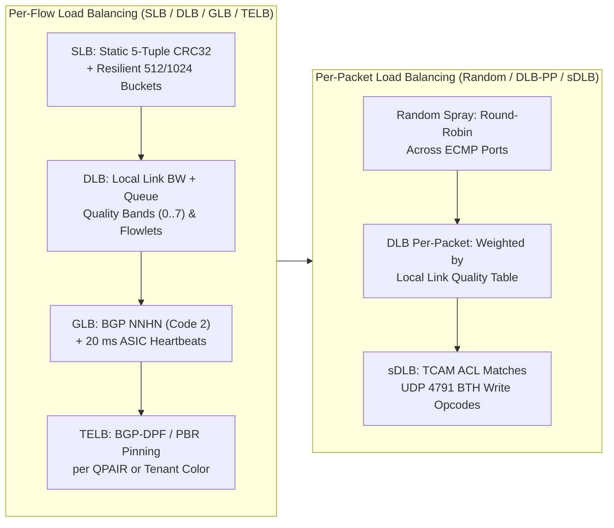
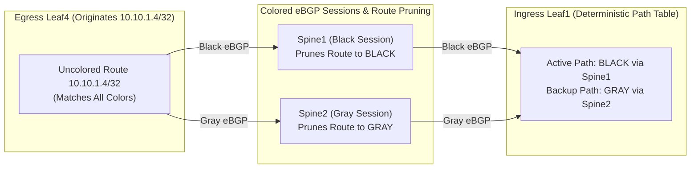

# 12.14 Load balancing and routing for AI fabrics

| | |
|---|---|
| Level | Advanced |
| Priority tier | 1 |
| Lab venue | Nebius GPU |
| Part | Part 12: Complete AI networking |
| Sources used | `ADC` Ch. 6, Ch. 8; `bcm11-admin` Ch. 3 |
| Coverage file | `planning/coverage/chapters/12-14.md` |
| Claim ledger | `planning/ledgers/12-14.md` |
| Companion code | `code/part12/load_balancing_routing_ai.py`, `code/part12/load_balancing_routing_ai_lab.py` |

## Why this matters for AI infrastructure

Picture an AI training cluster whose leaf-to-spine links are fully provisioned, with no oversubscription on paper. It can still run at half of its effective fabric capacity. The cause lies in how the switches spread the traffic across those links. You will recognize it by hot uplinks sitting next to idle ones. The dashboard shows every link as present and healthy, yet the job crawls, because the switches keep choosing the same few paths.

Enterprise web and microservice workloads open thousands of short, high-entropy TCP connections, and those connections spread evenly across switch ports. Each connection carries a small amount of data, and the many different source ports give the switch plenty of variety to hash. Distributed large language model training behaves very differently. Its natural language understanding and natural language generation phases send massive east-west synchronization bursts across a small, fixed set of GPU pairs, over RoCEv2 on UDP port 4791. RoCEv2 is RDMA carried over ordinary UDP and IP, and port 4791 is the number that identifies it. When two elephant flows hash to the same leaf-to-spine uplink, that link saturates and pauses traffic while adjacent uplinks sit idle. If the switches rely on traditional static 5-tuple Equal-Cost Multipathing, the cluster also suffers persistent Priority Flow Control stalls. A 5-tuple is the set of five header fields that name a flow, and Equal-Cost Multipathing, or ECMP, is the rule that spreads flows across several equally good paths. Priority Flow Control, or PFC, is the pause mechanism that stops a sender when a receiver's buffer fills.

Fixing this means working on two layers of the switching stack at once. The rest of the chapter keeps returning to that pairing. A fix that changes only one layer often works in the lab and then fails on the production fabric, because the other layer still sends traffic down the old path. Operators must line up data-plane load balancing, which runs in the switch Packet Forwarding Engine, with control-plane IP routing. The data plane is the part that moves each packet, and the control plane is the part that decides which routes exist. Think of the control plane as the map-maker and the data plane as the driver who picks a lane at every intersection. The two have to agree, or the driver ends up on a road the map never drew. That holds for three-stage, five-stage and DragonFly topologies alike.

In the data plane, modern AI switch ASICs have moved from Static Load Balancing, with resilient and weighted hashing, to local queue-aware Dynamic Load Balancing. An ASIC is the custom chip that does the forwarding work in the switch. They also support next-next-hop Global Load Balancing, Traffic Engineering Load Balancing and Selective Packet Spraying. Selective Packet Spraying matches RoCEv2 Base Transport Header write opcodes in TCAM. The Base Transport Header, or BTH, is the RoCEv2 header that carries the operation type, and TCAM is a fast lookup memory in the switch that matches packet fields against a set of rules.

In the control plane, operators deploy eBGP with RFC 5549 BGP unnumbered, shared spine Autonomous System Numbers, Link Bandwidth Extended Communities or BGP Deterministic Path Forwarding. Alternative control planes include Routing in Fat Trees, IS-IS with distributed flood reduction and Flex Algo, multi-tenant EVPN-VXLAN with NVIDIA Multi-Instance GPU, and Segment Routing over IPv6 with compressed micro-SIDs. Each of these names is a protocol or feature that the rest of the chapter explains in turn. If a name is new, read its section before the table row that mentions it. The table is easier to follow once each name already means something to you.

| Layer | Technology Family | Key Mechanisms and Standards |
|---|---|---|
| Workload traffic | Distributed LLM (`NLU` and `NLG`) | `1:1` non-oversubscribed `400 Gbps` or `800 Gbps` links, `RoCEv2` (`UDP 4791`), `100 Gbps` and `50 Gbps` flows on `200 Gbps` uplinks (`100%` vs `50%` load) |
| Data-plane load balancing | Switch ASIC `PFE` | `SLB` (`512` or `1,024` resilient buckets, `WCMP`), `DLB` (quality bands `0..7`, flowlets), `GLB` (`20 ms` heartbeats), `TELB`, `sDLB` (`BTH` write opcodes in `TCAM`) |
| Control-plane routing | Clos and DragonFly underlays | `eBGP` (`RFC 5549` Capability Code `5`, spine `ASN 65001`, `BGP DPF`), `RIFT` (`RFC 9692`), `IS-IS` (`RFC 9350` / `RFC 9502` Flex Algo), `EVPN-VXLAN` + `MIG`, `SRv6` `16`-bit `uSID` |

Read the table one row at a time. Each row names one layer and the technologies that serve it. Decide which layer is causing the problem before you change anything, because the fixes differ between layers, and tuning the wrong one wastes time. A symptom on a port counter usually points at the data plane, while a route that is missing or a path that flaps points at the control plane.

## Prerequisites and outcomes

Suppose a senior engineer asks you why one spine link is pegged while its neighbor is nearly empty. To answer, you need the vocabulary from the earlier chapters. If AI collective traffic patterns, RDMA Queue Pairs, RoCEv2 headers or congestion control feel unfamiliar, read Chapters 12.1 through 12.5 first. You should also be comfortable with switch ASIC buffer architectures, the trade-offs between Ethernet and InfiniBand, and the rail topologies covered in Chapters 12.11 through 12.13.

The chapter then moves through five engineering tasks, in order. It starts with the exact 5-tuple CRC32 hash key and the modulo indices, then builds resilient bucket remapping, symmetric XOR normalization and WCMP indirection tables for SLB. Next, it compares SLB, DLB, GLB and TELB across local and remote congestion scenarios. After that comes per-packet spraying and sDLB on NVIDIA ConnectX-6, ConnectX-7 and BlueField DPUs. The routing part covers eBGP AI underlays, using BGP unnumbered, shared spine ASNs, ADD-PATH, Link Bandwidth Extended Communities and BGP DPF. The last part looks at RIFT, IS-IS Flex Algo, multi-tenant EVPN-VXLAN with H100 MIG, host-level FRR BGP and SRv6 uSID traffic engineering.

| Outcome Area | Target Numbers, Identifiers, and Mechanisms |
|---|---|
| 1. `SLB` hashing math | `CRC32` key `0x8BDA7C2D` (`2,346,351,661`), `mod 5 = 1`, `mod 8 = 5`, `512` or `1,024` resilient buckets, symmetric `XOR`, `WCMP` |
| 2. `DLB`, `GLB`, and `TELB` | Quality bands `0` to `7`, flowlet inactivity timer (`256 µs`), `draft-wang-idr-next-next-hop-nodes` Code `2`, `20 ms` Tomahawk 5 heartbeats |
| 3. Per-packet spraying | Random Spray, `DLB` Per-Packet Mode, `sDLB` matching `UDP 4791` `BTH` RDMA Write opcodes (`0x06..0x0B`) on `ConnectX-6/7` and `BlueField` |
| 4. `eBGP` AI underlays | `RFC 5549` Capability Code `5`, `MP_REACH_NLRI` Type `14`, shared spine `ASN 65001`, `ADD-PATH`, `WCMP` (`20%/45%/15%/20%`), `BGP DPF` (`draft-wang-idr-dpf`) |
| 5. IGP, multi-tenancy, `SRv6` | `RIFT` (`RFC 9692`), `IS-IS` `Flex Algo` (`128`, `129`, `130`), `512`-GPU/rail `EVPN-VXLAN` + `7`-instance `H100 MIG`, host `FRR` (`4200000001..4200000004`), `16`-bit `uSID` |

Treat this table as a checklist. Before you start the labs, make sure each row makes sense to you, from the hash arithmetic in the first row to the SRv6 header in the last. If a row is still a mystery, the section it points to is the place to slow down.

---

## 1. Per-flow load balancing: from static hashing to global path awareness

### Why AI traffic has low entropy

Picture a leaf switch with several uplinks and a single elephant flow arriving on one of its server ports. The switch must choose one uplink for every packet of that flow. Every packet that leaves a switch has to take one uplink, and load balancing is the rule that picks it. In most data centers a simple rule works well enough. AI training changes that. A large language model has natural language understanding (NLU) and natural language generation (NLG) parts, and it trains across many GPUs at the same time. Those GPUs must exchange huge amounts of data, which creates heavy east-west traffic inside the data center.

Usually only a few applications run in such a cluster. If you watch the traffic, you will see a few large flows rather than many small ones. Most of it is RoCEv2, and that traffic has low entropy at the transport layer. Entropy here means how much variety the packet headers show. A switch hashes header fields to pick a path, so headers with little variety give the hash very little to work with. Much of the traffic moves between one source and one destination, so the network layer has low entropy as well. High-bandwidth flows then take a large share of the bandwidth on the ports between switches.

The aim here is to balance load before congestion forms, not after. Acting early gives you better fabric utilization and fewer congestion points. A congestion point that is caught late has already filled buffers and triggered pauses, and those pauses spread to neighbors that did nothing wrong.

An elephant flow is hard to place for a simple reason. Hashing decides a path from the header, and the header of a long RDMA stream does not change from one packet to the next. Every packet of that stream therefore lands on the same link, however empty the other links are. A mouse flow, by contrast, has many different headers across its short life, so the hash spreads it around without any help. The mix of the two is what breaks a plain ECMP design. The few large flows pile onto one link, and the many small flows that share that link pay the price in delay.

A useful habit is to count the elephant flows in your job before you tune anything. If the job runs only a handful of large flows per node, you should expect hashing to be lumpy. If it runs many flows, the hash will average out on its own. Knowing which case you are in tells you whether the fix belongs in the hash or in the path selection.

Flow-based balancing is only one option in an AI fabric. In a RoCEv2 setting, flow entropy is often low. One massive flow leaves the GPU server with the same source and destination IP addresses and UDP ports, so the headers barely vary. That is why per-packet load balancing, a packet-spraying technique, can serve as an alternative. Section 2 covers it.

### 1.1 IP ECMP next-hop groups and the low-entropy RoCEv2 problem

Picture a leaf switch that has learned several equal-cost paths to a remote GPU server. It has to forward each packet across those uplinks in hardware, because it cannot consult the routing CPU on every frame. Now imagine, as you read this, a separate hardware forwarding group for every destination IP prefix across dozens of spines. The ASIC's next-hop table memory would run out. So the switch control plane groups every remote prefix that shares the same spine next hops into one shared hardware ECMP group identifier. A next hop is the neighbor a packet is handed to next, and the group identifier is the handle the ASIC uses for that set of neighbors.

Take a three-stage Leaf-Spine Clos fabric. GPU1 connects to LeafA, GPU2 connects to LeafB, and both leaves connect to SpineA, SpineB and SpineC. LeafB advertises GPU2's IP subnet to all three spines. Each spine rewrites the BGP next-hop attribute to itself, then advertises the prefix to LeafA. All three paths carry identical routing metrics and BGP attributes, so LeafA installs one shared hardware ECMP group in its ASIC forwarding table. The routing protocol has not picked a winner. It has simply recorded that all three spines are equally good for this prefix.

```text
ASIC ECMP Group nh-id123 ---> { Unicast_nh1: SpineA, Unicast_nh2: SpineB, Unicast_nh3: SpineC }
Scale in production AI clusters: 32 or 64 spines sharing nh-id123 (or resolving to remote VTEP loopbacks under EVPN-VXLAN MAC-VRF / RT5 overlays)
```

After the control plane programs `nh-id123`, the switch ASIC's Packet Forwarding Engine picks the spine for every packet by itself. Neither BGP nor the switch CPU takes part in choosing which spine carries a given packet. That division of labor is what keeps forwarding at line rate. The control plane sets up the group once, and the hardware makes the per-packet choice from that group.



The diagram reads from left to right, and the arrows show how each family adds one more signal. The per-flow families keep every packet of a flow on one path. The per-packet families spread a flow across paths, which brings the reordering risk discussed in section 2.

The table below sorts the load-balancing families by the signal each one uses and the hardware it needs. Pay attention to the last column. Every per-packet option depends on a NIC that can reorder packets.

| Load-Balancing Family | Specific Mechanism | Primary Input Signals | Reordering Exposure and Target Hardware |
|---|---|---|---|
| **Per-Flow (`SLB`)** | Raw Modulo, Resilient (`512`/`1,024` buckets), Symmetric `XOR`, Weighted (`WCMP`) | Packet 5-tuple (`SRC/DST IP`, `Proto 17`, `SRC/DST UDP`) + optional `BTH QPair` | Zero intra-flow reordering; vulnerable to low-entropy elephant collisions (`100%` vs `50%` link load). |
| **Per-Flow (`DLB`)** | Assigned-Flow Mode, Flowlet Mode (inactivity timer), Reactive Rebalancing | 5-tuple + local port bandwidth utilization and egress buffer queue depth (quality bands `0..7`) | Zero reordering if paused longer than inactivity timer; brief reordering during reactive rebalancing. |
| **Per-Flow (`GLB`)** | Broadcom Cognitive Routing / `Tomahawk 5` `GLB` App | Local `DLB` quality + remote spine-to-egress-leaf quality via `BGP NNHN` (`Code 2`) and `20 ms` ASIC heartbeats | Prevents downstream spine collisions (`Link X` on `SpineA -> LeafD`); lowers `DCQCN` and `PFC` triggers. |
| **Per-Flow (`TELB`)** | Filter-Based Forwarding (`FBF`/`PBR`), `BGP DPF`, or Out-of-Band `TELB` Controller | Source `UDP` port range, `RoCEv2 BTH QPair`, ingress GPU port, or fabric telemetry | Deterministic in-order delivery per colored fabric plane with pre-installed ASIC backup path ID. |
| **Per-Packet** | Random Spray, `DLB` Per-Packet Mode, Selective Packet Spraying (`sDLB`) | Per-datagram spraying (`1,500 B` packets `A, B, C`) + `TCAM ACL` on `BTH` RDMA `Write` opcodes (`0x06..0x0B`) | Requires NIC hardware reorder buffer (`NVIDIA ConnectX-6/7` or `BlueField` DPU for RDMA Write opcodes). |

### 1.2 Static load balancing (`SLB`): worked CRC32 5-tuple math, resilient buckets, symmetric XOR, and WCMP

Static Load Balancing, or SLB, hashes the packet headers and never checks whether the chosen link is idle or busy. Two elephant flows that produce the same hash index collide on one spine link, while the parallel links sit underused. Think of it as a coin toss that is made once per flow and never revisited. The situation gets worse when a link flaps. A change in the number of active uplinks makes naive modulo arithmetic remap almost every active flow in the switch at once.

Here is what happens when a packet enters a port under SLB. The Packet Forwarding Engine (PFE) pulls out the 5-tuple header fields, plus optional fields from the RoCEv2 BTH header. It runs those bits through a hardware hash polynomial, such as CRC32 or CRC16. CRC is a checksum-style hash that mixes the input bits into a short number. Raw modulo arithmetic then divides the hash key by the number of active ECMP members. The remainder picks the outgoing interface index. If you want to check the arithmetic yourself, follow the worked example below.

```text
Worked 5-Tuple CRC32 Calculation (ADC Ch. 6):
- Simple modulo examples (N = 5): hash_key = 10 -> 10 mod 5 = 0; hash_key = 11 -> 11 mod 5 = 1
- Source IP address:      192.168.1.20 -> hex C0A80114
- Destination IP address: 192.168.2.10 -> hex C0A8020A
- IP Protocol:            17 (UDP)     -> hex 11
- Source UDP port:        1024         -> hex 0400
- Destination UDP port:   4791 (RoCEv2)-> hex 12B7
- Concatenated 13-byte (104-bit) string: C0A80114 C0A8020A 11040012 B7
- Hardware CRC32 output:  0x8BDA7C2D = 2,346,351,661 (base 10)
- Active links N = 5:     2,346,351,661 mod 5 = 1 (outgoing interface index 1)
- Active links N = 8:     2,346,351,661 mod 8 = 5 (outgoing interface index 5)
- Naive modulo churn:     dropping from 5 to 4 links remaps 75% of active flows
```

With five active links, the example flow goes to interface 1. With eight active links, the same hash sends it to interface 5. The output changes just because the divisor changed. The flow did nothing wrong, and the packets themselves are identical. Only the number of links moved, and that is enough to move the flow.

Resilient hashing exists to stop that churn. Instead of dividing by a number that moves with the link count, the switch uses a fixed hardware indirection table of 512 or 1,024 buckets. Think of the table as a list of buckets, where each bucket points at one interface. A hash picks a bucket, and the bucket names the link. When one interface fails, the ASIC rewrites only the buckets that pointed to that link. Every other bucket stays untouched.

Picture a small 8-bucket table, which is enough to show the idea. The table below walks through it. Five links are active at first, and `interface_2` fails.

| Bucket Index (`hash_key mod 8`) | Initial Mapped Interface (`5` Active Links) | Remapped Interface After `interface_2` Fails | Status on `interface_2` Failure |
|---|---|---|---|
| `Bucket 0` | `interface_0` | `interface_0` | Unchanged |
| `Bucket 1` | `interface_1` | `interface_1` | Unchanged |
| `Bucket 2` (`10 mod 8 = 2`) | `interface_2` | `interface_0` (reassigned) | **Affected (`2 / 8 = 25%` remapped)** |
| `Bucket 3` | `interface_3` | `interface_3` | Unchanged |
| `Bucket 4` | `interface_4` | `interface_4` | Unchanged |
| `Bucket 5` | `interface_0` | `interface_0` | Unchanged |
| `Bucket 6` | `interface_1` | `interface_1` | Unchanged |
| `Bucket 7` | `interface_2` | `interface_1` (reassigned) | **Affected (`2 / 8 = 25%` remapped)** |

Only Bucket 2 and Bucket 7 change interface. That is 2 of 8 buckets, or 25%. Every other flow keeps its path. Compare that with the modulo result above, where dropping to four links moved 75% of flows. The bucket table turns a large reshuffle into a small, local repair.

Switches often add two more SLB features on top of resilient buckets. The first is symmetric hashing. It sorts or applies a bitwise XOR over the source and destination IP addresses and UDP ports before the CRC32 runs. XOR is a bitwise operation that combines two values in a way that does not depend on their order, so A-to-B and B-to-A give the same result. Both directions of a bidirectional flow then land on the same bucket and interface. Stateful firewalls and inline inspection engines need exactly that symmetry, because they must see both directions of a conversation on the same device.

The second is Weighted ECMP. It fills the bucket table in proportion to the configured next-hop weights instead of spreading the buckets evenly. Weighted ECMP does not change the hash. It only changes how many buckets each link owns, so a link that is twice as fast should own about twice as many buckets. The hash still spreads flows the same way within each link's share. That pushes more flows toward the higher-capacity spines. A spine with twice the capacity gets roughly twice the buckets, which is the simplest way to make unequal links carry unequal loads.

Even with all three features, SLB stays blind to real flow rates and queue occupancy. You can have the same number of flows on every port and still see severe bandwidth imbalance, especially when elephant and mice flows mix. Mice flows are the small, short flows, and they are the ones that suffer when an elephant flow fills a queue they share.

| Metric / Scenario | `LeafA -> SpineA` (`200 Gbps` Uplink) | `LeafA -> SpineB` (`200 Gbps` Uplink) | Operational Outcome |
|---|---|---|---|
| **`SLB` (`2` flows per link: `Flow1=50G, Flow2=100G, Flow3=50G, Flow4=100G`)** | `Flow1 + Flow3 = 100 Gbps` (`50%` utilization) | `Flow2 + Flow4 = 200 Gbps` (`100%` utilization) | `SpineB` saturates at `100%` while `SpineA` sits at `50%`. |
| **`SLB` low-entropy collision (`2 × 200 Gbps` elephant flows)** | `0 Gbps` (`0%` utilization) | `2 × 200 Gbps` (`100%` saturated) | Mice flows drop or pause behind colliding elephant flows. |
| **`DLB` bandwidth-aware assignment (`Flow1..Flow4`)** | `Flow1 + Flow4 = 150 Gbps` (`75%` utilization) | `Flow2 + Flow3 = 150 Gbps` (`75%` utilization) | Both `200 Gbps` uplinks balance at `150 Gbps` (`75%`). |

Compare the first row with the last, and you will see the gap. Under SLB, one spine saturates at 100% while the other sits at 50%. DLB brings both links to 75%. The flows are the same in both rows. Only the choice of link changed, and that choice is what the hash got wrong.

### 1.3 Dynamic load balancing (`DLB`): quality bands, flowlet inactivity timers, and reactive rebalancing

Static hashing has no idea that one uplink carries twice as many bytes per second as its neighbor. You may find that collective phases shift the traffic pattern every few milliseconds. When they do, static hash assignments leave some uplinks congested and others half empty. If you have watched one uplink run hot while its neighbor sits idle, you have seen this problem. Dynamic Load Balancing, or DLB, fixes this local collision problem. It puts real-time link utilization and egress queue depth into each forwarding decision. An egress queue is the line of packets waiting to leave through a port, and its depth tells you how backed up that port is.

DLB began in Broadcom switch silicon, and other platforms call it Adaptive Load Balancing. Inside the switch ASIC, DLB runs an embedded microkernel that keeps sampling two things: the bandwidth in use on each local port, and how full each egress buffer queue is. A microkernel is a small, dedicated control program running on the chip, separate from the main switch software. Every ECMP member interface gets an integer link quality band, from 0 for the lowest quality to 7 for the highest. Because the PFE tracks port state in real time, DLB spots a local link failure within microseconds. It does not have to wait for control-plane routing to converge. Convergence is the time the routing protocol takes to agree on a new set of paths, and it is usually much slower than a hardware check.

| `DLB` Operational Mode | Forwarding Mechanism | Suitability for AI Training Fabrics |
|---|---|---|
| **1. `DLB` Assigned-Flow Mode** | Assigns each new flow to the highest-quality local egress port when its first packet arrives and pins it there for life. | Unsuitable for AI backend fabrics because RDMA Queue Pairs stay open for hours while link quality changes. |
| **2. `DLB` Flowlet Mode (Inactivity Timer)** | Tracks flows in hardware flowset tables and starts a per-flow inactivity timer (`256 µs`). Pauses shorter than the timer keep the current spine (`SpineB`); gaps exceeding the timer reassign the next burst (flowlet) to a higher-quality spine (`SpineA`). Ties (e.g., all at band `7`) fall back to flow hash. | Ideal for bursty GPU tasks that reuse the same outer 5-tuple (differing only inside `IB BTH`) with natural inter-task gaps. |
| **3. `DLB` Reactive Path Rebalancing** | Monitors active links for continuous elephant flows (`Flow1`, `Flow2`, `Flow3`) that never pause longer than the inactivity timer. Migrates flows from degraded `LeafA -> SpineA` to `LeafA -> SpineC` mid-stream. | Useful when destination NICs can tolerate brief transient packet reordering during the path switchover. |

The three modes differ in when a flow is allowed to move. Assigned-flow mode pins a flow for life, flowlet mode moves it after a pause, and reactive rebalancing can move it mid-stream. For bursty GPU tasks, flowlet mode is the ideal fit. Reactive rebalancing helps only when the destination NICs tolerate brief reordering.

Flowlet mode is worth a closer look, because its timer does the work. Think of a flow as a conversation with pauses in it. The timer is a judgment call. Set it too short and a flow will be moved while packets are still in flight. Set it too long and the flow never gets a chance to move at all. The right value depends on how long the natural pauses in your traffic are, which you can measure on your own jobs. As long as the pauses are shorter than the inactivity timer, the switch keeps the conversation on its current path. When a pause is long enough, the switch knows the next burst cannot overtake anything still in flight, so it is safe to move that burst to a better path. The 256 µs timer in the table is the threshold that marks the pause.

### 1.4 Global load balancing (`GLB`): BGP NNHN (`draft-wang-idr-next-next-hop-nodes`) and `20 ms` ASIC heartbeats

Local DLB balances the leaf-to-spine uplinks, but it cannot see one hop further downstream. Suppose you run servers on LeafA and LeafB, and both send line-rate elephant flows to one server on LeafD. LeafA checks its uplink to SpineA and finds it uncongested. LeafB checks its own uplink to SpineA and finds the same. Both leaves then send their elephant flows through SpineA. The flows collide on the single downlink from SpineA to LeafD, while SpineB's downlink to LeafD sits idle. That collision on the spine triggers ECN marking, DCQCN rate cuts and PFC pause cascades back into the fabric. ECN marking is the signal that tells senders a queue is filling, and DCQCN is the congestion control that slows senders down in response.

Global Load Balancing, or GLB, is the answer. It arrived in Broadcom's cognitive routing architecture, starting with the Tomahawk 5 ASIC. The answer is not to make the leaf smarter about its own ports, which it already knows. The answer is to give it a view of the far side of each spine, so it can see a jam that it cannot observe directly. GLB removes remote spine collisions by combining two things. Control-plane topology discovery uses BGP Next-Next-Hop Nodes, and fast data-plane hardware heartbeats supply the live quality data. The phrase next-next-hop means the leaf learns not just its spine neighbor but also the leaf that sits beyond that spine. That extra hop of knowledge is what makes global balancing possible. A local switch can only see its own ports, but a leaf that knows the far leaf behind each spine can judge the whole path before it commits a flow.

```text
Global Load Balancing (GLB) Architecture on Broadcom Tomahawk 5 (ADC Ch. 6):
1. Control-Plane Topology Discovery (draft-wang-idr-next-next-hop-nodes / BGP NNHN):
   - Carried inside BGP Next-Hop Dependent Capabilities attribute
   - Bits 0..15:  Characteristic Code = 2
   - Bits 16..31: Characteristic Length = variable
   - Row 2 (Bits 0..31):  32-bit Next-hop BGP ID (immediate spine next hop)
   - Row 3+ (Bits 0..31): 32-bit Next-next-hop BGP IDs (downstream egress leaves reachable via ECMP for the NLRI)
2. Data-Plane PFE Heartbeats (20 ms interval):
   - BGP sends a path-monitor message instructing the PFE GLB app to flood heartbeats ONLY on active BGP underlay interfaces
   - Change-based hardware heartbeats exchanged every 20 ms
3. Path Quality Profiles & Avoidance:
   - Simple path quality profile:   3-stage Clos (single next-next-hop leaf per spine for a prefix)
   - Compound path quality profile: 5-stage Clos (groups 2+ simple profiles across pod spines and super-spines)
   - Path correlation: combines local Link A (LeafA->SpineA) & Link B (LeafA->SpineB) with remote Link X (SpineA->LeafD) & Link Y (SpineB->LeafD)
   - Result: LeafA sees remote Link X is congested and steers new flows over Link B -> SpineB -> Link Y
```

Read the three steps in order, because you will meet them in that sequence on a real switch. Step 1 teaches the leaf which spines reach which egress leaves. Step 2 keeps link quality fresh with heartbeats every 20 ms. Step 3 uses both to steer new flows away from a congested downlink. Think of step 1 as a road map with the destinations written on it, step 2 as live traffic reports, and step 3 as the driver who reroutes when the report shows a jam ahead.

In a five-stage Clos, operators can choose from four GLB scopes, and the choice depends on how large the hardware tables are. The first scope covers a three-stage Clos fabric on all switches. The second treats each pod of a five-stage Clos as its own three-stage GLB domain. The third runs GLB only between the spine and super-spine layers, which suits a fabric that is oversubscribed there. The fourth runs across all five stages, and it needs enough ASIC profile table capacity to hold it. A scope is simply the set of switch tiers that share quality information. Choosing the scope is a question of cost and table size. A narrow scope keeps the hardware tables small and the heartbeats few. A wide scope sees more of the fabric and can avoid more collisions, but it asks more of the ASIC profile tables. Start with the narrowest scope that covers the layer where your collisions happen, and widen it only when the counters show that the narrow scope is missing them.

### GLB heartbeats, update rates, and congestion effects

GLB also cuts down how often congestion signals fire. Spines send link quality to leaves in GLB heartbeats, at microsecond speed. When a spine link degrades, the leaves move new flows to other paths, which are less likely to be congested. Fewer congested paths can mean fewer DCQCN triggers at the spine level. DCQCN stands for Data Center Quantized Congestion Notification. The RoCEv2 transport and congestion chapter covers it in detail.

Fewer DCQCN triggers also means fewer PFC frames pile up. A flood of PFC frames can stall traffic across the whole fabric, so preventing that flood matters. GLB helps stop the stall before it starts. The benefit is easy to miss on a graph, because the stall that does not happen leaves no trace, but a single prevented pause cascade can save a whole training step.

Update frequency is the hard part of GLB. Topology information needs an update only when the topology changes. Link quality can update in real time, or when a change starts. Propagation has to be fast, at the microsecond level, so each change has little impact. During frequent microbursts, the heartbeats may need tuning. A microburst is a very short spike of traffic that fills a queue and drains again within moments. Plan for that tuning early in a GLB deployment, and measure the microbursts on your own traffic before you choose a heartbeat rate.

### 1.5 Traffic engineering–based load balancing (`TELB`)

Dynamic schemes such as DLB and GLB react once queue occupancy starts to change. Multi-tenant LLM training clusters often need something stricter: deterministic path pinning. With pinning, one tenant's bursty AllReduce or AllToAll job never shares spine links or buffers with another tenant. A tenant is one customer or one team sharing the cluster, and pinning gives each of them their own set of paths. Traditional MPLS Traffic Engineering and Segment Routing MPLS need expensive software licenses on high-radix switches, and they add label overhead. High-radix switches are the ones with many ports, and labels are the extra headers that MPLS stacks on each packet. They also lack full telemetry, and their lossless DCQCN compatibility is weaker than in a native IP fabric.

Traffic Engineering–Based Load Balancing, or TELB, gives you deterministic path diversity inside a pure Ethernet and IP fabric. You get it with one of three tools: filter-based forwarding rules, ingress-port coloring, or an out-of-band telemetry controller. That controller stays in step with the GPU job scheduler, so the path plan changes when the jobs change. The difference from DLB and GLB is intent. DLB and GLB react to queues, so the path a tenant gets depends on what else is running at that moment. TELB decides the path ahead of time, so a tenant's paths stay the same across bursts. Predictability is worth a little efficiency when a tenant pays for a guaranteed slice of the fabric and expects its job to finish on the same schedule each time.

| `TELB` Mechanism | Topology and Configuration Details | Operational Guarantee |
|---|---|---|
| **1. Multi-tenant spine slicing and `FBF` / `PBR`** | In an `8`-spine, two-stripe `ROD` (`Leaf1..Leaf8` in Stripe 1, `Leaf9..Leaf16` in Stripe 2) with `7` tenants (`Tenant 1..7`), pin `Tenant 1` to `1` spine or split `4` and `4` spines. Host splits collectives across multiple `RoCEv2` `QPAIRs`; leaf `FBF`/`PBR` maps `QPAIR` or source UDP port ranges onto colored path IDs (`BGP DPF`). | Strict in-order delivery per pinned spine or `QPAIR` group with pre-installed ASIC backup path IDs. |
| **2. Ingress-port coloring in `RUD`** | All `8` GPUs (`GPU 1..8`) of a server connect to the same leaf complex (`Leaf1..Leaf16` with `3 × 400G` uplinks to `Spine1..Spine8`). `TELB` classifies traffic by ingress switch interface, assigning each GPU ID to a dedicated logical fabric color. | A bandwidth spike on `GPU 1` cannot contend with jobs running on `GPU 2..8`. |
| **3. Out-of-band (`OOB`) `TELB` controller** | External controller on the `OOB` management network collects streaming telemetry (queue buffers, `DCQCN`/`PFC` counters, active probe latencies) and coordinates with the GPU job scheduler. | Dynamically updates deterministic path placements before job launch or between training phases. |

Each mechanism in the table pins traffic to a path in a different way. Filter-based forwarding matches flows, ingress coloring matches the port a GPU uses, and the controller updates placements before a job starts or between training phases. The first mechanism is the most flexible, the second is the simplest to reason about, and the third is the one that needs a live feed of telemetry to work well.

### Why MPLS-TE and SR-MPLS are rarely used in AI fabrics

MPLS-TE and SR-MPLS are mature traffic engineering tools, but you will find them costly inside a data center. Upgrading 400 Gbps and 800 Gbps switches to run them raises capital expenditure, or capex. Capex is the up-front hardware and licence spend. It also raises operating expenditure, or opex, which is higher than for current data center technologies. Opex is the running cost of operating the network day to day. MPLS usually needs a premium license, so many operators keep it only in the core network. That draws a clear line at the data center gateway.

Telemetry for MPLS and SRv6 is also weaker than in a plain IP fabric. DCQCN compatibility is usually limited or incompatible, and the lossless fabric depends on DCQCN. For that reason, a pure IP fabric is still the better choice for most AI data center deployments. Decide early that the AI fabric itself will run on IP, and keep MPLS at the gateway. Changing that decision after the fabric is cabled means changing the switch software, the licences and the telemetry all at once.

---

## 2. Per-packet load balancing and selective packet spraying (`sDLB`)

### 2.1 Random spray, DLB per-packet mode, and the receiver reordering challenge

Think about one GPU pair that sends a huge elephant flow at full line rate. Per-flow load balancing keeps that whole flow on one path, so it can never split across several spine links at once. That is a hard limit when one flow is bigger than one link. Per-packet load balancing removes that limit. The ingress leaf ignores its flow tables and sprays each arriving packet of the elephant flow across all available ECMP uplinks. That reaches nearly perfect link utilization, even when a single pair of GPUs communicates at line rate.

Think of the difference as a road with one lane for each car, against a road where every car may pick any open lane. The first road is simple, but one slow car blocks everyone behind it. The second road uses all its lanes, and the cars arrive in a slightly shuffled order that the destination must sort out. Per-packet spraying trades order for capacity, and that trade is only worth making when the receiver can do the sorting.

Spraying has a cost, and the cost lands at the receiver. The cost is not paid by the switch. It is paid by the NIC, which must hold packets that arrive early and wait for the gap to fill. A NIC with a reorder buffer can do that quietly, while a NIC without one turns every gap into a retransmit request. The same spray rule therefore helps one fabric and hurts another, depending on the NIC at the far end. Parallel spine switches never have identical queues at the same instant, so packets sprayed across three spines arrive out of sequence. A traditional RDMA NIC without a hardware reorder buffer reads an out-of-order Packet Sequence Number as packet loss. A Packet Sequence Number, or PSN, is the counter that lets the receiver put packets back in order. The NIC answers with Go-Back-N NAK storms, which means it asks the sender to resend everything from the gap onward, and those storms collapse goodput. Goodput is the useful data that actually arrives, as opposed to the raw bits on the wire.

```text
Per-Packet Spraying and Selective Packet Spraying (sDLB) Mechanics (ADC Ch. 6):
- Spraying example: 100 Gbps flow of 3 x 1,500-byte datagrams (Datagram A, Datagram B, Datagram C) into Leaf1
  * Datagram A -> Port 1 (100 Gbps to Spine1)
  * Datagram B -> Port 2 (100 Gbps to Spine2)
  * Datagram C -> Port 3 (100 Gbps to Spine3)
- Out-of-order arrival at Leaf2 and server 192.168.1.1:
  * Time T1: Datagram B arrives first
  * Time T2: Datagram C arrives second
  * Time T3: Datagram A arrives last
- Switch Per-Packet Modes:
  1. Random Spray: blind random/round-robin across ECMP ports (can overload a link if 64 B control frames mix with 4,096 B or 9,000 B payloads)
  2. DLB Per-Packet Mode: weights per-packet spraying using the real-time DLB hardware link quality table (bands 0..7)
  3. Selective Packet Spraying (sDLB): ingress TCAM ACL inspects UDP 4791 + 8-bit RoCEv2 BTH opcode for ConnectX-6 (CX6), ConnectX-7 (CX7), and BlueField DPUs:
     - Flow1 (non-matching: RDMA Read Request 0x0C, RDMA Send Only 0x04) -> per-flow SLB/DLB (strictly in order)
     - Flow2 (matching: RDMA Write First 0x06, Write Middle 0x07, Write Last 0x08, Write Only 0x0A, 0x06..0x0B) -> DLB per-packet spray (NIC DDP engine places payloads out of order and defers CQE until all PSNs arrive)
```

Notice how the three datagrams land in the order B, C, A. Nothing was lost, and every packet arrived. The receiver simply has to rebuild the order, and a NIC without that ability treats the gap as a loss. That single difference explains why per-packet spraying is safe only for some traffic.

### 2.2 Complete load-balancing mechanism comparison (`ADC` Table 6-1)

Which mechanism you choose depends on two questions. Answer them in order. If the switch cannot see remote quality, GLB is off the table, whatever the NIC can do. If the NIC cannot reorder RDMA Writes, per-packet spraying is off the table, whatever the switch can do. Does your switch silicon support remote quality heartbeats? Do your NICs support out-of-order RDMA Write placement? The table below compares the seven capability dimensions across the four per-flow families.

| Feature / Capability | `SLB` (Static) | `DLB` (Dynamic) | `GLB` (Global) | `TELB` (Traffic Engineering) |
|---|---|---|---|---|
| **Load balancing based on packet characteristics** | Yes (`5`-tuple) | Yes (`5`-tuple + flowlets) | Yes (`5`-tuple + flowlets) | No (explicit path/color policy) |
| **Includes local link bandwidth** | No | Yes | Yes | Yes |
| **Uses queue size information** | No | Yes | Yes | No |
| **Can use remote link quality** | No | No | Yes (`BGP NNHN` + `20 ms` heartbeats) | Yes |
| **May include `RoCEv2 BTH` header for load balancing** | Yes | Yes | Yes | Yes |
| **Can use fabric telemetry for load balancing** | No | No | No | Yes |
| **Industry adoption level** | **High** | **Medium** | **Low** | **Low** |

Read the table from left to right. Each column adds one signal that the mechanism can use, from local bandwidth to queue depth to remote quality to fabric telemetry. If your NICs cannot reorder RDMA Writes, keep the flows on per-flow mechanisms. A simple rule follows from the table. The more signals a mechanism uses, the more hardware and telemetry it needs, so start with the cheapest one that fixes your collision.

---

## 3. IP routing for AI fabrics: eBGP unnumbered, ASN design, WCMP, and BGP DPF

### 3.1 Dynamic IP routing options: OSPF vs IS-IS vs eBGP across backend and frontend networks

Imagine you are asked to pick one routing protocol for the whole AI data center. A clear way to decide is to write down the three things that matter most for each domain. For the backend, the list is usually failure response, path control and simplicity of cabling. For the frontend, it is tenant separation, policy control and familiarity for the operations team. Once the lists are written, the protocol choice follows from them rather than from habit.

Do not skip the frontend list because the frontend seems minor. Inference traffic is often the part that users notice first, and a routing choice that suits the backend can make tenant isolation on the frontend harder to explain to an auditor. Writing both lists keeps those trade-offs visible from the start. The obvious answer is the one your team already runs. An AI data center actually has two routing domains, though, and they want different things. The backend training fabric connects high-speed GPU nodes over lossless RoCEv2 and DCQCN. The frontend inference and storage fabric connects inference servers, client gateways and storage clusters. That frontend can run RoCEv2, NVMe-o-TCP, iSCSI or iWARP. Suppose you choose eBGP for both domains. Their feature profiles still diverge. In practice that means two sets of settings, even though the protocol is the same. A design review should list the settings for each domain side by side, so that a change made for training does not quietly leak into the inference network. The backend usually runs a pure native IP underlay, tuned with GLB or BGP Link Bandwidth Extended Communities. The frontend instead layers multi-tenant EVPN-VXLAN overlays on standard equal-weight ECMP. An overlay is a virtual network built on top of the physical underlay, and equal-weight ECMP treats every path as the same size.

| Routing Protocol Family | Core Mechanism and Strengths | Operational Trade-Offs in AI Fabrics |
|---|---|---|
| **`OSPFv2` / `OSPFv3`** | Link-state flooding and Dijkstra `SPF` algorithm for fast convergence. | Requires separate instances for IPv4 (`OSPFv2`) and IPv6 (`OSPFv3`), lacks per-prefix policy traffic engineering, and risks transient micro-loops during topology changes. |
| **`IS-IS`** | Encapsulates directly over Layer 2 (immune to TCP spoofing), carries IPv4 and IPv6 in one instance via extensible `TLVs`, and scales to `2,500` switches with `Flex Algo`. | Enterprise data center teams often have less operational familiarity with `IS-IS` than with `BGP`. |
| **`eBGP` (`RFC 7938`)** | Deterministic path-vector loop prevention (`AS_PATH`), rich route-policy engine, native `EVPN` multi-tenancy, and multi-vendor maturity. | Requires `BGP` unnumbered (`RFC 5549`), shared spine `ASN` allocation, `ADD-PATH`, and link-bandwidth or `DPF` communities for optimal AI fabric behavior. |

eBGP covers both domains, but its last row lists the extras it needs for optimal AI fabric behavior. Compare the other two rows to see where OSPF and IS-IS fall short for this job. OSPF needs separate instances for each address family, and IS-IS is less familiar to most data center teams. Those two facts often decide the choice more than the protocol's technical merits.

### 3.2 eBGP underlay and BGP unnumbered (`RFC 5549` / `Capability Code 5`)

Picture a non-oversubscribed AI Clos fabric with dozens of high-speed links on every switch. The unnumbered design is also easier to repeat. Every new cable follows the same rule, so the configuration template does not change as the fabric grows. That consistency is the real benefit, because most routing faults in large fabrics come from one-off exceptions. Giving each cable its own `/30` or `/31` point-to-point IPv4 subnet, and then tracking all of them, is tedious and easy to get wrong. One mistyped subnet mask or one swapped cable can silently break ECMP symmetry. BGP Unnumbered, standardized in RFC 5549 and updated by RFC 8950, removes interface IPv4 address configuration altogether. The link itself carries the routing session, so there is no address to type.

Here is how it works. Under BGP unnumbered, each switch builds eBGP sessions over automatic IPv6 Link-Local Addresses. Those addresses come from the burned-in MAC address of each port. The switch then advertises IPv4 server prefixes with an IPv6 link-local next hop, using Extended Next Hop Encoding. Your work shrinks to two jobs: assigning private BGP Autonomous System Numbers, and redistributing the local GPU server interfaces through a route policy. An Autonomous System Number, or ASN, is the number that names one routing domain, and a private ASN is one reserved for internal use.

```text
RFC 5549 / RFC 8950 BGP Unnumbered Wire Sequence (ADC Ch. 8 Figs. 8-1, 8-2, 8-3):
- Private ASN ranges: 16-bit (64512 to 65535), 32-bit (4200000000 to 4294967294)
- Peers on interface Eth11:
  * spine1: MAC 0c:59:9c:f1:00:32, IPv6 LLA fe80::e59:9cff:fef1:32, AS 65001, Router ID 172.16.7.101
  * leaf1:  MAC 0c:59:9c:22:5d:d7, IPv6 LLA fe80::e59:9cff:fe22:5dd7
- Step 1 (ICMPv6 ND & RD): Exchange NS/NA (Router flag R set) and RS/RA carrying Source Link-Layer Address option (learns LLA + MAC without ARP)
- Step 2 (TCP Handshake):  spine1 fe80::e59:9cff:fef1:32 (port 52659) -> leaf1 fe80::e59:9cff:fe22:5dd7 (port 179) SYN, SYN-ACK, ACK
- Step 3 (Frame 22 - BGP OPEN, 189 bytes / 1,512 bits on wire):
  * Type = 1 (OPEN), Length = 81 bytes, Version = 4, My AS = 65001, Hold Time = 90 s, BGP ID = 172.16.7.101, Opt Params Len = 52 bytes
  * Capability: Extended Next Hop Encoding (Capability Code = 5, Length = 6 bytes)
    -> AFI = 1 (IPv4), SAFI = 1 (Unicast), Next Hop AFI = 2 (IPv6)
- Step 4 (Frame 28 - BGP UPDATE, 358 bytes / 2,864 bits on wire):
  * Type = 2 (UPDATE), Length = 82 bytes, Withdrawn Routes Len = 0, Total Path Attr Len = 46 bytes
  * ORIGIN = IGP, AS_PATH = 65001 (Flags = 0x40, Type = 2, Length = 6)
  * MP_REACH_NLRI (Flags = 0x90, Type Code = 14, Length = 42 bytes):
    -> AFI = 1 (IPv4), SAFI = 1 (Unicast), Next Hop = fe80::9:0a:2f:c1:f1:32, NLRI = 172.16.7.181/32
```

Step 3 carries the capability that lets an IPv4 route ride an IPv6 next hop. Step 4 carries the route itself. Watch those two frames if your unnumbered session comes up but the routes do not install. A session that is up with no routes usually means the capability was not negotiated, so check Step 3 first. The order of the four steps also tells you where a failure sits. If the link-local exchange in Step 1 fails, nothing above it can work, so the problem is cabling or interface state. If the TCP handshake in Step 2 fails, the problem is usually a filter or a wrong peer address. Only when Step 3 and Step 4 both appear do you need to look at the route policy itself.

### 3.3 BGP ASN allocation, ADD-PATH, AS-PATH normalization, Link Bandwidth WCMP, and minimum peers

The way you number your BGP Autonomous Systems decides how the fabric behaves when several links fail at once. Suppose every spine switch gets a different ASN. Simultaneous link failures can then make BGP route traffic down from one spine to a transit leaf, and back up to another spine. This is called valley tromboning. A valley is a path that goes down and then back up, which a clean fabric should never use. On 400 Gbps or 800 Gbps AI links, it saturates the transit leaf and stalls every GPU job attached to that leaf.

The fix is a single shared ASN for all spines in the same tier, with a unique ASN for each leaf. That prevents valley routing without extra work. When a bounced route comes back, the second spine sees its own shared ASN already in the `AS_PATH`. Standard loop detection then rejects the route immediately. Four more BGP features cover external multipath reflection, WAN ASN normalization, unequal spine bandwidths and degraded downlink withdrawal. Multipath reflection is the way a route reflector passes several equal paths to clients, instead of just one best path.

| Control-Plane Feature | Topology and Configuration Parameters (`ADC` Ch. 8) | Operational Behavior |
|---|---|---|
| **1. Shared Spine `ASN` (`Fig. 8-4` vs `Fig. 8-5`)** | `spine1..spine4` share `ASN 65001`; `leaf1..leaf4` use unique `ASNs 65101..65104`. Anti-pattern uses unique spine `ASNs 65001..65004`. | When `leaf1 -> spine2..4` and `leaf2 -> spine3` fail between `server1` (`10.10.1.1/24` on `leaf1`, `AS 65101`) and `server5` (`10.10.5.1/24` on `leaf3`, `AS 65103`), shared `ASN 65001` rejects the valley trombone `leaf1 (65101) -> spine1 (65001) -> leaf2 (65102) -> spine1/2 -> leaf3 (65103)` because `65001` is already in `AS_PATH (65001, 65102, 65101)`. |
| **2. `BGP ADD-PATH` (`Fig. 8-6`)** | External `DC GW` (`AS 65503`) advertises `server2` (`10.10.108.0/24`) via `border-leaf1` (`AS 65501`, `NH1`) and `border-leaf2` (`AS 65502`, `NH2`) to `spine2` (`AS 65001`). | Enabling `ADD-PATH send/receive` on `spine2` advertises both `NH1` and `NH2` for `10.10.108.0/24` to `leaf2` (`AS 65102`, hosting `server1` `10.10.101.0/24`) instead of only a single best path. |
| **3. `AS-PATH` Strip and Replace (`Fig. 8-7`)** | Ingress policy on border spines (`AS 65001`) or ToR leaves for routes from `server101` (private WAN core or host BGP daemons). | Strips private ASNs and replaces `AS_PATH` with a uniform-length operator ASN sequence so all border paths remain equal-cost `ECMP` candidates. |
| **4. Link Bandwidth Extended Community (`WCMP` / `WPS`, `Fig. 8-8`)** | `spine1..spine4` (`AS 65001`) connect northbound with `400 Gbps`, `800 Gbps`, `100 Gbps`, and `400 Gbps` (`1,700 Gbps` total). | Programs `WCMP` buckets on `leaf1..leaf4` (`AS 65101..65104`) as `20%` (`spine1`), `45%` (`spine2`), `15%` (`spine3`), and `20%` (`spine4`), or `13, 28, 10, 13` of `64` buckets. Dynamically lowers weights on 5-stage super-spine link failure (`Weighted Packet Spraying`, `WPS`). |
| **5. Minimum BGP Peers per Prefix** | Conditional advertisement policy on a spine reaching `10.10.101.0/24` across `4`-way `ECMP` downlinks. | If `1` downlink fails (active peers drop from `4` to `3`), the spine withdraws `10.10.101.0/24` northbound so upstream leaves use only the remaining `3` full-capacity spines instead of sending `25%` of traffic into a degraded spine. |

Each of the five rows answers a different question, from loop safety to degraded spines. Start with the first row, since it covers the valley tromboning failure this section opened with. The second and third rows deal with what the border of the fabric hears from outside. The fourth and fifth rows deal with unequal and degraded spines, which is where equal-weight ECMP goes wrong.

### 3.4 BGP Deterministic Path Forwarding (`BGP DPF`, `draft-wang-idr-dpf`) and traffic-to-fabric color mapping

Plain eBGP treats the Clos fabric as one shared pool of bandwidth. Every tenant competes for the same spine queues. The problem is not that eBGP is weak. It is that eBGP, by default, sees the fabric as one graph with one set of best paths. DPF adds a second dimension, the color, so the same physical link can belong to more than one logical fabric at once. BGP Deterministic Path Forwarding, specified in `draft-wang-idr-dpf`, changes that. It splits a physical three-stage or five-stage Clos into several isolated logical colored fabrics, such as black and gray. It does this by coloring the underlay eBGP peering sessions as well as the routes. A draft is an IETF working document, so the behavior is specified but may still change before it becomes a standard.

A leaf-to-spine underlay session can carry one color, several colors on the same physical link, all colors except some excluded ones, or no color at all. The color pruning rule governs what crosses each session. A route is advertised over a session only if it carries at least one color that matches the session's color. Colors that do not match get pruned when the route is advertised. The ingress leaf then has a deterministic active path, plus a backup path that the ASIC has already programmed. Pruning is the step that keeps a black route from leaking into the gray fabric.



Follow the diagram from the egress leaf outward. The uncolored route splits into a black session and a gray session, and the ingress leaf ends up with one active path and one backup. The active path is the one traffic uses, and the backup is already loaded into the ASIC, so a failover does not wait for a fresh route calculation.

| BGP DPF Stage / Deployment Mode | Mechanism and Route / Forwarding Behavior | Quantitative Example from `ADC` Ch. 8 |
|---|---|---|
| **1. Route Origination and Pruning (`Fig. 8-13`)** | Egress `leaf4` originates `10.10.1.4/32` uncolored (matching all colors). Advertising over `black` session to `spine1` prunes color to `black`; advertising over `gray` session to `spine2` prunes color to `gray`. | Ingress `leaf1` installs `black` via `spine1` as **Active** and `gray` via `spine2` as pre-programmed ASIC **Backup**. |
| **2. Rail-Optimized Design (`ROD`, `Fig. 8-10`)** | Two stripes (`Leaf1..8` and `Leaf9..16`, `8` GPUs/server) share `Spine1..8`. High-priority `black` tenant LLM is pinned to `fab-id black` for deterministic low `JCT`; other tenants (`Tenant 2..7`) use `DLB` / packet spraying. | Note resiliency trade-off: in `RUD`, losing `1` leaf takes down `4` whole `H100` servers (`32` GPUs); in `ROD`, losing `1` leaf impacts `1` rail across the stripe. |
| **3. Rail-Unified Design (`RUD`, `Fig. 8-11`)** | All `8` GPUs of a server connect to the same ToR leaf complex. Specific `GPU ID` (`GPU-id 0`) or `RoCEv2 QPair` is pinned to `fab-id black` across `128` servers. | `128 × GPU-id 0` across `128` servers allocated **`3 × 400 Gbps = 1.2 Tbps`** per leaf on logical fabric `black`. |
| **4. Traffic-to-Fabric Color Mapping (`4` Options)** | (a) **Filter-Based Forwarding (`FBF`)** on ingress ports, source UDP ports, or `BTH QPairs`; (b) **On-box agent** with active probes; (c) **Central controller (`CPCE`)**; (d) **`EVPN-VXLAN` underlay-to-overlay correlation (`Fig. 8-14`)**. | `MAC-VRF-black` / `RT5-VRF-black` maps to `black` IP path (`spine1`); `MAC-VRF-gray` / `RT5-VRF-gray` maps to `gray` IP path (`spine2`). |

When you debug a DPF deployment, start with stage 1. The colors it sets decide every later path the ingress leaf can use. If stage 1 is wrong, the later stages will look wrong too, and you will chase symptoms that have one cause.

### 3.5 Reading the DPF figures: shared pool, rail-optimized stripes, and rail-unified leaves

Think of a plain Clos fabric as a shared parking lot. Every tenant drives on the same lanes, and nobody can reserve a spot. The parking-lot picture is useful because it shows what the color mapping adds. The lot stays the same, but each tenant gets a reserved section with its own entrance and exit. The figures that follow show three layouts of the same idea, and each layout gives the tenants a little more structure. Figure 8-9 shows that shared pool. Two stripes sit at the top, and each one holds eight servers with eight graphics processing units each. Stripe 1 feeds leaf1 through leaf8, and stripe 2 feeds leaf9 through leaf16. All sixteen leaves connect to one pool, and eight spines connect to that pool too. A stripe is a group of servers that share one set of leaves.

Figure 8-10 shows the same stripes in the rail-optimized layout. Each stripe holds tenant racks, such as tenant1 and tenant7, with tenant2 through tenant6 implied between them. Each rack connects to all eight leaves in its group, and every leaf meets all eight spines in a full mesh. What changes is that a tenant's traffic now has defined rails to follow. It no longer shares one heap. The lanes are still shared at the spine, but each tenant has a clear route to it.

Figure 8-11 shows the rail-unified layout. Here the GPUs of one server are spread across leaves in pairs. The first server reaches leaf1 and leaf2. The second reaches leaf5 and leaf6. The third reaches leaf9 and leaf10. The fourth reaches leaf13 and leaf14. Keep the black fabric example in mind as you read it, since that is where the color mapping appears.

BGP DPF lets the ingress switch find paths to the egress router through different logical fabrics, such as the black fabric in Figure 8-11. You can then map each traffic flow to the logical fabric that matches its SLA. The mapping relies on colors, set on the underlay eBGP sessions and on the transport routes. When you trace it, start with the colors on the sessions, then check the routes that use them.

Figure 8-12 shows three kinds of session on a link. A solid line is one session type. A solid line and a dashed line together mean that two session types share the same link. A single dashed line is a regular session with no color. You can also set the color on the session itself, when the peering comes up. One link can then offer one color or several colored sessions at once.

Before you trust a colored path, check the session colors on each link. A correct route on the wrong session is the most common way a colored design goes quietly wrong.

---

## 4. Interior gateway protocols (`RIFT` and `IS-IS Flex Algo`), multi-tenancy, host BGP, and `SRv6 uSID`

### 4.1 RIFT (`RFC 9692`) for Fat-Tree and DragonFly Sparse topologies

Suppose an AI backend grows to tens of thousands of GPUs, or adopts a low-diameter DragonFly topology. At that scale, standard eBGP gets hard to automate. It needs intricate per-link policies and external failure detection. Routing in Fat Trees, standardized in IETF RFC 9692, is a hybrid Interior Gateway Protocol built for dense data center fabrics. An Interior Gateway Protocol, or IGP, runs inside one routing domain, and it is specialized for that job.

RIFT sends full topology link-state advertisements northbound, up to the Top-of-Fabric spines. The reason for sending the full picture upward is that the spines are the only devices that need to see everything. A leaf only needs to know how to reach the outside, so a default route is enough for it. This split is what allows a very large fabric to run with small tables at the edge. That gives the spines complete fabric visibility. In the other direction, southbound toward the ToR leaves, it advertises only a default route, using distance-vector. This asymmetry keeps leaf forwarding tables small. It also enables Zero-Touch Provisioning, so you do not need to assign ASNs by hand. The risk is a blackhole. A blackhole is traffic that is sent into a path that no longer leads anywhere, and it is silently dropped. If a spine-to-leaf link fails, a default route could keep sending traffic into it. RIFT prevents that with automatic route disaggregation. It pushes specific `/32` or `/24` prefixes southbound, so leaves route around the severed link.

```text
RIFT (RFC 9692) and DragonFly Sparse Architecture (ADC Ch. 8 Figs. 8-15..8-18):
- Target scale: 16,000 to 32,000 GPUs (>= 1,000 switch nodes)
- Hybrid routing: Northbound link-state to Top-of-Fabric (ToF) spines; Southbound distance-vector default route to ToR leaves
- Adjacencies & Multipathing: Lightweight UDP "hello" messages + IPv6 Neighbor Discovery (ND); automatic route disaggregation on failure; wide ECMP and northbound UCMP
- Canonical DragonFly: 7 switch groups (Group 1..7), each with 8 internally meshed switches and inter-group global links connecting every group to every other group
- DragonFly Sparse (draft-przygienda-rift-dragonfly):
  * Simplifies each group (Group A, Group B, Group C) into a standard two-tier Leaf-Spine Clos (LA1/LA2 -> SA1/SA2, LB1/LB2 -> SB1/SB2, LC1/LC2 -> SC1/SC2)
  * Interconnects only the T2 Top-of-Fabric (ToF) spines across groups (SA1/SA2 <-> SB1/SB2 <-> SC1/SC2)
  * Uses RIFT Key-Value Store (K-store) advertisements to distribute inter-group global links and link-quality telemetry for non-shortest-path UCMP with split-horizon loop prevention
```

The DragonFly Sparse lines matter most when you plan cabling. They show how a canonical DragonFly gets simplified, and why the RIFT K-store carries the inter-group links. A K-store is a key-value table that the protocol uses to pass configuration facts around the fabric. In practice, the cabling plan and the K-store contents have to match, so check them together.

### 4.2 IS-IS for AI IP fabrics: Optimal Distributed Flooding and Flex Algo (`RFC 9350` / `RFC 9502`)

Consider a dense AI fabric with 32 or 64 spines and several parallel links for each leaf-spine pair. With standard link-state flooding, every spine copies every new server prefix Link State PDU back to every leaf. A Link State PDU is the IS-IS message that carries one router's view of its links. That flood wastes control-plane CPU cycles and slows convergence. Modernized IS-IS fixes the problem. It also adds native IP traffic engineering planes, and it does that without MPLS or SRv6 header overhead.

Optimal Distributed Flooding changes the rule. Each leaf elects one designated spine to flood new server prefix updates, instead of having every spine replicate them. Think of it as one messenger carrying the news, instead of every spine shouting it to every leaf. The saving is largest when the fabric is wide, because the duplicate copies grow with the number of spines. In a small fabric the difference is hardly measurable, so the feature earns its place mostly in large builds with many parallel links. RFC 9350 and RFC 9502 add IS-IS Flexible Algorithm for native IPv4 and IPv6 prefix forwarding. Each switch advertises a Flexible Algorithm Definition. That definition sets the calculation type, the metric type, and any bandwidth or delay constraints. With that in place, one physical fabric can host isolated logical planes for storage, inference and training.

| `IS-IS` AI Fabric Capability | IETF Specification and Mechanism | Target Scale and Plane Mapping (`ADC` Ch. 8) |
|---|---|---|
| **1. Optimal Distributed Flooding** | `draft-white-lsr-distoptflood`: `leaf1` elects a single designated spine (`spine2`) to flood new server prefix `LSPs` across `T1/T2/T3/T4` Clos topologies. | Scales up to `2,500` switch nodes across `32` or `64` spines (`400G`/`800G` links) with minimal `LSP` fragment churn. |
| **2. `IS-IS` Flexible Algorithm (`Flex Algo`)** | `RFC 9350` (`FAD` tuple: Calculation Type, Metric Type, Constraints), `RFC 9502` (native IP Flex Algo via `IS-IS IPv4 Algorithm Prefix Reachability TLV` with `MTID`), and `draft-ietf-lsr-flex-algo-bw-con` (`min-bandwidth`, `max-link-delay`). | **`Flex Algorithm 128`** (`spine1/2`): Storage; **`Flex Algorithm 129`** (`spine3/4`): Inference; **`Flex Algorithm 130`** (`spine5/6`): Training elephant flows; **`Algorithm 0`**: default `SPF` fallback. |

If you plan the fabric, the second row is where plane planning happens. Each Flex Algo number maps to one traffic class, so decide the storage, inference and training split there. Algorithm 0 is the default, and it catches any traffic that no plane claims.

### 4.3 Protocol comparison: eBGP vs RIFT vs IS-IS (`ADC` Table 8-1)

When you pick an AI underlay routing protocol, weigh four things: topology support, frontend multi-tenancy, convergence speed and operational complexity. Convergence speed is how fast the fabric settles after a change, and operational complexity is how much your team has to run and watch. The table compares eBGP, RIFT and IS-IS across nine fabric design criteria.

| Characteristic | `eBGP` | `RIFT` (`RFC 9692`) | `IS-IS` (`RFC 9350` / `9502`) |
|---|---|---|---|
| **IP Clos `ECMP` topology support** | Yes | Yes | Yes |
| **DragonFly topology support** | No | **Yes** (`draft-przygienda-rift-dragonfly`) | No |
| **Multi-tenancy options for the frontend** | **Many** (`EVPN-VXLAN` `MAC-VRF` and `RT5`) | Limited | Limited |
| **Convergence speed** | Medium | **Fast** | **Fast** |
| **Link awareness** | Low (requires `BFD`/OAM/extensions) | **High** | **High** |
| **Full topology awareness** | Medium | **High** (northbound link-state) | Medium (`2,500`-node area scale) |
| **Automatic disaggregation on failure** | No | **Yes** | No |
| **Advertising fabric configuration data** | No | **Yes** (`K-store` metadata) | No |
| **Wide `ECMP` or `UCMP` (Unequal-Cost Multipathing)** | **Yes** (via Link Bandwidth Community) | **Yes** (native northbound `UCMP`) | No |

Look first at the DragonFly and multi-tenancy rows, since they separate the three options most clearly. If you run a DragonFly, only RIFT appears in the table as supported. If your frontend needs many tenants, eBGP with EVPN is the strongest option. The convergence and link-awareness rows matter for failure response, and they favor RIFT and IS-IS.

### 4.4 Network- and server-level multi-tenancy (`512` GPUs/rail, `H100 MIG`, `EVPN RT5`, and `VXLAN-GBP`)

A GPU-as-a-Service provider, or a private AI cloud inside an enterprise, cannot let one tenant's collective traffic cross into another tenant's workspace. It also cannot let one tenant's security boundary leak. Isolation has to hold at two levels. One is the network rail layer, used by bare-metal tenants. The other is the sub-GPU slice layer, used when a single server is shared. A bare-metal tenant has whole servers, and a sub-GPU slice is a fraction of one GPU.

At the network layer, EVPN Route Type 5 IP-VRFs and MAC-VRFs split a 512-GPU rail into isolated tenant routing domains. A VRF is a separate routing table, so two tenants can each have a route to the same address without clashing. Tenants can even reuse overlapping IP subnets across rails. At the server layer, NVIDIA Multi-Instance GPU partitions each H100 GPU in hardware, into up to seven isolated instances. Map each MIG instance to its own IEEE 802.1Q VLAN, MAC-VRF and EVPN Type-5 IP-VRF. That gives end-to-end CUDA-to-wire isolation, and it does not exhaust switch TCAM space.

| Multi-Tenancy Tier | Hardware and Protocol Architecture (`ADC` Ch. 8 Figs. 8-21..8-24) | Capacity and Isolation Numbers |
|---|---|---|
| **1. Bare-Metal (`BMSaaS`) Rail Multi-Tenancy** | `8` leaf switches × `8` spine switches built with `64 × 800 Gbps` radix switches. Each leaf allocates `32 × 800 Gbps` ports to spines (`4 × 800G` per spine = `25.6 Tbps`/leaf) and breaks out `32 × 800 Gbps` ports into `64 × 400 Gbps` server ports (`2 × 400G` breakout $\times 32$). | `8 × 64 = 512` GPUs per rail (`64` servers of `8` GPUs, `204.8 Tbps` `1:1` rail bisection). Partitioned into `4` bare-metal tenants of `128` GPUs/tenant using `EVPN RT5` (`RT5 IPVRF1..7`) + `MAC-VRF` (`RT2` symmetric IRB), reusing `8` IP subnets per tenant. |
| **2. Server + Network `H100 MIG` Multi-Tenancy** | NVIDIA `H100 MIG` partitions each GPU into `7` isolated instances (`GPU Instance 1..7`). Server-to-leaf links trunk `7` IEEE `802.1Q` tags (`VLAN 1..7`) into ToR leaves. | Each leaf maps `VLAN 1..7` `1:1` into `7` `MAC-VRF` instances (`MAC-VRF 1..7`) and `7` `EVPN Type-5 IP-VRFs` (`RT5 IPVRF 1..7`) for `Tenant 1..Tenant 7` without dynamic RADIUS `TCAM` exhaustion. |
| **3. Intra-Subnet Microsegmentation (`VXLAN-GBP`)** | Stamps a `16`-bit Group Policy ID (`GBP tag`) inside the VXLAN header on ingress when tenants or tiers share a subnet and `VNI`. | Egress ToR enforces microsegmentation rules in hardware without requiring additional `VRFs`. |

Tier 1 covers bare-metal tenants on the rail, and tier 3 covers isolation inside one subnet. Tier 2 sits between them, and it ties each server's VLANs to the leaf. Tiers 1 and 3 answer the questions a cloud provider asks first, namely who owns a whole server and who can see a packet inside a subnet. Tier 2 answers the question an inference operator asks, which is how one GPU can be shared safely. The design works only if all three tiers agree on the same tenant names. Read the tiers from the outside in. The rail is split first, then each server's GPUs are split, and last the traffic inside one subnet is tagged so policy can tell tenants apart.

### 4.5 Extending BGP to the GPU server (`FRR`) and SRv6 compressed `16`-bit `uSID` traffic engineering

Suppose a GPU server has several NICs, or it hosts containerized inference endpoints that move between racks. Static default gateway routes on the host then become a bottleneck. Running an open-source routing daemon, such as FRRouting, directly on the Linux GPU host or the BlueField DPU carries BGP all the way to the endpoint. Each server peers with its ToR leaves using 32-bit private ASNs. It advertises an IP anycast service prefix, which gives automatic leaf selection and host-level VRF isolation. Anycast means the same address is announced from several places, and the network delivers each request to the nearest one.

Sometimes you want central path steering, without keeping state for each flow in the switches. Segment Routing over IPv6 does that. The ingress leaf pushes a stack of Segment Identifiers onto each packet. A Segment Identifier, or SID, is an instruction that tells a switch where to send the packet next. Standard 128-bit SRv6 SIDs, though, add a lot of header overhead once four hops sit inside a Segment Routing Header. The Segment Routing Header, or SRH, is the extra header that carries the list of SIDs. Micro-segment SRv6 fixes that. It compresses each hop instruction into a 16-bit micro-SID, and all of them fit inside one 128-bit IPv6 Destination Address.

```text
Host-Level FRR BGP and SRv6 16-Bit uSID Carrier Math (ADC Ch. 8 Figs. 8-25..8-30):
1. Extending BGP to the GPU Server (FRR 32-bit Private ASNs):
   - Spines (spine1..spine4):   ASN 4294967100
   - Leaves (leaf1..leaf4):     ASN 4224967001, 4224967002, 4224967003, 4224967004 (or 4294967100 in iBGP RR mode)
   - Servers (server1..server4): ASN 4200000001, 4200000002, 4200000003, 4200000004
   - Advertised prefix: IP anycast inference/training service 192.168.10.10/32 with next hops NH1..NH4
2. Segment Routing over IPv6 (SRv6, RFC 8754 / RFC 8986) & Compressed 16-Bit uSID:
   - Controller discovery & programming: IGP or BGP-LS topology -> PCEP path placement (e.g., SID 5 transit spine -> SID 1 egress leaf)
   - Uncompressed SRH (RFC 8754): Next Header (0..7), Hdr Ext Len (8..15), Routing Type (16..23), Segments Left (24..31), Last Entry (0..7), Flags (8..15), Tag (16..31) + 128-bit SIDs formatted as Locator : Function (End / End.X) : Argument (RFC 8986)
   - Uncompressed 4-SID SRH overhead: 8-byte SRH base + 4 x 16-byte (128-bit) SIDs = 72 bytes (plus 40-byte outer IPv6 header = 112 bytes total)
   - Compressed SRv6 uSID (draft-filsfils-spring-net-pgm-extension-srv6-usid-16 & draft-filsfils-srv6ops-srv6-ai-backend):
     * Shared 32-bit locator block: fc00:0a10::/32
     * Remaining bits in 128-bit IPv6 Destination Address: (128 - 32) / 16 = 6 micro-SIDs (16-bit each), saving 72 bytes of SRH overhead
     * Carrier shift sequence: fc00:0a10:0005:0001:0000:: (ingress) -> fc00:0a10:0001:0000:0000:: (spine pops 0005) -> fc00:0a10:0000:0000:0000:: (egress leaf pops 0001)
```

The uncompressed four-SID header costs 112 bytes in total, counting the outer IPv6 header. In the compressed form, the header saves 72 bytes of SRH overhead, and the carrier shifts to the next micro-SID at each hop. The saving matters most for small messages, where a large header is a big share of the packet. For a bulk transfer of full-size frames, the same 72 bytes is a smaller fraction, but it still has to fit inside the frame size the switches allow. Think of the compressed address as a train with a fixed engine at the front. Each stop pops off the car that is now finished, and the next car moves into position.

### 4.6 Reading the tenancy figures: dedicated servers, RT5 across rails, MIG, and combined tenancy

Four multi-tenancy figures show this design in increasing detail, and each one adds a layer. Figure 8-21 starts with whole servers given to one tenant. Figure 8-22 spreads tenants across two rails. Figure 8-23 looks inside one GPU server, and Figure 8-24 puts the server and network levels together. If you read them in that order, each design choice will make more sense.

In Figure 8-21, four server racks are labeled server1, server2, server31 and server32, with servers 3 through 30 implied between them. Each server has eight ports. Each port goes to one of eight leaves, from leaf1 through leaf8. So every leaf receives one connection from each of the 32 servers, which gives it 32 incoming connections. Tenant A owns server1 and server31, and tenant B owns server2 and server32. The tenants are separated by server, not by port, so the whole machine belongs to one customer.

Figure 8-22 has five servers. Server1, server2 and server4 belong to tenant A. Server3 and server5 belong to tenant B. The leaves form two groups of eight, from leaf1 through leaf16, and the spines run from spine1 through spine8. Each GPU interface is labeled with an RT5 IP-VRF, such as RT5 IPVRF1 or RT5 IPVRF7. The tenant is defined at the ToR leaf. So traffic from server1 to server2 for tenant A rides an RT5 VXLAN tunnel. A BGP EVPN session signals that tunnel, and the tunnel uses its own routing VNI. A VNI is the identifier that tells VXLAN which virtual network a packet belongs to.

Reusing one IP subnet across several leaves takes a little more work. The design pairs MAC-VRF with RT5 EVPN, so each tenant needs only eight subnets across all the fabric rails. Lookups then follow the longest prefix match. That match uses RT5 host advertisements, or MAC-IP RT2 routes when symmetric inter-IRB routing is in use. Longest prefix match means the switch picks the most specific route that fits, and IRB is the routing interface that sits between a VLAN and a VRF.

Figure 8-23 shows one NVIDIA H100 server with MIG enabled. MIG is a software and hardware feature. It splits one GPU into up to seven separate GPU instances for CUDA applications. Each instance can map to its own VLAN. The figure shows instance 1 on VLAN 1 and instance 7 on VLAN 7. The links from the server to leaf1 and to leaf8 carry VLAN 1 through 7.

Inside a server, you can also use vGPU, and you can schedule work across servers with NCCL or RCCL. Figure 8-24 combines both layers. Tenant1 maps to MAC VRF 1 and a type 5 IP VRF. Tenant7 maps to MAC VRF 7 and its own IP VRF. Server1 connects GPU instance 1 on VLAN 1, and GPU instance 7 on VLAN 7. Server32 shows the same pattern.

Every leaf then runs seven MAC-VRF instances and seven EVPN IP-VRF instances, one for each tenant. A tenant can use every resource in one server, but its traffic between servers stays isolated. The example here uses tenant 1 and tenant 7, two different organizations. The operator has to keep their training jobs apart at the leaf level. That holds inside a rail and between rails.

Before you give a tenant a server, check which VLAN and VRF it maps to on every leaf. A mapping that is right on one leaf and missing on another is the kind of gap that only shows up when the tenant's job spans both.

---

## 5. End-to-end packet and control-plane walkthroughs

### 5.1 Walkthrough A: Ingress RoCEv2 flowlet vs GLB NNHN vs sDLB BTH opcode path selection

Picture two transfers that start on one GPU server on LeafA and head to a remote GPU server on LeafD. Both transfers share the same links on the way out, so the leaf has to treat them differently even though they leave from the same port. The walkthrough shows how one switch can make two different decisions for two different kinds of traffic, using only the headers and the quality data it already holds. Let's trace them one stage at a time. You will see how SLB, DLB, GLB and sDLB interact inside one leaf switch. The first transfer is a control transfer, made of RDMA Read Requests that must arrive strictly in order. Right after it, an AllReduce ring step sends bulk gradient payloads in RDMA Write Only frames toward a ConnectX-7 NIC.

| Walkthrough Stage | Packet / Control-Plane Attributes | Switch ASIC `PFE` Action on `LeafA` |
|---|---|---|
| **1. Control-plane table installation** | `SpineA` (`BGP ID 172.16.7.101`, `AS 65001`) and `SpineB` (`BGP ID 172.16.7.102`, `AS 65001`) peer with `LeafA` (`AS 65101`) over `RFC 5549` (`Capability Code 5`) and advertise `LeafD` with `BGP NNHN` (`Characteristic Code = 2`, `LeafD` `32-bit BGP ID`). | `Tomahawk 5` `GLB` app installs a 3-stage **simple path quality profile** combining local `Link A`/`Link B` quality with remote `Link X` (`SpineA -> LeafD`) and `Link Y` (`SpineB -> LeafD`) quality from `20 ms` `PFE` heartbeats. |
| **2. Control/Read flow (`RDMA Read Request 0x0C`)** | 5-tuple `192.168.1.20 -> 192.168.2.10, Proto 17, UDP 1024 -> 4791` (`CRC32 = 0x8BDA7C2D = 2,346,351,661`), `BTH Opcode = 0x0C`. | `0x0C` does not match the `sDLB` RDMA Write `TCAM` set (`0x06..0x0B`), so it uses per-flow `GLB`/`DLB` flowlet mode. Because `SpineA`'s `20 ms` heartbeat reports remote `Link X` degraded to band `1` (despite local `Link A` at band `7`), `LeafA` pins the flowlet to `Link B -> SpineB -> Link Y` (combined band `7`). |
| **3. Bulk gradient flow (`RDMA Write Only 0x0A`)** | `1,500-byte` (or `4,096-byte`) `RoCEv2` packets with `UDP 4791` and `BTH Opcode = 0x0A` (`RDMA Write Only`) to `ConnectX-7` / `BlueField-3`. | Matches ingress `TCAM` filter and invokes **`sDLB` per-packet spraying** across uncongested spines; destination NIC hardware reorder engine reassembles out-of-order datagrams (`B` at `T1`, `C` at `T2`, `A` at `T3`) directly in GPU memory. |

Stages 2 and 3 are the contrast to study. The read stays on one flowlet path, while the write stream is sprayed across uncongested spines. A read that stays on one path is safe because the NIC expects the replies in order. A write that is sprayed is safe only because the destination NIC can rebuild the order in hardware before it reports completion. The contrast is the whole lesson of the walkthrough, so trace each packet in the table and ask which rule let it take the path it took. The reason is the reorder rule from section 2. A read that arrives out of order breaks a strict sequence, but a write can be rebuilt by the NIC, so only the write may be sprayed.

### 5.2 Walkthrough B: Multi-tenant `512`-GPU rail with `H100 MIG`, `EVPN RT5`, and `BGP DPF`

Suppose a cloud provider commissions a 512-GPU rail. The rail is the unit of design here. Each rail is a complete set of leaves and spines that carries one slot of every server, so tenants are placed on rails and then split inside the rail. Planning at the rail level keeps the tenant map easy to read. It must serve large bare-metal training tenants and smaller fractional-GPU inference tenants, both on the same physical switches. Combining EVPN Route Type 5 overlays with NVIDIA H100 MIG and BGP DPF underlay coloring meets both needs cleanly. A fractional-GPU tenant uses a slice of one GPU, not the whole card.

| Tenant Layer | Configuration on the `512`-GPU Rail (`8` Leaves × `8` Spines of `64 × 800G` Switches = `204.8 Tbps`) | Isolation Result |
|---|---|---|
| **1. Bare-Metal (`BMSaaS`) Tenants** | `4` bare-metal tenants each lease `128` GPUs (`16` servers $\times 8$ GPUs) across `64 × 400G` server breakout ports and `32 × 800G` spine uplinks per leaf. | Segmented via `EVPN RT5` IP-VRFs (`RT5 IPVRF1..4`) or combined `MAC-VRF` (`RT2`) + `RT5`, reusing `8` rail subnets per tenant. |
| **2. Shared `H100 MIG` Tenants** | Shared nodes partitioned into `7` `MIG` instances (`MIG 1..7`) trunk `7` VLANs (`VLAN 1..7`) into ToR leaves. | Mapped `1:1` into `7` `MAC-VRF` instances (`MAC-VRF 1..7`) and `7` `EVPN RT5` IP-VRFs (`RT5 IPVRF 1..7`). |
| **3. `BGP DPF` Underlay Correlation** | `spine1` underlay `eBGP` session colored `black`; `spine2` session colored `gray`. `leaf4` originates `10.10.1.4/32` uncolored. | Ingress `leaf1` maps `Tenant 1` (`MAC-VRF-black` / `RT5-VRF-black`) to active underlay path `black` (`spine1`) with pre-installed ASIC backup path `gray` (`spine2`). |

Start from the third row, since the BGP DPF coloring decides which underlay path each tenant uses. Then check that each tier maps to its own VRF before you call the rail finished. Walk the rows in order, because each one assumes the row above it is already correct.

---

## Commands and configurations that matter

### 1. Cumulus Linux `NVUE` and BCM `cmsh`: eBGP unnumbered, shared spine ASN, and RoCEv2 adaptive routing

On NVIDIA Spectrum switches running Cumulus Linux, you set routing and QoS through NVUE and NVIDIA Base Command Manager. Before you apply anything, check the current state with the show commands and save a copy of the configuration. The habit costs a few minutes, and it turns a risky change into a reversible one. Treat the saved copy as part of the change record, the same way you would keep a rollback plan for any production switch. A config commit replaces the running settings in one step, so a saved copy is the fastest way back if a setting behaves differently than expected. In a single configuration commit, you can enable RFC 5549 BGP unnumbered with a shared spine ASN, lossless RoCEv2 QoS and hardware adaptive routing. The commands below show how. Read them as one block: the router settings come first, then the QoS and adaptive routing settings, and the final apply commits them together.

```bash
# (untested here) On leaf1 (ASN 65101): enable BGP unnumbered toward spine1..spine4 (shared ASN 65001)
nv set router bgp autonomous-system 65101
nv set router bgp router-id 172.16.7.181
nv set vrf default router bgp neighbor swp1-32 remote-as external
nv set vrf default router bgp neighbor swp1-32 type unnumbered
nv set vrf default router bgp address-family ipv4-unicast enable on
nv set vrf default router bgp address-family ipv4-unicast redistribute connected enable on
nv set vrf default router bgp address-family l2vpn-evpn enable on

# (untested here) Enable lossless RoCEv2 QoS (PFC prio 3 + ECN) and hardware adaptive routing / DLB
nv set qos roce enable on
nv set interface swp1-64 link mtu 9216
nv set router adaptive-routing enable on
nv config apply
```

From the BCM head node, administrators run `cmsh` to check the switch's NVUE management mode, its uplink port assignments, its hardware inventory and its NetQ telemetry port.

```text
BCM 11 Cumulus Linux Switch Management Reference (bcm11-admin Ch. 3 §3.8-3.12):
- NVUE REST API port: 8765 (nv CLI and REST management)
- nvconfigurationmode options: auto, manual, or file (pushes /etc/nvue.d/startup.yaml and cm-startup.yaml)
- SN2201 OOB/management switch specs: 8,048,771,072 B RAM, 115,923,419,136 B NVMe disk, uplink ports 15 16
- NetQ telemetry streaming port: HTTPS port 443
```

```bash
# (untested here) Inspect Cumulus NVUE switch management and port mapping in BCM 11 cmsh
cmsh -c "device; use switch01; get nvconfigurationmode; get uplinks; sysinfo"
cmsh -c "device; use switch01; accesssettings; get port"
cmsh -c "device; switchoverview"
```

### 2. Inspecting BGP unnumbered `Capability Code 5` (`Extended Next Hop`) and `MP_REACH_NLRI` (`Code 14`)

Suppose an unnumbered session is up but will not install IPv4 routes. Check two things. First, confirm that both switches negotiated RFC 5549 Extended Next Hop Encoding. Second, confirm that they exchanged IPv6 link-local next hops. The commands below inspect the neighbor capabilities in `vtysh`, and they capture the BGP OPEN and UPDATE frames on the wire. If the capture shows the capability but the route is still missing, the next place to look is the route policy, not the transport. Keep the capture and the policy output side by side, because a missing route usually has a single policy line behind it. Run the summary first, because it tells you whether the session is up at all before you look at the details.

```bash
# (untested here) Verify BGP unnumbered neighbor capabilities and IPv4 routes over IPv6 LLA next hops
vtysh -c "show bgp ipv4 unicast summary"
vtysh -c "show bgp neighbors swp11" | grep -E "Extended Next Hop|fe80::|Hold time"
vtysh -c "show bgp ipv4 unicast 172.16.7.181/32"

# (untested here) Packet capture on Eth11 / swp11 matching ADC Ch 8 Fig 8-2 (OPEN) & Fig 8-3 (UPDATE)
tcpdump -ni swp11 -vvv "ip6 and tcp port 179"
```

The decoded capture shows what you are looking for. Capability Code 5 appears in Frame 22, and Multiprotocol Reachable NLRI Type Code 14 appears in Frame 28.

```text
Frame 22: 189 bytes on wire (1512 bits), IPv6 fe80::e59:9cff:fef1:32.52659 > fe80::e59:9cff:fe22:5dd7.179
  Border Gateway Protocol - OPEN Message (Type 1, Length 81, My AS: 65001, Hold Time: 90s, BGP ID: 172.16.7.101)
    Optional Parameters Length: 52
    Capability: Extended Next Hop Encoding (Code 5, Length 6)
      AFI: IPv4 (1), SAFI: Unicast (1), Next Hop AFI: IPv6 (2)

Frame 28: 358 bytes on wire (2864 bits)
  Border Gateway Protocol - UPDATE Message (Type 2, Length 82, Path Attributes Length: 46)
    ORIGIN: IGP, AS_PATH: 65001 (Flags 0x40, Type 2, Length 6)
    MP_REACH_NLRI (Flags 0x90, Type Code 14, Length 42):
      AFI: IPv4 (1), SAFI: Unicast (1), Next Hop: fe80::9:0a:2f:c1:f1:32
      NLRI: 172.16.7.181/32
```

### 3. Configuring `DLB`, `GLB NNHN`, `sDLB` `BTH` opcode filters, and `BGP DPF` colored sessions

On switches that support Broadcom DLB and GLB, or Juniper Junos Evo BGP DPF with RoCEv2 BTH TCAM classification, the stanzas below map straight onto the hardware forwarding pipelines. The stanza is a conceptual sketch, so read it to see how the pieces relate, not as a file to paste. Each block answers one question. Keep the three answers in your notes, and check each one against the switch output after the change. If any of the three is missing on the switch, the other two cannot do their jobs. The first block says how flowlets are timed, the second says which opcodes to spray, and the third says which BGP session carries which color. Read them in that order, because a spray rule without a working flowlet timer will still reorder the flows that it should keep in order.

```text
# (untested here) Conceptual Junos Evo / Broadcom Tomahawk 5 DLB + GLB + sDLB + BGP DPF stanza
forwarding-options {
    enhanced-hash-key {
        ecmp-dlb {
            mode flowlet;
            inactivity-interval 256;          # Flowlet pause threshold in microseconds
            glb {
                enable;                       # Enable Tomahawk 5 GLB app (20 ms PFE heartbeats)
            }
        }
        rocev2-bth-opcode-spray {
            udp-destination-port 4791;
            bth-opcode [ 0x06 0x07 0x08 0x09 0x0a 0x0b ]; # RDMA Write opcodes -> per-packet spray
        }
    }
}
protocols bgp {
    group underlay-spines {
        family inet { unicast { extended-nexthop; add-path { send; receive; } } }
        capability next-next-hop-nodes;       # draft-wang-idr-next-next-hop-nodes (Code 2)
        neighbor fe80::e59:9cff:fef1:32 {
            peer-as 65001;
            dpf-session-color black;          # draft-wang-idr-dpf active plane color
        }
    }
}
```

### 4. Host-level `FRR` eBGP (`32`-bit ASNs) and `EVPN-VXLAN` `MIG` multi-tenancy

On a multi-tenant GPU node partitioned with H100 MIG, the host administrator creates seven VLAN subinterfaces, one for each GPU instance. Keep the VLAN numbers the same on the host and on the leaf. A mismatch between the two ends leaves a tenant reaching a neighbor's instance, or reaching nothing at all, and the BGP session can look healthy while the traffic does not flow. The administrator then advertises the anycast service address through FRR BGP. The order matters here. Confirm that the seven MIG instances exist first, then bind the VLANs, and only then bring up the BGP session.

```bash
# (untested here) Verify 7 H100 MIG instances on the GPU server and bind VLAN 1..7 subinterfaces
nvidia-smi mig -lgi
for id in 1 2 3 4 5 6 7; do
  ip link add link ens1f0 name ens1f0.${id} type vlan id ${id}
  ip link set dev ens1f0.${id} mtu 9000 up
done

# (untested here) Host FRR BGP configuration (server1 AS 4200000001 -> leaf1 AS 4224967001 -> spine1 AS 4294967100)
vtysh -c "show running-config bgp"
# router bgp 4200000001
#  neighbor ens1f0 interface remote-as 4224967001
#  address-family ipv4 unicast
#   network 192.168.10.10/32
```

Run the verification commands first, so you know the switch state before you change anything. Write down the output of each verification command before you make a change. That record becomes the baseline you compare against when the change is finished.

---

## How it fails

A misconfigured load-balancing mode or routing policy shows up in three ways. You see asymmetric link saturation, PFC pause cascades, or RDMA sequence number errors. Here the table maps six production failure modes to their root causes and to fixes you can apply deterministically. You usually meet the symptom first, on a port counter or in a log, so start there. A useful order is to check the counters on the leaf, then the spine it sends to, and then the routes that connect them. Write down what each step showed before you move to the next one. A short note turns a confusing incident into a sequence you can explain to the next person on call. Working outward from the port keeps you from chasing a cause that lives several hops away. Each row pairs a symptom you can see with the hidden cause and the change that addresses it.

| Failure Mode | Observable Symptom in Production | Root Cause in Data or Control Plane | Deterministic Fix |
|---|---|---|---|
| **1. Low-entropy `SLB` hash collision on `UDP 4791`** | One leaf-to-spine `200 Gbps` (or `400G`/`800G`) uplink runs at **`100%` utilization** with rising `tx_ecn_marked_prio3` and `rx_pfc_prio3`, while a parallel spine uplink sits at **`50%` or `0%`**. | Static 5-tuple `CRC32` hashing maps two `100 Gbps` elephant flows (`Flow2 + Flow4`) to `SpineB` and two `50 Gbps` flows (`Flow1 + Flow3`) to `SpineA` without checking port load or queue depth. | Enable **`DLB` flowlet mode** (settling both links at **`75%` / `150 Gbps`**) or include `RoCEv2 BTH QPair` fields in the hash seed; use **`sDLB`** for RDMA Write flows. |
| **2. Downstream spine collision (`Link X` congestion) under local-only `DLB`** | Ingress leaves `LeafA` and `LeafB` show balanced local uplinks, yet `SpineA`'s downlink `Link X` (`SpineA -> LeafD`) suffers heavy `DCQCN` rate cuts and `PFC` pause propagation while `SpineB -> LeafD` (`Link Y`) is idle. | Local `DLB` evaluates only the immediate `Leaf -> Spine` link quality band (`0..7`) and is blind to downstream `Spine -> Egress Leaf` congestion when multiple leaves target `LeafD`. | Enable **Global Load Balancing (`GLB`)** with `BGP NNHN` (`draft-wang-idr-next-next-hop-nodes` `Code 2`) and **`20 ms`** `PFE` heartbeats so `LeafA` steers new flows via `SpineB -> Link Y`. |
| **3. Blind per-packet spraying (`Random Spray`) onto NICs without Read/Send reorder support** | Pairwise throughput collapses, `ib_read_bw` / `rccl` / `nccl` logs `RETRY_EXC_ERR` or `PSN` gap NAKs, and host CPU spikes reassembling out-of-order packets (`Datagram B` at `T1`, `C` at `T2`, `A` at `T3`). | Per-packet spraying was enabled globally on all traffic rather than restricted to RDMA operations supported by the NIC's hardware reorder engine. | Deploy **Selective Packet Spraying (`sDLB`)** via ingress `TCAM ACLs` matching `UDP 4791` + `BTH` **RDMA Write opcodes (`0x06..0x0B`)** on `ConnectX-6/7` or `BlueField` DPUs; keep Read/Send per-flow. |
| **4. Suboptimal valley tromboning (`leaf1 -> spine1 -> leaf2 -> spine2 -> leaf3`) on link failures** | After multiple spine-link failures, transit `leaf2` (`400G`/`800G`) unexpectedly saturates and jobs local to `leaf2` stall, even though `server1` (`leaf1`) is communicating with `server5` (`leaf3`). | Spines were assigned **distinct BGP ASNs (`65001..65004`)** instead of a shared spine ASN; `spine2` accepted a route bounced through transit `leaf2` (`AS_PATH 65001, 65102, 65101`). | Assign the **same BGP ASN (`65001`) to all spines in a tier** (`RFC 7938` / `Fig. 8-4`) so default `AS_PATH` loop detection rejects any path that traverses two spines via a transit leaf. |
| **5. `BGP DPF` color pruning mismatch or missing backup path ID** | High-priority tenant traffic pinned to `fab-id black` drops completely (`No route to host`) when `spine1` goes down, or leaks onto shared best-effort spines during normal operation. | Either the `eBGP` session on `spine2` was colored `black` instead of `gray`, or ingress `leaf1` lacked the pre-installed `gray` backup path (`10.10.1.4/32` via `spine2`). | Audit `BGP DPF` session colors (`black` on `spine1`, `gray` on `spine2`), verify uncolored route origination on egress `leaf4`, and confirm both active (`black`) and backup (`gray`) next hops in `leaf1` `FIB`. |
| **6. Unequal border/super-spine link speeds overloaded under equal-weight `ECMP`** | On a border pod with `400G`, `800G`, `100G`, and `400G` uplinks (`spine1..4`), `spine3`'s `100 Gbps` link saturates at `100%` and drops packets as soon as total northbound traffic exceeds `400 Gbps`. | Standard `ECMP` splits flows `25%/25%/25%/25%` regardless of northbound link capacity, or keeps advertising a prefix from a spine that lost `1` of `4` downlinks. | Enable **BGP Link Bandwidth Extended Community (`WCMP` / `WPS`)** to weight buckets **`20% / 45% / 15% / 20%`**, and configure **minimum BGP peers per prefix (`min-peers 4`)** to withdraw degraded spines. |

If you see one uplink run hot while its neighbor sits idle, start with row 1. Row 1 is the cheapest place to start because its fix is a hash or flowlet setting, and both can be changed without touching the routing policy. Rows 4 through 6 need a routing change, so they deserve a planned maintenance window. Match the symptom to a row before you change anything. When more than one row seems to fit, pick the one whose telemetry you can check first. A counter you can read in a minute beats a theory you have to test for an hour. Rows 2 and 5 are the ones people most often misdiagnose as a local problem, because the local counters look fine.

---

## Hands-on lab

You can run this lab on a local workstation or on a Nebius GPU node. It uses only the Python 3 standard library. You need no root privileges and no physical switch hardware. The Python checks cover the arithmetic and protocol tables in this chapter, so they tell you the numbers agree with the cited sources. A passing run is a good sign that the chapter's arithmetic is consistent. It is not proof that a particular switch will forward traffic as described, so the switch-level checks still belong to your own test plan. They do not tell you that a real switch behaves the same way.

The switch commands in this chapter were not run on live switch hardware. Treat them as the shape of the configuration, and verify each one on your own platform before you rely on it.

### Step 1: Run the self-checking load-balancing and AI routing lab suite

Run the companion lab script, `code/part12/load_balancing_routing_ai_lab.py`. It runs 25 automated checks that cover every calculation and protocol table in this chapter. Start it with the command below. Each check prints one line, which names the table or figure it covers, so a failure points you to the right section.

```bash
python3 -B code/part12/load_balancing_routing_ai_lab.py
```

The output from the local check run looks like the block below. A passing run ends with `Summary: 25 passed, 0 failed`.

```text
=== Chapter 12.14 Lab: Load Balancing and Routing for AI Fabrics ===
  [PASS] ADC Ch 6 simple ECMP modulo: hash_key=10 -> 10 mod 5 = 0, hash_key=11 -> 11 mod 5 = 1
  [PASS] ADC Ch 6 5-tuple hex packing: C0A80114 C0A8020A 11 0400 12B7
  [PASS] ADC Ch 6 CRC32 key 0x8BDA7C2D (2,346,351,661): mod 5 = 1 and mod 8 = 5
  [PASS] ADC Ch 6 resilient hashing: 512/1024 buckets; 8-bucket example (0,1,2,3,4,0,1,2) maps key=10 -> bucket 2 -> iface 2, only buckets (2,7) remapped on failure (25% vs 75% modulo churn)
  [PASS] ADC Ch 6 symmetric hashing: normalized XOR 5-tuple produces identical key for A->B and B->A
  [PASS] ADC Ch 6 Figs 6-2 & 6-4: Flows (50, 100, 50, 100) Gbps on 200G links yield SLB (100G=50%, 200G=100%) vs DLB (150G=75%, 150G=75%)
  [PASS] ADC Ch 6 DLB quality bands (0..7), flowlet inactivity timer reassignment (SpineB -> SpineA), and reactive path rebalancing (SpineA -> SpineC)
  [PASS] ADC Ch 6 GLB NNHN (Characteristic Code=2, 32-bit BGP IDs, 20 ms Tomahawk 5 heartbeats, simple vs compound profile) avoids remote Link X congestion on SpineA->LeafD
  [PASS] ADC Ch 6 Figs 6-14 & 6-15 per-packet spraying: 3 x 1500B datagrams (A, B, C) over 3 x 100G ports arrive out of order (T1=B, T2=C, T3=A) at 192.168.1.1
  [PASS] ADC Ch 6 sDLB TCAM ACL: RoCEv2 UDP 4791 BTH RDMA Write opcodes (0x06..0x0B) trigger PER_PACKET_SPRAY while Read/Send stay PER_FLOW_DEFAULT
  [PASS] ADC Ch 6 Table 6-1 capability matrix: SLB (High), DLB (Medium, local BW+queue), GLB (Low, +remote link quality), TELB (Low, local+remote+BTH+telemetry)
  [PASS] ADC Ch 8 BGP Unnumbered (RFC 5549): 16-bit private ASNs 64512..65535, 32-bit private ASNs 4200000000..4294967294, spine1 fe80::e59:9cff:fef1:32 <-> leaf1 fe80::e59:9cff:fe22:5dd7 TCP 52659->179
  [PASS] ADC Ch 8 Figs 8-2 & 8-3 packet captures: Frame 22 OPEN (189B/1512b, Cap Code 5 len 6, AFI=1 SAFI=1 NH_AFI=2, AS 65001, hold 90s, ID 172.16.7.101) & Frame 28 UPDATE (358B/2864b, MP_REACH_NLRI type 14 len 42, 172.16.7.181/32)
  [PASS] ADC Ch 8 Figs 8-4 & 8-5: Shared spine ASN 65001 with leaf ASNs 65101..65104 rejects leaf-spine-leaf-spine valley paths whereas distinct spine ASNs 65001..65004 allow suboptimal tromboning
  [PASS] ADC Ch 8 Fig 8-6 BGP ADD-PATH: DC GW (65503) -> border-leaf1 (65501) & border-leaf2 (65502) -> spine2 (65001) advertises both NH1 and NH2 for 10.10.108.0/24 to leaf2 (65102)
  [PASS] ADC Ch 8 Fig 8-8 WCMP & Link Bandwidth Extended Community: spine1..4 (400G, 800G, 100G, 400G = 1,700G) configured as 20%/45%/15%/20% (sum=100%), and spine withdraws 10.10.101.0/24 when active peers drop from 4 to 3
  [PASS] ADC Ch 8 BGP DPF (draft-wang-idr-dpf): 10.10.1.4/32 pruned to black (active via spine1) and gray (backup via spine2); 128x GPU-0 on 3x400G = 1.2 Tbps/leaf; 4 color mapping modes
  [PASS] ADC Ch 8 RIFT (RFC 9692): >=1,000 switch nodes, link-state northbound + distance-vector southbound, UDP hello + IPv6 ND, 7 canonical DragonFly groups x 8 switches/group + DragonFly Sparse ToF K-store
  [PASS] ADC Ch 8 IS-IS Flood Reduction & Flex Algo: 2,500 switch nodes, 32/64 spines, RFC 9350 FAD + RFC 9502 IP Flex Algo planes 128 (storage), 129 (inference), 130 (training)
  [PASS] ADC Ch 8 Table 8-1 routing protocol matrix: eBGP (Many frontend multi-tenancy, Wide ECMP/UCMP) vs RIFT (DragonFly=Yes, auto-disaggregation=Yes, K-store config=Yes) vs IS-IS (Fast convergence, High link awareness)
  [PASS] ADC Ch 8 Figs 8-21..8-24 multi-tenancy: 8 leafs x 8 spines (64x800G switch: 64x400G server breakout + 32x800G spine) = 512 GPUs/rail, 4 tenants x 128 GPUs BMS, 7 H100 MIG instances x 7 VLANs/MAC-VRFs/RT5-IP-VRFs + VXLAN-GBP
  [PASS] ADC Ch 8 Figs 8-25 & 8-26 BGP to the server: spine AS 4294967100, leaf ASNs 4224967001..4224967004, host ASNs 4200000001..4200000004, anycast service 192.168.10.10/32
  [PASS] ADC Ch 8 SRv6 (RFC 8754 / RFC 8986) & 16-bit uSID carrier math: 128-bit SID holds 6 x 16-bit uSIDs after 32-bit locator, saving 72B on a 4-hop SRH and shifting SID 5 -> SID 1
  [PASS] BCM 11 Cumulus Linux NVUE & NetQ management: REST API port 8765, NetQ port 443, SN2201 8,048,771,072 B RAM / 115,923,419,136 B disk, uplinks (15, 16)
  [PASS] 1:1 non-oversubscribed 512-GPU rail bandwidth invariant: 8 leafs x 64x400G server ports = 204.8 Tbps == 8 leafs x 32x800G spine ports = 204.8 Tbps

Summary: 25 passed, 0 failed
```

### Step 2: Inspect the reference simulator outputs directly

Next, run `code/part12/load_balancing_routing_ai.py` to see the simulator output for yourself. It prints the 5-tuple hex and CRC32 breakdown, the SLB versus DLB link utilization, the WCMP 64-bucket allocation and the SRv6 16-bit uSID carrier shift. Compare the printed values with the worked examples in section 1 and section 4, since they should match.

```bash
python3 -B code/part12/load_balancing_routing_ai.py
```

The output should look like this.

```text
ADC Ch 6 5-tuple C0A80114C0A8020A11040012B7 -> CRC32 0x8BDA7C2D (2346351661), mod 5 = 1, mod 8 = 5
SLB spine util: (50%, 100%) vs DLB spine util: (75%, 75%)
ADC Ch 8 WCMP 64-bucket counts: {'spine1': 13, 'spine2': 28, 'spine3': 10, 'spine4': 13}
ADC Ch 8 SRv6 uSID carrier: fc00:0a10:0005:0001:0000:: -> fc00:0a10:0001:0000:0000::
```

If a check fails, compare its line with the expected output before you change any number in the chapter. A failing check often traces to a changed input in the lab script, not to a wrong figure in the text. Look at the input first, then at the arithmetic, and only then at the chapter. A mismatch usually means a typo in a constant or a changed input, not a problem with the protocol.

---

## Common first mistakes

1. **Relying on DLB assigned-flow mode for AI training clusters.** In assigned-flow mode, a flow lands on the highest-quality local link when it is created, and it is never rebalanced. RoCEv2 Queue Pairs between GPU peers persist across entire training runs. So assigned-flow mode locks elephant flows onto links whose quality later degrades. Use DLB flowlet mode with an inactivity timer and optional reactive rebalancing instead, or enable GLB and sDLB. The mistake is tempting because assigned-flow mode looks the cleanest on paper.
2. **Enabling GLB without checking BGP NNHN and underlay peering scope.** Before you enable GLB, confirm the control-plane next-next-hop-nodes capability, which maps which spine interface reaches which egress leaf. Its data-plane heartbeats must also stay restricted to links with active eBGP underlay peering. Without BGP NNHN, the leaf receives spine link quality numbers, but it cannot tie them to the egress leaf of the destination prefix. The numbers arrive, and they still cannot be used.
3. **Giving every spine switch in a tier its own BGP ASN.** Distinct spine ASNs switch off BGP's built-in `AS_PATH` valley-loop prevention between spines. After failures in leaf-to-spine links, elephant flows can bounce through a transit leaf. If you build the fabric, share one ASN across all spines in the same Clos stage. Check the ASN plan on paper before the first session comes up, because changing it later means tearing sessions down.
4. **Deploying uncompressed SRv6 SRH stacks on jumbo RoCEv2 frames without checking MTU and DCQCN support.** A four-segment uncompressed SRH adds 72 bytes. Add the 40-byte outer IPv6 header, and the total is 112 bytes. That extra header will fragment or drop RoCEv2 frames unless two things are true. The switch interfaces must be raised to 9,216 bytes, and compressed 16-bit uSID carriers must be used. Measure the frame size your job actually sends before you pick the header format.

Check each of these four before you sign off on a fabric design. Each item is a check you can run on paper before any hardware arrives. Run each check with the actual numbers from your own build, not with the example values in the chapter. A check that passes on example numbers can still fail on yours. Most of them catch a problem that would otherwise show up only under load, when the cost of a change is much higher.

---

## Exercises

Work through these in order, and keep notes as you go. Keep the notes short. A line for each number you computed and a line for each place it disagreed with the reference is enough to show your reasoning later. Each exercise builds on the one before it. The reference values give you the answer to check against, but try the calculation first, because the act of working it out is what makes the lab stick. Each exercise names the lab function that checks it, so you can confirm your hand calculation against the code once you have written it down.

1. Compute the 5-tuple CRC32 key, resilient buckets, and SLB versus DLB utilization. Use `compute_adc_ch6_five_tuple_slb` and `compare_slb_vs_dlb_spine_utilization` to check static and dynamic hashing. Convert the 5-tuple into its 13-byte hex string. Check that string by hand. State the CRC32 key. Compute the outgoing interface index for 5 active links. Compute it again for 8 active links. Find which resilient buckets remap when `interface_2` fails. Compare the SLB and DLB link utilization for the same four flows.

   ```text
   Exercise 1 Reference Parameters:
   - 5-tuple: SRC_IP = 192.168.1.20 (C0A80114), DST_IP = 192.168.2.10 (C0A8020A), IP_PROTO = 17 (11), SRC_PORT = 1024 (0400), DST_PORT = 4791 (12B7)
   - CRC32 key: 0x8BDA7C2D = 2,346,351,661 (N = 5 -> mod 5 = 1; N = 8 -> mod 8 = 5; simple keys 10 mod 5 = 0, 11 mod 5 = 1)
   - 8-bucket resilient table (0, 1, 2, 3, 4, 0, 1, 2): hash_key = 10 -> Bucket 2 -> interface_2; interface_2 failure remaps buckets (2, 7) = 25% churn vs 75% modulo churn
   - Flows (50, 100, 50, 100 Gbps) on 2 x 200 Gbps uplinks: SLB = (50%, 100%) vs DLB = (75%, 75%)
   ```

2. Trace DLB flowlet timers, GLB NNHN, and selective packet spraying. Use `simulate_dlb_flowlet_and_glb_nnhn`, `classify_sdlb_rocev2_packet` and `build_adc_table_6_1` to analyze path selection. Explain how DLB quality bands, flowlet inactivity timers and reactive path rebalancing work. Then explain why local-only DLB suffers downstream collisions. Finally, describe Tomahawk 5 GLB and sDLB TCAM opcode classification.

   ```text
   Exercise 2 Reference Parameters:
   - DLB: quality bands 0..7, flowlet reassignment SpineB -> SpineA after pause > inactivity timer, reactive rebalancing SpineA -> SpineC, downstream collision on Link X (SpineA -> LeafD)
   - GLB (Tomahawk 5): draft-wang-idr-next-next-hop-nodes (Characteristic Code = 2, 32-bit Next-hop and Next-next-hop BGP IDs), simple vs compound profiles, 20 ms PFE heartbeats
   - Per-packet & sDLB: 3 x 1,500 B datagrams (A, B, C) across 3 x 100 Gbps ports to 192.168.1.1 arrive B (T1), C (T2), A (T3); TCAM ACL on UDP 4791 BTH RDMA Write opcodes (0x06..0x0B) on ConnectX-6/7 and BlueField
   ```

3. Check BGP unnumbered packets and spine ASN loop prevention. Use `evaluate_bgp_spine_asn_allocation` to inspect control-plane peering. Trace the BGP unnumbered session between spine1 and leaf1. Cover every field in Frame 22. Cover every field in Frame 28. Compare `AS_PATH` loop prevention under distinct spine ASNs with shared spine ASNs. Last, explain ADD-PATH. Then explain ingress AS-PATH strip-and-replace.

   ```text
   Exercise 3 Reference Parameters:
   - Peers on Eth11: spine1 (0c:59:9c:f1:00:32, fe80::e59:9cff:fef1:32, AS 65001, BGP ID 172.16.7.101) <-> leaf1 (0c:59:9c:22:5d:d7, fe80::e59:9cff:fe22:5dd7, TCP 52659 -> 179)
   - Frame 22 (OPEN, 189 B / 1,512 b, Len 81, Hold 90 s, Opt Params 52, Capability Code 5 Len 6 with AFI=1, SAFI=1, NH_AFI=2) & Frame 28 (UPDATE, 358 B / 2,864 b, Len 82, Path Attr 46, MP_REACH_NLRI Type 14 Len 42, 172.16.7.181/32)
   - ASN loop check: server1 (10.10.1.1/24, leaf1 AS 65101) -> server5 (10.10.5.1/24, leaf3 AS 65103) under distinct spine ASNs (65001..65004) vs shared spine ASN (65001)
   - ADD-PATH: DC GW 65503 -> border-leaf1 65501 (NH1) & border-leaf2 65502 (NH2) -> spine2 65001 -> leaf2 65102 for 10.10.108.0/24; server101 AS-PATH strip-and-replace
   ```

4. Model WCMP weights, minimum peers, and BGP DPF. Use `compute_wcmp_link_bandwidth_distribution` and `build_bgp_dpf_plane_plan` to model weighted and deterministic routing. Check the WCMP traffic split. Check the 64-bucket counts across the four heterogeneous spines. Decide when a spine withdraws a prefix under a minimum-peers policy. Last, trace BGP DPF color pruning. Then trace the RUD capacity allocation.

   ```text
   Exercise 4 Reference Parameters:
   - WCMP & WPS: spine1..4 (AS 65001) with 400G, 800G, 100G, 400G (1,700 Gbps total) -> 20%, 45%, 15%, 20% (13, 28, 10, 13 of 64 buckets); 10.10.101.0/24 withdrawn when peers drop from 4 to 3
   - BGP DPF (draft-wang-idr-dpf): 10.10.1.4/32 from leaf4 pruned to active black (spine1) and backup gray (spine2) on leaf1; 128 x GPU-id 0 allocated 3 x 400 Gbps = 1.2 Tbps/leaf in RUD; 4 color mapping modes
   ```

5. Compare RIFT, DragonFly Sparse, and IS-IS flooding with Flex Algo. Use `build_adc_table_8_1` to compare the interior gateway protocols. Explain how RIFT combines northbound link-state flooding with southbound distance-vector default routing. Explain how DragonFly Sparse simplifies cabling. Explain IS-IS designated-spine flood reduction. Last, explain Flex Algo plane slicing.

   ```text
   Exercise 5 Reference Parameters:
   - RIFT (RFC 9692, >= 1,000 switches): UDP hello + IPv6 ND, automatic disaggregation, canonical DragonFly (7 groups x 8 switches) vs DragonFly Sparse (Group A/B/C Clos interconnected at T2 ToF spines SA1/2, SB1/2, SC1/2 with K-store in draft-przygienda-rift-dragonfly)
   - IS-IS (2,500 switches, 32/64 spines): draft-white-lsr-distoptflood (leaf1 elects spine2); RFC 9350 (FAD) + RFC 9502 (MTID) planes 128 (spine1/2 Storage), 129 (spine3/4 Inference), 130 (spine5/6 Training); Table 8-1 (9 rows)
   ```

6. Verify the 512-GPU rail, server-level BGP, and SRv6 16-bit uSID math. Use `compute_multitenant_rail_plan` and `compute_srv6_usid_carrier_shift` to verify multi-tenancy and segment routing. Confirm the port and bandwidth math for the 512-GPU rail. Confirm the four-tenant bare-metal split. Confirm the seven-instance H100 MIG mapping. Confirm the server-level FRR BGP setup. Show how six 16-bit micro-SIDs fit inside an IPv6 Destination Address. Show how they shift left at each hop.

   ```text
   Exercise 6 Reference Parameters:
   - 512-GPU rail: 8 leaves x 8 spines of 64 x 800G switches (64 x 400G server breakout + 32 x 800G spine uplinks/leaf = 25.6 Tbps/leaf, 204.8 Tbps rail), 4 x 128-GPU BMS tenants (EVPN RT5), 7 H100 MIG instances (VLAN 1..7 -> MAC-VRF 1..7 -> RT5 IPVRF 1..7), VXLAN-GBP
   - Host FRR BGP: spine 4294967100, leaf 4224967001..4, server 4200000001..4 advertising anycast 192.168.10.10/32
   - SRv6 uSID: 72-byte 4-hop SRH savings; 6 x 16-bit uSIDs after 32-bit locator fc00:0a10::/32 (fc00:0a10:0005:0001:0000:: -> fc00:0a10:0001:0000:0000:: -> fc00:0a10:0000:0000:0000::)
   ```

---

## Interview angles

Interviewers use these prompts to see whether you can reason from the wiring and the protocol up to a decision. Expect a follow-up question in each case. The interviewer will often ask what you would measure first, so have a counter or a route check ready to name. A good answer names the failure first, then the mechanism that fixes it, then the trade-off. Keep each answer to a few clear sentences, and say the numbers the way the chapter does.

1. **"Why does traditional 5-tuple ECMP fail in a RoCEv2 AI training cluster, and how do SLB, DLB, GLB and sDLB differ in hardware?"**

   RoCEv2 runs on fixed UDP destination port 4791, and a small number of persistent elephant Queue Pair flows carry most of the traffic. That is why the answer starts with the traffic pattern, not with the switch. Once the pattern is clear, each mechanism is easy to place on it. Even with resilient bucket tables, SLB ignores link load. It can hash two 100 Gbps flows onto one 200 Gbps spine link while putting two 50 Gbps flows on another. DLB samples local port bandwidth and queue depth in the PFE across quality bands 0 to 7. Its flowlet inactivity timer rebalances across the pauses between bursts, so both spines run at 75% utilization. GLB on Tomahawk 5 adds BGP NNHN and 20 ms PFE heartbeats, so ingress leaves can see congestion on the spine-to-egress-leaf link. Finally, sDLB uses ingress TCAM ACLs to match BTH RDMA Write opcodes and spray packets across all spines. The target ConnectX-6, ConnectX-7 or BlueField NIC then reorders those RDMA Write payloads in hardware.
2. **"Should we assign unique BGP ASNs or a shared ASN to the spine switches in our AI Clos underlay?"**

   Assign a shared BGP ASN, such as 65001, to all spines in the same tier, and give each ToR leaf its own unique ASN. This follows RFC 7938. Suppose spines have unique ASNs and multiple uplinks fail. A route from one leaf can then bounce down through a first spine to a transit leaf, back up to a second spine, and down to the destination leaf. No ASN repeats in `AS_PATH`, so BGP accepts that path. In an AI cluster with 400 Gbps or 800 Gbps elephant flows, that valley trombone saturates the transit leaf and stalls innocent training jobs. With a shared spine ASN, the second spine drops the bounced route at once, through standard `AS_PATH` loop detection.
3. **"When would you choose eBGP with BGP DPF instead of RIFT or IS-IS Flex Algo for an AI backend fabric?"**

   Choose eBGP with RFC 5549 unnumbered peering, Link Bandwidth WCMP and BGP DPF session coloring when you want multi-vendor familiarity and rich policy control. It also works directly with unified EVPN-VXLAN multi-tenancy. Choose RIFT under RFC 9692 for thousand-switch Fat-Tree or DragonFly Sparse topologies. You get sub-second UDP hello convergence and tiny leaf FIBs. RIFT also gives automatic disaggregation on failure and K-store fabric configuration distribution. Choose IS-IS with Optimal Distributed Flooding and RFC 9502 native IP Flex Algo when you want pure Layer-2 link-state security up to 2,500 switches. It isolates storage, inference and training onto constraint-based logical planes, with no SR-MPLS or SRv6 headers.

---

## Checkpoint questions (20)

<details><summary>**1. In a three-stage Clos fabric, how does an ingress leaf switch install ECMP routes learned from multiple spines, and why do multiple destination prefixes share a single ASIC `nh-id`?**</summary>

LeafB advertises GPU2's prefix to SpineA, SpineB and SpineC. Each spine rewrites the BGP next hop to itself, then passes the prefix to LeafA with identical attributes. LeafA's control plane installs one shared hardware ECMP group, `ASIC ECMP nh-id123 -> Unicast_nh1..3`, in the PFE. Every remote prefix that reaches the same 32 or 64 spines can share that `nh-id`. That saves next-hop table memory in the switch ASIC.
</details>

<details><summary>**2. Walk through the exact 5-tuple hexadecimal packing and CRC32 modulo result for `192.168.1.20 -> 192.168.2.10, UDP 17, 1024 -> 4791`.**</summary>

If you pack the fields by hand, you get 13 bytes. `192.168.1.20` becomes `C0A80114`, and `192.168.2.10` becomes `C0A8020A`. Protocol 17 is `11`, UDP source port 1024 is `0400`, and UDP port 4791 is `12B7`. Concatenated, they form `C0A80114 C0A8020A 11040012 B7`. The hardware CRC32 gives `0x8BDA7C2D`, which is `2,346,351,661` in decimal. Raw modulo then picks interface index 1 with 5 active links (`0x8BDA7C2D % 5 = 1`), and interface index 5 with 8 active links (`0x8BDA7C2D % 8 = 5`).
</details>

<details><summary>**3. How does resilient hashing with `512` or `1,024` buckets reduce flow churn compared to raw `hash_key mod N` when a link fails?**</summary>

Suppose you use raw `hash_key mod N`. Going from 5 links to 4 changes the divisor, and that remaps 75% of active flows. Resilient hashing maps `hash_key mod B` into a fixed table of 512 or 1,024 buckets. In the simplified 8-bucket example, `hash_key = 10` lands in `Bucket 2 -> interface_2`. When `interface_2` fails, the ASIC reassigns only Bucket 2 and Bucket 7, which is 25% of the buckets. Every other flow stays where it is.
</details>

<details><summary>**4. What is symmetric hashing in Static Load Balancing (SLB), and when is it required in a data center fabric?**</summary>

When you need it, symmetric hashing sorts or XORs the source and destination IP pair and the UDP port pair before the CRC32 or CRC16 runs. Forward and reverse packets of a bidirectional flow then produce the same hash key and the same egress interface. You need it when flows pass through stateful firewalls or inline inspection appliances.
</details>

<details><summary>**5. Using the four-flow example (`50, 100, 50, 100 Gbps` over two `200 Gbps` uplinks), explain why `DLB` outperforms `SLB`.**</summary>

If you use SLB, each link gets the same number of flows, without any bandwidth check. It can put both 50 Gbps flows on SpineA, which then runs at 100 Gbps, or 50%. It can put both 100 Gbps flows on SpineB, which runs at 200 Gbps, or 100%. DLB tracks real-time port bandwidth and queue depth through hardware link quality bands 0 to 7. It pairs one 50 Gbps flow with one 100 Gbps flow on each spine. Both 200 Gbps uplinks then carry 150 Gbps, or 75%.
</details>

<details><summary>**6. Compare `DLB` assigned-flow mode, flowlet mode (inactivity timer), and reactive path rebalancing.**</summary>

Assigned-flow mode pins a flow to its first interface for life. That is a poor fit for long-lived AI Queue Pairs, since link quality changes over time. If you run flowlet mode, it watches the gaps between packets against a configured inactivity timer. When a GPU flow pauses longer than that timer, its next burst can move to a higher-quality spine without reordering packets. Reactive path rebalancing moves continuous elephant flows, the ones that never pause, when their current link degrades relative to other ECMP paths.
</details>

<details><summary>**7. Why can congestion still occur at the spine under local `DLB`, and how does `GLB` (`draft-wang-idr-next-next-hop-nodes`) prevent it?**</summary>

Local DLB only checks the quality of the immediate leaf-to-spine uplink. When LeafA and LeafB both send elephant flows to LeafD through SpineA, the flows collide on one downlink, `Link X`, from SpineA to LeafD. GLB on Tomahawk 5 learns which spine interfaces reach LeafD through BGP NNHN, which uses `Characteristic Code = 2`. Hardware PFE heartbeats, sent every 20 ms on BGP-peered links, carry the link-quality data. LeafA combines local and remote quality into a simple or compound profile. It then steers its flows around `Link X`, through SpineB and `Link Y`.
</details>

<details><summary>**8. What happens when three `1,500-byte` datagrams (`A, B, C`) of a `100 Gbps` flow are sprayed per-packet across three `100 Gbps` spine paths, and how does `sDLB` handle this safely?**</summary>

Spine1, Spine2 and Spine3 have different instantaneous queue depths, so the three datagrams reach server `192.168.1.1` out of order: Datagram B at `T1`, Datagram C at `T2`, and Datagram A at `T3`. Selective Packet Spraying handles this safely. Ingress switch TCAM ACLs match UDP port 4791 and the RoCEv2 BTH RDMA Write opcodes (`0x06..0x0B`). Only those RDMA Write flows get sprayed, because NVIDIA ConnectX-6, ConnectX-7 and BlueField DPUs can reorder them in hardware. Read and Send flows stay on per-flow ECMP.
</details>

<details><summary>**9. Compare `SLB`, `DLB`, `GLB`, and `TELB` across the seven rows of `ADC` Table 6-1.**</summary>

You can use the RoCEv2 BTH header with all four mechanisms. SLB, DLB and GLB balance on packet characteristics, while TELB follows explicit path and color rules. Local link bandwidth counts for DLB, GLB and TELB, but SLB ignores it. Only DLB and GLB use queue size information. GLB and TELB both use remote link quality, and only TELB uses external fabric telemetry. Industry adoption runs High for SLB, Medium for DLB, and Low for GLB and TELB.
</details>

<details><summary>**10. How does BGP unnumbered (`RFC 5549`) establish an `eBGP` session without IPv4 interface addresses, and what exact capability is carried in the BGP `OPEN` message (`Frame 22`)?**</summary>

You will see that each switch derives a unique IPv6 Link-Local Address, such as `fe80::e59:9cff:fef1:32` on `spine1` and `fe80::e59:9cff:fe22:5dd7` on `leaf1`. The two switches, as you will see in a capture, find each other with ICMPv6 NS, NA, RS and RA messages, then open TCP port 179. Frame 22 is the OPEN message: 189 bytes, from AS 65001, with Hold Time 90 s and BGP ID 172.16.7.101. In it, the switches negotiate Extended Next Hop Encoding, which is Capability Code `5` with Length `6`, carrying `AFI = 1`, `SAFI = 1` and `Next Hop AFI = 2`. That capability lets the 358-byte UPDATE in Frame 28 advertise `172.16.7.181/32` over an IPv6 link-local next hop. The UPDATE carries `MP_REACH_NLRI` `Type 14`.
</details>

<details><summary>**11. What are the 16-bit and 32-bit private BGP ASN ranges, and why must all spines in a Clos stage share the same ASN (`65001`)?**</summary>

The 16-bit private ASN range runs from `64512` to `65535`. The 32-bit private range runs from `4200000000` to `4294967294`. Give all spines the same ASN, `65001`, and give each leaf a unique ASN from `65101..65104`. The default `AS_PATH` loop check then works between spines. A second spine rejects any route that bounced down to a transit leaf and back up. That stops valley tromboning during multi-link failures.
</details>

<details><summary>**12. What problems do BGP `ADD-PATH` and `AS-PATH` strip-and-replace solve in an AI data center fabric?**</summary>

Say `spine2` (`AS 65001`), or an iBGP Route Reflector, gets two paths for the external prefix `10.10.108.0/24`. One comes through `border-leaf1` (`NH1`) and one through `border-leaf2` (`NH2`), both from `DC GW 65503`. Without ADD-PATH, `spine2` would pass only one best path on to `leaf2` (`AS 65102`). ADD-PATH lets it advertise both. Ingress `AS-PATH` strip-and-replace handles routes from a private WAN core (`server101`) or from host BGP daemons. It swaps variable private ASNs for a uniform-length operator ASN sequence, so ECMP treats every border path equally.
</details>

<details><summary>**13. How do BGP Link Bandwidth Extended Community (`WCMP` / `WPS`) and Minimum BGP Peers per Prefix work (`ADC` Fig. 8-8)?**</summary>

spine1..spine4 have unequal northbound bandwidths: 400G, 800G, 100G and 400G. The BGP Link Bandwidth Extended Community tells the leaves how to weight their paths. That gives WCMP weights of 20%, 45%, 15% and 20% on leaf1..leaf4. In a five-stage Clos, Weighted Packet Spraying lowers a spine's weight when a spine-to-super-spine link fails. Minimum BGP peers per prefix works differently. If active downlink peers drop from 4 to 3, the spine withdraws `10.10.101.0/24`, so traffic stays on full-capacity spines.
</details>

<details><summary>**14. How does BGP Deterministic Path Forwarding (`BGP DPF`, `draft-wang-idr-dpf`) partition a Clos fabric into colored planes, and what are the four traffic-to-fabric color mapping methods?**</summary>

BGP DPF colors the underlay eBGP sessions. For example, the session on `spine1` is black and the one on `spine2` is gray. Egress `leaf4` originates an uncolored route, `10.10.1.4/32`. Advertising that route over a colored session prunes the colors that do not match. Ingress leaf1 then installs a deterministic black active path and a pre-installed gray backup path. Traffic can map to a color in four ways. Filter-Based Forwarding uses ingress ports, UDP ports or BTH QPairs. On-box active probe agents are a second option. A central controller, called `CPCE`, is a third. The fourth is EVPN-VXLAN correlation between `MAC-VRF` and `RT5` IP-VRF.
</details>

<details><summary>**15. How does `RIFT` (`RFC 9692`) work, and how does DragonFly Sparse (`draft-przygienda-rift-dragonfly`) simplify canonical DragonFly cabling?**</summary>

If you run RIFT, it floods link-state topology northbound toward the spines. Southbound, it advertises only a default route, using distance-vector. Its features include automatic disaggregation on link failure, UDP hello and IPv6 ND peering, wide ECMP and UCMP, and K-store configuration metadata. A canonical DragonFly needs internal and external meshes across 7 groups of 8 switches. DragonFly Sparse makes each group a simple Leaf-Spine Clos instead. It then meshes only the T2 Top-of-Fabric spines, and it advertises the horizontal global links as RIFT K-store attributes.
</details>

<details><summary>**16. What two enhancements make `IS-IS` suitable for dense AI backend fabrics (`draft-white-lsr-distoptflood` and `RFC 9350` / `RFC 9502` Flex Algo)?**</summary>

The first is Optimal Distributed Flooding, from `draft-white-lsr-distoptflood`. It elects one designated spine, `spine2`, to flood new leaf prefix LSPs. That works across dense 32- or 64-spine topologies of up to 2,500 switches. The second is IS-IS Flex Algo, from `RFC 9350` and `RFC 9502`. The native IP version uses the IPv4 Algorithm Prefix Reachability TLV. It isolates Storage on `Flex Algo 128`, Inference on `Flex Algo 129` and Training on `Flex Algo 130`, and it does this on separate spines with no SRv6 or MPLS encapsulation.
</details>

<details><summary>**17. Walk through the port and tenant math for a `512`-GPU non-oversubscribed rail (`ADC` Fig. 8-21) and its `H100 MIG` + `EVPN-VXLAN` multi-tenant mapping (`Fig. 8-24`).**</summary>

Picture a rail with 8 leaf switches and 8 spine switches, each built from `64 × 800 Gbps` radix hardware. Each leaf sends `32 × 800 Gbps` ports to the spines, which is `25.6 Tbps`. It also breaks out `32 × 800 Gbps` ports into `64 × 400 Gbps` server ports, another `25.6 Tbps`. Across the 8 leaves, the rail connects 512 GPUs, a `204.8 Tbps` 1:1 rail. Split it into 4 bare-metal tenants of 128 GPUs each. With NVIDIA H100 MIG, each GPU splits into 7 instances. Each server link trunks 7 VLANs, and each VLAN maps 1:1 into one of 7 `MAC-VRF` instances. Each of those maps to an EVPN Route Type 5 IP-VRF on every leaf. VXLAN-GBP tags give intra-subnet microsegmentation.
</details>

<details><summary>**18. How is BGP extended directly to the GPU server (`ADC` Figs. 8-25 and 8-26), and what 32-bit ASNs and prefixes are used?**</summary>

Run FRR on each Linux GPU server. Then server1..server4, with ASNs `4200000001` through `4200000004`, peer over eBGP with leaf1..leaf4. The leaves use ASNs `4224967001` through `4224967004`, below spines in `AS 4294967100`. The same servers can instead peer over iBGP with a Route Reflector. Each server advertises the IP anycast service prefix `192.168.10.10/32`, with next hops NH1..NH4. It also enforces host-level `IP-VRF` and `MAC-VRF` multi-tenancy.
</details>

<details><summary>**19. How does Segment Routing over IPv6 (`SRv6`, `RFC 8754` / `RFC 8986`) steer GPU flows, and how much header overhead does `16-bit` compressed `uSID` save?**</summary>

In practice, you will see the ingress leaf encapsulate packets with an IPv6 Segment Routing Header, defined in `RFC 8754`. That header carries 128-bit SIDs in the form `Locator : Function : Argument`, from `RFC 8986`. For example, the leaf pushes `SID 5` for the transit spine and `SID 1` for the egress leaf. Four uncompressed 128-bit SIDs plus the 8-byte SRH base add 72 bytes. Compressed SRv6 uSID instead packs up to 6 16-bit micro-SIDs after a 32-bit locator, inside the 128-bit IPv6 Destination Address, as in `fc00:0a10:0005:0001:0000::`. That saves all 72 bytes of SRH overhead.
</details>

<details><summary>**20. How does NVIDIA Base Command Manager (`bcm11-admin`) manage Cumulus Linux switches via `NVUE` and `NetQ`?**</summary>

In BCM 11, you manage each Cumulus Linux switch with `cmsh`. That covers the `SN5600`, or the `SN2201` OOB switch, which has `8,048,771,072` B RAM, `115,923,419,136` B NVMe and uplinks `15 16`. Configuration goes through the NVUE REST API on TCP port 8765. Operators set `nvconfigurationmode` to `auto`, `manual` or `file`. The `file` option pushes `/etc/nvue.d/startup.yaml` and `cm-startup.yaml`. Fleet-wide telemetry, along with BGP or QoS validation, streams to NetQ over HTTPS port 443.
</details>

---

## Sources and review notes

The primary book sources and technical references used in this chapter are cataloged in the block below.

```text
1. Primary book sources read in full from the local corpus:
   - AI Data Center Network Design and Technologies (ai-data-center-network-design-and-technologies):
     * Chapter 6 (Efficient Load Balancing): Read in full and incorporated (DONE in planning/gem_books/DEFERRED.md). Covers LLM (NLU/NLG) low-entropy RoCEv2 east-west flows (UDP 4791, IB BTH), ECMP hardware group ASIC ECMP nh-id123 (Unicast_nh1..3 across 32 or 64 spines and EVPN-VXLAN MAC-VRF / RT5 loopback next hops, Figure 6-1), Static Load Balancing (SLB) with Flow1..Flow4 (50, 100, 50, 100 Gbps on 200 Gbps links yielding 50% and 100% utilization, Figure 6-2, Figure 6-3), worked CRC32 5-tuple calculation (192.168.1.20 C0A80114, 192.168.2.10 C0A8020A, Proto 17 11, UDP 1024 0400, UDP 4791 12B7 -> C0A80114 C0A8020A 11040012 B7 -> 0x8BDA7C2D = 2,346,351,661, mod 5 = 1, mod 8 = 5, plus 10 mod 5 = 0 and 11 mod 5 = 1), resilient hashing (512 or 1,024 buckets, 8-bucket example mapping hash_key = 10 -> bucket 2 -> interface_2 where only buckets 2 and 7 remap on failure = 25% vs 75% modulo churn), symmetric XOR hashing, weighted ECMP (WCMP), Dynamic Load Balancing (DLB) quality bands (0..7), 75% (150 Gbps) balanced spine utilization (Figure 6-4), DLB assigned-flow mode, flowlet mode with inactivity timer and flowset tables (Figure 6-5), reactive path rebalancing (Figure 6-6), Global Load Balancing (GLB) on Broadcom Tomahawk 5 avoiding remote spine congestion on Link X (SpineA -> LeafD, Figure 6-7, Figure 6-8), BGP NNHN (draft-wang-idr-next-next-hop-nodes, Characteristic Code = 2, 32-bit Next-hop and Next-next-hop BGP IDs, simple vs compound path quality profiles, 20 ms change-based PFE heartbeats, Figure 6-9), Traffic Engineering-Based Load Balancing (TELB across ROD, RUD with 3 x 400G links, FBF/PBR per QPAIR, and OOB TELB controller, Figures 6-10..6-13), Per-Packet Load Balancing (3 x 1,500 B datagrams A, B, C over 3 x 100 Gbps ports arriving out of order B at T1, C at T2, A at T3 at 192.168.1.1, Figures 6-14, 6-15), Random Spray, DLB Per-Packet Mode, Selective Packet Spraying (sDLB matching UDP 4791 BTH RDMA Write opcodes 0x06..0x0B in TCAM ACLs for ConnectX-6/7 and BlueField DPUs, Figure 6-16), and Table 6-1.
     * Chapter 8 (IP Routing for AI/ML Fabrics): Read in full and incorporated (DONE in planning/gem_books/DEFERRED.md). Covers OSPFv2/v3 vs IS-IS vs eBGP (RFC 7938), backend vs frontend routing domains, eBGP unnumbered (RFC 5549 / RFC 8950) with 16-bit (64512..65535) and 32-bit (4200000000..4294967294) private ASNs, ICMPv6 NS/NA/RS/RA and TCP 52659 -> 179 handshake between spine1 (0c:59:9c:f1:00:32, fe80::e59:9cff:fef1:32) and leaf1 (0c:59:9c:22:5d:d7, fe80::e59:9cff:fe22:5dd7, Figure 8-1), packet capture Frame 22 (189 B / 1,512 bits BGP OPEN, Length 81, AS 65001, Hold Time 90 s, BGP ID 172.16.7.101, Opt Params 52 B, Extended Next Hop Encoding Capability Code 5 Length 6 with AFI=1, SAFI=1, NH_AFI=2, Figure 8-2) and Frame 28 (358 B / 2,864 bits BGP UPDATE, Length 82, Path Attr 46, MP_REACH_NLRI Type 14 Length 42, prefix 172.16.7.181/32, Figure 8-3), shared spine ASN (65001 with leaves 65101..65104, Figure 8-4) vs distinct spine ASNs (65001..65004 valley tromboning server1 10.10.1.1/24 -> leaf1 -> spine1 -> leaf2 -> spine1/2 -> leaf3 -> server5 10.10.5.1/24, Figure 8-5), BGP ADD-PATH (DC GW 65503, border-leaf1 65501, border-leaf2 65502, spine2 65001, leaf2 65102, 10.10.108.0/24 & 10.10.101.0/24, Figure 8-6), ingress AS-PATH strip-and-replace (server101, Figure 8-7), BGP Link Bandwidth Extended Community & WCMP / WPS (spine1..4 400G/800G/100G/400G -> 20%/45%/15%/20%, Figure 8-8), minimum BGP peers per prefix (10.10.101.0/24 withdrawn when peers drop from 4 to 3), BGP DPF (draft-wang-idr-dpf, ROD vs RUD where 1 leaf failure impacts 4 H100 servers in RUD, 128 x GPU-id 0 on 3 x 400G = 1.2 Tbps, 10.10.1.4/32 active black / backup gray pruning, and 4 color mapping modes including CPCE and EVPN-VXLAN, Figures 8-9..8-14), RIFT (RFC 9692, >= 1,000 switches, canonical 7 x 8 DragonFly vs DragonFly Sparse ToF K-store in draft-przygienda-rift-dragonfly, Figures 8-15..8-18), IS-IS Optimal Distributed Flooding (draft-white-lsr-distoptflood, 2,500 switches, 32/64 spines, Figure 8-19) & Flex Algo (RFC 9350 FAD, RFC 9502 IP Flex Algo planes 128/129/130, Figure 8-20, Table 8-1), Multi-tenancy (8 x 8 rail of 64 x 800G switches = 512 GPUs/rail, 204.8 Tbps, 4 x 128 GPUs BMS, 8 subnets/tenant, 7-instance H100 MIG VLAN 1..7 / MAC-VRF 1..7 / RT5 IPVRF 1..7, VXLAN-GBP, Figures 8-21..8-24), Host FRR BGP (spine 4294967100, leaf 4224967001..4, server 4200000001..4, anycast 192.168.10.10/32, Figures 8-25, 8-26), and SRv6 (RFC 8754 SRH, RFC 8986, SID 5 -> SID 1, 16-bit uSID packing 6 micro-SIDs after fc00:0a10::/32 saving 72 B, Figures 8-27..8-30).
   - NVIDIA Base Command Manager 11 Administrator Manual (bcm11-admin, Chapter 3 §3.8-3.12): Read and cited for Cumulus Linux switch management via NVUE (nv CLI and REST port 8765), nvconfigurationmode (auto/manual/file with startup.yaml and cm-startup.yaml), SN2201 (8,048,771,072 B RAM, 115,923,419,136 B NVMe, uplinks 15 16), and NetQ (port 443).
```

The companion reference module (`code/part12/load_balancing_routing_ai.py`) and its 25-check lab (`code/part12/load_balancing_routing_ai_lab.py`) were executed and verified locally (`Summary: 25 passed, 0 failed`). Switch CLI and NOS configuration snippets (`nv set`, `cmsh`, `vtysh`, `tcpdump`, `ALB`, `ZTP`, `ToF-to-ToF`, `spine6` ASNs `65002` and `65003`, `LLAs` in `fe80::/10`, `NEXT_HOP`, `MPLS-TE`, `Locator:Function:Argument`, `GPUaaS`, Junos Evo and Broadcom stanzas, and `nvidia-smi mig`) are derived from the cited references. They are marked `(untested here)` where not executed on live switch hardware in this build environment.
