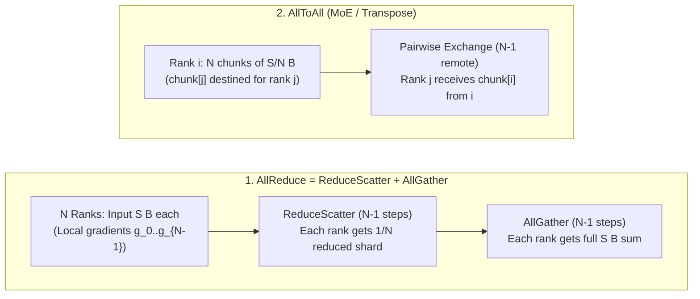
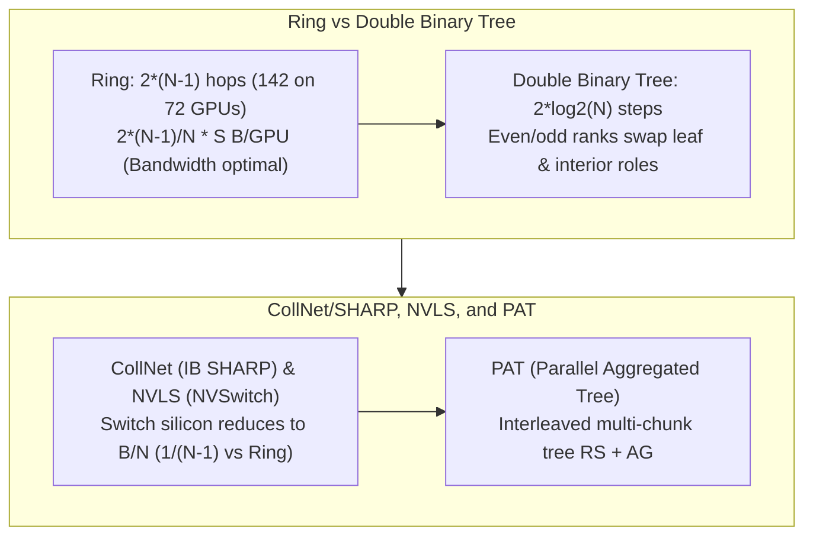

# 12.15 NCCL: collectives and algorithms

| | |
|---|---|
| Level | Advanced |
| Priority tier | 1 |
| Lab venue | Nebius GPU |
| Part | Part 12: Complete AI networking |
| Sources to use | *AI Systems Performance Engineering* 4; V7 ch9; *Distributed AI Systems* 2; VL6 ch2 |
| Coverage file | `planning/coverage/chapters/12-15.md` |
| Companion code | `code/part12/nccl_collectives_algorithms.py` · `code/part12/nccl_collectives_algorithms_lab.py` |

## Why this matters for AI infrastructure

A training run on thousands of GPUs has a steady rhythm. Each GPU finishes its share of the math, then waits while the others catch up, because every step ends with a gradient exchange. Picture the dashboard for a run like that. The GPUs look busy for a while, then drop to idle in a regular pattern, and the idle stretch is the exchange. The wire sets only an upper bound on that exchange. An 800 Gb/s InfiniBand fabric or an NVLink switch domain tells you how much data the cables can carry. Whether the cluster reaches a high Model FLOPS Utilization depends on the library that moves the data across those links. Model FLOPS Utilization, or MFU, is the share of the chip's peak arithmetic that the training run actually uses. On NVIDIA GPU clusters that library is the NVIDIA Collective Communications Library, usually called NCCL and pronounced "Nickel."

Take one concrete step. Thousands of GPUs must sum gradients, and the tensors are several gigabytes each. The point of the example is that the same sum can take seconds or milliseconds depending on the path it takes. Nothing about the math changes between the two cases, only the route the bytes travel and the order in which they arrive. If every GPU sends its tensor to a single master GPU, the whole cluster waits behind one network port. If a CPU-staged Gloo process group over TCP does the work, throughput falls about fifty-fold compared with GPUDirect RDMA. GPUDirect RDMA lets the network card read and write GPU memory directly, without a detour through the CPU. Even with NCCL and GPUDirect RDMA working, the algorithm still matters. A linear Ring across 72 GPUs needs 71 sequential hops per reduction pass, while a Tree needs only 6 or 7. In-network SHARP or NVLink SHARP then cuts the data each endpoint handles. SHARP is the reduction offload that runs inside the switch, and NVLink SHARP, or NVLS, is the same idea inside the NVSwitch.

```text
Key Cluster and Collective Performance Anchors (DAI Ch. 2; ASP Ch. 4 & Ch. 19; V7 Ch. 9):
- Physical wire capacities: 800 Gb/s (100 GB/s) InfiniBand rail fabric; 1.8 TB/s per GPU NVLink 5 switch domain
- Model FLOPS Utilization (MFU) target band: 40%-60% MFU
  * 70B BF16 transformer example: ~860 TFLOP per step / 2.0 s = 430 TFLOPS sustained vs 989 TFLOPS H100 peak = 43.48% (~43%) MFU (using ~6N FLOPs/token)
- 1,000-GPU and 10,000-GPU gradient sync: sending 10 GB tensors to 1 master GPU bottlenecks on a single port
- 400 MB AllReduce on 800 Gb/s (100 GB/s) InfiniBand:
  * NCCL with GPUDirect RDMA: 4.00 ms (100.0 GB/s)
  * CPU-staged Gloo over TCP: 200.00 ms (2.0 GB/s) -> 50x throughput collapse
- 72-GPU (NVL72) hop scaling and in-network reduction:
  * Ring: 71 sequential hops per reduction pass (142 steps for full AllReduce)
  * Tree: floor(log2(72)) = 6 to ceil(log2(72)) = 7 steps per pass (12 to 14 steps for full AllReduce)
  * SHARP and NVLink SHARP (NVLS): cuts per-endpoint volume by 1 / (N - 1) (1/7 on 8 GPUs, 1/71 on 72 GPUs)
```

Treat the anchors in that block as the reference numbers for the rest of the chapter. When a later section quotes a figure, you can find its source here first.

The MFU line deserves a word of explanation, since it is the number your manager is most likely to ask about. MFU divides the arithmetic the model actually performs per second by the arithmetic the chip could perform at its peak. A low MFU does not always mean a slow network. It can also mean slow kernels, a small batch, or waiting on data. Communication is one suspect among several, so use the collective numbers in this chapter to test that suspect before you blame the fabric.

The chapter starts with the collectives themselves, beginning with AllReduce, the one that sums gradients. It then compares the algorithms that carry them: Ring, Double Binary Tree, and the switch-based options CollNet with SHARP, NVLS, and Parallel Aggregated Tree. After that it covers the wire protocols LL, LL128, and Simple, the factor that converts algorithm bandwidth to bus bandwidth, and zero-copy buffer registration. The last section explains when to pair NCCL with NIXL for disaggregated inference.

---

## Prerequisites and outcomes

### Prerequisites

Before you start, you should know RDMA verbs and Queue Pairs from Chapter 12.2. GPUDirect RDMA is covered later, in Chapter 12.19, so a working idea of it is enough here. You should also be comfortable with InfiniBand and RoCEv2 fabrics from Chapters 12.3 through 12.14. Know `nvidia-peermem`, PCIe ACS disablement, and the PIX versus SYS topology labels. Finally, know the CUDA execution hierarchy of threads, warps, blocks, grids, and streams. A thread is the smallest unit of GPU work, and a warp is a group of threads that run the same instruction together.

### Outcomes

Imagine you are asked why a new 72-GPU job runs more slowly than the 8-GPU job that came before it. Answering that question needs most of what this chapter covers. The chapter walks through the six core NCCL collectives and the parallelism strategies that use them. It then derives step counts, per-GPU byte volumes and the factor that turns algorithm bandwidth into bus bandwidth, so you can reproduce `nccl-tests` and PyTorch microbenchmarks. Next it finds the message size where Ring and Double Binary Tree trade places, and the per-endpoint byte reduction from InfiniBand SHARP and NVLS. After that it contrasts the LL, LL128, and Simple wire protocols across message sizes. The final part covers compute-communication overlap, zero-copy buffer registration, NVL72 wave scheduling, and NIXL for disaggregated inference.

| Outcome Area | Formulas, Protocols, and Target Metrics |
|---|---|
| 1. Collectives and Parallelism | `AllReduce`, `ReduceScatter`, `AllGather`, `Broadcast`, `Reduce`, `AllToAll`, `Gather`, `Scatter`, `Send`/`Recv` mapped to `DDP`, `FSDP`, `ZeRO-1/2/3`, `TP`, `SP`, `CP`, `PP`, `MoE EP` |
| 2. Step and `busbw` Math | `AllReduce` steps $2(N-1)$ and factor $\frac{2(N-1)}{N}$; `RS`/`AG`/`A2A` steps $N-1$ and factor $\frac{N-1}{N}$; `Broadcast`/`Reduce` factor $1.0$ |
| 3. Algorithms and Offloads | `Ring` vs `Double Binary Tree` ($2\lceil\log_2 N\rceil$ steps, $S^* = 37.24\text{ MiB}$ on `72` GPUs); `CollNet`/`SHARP` (`2x-5x` speedup) and `NVLS` (`1/(N-1)` volume, `~1/2` overlapped time, up to `7.6x` NVLink speedup) |
| 4. Wire Protocols | `LL` (`4 B` payload + `4 B` flag = `50.0%` efficiency), `LL128` (`120 B` payload + `8 B` flag = `93.75%` efficiency), `Simple` (`100.0%` framing efficiency with `__threadfence_system()` over `4 MiB` `NCCL_BUFFSIZE`) |
| 5. Overlap, Zero-Copy, and `NIXL` | `25 MiB` `DDP` bucketing, avoiding `48.0 ms` repeated init, `ncclCommRegister` / `ncclMemAlloc` (`16 -> 4` channels), `NVL72` `4`-wave scheduling (`18` GPUs/wave), and `NIXL` (`0.5.x` API) |

Use the table as a checklist. Each row names one outcome area and the formulas or protocol numbers behind it. Work through the rows in order. The first row tells you which collective a strategy needs, the second tells you how to measure it, and the rest tell you how to make it fast. If a row contains a formula you cannot reproduce by hand, the section that derives it is the place to go next.

---

## 1. Hardware, Parallelism Taxonomy, and the Six Core NCCL Collectives

### 1.1 Cluster Hardware Context, SIMT Execution, and Parallelism Classification

Suppose you try to train a frontier transformer on one GPU. The weights, gradients, optimizer states, and activations will not fit in local HBM. HBM is the high-bandwidth memory on the GPU package. Training would also take far too long. So you spread the model across dozens or thousands of GPUs. That solves the memory problem, but it moves the bottleneck to the interconnect between GPU SMs, NVSwitches, and RDMA NICs. An SM is a streaming multiprocessor, the unit of the GPU that runs the threads. From then on, the network usually limits performance.

Every NCCL communication channel runs as a dedicated CUDA thread block. That block executes Single Instruction, Multiple Thread warps on one or more Streaming Multiprocessors. Single Instruction, Multiple Thread means the same instruction runs across many threads, each on its own data. Those SM threads read and write peer memory directly over NVLink or GPUDirect RDMA, while the remaining SMs run the matrix math. This split is the reason a slow collective hurts so much. Every SM that is busy moving bytes is an SM that is not running the matrix math, so a badly tuned collective costs compute as well as time. The reference block below gives the memory footprint of training states, the bandwidth hierarchy across GPU generations, and how alternative accelerators compare. Every collective design choice starts from those numbers. Think of the block as the floor plan of the building. Before you decide where a collective should run, you need to know which rooms are small, which are fast, and which doors are narrow. The later sections assume you have that picture in mind.

```text
Memory Footprint, Accelerator Generations, and SIMT Execution Reference (DAI Ch. 1-2; ASP Ch. 4; V6 Ch. 2):
1. Transformer Training Memory Breakdown (FP16/BF16 = 2 bytes/parameter):
   - 70B model: ~140 GB weights + 140 GB gradients + 280 GB Adam states (2x model size) = 500+ GB per step with activations
   - 7B BF16 Adam model: 14 GB weights + 14 GB gradients + 28 GB optimizer states = 56 GB static + 8-16 GB activations (peaks at 68 GB for 12 GB activations during loss.backward(); SGD needs 1x momentum or 0 extra state tensors)
2. NVIDIA GPU & Interconnect Generations:
   - Ampere A100 (2020, CC 8.0): 80 GB HBM2e (~1.5-2.0 TB/s effective copy), 600 GB/s NVLink 3.0
   - Hopper H100 (2022, CC 9.0, 132 SMs): 80 GB HBM3 (3.0 TB/s peak, ~2.0-3.0 TB/s effective copy, 989 TFLOPS BF16 dense, ~1.4 TFLOPS/W, up to 6x over A100 with FP8 Transformer Engine), 900 GB/s NVLink 4.0 (NV18 across 8 GPUs, 3.6 TB/s NVSwitch bisection on HGX/DGX H100)
   - Hopper H200 (2023): 141 GB (143,771 MiB) HBM3e, PCIe Gen5 x16 (~64 GB/s per direction); compare RTX 4090 (24,564 MiB, PCIe Gen4 x16 ~31.5 GB/s per direction / ~63 GB/s bidirectional)
   - Blackwell B200 (2024) & B300: 192 GB HBM3e (288 GB on B300), 8 TB/s HBM, 1.8 TB/s NVLink 5 (18 links x ~100 GB/s), 2.25 PFLOPS FP16, 20 PFLOPS FP4
   - Rack & Superchip Scale: GB200/GB300 NVL72 connects 36 Grace-Blackwell superchips (72 GPUs) in one NVLink Switch domain (~130 TB/s aggregate all-to-all, < 1 us hop latency); 8-rack GB200 SuperPOD links 576 GPUs; Grace Hopper GH200 (96 GB HBM + 512 GB LPDDR5X = 608 GB) shares a 900 GB/s NVLink-C2C coherent link
   - Host Server & Cluster Infrastructure Ratios (8-GPU node): 16-32 CPU cores (2-4 cores/GPU), >= 1 TB host RAM (1.5-2x GPU memory), 128 PCIe lanes, 10-20 GB/s local NVMe read, PUE 1.2-1.5, < 1 ms intra-node and < 5 ms inter-node AllReduce latency
3. Alternative Accelerators & CUDA SIMT Execution Hierarchy:
   - Google TPU Pods: v1 256x256 (65,536-PE systolic MXU at 700 MHz = 92 TOPS INT8); v2-v4 128x128 MXUs (~275 TFLOPS BF16 on v4, Sparse Core for embeddings, 2D/3D torus and OCS optical switches, v5e/v5p, Trillium, Ironwood, TPU 8t/8i via JAX/XLA NamedSharding)
   - Datacenter NPUs & AMD GPUs: Huawei Ascend 910C SuperPoD, AWS Trainium2, Cambricon MLU, Edge TPU; AMD MI300X (CDNA3, 4 SIMD units per Compute Unit under ROCm)
   - CUDA SPMD / SIMT Hierarchy: Thread -> Warp (32 threads) -> Block (128-1024 threads) -> Grid; 64 KB registers and 48 KB or 96 KB L1/shared memory per SM with Fine-Grained Multithreading (FGMT)
```

Read the block as a set of ratios, not a shopping list. The numbers also explain why the same GPU model can behave differently in two clusters. Two clusters with the same GPUs but different links, node sizes or memory per node will show different collective times, even when the code is identical. The memory breakdown tells you how much state each GPU must hold. The generation list tells you how fast that state can move. The SIMT hierarchy tells you how much parallel work a single collective can keep busy.

Three structural questions classify any distributed training or inference strategy. First, does the strategy split the forward and backward computation of one layer or sample across devices? Second, must a single sample cross device boundaries during the forward or backward pass? Third, does the strategy add device-to-device collective communication? The answers show which NCCL collectives sit on the critical path. The critical path is the chain of steps that cannot overlap, so any collective on it adds its full time to every iteration.

| Parallelism Category | Q1 (Split Layer Compute?) | Q2 (Sample Crosses Devices?) | Q3 (Collective Collaboration?) | Specific Strategies and Critical-Path `NCCL` Collectives |
|---|---|---|---|---|
| **Data Parallelism (`Data`)** | `No` | `No` | `Yes` | **`DDP`:** Full model replica per rank; synchronizes gradients via **`AllReduce`**. |
| **State Sharding (`State`)** | `No` | `No` | `Yes` | **`ZeRO-1`:** Shards optimizer states (`ReduceScatter` + `AllGather` at step). **`ZeRO-2`:** Shards optimizer + gradients (`ReduceScatter` on gradients). **`FSDP` / `ZeRO-3`:** Shards parameters, gradients, and optimizer states; runs **`AllGather`** before forward/backward layers and **`ReduceScatter`** during backward. |
| **Model Parallelism (`Computation`)** | `Yes` | `Yes` | `Yes` | **`TP`:** Splits matrices column/row-wise over NVLink, running **`AllReduce`** (or **`AllGather` + `ReduceScatter`** with **`SP`**) per layer. **`CP`:** Splits long-context KV caches (`AllGather` / ring P2P). **`PP`:** Slices layers across stages via point-to-point **`Send`/`Recv`**. **`MoE EP`:** Routes tokens to experts via **`AllToAll`**. |

Read the table one strategy at a time. Each row answers the three questions, then lists the collectives that strategy depends on. Consider the `FSDP` row. You will see `AllGather` before the layer runs and `ReduceScatter` during backward. Those two calls are the reason FSDP feels slower than plain DDP on a slow fabric, and they are also the reason it fits models that DDP cannot hold. The trade is simple to state. FSDP spends more communication to save memory, and DDP spends memory to save communication. Choosing between them is a question of which resource is tighter on your cluster.

### 1.2 The Six Core NCCL Collectives and Their Decomposition Rules

When a framework needs to sum gradients across replicas, gather sharded weights, or route tokens to Mixture-of-Experts layers, it calls a small set of collective primitives. A collective is an operation that every rank in a group takes part in together. Pick the wrong primitive, or chain two collectives without pipelining them, and you can cut effective fabric throughput in half.

NCCL exposes five primary collective C APIs: `ncclAllReduce`, `ncclBroadcast`, `ncclReduce`, `ncclAllGather`, and `ncclReduceScatter`. It also provides point-to-point group primitives, `ncclSend` and `ncclRecv`, used inside `ncclGroupStart` and `ncclGroupEnd`. Frameworks combine those to build AllToAll, Gather, and Scatter. A point-to-point call moves data between exactly two ranks, and the group calls let NCCL batch many of them together.



The diagram shows the two shapes that matter most. AllReduce is two phases in a row, and AllToAll is a single exchange where every rank sends a different chunk to every other rank. Keep those two shapes in mind, because most of the other collectives are variations on them.

| Collective Operation | Communication Pattern | Input Size per Rank | Output Size per Rank | Ring Steps | Bus Bandwidth Factor (`busbw / algbw`) | Primary AI Workload Mapping |
|---|---|---|---|---|---|---|
| **`AllReduce`** | Many-to-many reduction + full distribution | $S$ | $S$ (identical reduced tensor on all $N$ ranks) | $2(N - 1)$ | $\frac{2(N - 1)}{N}$ | `DDP` gradient averaging; `Megatron-LM` `TP` layer reductions |
| **`ReduceScatter`** | Many-to-many reduction + sharded distribution | $S$ (as $N$ shards of $S/N$) | $\frac{S}{N}$ (reduced shard $r$ on rank $r$) | $N - 1$ | $\frac{N - 1}{N}$ | `FSDP` / `ZeRO-2` / `ZeRO-3` backward gradient reduction; `TP+SP` |
| **`AllGather`** | Many-to-many shard concatenation | $\frac{S}{N}$ | $S$ (concatenated in rank order $0 \dots N-1$) | $N - 1$ | $\frac{N - 1}{N}$ | `FSDP` / `ZeRO-3` parameter unsharding; `TP+SP` activation gather |
| **`Broadcast`** | One-to-all replication from `root` | $S$ on `root` ($0$ on others) | $S$ on all $N$ ranks | $N - 1$ (or $1$ with `NVLS`) | $1.0$ | Initial weight/checkpoint distribution, seed and hyperparameter sync |
| **`Reduce`** | All-to-one reduction onto `root` | $S$ on all $N$ ranks | $S$ on `root` (non-root unchanged) | $N - 1$ | $1.0$ | Centralized loss/metric aggregation and rank-0 logging |
| **`AllToAll`** | All-to-all personalized matrix transpose | $S$ ($N$ chunks of $\frac{S}{N}$) | $S$ ($N$ transposed chunks of $\frac{S}{N}$) | $N - 1$ remote rounds | $\frac{N - 1}{N}$ | `MoE` Expert Parallelism token dispatch/combine; `CP`/`SP` transpose |
| **`Gather` / `Scatter`** | All-to-one collection / One-to-all partitioning | $\frac{S}{N}$ (`Gather`) / $S$ on `root` (`Scatter`) | $S$ on `root` (`Gather`) / $\frac{S}{N}$ (`Scatter`) | $N - 1$ | $\frac{N - 1}{N}$ | Centralized validation prediction collection / dataset shard init |

Three algebraic and buffer rules govern how frameworks compose these primitives in production. The first one matters most. AllReduce is mathematically identical to ReduceScatter followed by AllGather. You can check the identity on paper with a small vector of four values per rank before you trust it on a cluster. The sums match exactly, so a benchmark that disagrees with the identity is measuring something other than what you think. If you run Reduce to rank 0 and then Broadcast from rank 0, rank 0 becomes a serial bottleneck, and nothing pipelines. NCCL instead breaks Ring AllReduce into a pipelined ReduceScatter phase followed by an AllGather phase. FSDP uses this identity directly. It runs AllGather before a layer's compute pass and ReduceScatter after backward compute, so only one shard of the model state stays resident outside the active layer.

Second, the collectives differ in how they handle buffers. AllReduce, Broadcast, and Reduce work in place, with identical send and receive pointers. AllGather and ReduceScatter also run in place, as long as each rank's shard pointer is offset to `buff + rank * shard_bytes`. AllToAll is different. It transposes off-diagonal chunks at the same time, so it needs separate send and receive buffers. The reason is that the chunk a rank keeps for itself stays put, but every other chunk moves to a new owner while the rank is still reading its own data. Writing into the same buffer would overwrite data that has not been sent yet. In-place means the output overwrites the input, which saves memory, but it is only possible when the output fits where the input was.

Third, basic collectives have CPU fallbacks in Gloo, but `dist.all_to_all` in PyTorch requires `backend="nccl"` on GPU tensors. If you call it on a CPU Gloo process group, it fails. For a new parallel strategy, write down its answers to the three questions first. The collectives follow from those answers. Starting from the strategy rather than from the API keeps you from picking a collective that the strategy never needed.

---

## 2. Algorithmic bandwidth (`algbw`), bus bandwidth (`busbw`), and step/volume math

### 2.1 Deriving Ring Step Counts and Per-GPU Data Volume

Suppose you benchmark an 8-GPU node, then a 64-GPU cluster. The raw tensor size divided by wall-clock time drops as more GPUs join the ring. Teams that have not worked out the step count and byte volume often read that drop as a fabric problem. They conclude the hardware regressed, when the drop is normal scaling. Deriving those two numbers lets you tell the difference.

Consider an $N$-GPU communicator running an AllReduce on a tensor of $S$ bytes per rank. NCCL splits each rank's buffer into $N$ equal chunks of $S / N$ bytes. It then runs two consecutive ring phases, each with $N - 1$ steps. In a ring, every GPU passes data to its right-hand neighbor on each step, so the data moves around a circle. The derivation below walks through both phases.

```text
Ring AllReduce Two-Phase Step and Byte Volume Derivation (ASP Ch. 4; DAI Ch. 1-2):
1. Phase 1 - ReduceScatter (N - 1 steps):
   - In step k in {1 .. N-1}, rank r sends chunk (r - k + 1) mod N of size S/N to rank (r + 1) mod N
   - Rank r receives chunk (r - k) mod N from rank (r - 1) mod N and accumulates (SUM, MAX, MIN, or AVG) into its local buffer
   - After N - 1 steps, each rank holds 1 fully reduced shard of size S / N
   - Bytes sent (and received) per GPU in Phase 1: V_RS = (N - 1) * (S / N)
2. Phase 2 - AllGather (N - 1 steps):
   - In steps N .. 2(N - 1), each rank circulates its completed S / N shard around the ring without arithmetic reduction
   - Overwrites the remaining N - 1 shard slots until all N ranks hold the complete S-byte reduced tensor
   - Bytes sent (and received) per GPU in Phase 2: V_AG = (N - 1) * (S / N)
3. Combined Ring AllReduce Totals:
   - Total sequential ring steps: Steps_AllReduce = 2 * (N - 1)
   - Total bytes sent (and received) per GPU: V_AllReduce = V_RS + V_AG = 2 * ((N - 1) / N) * S
```

The two phases do different jobs. The first phase does the arithmetic, so each GPU finishes holding one fully summed slice. The second phase only copies, so every GPU collects the other slices. Notice that the byte count for each phase is the same, and that is why the total is exactly twice one phase.

### 2.2 Converting `algbw` to `busbw` Across Collectives and Cluster Scales

Suppose a collective of tensor size $S$ bytes finishes in $t$ seconds. `nccl-tests` reports two throughput figures for it. Algorithm bandwidth is simply $S / t$. It measures how fast the input tensor gets processed. Bus bandwidth multiplies algorithm bandwidth by the collective's topological volume factor. That lets you compare the result directly with NVLink, InfiniBand, or RoCEv2 line rates, whatever the GPU count $N$ is.

$$\text{algbw} = \frac{S}{t}, \qquad \text{busbw}_{\text{AllReduce}} = \text{algbw} \times \frac{2(N - 1)}{N}, \qquad \text{busbw}_{\text{RS / AG / A2A}} = \text{algbw} \times \frac{N - 1}{N}, \qquad \text{busbw}_{\text{Bcast / Reduce}} = \text{algbw} \times 1.0$$

The table below shows how the step counts, chunk sizes, per-GPU byte volumes, and bus bandwidth factors change from 2 GPUs up to a 72-GPU NVL72 rack. Notice that the AllReduce factor climbs toward 2 as $N$ grows. A higher busbw on a bigger cluster is expected, so do not read it as a faster link. The factor is a bookkeeping correction for how many bytes each link carries, and it rises for every cluster, even when the hardware is unchanged.

| World Size ($N$ GPUs) | `RS` / `AG` Steps ($N - 1$) | `AllReduce` Steps ($2(N - 1)$) | Chunk Size $S/N$ ($S = 100\text{ MB}$) | `RS` / `AG` / `A2A` Factor $\frac{N-1}{N}$ | `AllReduce` Factor $\frac{2(N-1)}{N}$ | `AllReduce` Volume per GPU ($S = 100\text{ MB}$) |
|---|---|---|---|---|---|---|
| **$N = 2$** | `1` | `2` | `50.00 MB` | `0.5000` | **`1.0000`** | `100.00 MB` (`algbw == busbw`) |
| **$N = 4$** | `3` | `6` | `25.00 MB` | `0.7500` | **`1.5000`** | `150.00 MB` (`busbw = 1.50 * algbw`) |
| **$N = 8$** (1 HGX node) | `7` | `14` | `12.50 MB` | `0.8750` | **`1.7500`** | `175.00 MB` (`busbw = 1.75 * algbw`) |
| **$N = 64$** (8 nodes) | `63` | `126` | `1.5625 MB` | `0.984375` | **`1.96875`** | `196.88 MB` (`busbw = 1.97 * algbw`) |
| **$N = 72$** (`NVL72` rack) | `71` | `142` | `1.3889 MB` | `0.986111` | **`1.972222`** (`142/72`) | `197.22 MB` (`142 MB` for $S = 72\text{ MB}$) |
| **$N \to \infty$** (asymptotic) | $N - 1$ | $2N - 2$ | $S / N \to 0$ | $\to 1.0000$ | **$\to 2.0000$** | $\to 2S$ (`200.00 MB`) |

:::info Reconciling `nccl-tests` `algbw` with PyTorch Cluster-Aggregate Microbenchmarks
The reference block below holds the measured numbers behind this comparison. In `nccl-tests`, run as `all_reduce_perf`, algorithm bandwidth is defined per rank as $S / t$. At 2 GPUs, the factor $2(2-1)/2 = 1.0$ makes the two figures identical. Some standalone PyTorch scripts count differently. `allreduce_microbench.py` defines cluster-aggregate algorithm bytes and ring bus bytes across all ranks and iterations, so read its numbers with that definition in mind. Compare that multi-GPU figure with a single-GPU HBM copy test such as `bandwidth_test.py`. The comparison shows whether Tensor Parallelism is viable on the node. If the interconnect is too slow, keep communication to FSDP and DDP.

```text
PyTorch Microbenchmark vs Single-GPU HBM Copy Reference (DAI Ch. 2 p.41-47 & p.793-795):
1. 2-GPU AllReduce Microbenchmark (allreduce_microbench.py):
   - Conventions: alg_bytes = size_bytes * n * iterations; bus_bytes = size_bytes * 2 * (n - 1) * iterations
   - Parameters: N = 2 GPUs, size_bytes = 100 MiB (26,214,400 float32 elements), iterations = 50, elapsed = 0.248 s
   - Total bytes: 100 MiB * 2 * 50 = 10,000 MiB (9.765625 GiB) for both alg_bytes and bus_bytes (since 2*(N-1) = N = 2; at N = 4, busbw = 1.5x algbw)
   - Measured rate: 40,322.58 MB/s (39.38 GB/s) for both algbw and busbw
2. Single-GPU HBM Copy Benchmark (bandwidth_test.py):
   - Parameters: 64 MiB tensor, 200 iterations, 2 * nbytes read+write per iteration = 25.0 GiB in 0.01262339 s
   - Measured HBM copy rate: 1,980.45 GB/s (vs 10-50 GB/s PCIe AllReduce or tens to low hundreds of GB/s over NVLink)
```
:::

Read the info block as a warning about comparisons. Two scripts can report different numbers for the same hardware, simply because they count bytes differently. Check the definition before you compare.

Convert to bus bandwidth before you compare two cluster sizes. Otherwise the ring factor will look like a regression. The conversion is not optional when you report results to people outside the team. A table that mixes raw and bus numbers will send readers in the wrong direction, and a single correction in the header is not enough to fix it after the fact. A simple test is to run the same job on 2 GPUs and on 8 GPUs, then compare the bus bandwidth columns, not the raw ones.

---

## 3. NCCL Communication Algorithms: Ring, Double Binary Tree, CollNet/SHARP, NVLS, and PAT

### 3.1 Ring vs Double Binary Tree and the Latency-Bandwidth Crossover

Ring is bandwidth-optimal. Every GPU sends and receives one chunk on every step, so no link sits idle. That property is why Ring stays the default for big messages. Once the pipeline is full, every link carries data on every step, and the link speed is the only limit. The downside appears only when the pipeline is long, which is the case at large rank counts. The cost is startup latency, which grows linearly with the number of GPUs. On a thousand-GPU job, or even across a 72-GPU NVL72 rack that needs 142 sequential steps for an AllReduce, that linear hop latency dominates small and medium messages. A small message finishes its arithmetic quickly, but it still waits for every hop before the last GPU sees the result.

A simple binary tree cuts the hop count to logarithmic depth. But half of the ranks in a binary tree are leaf nodes. During the upward Reduce phase, leaves send once and never receive. During the downward Broadcast phase, they receive and never send. So a single binary tree leaves half of the cluster's bidirectional link capacity idle. Bidirectional capacity means the link can carry traffic both ways at once, and a leaf uses only one direction at a time.

NCCL fixes both problems with its Double Binary Tree algorithm. It builds two complementary binary trees over the same $N$ GPUs by shifting the tree indexing. Every even-numbered rank is an interior node in Tree A and a leaf in Tree B. Every odd-numbered rank does the reverse. Each message is split evenly across both trees. That restores full-duplex bandwidth and still finishes in logarithmic latency steps. Full-duplex means both directions of the link are in use at the same time, so no rank sits idle for half the operation. The two trees do not compete for the same links on the same step. Each one has its own pattern of sends and receives, so the combined traffic keeps the links busy in both directions.

The model below compares the two on a 72-GPU rack. Keep your message sizes in mind as you read it. Watch the crossover size $S^*$, because it tells you which algorithm wins at which message size.

```text
Ring vs Double Binary Tree Latency-Bandwidth Model on 72 GPUs (ASP Ch. 4 & Ch. 19):
- Ring time formula: T_ring(S, N) = 2(N - 1)*alpha + 2*((N - 1)/N)*(S / B)
- Tree time formula: T_tree(S, N) = 2*ceil(log2(N))*alpha + 2*k_tree*(S / B)
- Parameters on N = 72 GPUs (NVL72):
  * One-way reduction hops: Ring = 72 - 1 = 71 hops (142 AllReduce steps) vs Tree = floor(log2(72)) = 6 to ceil(log2(72)) = 7 hops (12 to 14 AllReduce steps)
  * Per-hop latency alpha = 1.0 us, unidirectional link bandwidth B = 100 GB/s, dual-tree relay factor k_tree = 1.15
- Evaluated Latency and Crossover Size S*:
  * At S = 1 MiB (1,048,576 B):   Tree = 38.12 us vs Ring = 162.68 us (Tree is 4.27x faster)
  * At S = 256 MiB (268,435,456 B): Ring = 5,436.14 us vs Tree = 6,188.02 us (Ring wins on raw streaming bandwidth)
  * Exact crossover S* where T_ring(S*) = T_tree(S*):
    S* = ((142 - 14) * 1.0 us * 100 GB/s) / (2 * (1.15 - 71/72)) = 37.24 MiB (39,051,908 B)
```

Read the two formulas as two costs added together. The first term counts latency, which is the number of hops times the time per hop. The second term counts bandwidth, which is the bytes moved divided by the link speed. Small messages are dominated by the first term, and large messages by the second. The crossover is the point where the two algorithms pay the same total.

The diagram puts the two families side by side. The table after it works as a menu. The `NCCL_ALGO` token is what you set, and the last column tells you which messages suit it.



| Algorithm (`NCCL_ALGO` Token) | Step Complexity | Per-GPU Volume (`AllReduce` / `RS`) | Hardware Offload Requirement | Target Workload and Scale Regime |
|---|---|---|---|---|
| **`Ring`** (`Ring`) | $2(N - 1)$ steps (`142` on `72` GPUs) | $2\frac{N-1}{N}S$ (`AllReduce`), $\frac{N-1}{N}S$ (`RS`/`AG`) | None (GPU P2P DMA / RDMA) | Large bandwidth-bound messages (`> 32-64 MiB`) at small/moderate rank counts |
| **`Double Binary Tree`** (`Tree`) | $2\lceil\log_2 N\rceil$ steps (`12-14` on `72` GPUs) | $\approx 2S$ split `50/50` across dual complementary trees | None (intranode chain + internode dual tree) | Small/medium latency-bound messages (`< 10s of MiB`) and large multi-node clusters |
| **`CollNet`** (`CollNetDirect`, `CollNetChain`) | $O(\log_k N_{\text{nodes}})$ switch tree + local intra-node group | **`B / N`** per endpoint in `RS` (**`1 / (N - 1)`** vs Ring) | Quantum InfiniBand switch ASICs + `SHARP` `AM` + `NCCL` SHARP plugin | Multi-node InfiniBand clusters (`32+` nodes; **`2x` to `5x`** `AllReduce` speedup) |
| **`NVLink SHARP`** (`NVLS`, `NVLSTree`) | 1-hop / 2-hop NVSwitch reduction + hardware multicast | **`B / N`** in `RS` receive and `AG` send (**`1 / (N - 1)`** vs Ring) | `NVSwitch` 3.0/4.0 (`HGX H100/H200`, `GB200/GB300 NVL72`) | Intra-node / `NVL72` intra-rack collectives; overlapped `AG+RS` cuts time by **`~1/2`** |
| **`Parallel Aggregated Tree`** (`PAT`) | $O(\log_2 N)$ startup latency per staggered chunk | Near-ring optimal bandwidth across interleaved streams | Multi-stream GPU scheduling across topology links | Medium-to-large messages requiring both $O(\log N)$ latency and ring-level bandwidth |

Use the table as a menu, not a rule. The message size is the first thing to check, because it decides which of the two costs dominates. If you are unsure which family applies, measure a sweep of message sizes on your own cluster and look for the point where the curve bends. That bend is your crossover, and it is more reliable than any figure from a model. The rank count is the second, because it sets how many hops the Ring must cross.

### 3.2 CollNet (InfiniBand SHARP), NVLink SHARP (NVLS), and PAT Math

Even with a Double Binary Tree, every GPU still sends and receives nearly $2S$ bytes. It also spends SM cycles adding up floating-point values. Modern NVIDIA fabrics move that arithmetic and replication out of the SMs and into switch silicon. They do it through CollNet with InfiniBand SHARP and through NVLink SHARP. Moving the arithmetic into the switch frees the SMs for the matrix math they were built for.

CollNet groups GPUs within a node or rack and aggregates them locally, through CollNetDirect or CollNetChain. It then elects leader GPUs. Those leaders send their traffic into Quantum InfiniBand switches running SHARP. The leaders are the only GPUs that cross the fabric, so the upper tier sees one stream per node rather than one per GPU.

Inside an NVSwitch domain, such as an 8-GPU HGX baseboard or a 72-GPU NVL72 rack, NVLS offloads reductions and multicast replication to the NVSwitch ASICs. Multicast replication means one send reaches many receivers, and the switch makes the copies. When switch offload is unavailable, Parallel Aggregated Tree interleaves staggered tree reductions across multiple CUDA streams. Every physical link stays busy, the way it would in a Ring. Startup latency stays bounded to logarithmic depth, the way it would in a Tree. The combined effect is that PAT is useful when neither pure Ring nor pure Tree is a clear winner, which is the middle range of message sizes where the crossover sits. Treat it as a tool for that middle band, and measure before you rely on it. The benefit of PAT is that you keep the strengths of both families without any special switch hardware.

```text
In-Network SHARP, NVLink SHARP (NVLS), and PAT Offload Math (ASP Ch. 4; V7 Ch. 9):
1. CollNet (CollNetDirect & CollNetChain) with InfiniBand SHARP:
   - Prerequisites: Quantum IB switches with SHARP firmware, active SHARP Aggregation Manager (AM) alongside Subnet Manager, nvidia-peermem loaded, NCCL RDMA SHARP plugin, and NCCL_COLLNET_ENABLE=1 (use NCCL_SHARP_DISABLE=1 for A/B testing SHARP vs host reduction)
   - Hardware contrast: Spectrum-X Ethernet accelerates RoCEv2 via adaptive routing and telemetry, but does NOT have switch-resident reduction ALUs like IB SHARP
   - Switch buffer caveat: finite switch silicon reduction buffers can exhaust on huge multi-GB collectives and fall back to host algorithms (monitor via NCCL_DEBUG=INFO)
   - Multi-node speedup: 2x to 5x AllReduce speedup at 32+ node scale
2. NVLink SHARP (NVLS & NVLSTree, NCCL_NVLS_ENABLE=1) 1 / (N - 1) Volume Reduction:
   - ReduceScatter in-network reduction: Ring receives B*(N-1)/N bytes across N-1 hops; NVLS/SHARP switch reduces in hardware and returns only B / N bytes per GPU -> ratio (B/N) / (B*(N-1)/N) = 1 / (N - 1)
     * N = 8 GPUs (B = 800 MB):  Ring = 700 MB vs NVLS/SHARP = 100 MB (1/7 volume)
     * N = 72 GPUs (B = 720 MB): Ring = 710 MB vs NVLS/SHARP = 10 MB  (1/71 volume)
   - AllGather hardware multicast: each GPU sends its B / N shard once into NVSwitch, which multicast-replicates to all N - 1 peers in 1 hop -> 1 / (N - 1) sender volume
   - Overlapped FSDP phase wall time: overlapping NVLS multicast AllGather (T_AG) with NVLS in-network ReduceScatter (T_RS) shrinks wall time from T_AG + T_RS to max(T_AG, T_RS) -> ~1/2 (50% / 0.5x) time reduction, and up to 7.6x speedup on small/medium NVLink messages
```

Read the NVLS block as a simple ratio. The ratio is the reason NVLS matters most for the reduce phase of a large collective. The bytes a Ring pushes through each GPU grow with the tensor, while the switch version keeps the per-GPU share small. A Ring moves almost the whole tensor through each GPU, while the switch version moves one slice. The ratio $1 / (N - 1)$ is the number to remember, because it shrinks as the GPU count grows.

For a multi-node job on InfiniBand, turn on the offload that matches your hardware. Then watch for host fallbacks with `NCCL_DEBUG=INFO`. Enable one offload at a time when you first bring up a fabric. If the job slows down after an offload turns on, you know which change to reverse, and the other settings stay as they were. A fallback is silent by default, so the run still finishes, just more slowly. Checking the log is the only reliable way to see it.

---

## 4. NCCL Wire Protocols (`LL`, `LL128`, `Simple`) and Zero-Copy User Buffers

### 4.1 Wire Protocol Framing: `LL` (50%), `LL128` (93.75%), and `Simple` (100%)

Picture a GPU pushing a large payload into a peer's ring buffer with bulk DMA. Before it updates the receiver's ready counter, it must run a full system memory fence. Without that fence, the ready flag could arrive over NVLink or PCIe before all the payload bytes are visible in the receiver's HBM. The fence costs time, though. `__threadfence_system()` adds several microseconds of latency at every hop, and small, latency-sensitive collectives feel that most. A fence is a barrier that makes earlier writes visible to everyone before the next write goes out.

NCCL avoids this bottleneck by offering three wire protocols, chosen with `NCCL_PROTO`: LL, LL128, and Simple. They work independently of the graph algorithm. LL is for tiny messages. It packs 4 bytes of data and a 4-byte iteration flag into one 8-byte atomic store. An atomic store is a write that the hardware completes as one indivisible step, so the receiver never sees half of it. The receiver polls L2 cache for the flag, so no memory fence is needed. The flag arrives with the data, so the receiver knows the data is ready the moment it sees the flag.

LL128 targets small-to-medium messages on platforms that support 128-byte atomic transactions. It packs 120 bytes of data with an 8-byte flag, reaching 93.75% framing efficiency, and it stays fence-free. Framing efficiency is the share of the wire bytes that carry payload. Simple suits large, bandwidth-dominated messages. It sends full bulk DMA slices and pays for the `__threadfence_system()` call on each one.

| Protocol (`NCCL_PROTO`) | Atomic Unit Size | Payload Bytes | Flag Overhead Bytes | Framing Efficiency | Flag Overhead % | Synchronization Mechanism | Optimal Message Size Regime |
|---|---|---|---|---|---|---|---|
| **`LL`** (Low Latency) | `8 B` | **`4 B`** | **`4 B`** | **`50.0%`** (`4 / 8`) | **`50.0%`** | `8-byte` atomic store + L2/register flag poll (no memory fence) | Tiny messages (`<= 32-64 KiB`); lowest transfer startup latency |
| **`LL128`** (Low Latency 128B) | `128 B` | **`120 B`** | **`8 B`** | **`93.75%`** (`120 / 128`) | **`6.25%`** | `128-byte` NVLink/PCIe atomic store + `8B` inline flag poll (no fence) | Small-to-medium messages (`~64 KiB` to several `MiB` on NVLink/PCIe) |
| **`Simple`** (Bulk DMA) | `NCCL_BUFFSIZE` (default `4 MiB`) | `100%` of slice | `0 B` inline | **`~100.0%`** | **`~0.0%`** | Bulk DMA write + `__threadfence_system()` before signalling peer FIFO | Large bandwidth-dominated messages (`> 4-16 MiB`) |

The table shows the trade-off in numbers. LL spends half of every atomic store on its flag, but it skips the fence. Simple spends nothing on framing, but it pays for the fence. The worked example below pushes one 120,000-byte payload through each protocol, so you can compare the cost directly. Think of LL as sending each letter in its own labeled envelope, and Simple as sending one large crate that gets sealed once.

```text
Worked 120,000-Byte (120 KB) Payload Wire Protocol Breakdown (ASP Ch. 4):
- LL (8 B atomic unit = 4 B payload + 4 B flag):
  * Atomic packets = 120,000 / 4 = 30,000 packets
  * Total wire bytes = 120,000 B payload + 120,000 B flags = 240,000 B (50.0% efficiency, 50.0% overhead)
- LL128 (128 B atomic unit = 120 B payload + 8 B flag):
  * Atomic transactions = 120,000 / 120 = 1,000 transactions
  * Total wire bytes = 120,000 B payload + 8,000 B flags = 128,000 B (93.75% efficiency, 6.25% overhead)
- Simple (NCCL_BUFFSIZE default = 4 MiB = 4,194,304 B):
  * Bulk DMA slices = 1 slice (120,000 B wire payload, 100.0% framing efficiency, requires __threadfence_system())
```

Notice the packet counts. LL needs 30,000 packets for the payload, while LL128 needs only 1,000 transactions. The count matters because each packet or transaction has a fixed cost in time, so fewer transactions usually means less overhead even when the byte totals are close. For this payload, LL128 sends fewer packets and fewer flag bytes than LL. Simple sends the payload in one slice, but it has to pay for the fence once.

The choice follows the message size. A tiny message is dominated by startup latency, so LL wins even though it wastes half its bytes. A medium message is dominated by packet count, so LL128 wins. A large message is dominated by bytes on the wire, so Simple wins because it has no framing at all. You can test the boundary on your own fabric by sweeping message sizes with `NCCL_PROTO` set to each value.

### 4.2 Persistent User Buffers and Zero-Copy Registration (`ncclCommRegister` / `ncclMemAlloc`)

By default, when your application passes an arbitrary tensor pointer to `ncclAllReduce`, NCCL copies slices of that tensor into its internal, pre-registered channel staging buffers using GPU SM threads. It sends from the staging buffer and then copies the result back out. That staging takes GPU memory and HBM bandwidth for extra device-to-device copies. It also occupies 16 to 32 SM thread blocks that could otherwise run GEMM compute kernels. A GEMM is a general matrix multiply, the core operation of most training compute.

To remove those staging copies, modern NCCL releases offer persistent user buffer registration through `ncclMemAlloc` and `ncclCommRegister`. With zero-copy registration active alongside NVLS, SHARP, or InfiniBand GPUDirect Async, NCCL reads and writes the user's tensor memory directly. Active channels drop from 16 SM blocks to 4. The same setup also prevents PyTorch caching-allocator fragmentation in UCX RDMA registration pools. The caching allocator keeps freed GPU memory for reuse, and fragmentation means the reusable pieces end up too small for the next request.

```text
Persistent Zero-Copy Buffer Registration & UCX Fragmentation Reference (ASP Ch. 4):
1. API Lifecycle (NCCL 2.19+ / 2.21+):
   - Allocate fabric/IPC-compatible buffer: ncclMemAlloc(&ptr, bytes) (or CUDA VMM cudaMemCreate / cudaMemAddressReserve)
   - Register once outside the loop: ncclCommRegister(comm, ptr, bytes, &regHandle)
   - Deregister & free at teardown: ncclCommDeregister(comm, regHandle) and ncclMemFree(ptr)
   - Channel & SM savings (controlled by NCCL_MIN_NCHANNELS and NCCL_MAX_NCHANNELS): drops active channels from 16 blocks to 4 blocks (saving 12 SM thread blocks per GPU for GEMM compute) with NVLS, SHARP, or IBGDA
2. Two Mandatory Rank-Symmetry Invariants:
   - All-Rank Rule: if ANY rank in a communicator registers its user buffer for a collective, ALL ranks must pass registered buffers
   - Symmetric Offset Rule: for symmetric zero-copy algorithms (NVLS, CollNet/SHARP, symmetric NVLink), the byte offset (user_ptr - base_alloc_ptr) must match across all ranks (violations silently fall back to internal NCCL_BUFFSIZE staging)
3. UCX / RDMA Caching Allocator Fragmentation Pattern:
   - Allocating and freeing varying temporary tensors (40 MB and 200 MB after an initial 0.800 GB tensor) leaves torch.cuda.memory_allocated() at 0.000 GB
   - Meanwhile, torch.cuda.memory_reserved() ratchets up from 0.800 GB (Iter 00) -> 1.040 GB (Iter 01) -> 1.240 GB (Iter 02..10), exhausting RDMA pin pools unless persistent registered buffers are reused
```

If your job reuses the same buffers on every step, register them once and keep them for the life of the communicator. Keep a short note in the launch script that lists which buffers are registered and when. Reading that note later is much faster than rediscovering the registration order during an incident. The symmetry rules matter because NCCL cannot check them for you. A rank that skips the registration does not raise an error. It quietly takes the slower staging path, and the only sign is a lower bandwidth number.

---

## 5. Compute-Communication Overlap, Wave Scheduling, Communicator Lifecycle, and NIXL

### 5.1 Pipelining, Wait-Free Backpropagation (`DDP` vs `DP`), and Bucketing Math

Hiding network time behind Tensor Core work is one of the biggest software wins available. A good test is to look at a timeline trace. If the communication bars sit under the compute bars, the overlap is working. If the communication bars sit in gaps between compute bars, the overlap is missing, and the fix is in the training loop, not in the network. NVIDIA's four-pillar Magnum IO architecture is built around that idea. Consider a training loop that computes the whole backward pass first, and only then launches AllReduce. The GPUs sit idle for the entire network transfer. Single-process `nn.DataParallel` causes a similar stall, and so do host-device sync calls inside the training step. Re-initializing communicators on every iteration hurts scaling too. Each of these habits adds a wait that the GPU could have spent computing.

PyTorch `DistributedDataParallel` avoids much of this with Wait-Free Backpropagation. Autograd hooks group parameters in reverse layer order into 25 MiB gradient buckets. Autograd is PyTorch's automatic differentiation engine, and the hooks are functions that run as each gradient becomes ready. As soon as a bucket fills on the compute stream, DDP launches an asynchronous NCCL AllReduce on a dedicated communication stream. The compute stream keeps calculating gradients for earlier layers while that transfer runs. The reverse order matters, because the last layers finish their backward pass first, so their buckets are ready first.

| Optimization / Anti-Pattern | Baseline Execution Behavior | Optimized Execution Behavior (*AI Systems Performance Engineering* Ch. 4 Tables 4-1..4-3) |
|---|---|---|
| **1. NVIDIA Magnum IO 4 Pillars** | Uncoordinated I/O subsystems | **(1) Storage I/O** (`GPUDirect Storage` / `BlueField SNAP`), **(2) Network I/O** (`GPUDirect RDMA`, `NCCL`, `NVSHMEM`, `UCX`, `HPC-X`), **(3) In-Network Compute** (`SHARP`), **(4) I/O Management** (`NetQ`, `UFM`). |
| **2. Serial vs Overlapped `DDP` (`WFBP`)** | Serial `loss.backward()` (`fc1, fc2, fc3` = `10.0 ms`) then `dist.all_reduce` (`12.0 ms`) = **`22.0 ms`** (`0%` overlap). Broad baseline: `100.0 ms` (`60%` SM busy). | Reverse-order `25 MiB` gradient buckets (`bucket_cap_mb = 25`, `fc3 -> fc2 -> fc1`) overlap `AllReduce` on a secondary CUDA stream: $\max(10.0, 12.0) = \mathbf{12.0\text{ ms}}$ (**`45.45%` reduction**). Broad iteration drops from `100.0 ms` to **`70.0 ms`** (**`30.0%` faster**, **`90%` SM busy**). |
| **3. `nn.DataParallel` (`DP`) vs `DDP`** | Single-process `DP` splits `[512, 1024]` into `[256, 1024]` across threads contending on Python `GIL` and gathers on `GPU 0` = **`45.00 ms`**. | Multi-process `DDP` (`1` process/GPU via `torchrun` or `mp.spawn`) eliminates `GIL` and `GPU 0` bottleneck = **`30.00 ms`** (**`33.33%` faster**). |
| **4. Syncs and Gradient Accumulation** | Calling `torch.cuda.synchronize()`, `.item()`, `.cpu()`, or `print(tensor)` in the loop blocks the CPU and serializes streams. | Remove in-loop host syncs; `4`-step gradient accumulation cuts `AllReduce` frequency by **`4x`** (`75%` fewer collective barriers). |
| **5. Communicator Lifecycle (`48.0 ms` Penalty)** | Calling `init_process_group` + `destroy_process_group` inside the loop adds **`48.0 ms`** to a `0.5 ms` `1`-element `AllReduce` = **`48.5 ms`** (`2-3 min` for `32` comms). | Initialize once outside the loop and create `TP`/`PP` subgroups via `dist.new_group()` or `ncclGroupStart()`/`ncclGroupEnd()` = **`0.5 ms`** (**`98.97%` reduction**, `> 98%`). |
| **6. `NCCL_PROFILER_PLUGIN` Callbacks** | Heavyweight external tracing distorts collective timing. | `32`-bit event activation mask (group, collective, P2P, proxy events) with **5 C callbacks:** `init`, `startEvent`, `stopEvent`, `recordEventState`, and `finalize` (used by `Kineto`, Nsight Systems, `CUPTI`/`NVTX`). |

Read the table row by row, and ask which of the six rows describes your job. Start with the row that matches your most visible slow pattern, and check its fix before you touch anything else. A fix that is correct but applied to the wrong row only adds risk. Each row pairs a slow pattern with its fix and the measured change. The first row is the map, and the others are the specific fixes. Rows 4 and 5 are the cheapest to check, because they only need a look at the training loop.

Look closely at row 2, because it shows why bucketing matters. The baseline waits for the whole backward pass and then pays for the whole AllReduce. The bucketed version starts each AllReduce as soon as its bucket is ready. The total time then falls to the longer of the two stages, rather than their sum. A bucket that is too small pays launch overhead many times, and a bucket that is too large waits too long, which is why the default of 25 MiB is a starting point rather than a law.

### 5.2 Wave Scheduling, Rotating Ring Endpoints, and Multi-Rail Striping on NVL72

Now scale up to a 72-GPU GB200 or GB300 NVL72 domain. If every GPU launches collectives at the same moment, the NVSwitch queues spike. Each Blackwell GPU has 18 NVLink 5 ports. Suppose all 72 GPUs run a simultaneous AllToAll token exchange. Every GPU is then hit by 71 concurrent senders at once. That oversubscribes its 18 ingress ports nearly fourfold. An ingress port is an input link, and oversubscription means more senders want a port than the port can carry.

Splitting the exchange into four staggered waves of 18 GPUs keeps at most 18 GPUs transmitting to any receiver at one instant. That matches the 18 NVLink ports per GPU with no switch queueing. Wave 1's downstream compute can also overlap with the communication of Waves 2 through 4. Operators go further. They rotate ring start endpoints and enable cross-NIC rail striping, which removes persistent boundary hot spots. A hot spot is a link that stays busy for the whole job because every ring starts and ends there. Striping spreads a stream across several NICs so that no single NIC carries it all.

```text
NVL72 Congestion-Aware Scheduling and Multi-Rail Striping (ASP Ch. 4 & Ch. 19; V6 Ch. 2):
1. 4-Wave AllToAll Scheduling on 72 GPUs:
   - Per-GPU NVLink 5 port count: 18 links x ~100 GB/s = 1.8 TB/s bidirectional
   - Unstaggered 72-GPU AllToAll: 71 concurrent senders hit GPU 0 (exceeds 18 ports)
   - Staggered 4-Wave Schedule: 72 / 4 = 18 active senders per wave (matches 18 NVLink ports with 0 queue buildup)
   - Concurrent Inference Collectives Cap: limit heavy expert-gather/broadcast collectives to 2 to 4 in flight (e.g., stagger 12 collectives into 3 waves of 4)
2. Rotating Ring Endpoints & Multi-NIC Striping:
   - Alternating internal inside/outside rings + rotated ring start endpoints [0, 18, 36, 54] across 4 permuted ncclCommInitRank groups
   - Multi-NIC nodes (2x 800 Gbps = 1.6 Tbps or 4x 800 Gbps = 3.2 Tbps): enable NCCL_CROSS_NIC=1 and static topology files (NCCL_TOPO_FILE) binding GPUs 0-3 to NIC 0 (NUMA 0) and GPUs 4-7 to NIC 1 (NUMA 1)
```

Use the four-wave split whenever a 72-GPU AllToAll would otherwise hit every port at once. Waves also give the overlap from the wait-free backpropagation discussion room to work. While one wave is in flight, the compute for the previous wave can run, so the schedule and the overlap support each other. A simple check after you apply the split is to confirm that no GPU sees more than its port count in flight at one time. Write the check down with the wave count next to it, so that a later change to the rank count prompts a fresh look at the schedule. The NVLink counters in the telemetry show that directly. The wave count comes from dividing the GPUs by the ports, so you can check it on any other domain with the same arithmetic. Keep the concurrent collective cap in mind too, because a schedule that is fine for one collective can jam when several run together.

### 5.3 NCCL vs NIXL for Disaggregated Inference

NCCL is built for synchronous many-to-many collectives, where every rank in a communicator enters a barrier-like call in lockstep. Lockstep is what makes NCCL fast for training, because every rank does the same work at the same time. In practice, the lockstep rule is the reason a single slow rank slows the whole group. The fast ranks wait at the barrier for the slow one, so a monitor that shows one idle group of GPUs often points to one busy GPU elsewhere. The same property makes it a poor fit for inference, where one request may need data from one pool while the other pools are busy with unrelated work. Disaggregated LLM inference works differently. Frameworks such as NVIDIA Dynamo, vLLM, SGLang, and TensorRT-LLM split compute-bound prefill workers from memory-bandwidth-bound decode workers. Prefill is the step that reads the whole prompt, and decode is the step that writes the answer one token at a time. Prefill workers must hand multi-gigabyte KV caches to decode workers. A KV cache holds the attention keys and values for the tokens already processed, and it grows with the conversation. The workers may also offload blocks across GPU HBM, CPU DRAM, local NVMe SSDs, and object storage. All of that has to happen without blocking peer GPUs.

The NVIDIA Inference Xfer Library, or NIXL, provides a unified, non-blocking point-to-point transfer API across those memory tiers. Because the transfer is one-to-one, the sender can keep serving other requests while the receiver catches up. That is the property a disaggregated serving stack needs, and it is the property a barrier cannot give. A common pattern pairs the two libraries. You use NCCL for tensor parallelism inside a pool, and NIXL for KV cache handoffs between pools. Together, they maximize both prefill time-to-first-token and decode throughput. Time-to-first-token is how long a user waits before the first word of the answer appears.

| Dimension | `NCCL` (Collective Communication Library) | `NIXL` (NVIDIA Inference Xfer Library, `0.5.x`) |
|---|---|---|
| **Primary Pattern** | Many-to-many synchronized collectives (`AllReduce`, `AllGather`, `ReduceScatter`, `AllToAll`) | One-to-one or one-to-few asynchronous point-to-point transfers (`NIXL_WRITE` / `NIXL_READ`) |
| **Synchronization Semantics** | Collective barrier semantics (all ranks in communicator must invoke the call in lockstep) | Non-blocking initiator/target agents (`agentSrc` → `agentDst`) polled via `checkXfer(reqHandle)` |
| **Core C++ Lifecycle API** | `ncclCommInitRank` → `ncclCommRegister` → `ncclAllReduce(..., stream)` → `ncclCommDestroy` | `nixlAgent` → `registerMem` → `trim` → `prepXfer` → `postXfer` → `checkXfer` → `releaseReqH` → `deregisterMem` |
| **Memory Tiers and Transports** | GPU HBM (and NVLink-C2C symmetric memory) over `NVLink`, `NVSwitch`, `PCIe`, `IB`/`RoCE`, TCP | Unified across GPU `VRAM_SEG` (`1 GB` to `100 GB` KV caches), CPU DRAM (`512 GB` LPDDR5X on `GH200`), NVMe SSD (`GDS`/POSIX), and `S3` via `UCX`, `GPUDirect RDMA`, and `IBGDA` |
| **Measured Speedup Benchmarks** | `100.0 GB/s` (`4.0 ms` for `400 MB`) on `800G` IB vs `2.0 GB/s` (`200 ms`) on `Gloo`; `2x-5x` with `SHARP` | **`14x` TTFT speedup** on x86 `H100` KV offload vs recompute; **`2x` faster TTFT** on `GH200` (`900 GB/s` `NVLink-C2C`) vs x86 `H100`; **`30x` higher throughput** in `Dynamo` on a `~680B` LLM across a `72`-GPU `NVL72` rack |

The table makes the split clear. NCCL is a barrier-style group call, while NIXL is a one-to-one transfer that you poll. A useful way to remember it is that NCCL is for moving the whole team together, and NIXL is for handing one parcel from one station to another. For disaggregated serving, use NIXL for cross-pool handoffs and keep NCCL inside each pool. A simple test for the choice is to ask whether every rank must wait for the others. If yes, the call belongs in NCCL. If only two parties are involved and the sender can keep working, it belongs in NIXL.

---

## Commands and configurations that matter

### 1. Environment Variables for Algorithm, Protocol, SHARP/NVLS, and Transport Control (`(untested here)`)

Production launch scripts control NCCL through environment variables. They pick the algorithm and wire protocol, turn on the SHARP and NVLS offloads, tune RoCEv2 QoS classes, and cap socket threads. Two rules matter most. If you write these values into a manifest, never leave debug disable flags on, and keep the socket thread product under the 64-connection ceiling. Set them in one place, such as the job template, so every rank reads the same values. A common failure is a value that is set on one node and not on the others. The collective then runs with two different algorithms, and the job slows down or hangs in a way that looks random. Put the settings in one shared file, and check that every node loads it.

```bash
# (untested here) Explicitly select NCCL algorithm and wire protocol (for benchmarking or NVL72 tuning)
export NCCL_ALGO=NVLS,NVLSTree,Tree,Ring,PAT,CollNetDirect,CollNetChain
export NCCL_PROTO=LL,LL128,Simple

# (untested here) Enable InfiniBand CollNet/SHARP and NVSwitch NVLS offloads
export NCCL_COLLNET_ENABLE=1
export NCCL_NVLS_ENABLE=1
export NCCL_SHARP_DISABLE=0          # Set to 1 only for A/B testing SHARP vs host reduction
export NCCL_MNNVL_ENABLE=1           # Enable Multi-Node NVLink on GB200/GB300 NVL72 domains

# (untested here) Bind bootstrap and RDMA HCA interfaces; keep P2P and SHM enabled in production
export NCCL_SOCKET_IFNAME=ib0
export NCCL_IB_HCA=mlx5
export NCCL_P2P_DISABLE=0            # Never leave at 1 in prod (forces slow CPU staging)
export NCCL_SHM_DISABLE=0            # Never leave at 1 in prod
export NCCL_BUFFSIZE=4194304         # Default 4 MiB channel ring buffer; increase stepwise if needed

# (untested here) RoCEv2 QoS, GID, multi-QP, cross-NIC, and CPU affinity tuning (SR-IOV numVfs: 8, mtu: 9000, vlan: 100)
export NCCL_IB_TC=106
export NCCL_IB_GID_INDEX=3
export NCCL_IB_QPS_PER_CONNECTION=4
export NCCL_CROSS_NIC=1
export NCCL_IGNORE_CPU_AFFINITY=1    # Prevent inherited narrow taskset masks from collapsing NCCL threads

# (untested here) Socket transport thread x socket product MUST NOT exceed 64 (e.g., 2 * 2 = 4 <= 64)
export NCCL_SOCKET_NTHREADS=2
export NCCL_NSOCKS_PERTHREAD=2

# (untested here) Diagnostics, topology dump/injection, profiler plugin, and async error handling
export NCCL_DEBUG=INFO
export NCCL_DEBUG_SUBSYS=INIT,GRAPH,ENV,TUNING
export NCCL_TOPO_DUMP_FILE=/tmp/nccl_topo_detected.xml
# export NCCL_TOPO_FILE=/etc/nccl/topology.xml
export TORCH_NCCL_ASYNC_ERROR_HANDLING=1   # default is 3; 1 also aborts the communicator
export NCCL_ASYNC_ERROR_HANDLING=1
```

Read the block in groups. The first group chooses what runs, the second turns on the offloads, the third sets the network interface, and the fourth tunes RoCEv2. Pay particular attention to the debug flags in the last group. Turning on verbose logging is useful for an hour of troubleshooting, but leaving it on for a month fills the disks and slows the job. Set a reminder to remove the debug flags once the investigation is over. The last group controls how much you can see. Change one group at a time, and rerun the benchmark after each change, so you know which setting helped.

### 2. Zero-Copy Persistent User Buffer Registration (`ncclMemAlloc` + `ncclCommRegister`, `(untested here)`)

The C++ example below allocates a fabric-compatible device buffer with `ncclMemAlloc`. It registers that buffer once with `ncclCommRegister`, outside the iteration loop. Every rank then runs `ncclAllReduce` directly on the registered buffer, with no internal staging copies. Your loop only ever touches the registered buffer. The example shows the lifecycle, so copy the order of the calls and adapt the sizes to your model.

```cpp
// (untested here) Zero-copy persistent buffer registration in NCCL 2.19+ / 2.21+
#include <nccl.h>
#include <cuda_runtime.h>

void run_zero_copy_allreduce(ncclComm_t comm, size_t count, cudaStream_t stream) {
    const size_t bytes = count * sizeof(float);
    void* d_buf = nullptr;
    void* reg_handle = nullptr;

    // 1) Allocate fabric/IPC-compatible buffer via ncclMemAlloc
    ncclMemAlloc(&d_buf, bytes);

    // 2) Register once outside the training loop (all ranks MUST register at identical offsets)
    ncclCommRegister(comm, d_buf, bytes, &reg_handle);

    // 3) Execute zero-copy AllReduce across iterations without internal NCCL_BUFFSIZE staging
    for (int iter = 0; iter < 100; ++iter) {
        ncclAllReduce(d_buf, d_buf, count, ncclFloat, ncclSum, comm, stream);
    }
    cudaStreamSynchronize(stream);

    // 4) Deregister and free once at teardown
    ncclCommDeregister(comm, reg_handle);
    ncclMemFree(d_buf);
}
```

Notice that registration happens once, before the loop, and the free happens once, at teardown. If the loop ever needs a buffer of a different size, allocate and register a second buffer rather than resizing this one. Registration is the expensive step, so it pays to keep the number of registered buffers small and stable. The sample also waits for the stream at the end of the loop, so the caller can safely read the result. Without that wait, the code after the loop could read the buffer before the last AllReduce finishes.

### 3. NIXL `0.5.x` Non-Blocking GPU-to-GPU KV Cache Transfer (`(untested here)`)

For disaggregated inference handoffs, the C++ snippet below shows the eight-step NIXL lifecycle. It moves a 1 MiB KV cache block asynchronously between two GPU `VRAM_SEG` allocations over UCX. UCX is the open communication framework that NIXL uses as one of its transports. Each step has a clear owner, so the sample reads top to bottom: create the agents, register the memory, prepare the transfer, post it, poll it, then release everything.

```cpp
// (untested here) NIXL 0.5.x non-blocking VRAM_SEG -> VRAM_SEG transfer (1 MiB = 1,048,576 B)
#include <nixl.h>
#include <nixl_types.h>
#include <cuda_runtime.h>
#include <thread>
#include <vector>

int transfer_kv_block() {
    nixl_agent_config cfg{};
    cfg.backends = {"UCX"};
    cfg.thread_safe = true;

    nixlAgent agentSrc("srcAgent", cfg);
    nixlAgent agentDst("dstAgent", cfg);

    const size_t bytes = 1 << 20; // 1 MiB
    void *d_src = nullptr, *d_dst = nullptr;
    cudaSetDevice(0);
    cudaMalloc(&d_src, bytes);
    cudaMalloc(&d_dst, bytes);

    nixl_desc_t srcDesc{reinterpret_cast<uintptr_t>(d_src), bytes, 0, VRAM_SEG};
    nixl_desc_t dstDesc{reinterpret_cast<uintptr_t>(d_dst), bytes, 0, VRAM_SEG};
    auto srcRegs = agentSrc.registerMem(std::vector<nixl_desc_t>{srcDesc});
    auto dstRegs = agentDst.registerMem(std::vector<nixl_desc_t>{dstDesc});
    auto srcXfer = srcRegs.trim();
    auto dstXfer = dstRegs.trim();

    nixlReqH reqHandle = nullptr;
    agentSrc.prepXfer(NIXL_WRITE, srcXfer, dstXfer, "dstAgent", reqHandle);
    agentSrc.postXfer(NIXL_WRITE, srcXfer, dstXfer, "dstAgent", reqHandle);

    while (agentSrc.checkXfer(reqHandle) == NIXL_INPROGRESS) {
        std::this_thread::yield();
    }
    agentSrc.releaseReqH(reqHandle);
    agentSrc.deregisterMem(srcRegs);
    agentDst.deregisterMem(dstRegs);
    cudaFree(d_src);
    cudaFree(d_dst);
    return 0;
}
```

Notice that `checkXfer` is polled in a loop until the transfer finishes. The loop in the sample is a busy wait, which keeps one CPU thread spinning. A production service would usually combine the poll with its own event loop so the thread can serve other requests while the transfer runs. The buffers are released only after that. A release before the poll ends would free memory that the transfer is still writing, which is a bug that often shows up only under load.

---

## How it fails

Picture a large synchronous training job. One degraded cable, one bad NIC, or one wrong environment variable can stall every GPU in the communicator. The stall is hard to diagnose because it looks the same from every GPU. Each rank reports that it is waiting for a peer, and the peer that caused the wait may be the one that reports nothing at all. That is why the evidence column in the next table matters more than the symptom column. They all wait until the watchdog timer fires. A watchdog is the timer that aborts a collective that has not finished in time, and it turns a silent hang into an error you can see. Meta's 54-day pretraining study of Llama 3 405B, run on 16,384 H100 GPUs, recorded 419 unexpected interruptions. Those interruptions show how hardware, memory, and network faults surface as collective timeouts. A single stalled GPU looks, from the rest of the job, the same as a stalled network.

```text
Llama 3 405B 54-Day Pretraining Interruption Breakdown on 16,384 H100 GPUs (ASP Ch. 4 Table 4-4):
- Total unexpected interruptions: 419 across 54 days
- Faulty GPUs:                   148 (35.3%)
- GPU HBM3 memory errors:         72 (17.2%)
- Software bugs:                  54 (12.9%)
- Network switch / cable faults:  35 (8.4%)
- Unplanned host maintenance:     32 (7.6%)
- GPU SRAM errors:                19 (4.5%)
- GPU System Processor (GSP):     17 (4.1%)
- NIC faults:                      7 (1.7%)
- NCCL watchdog timeouts:          7 (1.7%)
- Silent data corruption (SDC):    6 (1.4%)
- Thermal sensor faults:           6 (1.4%)
- SSD faults / PSU faults:         3 each (0.7% each)
- Chassis / IO board / Dependency / CPU / RAM: 2 each (0.5% each)
```

Read the breakdown from the top. GPU faults, HBM errors, and software bugs cause most of the stops. A simple habit for a large run is to log each interruption with its category, so that the breakdown for your own cluster is visible after the first week rather than after the fifty-fourth day. Network faults form a smaller slice, but they still stall the whole job. The lesson for your own debugging is to check the GPU and the software before you blame the fabric, unless the timeout names a specific link.

The table below catalogs the six most frequent NCCL collective and algorithm failure modes in production. Some of the fixes below change a setting for the whole job, so test them on a short run first. A change that clears one failure can expose another that was hidden behind it. It lists the observable symptom, the root cause, the evidence to check, and the fix. Each row is a different way the same symptom, a slow or stalled collective, can arise.

| Failure Mode | Observable Symptom | Root Cause | Diagnostic Command / Evidence | Production Fix |
|---|---|---|---|---|
| **1. Silent Fallback to `Gloo` or `NET/Socket` TCP** | `400 MB` `AllReduce` on `800G` IB takes **`200.0 ms` (`2.0 GB/s`)** instead of **`4.0 ms` (`100.0 GB/s`)**; CPU hits `100%` while GPU SMs sit idle. | `ProcessGroup` initialized with `backend="gloo"`, missing `/dev/infiniband` or `nvidia_peermem`, or wrong `NCCL_IB_GID_INDEX` / `NCCL_IB_TC` causing `NET/Socket` fallback. | `NCCL_DEBUG=INFO` prints `NET/Socket : Using [0]eth0` instead of `NET/IB`; `lsmod \| grep nvidia_peermem` empty; `torch.distributed.get_backend()` returns `gloo`. | Explicitly pass `backend="nccl"`, load `nvidia-peermem`, set `NCCL_SOCKET_IFNAME=ib0` and `NCCL_IB_HCA=mlx5`, and align `NCCL_IB_GID_INDEX` with `show_gids`. |
| **2. Suboptimal PCIe / UPI Ring Selection (`ProcessGroupNCCL` Watchdog Timeout)** | Multi-node job on `32` OEM HGX nodes (`400G` IB) randomly aborts with `ProcessGroupNCCL` watchdog timeout or runs at `< 20 GB/s` `busbw`. | PCIe `ACS` enabled in BIOS (`SYS` instead of `PIX` in `nvidia-smi topo -m`) or flattened VM/SR-IOV PCIe tree causes `NCCL` to route ring hops across CPU `UPI` or spine switches. | `nvidia-smi topo -m` shows `SYS` between GPU and NIC; `lspci -vvv \| grep -i acs` shows `ACSCtl: SrcValid+`; `NCCL_TOPO_DUMP_FILE` shows cross-socket ring. | Disable PCIe `ACS` in BIOS, verify `IOMMU` (`intel_iommu=on iommu=pt`) for SR-IOV VFs, and inject a validated `NCCL_TOPO_FILE` dumped from a known-good node. |
| **3. Per-Iteration Communicator Re-Initialization (`48.0 ms` Stall)** | Step time on tiny/medium collectives is **`48.5 ms`** (`98.97%` overhead) instead of **`0.5 ms`**, or `32`-GPU startup takes `2-3 minutes`. | Calling `init_process_group` / `ncclCommInitRank` inside the training loop or creating dynamic per-step subgroup communicators without reuse, or exhausting `/proc/sys/net/ipv4/ip_local_port_range`. | Nsight Systems trace shows repeated `ncclCommInitRank` handshakes; `ss -tan` shows ephemeral port exhaustion unless `ip_local_port_range` is widened (e.g. `50000 51000`). | Initialize communicators once outside the loop, pre-create `TP`/`PP` subgroups via `dist.new_group()` or `ncclGroupStart()`/`ncclGroupEnd()`, and widen `ip_local_port_range`. |
| **4. Linear `Ring` Latency Bottleneck on `72`-GPU `NVL72` Collectives** | Small/medium (`<= 32 MiB`) `AllReduce` or un-staggered `72`-GPU `AllToAll` experiences high tail latency (`162.68 µs` vs `38.12 µs` at `1 MiB`) and `NVSwitch` port queueing. | Using a `72`-GPU `Ring` (`71` one-way hops / `142` `AllReduce` steps) instead of `Tree`/`NVLSTree` (`6-7` hops), or firing all `72` `AllToAll` senders simultaneously into `18`-port GPUs. | `NCCL_DEBUG_SUBSYS=TUNING` shows `Algo Ring` on small/medium messages; DCGM `NVLink` counters show instantaneous port saturation across all `72` ranks. | Enable `NVLS`/`NVLSTree`/`Tree` (`NCCL_NVLS_ENABLE=1`), split `72`-GPU `AllToAll` into **`4` waves of `18` GPUs**, and cap concurrent inference collectives at `2-4`. |
| **5. Leftover Debug Flags (`NCCL_P2P_DISABLE=1` / `NCCL_SHM_DISABLE=1`) or Asymmetric Zero-Copy Buffers** | Intra-node bandwidth drops from hundreds of `GB/s` to tens of `GB/s`, or `ncclCommRegister` silently fails to free SM channels. | Leaving `NCCL_P2P_DISABLE=1` or `NCCL_SHM_DISABLE=1` in environment scripts after debugging, or registering buffers on only a subset of ranks / with mismatched buffer head offsets. | `NCCL_DEBUG=INFO` warns `unable to enable P2P, falling back to copy`; profiler shows `16+` SM blocks still consumed by internal `NCCL_BUFFSIZE` copy kernels. | Explicitly set `NCCL_P2P_DISABLE=0` and `NCCL_SHM_DISABLE=0` in production manifests, and ensure all ranks call `ncclCommRegister` on `ncclMemAlloc` buffers with identical head offsets. |
| **6. Collapsed CPU Polling Threads and UCX Caching Allocator Fragmentation** | Multi-GPU throughput degrades unpredictably across iterations; `torch.cuda.memory_reserved()` climbs from **`0.800 GB` to `1.240 GB`** while `allocated` is `0.000 GB`. | Inherited narrow `taskset` CPU mask pins all `NCCL` proxy threads to `1` core, or `NCCL_SOCKET_NTHREADS * NCCL_NSOCKS_PERTHREAD > 64`, or PyTorch's caching allocator fragments `UCX` registered memory pools. | `htop` / `ps -eLo psr,comm` shows all `nccl` threads on one core; memory logs show `Reserved: 0.800 GB -> 1.040 GB -> 1.240 GB` with `Allocated: 0.000 GB`. | Bind each rank to its local NUMA node (`numactl`) with `NCCL_IGNORE_CPU_AFFINITY=1`, keep `NTHREADS * NSOCKS <= 64`, and pre-allocate persistent registered buffers. |

Start with the symptom column, then check the evidence column before you change any setting. Keep one symptom in front of you at a time. A job that shows two symptoms usually has two causes, and fixing one of them first makes the other easier to see. When a job stalls, match what you see to a row, and confirm it with the evidence you can collect yourself. If no row matches, collect the NCCL debug log for one failing step and compare it with a healthy step. The difference between the two logs is the most useful evidence you can get. A row that names a setting is only a hypothesis until the log or counter shows it.

---

## Hands-on lab

### Lab Venue and Objective

You can run this lab on any workstation with Python 3.10 or newer, using only the standard library. If you have a Nebius GPU node, you can also run it live with `torchrun` and `nccl-tests`. The companion simulator, `code/part12/nccl_collectives_algorithms_lab.py`, runs 29 self-checks. They cover the six core collectives, Ring step and byte volume math, bus bandwidth conversion factors, and the microbenchmark and MFU calculations. They also check the 72-GPU Ring versus Tree crossover size, the SHARP and NVLS volume reductions, wire protocol framing efficiencies, zero-copy channel savings, and NVL72 wave scheduling. The simulator is arithmetic only, so it runs without any GPU in the machine. When a check fails, read its line in the output, find the section it cites, and compare the formula there with the code. That order keeps the lab tied to the text.

The live step later in the lab needs GPUs. This build did not run it, so the commands below are the shape of the test, not a result.

### Step 1: Run the Self-Checking Simulation Lab (Tested Locally)

Run the simulator with the command below. It prints one line for each check, and the last line gives the total. Its output should end with the summary line shown after it. A failure in one line points you to the section that owns that number.

```bash
python3 -B code/part12/nccl_collectives_algorithms_lab.py
```

Expected output, ending in `29 passed, 0 failed`:

```text
=== Chapter 12.15 Lab: NCCL Collectives and Algorithms ===
  [PASS] Core 6 NCCL collectives (AllReduce, ReduceScatter, AllGather, Broadcast, Reduce, AllToAll) are modeled
  [INFO] Ring AllReduce (100 MB): N=2 steps=2, factor=1.0; N=4 steps=6, factor=1.5; N=8 steps=14, factor=1.75, bytes=175000000
  [PASS] DAI Ch2 & ASP Ch4: Ring AllReduce for N=2 has 2 steps and busbw factor 1.0 (algbw == busbw)
  [PASS] DAI Ch2: Ring AllReduce for N=4 has 6 steps and busbw factor 1.5x (150 MB per GPU for 100 MB tensor)
  [PASS] ASP Ch4: Ring AllReduce for N=8 has 14 steps (7 RS + 7 AG) and busbw factor 1.75x (175 MB per GPU for 100 MB tensor)
  [PASS] ASP Ch4 & Ch19: Ring AllReduce for N=72 (NVL72) has 142 steps (71 per pass) and busbw factor 142/72 = 1.972222
  [PASS] DAI Ch1-2: ReduceScatter and AllGather on N=8 each take N-1=7 steps, factor (N-1)/N=0.875, and sum to AllReduce (14 steps, 175 MB)
  [PASS] nccl-tests busbw factors: AllToAll uses (N-1)/N=0.875 on N=8 (87.5 MB remote), while Broadcast and Reduce use factor 1.0
  [INFO] DAI Ch2 allreduce_microbench (N=2, 100 MiB, 50 iters, 0.248 s): alg_bw=40322.58 MB/s (39.38 GB/s), bus_bw=40322.58 MB/s (39.38 GB/s), HBM_copy=1980.45 GB/s, 70B_MFU=43.48%
  [PASS] DAI Ch2 p.793-795: 2-GPU 100 MiB AllReduce (50 iters in 0.248 s) yields 40,322.58 MB/s (39.38 GB/s) algbw and busbw
  [PASS] DAI Ch2 p.41-47 & p.745: Single-GPU 64 MiB read+write copy yields 1,980.45 GB/s and 70B model on H100 (860 TFLOP / 2.0 s / 989 TFLOPS) yields 430 TFLOPS (43.48% MFU)
  ...
Summary: 29 passed, 0 failed
```

### Step 2: Benchmark Live `AllReduce` `algbw` and `busbw` on Nebius GPU (`(untested here)`)

This step needs live GPUs, so it has not been run in this build. First inspect the NVLink (NV18) and PCIe (PIX/SYS) topology. Then run a 2-GPU and an 8-GPU AllReduce with the INIT and TUNING logs turned on. Run the topology command first, because its answer tells you what the AllReduce numbers should look like before you measure them.

```bash
# (untested here) Inspect NVLink (NV18) vs PCIe (PIX/SYS) topology and run 2-GPU and 8-GPU AllReduce
nvidia-smi topo -m
NCCL_DEBUG=INFO NCCL_DEBUG_SUBSYS=INIT,TUNING torchrun --standalone --nproc_per_node=2 allreduce_microbench.py
```

The topology output tells you which GPU pairs share NVLink and which fall back to PCIe. Compare the measured bus bandwidth with the factor table in section 2, and treat any large gap as a question to answer before you tune anything.

---

## Common first mistakes

1. You compare algorithm bandwidth across GPU counts without converting to bus bandwidth. At 2 GPUs, bus bandwidth equals 1.0x algorithm bandwidth. At 8 GPUs, it equals 1.75x for AllReduce and 0.875x for ReduceScatter and AllGather. If you read a drop in algorithm bandwidth from 2 to 8 GPUs as a fabric regression, you have ignored the ring volume factor. Convert first, then compare.
2. You assume Reduce plus Broadcast is as fast as AllReduce. Calling `dist.reduce(dst=0)` followed by `dist.broadcast(src=0)` bottlenecks rank 0 and runs in two phases that do not pipeline. NCCL's AllReduce pipelines ReduceScatter and AllGather across all links at once, or it offloads to Tree, NVLS, or SHARP. Use the single AllReduce call and let NCCL pick the schedule.
3. You leave `torch.cuda.synchronize()` or `.item()` loss logging inside every training step. Moving a scalar loss tensor to the CPU on every iteration forces a full device synchronization. The backward pass then stalls until every background NCCL AllReduce bucket finishes, and DDP's 30% overlap gain disappears. Log the loss every few hundred steps instead, or keep it on the GPU until then.
4. You force `NCCL_ALGO=Ring` on large rank counts or small messages. At 72 GPUs, or at 1,000+ GPUs, Ring pays $2(N-1)$ serial hop latencies, which is 142 steps on 72 GPUs. In the latency model of Section 3.1, which uses assumed per-hop and bandwidth values, Tree wins below a crossover of 37.24 MiB, and at 1 MiB it is 4.27x faster. Those figures come from the model, not from a measurement. Your own crossover depends on your fabric, so measure it with `nccl-tests` before you pin an algorithm.
5. You set `NCCL_SOCKET_NTHREADS * NCCL_NSOCKS_PERTHREAD > 64`, or you expect those variables to speed up InfiniBand RDMA. Those two variables tune TCP socket transport only, and their product is capped at 64 connections per communicator. They do nothing for NET/IB GPUDirect RDMA paths. If your RDMA run is slow, look at the HCA, GID and QoS settings instead.

---

## Exercises

Each exercise comes with a reference block. Work the problem first, then compare your numbers with the block. If your number differs from the reference, check the inputs first, then the formula, and only then the rounding. Most disagreements come from the input, such as using MB where the block uses MiB. The exercises build on one another, so keep the counts from each one in your notes.

1. Bandwidth on one node. An 8-GPU HGX H100 node runs a 100 MB AllReduce in 1.0 ms. Compute the ring steps for that AllReduce. Compute the chunk size. Compute the bytes each GPU moves. Compute the algorithm bandwidth. Compute the bus bandwidth. Repeat the calculation for ReduceScatter, AllGather, AllToAll, and Broadcast. Repeat the AllReduce calculation for 2, 4, and 72 GPUs. Check that ReduceScatter plus AllGather equals AllReduce.

   ```text
   Exercise 1 Reference Parameters:
   - N = 8 GPUs, S = 100 MB (100,000,000 B), t = 1.0 ms (0.001 s) -> algbw = 100.0 GB/s
   - N = 8 results: AllReduce = 14 steps, 12.5 MB chunk, factor 1.75, 175.0 MB/GPU, busbw = 175.0 GB/s; RS/AG/A2A = 7 steps, factor 0.875, 87.5 MB/GPU, busbw = 87.5 GB/s; Broadcast = 7 steps, factor 1.0, 100.0 MB, busbw = 100.0 GB/s
   - Scaling check: N = 2 (2 steps, factor 1.0, 100 MB), N = 4 (6 steps, factor 1.5, 150 MB), N = 72 with S = 72 MB (142 steps, factor 142/72 = 1.972222, 142 MB/GPU)
   ```

2. Numbers from a real PyTorch run. Compute the algorithm and bus bandwidth, in MB/s and GB/s, for a 2-GPU `allreduce_microbench.py` run. Say how the ratio changes at 4 GPUs. Compute the effective HBM copy bandwidth from the single-GPU 64 MiB copy benchmark. Finish with the MFU of a 70B BF16 model on an H100.

   ```text
   Exercise 2 Reference Parameters:
   - Part (a): N = 2 GPUs, 100 MiB/GPU, 50 iters, 0.248 s -> alg_bytes = bus_bytes = 10,000 MiB (9.765625 GiB) -> 40,322.58 MB/s (39.38 GB/s); at N = 4, busbw / algbw = 1.5x
   - Part (b): 64 MiB copy (2 * nbytes read+write), 200 iters in 0.01262339 s (25.0 GiB) -> 1,980.45 GB/s; 70B BF16 model (860 TFLOP / 2.0 s = 430.0 TFLOPS) on 989 TFLOPS H100 -> 43.48% (~43%) MFU
   ```

3. Ring against Tree on NVL72. A 72-GPU GB200 NVL72 domain runs AllReduce. Compute the one-way reduction hops for Ring. Compute the full step count for Ring. Compute the one-way reduction hops for Tree. Compute the full step count for Tree. Calculate the AllReduce time for each algorithm at 1 MiB. Calculate the AllReduce time for each algorithm at 256 MiB. Finally, solve for the crossover message size $S^*$.

   ```text
   Exercise 3 Reference Parameters:
   - N = 72 GPUs, alpha = 1.0 us, B = 100 GB/s, k_tree = 1.15
   - Steps: Ring = 71 one-way hops (142 AllReduce steps) vs Tree = floor(log2(72)) = 6 / ceil(log2(72)) = 7 hops (14 AllReduce steps)
   - Timings & Crossover: S = 1 MiB (1,048,576 B) -> Tree 38.12 us vs Ring 162.68 us (Tree 4.27x faster); S = 256 MiB (268,435,456 B) -> Ring 5,436.14 us vs Tree 6,188.02 us; exact crossover S* = 37.24 MiB (39,051,908 B)
   ```

4. What in-network reduction saves. Calculate the ReduceScatter receive volume for a standard Ring on 8 GPUs. Calculate the AllGather send volume for a standard Ring on 8 GPUs. Repeat both for SHARP or NVLS on 8 GPUs. Repeat all four on 72 GPUs. Take a 10.0 ms NVLS AllGather and a 10.0 ms in-network ReduceScatter. Find the wall-clock time when they overlap. Compare that with running them one after the other.

   ```text
   Exercise 4 Reference Parameters:
   - Part (a): N = 8 (800 MB tensor) -> Ring 700 MB vs SHARP/NVLS 100 MB (ratio 1/(N-1) = 1/7); N = 72 (720 MB tensor) -> Ring 710 MB vs NVLS 10 MB (ratio 1/(N-1) = 1/71)
   - Part (b): T_AG = 10.0 ms, T_RS = 10.0 ms -> serial T_AG + T_RS = 20.0 ms vs overlapped max(T_AG, T_RS) = 10.0 ms (1/2 or 50% reduction)
   ```

5. Protocol overhead on one payload. Take a 120,000-byte payload. For LL, calculate the packet count, the flag overhead, the total wire bytes, and the payload efficiency. Repeat the calculation for LL128. Repeat it for Simple. Then explain the two rank-symmetry invariants that zero-copy registration with `ncclCommRegister` and `ncclMemAlloc` requires. Last, say how many SM thread blocks each GPU frees.

   ```text
   Exercise 5 Reference Parameters:
   - Part (a): 120,000 B (120 KB) payload -> LL: 30,000 8B packets (120,000 B flag, 240,000 B wire, 50.0% efficiency); LL128: 1,000 128B transactions (8,000 B flag, 128,000 B wire, 93.75% efficiency); Simple: 1 bulk DMA slice (120,000 B wire, 100.0% framing efficiency with __threadfence_system())
   - Part (b): All ranks must register buffers and buffer head offsets must match across ranks; channel usage drops from 16 to 4 (freeing 12 SM blocks/GPU)
   ```

6. Overlap and lifecycle savings. Calculate the percentage step-time reduction for full compute-communication overlap. Calculate it for DP to DDP. Calculate it for Gloo to NCCL on 800G InfiniBand. Calculate it for moving `init_process_group` outside the loop. Then design a wave schedule for a 72-GPU AllToAll on NVL72. Last, contrast NCCL with the eight-step C++ lifecycle of NIXL.

   ```text
   Exercise 6 Reference Parameters:
   - Part (a) reductions: (i) 22.0 ms -> 12.0 ms = 45.45%; (ii) DP 45.0 ms -> DDP 30.0 ms = 33.33%; (iii) Gloo 200.0 ms -> NCCL 4.0 ms (400 MB on 800G IB) = 98.0% (50x speedup); (iv) 48.5 ms -> 0.5 ms (moving 48.0 ms init outside loop) = 98.97%
   - Part (b): 72-GPU AllToAll split into 4 waves of 18 GPUs (matching 18 NVLink 5 ports/GPU, rotated starts [0, 18, 36, 54]); 12 expert collectives -> 3 waves of 4; NIXL 8-step API (14x x86 H100 TTFT, 2x GH200 TTFT, 30x Dynamo 680B throughput)
   ```

---

## Interview angles

Interviewers use these prompts to see whether you can explain the numbers, not only recite them. A useful habit is to say the formula before the answer, so the interviewer can follow your reasoning even if one number is off. A strong answer names the problem first, then the mechanism, then the number that proves it. Say the arithmetic in full sentences, and expect a follow-up about what you would measure first.

1. Why does NCCL use a Double Binary Tree instead of a single binary tree?

   In a single binary tree of $N$ GPUs, half the ranks are leaves. They only send during Reduce and only receive during Broadcast, which leaves 50% of bidirectional link bandwidth idle. NCCL builds two complementary binary trees. Even ranks are interior nodes in Tree 1 and leaves in Tree 2, and odd ranks do the reverse. Splitting the tensor 50/50 across both trees lets all $N$ GPUs send and receive at full duplex, in $2\lceil\log_2 N\rceil$ latency steps.

2. How do you derive algorithm bandwidth versus bus bandwidth from an `nccl-tests` log?

   Interviewers often hand you an `nccl-tests` log and ask why bus bandwidth is 1.75x algorithm bandwidth on an 8-GPU node for AllReduce. The factor is `2*(8-1)/8 = 1.75`. For ReduceScatter and AllGather on 8 GPUs, bus bandwidth is 0.875x algorithm bandwidth, since `(8-1)/8 = 0.875`. Walk through the $2(N-1)$ steps against the $N-1$ steps, each moving a chunk of size $S/N$. That shows how bus bandwidth normalizes out the GPU count $N$ and reflects how saturated the links are.

3. How do SHARP, NVLS, and Spectrum-X Ethernet differ?

   Keep the three fabrics apart. InfiniBand SHARP reduces data inside Quantum switch ASICs, driven by the SHARP Aggregation Manager and the NCCL CollNet plugin, and it delivers 2x to 5x multi-node AllReduce speedups. NVLink SHARP runs reduction and multicast inside the NVSwitch, within a node or rack. It cuts endpoint volume by `1/(N-1)`, and it cuts the overlapped AllGather plus ReduceScatter time by roughly half. Spectrum-X Ethernet speeds up RoCEv2 collectives with adaptive routing and congestion telemetry. It has no switch-resident reduction ALUs like SHARP.

4. When should you use NIXL instead of NCCL?

   NCCL suits synchronous many-to-many collectives, where all ranks enter a barrier-like call together. Disaggregated inference in NVIDIA Dynamo needs something different. It needs non-blocking, one-sided point-to-point KV cache transfers across GPU HBM, CPU DRAM, and NVMe SSDs. NIXL handles those asynchronous transfers. It delivers a 14x TTFT speedup on x86 H100, 2x faster TTFT on GH200, and 30x higher throughput on a 680B model across an NVL72 rack.

---

## Checkpoint questions (20)

<details><summary>**1. How does the three-question parallelism taxonomy distinguish Model Parallelism, State Sharding, and Data Parallelism, and which NCCL collectives does each use?**</summary>

Ask three questions. Does the strategy split layer or sample computation? Must a single sample cross devices? Does it need device-to-device collective communication? Model Parallelism answers yes to all three. It uses AllReduce, or AllGather plus ReduceScatter, for TP and SP, Send and Recv for PP, and AllToAll for MoE EP. State Sharding and Data Parallelism answer no to the first two questions and yes to the third. FSDP uses AllGather and ReduceScatter, and DDP uses AllReduce.
</details>

<details><summary>**2. Why is `AllReduce` mathematically equivalent to `ReduceScatter` followed by `AllGather`, and how does `FSDP` exploit this decomposition?**</summary>

ReduceScatter takes $N$ rank inputs of size $S$ and leaves each rank with its reduced $S/N$ shard, in $N - 1$ ring steps. AllGather then circulates those $N$ shards in another $N - 1$ steps, so every rank ends up with the full $S$-byte sum. FSDP uses this split. It runs ReduceScatter during backward to shard the gradients. It delays AllGather until just before each layer's next forward or backward pass.
</details>

<details><summary>**3. Why is `NCCL`'s fused `AllReduce` faster than calling `Reduce` to rank `0` followed by `Broadcast` from rank `0`?**</summary>

An explicit Reduce followed by Broadcast funnels all $N$ tensors onto one root rank. That creates an incast and egress bottleneck at rank 0. The sequence also takes $2(N-1)$ steps that do not pipeline. NCCL fuses AllReduce into a pipelined ReduceScatter plus AllGather. It runs that as a ring, as a balanced Double Binary Tree, or as an NVLS or SHARP tree. All $N$ GPUs and links then send and receive in parallel.
</details>

<details><summary>**4. What are the `nccl-tests` `algbw`-to-`busbw` conversion formulas for `AllReduce`, `ReduceScatter`, `AllGather`, `AllToAll`, `Broadcast`, and `Reduce`?**</summary>

Given $\text{algbw} = S / t$, AllReduce uses $\text{busbw} = \text{algbw} \times \frac{2(N - 1)}{N}$, which gives 1.0x at $N=2$, 1.5x at $N=4$, 1.75x at $N=8$, and 1.9722x at $N=72$. ReduceScatter, AllGather, and AllToAll use $\text{busbw} = \text{algbw} \times \frac{N - 1}{N}$, which gives 0.5x at $N=2$, 0.75x at $N=4$, and 0.875x at $N=8$. Broadcast and Reduce use $\text{busbw} = \text{algbw} \times 1.0$.
</details>

<details><summary>**5. In *Distributed AI Systems* Ch 2's `allreduce_microbench.py` (`2` GPUs, `100 MiB` per GPU, `50` iterations in `0.248 s`), why do `algbw` and `busbw` both equal `40,322.58 MB/s` (`39.38 GB/s`)?**</summary>

At $N = 2$ GPUs, the ring factor $\frac{2(N - 1)}{N}$ equals 1.0. So `alg_bytes` and `bus_bytes` are the same. Their total is $100\text{ MiB} \times 2 \times 50 = 10,000\text{ MiB} = 9.765625\text{ GiB}$. Dividing by 0.248 s gives 40,322.58 MB/s (39.38 GB/s) for both metrics. At $N = 4$ GPUs, bus bandwidth becomes 1.5x algorithm bandwidth.
</details>

<details><summary>**6. How is Model FLOPS Utilization (`MFU`) calculated for a `70B` transformer training on `H100` GPUs (*Distributed AI Systems* Ch 2)?**</summary>

The dense transformer rule counts about $6 \times N_{\text{params}}$ FLOPs per token across the forward and backward passes. A 70B model that runs 860 TFLOP per step in 2.0 seconds reaches $860 / 2.0 = 430\text{ TFLOPS}$. Divide that by the H100 dense BF16 peak of 989 TFLOPS, and you get $\text{MFU} = 430 / 989 \approx 43.48\%$, or roughly 43%. That falls inside the 40% to 60% target band for well-tuned clusters.
</details>

<details><summary>**7. How does `NCCL`'s `Double Binary Tree` algorithm solve both the linear hop latency of `Ring` and the `50%` leaf underutilization of a simple binary tree?**</summary>

A Ring takes $2(N-1)$ sequential steps, which stalls small and medium messages at scale. A single binary tree cuts the steps to $2\lceil\log_2 N\rceil$. But its $N/2$ leaf ranks only send during Reduce and only receive during Broadcast. NCCL builds two complementary binary trees over the same $N$ GPUs, and even and odd ranks swap leaf and interior roles. Splitting the payload 50/50 lets every rank send and receive at once, in logarithmic steps.
</details>

<details><summary>**8. On a `72`-GPU `GB200 NVL72` rack, how many sequential steps does a single reduction pass take in a `Ring` versus a `Tree`, and why should `Tree` or `NVLSTree` be favored when congestion appears?**</summary>

On 72 GPUs, one reduction pass in a Ring traverses 71 sequential hops, or 142 steps for a full AllReduce. A binary Tree needs only $\lfloor\log_2(72)\rfloor = 6$ to $\lceil\log_2(72)\rceil = 7$ steps per pass, or 12 to 14 steps for a full AllReduce. Tree and NVLSTree avoid sending all traffic around one 71-hop loop. They run independent branch reductions in parallel across the NVSwitch fabric, which is why you favor them when congestion appears.
</details>

<details><summary>**9. How do `CollNetDirect`, `CollNetChain`, and `Parallel Aggregated Tree` (`PAT`) differ in `NCCL`?**</summary>

CollNetDirect and CollNetChain are hierarchical, two-level collectives. They aggregate traffic inside each node first, then send the leader traffic into InfiniBand SHARP switch trees. CollNetDirect uses dense direct peer exchange within the node. CollNetChain orders the local GPUs in a forward-reduce and reverse-broadcast chain. PAT is a pipelined mix of Ring and Tree. It interleaves staggered tree ReduceScatter and AllGather chunks across multiple CUDA streams, which gives $O(\log_2 N)$ startup latency with near-ring bandwidth saturation.
</details>

<details><summary>**10. Derive the exact `1 / (N - 1)` per-endpoint byte reduction provided by in-network `SHARP` and `NVLink SHARP` (`NVLS`) for `ReduceScatter` and `AllGather`.**</summary>

In a standard $N$-GPU Ring, each GPU receives $B\frac{N-1}{N}$ bytes during ReduceScatter and sends the same amount during AllGather, across $N - 1$ hops. With SHARP or NVLS switch reduction, the switch adds the data in silicon and returns only $B / N$ bytes to each GPU during ReduceScatter. With NVLS multicast, each GPU sends its $B / N$ shard once during AllGather. Dividing $B / N$ by $B(N - 1) / N$ gives $\frac{1}{N - 1}$, which is `1/7` on 8 GPUs and `1/71` on 72 GPUs. Overlapping NVLS AllGather with ReduceScatter also cuts the phase time by roughly `1/2`.
</details>

<details><summary>**11. Compare `NCCL`'s `LL`, `LL128`, and `Simple` protocols in terms of packet size, flag overhead, framing efficiency, and memory fencing.**</summary>

LL sends an 8-byte atomic unit, made of 4 bytes of payload and a 4-byte flag, for 50.0% efficiency. It polls L2 cache with no memory fence, which suits tiny messages up to 64 KiB. LL128 sends a 128-byte unit, made of 120 bytes of payload and an 8-byte flag, for 93.75% efficiency. It is also fence-free, and it suits small-to-medium messages on NVLink and PCIe. Simple streams bulk DMA slices into `NCCL_BUFFSIZE`, which defaults to 4 MiB, and reaches 100.0% framing efficiency. It needs a full `__threadfence_system()` per slice, so it wins for messages above 4 to 16 MiB.
</details>

<details><summary>**12. How does persistent user buffer registration (`ncclCommRegister` + `ncclMemAlloc`) achieve zero-copy collectives, and what two symmetry rules must hold?**</summary>

Registering device buffers allocated with `ncclMemAlloc` through `ncclCommRegister` lets NCCL read and write your tensors directly. It skips the internal `NCCL_BUFFSIZE` bounce buffers. Active channels fall from 16 SM blocks to 4, which frees 12 SMs for compute. Two rules must hold. If any rank registers its buffer, every rank in the communicator must register one. For symmetric algorithms, the byte offset from the buffer head must match across all ranks.
</details>

<details><summary>**13. Why does `PyTorch` `DistributedDataParallel` (`DDP`) outperform `nn.DataParallel` (`DP`) by `33.33%` (`30.0 ms` vs `45.0 ms` in *AI Systems Performance Engineering* Ch 4), and how does `bucket_cap_mb` work?**</summary>

nn.DataParallel is single-process and multi-threaded. It runs into Python GIL serialization, gathers outputs and gradients onto GPU 0, and cannot overlap communication with backward compute, so a step takes 45.0 ms. DDP runs one process per GPU, so there is no GIL contention. It groups gradients into 25 MiB buckets, set by `bucket_cap_mb = 25`. Autograd hooks launch asynchronous NCCL AllReduce calls on a background stream as each bucket fills. That brings the step to 30.0 ms, which is 33.33% faster.
</details>

<details><summary>**14. What is the performance penalty of accidentally using the `Gloo` backend instead of `NCCL` for a `400 MB` `AllReduce` on `800 Gb/s` InfiniBand?**</summary>

Gloo stages tensors through CPU memory and TCP sockets. The 400 MB AllReduce takes 200.00 ms (2.0 GB/s), with the CPU at 100% and the GPUs idle. Set `backend="nccl"` and use GPUDirect RDMA, and the same AllReduce finishes in 4.00 ms (100.0 GB/s). That is a 50x speedup, running at the full 800 Gb/s line rate.
</details>

<details><summary>**15. Why must `init_process_group` / `ncclCommInitRank` never be called inside the training loop, and what is the rule for `NCCL_SOCKET_NTHREADS * NCCL_NSOCKS_PERTHREAD`?**</summary>

Communicator initialization does all-to-all handshakes, topology discovery, and buffer allocation. Calling it in the loop adds 48.0 ms per iteration on 2 GPUs. A small 0.5 ms AllReduce then costs 48.5 ms, a 98.97% overhead. Initialize once at startup, and build subgroups with `dist.new_group()` or `ncclGroupStart()` and `ncclGroupEnd()`. For TCP socket transport, `NCCL_SOCKET_NTHREADS * NCCL_NSOCKS_PERTHREAD` must not exceed 64.
</details>

<details><summary>**16. Why should you pair per-NUMA process binding (`numactl`) with `NCCL_IGNORE_CPU_AFFINITY=1`?**</summary>

When a launcher or `taskset` pins a GPU process to a narrow CPU mask, NCCL's proxy and polling threads inherit that mask. They can collapse onto a single core. Bind each rank to its GPU's local NUMA domain, such as GPUs 0-3 on NUMA 0 and GPUs 4-7 on NUMA 1. Then set `NCCL_IGNORE_CPU_AFFINITY=1`, so NCCL can spread its threads across the cores in that node.
</details>

<details><summary>**17. How does `UCX`/`RDMA` GPU memory fragmentation manifest in `PyTorch`, and how do you detect it?**</summary>

PyTorch's caching allocator keeps freed GPU blocks in its reserved pool, so `torch.cuda.memory_reserved()` grows while `memory_allocated()` drops. In the example, the job allocates and frees 40 MB and 200 MB tensors after an initial 0.800 GB buffer. Allocated memory reads 0.000 GB, but reserved memory climbs from 0.800 GB to 1.040 GB and then to 1.240 GB. That exhausts RDMA registration pins. Detect it by logging reserved and allocated memory side by side, and fix it with persistent pre-allocated buffers.
</details>

<details><summary>**18. In Meta's `54`-day `Llama 3 405B` pretraining study (`419` unexpected interruptions), what share of failures came from GPUs vs network switches/cables, NICs, and `NCCL` watchdog timeouts?**</summary>

Out of 419 unexpected interruptions, faulty GPUs caused 148, or 35.3%. GPU HBM3 caused 72, or 17.2%, and software bugs caused 54, or 12.9%. Network switches and cables caused 35, or 8.4%. Unplanned host maintenance caused 32, or 7.6%. GPU SRAM caused 19, or 4.5%, and GPU system processors caused 17, or 4.1%. NICs caused 7, or 1.7%, and NCCL watchdog timeouts caused 7, or 1.7%. Because NCCL collectives are synchronous, one degraded cable or GPU stalls every rank until `TORCH_NCCL_ASYNC_ERROR_HANDLING=1` aborts the job.
</details>

<details><summary>**19. How does `4`-wave scheduling (`18` GPUs/wave) prevent `NVSwitch` congestion during a `72`-GPU `AllToAll` on `GB200 NVL72`?**</summary>

Each Blackwell GPU in an NVL72 rack has 18 NVLink 5 links, at roughly 100 GB/s each, for 1.8 TB/s in total. If all 72 GPUs run an AllToAll at once, each GPU receives from 71 peers at the same time. That oversubscribes its 18 ports nearly fourfold. Splitting the collective into 4 staggered waves of 18 GPUs, since 72 / 4 = 18, keeps at most 18 GPUs sending to any receiver at once. That matches the 18-port capacity without switch queueing.
</details>

<details><summary>**20. Walk through the `NIXL` `0.5.x` C++ transfer lifecycle and its measured TTFT and throughput speedups in `NVIDIA Dynamo`.**</summary>

First, create source and destination agents (`nixlAgent`) configured with the UCX backend. Second, build `nixl_desc_t` descriptors for `VRAM_SEG`, register them with `registerMem`, and strip the metadata with `trim()`. Third, prepare and post a non-blocking write with `prepXfer` and `postXfer`, then poll `checkXfer(reqHandle)` until it completes. Clean up with `releaseReqH` and `deregisterMem`. The measured results are a 14x TTFT speedup on x86 H100 KV offload, 2x faster TTFT on GH200 over x86 H100, and 30x higher throughput in NVIDIA Dynamo on a 680B LLM across a 72-GPU NVL72 rack.
</details>

---

## Sources and review notes

The primary book sources and migrated technical references used in this chapter are cataloged in the block below.

```text
1. Primary book sources read in full from the local corpus:
   - AI Systems Performance Engineering (ai-systems-performance-engineering):
     * Chapter 4 (Tuning Distributed Networking Communication): Read in full and incorporated (DONE for 12.15 scope in planning/gem_books/DEFERRED.md). Covers compute-communication overlap (10 ms compute + 12 ms AllReduce = 22 ms serial vs 12 ms overlapped; Table 4-1 and Table 4-2 100 ms 60% SM busy -> 70 ms 90% SM busy with 50% overlap = 30% faster; DistributedDataParallel 25 MiB bucket_cap_mb and Wait-Free Backpropagation vs nn.DataParallel 45.0 ms vs 30.0 ms = 33.33% faster; 4x gradient accumulation), NVIDIA Magnum IO (Storage I/O GDS/BlueField SNAP, Network I/O GPUDirect RDMA/NCCL/NVSHMEM/UCX/HPC-X, In-Network Compute SHARP, I/O Management NetQ/UFM), IBGDA direct NIC mode, GB200/GB300 NVL72 (72 GPUs, 18 NVLink 5 links/GPU at ~100 GB/s = 1.8 TB/s per GPU, ~130 TB/s rack aggregate, 900 GB/s NVLink-C2C), 6 multinode pitfalls (Gloo 200.0 ms 2.0 GB/s vs NCCL 4.0 ms 100.0 GB/s for 400 MB AllReduce on 800G IB; mismatched NCCL versions; /proc/sys/net/ipv4/ip_local_port_range 50000 51000; multi-NIC 2x 800G = 1.6 Tbps / 4x 800G = 3.2 Tbps and NCCL_SOCKET_NTHREADS * NCCL_NSOCKS_PERTHREAD <= 64; stragglers; UCX caching allocator fragmentation 0.800 GB -> 1.040 GB -> 1.240 GB), NCCL Communication Algorithms (Ring 2 * data_size * (N-1)/N, Tree / NVLSTree O(log N), CollNet CollNetDirect / CollNetChain, Parallel Aggregated Tree PAT, up to 7.6x small/medium NVLink speedup), 6 communicator/environment gotchas (Table 4-3 48.0 ms repeated init_process_group + 0.5 ms AllReduce = 48.5 ms -> 0.5 ms 98.97% reduction; ncclGroupStart/ncclGroupEnd; NCCL_BUFFSIZE 4 MB; NCCL_P2P_DISABLE=1 / NCCL_SHM_DISABLE=1 hazards; NCCL_IGNORE_CPU_AFFINITY=1; Table 4-4 Llama 3 405B 54-day 419 interruptions), NCCL_PROFILER_PLUGIN (5 callbacks: init, startEvent, stopEvent, recordEventState, finalize), SHARP & NVLS 1/(N-1) volume reduction (~1/2 overlapped AG+RS time, 2x-5x IB SHARP speedup), LL (50.0%), LL128 (93.75%), Simple (100.0%), ncclCommRegister + ncclMemAlloc zero-copy (16 -> 4 channels), and NIXL (0.5.x API, 14x x86 H100 TTFT, 2x GH200 TTFT, 30x Dynamo 680B NVL72 throughput, Table 4-5).
     * Chapter 19 (Dynamic and Adaptive Inference Engine Optimizations): Read for congestion-aware NCCL tuning on NVL72: 72-GPU Ring (71 hops) vs Tree (floor(log2 72) = 6 steps, Figure 19-11), rotating ring endpoints (ncclCommInitRank permutation and alternating rings), 4-wave scheduling (72 GPUs split into 4 waves of 18 GPUs matching 18 NVLink ports/GPU, plus capping concurrent expert collectives at 2-4, e.g. 12 collectives in 3 waves of 4), and NCCL_CROSS_NIC.
   - Distributed AI Systems (distributed-ai-systems):
     * Chapter 2 (GPU Hardware, Networking, and Parallelism Strategies) and Chapter 1: Read in full and incorporated. Covers AI cluster metrics (MFU = 860 TFLOP / 2.0 s = 430 TFLOPS on 989 TFLOPS H100 = 43.48% / ~43%, 6N FLOPs/token, linear scaling, 1.4 TFLOPS/W, PUE 1.2-1.5, < 1 ms intra-node and < 5 ms inter-node AllReduce latency), CPU/NUMA requirements (2-4 cores/GPU, 1.5-2x RAM, 128 PCIe lanes, 10-20 GB/s NVMe), GPU generations (A100 80 GB 600 GB/s NVLink, H100 80 GB 3 TB/s HBM 900 GB/s NVLink 132 SMs 6x FP8 Transformer Engine, H200 141 GB / 143,771 MiB PCIe Gen5 x16 64 GB/s, RTX 4090 24,564 MiB PCIe Gen4 x16 31.5 GB/s, B200 192 GB / B300 288 GB 8 TB/s HBM 1.8 TB/s NVLink 2.25 PFLOPS FP16 20 PFLOPS FP4, HGX 3.6 TB/s NVSwitch bisection, GB200 NVL72 72 GPUs 130 TB/s and 576-GPU SuperPOD, GH200 96+512=608 GB 900 GB/s NVLink-C2C), TPU (v1 256x256 65,536 PEs 700 MHz 92 TOPS, v2-v4 128x128 ~275 TFLOPS BF16, Sparse Core, 2D/3D torus, OCS, v5e/v5p/Trillium/Ironwood/TPU 8t/8i, XLA NamedSharding), NPU (Ascend 910C SuperPoD, AWS Trainium2, Cambricon MLU, Edge TPU), SPMD vs SIMT (32-thread warps, 64 KB registers, 48/96 KB shared memory, FGMT, AMD MI300X CDNA3 4 SIMD units/CU), the Parallelism Taxonomy Table and Three Questions (DP, FSDP, ZeRO-1/2/3, TP, SP, CP, PP, MoE EP), the 6+2 collectives (AllReduce, AllGather, ReduceScatter, Broadcast, Reduce, AllToAll, Gather, Scatter), bandwidth_test.py (64 MB, 200 iters = 1,980.45 GB/s), and allreduce_microbench.py (2 GPUs, 100 MB, 50 iters, 0.248 s = 40,322.58 MB/s / 39.38 GB/s, ring factor 2*(n-1)/n, 1.5x at 4 GPUs).
2. Mapped nvidia-devops files read in full and migrated (planning/MIGRATION_MAP.md):
   - nvidia-zero-to-hero/volume-07/chapter-09-multi-node-collectives-and-nccl-paths.md (1,000-GPU and 10,000-GPU 10 GB gradient AllReduce vs master-node serialization, Ring 1,000-hop latency vs Tree logarithmic hops, SHARP switch-ASIC reduction via Quantum switches + SHARP Aggregation Manager + CollNet plugin, and the 32-node OEM HGX 400G InfiniBand ProcessGroupNCCL watchdog timeout caused by UPI/spine misrouting fixed via NCCL_TOPO_FILE and NCCL_DEBUG=INFO).
   - volume-06/02-gpudirect-fabric-operator-masterclass.md (and volume-06/02-nccl-topology-and-gpudirect-rdma.md alias: 5-step traditional host bounce-buffer path vs GPUDirect RDMA BAR1 P2P via nvidia-peermem and mlx5_core, PCIe ACS disablement PIX/PHB vs SYS, 8-NIC Rail 1..8 alignment across NUMA 0 and NUMA 1, NCCL sysfs/NVML topology discovery, Ring Scatter-Reduce + AllGather vs Double Binary Tree Reduce + Broadcast, NCCL_SOCKET_IFNAME, NCCL_IB_HCA=mlx5, NCCL_IB_TC=106, NCCL_IB_GID_INDEX=3, NCCL_IB_QPS_PER_CONNECTION=4, NCCL_TOPO_DUMP_FILE / NCCL_TOPO_FILE, Kubernetes Network Operator NicClusterPolicy / Multus macvlan / SriovNetworkNodePolicy numVfs: 8 mtu: 9000 vlan: 100, and 3 troubleshooting scenarios).
```

The companion simulation and its 29 self-checks, in `code/part12/nccl_collectives_algorithms.py` and `code/part12/nccl_collectives_algorithms_lab.py`, were executed and verified locally with 29 passed and 0 failed. The multi-GPU `torchrun` runs, `nccl-tests`, `ncclCommRegister`, the RoCEv2 settings for Quantum-2 and Quantum-X800 fabrics, and the NIXL C++ snippets need CUDA GPUs and RDMA or NVSwitch hardware. They are marked `(untested here)` where they were not run on live hardware in this build.

corrected 2026-11-11: TORCH_NCCL_ASYNC_ERROR_HANDLING defaults to 3 in PyTorch 2.15 and 1 is a deliberate non-default choice (abort the communicator, then tear down); source PyTorch 2.15 docs, ProcessGroupNCCL environment variables.

corrected 2026-11-11: Meta Llama 3 paper (arXiv 2407.21783, Table 5) counts sum to 419, so shares are computed as count over 419: faulty GPU 148 is 35.3 percent and faulty GPU plus HBM3 is 220 or 52.5 percent. The paper prints 30.1 percent for the faulty-GPU row and 58.7 percent for all GPU issues, and neither matches its own counts; the 64.0 percent for 268 GPU-category interruptions does match.
