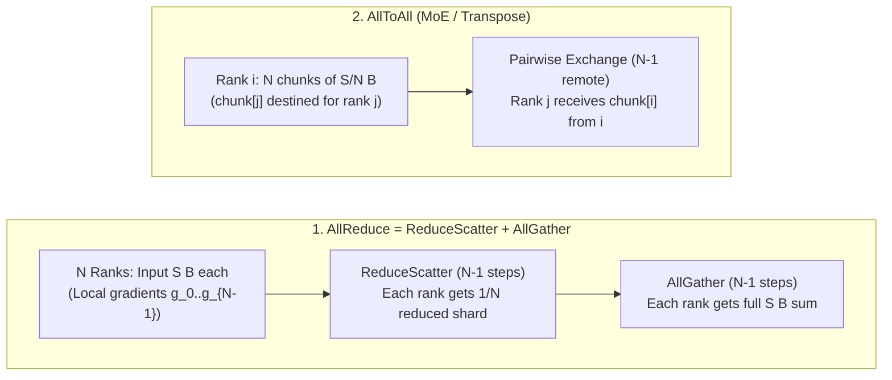
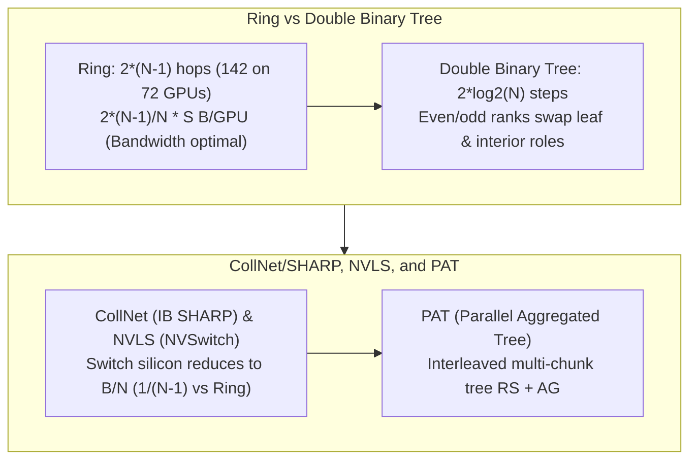

# 12.15 NCCL: collectives and algorithms

| | |
|---|---|
| Level | Advanced |
| Priority tier | 1 |
| Lab venue | Nebius GPU |
| Part | Part 12: Complete AI networking |
| Sources to use | ASP 4; V7 ch9; DAI 2; VL6 ch2 |
| Coverage file | `planning/coverage/chapters/12-15.md` |
| Companion code | `code/part12/nccl_collectives_algorithms.py` · `code/part12/nccl_collectives_algorithms_lab.py` |

## Why this matters for AI infrastructure

An 800 Gb/s InfiniBand rail fabric or a high-speed NVLink switch domain is only an upper bound on physical wire capacity. What determines whether a distributed training or inference cluster achieves high Model FLOPS Utilization is the collective communication runtime orchestrating data movement across those links. In NVIDIA GPU clusters, that runtime is the NVIDIA Collective Communications Library, commonly called NCCL and pronounced "Nickel."

When thousands of GPUs synchronize gradients or exchange sharded weights and Mixture-of-Experts tokens on every step, sending multi-gigabyte tensors to a single master GPU serializes the entire cluster behind one network port. Falling back to a CPU-staged Gloo process group over TCP collapses throughput by two orders of magnitude compared to GPUDirect RDMA. Even when NCCL and GPUDirect RDMA are active, picking a linear Ring algorithm for a latency-bound collective across 72 GPUs forces 71 sequential hops per reduction pass. A hierarchical Tree completes each pass in only 6 or 7 steps, and in-network SHARP or NVLink SHARP cuts per-endpoint data volume dramatically.

```text
Key Cluster and Collective Performance Anchors (DAI Ch. 2; ASP Ch. 4 & Ch. 19; V7 Ch. 9):
- Physical wire capacities: 800 Gb/s (100 GB/s) InfiniBand rail fabric; 1.8 TB/s per GPU NVLink 5 switch domain
- Model FLOPS Utilization (MFU) target band: 40%-60% MFU
  * 70B BF16 transformer example: ~860 TFLOP per step / 2.0 s = 430 TFLOPS sustained vs 989 TFLOPS H100 peak = 43.48% (~43%) MFU (using ~6N FLOPs/token)
- 1,000-GPU and 10,000-GPU gradient sync: sending 10 GB tensors to 1 master GPU bottlenecks on a single port
- 400 MB AllReduce on 800 Gb/s (100 GB/s) InfiniBand:
  * NCCL with GPUDirect RDMA: 4.00 ms (100.0 GB/s)
  * CPU-staged Gloo over TCP: 200.00 ms (2.0 GB/s) -> 50x throughput collapse
- 72-GPU (NVL72) hop scaling and in-network reduction:
  * Ring: 71 sequential hops per reduction pass (142 steps for full AllReduce)
  * Tree: floor(log2(72)) = 6 to ceil(log2(72)) = 7 steps per pass (12 to 14 steps for full AllReduce)
  * SHARP and NVLink SHARP (NVLS): cuts per-endpoint volume by 1 / (N - 1) (1/7 on 8 GPUs, 1/71 on 72 GPUs)
```

Infrastructure and performance engineers must understand the exact mathematics and execution mechanics of NCCL collectives. These include AllReduce, ReduceScatter, AllGather, Broadcast, Reduce, and AllToAll. You also need to master the algorithmic trade-offs between Ring, Double Binary Tree, CollNet with SHARP, NVLS, and Parallel Aggregated Tree. Finally, you must know the wire-level framing of LL, LL128, and Simple protocols, bus bandwidth conversion factors, and persistent zero-copy buffer registration. You will also learn when to pair NCCL with NIXL for disaggregated inference.

---

## Prerequisites and outcomes

### Prerequisites

Before starting this chapter, you should understand RDMA verbs, Queue Pairs, and GPUDirect RDMA from Chapters 12.1 and 12.2. That includes `nvidia-peermem`, PCIe ACS disablement, and PIX versus SYS topology matrices. You should also be familiar with InfiniBand and RoCEv2 fabrics from Chapters 12.3 through 12.14. Finally, you should know the CUDA execution hierarchy of threads, warps, blocks, grids, and streams.

### Outcomes

After completing this chapter, you will be able to accomplish five engineering tasks. First, you will map the six core NCCL collective operations plus Gather, Scatter, and point-to-point Send and Recv to distributed parallelism strategies. Second, you will derive the exact step counts, per-GPU byte volumes, and algorithm-to-bus bandwidth conversion factors. That will allow you to reproduce `nccl-tests` and PyTorch microbenchmarks. Third, you will calculate the latency-bandwidth crossover message size between Ring and Double Binary Tree. You will also quantify the per-endpoint byte reduction of InfiniBand SHARP and NVLS. Fourth, you will contrast the LL, LL128, and Simple wire protocols across message size regimes. Fifth, you will configure compute-communication overlap, zero-copy user buffer registration, NVL72 wave scheduling, and NIXL for disaggregated inference.

| Outcome Area | Formulas, Protocols, and Target Metrics |
|---|---|
| 1. Collectives and Parallelism | `AllReduce`, `ReduceScatter`, `AllGather`, `Broadcast`, `Reduce`, `AllToAll`, `Gather`, `Scatter`, `Send`/`Recv` mapped to `DDP`, `FSDP`, `ZeRO-1/2/3`, `TP`, `SP`, `CP`, `PP`, `MoE EP` |
| 2. Step and `busbw` Math | `AllReduce` steps $2(N-1)$ and factor $\frac`{2(N-1)}``{N}`$; `RS`/`AG`/`A2A` steps $N-1$ and factor $\frac`{N-1}``{N}`$; `Broadcast`/`Reduce` factor $1.0$ |
| 3. Algorithms and Offloads | `Ring` vs `Double Binary Tree` ($2\lceil\log_2 N\rceil$ steps, $S^* = 37.24\text`{ MiB}`$ on `72` GPUs); `CollNet`/`SHARP` (`2x-5x` speedup) and `NVLS` (`1/(N-1)` volume, `~1/2` overlapped time, up to `7.6x` NVLink speedup) |
| 4. Wire Protocols | `LL` (`4 B` payload + `4 B` flag = `50.0%` efficiency), `LL128` (`120 B` payload + `8 B` flag = `93.75%` efficiency), `Simple` (`100.0%` framing efficiency with `__threadfence_system()` over `4 MiB` `NCCL_BUFFSIZE`) |
| 5. Overlap, Zero-Copy, and `NIXL` | `25 MiB` `DDP` bucketing, avoiding `48.0 ms` repeated init, `ncclCommRegister` / `ncclMemAlloc` (`16 -> 4` channels), `NVL72` `4`-wave scheduling (`18` GPUs/wave), and `NIXL` (`0.5.x` API) |

---

## 1. Hardware, Parallelism Taxonomy, and the Six Core NCCL Collectives

### 1.1 Cluster Hardware Context, SIMT Execution, and Parallelism Classification

A single GPU cannot hold the weights, gradients, optimizer states, and activations of a frontier transformer in local HBM, nor can it finish training in a reasonable time alone. Distributing the model across dozens or thousands of GPUs solves the memory capacity problem. However, it immediately turns the interconnect between GPU SMs, NVSwitches, and RDMA NICs into the primary performance bottleneck.

Every NCCL communication channel runs as a dedicated CUDA thread block executing Single Instruction, Multiple Thread warps on one or more Streaming Multiprocessors. Those SM threads read and write peer memory directly over NVLink or GPUDirect RDMA while the remaining SMs execute matrix math. Understanding the memory footprint of training states, the bandwidth hierarchy across GPU generations, and how alternative accelerators compare anchors every collective design choice.

```text
Memory Footprint, Accelerator Generations, and SIMT Execution Reference (DAI Ch. 1-2; ASP Ch. 4; V6 Ch. 2):
1. Transformer Training Memory Breakdown (FP16/BF16 = 2 bytes/parameter):
   - 70B model: ~140 GB weights + 140 GB gradients + 280 GB Adam states (2x model size) = 500+ GB per step with activations
   - 7B BF16 Adam model: 14 GB weights + 14 GB gradients + 28 GB optimizer states = 56 GB static + 8-16 GB activations (peaks at 68 GB for 12 GB activations during loss.backward(); SGD needs 1x momentum or 0 extra state tensors)
2. NVIDIA GPU & Interconnect Generations:
   - Ampere A100 (2020, CC 8.0): 80 GB HBM2e (~1.5-2.0 TB/s effective copy), 600 GB/s NVLink 3.0
   - Hopper H100 (2022, CC 9.0, 132 SMs): 80 GB HBM3 (3.0 TB/s peak, ~2.0-3.0 TB/s effective copy, 989 TFLOPS BF16 dense, ~1.4 TFLOPS/W, up to 6x over A100 with FP8 Transformer Engine), 900 GB/s NVLink 4.0 (NV18 across 8 GPUs, 3.6 TB/s NVSwitch bisection on HGX/DGX H100)
   - Hopper H200 (2023): 141 GB (143,771 MiB) HBM3e, PCIe Gen5 x16 (~64 GB/s per direction); compare RTX 4090 (24,564 MiB, PCIe Gen4 x16 ~31.5 GB/s per direction / ~63 GB/s bidirectional)
   - Blackwell B200 (2024) & B300: 192 GB HBM3e (288 GB on B300), 8 TB/s HBM, 1.8 TB/s NVLink 5 (18 links x ~100 GB/s), 2.25 PFLOPS FP16, 20 PFLOPS FP4
   - Rack & Superchip Scale: GB200/GB300 NVL72 connects 36 Grace-Blackwell superchips (72 GPUs) in one NVLink Switch domain (~130 TB/s aggregate all-to-all, < 1 us hop latency); 8-rack GB200 SuperPOD links 576 GPUs; Grace Hopper GH200 (96 GB HBM + 512 GB LPDDR5X = 608 GB) shares a 900 GB/s NVLink-C2C coherent link
   - Host Server & Cluster Infrastructure Ratios (8-GPU node): 16-32 CPU cores (2-4 cores/GPU), >= 1 TB host RAM (1.5-2x GPU memory), 128 PCIe lanes, 10-20 GB/s local NVMe read, PUE 1.2-1.5, < 1 ms intra-node and < 5 ms inter-node AllReduce latency
3. Alternative Accelerators & CUDA SIMT Execution Hierarchy:
   - Google TPU Pods: v1 256x256 (65,536-PE systolic MXU at 700 MHz = 92 TOPS INT8); v2-v4 128x128 MXUs (~275 TFLOPS BF16 on v4, Sparse Core for embeddings, 2D/3D torus and OCS optical switches, v5e/v5p, Trillium, Ironwood, TPU 8t/8i via JAX/XLA NamedSharding)
   - Datacenter NPUs & AMD GPUs: Huawei Ascend 910C SuperPoD, AWS Trainium2, Cambricon MLU, Edge TPU; AMD MI300X (CDNA3, 4 SIMD units per Compute Unit under ROCm)
   - CUDA SPMD / SIMT Hierarchy: Thread -> Warp (32 threads) -> Block (128-1024 threads) -> Grid; 64 KB registers and 48 KB or 96 KB L1/shared memory per SM with Fine-Grained Multithreading (FGMT)
```

To classify any distributed training or inference strategy and identify which NCCL collectives sit on its critical path, you can ask three structural questions. First, does the strategy split the forward and backward computation of a single layer or sample across devices? Second, must a single sample cross device boundaries during the forward or backward pass? Third, does the strategy introduce device-to-device collective communication?

| Parallelism Category | Q1 (Split Layer Compute?) | Q2 (Sample Crosses Devices?) | Q3 (Collective Collaboration?) | Specific Strategies and Critical-Path `NCCL` Collectives |
|---|---|---|---|---|
| **Data Parallelism (`Data`)** | `No` | `No` | `Yes` | **`DDP`:** Full model replica per rank; synchronizes gradients via **`AllReduce`**. |
| **State Sharding (`State`)** | `No` | `No` | `Yes` | **`ZeRO-1`:** Shards optimizer states (`ReduceScatter` + `AllGather` at step). **`ZeRO-2`:** Shards optimizer + gradients (`ReduceScatter` on gradients). **`FSDP` / `ZeRO-3`:** Shards parameters, gradients, and optimizer states; runs **`AllGather`** before forward/backward layers and **`ReduceScatter`** during backward. |
| **Model Parallelism (`Computation`)** | `Yes` | `Yes` | `Yes` | **`TP`:** Splits matrices column/row-wise over NVLink, running **`AllReduce`** (or **`AllGather` + `ReduceScatter`** with **`SP`**) per layer. **`CP`:** Splits long-context KV caches (`AllGather` / ring P2P). **`PP`:** Slices layers across stages via point-to-point **`Send`/`Recv`**. **`MoE EP`:** Routes tokens to experts via **`AllToAll`**. |

### 1.2 The Six Core NCCL Collectives and Their Decomposition Rules

When a distributed framework needs to sum gradients across replicas, gather sharded weights, or route tokens to Mixture-of-Experts layers, it calls into a small set of collective primitives. Choosing the wrong primitive or composing two non-pipelined collectives can cut effective fabric throughput in half.

NCCL exposes five primary collective C APIs: `ncclAllReduce`, `ncclBroadcast`, `ncclReduce`, `ncclAllGather`, and `ncclReduceScatter`. It also provides point-to-point group primitives (`ncclSend` and `ncclRecv` inside `ncclGroupStart` and `ncclGroupEnd`) that frameworks combine to build AllToAll, Gather, and Scatter.



| Collective Operation | Communication Pattern | Input Size per Rank | Output Size per Rank | Ring Steps | Bus Bandwidth Factor (`busbw / algbw`) | Primary AI Workload Mapping |
|---|---|---|---|---|---|---|
| **`AllReduce`** | Many-to-many reduction + full distribution | $S$ | $S$ (identical reduced tensor on all $N$ ranks) | $2(N - 1)$ | $\frac`{2(N - 1)}``{N}`$ | `DDP` gradient averaging; `Megatron-LM` `TP` layer reductions |
| **`ReduceScatter`** | Many-to-many reduction + sharded distribution | $S$ (as $N$ shards of $S/N$) | $\frac`{S}``{N}`$ (reduced shard $r$ on rank $r$) | $N - 1$ | $\frac`{N - 1}``{N}`$ | `FSDP` / `ZeRO-2` / `ZeRO-3` backward gradient reduction; `TP+SP` |
| **`AllGather`** | Many-to-many shard concatenation | $\frac`{S}``{N}`$ | $S$ (concatenated in rank order $0 \dots N-1$) | $N - 1$ | $\frac`{N - 1}``{N}`$ | `FSDP` / `ZeRO-3` parameter unsharding; `TP+SP` activation gather |
| **`Broadcast`** | One-to-all replication from `root` | $S$ on `root` ($0$ on others) | $S$ on all $N$ ranks | $N - 1$ (or $1$ with `NVLS`) | $1.0$ | Initial weight/checkpoint distribution, seed and hyperparameter sync |
| **`Reduce`** | All-to-one reduction onto `root` | $S$ on all $N$ ranks | $S$ on `root` (non-root unchanged) | $N - 1$ | $1.0$ | Centralized loss/metric aggregation and rank-0 logging |
| **`AllToAll`** | All-to-all personalized matrix transpose | $S$ ($N$ chunks of $\frac`{S}``{N}`$) | $S$ ($N$ transposed chunks of $\frac`{S}``{N}`$) | $N - 1$ remote rounds | $\frac`{N - 1}``{N}`$ | `MoE` Expert Parallelism token dispatch/combine; `CP`/`SP` transpose |
| **`Gather` / `Scatter`** | All-to-one collection / One-to-all partitioning | $\frac`{S}``{N}`$ (`Gather`) / $S$ on `root` (`Scatter`) | $S$ on `root` (`Gather`) / $\frac`{S}``{N}`$ (`Scatter`) | $N - 1$ | $\frac`{N - 1}``{N}`$ | Centralized validation prediction collection / dataset shard init |

Three algebraic and buffer rules govern how frameworks compose these primitives in production. First, AllReduce is mathematically identical to ReduceScatter followed by AllGather. Executing Reduce to rank 0 followed by Broadcast from rank 0 turns rank 0 into a serial bottleneck and prevents pipelining. Instead, NCCL decomposes Ring AllReduce into a pipelined ReduceScatter phase followed immediately by an AllGather phase. FSDP exploits this exact identity by running AllGather before a layer's compute pass and ReduceScatter after backward compute. That keeps only one shard of the model state resident outside the active layer.

Second, collectives differ in their in-place versus out-of-place buffer rules. AllReduce, Broadcast, and Reduce naturally operate in-place with identical send and receive pointers. AllGather and ReduceScatter also support in-place execution when each rank's shard pointer is offset to `buff + rank * shard_bytes`. By contrast, AllToAll transposes off-diagonal chunks simultaneously and requires separate send and receive buffers. Third, while basic collectives have CPU fallback implementations in Gloo, `dist.all_to_all` in PyTorch requires `backend="nccl"` on GPU tensors. It fails if invoked on a CPU Gloo process group.

---

## 2. Algorithmic bandwidth (`algbw`), bus bandwidth (`busbw`), and step/volume math

### 2.1 Deriving Ring Step Counts and Per-GPU Data Volume

When engineers benchmark an 8-GPU node or a 64-GPU cluster, raw tensor size divided by wall-clock time decreases as more GPUs join the ring. Without deriving the exact step count and byte volume transferred by each GPU, teams often misread this normal scaling factor. They mistake it for a hardware or fabric regression.

Consider an $N$-GPU communicator executing an AllReduce on a tensor of size $S$ bytes per rank. NCCL partitions each rank's buffer into $N$ equal chunks of size $S / N$ bytes and executes two consecutive $(N - 1)$-step ring phases.

```text
Ring AllReduce Two-Phase Step and Byte Volume Derivation (ASP Ch. 4; DAI Ch. 1-2):
1. Phase 1 - ReduceScatter (N - 1 steps):
   - In step k in {1 .. N-1}, rank r sends chunk (r - k + 1) mod N of size S/N to rank (r + 1) mod N
   - Rank r receives chunk (r - k) mod N from rank (r - 1) mod N and accumulates (SUM, MAX, MIN, or AVG) into its local buffer
   - After N - 1 steps, each rank holds 1 fully reduced shard of size S / N
   - Bytes sent (and received) per GPU in Phase 1: V_RS = (N - 1) * (S / N)
2. Phase 2 - AllGather (N - 1 steps):
   - In steps N .. 2(N - 1), each rank circulates its completed S / N shard around the ring without arithmetic reduction
   - Overwrites the remaining N - 1 shard slots until all N ranks hold the complete S-byte reduced tensor
   - Bytes sent (and received) per GPU in Phase 2: V_AG = (N - 1) * (S / N)
3. Combined Ring AllReduce Totals:
   - Total sequential ring steps: Steps_AllReduce = 2 * (N - 1)
   - Total bytes sent (and received) per GPU: V_AllReduce = V_RS + V_AG = 2 * ((N - 1) / N) * S
```

### 2.2 Converting `algbw` to `busbw` Across Collectives and Cluster Scales

When a collective of tensor size $S$ bytes completes in wall-clock time $t$ seconds, `nccl-tests` reports two distinct throughput figures. These are algorithm bandwidth and bus bandwidth. Algorithm bandwidth is simply $S / t$, measuring the apparent rate at which the input tensor is processed. Bus bandwidth multiplies algorithm bandwidth by the collective's topological volume factor. The result can then be compared directly against physical NVLink, InfiniBand, or RoCEv2 line rates regardless of the GPU count $N$.

$$\text`{algbw}` = \frac`{S}``{t}`, \qquad \text`{busbw}`_\{\text`{AllReduce}`} = \text`{algbw}` \times \frac`{2(N - 1)}``{N}`, \qquad \text`{busbw}`_\{\text`{RS / AG / A2A}`} = \text`{algbw}` \times \frac`{N - 1}``{N}`, \qquad \text`{busbw}`_\{\text`{Bcast / Reduce}`} = \text`{algbw}` \times 1.0$$

The table below shows how the step counts, chunk sizes, per-GPU byte volumes, and bus bandwidth conversion factors evolve from 2 GPUs up to a 72-GPU NVL72 rack.

| World Size ($N$ GPUs) | `RS` / `AG` Steps ($N - 1$) | `AllReduce` Steps ($2(N - 1)$) | Chunk Size $S/N$ ($S = 100\text`{ MB}`$) | `RS` / `AG` / `A2A` Factor $\frac`{N-1}``{N}`$ | `AllReduce` Factor $\frac`{2(N-1)}``{N}`$ | `AllReduce` Volume per GPU ($S = 100\text`{ MB}`$) |
|---|---|---|---|---|---|---|
| **$N = 2$** | `1` | `2` | `50.00 MB` | `0.5000` | **`1.0000`** | `100.00 MB` (`algbw == busbw`) |
| **$N = 4$** | `3` | `6` | `25.00 MB` | `0.7500` | **`1.5000`** | `150.00 MB` (`busbw = 1.50 * algbw`) |
| **$N = 8$** (1 HGX node) | `7` | `14` | `12.50 MB` | `0.8750` | **`1.7500`** | `175.00 MB` (`busbw = 1.75 * algbw`) |
| **$N = 64$** (8 nodes) | `63` | `126` | `1.5625 MB` | `0.984375` | **`1.96875`** | `196.88 MB` (`busbw = 1.97 * algbw`) |
| **$N = 72$** (`NVL72` rack) | `71` | `142` | `1.3889 MB` | `0.986111` | **`1.972222`** (`142/72`) | `197.22 MB` (`142 MB` for $S = 72\text`{ MB}`$) |
| **$N \to \infty$** (asymptotic) | $N - 1$ | $2N - 2$ | $S / N \to 0$ | $\to 1.0000$ | **$\to 2.0000$** | $\to 2S$ (`200.00 MB`) |

:::info Reconciling `nccl-tests` `algbw` with PyTorch Cluster-Aggregate Microbenchmarks
In `nccl-tests` (`all_reduce_perf`), algorithm bandwidth is defined per rank as $S / t$. At 2 GPUs, the factor $2(2-1)/2 = 1.0$ makes algorithm bandwidth and bus bandwidth identical. Some standalone PyTorch scripts, such as `allreduce_microbench.py`, define cluster-aggregate algorithm bytes and ring bus bytes across all ranks and iterations. Comparing that multi-GPU bandwidth against a single-GPU HBM copy test (`bandwidth_test.py`) reveals whether Tensor Parallelism is viable on the node. If the interconnect is too slow, communication must be restricted to FSDP and DDP.

```text
PyTorch Microbenchmark vs Single-GPU HBM Copy Reference (DAI Ch. 2 p.41-47 & p.793-795):
1. 2-GPU AllReduce Microbenchmark (allreduce_microbench.py):
   - Conventions: alg_bytes = size_bytes * n * iterations; bus_bytes = size_bytes * 2 * (n - 1) * iterations
   - Parameters: N = 2 GPUs, size_bytes = 100 MiB (26,214,400 float32 elements), iterations = 50, elapsed = 0.248 s
   - Total bytes: 100 MiB * 2 * 50 = 10,000 MiB (9.765625 GiB) for both alg_bytes and bus_bytes (since 2*(N-1) = N = 2; at N = 4, busbw = 1.5x algbw)
   - Measured rate: 40,322.58 MB/s (39.38 GB/s) for both algbw and busbw
2. Single-GPU HBM Copy Benchmark (bandwidth_test.py):
   - Parameters: 64 MiB tensor, 200 iterations, 2 * nbytes read+write per iteration = 25.0 GiB in 0.01262339 s
   - Measured HBM copy rate: 1,980.45 GB/s (vs 10-50 GB/s PCIe AllReduce or tens to low hundreds of GB/s over NVLink)
```
:::

---

## 3. NCCL Communication Algorithms: Ring, Double Binary Tree, CollNet/SHARP, NVLS, and PAT

### 3.1 Ring vs Double Binary Tree and the Latency-Bandwidth Crossover

While Ring is bandwidth-optimal because every GPU sends and receives one chunk on every step, its startup latency grows linearly with the number of GPUs. On a thousand-GPU job, or even across a 72-GPU NVL72 rack requiring 142 sequential steps for an AllReduce, that linear hop latency dominates small and medium messages.

A simple binary tree reduces the hop count to logarithmic depth, but half of the ranks in a binary tree are leaf nodes. During the upward Reduce phase, leaves only send once and never receive; during the downward Broadcast phase, leaves only receive and never send. Consequently, a single binary tree leaves half of the cluster's bidirectional link capacity idle.

NCCL solves both problems with its Double Binary Tree algorithm. It constructs two complementary binary trees over the same $N$ GPUs by shifting the tree indexing. Every even-numbered rank is an interior node in Tree A and a leaf node in Tree B. Conversely, every odd-numbered rank is a leaf in Tree A and an interior node in Tree B. Each message is split evenly across both trees, restoring full-duplex bandwidth while completing in logarithmic latency steps.

```text
Ring vs Double Binary Tree Latency-Bandwidth Model on 72 GPUs (ASP Ch. 4 & Ch. 19):
- Ring time formula: T_ring(S, N) = 2(N - 1)*alpha + 2*((N - 1)/N)*(S / B)
- Tree time formula: T_tree(S, N) = 2*ceil(log2(N))*alpha + 2*k_tree*(S / B)
- Parameters on N = 72 GPUs (NVL72):
  * One-way reduction hops: Ring = 72 - 1 = 71 hops (142 AllReduce steps) vs Tree = floor(log2(72)) = 6 to ceil(log2(72)) = 7 hops (12 to 14 AllReduce steps)
  * Per-hop latency alpha = 1.0 us, unidirectional link bandwidth B = 100 GB/s, dual-tree relay factor k_tree = 1.15
- Evaluated Latency and Crossover Size S*:
  * At S = 1 MiB (1,048,576 B):   Tree = 38.12 us vs Ring = 162.68 us (Tree is 4.27x faster)
  * At S = 256 MiB (268,435,456 B): Ring = 5,436.14 us vs Tree = 6,188.02 us (Ring wins on raw streaming bandwidth)
  * Exact crossover S* where T_ring(S*) = T_tree(S*):
    S* = ((142 - 14) * 1.0 us * 100 GB/s) / (2 * (1.15 - 71/72)) = 37.24 MiB (39,051,908 B)
```



| Algorithm (`NCCL_ALGO` Token) | Step Complexity | Per-GPU Volume (`AllReduce` / `RS`) | Hardware Offload Requirement | Target Workload and Scale Regime |
|---|---|---|---|---|
| **`Ring`** (`Ring`) | $2(N - 1)$ steps (`142` on `72` GPUs) | $2\frac`{N-1}``{N}`S$ (`AllReduce`), $\frac`{N-1}``{N}`S$ (`RS`/`AG`) | None (GPU P2P DMA / RDMA) | Large bandwidth-bound messages (`> 32-64 MiB`) at small/moderate rank counts |
| **`Double Binary Tree`** (`Tree`) | $2\lceil\log_2 N\rceil$ steps (`12-14` on `72` GPUs) | $\approx 2S$ split `50/50` across dual complementary trees | None (intranode chain + internode dual tree) | Small/medium latency-bound messages (`< 10s of MiB`) and large multi-node clusters |
| **`CollNet`** (`CollNetDirect`, `CollNetChain`) | $O(\log_k N_\{\text`{nodes}`})$ switch tree + local intra-node group | **`B / N`** per endpoint in `RS` (**`1 / (N - 1)`** vs Ring) | Quantum InfiniBand switch ASICs + `SHARP` `AM` + `NCCL` SHARP plugin | Multi-node InfiniBand clusters (`32+` nodes; **`2x` to `5x`** `AllReduce` speedup) |
| **`NVLink SHARP`** (`NVLS`, `NVLSTree`) | 1-hop / 2-hop NVSwitch reduction + hardware multicast | **`B / N`** in `RS` receive and `AG` send (**`1 / (N - 1)`** vs Ring) | `NVSwitch` 3.0/4.0 (`HGX H100/H200`, `GB200/GB300 NVL72`) | Intra-node / `NVL72` intra-rack collectives; overlapped `AG+RS` cuts time by **`~1/2`** |
| **`Parallel Aggregated Tree`** (`PAT`) | $O(\log_2 N)$ startup latency per staggered chunk | Near-ring optimal bandwidth across interleaved streams | Multi-stream GPU scheduling across topology links | Medium-to-large messages requiring both $O(\log N)$ latency and ring-level bandwidth |

### 3.2 CollNet (InfiniBand SHARP), NVLink SHARP (NVLS), and PAT Math

Even with a Double Binary Tree, every GPU still sends and receives nearly $2S$ bytes of data and burns SM cycles accumulating floating-point values. Modern NVIDIA fabrics move collective arithmetic and replication out of the GPU SMs and directly into switch silicon through CollNet with InfiniBand SHARP and NVLink SHARP.

CollNet groups GPUs within a local node or rack, aggregates locally via CollNetDirect or CollNetChain, and elects leader GPUs. Those leaders inject traffic into Quantum InfiniBand switches running SHARP. Inside an NVSwitch domain such as an 8-GPU HGX baseboard or a 72-GPU NVL72 rack, NVLS offloads reductions and multicast replication to the NVSwitch ASICs. Finally, when switch offload is unavailable, Parallel Aggregated Tree interleaves staggered tree reductions across multiple CUDA streams. Every physical link stays saturated like a Ring while startup latency stays bounded to logarithmic depth like a Tree.

```text
In-Network SHARP, NVLink SHARP (NVLS), and PAT Offload Math (ASP Ch. 4; V7 Ch. 9):
1. CollNet (CollNetDirect & CollNetChain) with InfiniBand SHARP:
   - Prerequisites: Quantum IB switches with SHARP firmware, active SHARP Aggregation Manager (AM) alongside Subnet Manager, nvidia-peermem loaded, NCCL RDMA SHARP plugin, and NCCL_COLLNET_ENABLE=1 (use NCCL_SHARP_DISABLE=1 for A/B testing)
   - Hardware contrast: Spectrum-X Ethernet accelerates RoCEv2 via adaptive routing and telemetry, but does NOT have switch-resident reduction ALUs like IB SHARP
   - Switch buffer caveat: finite switch silicon reduction buffers can exhaust on huge multi-GB collectives and fall back to host algorithms (monitor via NCCL_DEBUG=INFO)
   - Multi-node speedup: 2x to 5x AllReduce speedup at 32+ node scale
2. NVLink SHARP (NVLS & NVLSTree, NCCL_NVLS_ENABLE=1) 1 / (N - 1) Volume Reduction:
   - ReduceScatter in-network reduction: Ring receives B*(N-1)/N bytes across N-1 hops; NVLS/SHARP switch reduces in hardware and returns only B / N bytes per GPU -> ratio (B/N) / (B*(N-1)/N) = 1 / (N - 1)
     * N = 8 GPUs (B = 800 MB):  Ring = 700 MB vs NVLS/SHARP = 100 MB (1/7 volume)
     * N = 72 GPUs (B = 720 MB): Ring = 710 MB vs NVLS/SHARP = 10 MB  (1/71 volume)
   - AllGather hardware multicast: each GPU sends its B / N shard once into NVSwitch, which multicast-replicates to all N - 1 peers in 1 hop -> 1 / (N - 1) sender volume
   - Overlapped FSDP phase wall time: overlapping NVLS multicast AllGather (T_AG) with NVLS in-network ReduceScatter (T_RS) shrinks wall time from T_AG + T_RS to max(T_AG, T_RS) -> ~1/2 (50% / 0.5x) time reduction, and up to 7.6x speedup on small/medium NVLink messages
```

---

## 4. NCCL Wire Protocols (`LL`, `LL128`, `Simple`) and Zero-Copy User Buffers

### 4.1 Wire Protocol Framing: `LL` (50%), `LL128` (93.75%), and `Simple` (100%)

When a GPU streams a large payload slice into a peer's ring buffer using bulk DMA, it must execute a full system memory fence before updating the receiver's ready counter. Without that fence, the ready flag could arrive over NVLink or PCIe before all payload bytes become visible in the receiver's HBM. However, calling `__threadfence_system()` adds several microseconds of latency at every hop, which severely penalizes small latency-sensitive collectives.

Orthogonal to the graph algorithm, NCCL solves this synchronization bottleneck by offering three wire transfer protocols via `NCCL_PROTO`: LL, LL128, and Simple. For tiny messages, LL packs 4 bytes of data and a 4-byte iteration flag into a single 8-byte atomic store so the receiver can poll L2 cache without any memory fence. For small-to-medium messages on platforms supporting 128-byte atomic transactions, LL128 packs 120 bytes of data with an 8-byte flag to achieve 93.75% framing efficiency while remaining fence-free. For large bandwidth-dominated messages, Simple uses full bulk DMA slices with `__threadfence_system()`.

| Protocol (`NCCL_PROTO`) | Atomic Unit Size | Payload Bytes | Flag Overhead Bytes | Framing Efficiency | Flag Overhead % | Synchronization Mechanism | Optimal Message Size Regime |
|---|---|---|---|---|---|---|---|
| **`LL`** (Low Latency) | `8 B` | **`4 B`** | **`4 B`** | **`50.0%`** (`4 / 8`) | **`50.0%`** | `8-byte` atomic store + L2/register flag poll (no memory fence) | Tiny messages (`<= 32-64 KiB`); lowest transfer startup latency |
| **`LL128`** (Low Latency 128B) | `128 B` | **`120 B`** | **`8 B`** | **`93.75%`** (`120 / 128`) | **`6.25%`** | `128-byte` NVLink/PCIe atomic store + `8B` inline flag poll (no fence) | Small-to-medium messages (`~64 KiB` to several `MiB` on NVLink/PCIe) |
| **`Simple`** (Bulk DMA) | `NCCL_BUFFSIZE` (default `4 MiB`) | `100%` of slice | `0 B` inline | **`~100.0%`** | **`~0.0%`** | Bulk DMA write + `__threadfence_system()` before signalling peer FIFO | Large bandwidth-dominated messages (`> 4-16 MiB`) |

```text
Worked 120,000-Byte (120 KB) Payload Wire Protocol Breakdown (ASP Ch. 4):
- LL (8 B atomic unit = 4 B payload + 4 B flag):
  * Atomic packets = 120,000 / 4 = 30,000 packets
  * Total wire bytes = 120,000 B payload + 120,000 B flags = 240,000 B (50.0% efficiency, 50.0% overhead)
- LL128 (128 B atomic unit = 120 B payload + 8 B flag):
  * Atomic transactions = 120,000 / 120 = 1,000 transactions
  * Total wire bytes = 120,000 B payload + 8,000 B flags = 128,000 B (93.75% efficiency, 6.25% overhead)
- Simple (NCCL_BUFFSIZE default = 4 MiB = 4,194,304 B):
  * Bulk DMA slices = 1 slice (120,000 B wire payload, 100.0% framing efficiency, requires __threadfence_system())
```

### 4.2 Persistent User Buffers and Zero-Copy Registration (`ncclCommRegister` / `ncclMemAlloc`)

By default, when an application passes an arbitrary tensor pointer to `ncclAllReduce`, NCCL copies slices of that tensor into its internal pre-registered channel staging buffers using GPU SM threads. It then transmits from the staging buffer and copies the result back out. This internal staging consumes GPU memory, burns HBM bandwidth on extra device-to-device copies, and occupies 16 to 32 SM thread blocks that would otherwise execute GEMM compute kernels.

To eliminate staging copies, modern NCCL releases provide persistent user buffer registration via `ncclMemAlloc` and `ncclCommRegister`. When zero-copy registration is active alongside NVLS, SHARP, or InfiniBand GPUDirect Async, NCCL reads and writes the user's tensor memory directly. It cuts required communication channels from 16 SM blocks down to 4 and prevents PyTorch caching-allocator fragmentation in UCX RDMA registration pools.

```text
Persistent Zero-Copy Buffer Registration & UCX Fragmentation Reference (ASP Ch. 4):
1. API Lifecycle (NCCL 2.19+ / 2.21+):
   - Allocate fabric/IPC-compatible buffer: ncclMemAlloc(&ptr, bytes) (or CUDA VMM cudaMemCreate / cudaMemAddressReserve)
   - Register once outside the loop: ncclCommRegister(comm, ptr, bytes, &regHandle)
   - Deregister & free at teardown: ncclCommDeregister(comm, regHandle) and ncclMemFree(ptr)
   - Channel & SM savings (controlled by NCCL_MIN_NCHANNELS and NCCL_MAX_NCHANNELS): drops active channels from 16 blocks to 4 blocks (saving 12 SM thread blocks per GPU for GEMM compute) with NVLS, SHARP, or IBGDA
2. Two Mandatory Rank-Symmetry Invariants:
   - All-Rank Rule: if ANY rank in a communicator registers its user buffer for a collective, ALL ranks must pass registered buffers
   - Symmetric Offset Rule: for symmetric zero-copy algorithms (NVLS, CollNet/SHARP, symmetric NVLink), the byte offset (user_ptr - base_alloc_ptr) must match across all ranks (violations silently fall back to internal NCCL_BUFFSIZE staging)
3. UCX / RDMA Caching Allocator Fragmentation Pattern:
   - Allocating and freeing varying temporary tensors (40 MB and 200 MB after an initial 0.800 GB tensor) leaves torch.cuda.memory_allocated() at 0.000 GB
   - Meanwhile, torch.cuda.memory_reserved() ratchets up from 0.800 GB (Iter 00) -> 1.040 GB (Iter 01) -> 1.240 GB (Iter 02..10), exhausting RDMA pin pools unless persistent registered buffers are reused
```

---

## 5. Compute-Communication Overlap, Wave Scheduling, Communicator Lifecycle, and NIXL

### 5.1 Pipelining, Wait-Free Backpropagation (`DDP` vs `DP`), and Bucketing Math

In NVIDIA's four-pillar Magnum IO architecture, hiding network latency behind useful Tensor Core execution is the single highest-leverage software optimization. If a training loop computes the entire backward pass across all layers and only launches AllReduce after backward finishes, the GPUs sit idle during network transfer. Similarly, calling single-process `nn.DataParallel` or leaving host-device synchronization calls inside the training step stalls the pipeline. Re-initializing communicators on every iteration also destroys cluster scaling efficiency.

With Wait-Free Backpropagation in PyTorch `DistributedDataParallel`, autograd hooks group parameters in reverse layer order into 25 MiB gradient buckets. As soon as a bucket fills on the compute stream, DDP launches an asynchronous NCCL AllReduce on a dedicated communication stream. Meanwhile, the compute stream continues calculating earlier-layer gradients.

| Optimization / Anti-Pattern | Baseline Execution Behavior | Optimized Execution Behavior (`ASP` Ch. 4 Tables 4-1..4-3) |
|---|---|---|
| **1. NVIDIA Magnum IO 4 Pillars** | Uncoordinated I/O subsystems | **(1) Storage I/O** (`GPUDirect Storage` / `BlueField SNAP`), **(2) Network I/O** (`GPUDirect RDMA`, `NCCL`, `NVSHMEM`, `UCX`, `HPC-X`), **(3) In-Network Compute** (`SHARP`), **(4) I/O Management** (`NetQ`, `UFM`). |
| **2. Serial vs Overlapped `DDP` (`WFBP`)** | Serial `loss.backward()` (`fc1, fc2, fc3` = `10.0 ms`) then `dist.all_reduce` (`12.0 ms`) = **`22.0 ms`** (`0%` overlap). Broad baseline: `100.0 ms` (`60%` SM busy). | Reverse-order `25 MiB` gradient buckets (`bucket_cap_mb = 25`, `fc3 -> fc2 -> fc1`) overlap `AllReduce` on a secondary CUDA stream: $\max(10.0, 12.0) = \mathbf\{12.0\text`{ ms}`}$ (**`45.45%` reduction**). Broad iteration drops from `100.0 ms` to **`70.0 ms`** (**`30.0%` faster**, **`90%` SM busy**). |
| **3. `nn.DataParallel` (`DP`) vs `DDP`** | Single-process `DP` splits `[512, 1024]` into `[256, 1024]` across threads contending on Python `GIL` and gathers on `GPU 0` = **`45.00 ms`**. | Multi-process `DDP` (`1` process/GPU via `torchrun` or `mp.spawn`) eliminates `GIL` and `GPU 0` bottleneck = **`30.00 ms`** (**`33.33%` faster**). |
| **4. Syncs and Gradient Accumulation** | Calling `torch.cuda.synchronize()`, `.item()`, `.cpu()`, or `print(tensor)` in the loop blocks the CPU and serializes streams. | Remove in-loop host syncs; `4`-step gradient accumulation cuts `AllReduce` frequency by **`4x`** (`75%` fewer collective barriers). |
| **5. Communicator Lifecycle (`48.0 ms` Penalty)** | Calling `init_process_group` + `destroy_process_group` inside the loop adds **`48.0 ms`** to a `0.5 ms` `1`-element `AllReduce` = **`48.5 ms`** (`2-3 min` for `32` comms). | Initialize once outside the loop and create `TP`/`PP` subgroups via `dist.new_group()` or `ncclGroupStart()`/`ncclGroupEnd()` = **`0.5 ms`** (**`98.97%` reduction**, `> 98%`). |
| **6. `NCCL_PROFILER_PLUGIN` Callbacks** | Heavyweight external tracing distorts collective timing. | `32`-bit event activation mask (group, collective, P2P, proxy events) with **5 C callbacks:** `init`, `startEvent`, `stopEvent`, `recordEventState`, and `finalize` (used by `Kineto`, Nsight Systems, `CUPTI`/`NVTX`). |

### 5.2 Wave Scheduling, Rotating Ring Endpoints, and Multi-Rail Striping on NVL72

At rack scale in a 72-GPU GB200 or GB300 NVL72 domain, launching uncoordinated collectives across all 72 GPUs creates instantaneous NVSwitch queue spikes. Each Blackwell GPU has 18 NVLink 5 ports. If all 72 GPUs execute a simultaneous AllToAll token exchange, every GPU is hit by 71 concurrent senders at once, oversubscribing its 18 ingress ports nearly fourfold.

Splitting the 72-GPU exchange into four staggered waves of 18 GPUs via temporal multiplexing ensures that at most 18 GPUs transmit to any receiver at one instant. That matches the 18 NVLink ports per GPU without switch queueing and allows Wave 1's downstream compute to overlap with Wave 2 through Wave 4 communication. Operators also rotate ring start endpoints and enable cross-NIC rail striping to eliminate persistent boundary hot spots.

```text
NVL72 Congestion-Aware Scheduling and Multi-Rail Striping (ASP Ch. 4 & Ch. 19; V6 Ch. 2):
1. 4-Wave AllToAll Scheduling on 72 GPUs:
   - Per-GPU NVLink 5 port count: 18 links x ~100 GB/s = 1.8 TB/s bidirectional
   - Unstaggered 72-GPU AllToAll: 71 concurrent senders hit GPU 0 (exceeds 18 ports)
   - Staggered 4-Wave Schedule: 72 / 4 = 18 active senders per wave (matches 18 NVLink ports with 0 queue buildup)
   - Concurrent Inference Collectives Cap: limit heavy expert-gather/broadcast collectives to 2 to 4 in flight (e.g., stagger 12 collectives into 3 waves of 4)
2. Rotating Ring Endpoints & Multi-NIC Striping:
   - Alternating internal inside/outside rings + rotated ring start endpoints [0, 18, 36, 54] across 4 permuted ncclCommInitRank groups
   - Multi-NIC nodes (2x 800 Gbps = 1.6 Tbps or 4x 800 Gbps = 3.2 Tbps): enable NCCL_CROSS_NIC=1 and static topology files (NCCL_TOPO_FILE) binding GPUs 0-3 to NIC 0 (NUMA 0) and GPUs 4-7 to NIC 1 (NUMA 1)
```

### 5.3 NCCL vs NIXL for Disaggregated Inference

NCCL is purpose-built for synchronous many-to-many collectives where all ranks in a communicator enter a barrier-like call in lockstep. Disaggregated LLM inference in frameworks such as NVIDIA Dynamo, vLLM, SGLang, and TensorRT-LLM separates compute-bound prefill workers from memory-bandwidth-bound decode workers. Prefill workers must hand off multi-gigabyte KV caches asynchronously to decode workers or offload blocks across GPU HBM, CPU DRAM, local NVMe SSDs, and object storage without blocking peer GPUs.

The NVIDIA Inference Xfer Library, or NIXL, provides a unified non-blocking point-to-point transfer API across heterogeneous memory tiers. Pairing NCCL for intra-pool tensor parallelism with NIXL for cross-pool KV cache handoffs maximizes both prefill time-to-first-token and decode throughput.

| Dimension | `NCCL` (Collective Communication Library) | `NIXL` (NVIDIA Inference Xfer Library, `0.5.x`) |
|---|---|---|
| **Primary Pattern** | Many-to-many synchronized collectives (`AllReduce`, `AllGather`, `ReduceScatter`, `AllToAll`) | One-to-one or one-to-few asynchronous point-to-point transfers (`NIXL_WRITE` / `NIXL_READ`) |
| **Synchronization Semantics** | Collective barrier semantics (all ranks in communicator must invoke the call in lockstep) | Non-blocking initiator/target agents (`agentSrc` $\rightarrow$ `agentDst`) polled via `checkXfer(reqHandle)` |
| **Core C++ Lifecycle API** | `ncclCommInitRank` $\rightarrow$ `ncclCommRegister` $\rightarrow$ `ncclAllReduce(..., stream)` $\rightarrow$ `ncclCommDestroy` | `nixlAgent` $\rightarrow$ `registerMem` $\rightarrow$ `trim` $\rightarrow$ `prepXfer` $\rightarrow$ `postXfer` $\rightarrow$ `checkXfer` $\rightarrow$ `releaseReqH` $\rightarrow$ `deregisterMem` |
| **Memory Tiers and Transports** | GPU HBM (and NVLink-C2C symmetric memory) over `NVLink`, `NVSwitch`, `PCIe`, `IB`/`RoCE`, TCP | Unified across GPU `VRAM_SEG` (`1 GB` to `100 GB` KV caches), CPU DRAM (`512 GB` LPDDR5X on `GH200`), NVMe SSD (`GDS`/POSIX), and `S3` via `UCX`, `GPUDirect RDMA`, and `IBGDA` |
| **Measured Speedup Benchmarks** | `100.0 GB/s` (`4.0 ms` for `400 MB`) on `800G` IB vs `2.0 GB/s` (`200 ms`) on `Gloo`; `2x-5x` with `SHARP` | **`14x` TTFT speedup** on x86 `H100` KV offload vs recompute; **`2x` faster TTFT** on `GH200` (`900 GB/s` `NVLink-C2C`) vs x86 `H100`; **`30x` higher throughput** in `Dynamo` on a `~680B` LLM across a `72`-GPU `NVL72` rack |

---

## Commands and configurations that matter

### 1. Environment Variables for Algorithm, Protocol, SHARP/NVLS, and Transport Control (`(untested here)`)

Production launch scripts control NCCL algorithm selection, wire protocols, SHARP and NVLS offloads, RoCEv2 QoS classes, and socket thread limits through environment variables. Never leave debug disable flags enabled in production manifests, and ensure that the socket thread product stays below the 64-connection ceiling.

```bash
# (untested here) Explicitly select NCCL algorithm and wire protocol (for benchmarking or NVL72 tuning)
export NCCL_ALGO=NVLS,NVLSTree,Tree,Ring,PAT,CollNetDirect,CollNetChain
export NCCL_PROTO=LL,LL128,Simple

# (untested here) Enable InfiniBand CollNet/SHARP and NVSwitch NVLS offloads
export NCCL_COLLNET_ENABLE=1
export NCCL_NVLS_ENABLE=1
export NCCL_SHARP_DISABLE=0          # Set to 1 only for A/B testing SHARP vs host reduction
export NCCL_MNNVL_ENABLE=1           # Enable Multi-Node NVLink on GB200/GB300 NVL72 domains

# (untested here) Bind bootstrap and RDMA HCA interfaces; keep P2P and SHM enabled in production
export NCCL_SOCKET_IFNAME=ib0
export NCCL_IB_HCA=mlx5
export NCCL_P2P_DISABLE=0            # Never leave at 1 in prod (forces slow CPU staging)
export NCCL_SHM_DISABLE=0            # Never leave at 1 in prod
export NCCL_BUFFSIZE=4194304         # Default 4 MiB channel ring buffer; increase stepwise if needed

# (untested here) RoCEv2 QoS, GID, multi-QP, cross-NIC, and CPU affinity tuning (SR-IOV numVfs: 8, mtu: 9000, vlan: 100)
export NCCL_IB_TC=106
export NCCL_IB_GID_INDEX=3
export NCCL_IB_QPS_PER_CONNECTION=4
export NCCL_CROSS_NIC=1
export NCCL_IGNORE_CPU_AFFINITY=1    # Prevent inherited narrow taskset masks from collapsing NCCL threads

# (untested here) Socket transport thread x socket product MUST NOT exceed 64 (e.g., 2 * 2 = 4 <= 64)
export NCCL_SOCKET_NTHREADS=2
export NCCL_NSOCKS_PERTHREAD=2

# (untested here) Diagnostics, topology dump/injection, profiler plugin, and async error handling
export NCCL_DEBUG=INFO
export NCCL_DEBUG_SUBSYS=INIT,GRAPH,ENV,TUNING
export NCCL_TOPO_DUMP_FILE=/tmp/nccl_topo_detected.xml
# export NCCL_TOPO_FILE=/etc/nccl/topology.xml
export TORCH_NCCL_ASYNC_ERROR_HANDLING=1
export NCCL_ASYNC_ERROR_HANDLING=1
```

### 2. Zero-Copy Persistent User Buffer Registration (`ncclMemAlloc` + `ncclCommRegister`, `(untested here)`)

The C++ example below allocates a fabric-compatible device buffer with `ncclMemAlloc` and registers it once with `ncclCommRegister` outside the iteration loop. Every rank in the communicator executes `ncclAllReduce` directly on the registered buffer without internal staging copies.

```cpp
// (untested here) Zero-copy persistent buffer registration in NCCL 2.19+ / 2.21+
#include <nccl.h>
#include <cuda_runtime.h>

void run_zero_copy_allreduce(ncclComm_t comm, size_t count, cudaStream_t stream) {
    const size_t bytes = count * sizeof(float);
    void* d_buf = nullptr;
    void* reg_handle = nullptr;

    // 1) Allocate fabric/IPC-compatible buffer via ncclMemAlloc
    ncclMemAlloc(&d_buf, bytes);

    // 2) Register once outside the training loop (all ranks MUST register at identical offsets)
    ncclCommRegister(comm, d_buf, bytes, &reg_handle);

    // 3) Execute zero-copy AllReduce across iterations without internal NCCL_BUFFSIZE staging
    for (int iter = 0; iter < 100; ++iter) {
        ncclAllReduce(d_buf, d_buf, count, ncclFloat, ncclSum, comm, stream);
    }
    cudaStreamSynchronize(stream);

    // 4) Deregister and free once at teardown
    ncclCommDeregister(comm, reg_handle);
    ncclMemFree(d_buf);
}
```

### 3. NIXL `0.5.x` Non-Blocking GPU-to-GPU KV Cache Transfer (`(untested here)`)

For disaggregated inference handoffs, the C++ snippet below demonstrates the eight-step NIXL lifecycle transferring a 1 MiB KV cache block asynchronously between two GPU `VRAM_SEG` allocations over UCX.

```cpp
// (untested here) NIXL 0.5.x non-blocking VRAM_SEG -> VRAM_SEG transfer (1 MiB = 1,048,576 B)
#include <nixl.h>
#include <nixl_types.h>
#include <cuda_runtime.h>
#include <thread>
#include <vector>

int transfer_kv_block() {
    nixl_agent_config cfg{};
    cfg.backends = {"UCX"};
    cfg.thread_safe = true;

    nixlAgent agentSrc("srcAgent", cfg);
    nixlAgent agentDst("dstAgent", cfg);

    const size_t bytes = 1 << 20; // 1 MiB
    void *d_src = nullptr, *d_dst = nullptr;
    cudaSetDevice(0);
    cudaMalloc(&d_src, bytes);
    cudaMalloc(&d_dst, bytes);

    nixl_desc_t srcDesc{reinterpret_cast<uintptr_t>(d_src), bytes, 0, VRAM_SEG};
    nixl_desc_t dstDesc{reinterpret_cast<uintptr_t>(d_dst), bytes, 0, VRAM_SEG};
    auto srcRegs = agentSrc.registerMem(std::vector<nixl_desc_t>{srcDesc});
    auto dstRegs = agentDst.registerMem(std::vector<nixl_desc_t>{dstDesc});
    auto srcXfer = srcRegs.trim();
    auto dstXfer = dstRegs.trim();

    nixlReqH reqHandle = nullptr;
    agentSrc.prepXfer(NIXL_WRITE, srcXfer, dstXfer, "dstAgent", reqHandle);
    agentSrc.postXfer(NIXL_WRITE, srcXfer, dstXfer, "dstAgent", reqHandle);

    while (agentSrc.checkXfer(reqHandle) == NIXL_INPROGRESS) {
        std::this_thread::yield();
    }
    agentSrc.releaseReqH(reqHandle);
    agentSrc.deregisterMem(srcRegs);
    agentDst.deregisterMem(dstRegs);
    cudaFree(d_src);
    cudaFree(d_dst);
    return 0;
}
```

---

## How it fails

In large-scale synchronous training, a single degraded cable, NIC, or misconfigured environment variable stalls every GPU in the communicator until the watchdog timer fires. Meta's 54-day pretraining study of Llama 3 405B across 16,384 H100 GPUs recorded 419 unexpected interruptions, demonstrating how hardware, memory, and network faults surface as collective timeouts.

```text
Llama 3 405B 54-Day Pretraining Interruption Breakdown on 16,384 H100 GPUs (ASP Ch. 4 Table 4-4):
- Total unexpected interruptions: 419 across 54 days
- Faulty GPUs:                   148 (30.1%)
- GPU HBM3 memory errors:         72 (17.2%)
- Software bugs:                  54 (12.9%)
- Network switch / cable faults:  35 (8.4%)
- Unplanned host maintenance:     32 (7.6%)
- GPU SRAM errors:                19 (4.5%)
- GPU System Processor (GSP):     17 (4.1%)
- NIC faults:                      7 (1.7%)
- NCCL watchdog timeouts:          7 (1.7%)
- Silent data corruption (SDC):    6 (1.4%)
- Thermal sensor faults:           6 (1.4%)
- SSD faults / PSU faults:         3 each (0.7% each)
- Chassis / IO board / Dependency / CPU / RAM: 2 each (0.5% each)
```

The table below catalogs the six most frequent NCCL collective and algorithm failure modes in production alongside their diagnostic evidence and fixes.

| Failure Mode | Observable Symptom | Root Cause | Diagnostic Command / Evidence | Production Fix |
|---|---|---|---|---|
| **1. Silent Fallback to `Gloo` or `NET/Socket` TCP** | `400 MB` `AllReduce` on `800G` IB takes **`200.0 ms` (`2.0 GB/s`)** instead of **`4.0 ms` (`100.0 GB/s`)**; CPU hits `100%` while GPU SMs sit idle. | `ProcessGroup` initialized with `backend="gloo"`, missing `/dev/infiniband` or `nvidia_peermem`, or wrong `NCCL_IB_GID_INDEX` / `NCCL_IB_TC` causing `NET/Socket` fallback. | `NCCL_DEBUG=INFO` prints `NET/Socket : Using [0]eth0` instead of `NET/IB`; `lsmod \| grep nvidia_peermem` empty; `torch.distributed.get_backend()` returns `gloo`. | Explicitly pass `backend="nccl"`, load `nvidia-peermem`, set `NCCL_SOCKET_IFNAME=ib0` and `NCCL_IB_HCA=mlx5`, and align `NCCL_IB_GID_INDEX` with `show_gids`. |
| **2. Suboptimal PCIe / UPI Ring Selection (`ProcessGroupNCCL` Watchdog Timeout)** | Multi-node job on `32` OEM HGX nodes (`400G` IB) randomly aborts with `ProcessGroupNCCL` watchdog timeout or runs at `< 20 GB/s` `busbw`. | PCIe `ACS` enabled in BIOS (`SYS` instead of `PIX` in `nvidia-smi topo -m`) or flattened VM/SR-IOV PCIe tree causes `NCCL` to route ring hops across CPU `UPI` or spine switches. | `nvidia-smi topo -m` shows `SYS` between GPU and NIC; `lspci -vvv \| grep -i acs` shows `ACSCtl: SrcValid+`; `NCCL_TOPO_DUMP_FILE` shows cross-socket ring. | Disable PCIe `ACS` in BIOS, verify `IOMMU` (`intel_iommu=on iommu=pt`) for SR-IOV VFs, and inject a validated `NCCL_TOPO_FILE` dumped from a known-good node. |
| **3. Per-Iteration Communicator Re-Initialization (`48.0 ms` Stall)** | Step time on tiny/medium collectives is **`48.5 ms`** (`98.97%` overhead) instead of **`0.5 ms`**, or `32`-GPU startup takes `2-3 minutes`. | Calling `init_process_group` / `ncclCommInitRank` inside the training loop or creating dynamic per-step subgroup communicators without reuse, or exhausting `/proc/sys/net/ipv4/ip_local_port_range`. | Nsight Systems trace shows repeated `ncclCommInitRank` handshakes; `ss -tan` shows ephemeral port exhaustion unless `ip_local_port_range` is widened (e.g. `50000 51000`). | Initialize communicators once outside the loop, pre-create `TP`/`PP` subgroups via `dist.new_group()` or `ncclGroupStart()`/`ncclGroupEnd()`, and widen `ip_local_port_range`. |
| **4. Linear `Ring` Latency Bottleneck on `72`-GPU `NVL72` Collectives** | Small/medium (`<= 32 MiB`) `AllReduce` or un-staggered `72`-GPU `AllToAll` experiences high tail latency (`162.68 µs` vs `38.12 µs` at `1 MiB`) and `NVSwitch` port queueing. | Using a `72`-GPU `Ring` (`71` one-way hops / `142` `AllReduce` steps) instead of `Tree`/`NVLSTree` (`6-7` hops), or firing all `72` `AllToAll` senders simultaneously into `18`-port GPUs. | `NCCL_DEBUG_SUBSYS=TUNING` shows `Algo Ring` on small/medium messages; DCGM `NVLink` counters show instantaneous port saturation across all `72` ranks. | Enable `NVLS`/`NVLSTree`/`Tree` (`NCCL_NVLS_ENABLE=1`), split `72`-GPU `AllToAll` into **`4` waves of `18` GPUs**, and cap concurrent inference collectives at `2-4`. |
| **5. Leftover Debug Flags (`NCCL_P2P_DISABLE=1` / `NCCL_SHM_DISABLE=1`) or Asymmetric Zero-Copy Buffers** | Intra-node bandwidth drops from hundreds of `GB/s` to tens of `GB/s`, or `ncclCommRegister` silently fails to free SM channels. | Leaving `NCCL_P2P_DISABLE=1` or `NCCL_SHM_DISABLE=1` in environment scripts after debugging, or registering buffers on only a subset of ranks / with mismatched buffer head offsets. | `NCCL_DEBUG=INFO` warns `unable to enable P2P, falling back to copy`; profiler shows `16+` SM blocks still consumed by internal `NCCL_BUFFSIZE` copy kernels. | Explicitly set `NCCL_P2P_DISABLE=0` and `NCCL_SHM_DISABLE=0` in production manifests, and ensure all ranks call `ncclCommRegister` on `ncclMemAlloc` buffers with identical head offsets. |
| **6. Collapsed CPU Polling Threads and UCX Caching Allocator Fragmentation** | Multi-GPU throughput degrades unpredictably across iterations; `torch.cuda.memory_reserved()` climbs from **`0.800 GB` to `1.240 GB`** while `allocated` is `0.000 GB`. | Inherited narrow `taskset` CPU mask pins all `NCCL` proxy threads to `1` core, or `NCCL_SOCKET_NTHREADS * NCCL_NSOCKS_PERTHREAD > 64`, or PyTorch's caching allocator fragments `UCX` registered memory pools. | `htop` / `ps -eLo psr,comm` shows all `nccl` threads on one core; memory logs show `Reserved: 0.800 GB -> 1.040 GB -> 1.240 GB` with `Allocated: 0.000 GB`. | Bind each rank to its local NUMA node (`numactl`) with `NCCL_IGNORE_CPU_AFFINITY=1`, keep `NTHREADS * NSOCKS <= 64`, and pre-allocate persistent registered buffers. |

---

## Hands-on lab

### Lab Venue and Objective

This lab runs on any local workstation with Python 3.10 or newer using the standard library. You can also run it on a Nebius GPU node for optional live `torchrun` and `nccl-tests` verification. Execute the companion simulator `code/part12/nccl_collectives_algorithms_lab.py` to verify all 29 self-checks. They cover the six core collectives, Ring step and byte volume math, bus bandwidth conversion factors, and microbenchmark and MFU calculations. They also verify the 72-GPU Ring versus Tree crossover size, SHARP and NVLS volume reductions, wire protocol framing efficiencies, zero-copy channel savings, and NVL72 wave scheduling.

### Step 1: Run the Self-Checking Simulation Lab (Tested Locally)

```bash
python3 -B code/part12/nccl_collectives_algorithms_lab.py
```

Expected output (`29 passed, 0 failed`):

```text
=== Chapter 12.15 Lab: NCCL Collectives and Algorithms ===
  [PASS] Core 6 NCCL collectives (AllReduce, ReduceScatter, AllGather, Broadcast, Reduce, AllToAll) are modeled
  [INFO] Ring AllReduce (100 MB): N=2 steps=2, factor=1.0; N=4 steps=6, factor=1.5; N=8 steps=14, factor=1.75, bytes=175000000
  [PASS] DAI Ch2 & ASP Ch4: Ring AllReduce for N=2 has 2 steps and busbw factor 1.0 (algbw == busbw)
  [PASS] DAI Ch2: Ring AllReduce for N=4 has 6 steps and busbw factor 1.5x (150 MB per GPU for 100 MB tensor)
  [PASS] ASP Ch4: Ring AllReduce for N=8 has 14 steps (7 RS + 7 AG) and busbw factor 1.75x (175 MB per GPU for 100 MB tensor)
  [PASS] ASP Ch4 & Ch19: Ring AllReduce for N=72 (NVL72) has 142 steps (71 per pass) and busbw factor 142/72 = 1.972222
  [PASS] DAI Ch1-2: ReduceScatter and AllGather on N=8 each take N-1=7 steps, factor (N-1)/N=0.875, and sum to AllReduce (14 steps, 175 MB)
  [PASS] nccl-tests busbw factors: AllToAll uses (N-1)/N=0.875 on N=8 (87.5 MB remote), while Broadcast and Reduce use factor 1.0
  [INFO] DAI Ch2 allreduce_microbench (N=2, 100 MiB, 50 iters, 0.248 s): alg_bw=40322.58 MB/s (39.38 GB/s), bus_bw=40322.58 MB/s (39.38 GB/s), HBM_copy=1980.45 GB/s, 70B_MFU=43.48%
  [PASS] DAI Ch2 p.793-795: 2-GPU 100 MiB AllReduce (50 iters in 0.248 s) yields 40,322.58 MB/s (39.38 GB/s) algbw and busbw
  [PASS] DAI Ch2 p.41-47 & p.745: Single-GPU 64 MiB read+write copy yields 1,980.45 GB/s and 70B model on H100 (860 TFLOP / 2.0 s / 989 TFLOPS) yields 430 TFLOPS (43.48% MFU)
  ...
Summary: 29 passed, 0 failed
```

### Step 2: Benchmark Live `AllReduce` `algbw` and `busbw` on Nebius GPU (`(untested here)`)

```bash
# (untested here) Inspect NVLink (NV18) vs PCIe (PIX/SYS) topology and run 2-GPU and 8-GPU AllReduce
nvidia-smi topo -m
NCCL_DEBUG=INFO NCCL_DEBUG_SUBSYS=INIT,TUNING torchrun --standalone --nproc_per_node=2 allreduce_microbench.py
```

---

## Common first mistakes

1. **Comparing algorithm bandwidth across different GPU counts without converting to bus bandwidth:** At 2 GPUs, bus bandwidth equals 1.0x algorithm bandwidth. At 8 GPUs, bus bandwidth equals 1.75x algorithm bandwidth for AllReduce and 0.875x algorithm bandwidth for ReduceScatter and AllGather. Treating a drop in algorithm bandwidth from 2 to 8 GPUs as a fabric regression ignores the ring volume factor.
2. **Assuming Reduce plus Broadcast is just as fast as AllReduce:** Calling `dist.reduce(dst=0)` followed by `dist.broadcast(src=0)` bottlenecks rank 0 and takes two un-pipelined phases. By contrast, NCCL's AllReduce pipelines ReduceScatter and AllGather across all links simultaneously or offloads to Tree, NVLS, or SHARP.
3. **Leaving `torch.cuda.synchronize()` or `.item()` loss logging inside every training step:** Moving a scalar loss tensor to the CPU on every iteration forces a full device synchronization. That stalls the backward pass until all background NCCL AllReduce buckets finish and eliminates DDP's 30% overlap gain.
4. **Forcing `NCCL_ALGO=Ring` on large rank counts or small messages:** At 72 GPUs or 1,000+ GPUs, Ring incurs $2(N-1)$ serial hop latencies, or 142 steps on 72 GPUs. For messages under 37.24 MiB, Tree or NVLSTree completes in logarithmic steps and runs 4.27x faster at 1 MiB on 72 GPUs.
5. **Setting `NCCL_SOCKET_NTHREADS * NCCL_NSOCKS_PERTHREAD > 64` or expecting those variables to speed up InfiniBand RDMA:** Those two variables tune TCP socket transport only and are capped at a maximum product of 64 connections per communicator. They do nothing for `NET/IB` GPUDirect RDMA paths.

---

## Exercises

1. **Ring AllReduce vs ReduceScatter + AllGather Volume and Bus Bandwidth Derivation:**
   An 8-GPU HGX H100 node executes a 100 MB AllReduce in 1.0 ms. Compute the ring steps, chunk size, per-GPU bytes transferred, algorithm bandwidth, and bus bandwidth for AllReduce, ReduceScatter, AllGather, AllToAll, and Broadcast. Then repeat the AllReduce calculation for 2, 4, and 72 GPUs and verify that ReduceScatter plus AllGather equals AllReduce.

   ```text
   Exercise 1 Reference Parameters:
   - N = 8 GPUs, S = 100 MB (100,000,000 B), t = 1.0 ms (0.001 s) -> algbw = 100.0 GB/s
   - N = 8 results: AllReduce = 14 steps, 12.5 MB chunk, factor 1.75, 175.0 MB/GPU, busbw = 175.0 GB/s; RS/AG/A2A = 7 steps, factor 0.875, 87.5 MB/GPU, busbw = 87.5 GB/s; Broadcast = 7 steps, factor 1.0, 100.0 MB, busbw = 100.0 GB/s
   - Scaling check: N = 2 (2 steps, factor 1.0, 100 MB), N = 4 (6 steps, factor 1.5, 150 MB), N = 72 with S = 72 MB (142 steps, factor 142/72 = 1.972222, 142 MB/GPU)
   ```

2. **Reproducing PyTorch Microbenchmark Bandwidth and 70B MFU:**
   Compute algorithm bandwidth and bus bandwidth in both MB/s and GB/s for a 2-GPU `allreduce_microbench.py` run. State how the ratio changes at 4 GPUs. Then compute the effective HBM copy bandwidth of a single-GPU 64 MiB copy benchmark and the MFU of a 70B BF16 model on an H100.

   ```text
   Exercise 2 Reference Parameters:
   - Part (a): N = 2 GPUs, 100 MiB/GPU, 50 iters, 0.248 s -> alg_bytes = bus_bytes = 10,000 MiB (9.765625 GiB) -> 40,322.58 MB/s (39.38 GB/s); at N = 4, busbw / algbw = 1.5x
   - Part (b): 64 MiB copy (2 * nbytes read+write), 200 iters in 0.01262339 s (25.0 GiB) -> 1,980.45 GB/s; 70B BF16 model (860 TFLOP / 2.0 s = 430.0 TFLOPS) on 989 TFLOPS H100 -> 43.48% (~43%) MFU
   ```

3. **72-GPU NVL72 Ring vs Double Binary Tree Crossover Calculation:**
   Consider a 72-GPU GB200 NVL72 domain. Compute the one-way reduction hop count and full AllReduce step count for Ring versus Tree. Then calculate total AllReduce time for Ring and Tree at 1 MiB and 256 MiB, and solve for the exact crossover message size $S^*$.

   ```text
   Exercise 3 Reference Parameters:
   - N = 72 GPUs, alpha = 1.0 us, B = 100 GB/s, k_tree = 1.15
   - Steps: Ring = 71 one-way hops (142 AllReduce steps) vs Tree = floor(log2(72)) = 6 / ceil(log2(72)) = 7 hops (14 AllReduce steps)
   - Timings & Crossover: S = 1 MiB (1,048,576 B) -> Tree 38.12 us vs Ring 162.68 us (Tree 4.27x faster); S = 256 MiB (268,435,456 B) -> Ring 5,436.14 us vs Tree 6,188.02 us; exact crossover S* = 37.24 MiB (39,051,908 B)
   ```

4. **In-Network SHARP and NVLS Offload Math:**
   Calculate the per-GPU ReduceScatter receive volume and AllGather send volume under a standard Ring versus in-network SHARP or NVLS multicast for 8 GPUs and 72 GPUs. Then determine the wall-clock time when a 10.0 ms NVLS multicast AllGather and a 10.0 ms in-network ReduceScatter are overlapped versus run serially.

   ```text
   Exercise 4 Reference Parameters:
   - Part (a): N = 8 (800 MB tensor) -> Ring 700 MB vs SHARP/NVLS 100 MB (ratio 1/(N-1) = 1/7); N = 72 (720 MB tensor) -> Ring 710 MB vs NVLS 10 MB (ratio 1/(N-1) = 1/71)
   - Part (b): T_AG = 10.0 ms, T_RS = 10.0 ms -> serial T_AG + T_RS = 20.0 ms vs overlapped max(T_AG, T_RS) = 10.0 ms (1/2 or 50% reduction)
   ```

5. **Wire Protocol Framing (`LL` vs `LL128` vs `Simple`) and Zero-Copy Registration:**
   For a 120,000-byte payload, calculate the number of atomic packets, flag overhead bytes, total wire bytes, and payload efficiency percentage for LL, LL128, and Simple. Then explain the two rank-symmetry invariants required for `ncclCommRegister` and `ncclMemAlloc` zero-copy operation. State how many SM thread blocks are freed per GPU.

   ```text
   Exercise 5 Reference Parameters:
   - Part (a): 120,000 B (120 KB) payload -> LL: 30,000 8B packets (120,000 B flag, 240,000 B wire, 50.0% efficiency); LL128: 1,000 128B transactions (8,000 B flag, 128,000 B wire, 93.75% efficiency); Simple: 1 bulk DMA slice (120,000 B wire, 100.0% framing efficiency with __threadfence_system())
   - Part (b): All ranks must register buffers and buffer head offsets must match across ranks; channel usage drops from 16 to 4 (freeing 12 SM blocks/GPU)
   ```

6. **Overlap, Communicator Lifecycle, NVL72 Wave Scheduling, and NIXL Audit:**
   Calculate the percentage step-time reduction for full compute-communication overlap, switching from DP to DDP, switching from Gloo to NCCL on 800G InfiniBand, and moving `init_process_group` outside the loop. Then design a wave schedule for a 72-GPU AllToAll on NVL72 and contrast NCCL with NIXL's eight-step C++ lifecycle.

   ```text
   Exercise 6 Reference Parameters:
   - Part (a) reductions: (i) 22.0 ms -> 12.0 ms = 45.45%; (ii) DP 45.0 ms -> DDP 30.0 ms = 33.33%; (iii) Gloo 200.0 ms -> NCCL 4.0 ms (400 MB on 800G IB) = 98.0% (50x speedup); (iv) 48.5 ms -> 0.5 ms (moving 48.0 ms init outside loop) = 98.97%
   - Part (b): 72-GPU AllToAll split into 4 waves of 18 GPUs (matching 18 NVLink 5 ports/GPU, rotated starts [0, 18, 36, 54]); 12 expert collectives -> 3 waves of 4; NIXL 8-step API (14x x86 H100 TTFT, 2x GH200 TTFT, 30x Dynamo 680B throughput)
   ```

---

## Interview angles

1. **Why NCCL Uses a Double Binary Tree Instead of a Single Binary Tree:**
   In a single binary tree of $N$ GPUs, half the ranks are leaves that only send during Reduce and only receive during Broadcast. That leaves 50% of bidirectional link bandwidth idle. NCCL builds two complementary binary trees where even ranks are interior nodes in Tree 1 and leaves in Tree 2. Odd ranks are leaves in Tree 1 and interior nodes in Tree 2. Splitting the tensor 50/50 across both trees lets all $N$ GPUs transmit and receive at full duplex across $2\lceil\log_2 N\rceil$ latency steps.
2. **Exact Derivation of Algorithm Bandwidth vs Bus Bandwidth (`nccl-tests` Formula):**
   Candidates are frequently handed an `nccl-tests` log and asked why bus bandwidth is 1.75x algorithm bandwidth on an 8-GPU node for AllReduce (`2*(8-1)/8 = 1.75`). For ReduceScatter and AllGather on 8 GPUs, bus bandwidth is 0.875x algorithm bandwidth (`(8-1)/8 = 0.875`). Walk through the $2(N-1)$ versus $N-1$ chunk steps of size $S/N$ to prove how bus bandwidth normalizes out cluster size $N$ to reflect hardware link saturation.
3. **SHARP vs NVLS vs Spectrum-X Ethernet:**
   Distinguish clearly between the three hardware fabrics. InfiniBand SHARP performs in-network reduction inside Quantum switch ASICs via the SHARP Aggregation Manager and NCCL CollNet plugin. It yields 2x to 5x multi-node AllReduce speedups. NVLink SHARP performs intra-node and intra-rack NVSwitch reduction and multicast, cutting endpoint volume by `1/(N-1)` and overlapped AllGather plus ReduceScatter time by roughly half. Spectrum-X Ethernet accelerates RoCEv2 collectives via adaptive routing and congestion telemetry, but it does not have switch-resident reduction ALUs like SHARP.
4. **When to Use NIXL Instead of NCCL:**
   NCCL is built for synchronous many-to-many group collectives where all ranks enter a barrier-like call together. Disaggregated inference in NVIDIA Dynamo requires non-blocking, one-sided point-to-point KV cache transfers across heterogeneous memory tiers including GPU HBM, CPU DRAM, and NVMe SSDs. NIXL handles those asynchronous transfers. It delivers a 14x TTFT speedup on x86 H100, 2x faster TTFT on GH200, and 30x higher throughput on a 680B model across an NVL72 rack.

---

## Checkpoint questions (20)

<details><summary>`&lt;strong>`1. How does the three-question parallelism taxonomy distinguish Model Parallelism, State Sharding, and Data Parallelism, and which NCCL collectives does each use?`&lt;/strong>`</summary>

Ask three questions: does it split layer or sample computation, must a single sample cross devices, and does it require device-to-device collective communication? Model Parallelism answers Yes to all three. It uses AllReduce or AllGather plus ReduceScatter for TP and SP, Send and Recv for PP, and AllToAll for MoE EP. State Sharding and Data Parallelism answer No to the first two questions and Yes to the third, using AllGather and ReduceScatter for FSDP and AllReduce for DDP.
</details>

<details><summary>`&lt;strong>`2. Why is `AllReduce` mathematically equivalent to `ReduceScatter` followed by `AllGather`, and how does `FSDP` exploit this decomposition?`&lt;/strong>`</summary>

ReduceScatter reduces $N$ rank inputs of size $S$ and leaves each rank with its reduced $S/N$ shard in $N - 1$ ring steps. AllGather then circulates those $N$ reduced shards in another $N - 1$ ring steps so every rank holds the full $S$-byte sum. FSDP separates these two halves by running ReduceScatter during backward to shard gradients. It defers AllGather until just before each layer's next forward or backward pass.
</details>

<details><summary>`&lt;strong>`3. Why is `NCCL`'s fused `AllReduce` faster than calling `Reduce` to rank `0` followed by `Broadcast` from rank `0`?`&lt;/strong>`</summary>

An explicit Reduce plus Broadcast sequence funnels all $N$ tensors onto a single root rank, creating an incast and egress bottleneck at rank 0. It also requires $2(N-1)$ un-pipelined sequential steps. NCCL fuses AllReduce into a pipelined ReduceScatter plus AllGather ring or balanced Double Binary Tree, NVLS, or SHARP tree. All $N$ GPUs and links then transmit and receive in parallel.
</details>

<details><summary>`&lt;strong>`4. What are the `nccl-tests` `algbw`-to-`busbw` conversion formulas for `AllReduce`, `ReduceScatter`, `AllGather`, `AllToAll`, `Broadcast`, and `Reduce`?`&lt;/strong>`</summary>

Given $\text`{algbw}` = S / t$, AllReduce uses $\text`{busbw}` = \text`{algbw}` \times \frac`{2(N - 1)}``{N}`$ (1.0x at $N=2$, 1.5x at $N=4$, 1.75x at $N=8$, 1.9722x at $N=72$). ReduceScatter, AllGather, and AllToAll use $\text`{busbw}` = \text`{algbw}` \times \frac`{N - 1}``{N}`$ (0.5x at $N=2$, 0.75x at $N=4$, 0.875x at $N=8$). Broadcast and Reduce use $\text`{busbw}` = \text`{algbw}` \times 1.0$.
</details>

<details><summary>`&lt;strong>`5. In `DAI` Ch 2's `allreduce_microbench.py` (`2` GPUs, `100 MiB` per GPU, `50` iterations in `0.248 s`), why do `algbw` and `busbw` both equal `40,322.58 MB/s` (`39.38 GB/s`)?`&lt;/strong>`</summary>

For $N = 2$ GPUs, the ring factor $\frac`{2(N - 1)}``{N}`$ equals 1.0. Thus `alg_bytes` ($100\text`{ MiB}` \times 2 \times 50 = 10,000\text`{ MiB}` = 9.765625\text`{ GiB}`$) equals `bus_bytes`. Dividing by 0.248 s yields 40,322.58 MB/s (39.38 GB/s) for both metrics, whereas at $N = 4$ GPUs bus bandwidth becomes 1.5x algorithm bandwidth.
</details>

<details><summary>`&lt;strong>`6. How is Model FLOPS Utilization (`MFU`) calculated for a `70B` transformer training on `H100` GPUs (`DAI` Ch 2)?`&lt;/strong>`</summary>

Using the dense transformer rule of `~6 * N_params` FLOPs per token across forward and backward passes, a 70B model executing 860 TFLOP per step in 2.0 seconds achieves $860 / 2.0 = 430\text`{ TFLOPS}`$. Dividing by the H100 dense BF16 peak of 989 TFLOPS yields $\text`{MFU}` = 430 / 989 \approx 43.48\%$ (roughly 43%). That sits cleanly within the 40% to 60% target band for well-tuned clusters.
</details>

<details><summary>`&lt;strong>`7. How does `NCCL`'s `Double Binary Tree` algorithm solve both the linear hop latency of `Ring` and the `50%` leaf underutilization of a simple binary tree?`&lt;/strong>`</summary>

A Ring takes $2(N-1)$ sequential steps, which stalls small and medium messages at scale. A single binary tree cuts steps to $2\lceil\log_2 N\rceil$, but its $N/2$ leaf ranks only send during Reduce and only receive during Broadcast. NCCL builds two complementary binary trees over the same $N$ GPUs by swapping leaf and interior roles between even and odd ranks. Splitting the payload 50/50 lets every rank transmit and receive simultaneously in logarithmic steps.
</details>

<details><summary>`&lt;strong>`8. On a `72`-GPU `GB200 NVL72` rack, how many sequential steps does a single reduction pass take in a `Ring` versus a `Tree`, and why should `Tree` or `NVLSTree` be favored when congestion appears?`&lt;/strong>`</summary>

On 72 GPUs, a one-way Ring reduction pass traverses 71 sequential hops (142 steps for full AllReduce). A binary Tree requires only $\lfloor\log_2(72)\rfloor = 6$ to $\lceil\log_2(72)\rceil = 7$ steps (12 to 14 steps for full AllReduce). Using Tree or NVLSTree avoids routing all traffic along a single 71-hop loop and runs independent branch reductions in parallel across the NVSwitch fabric.
</details>

<details><summary>`&lt;strong>`9. How do `CollNetDirect`, `CollNetChain`, and `Parallel Aggregated Tree` (`PAT`) differ in `NCCL`?`&lt;/strong>`</summary>

CollNetDirect and CollNetChain are hierarchical two-level collectives that aggregate intra-node traffic and send leader traffic into InfiniBand SHARP switch trees. CollNetDirect uses dense direct peer exchange within the node, while CollNetChain orders local GPUs in a forward-reduce and reverse-broadcast chain. PAT is a pipelined hybrid of Ring and Tree that interleaves staggered tree ReduceScatter and AllGather chunks across multiple CUDA streams. It achieves $O(\log_2 N)$ startup latency with near-ring bandwidth saturation.
</details>

<details><summary>`&lt;strong>`10. Derive the exact `1 / (N - 1)` per-endpoint byte reduction provided by in-network `SHARP` and `NVLink SHARP` (`NVLS`) for `ReduceScatter` and `AllGather`.`&lt;/strong>`</summary>

In a standard $N$-GPU Ring, each GPU receives $B\frac`{N-1}``{N}`$ bytes during ReduceScatter and sends $B\frac`{N-1}``{N}`$ bytes during AllGather across $N - 1$ hops. With SHARP or NVLS switch reduction, the switch aggregates data in silicon and returns only $B / N$ bytes to each GPU in ReduceScatter. With NVLS hardware multicast, each GPU sends its $B / N$ shard once in AllGather. Dividing $B / N$ by $B(N - 1) / N$ gives $\frac`{1}``{N - 1}`$ (`1/7` on 8 GPUs, `1/71` on 72 GPUs), and overlapping NVLS AllGather with ReduceScatter cuts phase time by roughly `1/2`.
</details>

<details><summary>`&lt;strong>`11. Compare `NCCL`'s `LL`, `LL128`, and `Simple` protocols in terms of packet size, flag overhead, framing efficiency, and memory fencing.`&lt;/strong>`</summary>

LL writes an 8-byte atomic unit (4 B payload plus 4 B flag for 50.0% efficiency) and polls L2 cache with no memory fence for tiny messages up to 64 KiB. LL128 writes a 128-byte atomic unit (120 B payload plus 8 B flag for 93.75% efficiency) with fence-free polling for small-to-medium messages on NVLink and PCIe. Simple streams bulk DMA slices into `NCCL_BUFFSIZE` (4 MiB default, 100.0% framing efficiency) but requires a full `__threadfence_system()` per slice. That makes Simple optimal for large messages above 4 to 16 MiB.
</details>

<details><summary>`&lt;strong>`12. How does persistent user buffer registration (`ncclCommRegister` + `ncclMemAlloc`) achieve zero-copy collectives, and what two symmetry rules must hold?`&lt;/strong>`</summary>

Registering persistent device buffers allocated via `ncclMemAlloc` with `ncclCommRegister` lets NCCL read and write user tensors directly without copying through internal `NCCL_BUFFSIZE` bounce buffers. That reduces active communication channels from 16 SM blocks down to 4, freeing 12 SMs for compute. Two rules must hold: if any rank registers its buffer, all ranks in the communicator must register buffers. In addition, for symmetric algorithms the byte offset from the buffer head must match across all ranks.
</details>

<details><summary>`&lt;strong>`13. Why does `PyTorch` `DistributedDataParallel` (`DDP`) outperform `nn.DataParallel` (`DP`) by `33.33%` (`30.0 ms` vs `45.0 ms` in `ASP` Ch 4), and how does `bucket_cap_mb` work?`&lt;/strong>`</summary>

`nn.DataParallel` is single-process and multi-threaded, so it suffers from Python GIL serialization, gathers all outputs and gradients synchronously onto GPU 0, and cannot overlap communication with backward compute (45.0 ms). DDP runs one process per GPU without GIL contention and groups gradients into 25 MiB buckets (`bucket_cap_mb = 25`). Autograd hooks launch asynchronous NCCL AllReduce calls on a background stream as soon as each bucket fills, cutting step time to 30.0 ms (33.33% faster).
</details>

<details><summary>`&lt;strong>`14. What is the performance penalty of accidentally using the `Gloo` backend instead of `NCCL` for a `400 MB` `AllReduce` on `800 Gb/s` InfiniBand?`&lt;/strong>`</summary>

Gloo stages tensors through CPU memory and TCP sockets, taking 200.00 ms (2.0 GB/s) with 100% CPU utilization while GPUs sit idle. Switching to `backend="nccl"` with GPUDirect RDMA completes the same 400 MB AllReduce in 4.00 ms (100.0 GB/s). That is a 50x speedup running at the full 800 Gb/s line rate.
</details>

<details><summary>`&lt;strong>`15. Why must `init_process_group` / `ncclCommInitRank` never be called inside the training loop, and what is the rule for `NCCL_SOCKET_NTHREADS * NCCL_NSOCKS_PERTHREAD`?`&lt;/strong>`</summary>

Communicator initialization performs all-to-all handshakes, topology discovery, and buffer allocation. Calling it in the loop adds 48.0 ms per iteration on 2 GPUs compared to 0.5 ms for a small AllReduce (98.97% overhead). You should initialize once at startup and use `dist.new_group()` or `ncclGroupStart()` and `ncclGroupEnd()` for subgroups. For TCP socket transport, the product `NCCL_SOCKET_NTHREADS * NCCL_NSOCKS_PERTHREAD` must not exceed 64.
</details>

<details><summary>`&lt;strong>`16. Why should you pair per-NUMA process binding (`numactl`) with `NCCL_IGNORE_CPU_AFFINITY=1`?`&lt;/strong>`</summary>

When a launcher or `taskset` pins a GPU process to a narrow CPU core mask, NCCL's internal proxy and polling threads inherit that narrow mask. They can then collapse onto a single CPU core. Binding each rank to its GPU's local NUMA domain (GPUs 0-3 on NUMA 0, GPUs 4-7 on NUMA 1) and setting `NCCL_IGNORE_CPU_AFFINITY=1` allows NCCL to spread its worker threads across the available cores within that local NUMA node.
</details>

<details><summary>`&lt;strong>`17. How does `UCX`/`RDMA` GPU memory fragmentation manifest in `PyTorch`, and how do you detect it?`&lt;/strong>`</summary>

PyTorch's caching allocator retains freed GPU blocks across iterations in `torch.cuda.memory_reserved()` rather than returning them to the OS or UCX RDMA registration pool. When allocating and freeing varying tensor sizes (40 MB and 200 MB after an initial 0.800 GB buffer), `memory_allocated()` drops to 0.000 GB. Meanwhile, `memory_reserved()` climbs from 0.800 GB to 1.040 GB and 1.240 GB, exhausting RDMA registration pins. Detect it by logging `memory_reserved()` against `memory_allocated()` and mitigate it with persistent pre-allocated buffers.
</details>

<details><summary>`&lt;strong>`18. In Meta's `54`-day `Llama 3 405B` pretraining study (`419` unexpected interruptions), what share of failures came from GPUs vs network switches/cables, NICs, and `NCCL` watchdog timeouts?`&lt;/strong>`</summary>

Out of 419 unexpected interruptions, faulty GPUs caused 148 (30.1%), GPU HBM3 caused 72 (17.2%), and software bugs caused 54 (12.9%). Network switches and cables caused 35 (8.4%), unplanned host maintenance caused 32 (7.6%), GPU SRAM caused 19 (4.5%), GPU system processors caused 17 (4.1%), NICs caused 7 (1.7%), and NCCL watchdog timeouts caused 7 (1.7%). Because NCCL collectives are synchronous, even a single degraded cable or GPU stalls all ranks until `TORCH_NCCL_ASYNC_ERROR_HANDLING=1` aborts the job.
</details>

<details><summary>`&lt;strong>`19. How does `4`-wave scheduling (`18` GPUs/wave) prevent `NVSwitch` congestion during a `72`-GPU `AllToAll` on `GB200 NVL72`?`&lt;/strong>`</summary>

Each Blackwell GPU in an NVL72 rack has 18 NVLink 5 links (roughly 100 GB/s each for 1.8 TB/s total). If all 72 GPUs execute an AllToAll simultaneously, each GPU receives from 71 peers at once and oversubscribes its 18 ports nearly fourfold. Splitting the collective into 4 staggered waves of 18 GPUs (`72 / 4 = 18`) ensures at most 18 GPUs transmit to any receiver at one instant, matching its 18-port capacity without switch queueing.
</details>

<details><summary>`&lt;strong>`20. Walk through the `NIXL` `0.5.x` C++ transfer lifecycle and its measured TTFT and throughput speedups in `NVIDIA Dynamo`.`&lt;/strong>`</summary>

First, create source and destination agents (`nixlAgent`) configured with the UCX backend. Second, build `nixl_desc_t` descriptors for `VRAM_SEG`, register them via `registerMem`, and strip metadata via `trim()`. Third, prepare and submit a non-blocking write via `prepXfer` and `postXfer`, poll `checkXfer(reqHandle)` until completion, and clean up via `releaseReqH` and `deregisterMem`. NIXL delivers a 14x TTFT speedup on x86 H100 KV offload, 2x faster TTFT on GH200 over x86 H100, and 30x higher throughput in NVIDIA Dynamo on a 680B LLM across a 72-GPU NVL72 rack.
</details>

---

## Sources and review notes

The primary book sources and migrated technical references used in this chapter are cataloged in the block below.

```text
1. Primary book sources read in full from the local corpus:
   - AI Systems Performance Engineering (ai-systems-performance-engineering):
     * Chapter 4 (Tuning Distributed Networking Communication, /var/folders/5k/hkmswyf95w5b0y7_xc87ddf80000gn/T/opencode/asp_ch4.txt): Read in full and incorporated (DONE for 12.15 scope in planning/gem_books/DEFERRED.md). Covers compute-communication overlap (10 ms compute + 12 ms AllReduce = 22 ms serial vs 12 ms overlapped; Table 4-1 and Table 4-2 100 ms 60% SM busy -> 70 ms 90% SM busy with 50% overlap = 30% faster; DistributedDataParallel 25 MiB bucket_cap_mb and Wait-Free Backpropagation vs nn.DataParallel 45.0 ms vs 30.0 ms = 33.33% faster; 4x gradient accumulation), NVIDIA Magnum IO (Storage I/O GDS/BlueField SNAP, Network I/O GPUDirect RDMA/NCCL/NVSHMEM/UCX/HPC-X, In-Network Compute SHARP, I/O Management NetQ/UFM), IBGDA direct NIC mode, GB200/GB300 NVL72 (72 GPUs, 18 NVLink 5 links/GPU at ~100 GB/s = 1.8 TB/s per GPU, ~130 TB/s rack aggregate, 900 GB/s NVLink-C2C), 6 multinode pitfalls (Gloo 200.0 ms 2.0 GB/s vs NCCL 4.0 ms 100.0 GB/s for 400 MB AllReduce on 800G IB; mismatched NCCL versions; /proc/sys/net/ipv4/ip_local_port_range 50000 51000; multi-NIC 2x 800G = 1.6 Tbps / 4x 800G = 3.2 Tbps and NCCL_SOCKET_NTHREADS * NCCL_NSOCKS_PERTHREAD <= 64; stragglers; UCX caching allocator fragmentation 0.800 GB -> 1.040 GB -> 1.240 GB), NCCL Communication Algorithms (Ring 2 * data_size * (N-1)/N, Tree / NVLSTree O(log N), CollNet CollNetDirect / CollNetChain, Parallel Aggregated Tree PAT, up to 7.6x small/medium NVLink speedup), 6 communicator/environment gotchas (Table 4-3 48.0 ms repeated init_process_group + 0.5 ms AllReduce = 48.5 ms -> 0.5 ms 98.97% reduction; ncclGroupStart/ncclGroupEnd; NCCL_BUFFSIZE 4 MB; NCCL_P2P_DISABLE=1 / NCCL_SHM_DISABLE=1 hazards; NCCL_IGNORE_CPU_AFFINITY=1; Table 4-4 Llama 3 405B 54-day 419 interruptions), NCCL_PROFILER_PLUGIN (5 callbacks: init, startEvent, stopEvent, recordEventState, finalize), SHARP & NVLS 1/(N-1) volume reduction (~1/2 overlapped AG+RS time, 2x-5x IB SHARP speedup), LL (50.0%), LL128 (93.75%), Simple (100.0%), ncclCommRegister + ncclMemAlloc zero-copy (16 -> 4 channels), and NIXL (0.5.x API, 14x x86 H100 TTFT, 2x GH200 TTFT, 30x Dynamo 680B NVL72 throughput, Table 4-5).
     * Chapter 19 (Dynamic and Adaptive Inference Engine Optimizations, /var/folders/5k/hkmswyf95w5b0y7_xc87ddf80000gn/T/opencode/asp_ch19.txt): Read for congestion-aware NCCL tuning on NVL72: 72-GPU Ring (71 hops) vs Tree (floor(log2 72) = 6 steps, Figure 19-11), rotating ring endpoints (ncclCommInitRank permutation and alternating rings), 4-wave scheduling (72 GPUs split into 4 waves of 18 GPUs matching 18 NVLink ports/GPU, plus capping concurrent expert collectives at 2-4, e.g. 12 collectives in 3 waves of 4), and NCCL_CROSS_NIC.
   - Distributed AI Systems (distributed-ai-systems):
     * Chapter 2 (GPU Hardware, Networking, and Parallelism Strategies, /tmp/w/dai-ch2.txt) and Chapter 1 (/var/folders/5k/hkmswyf95w5b0y7_xc87ddf80000gn/T/opencode/dai_ch1.txt): Read in full and incorporated. Covers AI cluster metrics (MFU = 860 TFLOP / 2.0 s = 430 TFLOPS on 989 TFLOPS H100 = 43.48% / ~43%, 6N FLOPs/token, linear scaling, 1.4 TFLOPS/W, PUE 1.2-1.5, < 1 ms intra-node and < 5 ms inter-node AllReduce latency), CPU/NUMA requirements (2-4 cores/GPU, 1.5-2x RAM, 128 PCIe lanes, 10-20 GB/s NVMe), GPU generations (A100 80 GB 600 GB/s NVLink, H100 80 GB 3 TB/s HBM 900 GB/s NVLink 132 SMs 6x FP8 Transformer Engine, H200 141 GB / 143,771 MiB PCIe Gen5 x16 64 GB/s, RTX 4090 24,564 MiB PCIe Gen4 x16 31.5 GB/s, B200 192 GB / B300 288 GB 8 TB/s HBM 1.8 TB/s NVLink 2.25 PFLOPS FP16 20 PFLOPS FP4, HGX 3.6 TB/s NVSwitch bisection, GB200 NVL72 72 GPUs 130 TB/s and 576-GPU SuperPOD, GH200 96+512=608 GB 900 GB/s NVLink-C2C), TPU (v1 256x256 65,536 PEs 700 MHz 92 TOPS, v2-v4 128x128 ~275 TFLOPS BF16, Sparse Core, 2D/3D torus, OCS, v5e/v5p/Trillium/Ironwood/TPU 8t/8i, XLA NamedSharding), NPU (Ascend 910C SuperPoD, AWS Trainium2, Cambricon MLU, Edge TPU), SPMD vs SIMT (32-thread warps, 64 KB registers, 48/96 KB shared memory, FGMT, AMD MI300X CDNA3 4 SIMD units/CU), the Parallelism Taxonomy Table and Three Questions (DP, FSDP, ZeRO-1/2/3, TP, SP, CP, PP, MoE EP), the 6+2 collectives (AllReduce, AllGather, ReduceScatter, Broadcast, Reduce, AllToAll, Gather, Scatter), bandwidth_test.py (64 MB, 200 iters = 1,980.45 GB/s), and allreduce_microbench.py (2 GPUs, 100 MB, 50 iters, 0.248 s = 40,322.58 MB/s / 39.38 GB/s, ring factor 2*(n-1)/n, 1.5x at 4 GPUs).
2. Mapped nvidia-devops files read in full and migrated (planning/MIGRATION_MAP.md):
   - nvidia-zero-to-hero/volume-07/chapter-09-multi-node-collectives-and-nccl-paths.md (1,000-GPU and 10,000-GPU 10 GB gradient AllReduce vs master-node serialization, Ring 1,000-hop latency vs Tree logarithmic hops, SHARP switch-ASIC reduction via Quantum switches + SHARP Aggregation Manager + CollNet plugin, and the 32-node OEM HGX 400G InfiniBand ProcessGroupNCCL watchdog timeout caused by UPI/spine misrouting fixed via NCCL_TOPO_FILE and NCCL_DEBUG=INFO).
   - volume-06/02-gpudirect-fabric-operator-masterclass.md (and volume-06/02-nccl-topology-and-gpudirect-rdma.md alias: 5-step traditional host bounce-buffer path vs GPUDirect RDMA BAR1 P2P via nvidia-peermem and mlx5_core, PCIe ACS disablement PIX/PHB vs SYS, 8-NIC Rail 1..8 alignment across NUMA 0 and NUMA 1, NCCL sysfs/NVML topology discovery, Ring Scatter-Reduce + AllGather vs Double Binary Tree Reduce + Broadcast, NCCL_SOCKET_IFNAME, NCCL_IB_HCA=mlx5, NCCL_IB_TC=106, NCCL_IB_GID_INDEX=3, NCCL_IB_QPS_PER_CONNECTION=4, NCCL_TOPO_DUMP_FILE / NCCL_TOPO_FILE, Kubernetes Network Operator NicClusterPolicy / Multus macvlan / SriovNetworkNodePolicy numVfs: 8 mtu: 9000 vlan: 100, and 3 troubleshooting scenarios).
```

The companion simulation and its 29 self-checks (`code/part12/nccl_collectives_algorithms.py` and `code/part12/nccl_collectives_algorithms_lab.py`) were executed and verified locally (`29 passed, 0 failed`). Multi-GPU `torchrun`, `nccl-tests`, `ncclCommRegister`, and NIXL C++ snippets require CUDA GPUs and RDMA or NVSwitch hardware. They are marked `(untested here)` where not run on live hardware in this build environment.

