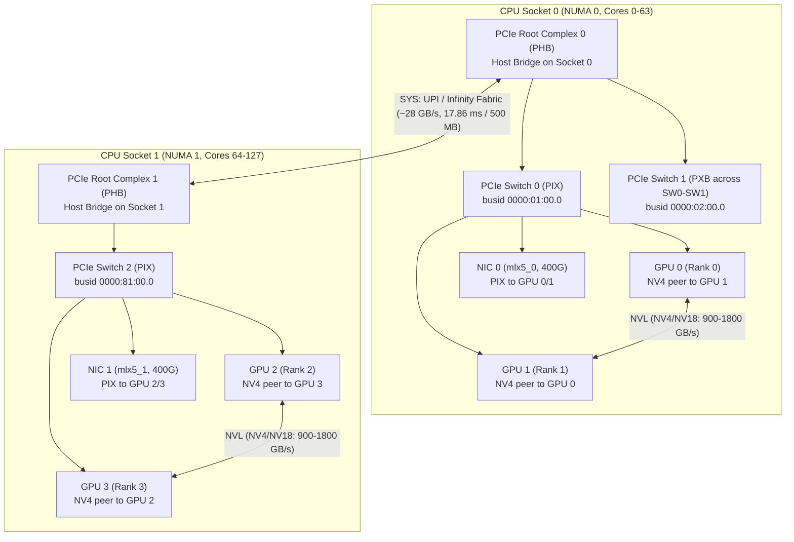
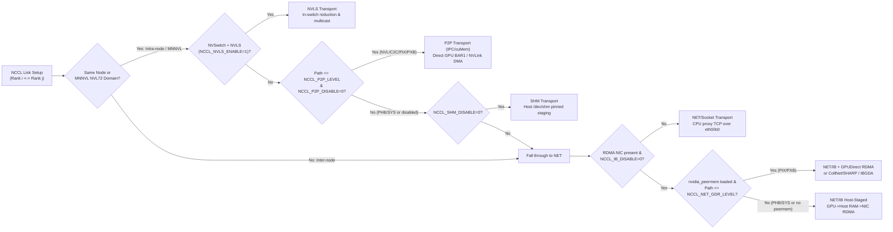

# 12.16 NCCL: topology, channels, transports and environment variables

| | |
|---|---|
| Level | Advanced |
| Priority tier | 1 |
| Lab venue | Nebius GPU |
| Part | Part 12: Complete AI networking |
| Sources to use | *AI Systems Performance Engineering* 4; V7 ch8; V7 ch9; VL6 ch2; V2 ch10; V13 ch8 |
| Coverage file | `planning/coverage/chapters/12-16.md` |
| Companion code | `code/part12/nccl_topology_channels_env.py` · `code/part12/nccl_topology_channels_env_lab.py` |

## Why this matters for AI infrastructure

Picture a training run that slowed down after a container update. The GPUs still show work, the job still finishes, and no error appears anywhere. The first sign of trouble is that each iteration takes twice as long, or three times as long, as it did before.

A well-chosen collective algorithm can still fail in production. That happens when NCCL maps its logical rings or trees onto the wrong physical links. Training engineers often see GPU utilization stall while iteration time doubles or triples. Nothing crashes, and no message points at the cause. The usual suspects are a silent transport fallback, a cross-socket path mistake, or an aggressive channel setting that starves compute kernels.

The gap between a well-mapped path and a misconfigured fallback is large, even on identical hardware. Take a gradient slice of 500 MB. Over NVLink it moves in less than a millisecond. Across an inter-socket CPU link the same slice takes tens of milliseconds. Two small mistakes cause the same damage. A debug environment variable left switched on is one. An InfiniBand device that was never mounted into the container is the other. Both push multi-hundred-gigabyte-per-second GPU traffic through host RAM or kernel TCP sockets.

The block below works through the arithmetic for each case, so you can see what a single mistake costs.

```text
Quantitative penalty of topology and transport mistakes:
- Intra-node NVLink 4.0 (NVL, 900 GB/s on Hopper H100 / H200) for a 500 MB (0.5 GB) slice:
  0.5 GB / 900 GB/s = 0.56 ms
- Cross-socket SYS path (PCIe Gen4 x16 + Intel UPI / AMD Infinity Fabric at ~28 GB/s) for 500 MB (0.5 GB):
  0.5 GB / 28 GB/s = 17.86 ms (~18 ms), a 32.14x (> 30x) latency penalty
- Naive 4-GPU pairing (GPU0+GPU2 over SYS instead of GPU0+GPU1 over NV4):
  SM busy time drops to 60% and step time stretches to 100.0 ms
- Topology-aware hierarchical schedule with compute-communication overlap (ASP Table 4-2):
  Raises SM utilization to 90% and cuts step time by 30.0% down to 70.0 ms
- Inter-node 800 Gb/s (100 GB/s) InfiniBand link for a 400 MB AllReduce:
  NET/IB with GPUDirect RDMA: 4.00 ms (100.0 GB/s)
  CPU-bound Gloo TCP fallback: 200.00 ms (2.0 GB/s, 50x slower)
```

The naive pairing is the case to watch. It pushes step time up to 100.0 ms, and the topology-aware schedule brings it down to 70.0 ms. The Gloo TCP fallback on an 800 Gb/s link is the slowest path in the list, at 50 times slower than GPUDirect RDMA.

This chapter explains how NCCL discovers hardware topology, scores path costs, and partitions collectives across parallel channels. It also covers how the runtime selects transports and responds to environment variables and Kubernetes NUMA policies. When a job runs slowly, the first question to ask is which physical path its traffic actually takes.

---

## Prerequisites and outcomes

### Prerequisites

Before you start here, read Chapter 12.15 on NCCL collectives and algorithms. That chapter teaches the Ring and Tree step math, the wire protocols, and the conversion factors for bus bandwidth. You should also be comfortable with PCIe root complexes, switches, BAR1 peer-to-peer addressing, `nvidia-peermem`, InfiniBand GIDs, and RoCEv2 from earlier chapters in Part 12. Basic knowledge of Linux sysfs, `numactl`, and Kubernetes device plugins will help when the cluster configuration sections arrive.

### Outcomes

When you finish this chapter, you will be able to do the following.

- Follow NCCL's topology discovery through its three phases, and read the distance labels that `nvidia-smi topo -m` prints.
- Write and audit `NCCL_TOPO_DUMP_FILE` and `NCCL_TOPO_FILE` XML overrides for virtualized or multi-root servers.
- Work out channel counts, subring parallelism, the thread blocks each channel takes on a Streaming Multiprocessor, the memory `NCCL_BUFFSIZE` reserves, and the savings from zero-copy registration.
- Predict which transport NCCL picks among P2P, SHM, NET/IB, NET/Socket, NVLS, and CollNet, and apply the interface filter grammar.
- Stop Kubernetes pods from being rejected with `TopologyAffinityError`.

If the prerequisites feel shaky, go back to Chapter 12.15 before you start the topology work.

---

## 1. NCCL Topology Discovery, Path Cost Scoring, and XML Graph Overrides

### 1.1 Logical GPU Indices versus Physical Locality

Picture a launch script that pairs adjacent device indices in round-robin order. On paper the pairing looks tidy. GPU runtimes number accelerators from zero, but that number says nothing about how close two accelerators sit. Enumeration order can shift after a BIOS update, a PCIe bus scan, or a motherboard replacement. When that happens, the script can map high-volume collective rings across a slow inter-socket CPU link.

NCCL does not trust the numbering. To make routing decisions that do not depend on luck, it inspects seven hardware attributes during `ncclCommInitRank`. PyTorch calls that function once, inside `torch.distributed.init_process_group`. NCCL starts by asking NVML for each GPU's UUID and compute capability. Next it walks sysfs to map the PCIe bridge tree and to check whether PCIe Access Control Services is enabled. It then asks NVML about direct NVLink, NVSwitch, and NVLink-C2C connections. The fourth check reads sysfs for network adapter locality and link rates, and the fifth reads the CPU socket and NUMA node core bitmasks. Sixth, NCCL checks whether peer-to-peer BAR1 and GPUDirect RDMA transfers are supported. Last, it exchanges fabric reachability across ranks over the bootstrap TCP store, and uses that to build rail-aligned rings and trees.

| Hardware Attribute Inspected | Discovery Interface | Key Hardware Values and Capabilities Recorded |
|---|---|---|
| 1. GPU UUID & compute capability | NVML | `sm="80"` for A100, `sm="90"` for H100/H200, `sm="100"` for Blackwell B200/GB200 |
| 2. PCIe BDF address & bridge tree | `/sys/class/pci_bus/`, `/sys/devices/pci*` | PCIe Gen4 `31.5 GB/s` vs Gen5 `64 GB/s` per x16 direction, switch `class="0x060400"`, PCIe ACS state |
| 3. Direct GPU interconnects | NVML (`nvidia-smi nvlink -s`) | Point-to-point bridges (`NV4`), 8-GPU HGX/DGX NVSwitch (`NV12` on A100 `600 GB/s`, `NV18` on H100 `900 GB/s` with `3.6 TB/s` bisection, `NV18` on B200 `1.8 TB/s`), `900 GB/s` NVLink-C2C (`GH200` `608 GB`, `GB200`), 72-GPU NVL72 (`~130 TB/s`) |
| 4. NIC / HCA locality & link rate | `/sys/class/infiniband/`, `/sys/class/net/` | Maps `mlx5_0..mlx5_7` `400 Gb/s` NDR or `800 Gb/s` XDR ports to their nearest PCIe switch |
| 5. CPU socket & NUMA affinity | sysfs NUMA topology | `numaid="0"`, `numaid="1"`, and local CPU core bitmasks (`0-31` or `0-63`) |
| 6. P2P & GPUDirect RDMA viability | NVIDIA driver + `nvidia-peermem` / DMA-BUF | Sets `gdr="1"` when GPU BAR1 physical pages can map directly to `mlx5_core` |
| 7. Inter-node fabric reachability | Bootstrap TCP store | Connects rail-aligned rings and trees across multi-node servers |

Each row in the table is one of the seven checks. The last column lists what NCCL records from that check. It is the first place to look when a topology looks wrong.

### 1.2 The Seven NCCL Topology Path Levels (LOC through SYS)

A collective planner needs a way to measure distance. Without one, it cannot tell whether two devices share a dedicated PCIe switch or sit on opposite CPU sockets. Both `nvidia-smi topo -m` and the internal NCCL graph solver (`ncclTopoGetSystem` and `ncclTopoComputePaths`) solve this problem. They sort every GPU-to-GPU and GPU-to-NIC path into seven ordered distance tiers. Each hop gets a bandwidth-weighted cost, so the graph search always prefers edges that are cheap and fast:

$$\text{Cost}(\text{LOC}) < \text{Cost}(\text{NVL}) < \text{Cost}(\text{C2C}) < \text{Cost}(\text{PIX}) < \text{Cost}(\text{PXB}) < \text{Cost}(\text{PHB}) < \text{Cost}(\text{SYS})$$

Read that chain from left to right. Each tier costs more than the one before it. The diagram below shows a two-socket server, with its GPUs, NICs, and the links between them.



The table below lists the tokens you will see for each tier, with typical bandwidth, latency, and whether GPUDirect can be used on that path.

| Path Token (`nvidia-smi` / NCCL) | Rank / Model Cost | Typical Unidirectional BW | Typical Hop Latency | Physical Path Traversal | GPUDirect P2P / RDMA (`GDR`) Viability |
|---|---|---|---|---|---|
| `X` / `LOC` | Rank `0` (Cost `0`) | `~3,000 GB/s` (HBM3) | `~0.1 µs` | Self (loopback on the same GPU device) | Native on-device memory |
| `NV#` (`NV4`, `NV12`, `NV18`) / `NVL` | Rank `1` (Cost `10`) | `600–1,800 GB/s` (bidir) | `~0.5 µs` (`< 1 µs` NVL72) | Direct NVLink bridges or NVSwitch fabric (`A100` `600 GB/s`, `H100` `900 GB/s`, `B200` `1,800 GB/s`) | Ideal direct GPU P2P (`CUDA IPC` / `cuMem` / `NVLS`) |
| `C2C` | Rank `2` (Cost `15`) | `900 GB/s` (bidir) | `~0.6 µs` | Coherent NVLink-C2C chip-to-chip link (`Grace Hopper GH200` / `Grace Blackwell GB200`) | Coherent CPU-GPU memory extension & P2P |
| `PIX` | Rank `3` (Cost `30`) | `~31.5–64 GB/s` (Gen4/5 x16) | `~1.2 µs` | Traverses at most **one** PCIe switch/bridge (`class="0x060400"`, ACS disabled) | **Gold standard** for `GPU <-> NIC` GPUDirect RDMA (`Rail 1..8`) |
| `PXB` | Rank `4` (Cost `50`) | `~28–48 GB/s` | `~1.8 µs` | Traverses **multiple** cascaded PCIe switches without crossing the CPU Host Bridge | Viable for P2P and GPUDirect RDMA (`NCCL_NET_GDR_LEVEL=PXB`) |
| `PHB` | Rank `5` (Cost `80`) | `~16–32 GB/s` | `~3.0 µs` | Traverses the CPU PCIe Host Bridge / Root Complex within a single NUMA socket | Hairpins through CPU Root Complex; GDR disabled by default |
| `SYS` | Rank `6` (Cost `200`) | `~12–28 GB/s` | `~8.0+ µs` | Crosses both PCIe and the inter-socket NUMA link (`Intel UPI` / `AMD Infinity Fabric`) | **Severe bottleneck** (`32.14x` slower than `NVL`); P2P/GDR disabled by default |

The most useful row to know is `PIX`, the gold standard for a GPU and NIC that share one switch. `SYS` is the row to avoid, since it crosses the inter-socket link on every hop.

A real matrix makes the tiers easier to picture. The output below comes from a dual-socket server with four GPUs. It has two NV4 pairs and one high-speed NIC attached to Socket 0.

```text
$ nvidia-smi topo -m
        GPU0    GPU1    GPU2    GPU3    NIC0    CPU Affinity    NUMA Affinity
GPU0     X      NV4     SYS     SYS     PIX     0-31            0
GPU1    NV4      X      SYS     SYS     SYS     0-31            0
GPU2    SYS     SYS      X      NV4     SYS     32-63           1
GPU3    SYS     SYS     NV4      X      SYS     32-63           1
NIC0    PIX     SYS     SYS     SYS      X

Key timing and utilization takeaways from this 4-GPU matrix:
1. GPU0 <-> GPU1 and GPU2 <-> GPU3 are NV4 (NVL at 900 GB/s):
   500 MB (0.5 GB) transfer = 0.5 GB / 900 GB/s = 0.000556 s = 0.56 ms
2. GPU0 <-> GPU2 and GPU1 <-> GPU3 are SYS (PCIe + UPI at ~28 GB/s):
   500 MB (0.5 GB) transfer = 0.5 GB / 28 GB/s = 0.017857 s = 17.86 ms (~18 ms, 32.14x slower)
3. Hierarchical topology-aware routing + overlap in Nsight Systems (ASP Table 4-2):
   Reduces within {GPU0, GPU1} and {GPU2, GPU3} over NVLink, exchanges one shard across SYS,
   and broadcasts back over NVLink. Raises SM busy from 60% to 90% and cuts step time from 100.0 ms to 70.0 ms (30.0% faster).
```

Read the matrix as a map of distances. GPU 0 and GPU 1 share an NV4 link. A 500 MB transfer between them takes 0.56 ms. GPU 0 and GPU 2 sit on opposite sockets and cross SYS. The same 500 MB then takes about 18 ms, which is 32.14 times slower.

That gap changes how a job should be placed. If a two-GPU job lands on GPU 1 and GPU 2, or a four-GPU job forms a flat ring across the sockets, every step waits on the slow SYS link. NCCL responds differently when it detects two fast NVLink islands joined by a slow SYS bridge. Its hierarchical algorithm reduces inside each local pair first. Only one leader per pair then sends a reduced shard across the slower inter-group link, and that leader broadcasts the result back over NVLink. In Nsight Systems, you see this as separate intra-group and inter-group CUDA kernels that keep the compute units busy.

When you audit a slow job, look for `SYS` entries in the matrix before you touch any tuning knob.

### 1.3 Inspecting and Overriding Topologies with `NCCL_TOPO_DUMP_FILE` and `NCCL_TOPO_FILE`

Virtual machines and complex servers are where this breaks most often. In virtualized clouds, SR-IOV guests, or multi-root OEM HGX servers, the hypervisor or broken ACPI tables can expose a flattened or scrambled PCIe tree. NCCL then misreads which NIC shares a PCIe switch with a given GPU. It may pair GPU 0 with a remote NIC across the inter-socket UPI link. Or it may build rings that hairpin out to a spine switch. That misrouting saturates a bottleneck link, and the saturation triggers `ProcessGroupNCCL` watchdog timeouts on multi-node InfiniBand runs.

NCCL gives you two XML topology variables to diagnose and fix a broken hardware tree. `NCCL_TOPO_DUMP_FILE` tells NCCL to write out the exact XML graph it built at the end of topology discovery. Dump a working node's XML first instead of writing one from scratch, because the parser expects specific CPU, PCIe, GPU, and NIC attributes.

`NCCL_TOPO_FILE` works in the other direction. It forces NCCL to load your corrected XML graph before it computes any paths. That override anchors each GPU and its local rail NIC under the same PCIe switch, so they score as `PIX`.

The block below lists both variables and the attributes the parser expects.

```text
NCCL XML topology environment variables and required schema attributes:
- NCCL_TOPO_DUMP_FILE=/tmp/nccl_topo_detected.xml
  Dumps the auto-discovered XML graph after topology discovery.
- NCCL_TOPO_FILE=/etc/nccl/topology.xml
  Overrides broken sysfs/VM bridge hierarchies on 32-node 400G IB runs.
- Required XML schema attributes:
  <system version="1">
  <cpu numaid="0" arch="x86_64" vendor="GenuineIntel" familyid="6" modelid="143">
  <pci busid="0000:01:00.0" class="0x060400" link_speed="32.0 GT/s PCIe" link_width="16">
  <gpu dev="0" sm="90" rank="0" gdr="1"/>
  <net name="mlx5_0" dev="0" speed="400000" (400G) or "800000" (800G) port="1" gdr="1"/>
```

Compare each attribute with what your own node reports before you rely on an override file.

---

## 2. NCCL Channels, Subrings, SM Thread Blocks, and `NCCL_BUFFSIZE`

### 2.1 How Channels Map to Subrings and GPU Streaming Multiprocessors (SMs)

A single CUDA thread block cannot saturate hundreds of gigabytes per second of NVLink bandwidth. It cannot drive eight parallel InfiniBand rails at line rate either. If NCCL used only one thread block, most physical links would sit idle while your step times dragged on. So NCCL splits each collective tensor across $C$ independent execution pipelines, called **channels**, so that every link has work to do.

Each active channel maps to one parallel subring or subtree. It launches one CUDA thread block per GPU inside `ncclDevKernel`. That block occupies one Streaming Multiprocessor while the collective kernel runs. Overlapping communication with the backward pass therefore trades compute SMs for communication SMs.

Here is the trade-off in a concrete setting. Suppose you run PyTorch DDP, and an AllReduce on a background CUDA stream while `cuBLAS` matrix multiplications run on the default compute stream. Each extra NCCL channel takes an SM away from the matrix math. Allocate too many channels and the step slows down.

The reverse is also possible. Registering user buffers persistently on NVSwitch fabrics lets the switch and copy engines move data straight from the user tensor, without SM-driven staging copies. Call `ncclCommRegister` on memory allocated with `ncclMemAlloc`, and you enable zero-copy NVLS transfers. That optimization cuts the required channel count by three-quarters. The SM thread blocks it frees go back to model computation.

The block below works the arithmetic for an H100, which has 132 SMs.

```text
Channel-to-SM occupancy breakdown on an NVIDIA H100 (132 total SMs):
- 16 active channels (Channel 0..15):
  Launches 16 CUDA thread blocks = 12.12% of 132 SMs, leaving 116 SMs (87.88%) for compute.
- 32 active channels (aggressive NCCL_MAX_NCHANNELS=32):
  Launches 32 CUDA thread blocks = 24.24% of 132 SMs (32 / 132), starving overlapped GEMMs.
- Zero-copy user buffer registration (ncclCommRegister + ncclMemAlloc on NVLS):
  Drops required channels from 16 down to 4 channels (3.03% of 132 SMs), freeing 12 SM blocks.
```

The 32-channel line shows the cost. The collective takes twice as many SMs as the 16-channel setup, and the overlapped GEMMs lose compute. The zero-copy line shows the saving. It drops the count to 4 channels and frees 12 SM blocks.

Treat the channel count as an SM budget you spend carefully. Change it only when a profile shows that your links are underused.

### 2.2 Controlling Channel Count and Channel Buffer Memory (`NCCL_BUFFSIZE`)

When engineers raise channel counts or buffer sizes blindly across several process groups, jobs often crash with out-of-memory errors. Three environment variables control channel parallelism and per-channel staging memory. The variables `NCCL_MIN_NCHANNELS` and `NCCL_MAX_NCHANNELS` clamp how many channels NCCL allocates per communicator:

$$C_{\text{active}} = \max\!\left(\text{NCCL\_MIN\_NCHANNELS},\; \min\!\left(\text{NCCL\_MAX\_NCHANNELS},\; C_{\text{auto}}\right)\right)$$

Read the formula from the inside out. The automatic count is first capped at the maximum. If the result falls below the minimum, it is raised to the minimum. On NVSwitch systems, NCCL tunes $C_{\text{auto}}$ on its own, based on topology and message size. Leave the bounds at their defaults unless a profile shows either under-used links or compute SMs starving during overlapped execution.

The variable `NCCL_BUFFSIZE` sets the size in bytes of the internal FIFO communication buffer. NCCL allocates that buffer in GPU HBM, once for each peer slot in each channel. A ring communicator gives every channel $P_{\text{peers}} = 2$ peer buffer slots. Those two slots are the send neighbor and the receive neighbor on the ring. The total channel buffer HBM per communicator is therefore:

$$\text{Memory}_{\text{channels}} = C_{\text{active}} \times P_{\text{peers}} \times \text{NCCL\_BUFFSIZE}$$

The table works this formula for four configurations on an H100. Read across a row: the channel count, times 2 peer slots, times the buffer size gives the HBM each communicator reserves.

| Configuration Scenario | Active Channels ($C_{\text{active}}$) | `NCCL_BUFFSIZE` (Bytes / MiB) | Peer Slots ($P_{\text{peers}}$) | Total Channel HBM per Communicator | H100 (`132` SMs) SM Blocks Used (`%`) |
|---|---|---|---|---|---|
| Default 16-Channel Ring (`4 MiB` start) | `16` | `4,194,304 B` (`4.0 MiB`) | `2` | `134,217,728 B` (**`128.0 MiB`**) | `16` SMs (**`12.12%`**) |
| Clamped 8-Channel Ring (`8 MiB` tuned) | `8` (`MIN=4, MAX=8`) | `8,388,608 B` (`8.0 MiB`) | `2` | `134,217,728 B` (**`128.0 MiB`**) | `8` SMs (**`6.06%`**) |
| High-Channel 32-Channel Ring (`16 MiB` aggressive) | `32` | `16,777,216 B` (`16.0 MiB`) | `2` | `1,073,741,824 B` (**`1,024.0 MiB` / `1.0 GiB`**) | `32` SMs (**`24.24%`**) |
| Zero-Copy `ncclCommRegister` + `NVLS` | `4` (`16 -> 4` saved) | `4,194,304 B` (`4.0 MiB`) | `2` | `33,554,432 B` (**`32.0 MiB`**) | `4` SMs (**`3.03%`**, saves `12` SMs) |

The 8-channel row reserves the same 128.0 MiB as the default row, because the doubled buffer offsets the halved channel count. The 32-channel row reserves 1.0 GiB, which is eight times the default. The zero-copy row is the cheapest of the four, at 32.0 MiB and only 4 SMs.

For large, bandwidth-bound AllReduce operations, start at the recommended baseline. Double the buffer one step at a time, and watch `torch.cuda.memory_reserved()` after each step. Channel buffers belong to each communicator. Tensor, pipeline, data, and expert parallel groups each carry their own, so the HBM cost multiplies across every group.

The block below states the tuning rule in short form.

```text
NCCL_BUFFSIZE tuning rule:
- Recommended starting point: 4 MB / 4 MiB (4,194,304 bytes)
- Stepwise progression: 4 MiB -> 8 MiB (8,388,608 B) -> 16 MiB (16,777,216 B)
- Multiply total channel HBM across all active communicators (TP, PP, DP, EP) to avoid OOM evictions.
```

Add up the channel HBM across all active communicators before you pick a buffer size. That sum is what can exhaust GPU memory.

---

## 3. NCCL Transports: P2P, SHM, NET (IB / RoCE / IBGDA / Socket), NVLS, and CollNet

Once NCCL has its topology graph and channel rings, it has to pick a transport for every link between two ranks. There are six transport engines, all under `src/transport/`. Suppose a fast transport is blocked by a missing kernel module, a BIOS setting, or an environment flag. NCCL does not stop the job. It silently drops down the fallback ladder to a slower transport.

The flowchart below follows that choice for one pair of ranks, from the first question to the last fallback.



Read the flowchart as a series of questions, and follow the path your own link takes. Each check either keeps the link on a fast transport or sends it one step down. The table below gives the details for each engine.

The table lists each engine, the signature it prints with `NCCL_DEBUG=INFO`, and the fallback it uses when it is disabled or blocked. The signature column is the one to scan in a log. It shows which engine NCCL actually picked.

| Transport Engine | `NCCL_DEBUG=INFO` Signature | Primary Scope | Data Path & Memory Registration Mechanism | Key Controlling Environment Variables | Fallback Path When Disabled or Blocked |
|---|---|---|---|---|---|
| **`P2P`** (Peer-to-Peer) | `P2P/IPC` or `P2P/CUMEM` | Intra-node (and intra-rack MNNVL on `NVL72`) | Direct GPU-to-GPU loads/stores or copy engine DMA over NVLink/NVSwitch or PCIe BAR1 (`CUDA IPC` handles or `cuMem` fabric handles) | `NCCL_P2P_DISABLE`, `NCCL_P2P_LEVEL`, `NCCL_MNNVL_ENABLE` | `SHM/direct` (host `/dev/shm` staging) |
| **`SHM`** (Shared Memory) | `SHM/direct` | Intra-node | GPU A DMAs over PCIe into pinned host shared memory (`/dev/shm`); GPU B DMAs from `/dev/shm` over PCIe | `NCCL_SHM_DISABLE` | `NET/IB` loopback or `NET/Socket` TCP |
| **`NET/IB`** (GPUDirect RDMA / IBGDA) | `NET/IB : ... [GDRDMA]` | Inter-node (and intra-node PXN) | `mlx5_core` NIC DMAs directly to/from GPU BAR1 pages pinned via `nvidia-peermem` / DMA-BUF (or GPU SMs post WRs directly via IBGDA) | `NCCL_IB_DISABLE`, `NCCL_IB_HCA`, `NCCL_NET_GDR_LEVEL`, `NCCL_IB_GID_INDEX`, `NCCL_IB_TC`, `NCCL_CROSS_NIC` | `NET/IB` host-staged (if GDR fails) or `NET/Socket` (if IB fails) |
| **`NET/Socket`** (POSIX TCP) | `NET/Socket : Using [0]eth0...` | Bootstrap handshake + Inter-node fallback | GPU copies to host RAM; CPU proxy threads send/recv over kernel TCP/IP sockets (`eth0`/`ib0`) | `NCCL_SOCKET_IFNAME`, `NCCL_SOCKET_NTHREADS`, `NCCL_NSOCKS_PERTHREAD` | Communicator init aborts if no reachable interface |
| **`NVLS`** (NVLink SHARP) | `NVLS` / `NVLSTree` | Intra-node HGX/DGX & 72-GPU `NVL72` rack | Switch-resident ALUs on `NVSwitch 3.0/4.0` perform reductions and hardware multicast (`1/(N-1)` endpoint volume) | `NCCL_NVLS_ENABLE`, `NCCL_MNNVL_ENABLE` | `P2P` Ring or Tree over NVLink |
| **`CollNet`** (InfiniBand SHARP) | `CollNet/SHARP` | Multi-node Quantum InfiniBand (`32+` nodes) | Quantum IB switch ASICs aggregate reductions via SHARP Aggregation Manager + NCCL RDMA SHARP plugin (`2x–5x` speedup) | `NCCL_COLLNET_ENABLE`, `NCCL_SHARP_DISABLE` | `NET/IB` hierarchical Tree or Ring |

### 3.1 Deep Dive into the Five Critical Transport Mechanisms

Knowing how each transport moves bytes tells you why one wrong setting can slow a job badly. Start with intra-node peer-to-peer (P2P). By default, NCCL uses direct P2P across NVL, C2C, PIX, and PXB links. It avoids direct P2P across PHB or SYS, because CPU root complexes and inter-socket links often stall on peer BAR1 reads and writes. You can move that cutoff with `NCCL_P2P_LEVEL`.

Setting `NCCL_P2P_DISABLE=1` turns off every direct GPU peer copy, so intra-node traffic goes through host memory. On multi-node Grace Blackwell racks, `NCCL_MNNVL_ENABLE=1` turns on Multi-Node NVLink. With it, P2P and NVLS can span all GPUs across the NVLink Switch backplane, without touching network adapters.

When two GPUs on the same host sit on different sockets, or PCIe ACS is enabled in the BIOS, they cannot establish direct P2P. NCCL then uses the Shared Memory transport and stages buffers through `/dev/shm`. In Docker and Kubernetes containers, the default `/dev/shm` mount is tiny, and that is what triggers `NCCL WARN Call to posix_fallocate failed : No space left on device`. Mount a multi-gigabyte in-memory volume at `/dev/shm`, and never leave `NCCL_SHM_DISABLE=1` set in production.

Inter-node traffic has its own trap. In the traditional path without GPUDirect RDMA, data takes five separate copy steps through host RAM, on both the sender and the receiver. GPUDirect RDMA removes that staging. The NVIDIA driver pins GPU BAR1 physical pages and passes them through `nvidia-peermem` or DMA-BUF to `mlx5_core`. The NIC then DMAs straight from the sender's GPU HBM, over the local PCIe switch, into the receiver's GPU HBM.

Whether GPUDirect RDMA is allowed depends on distance. `NCCL_NET_GDR_LEVEL` sets the maximum topological distance between a GPU and a NIC at which NCCL still allows it. If a GPU and NIC are separated by PHB or SYS, NCCL disables GPUDirect RDMA on that link and uses host-staged bounce buffers instead.

Rail-optimized NVSwitch servers add one more route. There, `NCCL_CROSS_NIC` enables PXN, which stands for PCIe across NVLink. Suppose a rank on Node A must send to a NIC that is not aligned with its rail on Node B. PXN sends the packet over fast intra-node NVLink to a proxy GPU on the same node. That proxy GPU is PIX-local to the target NIC's rail, so this avoids cross-socket GPU-to-NIC traffic completely.

The last step is the CPU. With GPUDirect RDMA the data skips host RAM, but a CPU proxy thread traditionally still rings the NIC doorbell and polls Completion Queues. InfiniBand GPUDirect Async removes that middleman. The GPU Streaming Multiprocessors build the RDMA Work Requests themselves and ring the ConnectX NIC doorbell directly over PCIe.

The block below collects the thresholds and sizes from this section.

```text
Transport operational specifications and thresholds:
- P2P disable penalty (NCCL_P2P_DISABLE=1, equivalent to NCCL_P2P_LEVEL=LOC):
  Increases intra-node latency from a few us to tens of us; drops bandwidth from 900-1,800 GB/s to tens of GB/s.
- Multi-Node NVLink (NCCL_MNNVL_ENABLE=1 on GB200 / GB300 NVL72):
  Spans 72 GPUs (36 Grace-Blackwell compute trays) via P2P/CUMEM and NVLS at ~130 TB/s aggregate bandwidth and < 1 us latency.
- Container /dev/shm sizing for SHM transport:
  Default Docker/K8s tmpfs is 64 MiB (causes posix_fallocate failure); mount >= 16-64 GiB (--shm-size=16g).
- Traditional 5-step non-GDR path vs GPUDirect RDMA:
  (1) GPU A -> Host RAM A, (2) Host RAM A -> NIC A, (3) NIC A -> NIC B wire, (4) NIC B -> Host RAM B, (5) Host RAM B -> GPU B.
  GPUDirect RDMA eliminates steps 1, 2, 4, and 5 via BAR1 + nvidia-peermem / DMA-BUF over PIX.
- PXN (NCCL_CROSS_NIC=0, 1, or 2; default 2 on NVSwitch):
  Routes GPU i -> proxy GPU j over 900 GB/s NVLink -> PIX-attached NIC j (Rail j).
```

The 5-step line shows how many copies the traditional path makes. GPUDirect RDMA removes four of those five steps for inter-node traffic. If the log shows a fallback where you expected GPUDirect RDMA, start by checking the distance between that GPU and its NIC.

---

## 4. Production NCCL Environment Variables Reference and Filter Grammar

### 4.1 Complete Categorized Environment Variable Matrix

Relying on undocumented defaults is risky in production, because internal heuristics can shift across minor NCCL releases. Suppose you leave a setting unpinned. It can change your collective algorithm, select a management network interface, or hang indefinitely when a remote rank crashes. Set the performance-critical and resiliency-critical variables explicitly in your job launch manifests.

Picture this table as your checklist before a launch. It lists the variables that matter most. For each one it gives the valid values, the recommended production value, and what the setting does.

| Environment Variable | Valid Values / Syntax | Default / Recommended Production Value | Subsystem & Operational Impact |
|---|---|---|---|
| `NCCL_DEBUG` | `VERSION`, `WARN`, `INFO`, `TRACE` | `WARN` in steady-state prod; `INFO` during validation/triage | Controls log verbosity (`TRACE`/`DEBUG` adds latency overhead; never run `TRACE` in prod) |
| `NCCL_DEBUG_SUBSYS` | `INIT`, `COLL`, `P2P`, `SHM`, `NET`, `GRAPH`, `TUNING`, `ENV`, `ALLOC`, `ALL` | `INIT,ENV,GRAPH` (when `NCCL_DEBUG=INFO`) | Filters `NCCL_DEBUG` output to specific subsystems (`INIT,GRAPH,ENV` shows transport & ring setup) |
| `NCCL_TOPO_DUMP_FILE` | File path (e.g., `/tmp/topo.xml`) | Unset (set on 1 node to capture baseline XML) | Dumps NCCL auto-discovered hardware topology graph to an XML file |
| `NCCL_TOPO_FILE` | File path (e.g., `/etc/nccl/topo.xml`) | Unset (set in VMs / complex OEM HGX servers) | Overrides auto-detection with an explicit XML hardware topology graph |
| `NCCL_ALGO` | `Ring`, `Tree`, `CollNetDirect`, `CollNetChain`, `NVLS`, `NVLSTree`, `PAT` | Auto-selected by message size & topology | Forces specific collective algorithms (set before `ncclCommInitRank`) |
| `NCCL_PROTO` | `LL`, `LL128`, `Simple` | Auto-selected (`LL` `<64KB`, `LL128` mid, `Simple` large) | Forces wire framing protocol (`50%`, `93.75%`, or `100%` payload efficiency) |
| `NCCL_MIN_NCHANNELS` / `NCCL_MAX_NCHANNELS` | Integer `1..64` | Auto-tuned by topology (`16–32` on NVSwitch) | Clamps subring channel count (and SM thread blocks consumed per collective) |
| `NCCL_BUFFSIZE` | Bytes (power of 2) | **`4194304` (`4 MiB`)** starting point | Per-channel peer FIFO buffer size in GPU HBM (`C * P * NCCL_BUFFSIZE`) |
| `NCCL_P2P_DISABLE` | `0` or `1` | **`0`** (never leave `1` in production) | Disables intra-node GPU-to-GPU direct P2P, forcing slow `/dev/shm` host staging |
| `NCCL_P2P_LEVEL` | `LOC`, `NVL`, `PIX`, `PXB`, `PHB`, `SYS` | Auto (`PXB` typical cutoff) | Maximum topological distance allowed for direct GPU P2P transfers |
| `NCCL_SHM_DISABLE` | `0` or `1` | **`0`** (never leave `1` in production) | Disables `/dev/shm` shared-memory transport, forcing network loopback fallback |
| `NCCL_MNNVL_ENABLE` | `0` or `1` | **`1` on GB200/GB300 NVL72** (`0` otherwise) | Enables Multi-Node NVLink (MNNVL) across NVLink Switch rack domains |
| `NCCL_IB_DISABLE` | `0` or `1` | **`0`** (never leave `1` on IB/RoCE fabrics) | Disables `NET/IB` RDMA verbs, forcing fallback to `NET/Socket` TCP |
| `NCCL_IB_HCA` | `[=\|^\|^=]mlx5_0[:1],...` | `mlx5` or explicit rail list (`=mlx5_0:1,mlx5_1:1`) | Selects or excludes InfiniBand / RoCEv2 RDMA Host Channel Adapters and ports |
| `NCCL_NET_GDR_LEVEL` | `LOC`, `PIX`, `PXB`, `PHB`, `SYS` | **`PIX`** (or `PXB` on cascaded switches) | Max GPU-to-NIC topological distance allowed for GPUDirect RDMA (`GDRDMA`) |
| `NCCL_CROSS_NIC` | `0` (off), `1` (ring/tree), `2` (PXN auto) | **`2`** on NVSwitch rail-optimized clusters | Controls cross-NIC traffic and PXN (NVLink-assisted NIC rail alignment) |
| `NCCL_IB_GID_INDEX` | Integer (`0..N`) | **`3`** for RoCEv2 IPv4 (verify with `show_gids`) | Selects the InfiniBand/RoCE Global Identifier (GID) table index |
| `NCCL_IB_TC` | Integer (`0..255`, DSCP * 4) | **`106`** (DSCP `26` AF31, or `184` DSCP `46`) | Sets IP/RoCEv2 Traffic Class (`TOS`/`DSCP`) to match lossless switch PFC/ECN queues |
| `NCCL_IB_QPS_PER_CONNECTION` | Integer (`1..16`) | **`4`** (or `2–8` on multi-plane/ECMP fabrics) | Stripes each channel connection across multiple Queue Pairs (QPs) for ECMP/throughput |
| `NCCL_COLLNET_ENABLE` / `NCCL_NVLS_ENABLE` | `0` or `1` | `1` when Quantum SHARP / NVSwitch NVLS active | Enables in-network switch reduction (CollNet) and NVSwitch NVLink SHARP (NVLS) |
| `NCCL_SHARP_DISABLE` | `0` or `1` | `0` (set `1` for A/B testing or switch buffer triage) | Explicitly disables InfiniBand SHARP offload even when CollNet is present |
| `NCCL_SOCKET_IFNAME` | `[=\|^\|^=]ib0,eth0,...` | **`ib0`** (or high-speed bond, e.g., `^docker,lo`) | Selects OS network interface for NCCL bootstrap TCP handshakes and `NET/Socket` |
| `NCCL_SOCKET_NTHREADS` & `NCCL_NSOCKS_PERTHREAD` | Integers with product **`<= 64`** | Product **`<= 64`** (e.g., `2` threads × `2` sockets = `4`) | Tunes CPU proxy threads and TCP sockets per thread when `NET/Socket` is active |
| `NCCL_IGNORE_CPU_AFFINITY` | `0` or `1` | **`1`** (paired with NUMA-level `numactl`) | Ignores inherited narrow CPU core affinity masks so NCCL spreads threads across the local NUMA node |
| `TORCH_NCCL_ASYNC_ERROR_HANDLING` / `NCCL_ASYNC_ERROR_HANDLING` | `0` none, `1` abort and tear down, `2` abort only, `3` tear down only | **`3`** in PyTorch 2.15 | Controls the asynchronous watchdog action on rank crash or collective stall; the default already avoids an infinite hang |
| `NCCL_PROFILER_PLUGIN` | Shared library name / path | Unset (or Kineto / custom profiler `.so`) | Loads the 5-callback (`init`, `startEvent`, `stopEvent`, `recordEventState`, `finalize`) profiler plugin |

Two settings deserve the most attention. Keep `NCCL_P2P_DISABLE`, `NCCL_SHM_DISABLE`, and `NCCL_IB_DISABLE` at `0` in production, because each one switches off a fast path. Keep `NCCL_DEBUG` at `WARN` for steady-state runs, and reserve `INFO` for validation and triage.

### 4.2 Prefix and Exact Filter Operators for `NCCL_SOCKET_IFNAME` and `NCCL_IB_HCA`

A multi-homed GPU server has many interfaces: loopback, container bridges, management bonds, storage VLANs, and eight or more RDMA rails. A naive filter string can bind bootstrap traffic to a dead VLAN sub-interface, or pull a slow management bond into the collective rings. Both `NCCL_SOCKET_IFNAME` and `NCCL_IB_HCA` use the same four-mode prefix and exact filter grammar.

Start with the default, prefix-include mode, since that is the one you will meet first. Any interface or HCA whose name starts with a listed token is selected. So a plain `eth0` token also selects the VLAN sub-interface `eth0.100`, and that is the prefix trap. Prepending `=` switches to exact-include mode, which matches only the full name. Prepending `^` switches to prefix-exclude mode, which drops any device that starts with a listed token and keeps the rest. Prepending `^=` gives exact-exclude mode, which drops only exact matches and keeps sub-interfaces and numbered variants.

The block below runs each mode against the same set of interfaces and HCAs, so you can compare the results directly.

```text
Filter operator grammar evaluated against host interfaces and RDMA HCAs:
Host IP interfaces: ["lo", "docker0", "eth0", "eth0.100", "eth1", "ib0", "ib1"]
Host RDMA HCAs:     ["mlx5_0:1", "mlx5_1:1", "mlx5_2:1", "mlx5_3:1", "mlx5_bond_0:1"]

1. Default Prefix Include (<token1>,<token2>):
   - NCCL_SOCKET_IFNAME=ib   -> selects ["ib0", "ib1"]
   - NCCL_SOCKET_IFNAME=eth0 -> selects BOTH ["eth0", "eth0.100"] (prefix match trap)
2. Exact Include (=<token1>,<token2>):
   - NCCL_SOCKET_IFNAME==eth0            -> selects ["eth0"] (excludes "eth0.100" and "eth1")
   - NCCL_IB_HCA==mlx5_0:1,mlx5_1:1      -> binds strictly to port 1 of mlx5_0 and mlx5_1
3. Prefix Exclude (^<token1>,<token2>):
   - NCCL_SOCKET_IFNAME=^docker,lo,eth   -> excludes lo, docker0, eth*, leaving ["ib0", "ib1"]
   - NCCL_IB_HCA=^mlx5_bond              -> excludes bond, keeps ["mlx5_0:1", "mlx5_1:1", "mlx5_2:1", "mlx5_3:1"]
4. Exact Exclude (^=<token1>,<token2>):
   - NCCL_SOCKET_IFNAME=^=lo,docker0,eth0 -> excludes exact lo, docker0, eth0; keeps ["eth0.100", "eth1", "ib0", "ib1"]
```

Consider the `eth0` line in mode 1, which is the one to watch. A short filter looks harmless, yet it quietly widens the match. Test each filter against your own interface list before it goes into a manifest.

### 4.3 Multi-NIC Socket Tuning and the 64-Socket Limit

On InfiniBand or RoCEv2 with NET/IB, `NCCL_IB_HCA` and `NCCL_IB_QPS_PER_CONNECTION` control how traffic is striped across multiple high-speed NICs. Cloud instances without RDMA fall back to the NET/Socket TCP transport instead. A single kernel TCP stream cannot saturate a high-speed Ethernet link, and it cannot stripe across several NICs. Engineers who leave the socket settings at their defaults see severe bandwidth under-utilization. Engineers who push them too high hit the hard socket ceiling instead.

For NET/Socket, NCCL starts `NCCL_SOCKET_NTHREADS` CPU proxy threads per interface. Each thread opens `NCCL_NSOCKS_PERTHREAD` parallel TCP sockets. NCCL enforces a built-in maximum of **64 total TCP sockets per communicator**, and the product of the two settings must stay within it:

$$\text{NCCL\_SOCKET\_NTHREADS} \times \text{NCCL\_NSOCKS\_PERTHREAD} \le 64$$

That product is the total socket count per communicator. Going above the ceiling wastes CPU cycles on lock contention and uses up OS file descriptors. It does not open any extra collective streams. Raise these values one step at a time, and only when NET/Socket is carrying collective payloads.

The block below does the multi-NIC arithmetic and checks each socket product against the 64 limit.

```text
Multi-NIC bandwidth aggregation and NET/Socket connection limits:
- Multi-rail 800 Gbps NIC aggregation (NET/IB or multi-NIC striping):
  2 x 800 Gbps NICs = 1.6 Tbps (1,600 Gbps) aggregate
  4 x 800 Gbps NICs = 3.2 Tbps (3,200 Gbps) aggregate
- NET/Socket thread and socket combinations (product <= 64 ceiling):
  NCCL_NSOCKS_PERTHREAD=2 * NCCL_SOCKET_NTHREADS=2  = 4 sockets   (VALID <= 64, dual-NIC baseline)
  NCCL_NSOCKS_PERTHREAD=8 * NCCL_SOCKET_NTHREADS=8  = 64 sockets  (VALID <= 64, exact architectural ceiling)
  NCCL_NSOCKS_PERTHREAD=16 * NCCL_SOCKET_NTHREADS=8 = 128 sockets (INVALID > 64, violates NCCL 64-socket limit)
  Stepwise tuning progression for NET/Socket: 2 -> 4 -> 8
```

The two 800 Gbps NICs add up to 1.6 Tbps, and four of them add up to 3.2 Tbps. A socket product of 8 by 8 lands exactly on the 64 ceiling. A product of 16 by 8 reaches 128 sockets and breaks the limit. Keep the product at or below 64, and raise it only after you see real collective traffic on NET/Socket.

---

## 5. CPU/GPU NUMA Affinity, Kubernetes Topology Manager, and Rail-Aligned Multi-Tenancy

### 5.1 `NCCL_IGNORE_CPU_AFFINITY=1` and Dual-Socket NUMA Binding

GPUDirect RDMA moves tensor payloads straight between GPU HBM and ConnectX NICs, without touching host RAM. The CPU still matters, though. NCCL runs background CPU proxy threads. They handle bootstrap handshakes, ring RDMA doorbells when IBGDA is not active, polling of Completion Queues, and enqueuing CUDA kernels. Misplacing those threads across CPU sockets, or pinning them to a single core, degrades collective latency.

Picture a dual-socket, eight-GPU server. The first four GPUs and the first four NICs attach to CPU Socket 0. GPUs 4 through 7 and NICs 4 through 7 attach to Socket 1. Two affinity failures show up in production. In the first, Rank 0 on NUMA 0 runs its CPU proxy thread or NIC interrupt handler on NUMA 1. Every doorbell and completion event then crosses the inter-socket UPI link. In the second, a job launcher such as `mpirun`, `srun`, or `taskset` pins a rank process to one CPU core. Every background proxy thread inherits that narrow mask and fights for the same core.

The production fix combines NUMA-level binding with `NCCL_IGNORE_CPU_AFFINITY=1`. Bind each rank process to the full CPU core set of its local NUMA domain with `numactl`. Then export `NCCL_IGNORE_CPU_AFFINITY=1`, so NCCL ignores any narrow inherited mask and spreads its worker threads across the cores of the local NUMA node.

The block below shows the launch binding for each socket.

```text
Dual-socket 8-GPU NUMA layout and binding commands:
- Socket 0 (NUMA 0, CPU cores 0-63):  GPUs 0-3 (Ranks 0-3) and NICs 0-3 (Rails 1-4)
  Launch binding: numactl --cpunodebind=0 --membind=0
- Socket 1 (NUMA 1, CPU cores 64-127): GPUs 4-7 (Ranks 4-7) and NICs 4-7 (Rails 5-8)
  Launch binding: numactl --cpunodebind=1 --membind=1
- Export NCCL_IGNORE_CPU_AFFINITY=1 so NCCL worker threads spread across local NUMA cores.
```

Each socket gets its own binding, so each rank's threads stay on the socket that owns its GPU and NICs.

### 5.2 Kubernetes Topology Manager and the `TopologyAffinityError` Trap

By default, Kubernetes treats a dual-socket server as a flat pool of resources under `--topology-manager-policy=none`. Suppose a pod requests CPU cores, a GPU, and an SR-IOV NIC. The kubelet can then take the CPU cores from NUMA 0, the GPU from NUMA 1, and the NIC from NUMA 0. That split placement forces every host-to-device and GPU-to-NIC transfer across the slow inter-socket UPI link.

To prevent cross-NUMA placement, the kubelet Topology Manager collects NUMA hints from the CPU Manager, Memory Manager, and Device Manager. It works alongside the NVIDIA GPU Operator and SR-IOV Network Device Plugin, on Guaranteed QoS pods with integer CPU requests. Together they enforce one of four policies:

| Kubelet Topology Manager Policy | Admission Behavior | Production Suitability for AI Training / Inference |
|---|---|---|
| `none` (Default) | No NUMA alignment; allocates CPUs, GPUs, and NICs across sockets arbitrarily | Unacceptable for multi-GPU or RDMA workloads (`SYS` bottlenecks) |
| `best-effort` | Attempts NUMA alignment, but admits split-NUMA pods if single-NUMA capacity is full | Non-deterministic performance; hides sizing bugs until throughput drops |
| `restricted` | Rejects pods if allocated devices do not align to the minimum possible number of NUMA nodes | Useful for multi-socket pods, but less strict than single-socket isolation |
| `single-numa-node` (AI Standard) | Strictly requires all requested CPUs, memory, GPUs, and SR-IOV VFs to reside on **one** NUMA node | **Production standard**; rejects misaligned pods with `TopologyAffinityError` |

The `single-numa-node` policy guarantees local PIX and NVL paths, but it sets a classic scheduling trap. Engineers often divide total CPU cores by total GPUs, and forget the cores that the OS and system daemons reserve. Suppose those daemons take just two CPU cores on one socket. The last pod, which requests a full one-eighth share of the server's CPUs, is then rejected with `TopologyAffinityError`. That leaves an expensive GPU idle.

The case study below works through the numbers on a 128-core, 8-GPU server, so you can see exactly where the eighth pod fails.

```text
Production Case Study: Why the 8th pod fails with TopologyAffinityError on a 128-core, 8-GPU server
Server hardware:
- 128 total CPU cores: 64 cores on NUMA 0 (cores 0-63), 64 cores on NUMA 1 (cores 64-127)
- 8 total GPUs:        4 GPUs on NUMA 0 (GPUs 0-3),     4 GPUs on NUMA 1 (GPUs 4-7)
- Kubelet policy:      --topology-manager-policy=single-numa-node

Broken deployment (8 pods requesting 16 CPU cores and 1 GPU each; 8 * 16 = 128 cores):
- NUMA 0: Pods 1-4 consume 4 * 16 = 64 cores (0 cores left) and GPUs 0-3 (0 GPUs left).
- NUMA 1: Linux kernel, kubelet, and monitoring DaemonSets consume 2 CPU cores,
          leaving 64 - 2 = 62 allocatable cores and 4 free GPUs (GPUs 4-7).
- Pods 5-7 take 3 * 16 = 48 cores on NUMA 1, leaving 62 - 48 = 14 free cores and 1 empty GPU.
  (Same result if systemReserved/kubeReserved carves 2 cores per NUMA node up front: 62 - 48 = 14 free cores.)
- Pod 8 requests 16 cores on NUMA 1, where only 14 free cores remain (< 16) -> REJECTED with TopologyAffinityError.

The Fix (do NOT weaken single-numa-node to best-effort):
- Maximum integer CPU request per pod: floor((64 - 2) / 4) = 15 cores/pod.
- Production right-sized request: 12 CPU cores per pod (4 * 12 = 48 <= 62 free cores per NUMA node).
- Result: All 8 pods admit cleanly with 100% PIX/NVL locality.
```

The fix leaves the policy alone. It right-sizes each request to 12 cores, and all eight pods then admit with 100% PIX/NVL locality. When you size CPU requests, count the cores left on each NUMA node, not the server total.

---

## Commands and configurations that matter

### 1. Host Topology, `nvidia-peermem`, PCIe ACS, and Ephemeral Port Audit (`untested here`)

Run this audit before you launch a distributed job. It checks the GPU-to-NIC topology matrix and confirms that `nvidia-peermem` is loaded. It also checks that PCIe ACS is disabled on the switch ports, and it widens the kernel ephemeral port and socket buffer limits.

```bash
# (untested here) 1. Inspect full GPU-to-GPU and GPU-to-NIC topology matrix and NVLink status
nvidia-smi topo -m
nvidia-smi nvlink -s

# (untested here) 2. Verify GPUDirect RDMA kernel module is loaded and check PCIe ACS status
lsmod | grep nvidia_peermem || sudo modprobe nvidia-peermem
sudo lspci -vvv | grep -E "ACSia|ACSCtl"

# (untested here) 3. Verify RoCEv2 GID table index (e.g., index 3 for RoCEv2 IPv4) and widen TCP bootstrap port range
show_gids
sudo sysctl -w net.ipv4.ip_local_port_range="50000 51000"
sudo sysctl -w net.core.rmem_max=134217728 net.core.wmem_max=134217728
```

If you see that `nvidia_peermem` is missing, the `||` branch in the second command loads it with `modprobe`.

### 2. Production NCCL Launch Profile with Topology Dump and NUMA Binding (`untested here`)

This launch script is a complete profile for a four-node job with eight GPUs per node. It pins the initialization logging and the asynchronous error handling. It enables P2P, SHM, and InfiniBand explicitly, and it sets the GPUDirect RDMA distance cutoff. It also sets the interface and HCA filters, the channel buffer size, and the topology XML dump.

```bash
# (untested here) Production multi-node NCCL environment configuration
export NCCL_DEBUG=INFO
export NCCL_DEBUG_SUBSYS=INIT,GRAPH,ENV
export TORCH_NCCL_ASYNC_ERROR_HANDLING=1   # default is 3; 1 also aborts the communicator
export NCCL_ASYNC_ERROR_HANDLING=1

# Ensure P2P, SHM, and IB RDMA are explicitly enabled
export NCCL_P2P_DISABLE=0
export NCCL_SHM_DISABLE=0
export NCCL_IB_DISABLE=0
export NCCL_NET_GDR_LEVEL=PIX
export NCCL_CROSS_NIC=2

# Bind bootstrap to ib0 and select rail HCAs mlx5_0..mlx5_7 (excluding management bonds)
export NCCL_SOCKET_IFNAME==ib0
export NCCL_IB_HCA=^mlx5_bond
export NCCL_IB_GID_INDEX=3
export NCCL_IB_TC=106
export NCCL_IB_QPS_PER_CONNECTION=4

# Channel buffer starting point (4 MiB) and NUMA thread spreading
export NCCL_BUFFSIZE=4194304
export NCCL_IGNORE_CPU_AFFINITY=1
export NCCL_TOPO_DUMP_FILE=/tmp/nccl_topo_detected.xml
# When overriding broken VM/OEM PCIe trees:
# export NCCL_TOPO_FILE=/etc/nccl/topology.xml

# Launch with torchrun across 8 local GPUs
torchrun --nnodes=4 --nproc_per_node=8 --rdzv_backend=c10d --rdzv_endpoint=$MASTER_ADDR:29500 train.py
```

When you read the script, start from the top. The first block turns on diagnostics and error handling, and the second makes the transports explicit. Uncomment the `NCCL_TOPO_FILE` line only on a VM or OEM server with a broken PCIe tree.

### 3. Schematic `NCCL_TOPO_FILE` (`topology.xml`) Anchoring GPU and NIC under One PCIe Switch (`untested here`)

When a virtual machine or OEM server misreports PCIe bridges, edit the dumped XML. Move each GPU and its local rail NIC under the same PCIe switch node, as the schematic below shows.

```xml
<!-- (untested here) Schematic topology.xml derived from NCCL_TOPO_DUMP_FILE -->
<system version="1">
  <cpu numaid="0" affinity="00000000,00000000,ffffffff,ffffffff" arch="x86_64" vendor="GenuineIntel" familyid="6" modelid="143">
    <pci busid="0000:00:00.0" class="0x060400" link_speed="32.0 GT/s PCIe" link_width="16">
      <!-- Force NCCL to recognize that GPU 0 and mlx5_0 share PCIe switch 0000:01:00.0 (PIX) -->
      <pci busid="0000:01:00.0" class="0x060400" link_speed="32.0 GT/s PCIe" link_width="16">
        <gpu dev="0" sm="90" rank="0" gdr="1"/>
        <nic>
          <net name="mlx5_0" dev="0" speed="400000" port="1" guid="0x08c0eb0300a1b2c0" maxconn="131072" gdr="1"/>
        </nic>
      </pci>
    </pci>
  </cpu>
</system>
```

The comment in the XML marks the key line. GPU 0 and `mlx5_0` sit under switch 0000:01:00.0, which scores as `PIX`.

### 4. Kubernetes NVIDIA Network Operator, Multus, and SR-IOV Multi-Tenant Manifests (`untested here`)

In a multi-tenant cluster, the manifests below ask the SR-IOV Network Operator for eight RDMA-capable Virtual Functions per physical NIC port. They also set jumbo frames and hardware VLAN isolation.

```yaml
# (untested here) sriov-policy-and-network.yaml: 8 VFs on enp1s0f0 with MTU 9000 and VLAN 100
apiVersion: sriovnetwork.openshift.io/v1
kind: SriovNetworkNodePolicy
metadata:
  name: mlx5-rdma-policy
  namespace: sriov-network-operator
spec:
  resourceName: rdma_vf
  nodeSelector:
    feature.node.kubernetes.io/network-sriov.capable: "true"
  priority: 99
  mtu: 9000
  numVfs: 8
  nicSelector:
    vendor: "15b3"
    pfNames: ["enp1s0f0"]
  deviceType: netdevice
  isRdma: true
---
apiVersion: sriovnetwork.openshift.io/v1
kind: SriovNetwork
metadata:
  name: sriov-rdma-vlan100
  namespace: sriov-network-operator
spec:
  resourceName: rdma_vf
  networkNamespace: tenant-a
  vlan: 100
  ipam: '{"type": "whereabouts", "range": "10.10.100.0/24"}'
```

The first manifest creates the Virtual Functions, and the second defines a network on VLAN 100 for `tenant-a`. The `resourceName` field ties the two together, so both must use the same value.

---

## How it fails

Picture an on-call page saying that a job got slower overnight. The clues sit in the initialization logs, in `dmesg`, or in Kubernetes pod events. When a transport degrades or a topology check fails, each clue points toward a cause. The table below maps each symptom to its root cause and to a fix you can apply the same way every time.

| Failure Mode | Observable Symptom (`NCCL_DEBUG=INFO` / `dmesg` / Profiler) | Root Cause | Verification & Remediation |
|---|---|---|---|
| **1. Silent Fallback from `NET/IB` to `NET/Socket` (TCP)** | AllReduce throughput drops from `~100 GB/s` (`4.00 ms` on `400 MB`) to a few `Gb/s` (`~1–2 GB/s`), CPU utilization spikes to `100%`, and logs show `NCCL INFO NET/Socket : Using [0]eth0:10.0.0.5<0>` instead of `NET/IB`. | Container is missing `/dev/infiniband` (`rdma/rdma_shared_device_a` or `sriov` resource not requested), `NCCL_IB_DISABLE=1` was left set, or RoCEv2 GID index (`NCCL_IB_GID_INDEX=3`) / Traffic Class (`NCCL_IB_TC=106`) mismatches host `show_gids`. | Expose `/dev/infiniband` via Network Operator device plugin, set `NCCL_IB_DISABLE=0`, match `NCCL_IB_GID_INDEX` to `show_gids`, and verify `NCCL INFO NET/IB` in logs. |
| **2. Silent Fallback from GPUDirect RDMA to Host-Staged `NET/IB`** | `NET/IB` is selected, but `[GDRDMA]` is absent from `NCCL INFO channel 00 : ... via NET/IB/...`, PCIe host memory bandwidth saturates, and inter-node `busbw` plateaus at `20–30%` of line rate. | `nvidia_peermem` kernel module is not loaded, PCIe ACS is enabled in BIOS (making `nvidia-smi topo -m` show `SYS` instead of `PIX`), or container GID table is desynchronized in `rdma-shared` mode. | Load `modprobe nvidia-peermem`, disable PCIe ACS in BIOS so GPU-NIC is `PIX`, ensure `NCCL_NET_GDR_LEVEL=PIX` (or `PXB`), and confirm `[GDRDMA]` in `NCCL_DEBUG=INFO`. |
| **3. Leftover `NCCL_P2P_DISABLE=1` or `NCCL_SHM_DISABLE=1` in Production** | Intra-node NVLink (`900–1,800 GB/s`) is ignored; NCCL logs `SHM/direct` or `NET/Socket` for same-node ranks, raising latency from `< 2 µs` to `> 20 µs` and cutting bandwidth by `10x–30x` (or crashing with `No space left on device` in `/dev/shm`). | Engineer set `NCCL_P2P_DISABLE=1` or `NCCL_SHM_DISABLE=1` during troubleshooting and forgot to unset it, or container `/dev/shm` is left at Docker's `64 MiB` default. | Explicitly set `NCCL_P2P_DISABLE=0` and `NCCL_SHM_DISABLE=0`, and mount a `>= 16–64 GiB` `emptyDir: {medium: Memory}` at `/dev/shm`. |
| **4. Post-Reboot NVLink Drop to PCIe (`800 GB/s -> 90 GB/s`)** | Job throughput drops from `950 tokens/sec` to `310 tokens/sec` after a node reboot, and `nccl-tests` `all_reduce_perf` drops from `~800 GB/s` to `~90 GB/s` with `NCCL INFO Using PCIe interface`. | `nvidia-fabricmanager` service failed to start after reboot or an NVLink link failed training, causing `nvidia-smi topo -m` to downgrade `NV18`/`NV4` pairs to `PIX`/`SYS`. | Run `nvidia-smi topo -m` and `systemctl status nvidia-fabricmanager`; restart `nvidia-fabricmanager` and inspect `dmesg` for NVLink training errors before scheduling jobs. |
| **5. `ProcessGroupNCCL` Watchdog Timeout on OEM HGX / VM Topologies** | Multi-node job on `32` OEM HGX `400G` IB nodes halts mid-run with `ProcessGroupNCCL` watchdog timeout or `NCCL WARN Watchdog caught network down!`. | Flattened ACPI/VM PCIe tree caused NCCL to route GPU traffic across UPI (`SYS`) or build rings across the Spine switch, saturating a bottleneck link; or a remote rank died (`OOM` kill). | Check the **first rank to fail** and `dmesg -T \| grep -i oom`; dump topology with `NCCL_TOPO_DUMP_FILE`, fix `<pci>` switch grouping, and inject `NCCL_TOPO_FILE=/etc/nccl/topology.xml`. |
| **6. SR-IOV Virtual Functions (VFs) Fail to Create or Pods Stick in `TopologyAffinityError`** | `SriovNetworkNodePolicy` creates `0` VFs in `ip link`, or pods 5–8 hang in `TopologyAffinityError` on a 128-core, 8-GPU node under `single-numa-node`. | For SR-IOV: IOMMU (`intel_iommu=on iommu=pt`) is disabled in GRUB/BIOS. For `TopologyAffinityError`: `16` cores/pod $\times 4 = 64$ leaves `0` headroom for `2` OS cores on `NUMA 1` (`14` free cores $< 16$). | Enable `intel_iommu=on iommu=pt` in GRUB for SR-IOV; reduce pod CPU request from `16` to `12` cores (`4 * 12 = 48 <= 62` free cores per NUMA node). |

Find the row that matches your symptom first, then read its root-cause column before you change any setting.

---

## Hands-on lab

### Venue and Scope

You can run this lab on Nebius GPU or on any local Linux or macOS machine. It needs only the Python standard library, so there is nothing to install. The two companion scripts are `code/part12/nccl_topology_channels_env.py` and `code/part12/nccl_topology_channels_env_lab.py`. The lab runs self-checks on topology path cost ordering, NVLink versus SYS transfer math, and XML topology parsing. It also checks channel and buffer memory sizing, transport selection, filter operator grammar, socket limits, and how a Kubernetes `TopologyAffinityError` gets resolved.

### Run Command and Verified Output

Run the lab with the one command below. Then compare your output with the verified run that follows, line by line.

```bash
python3 -B code/part12/nccl_topology_channels_env_lab.py
```

```text
=== Chapter 12.16 Lab: NCCL Topology, Channels, Transports, and Environment Variables ===
  [PASS] All 7 NCCL topology path levels (LOC, NVL, C2C, PIX, PXB, PHB, SYS) are cataloged
  [PASS] Strict NCCL topology path cost ordering: NVL (10) < C2C (15) < PIX (30) < PXB (50) < PHB (80) < SYS (200)
  [PASS] normalize_topo_label maps NV4, NV12, NV18 to NVL and X to LOC
  [PASS] score_topology_path ranks NV4 (NVL, 900 GB/s) strictly faster than SYS (28 GB/s)
  [INFO] 500 MB transfer: NVLink (900 GB/s)=0.56 ms vs SYS (28 GB/s)=17.86 ms (32.14x slower); Table 4-2 SM busy: 60.0% -> 90.0%, iter time: 100.0 ms -> 70.0 ms
  [PASS] V2 Ch10: 500 MB (0.5 GB) transfer takes 0.56 ms on NVLink (900 GB/s) vs 17.86 ms (~18 ms, 32.14x slower) on SYS (28 GB/s)
  [PASS] ASP Ch4 Table 4-2: Topology-aware + overlapped NCCL raises SM busy from 60% to 90% and cuts iteration time from 100 ms to 70 ms (-30%)
  [INFO] Parsed topology.xml GPU-to-NIC paths: {(0, 'mlx5_0'): 'PIX', (0, 'mlx5_1'): 'SYS', (1, 'mlx5_0'): 'PXB', (1, 'mlx5_1'): 'SYS', (2, 'mlx5_0'): 'SYS', (2, 'mlx5_1'): 'PIX'}
  [PASS] V6 Ch2 & ASP Ch4: topology.xml parser identifies GPU0<->mlx5_0 as PIX (same switch 0000:01:00.0, 400000 Mbps / 800000 Mbps, gdr=1)
  [PASS] topology.xml parser identifies GPU1<->mlx5_0 as PXB (same root 0000:00:00.0, different switch) and GPU0<->mlx5_1 as SYS (cross NUMA 0->1)
  [INFO] Channels & buffers: 16 ch @ 4 MiB = 128.0 MiB (16.0 SM blocks = 12.12% of 132 H100 SMs, leaving 116 SMs / 87.88%); 8 ch = 6.06%; 32 ch @ 16 MiB = 1024.0 MiB (24.24%); zero-copy registered = 4 ch (saved 12 SM blocks)
  [PASS] ASP Ch4: Default NCCL_BUFFSIZE=4,194,304 B (4 MiB) across 16 channels (2 peers/ch) uses 16 SM blocks (12.12% of 132 H100 SMs, leaving 87.88%) and 128 MiB buffer memory
  [PASS] ASP Ch4: NCCL_MIN_NCHANNELS=4 and NCCL_MAX_NCHANNELS=8 clamp 16 detected channels to 8 channels (6.06% of 132 SMs, 128 MiB at 8 MiB NCCL_BUFFSIZE); 32 channels @ 16 MiB uses 24.24% SMs and 1024.0 MiB
  [PASS] ASP Ch4: Persistent zero-copy buffer registration (ncclCommRegister) cuts NVLS channels from 16 to 4, saving 12 SM blocks (3.03% of 132 SMs)
  [PASS] All 6 NCCL transport classes (P2P, SHM, NET_IB, NET_SOCKET, NVLS, COLLNET) are cataloged
  [PASS] Intra-node NV18 selects P2P/IPC by default and NVLS when NVSwitch + NCCL_NVLS_ENABLE=1 are present
  [PASS] ASP Ch4: Multi-Node NVLink (NCCL_MNNVL_ENABLE=1) on GB200/GB300 NVL72 selects MNNVL NVLS/P2P across trays
  [PASS] ASP Ch4: Setting NCCL_P2P_DISABLE=1 (or crossing SYS without NCCL_P2P_LEVEL=SYS) forces fallback to SHM (/dev/shm host staging)
  [PASS] V6 Ch2 & ASP Ch4: Inter-node PIX GPU-NIC with nvidia_peermem loaded enables NET/IB/GDRDMA (GPUDirect RDMA)
  [PASS] V6 Ch2 & ASP Ch4: Missing nvidia_peermem or SYS GPU-NIC path disables GPUDirect RDMA and forces host-staged NET/IB
  [PASS] ASP Ch4: NCCL_COLLNET_ENABLE=1 enables CollNet/SHARP on Quantum IB switches, while NCCL_SHARP_DISABLE=1 forces fallback to NET/IB
  [PASS] V6 Ch2 & ASP Ch4: NCCL_IB_DISABLE=1 (or missing /dev/infiniband) falls back to NET/Socket (TCP)
  [PASS] NCCL_SOCKET_IFNAME prefix match: 'ib' selects ['ib0', 'ib1'] and 'eth0' selects ['eth0', 'eth0.100']
  [PASS] NCCL_SOCKET_IFNAME exact match ('='): '=eth0' selects only ['eth0'] and excludes 'eth0.100'
  [PASS] NCCL_SOCKET_IFNAME exclude prefix ('^'): '^docker,lo,eth' leaves only ['ib0', 'ib1']
  [PASS] NCCL_SOCKET_IFNAME exclude exact ('^='): '^=lo,docker0,eth0' excludes exact 'eth0' but keeps 'eth0.100' and 'eth1'
  [PASS] NCCL_IB_HCA filter: 'mlx5_0,mlx5_1' selects rails 0-1, '=mlx5_0:1' matches exact port, and '^mlx5_bond' excludes bond devices
  [INFO] Socket transport limits: 2x2=4 sockets (2x800G=1.6 Tbps); 8x8=64 sockets (4x800G=3.2 Tbps); 16x8=128 (within_64=False)
  [PASS] ASP Ch4 p.223 & p.299: 2 threads * 2 sockets = 4 connections; 2x 800 Gbps NICs yield 1.6 Tbps and 4x 800 Gbps NICs yield 3.2 Tbps
  [PASS] ASP Ch4 p.299 & p.617-618: NCCL_NSOCKS_PERTHREAD * NCCL_SOCKET_NTHREADS <= 64 passes for 8*8=64 and flags 16*8=128
  [INFO] K8s Topology Manager (single-numa-node, 128 cores, 8 GPUs): 16 cores/pod -> status=TopologyAffinityError, free_cores=[0, 14]; 12 cores/pod -> status=AllPodsRunning (8/8 pods admitted)
  [PASS] V7 Ch8: On a 128-core (2x64), 8-GPU (2x4) server with 2 OS cores used on NUMA 1, requesting 16 cores/pod triggers TopologyAffinityError when 14 cores remain
  [PASS] V7 Ch8 & ASP Ch4: Reducing request to 12 cores/pod schedules all 8 pods within strict single-numa-node bounds with NCCL_IGNORE_CPU_AFFINITY=1
  [PASS] Invalid topology path label raises NCCLTopologyEnvError

Summary: 29 passed, 0 failed
```

Each line should read PASS or INFO, and the summary should show 29 passed and 0 failed. If a line fails, go back to the section of this chapter that covers it.

---

## Common first mistakes

These are the five habits this chapter keeps coming back to. Each one is easy to fix once you can name it.

1. Treating an unprefixed interface filter as an exact match. Without the leading `=`, NCCL reads `NCCL_SOCKET_IFNAME` tokens as prefixes, so it matches the base interface and its VLAN sub-interfaces too. Use `=` for exact inclusion, `^` for prefix exclusion, and `^=` for exact exclusion.
2. Tuning socket thread variables to speed up InfiniBand RDMA. `NCCL_NSOCKS_PERTHREAD` and `NCCL_SOCKET_NTHREADS` affect only the NET/Socket TCP path, so they have zero effect when NCCL runs over NET/IB RDMA. Setting their product above 64 also breaks the hard per-communicator socket limit.
3. Leaving debug tracing or a peer-to-peer disable flag in a production manifest. `NCCL_P2P_DISABLE=1` forces all intra-node NVLink traffic through host shared memory. `NCCL_DEBUG=TRACE` serializes collective launches behind heavy console I/O. Use `NCCL_DEBUG=INFO` with `NCCL_DEBUG_SUBSYS=INIT,GRAPH,ENV` instead, so logging happens only once, during communicator initialization.
4. Writing topology XML by hand from scratch. Minimal snippets often omit the CPU architecture or PCIe link attributes that NCCL requires, and then NCCL rejects the file. Capture a real file first with `NCCL_TOPO_DUMP_FILE`, and edit the PCIe switch hierarchy from that baseline.
5. Re-creating NCCL communicators inside the training loop. Calling `init_process_group` and `destroy_process_group` on every step adds 48.0 ms of bootstrap overhead to a 0.5 ms collective. That mistake wastes 98.97% of step time. Creating 32 separate communicators on 32 GPUs can also stall startup for two to three minutes instead of two to three seconds.

Read these five against your own manifests, and remove any habit you find in them.

---

## Exercises

The six exercises below share one set of parameters, which appears in the block at the end of this section. Each exercise names the lab function to call, so you can check your reasoning against the code.

1. How much does a slow path cost? Use the `nvidia-smi topo -m` matrix in Section 1.2 and the parameters below. Rank the seven NCCL topology levels from lowest cost to highest. Then compute the transfer time for a 500 MB tensor over NV4 and over SYS, and the slowdown between them. Finally, give the SM utilization and iteration time before and after a topology-aware overlapped schedule.
2. Which GPU and NIC pairs can use GPUDirect RDMA? Run `parse_nccl_topo_xml` on the dual-socket XML below. Find the NCCL path level for each of the four GPU-to-NIC pairs. Then say which pairs qualify when `NCCL_NET_GDR_LEVEL` is PIX, and which when it is PXB.
3. What does a channel cost? Run `evaluate_channels_and_buffers` on the 132-SM H100 configurations below. For the default 16-channel ring, calculate the thread blocks used, the share of H100 SMs they occupy, and the channel buffer memory in MiB. Then repeat the calculation for the clamped 8-channel ring and for the zero-copy registered NVLS configuration.
4. Which transport will NCCL pick? Run `select_nccl_transport` on each of the five scenarios below. For each one, give the selected transport, the log prefix, and whether GPUDirect RDMA is on.
5. Which interfaces will a filter match? Run `evaluate_nccl_filter` on each filter expression below and list the interfaces and HCAs it matches. Then run `evaluate_socket_transport_limits` on the three thread-and-socket pairs, and check each total against the 64-socket ceiling. Last, calculate the aggregate bandwidth in Tbps for two and for four 800 Gbps NICs.
6. Why are pods rejected on a 128-core server? Run `evaluate_k8s_numa_pod_scheduling` on the 8-GPU server below. Show why 8 pods requesting 16 CPU cores and 1 GPU each hit `TopologyAffinityError`, and give the free cores and free GPUs left on each NUMA node. Then find the largest whole-number CPU request per pod that admits all 8 pods. Finally, explain why `NCCL_IGNORE_CPU_AFFINITY=1` is needed.

```text
Exercise Input Parameters and Reference Specifications:
- Ex 1 (Path & Step Math):   GPU0<->GPU1 and GPU2<->GPU3 = NV4 (900 GB/s); GPU0<->GPU2 = SYS (28 GB/s); payload = 500 MB (0.5 GB);
                             unoverlapped SYS schedule = 60% SM busy, 100.0 ms step vs overlapped hierarchical = 90% SM busy, 70.0 ms step.
- Ex 2 (XML Topology Graph): numaid="0" root <pci busid="0000:00:00.0"> has <pci busid="0000:01:00.0"> (GPU 0, mlx5_0 @ 400000 Mbps, gdr="1")
                             and <pci busid="0000:02:00.0"> (GPU 1); numaid="1" has <pci busid="0000:81:00.0"> (GPU 2, mlx5_1).
                             Evaluate pairs: (GPU 0, mlx5_0), (GPU 1, mlx5_0), (GPU 0, mlx5_1), (GPU 2, mlx5_1) at PIX vs PXB.
- Ex 3 (Channels & Buffers): H100 (132 SMs), 2 peer slots/channel:
                             (a) 16 auto channels, NCCL_BUFFSIZE = 4,194,304 B (4 MiB)
                             (b) NCCL_MIN_NCHANNELS=4, NCCL_MAX_NCHANNELS=8, NCCL_BUFFSIZE = 8,388,608 B (8 MiB)
                             (c) Persistent zero-copy registration (ncclCommRegister) on the 16-channel 4 MiB baseline (16 -> 4 channels)
- Ex 4 (Transport Matrix):   (a) Intra-node NV18 with NCCL_P2P_DISABLE=0 vs NCCL_P2P_DISABLE=1
                             (b) Inter-tray GB200 NVL72 with NCCL_MNNVL_ENABLE=1 and NCCL_NVLS_ENABLE=1
                             (c) Inter-node PIX GPU-to-NIC with nvidia_peermem loaded vs unloaded
                             (d) Inter-node PIX on Quantum IB with NCCL_COLLNET_ENABLE=1 and NCCL_SHARP_DISABLE=0 vs 1
                             (e) Inter-node with NCCL_IB_DISABLE=1
- Ex 5 (Filters & Sockets):  Interfaces = ["lo", "docker0", "eth0", "eth0.100", "eth1", "ib0", "ib1"] with "eth0", "=eth0", "^docker,lo,eth", "^=lo,docker0,eth0"
                             HCAs = ["mlx5_0:1", "mlx5_1:1", "mlx5_2:1", "mlx5_3:1", "mlx5_bond_0:1"] with "^mlx5_bond" and "=mlx5_0:1"
                             Socket pairs (nsocks_perthread, socket_nthreads) = (2, 2), (8, 8), (16, 8); NICs = 2x 800 Gbps and 4x 800 Gbps.
- Ex 6 (K8s NUMA Affinity):  128 CPU cores (64 on NUMA 0, 64 on NUMA 1), 8 GPUs (4 per NUMA), single-numa-node policy,
                             2 OS/DaemonSet cores on NUMA 1; compare 8 pods @ 16 cores/pod vs 12 cores/pod (max 15 cores/pod).
```

---

## Interview angles

These three questions come up when an interviewer wants to know whether you can read NCCL's behaviour in a live job, not just recite its settings. Each answer below starts with the mechanism, then gives the check you would run, so you can explain both in the same breath.

1. **"How does NCCL decide between P2P, SHM, NET/IB, and NET/Socket, and how do you prove in 60 seconds which one your job is actually using?"**
   Start from the graph NCCL builds out of the sysfs PCIe tree, the NVML NVLink status, and the RDMA device list. Intra-node ranks use NVLS when NVSwitch and `NCCL_NVLS_ENABLE=1` are present. They use P2P when the path cost is at or below `NCCL_P2P_LEVEL` and `NCCL_P2P_DISABLE=0`. Otherwise they fall back to SHM in `/dev/shm`. Inter-node ranks use CollNet/SHARP on Quantum IB, or NET/IB with GPUDirect RDMA when `nvidia_peermem` is loaded and the GPU-to-NIC distance is within `NCCL_NET_GDR_LEVEL`. If GDR fails, they use host-staged NET/IB, and if RDMA verbs fail, they fall back to NET/Socket TCP. To prove it in 60 seconds, export `NCCL_DEBUG=INFO` and `NCCL_DEBUG_SUBSYS=INIT,GRAPH,ENV`, then read the Channel 00 log lines. The strong answer is the log check itself, because it shows you looked at the running job instead of guessing from the settings.
2. **"Why does increasing `NCCL_MAX_NCHANNELS` or `NCCL_BUFFSIZE` sometimes make a distributed training step slower or crash with OOM?"**
   This question tests whether you see that channels cost more than bandwidth. Every channel is backed by one CUDA thread block, which occupies one SM while the collective runs. It also holds peer FIFO buffers in GPU HBM. On a 132-SM H100, moving from 16 channels to 32 raises SM occupancy from 12.12% to 24.24%, and it takes SMs away from overlapped backward-pass GEMM kernels. Raising `NCCL_BUFFSIZE` to 16 MiB at 32 channels also uses 1,024 MiB of HBM per communicator, across every active process group. Zero-copy registration works the other way. Calling `ncclCommRegister` with NVLS cuts channels from 16 to 4, leaves 3.03% SM occupancy, and frees 12 SM blocks for compute. So you tune channels against two budgets at once, the SMs and the HBM.
3. **"After enabling `--topology-manager-policy=single-numa-node` on 128-core, 8-GPU servers, pods 5–8 fail with `TopologyAffinityError` even though 4 GPUs are idle. Why, and how do you fix it?"**
   Think of this question as a placement problem with a counting trap at the end. The `single-numa-node` policy needs a pod's CPU cores, GPU, and SR-IOV NIC VF to come from the same physical NUMA node. Each socket has 64 cores and 4 GPUs. At 16 cores per pod, four pods use up all 64 cores on NUMA 0. On NUMA 1, OS and kubelet daemons use 2 cores, which leaves 62 free. Three pods take 48 of those, so 14 cores remain, two short of the 16 the eighth pod needs. Do not downgrade to `best-effort`, which permits 32.14x slower SYS crossings. Instead, reduce the pod CPU request to 12 cores and set `NCCL_IGNORE_CPU_AFFINITY=1`. A strong answer names the policy, shows the arithmetic, and gives the fix in that order.

---

## Checkpoint questions (20)

<details>
<summary>**1. In what exact order does NCCL rank hardware interconnect path costs from fastest to slowest?**</summary>

Think of NCCL's seven levels as a ladder, from the cheapest hop to the most expensive one:

```text
LOC (X, self, cost 0) < NVL (NV4/NV12/NV18 NVLink/NVSwitch, cost 10) < C2C (NVLink-C2C, cost 15) < PIX (single PCIe switch, cost 30) < PXB (multiple PCIe switches, cost 50) < PHB (PCIe Host Bridge on same NUMA node, cost 80) < SYS (cross-socket UPI / Infinity Fabric, cost 200)
```
</details>

<details>
<summary>**2. How long does a 500 MB (0.5 GB) GPU-to-GPU transfer take over a 900 GB/s NVLink path versus a 28 GB/s SYS path, and what is the slowdown factor?**</summary>

Over NVLink at 900 GB/s, a 0.5 GB transfer takes 0.56 ms. Over the cross-socket SYS path at 28 GB/s, the same transfer takes 17.86 ms, roughly 18 ms. That makes SYS **32.14x slower** (`> 30x`).
</details>

<details>
<summary>**3. What is the difference between PIX, PXB, and PHB in nvidia-smi topo -m and NCCL path scoring?**</summary>

When you see PIX in the matrix, the path stays within a single PCIe switch (`class="0x060400"`). PXB crosses several cascaded PCIe switches, but it never reaches the CPU host bridge. PHB goes through the CPU PCIe Host Bridge or Root Complex inside one NUMA socket.
</details>

<details>
<summary>**4. How does PCIe Access Control Services (ACS) break GPUDirect P2P and GPUDirect RDMA, and how does it appear in nvidia-smi topo -m?**</summary>

When PCIe ACS is enabled in the BIOS, switches cannot route peer-to-peer traffic directly between downstream ports. Every packet has to climb to the CPU Root Complex and IOMMU instead. In `nvidia-smi topo -m`, that shows up as SYS or PHB where you expect PIX. GPUDirect RDMA is disabled, and throughput collapses.
</details>

<details>
<summary>**5. How do you capture NCCL's auto-detected hardware graph and inject a corrected topology in a virtualized or OEM HGX environment?**</summary>

On a working run, you set `NCCL_TOPO_DUMP_FILE=/tmp/topo.xml` to dump the XML that NCCL discovered. Then edit the PCIe switch hierarchy so each GPU and its local rail NIC sit under the same switch and score as PIX. Finally, load the corrected file at runtime with `NCCL_TOPO_FILE=/etc/nccl/topology.xml`.
</details>

<details>
<summary>**6. What is an NCCL channel, and how does the number of active channels affect GPU Streaming Multiprocessor (SM) compute resources?**</summary>

An NCCL channel is an independent parallel subring or subtree pipeline that runs a collective across the hardware links. Each active channel launches **1 CUDA thread block** on one GPU SM. On a 132-SM H100, 16 channels take 16 SMs, or 12.12% of the GPU. So channels trade compute SMs for communication bandwidth during overlapped execution.
</details>

<details>
<summary>**7. How does persistent zero-copy user buffer registration (ncclCommRegister with ncclMemAlloc) change channel and SM usage on NVSwitch systems?**</summary>

Zero-copy registration lets NVLS and NCCL work directly on the registered user tensor, so no SM-staged copies are needed. That cuts the channel count from **16 channels down to 4 channels**, which is 3.03% of 132 H100 SMs. It also frees **12 SM thread blocks** per GPU for model computation.
</details>

<details>
<summary>**8. What is the recommended starting value for NCCL_BUFFSIZE, and how do you calculate the per-communicator GPU HBM footprint of channel buffers?**</summary>

The default and recommended starting value is **4 MB** (`4 MiB` = `4,194,304` bytes). To get the per-communicator footprint, multiply the active channels, the peer slots, and the buffer size: $C_{\text{active}} \times P_{\text{peers}} \times \text{NCCL\_BUFFSIZE}$. For 16 channels with 2 peers each at 4 MiB, that comes to 128.0 MiB.
</details>

<details>
<summary>**9. What happens to intra-node collective performance if NCCL_P2P_DISABLE=1 is left enabled in production?**</summary>

Setting `NCCL_P2P_DISABLE=1` turns off direct GPU-to-GPU peer transfers over NVLink and PCIe BAR1. If you leave it on, every intra-node transfer falls back to SHM in `/dev/shm`. Latency rises from a few microseconds to tens of microseconds, and bandwidth drops from hundreds of GB/s to tens of GB/s.
</details>

<details>
<summary>**10. Why do multi-GPU containers in Docker or Kubernetes sometimes fail with "Call to posix_fallocate failed : No space left on device" during NCCL initialization?**</summary>

When NCCL uses the SHM transport, it stages its buffers inside `/dev/shm`. Docker and Kubernetes default that mount to 64 MiB, and it runs out quickly. Pass `--shm-size=16g` to Docker, or mount a 16 to 64 GiB in-memory `emptyDir` at `/dev/shm` in Kubernetes.
</details>

<details>
<summary>**11. What does NCCL_NET_GDR_LEVEL control, and what happens when the GPU-to-NIC path exceeds that level?**</summary>

`NCCL_NET_GDR_LEVEL` sets the furthest topological distance between a GPU and an RDMA NIC at which NCCL still permits GPUDirect RDMA. The default is PIX or PXB. Past that level, a PHB or SYS path disables GPUDirect RDMA on that link, and RDMA buffers are staged through host CPU RAM.
</details>

<details>
<summary>**12. How does PXN (controlled by NCCL_CROSS_NIC=2) avoid cross-socket SYS traffic on multi-rail NVSwitch servers?**</summary>

Suppose a GPU on NUMA 0 must send through a NIC rail attached to NUMA 1. PXN first moves the payload over NVLink or NVSwitch, at 900 to 1,800 GB/s, to a proxy GPU on NUMA 1 that sits PIX-local to the target NIC. That proxy then does GPUDirect RDMA through its local PCIe switch, so the traffic never crosses the CPU UPI link.
</details>

<details>
<summary>**13. What is the difference between standard GPUDirect RDMA and InfiniBand GPUDirect Async (IBGDA)?**</summary>

Standard GPUDirect RDMA skips host RAM on the data path between the NIC and GPU BAR1. Its control path still depends on a CPU proxy thread, which posts RDMA Work Requests and polls Completion Queues. With IBGDA, the control path moves to the GPU too. GPU SMs post the work descriptors and ring the NIC doorbell themselves.
</details>

<details>
<summary>**14. Which environment variables control Multi-Node NVLink (MNNVL), NVSwitch SHARP (NVLS), and InfiniBand SHARP (CollNet)?**</summary>

`NCCL_MNNVL_ENABLE=1` turns on Multi-Node NVLink across GB200 and GB300 NVL72 rack domains. `NCCL_NVLS_ENABLE=1` controls NVLink SHARP, which does in-switch reduction and multicast on NVSwitch. `NCCL_COLLNET_ENABLE=1` enables InfiniBand CollNet and SHARP switch reduction. `NCCL_SHARP_DISABLE=1` turns SHARP off, which is useful for A/B testing or troubleshooting.
</details>

<details>
<summary>**15. Given interfaces ["lo", "docker0", "eth0", "eth0.100", "eth1", "ib0"], what is the difference between NCCL_SOCKET_IFNAME=eth0, =eth0, ^docker,lo,eth, and ^=lo,docker0,eth0?**</summary>

Each line shows what one filter matches against that interface list.

```text
- eth0 (prefix include):          matches ["eth0", "eth0.100"]
- =eth0 (exact include):          matches ["eth0"] only
- ^docker,lo,eth (prefix exclude): excludes lo, docker0, and all eth*, leaving ["ib0"]
- ^=lo,docker0,eth0 (exact exclude): excludes exact lo, docker0, and eth0, keeping ["eth0.100", "eth1", "ib0"]
```
</details>

<details>
<summary>**16. What is the hard upper limit on NCCL_NSOCKS_PERTHREAD * NCCL_SOCKET_NTHREADS, and which transport do those variables affect?**</summary>

The product must stay at or below **64**: $\text{NCCL\_SOCKET\_NTHREADS} \times \text{NCCL\_NSOCKS\_PERTHREAD} \le 64$. That is NCCL's built-in per-communicator TCP socket limit. These two variables tune **only** the NET/Socket TCP transport. They do not touch NET/IB RDMA data paths.
</details>

<details>
<summary>**17. Why should you set NCCL_IGNORE_CPU_AFFINITY=1 when launching multi-GPU jobs with taskset, Slurm, or MPI?**</summary>

If a process inherits a narrow mask, such as a single core, NCCL's background proxy threads are forced onto that one core and compete with each other. Bind the process to its NUMA domain and set `NCCL_IGNORE_CPU_AFFINITY=1`. NCCL can then spread its worker threads across all the cores of the local NUMA node.
</details>

<details>
<summary>**18. Why does a routine node reboot sometimes drop 8-GPU AllReduce busbw from ~800 GB/s to ~90 GB/s without crashing the training job?**</summary>

If `nvidia-fabricmanager` fails to start after a reboot, or an NVLink fails to initialize, NCCL falls back quietly. NVLink at 800 to 900 GB/s gives way to PCIe at roughly 90 GB/s across the pairs. The log shows `NCCL INFO Using PCIe interface`, and the job keeps running rather than crashing.
</details>

<details>
<summary>**19. Compare the four Kubernetes kubelet Topology Manager policies: none, best-effort, restricted, and single-numa-node.**</summary>

`none` ignores NUMA locality altogether. `best-effort` tries for NUMA alignment, but it admits split pods when local capacity runs out. `restricted` rejects pods that cannot line up with the minimum theoretical number of NUMA nodes. `single-numa-node` demands that CPUs, memory, GPUs, and SR-IOV NICs all sit on one NUMA node, and the kubelet rejects the pod with `TopologyAffinityError` if they do not.
</details>

<details>
<summary>**20. How does the NVIDIA Network Operator provide hardware-isolated GPUDirect RDMA in a multi-tenant Kubernetes cluster?**</summary>

The NVIDIA Network Operator deploys the MOFED or DOCA driver, `nvidia-peermem`, Multus CNI, and the SR-IOV Network Operator. Through `SriovNetworkNodePolicy` and `SriovNetwork`, it hands dedicated PCIe Virtual Functions, with hardware VLAN tags and NUMA topology hints, to tenant pods.
</details>

---

## Sources and review notes

The primary book and `nvidia-devops` sources cited in this chapter (`ibv_get_device_list`, `ibv_devinfo`, `IRQ` affinity, `kube-scheduler`, `selected_transport`, `gpudirect_rdma_active`, `log_prefix`, `128.0MiB` channel buffers, cross-referenced with Chapters `3.9`, `12.1`, and `12.14`) are cataloged below with their exact file paths and validated technical claims.

```text
Primary Sources Read in Full and Cited:
1. Local TOON-RAG Book Corpus:
   - AI Systems Performance Engineering (ai-systems-performance-engineering), Chapter 4: Tuning Distributed Networking Communication
     (/var/folders/5k/hkmswyf95w5b0y7_xc87ddf80000gn/T/opencode/asp_ch4.txt — required input from planning/gem_books/DEFERRED.md).
     Cited for: Topology Awareness in NCCL (Table 4-2: 60% -> 90% SM busy, 100 ms -> 70 ms iteration time, 18 NVLink 5 links at
     100 GB/s = 1.8 TB/s on B200/GB200, ~130 TB/s on 72-GPU NVL72, 900 GB/s NVLink-C2C on GH200/GB200), NCCL channels and SM thread
     blocks (NCCL_MIN_NCHANNELS, NCCL_MAX_NCHANNELS, 1 CUDA block per channel, persistent ncclCommRegister zero-copy registration
     reducing channels from 16 to 4 and saving 12 SM blocks), NCCL_BUFFSIZE starting at 4 MB (4,194,304 bytes), NCCL_TOPO_FILE and
     NCCL_TOPO_DUMP_FILE, NCCL_MNNVL_ENABLE, NCCL_COLLNET_ENABLE, NCCL_NVLS_ENABLE, NCCL_SHARP_DISABLE, NCCL_P2P_DISABLE,
     NCCL_P2P_LEVEL, NCCL_SHM_DISABLE, NCCL_SOCKET_IFNAME=ib0, NCCL_IB_HCA, NCCL_IB_GID_INDEX,
     NCCL_NSOCKS_PERTHREAD * NCCL_SOCKET_NTHREADS <= 64 socket limit (2 * 2 = 4, 2x 800 Gbps = 1.6 Tbps, 4x 800 Gbps = 3.2 Tbps),
     NCCL_IGNORE_CPU_AFFINITY=1, TORCH_NCCL_ASYNC_ERROR_HANDLING / NCCL_ASYNC_ERROR_HANDLING=1, net.ipv4.ip_local_port_range
     (50000 51000), 48.0 ms repeated communicator init penalty (Table 4-3: 48.5 ms vs 0.5 ms, 98.97% wasted, 32 communicators taking
     2-3 minutes vs 2-3 seconds), Table 4-4 Llama 3 405B 419 interruptions (7 / 1.7% NCCL watchdog timeouts, 35 / 8.4% switch/cable,
     7 / 1.7% NIC), and NCCL_PROFILER_PLUGIN (5 callbacks, 32-bit event activation mask).
   - Distributed AI Systems (distributed-ai-systems), Chapter 2: GPU Hardware, Networking, and Parallelism Strategies
    . Cited for: nvidia-smi topo -m (NV18/NV12/NV4 vs PIX/PXB/PHB/SYS), numactl, and PCIe Gen4/Gen5 x16
     (31.5-64 GB/s) vs NVLink (600-1,800 GB/s).

2. nvidia-devops Source Chapters Read in Full and Cited:
   - Volume 07 Chapter 8 (nvidia-zero-to-hero/volume-07/chapter-08-topology-aware-placement.md /
     /var/folders/5k/hkmswyf95w5b0y7_xc87ddf80000gn/T/opencode/v7_ch8.txt): Kubernetes kubelet Topology Manager policies
     (none, best-effort, restricted, single-numa-node), NVIDIA GPU Operator + SR-IOV Network Device Plugin NUMA hint reporting,
     and the 128-core (2x64), 8-GPU (2x4) 16 cores/pod TopologyAffinityError incident (14 free cores left on NUMA 1, fixed by
     requesting 12 cores/pod).
   - Volume 07 Chapter 9 (nvidia-zero-to-hero/volume-07/chapter-09-multi-node-collectives-and-nccl-paths.md /
     /var/folders/5k/hkmswyf95w5b0y7_xc87ddf80000gn/T/opencode/v7_ch9.txt): 32-node OEM HGX 400G InfiniBand ProcessGroupNCCL
     watchdog timeout caused by UPI/spine misrouting, resolved via NCCL_TOPO_FILE and NCCL_DEBUG=INFO.
   - Legacy Volume 06 Chapter 2 (volume-06/02-gpudirect-fabric-operator-masterclass.md / 02-nccl-topology-and-gpudirect-rdma.md /
     /var/folders/5k/hkmswyf95w5b0y7_xc87ddf80000gn/T/opencode/v6_ch2.txt): 5-step traditional host bounce-buffer path vs
     GPUDirect RDMA (BAR1 + nvidia-peermem + mlx5_core), PCIe ACS disablement (lspci -vvv | grep -i acs), 8-NIC Rail 1..8
     architecture across NUMA 0 and NUMA 1, /sys/class/pci_bus/ + NVML topology discovery, NCCL_SOCKET_IFNAME, NCCL_IB_HCA=mlx5,
     NCCL_P2P_DISABLE=0, NCCL_IB_DISABLE=0, NCCL_DEBUG_SUBSYS=INIT,GRAPH,ENV, NCCL_IB_TC=106, NCCL_IB_GID_INDEX=3,
     NCCL_IB_QPS_PER_CONNECTION=4, NCCL_TOPO_DUMP_FILE / NCCL_TOPO_FILE <system version="1"> XML schema (speed="400000", gdr="1"),
     and NVIDIA Network Operator (NicClusterPolicy, Multus macvlan, SriovNetworkNodePolicy numVfs: 8, mtu: 9000, vlan: 100,
     intel_iommu=on iommu=pt).
   - Volume 02 Chapter 10 (GPU Topology, Peer Access, and Data Paths)
     and Volume 13 Chapter 8 (NCCL Collectives and Communication Paths):
     nvidia-smi topo -m 4-GPU NV4 vs SYS matrix, 500 MB (0.5 GB) transfer over NVLink (900 GB/s = 0.56 ms) vs SYS (28 GB/s = 17.86 ms /
     ~18 ms, 32.14x / > 30x slower), and post-reboot nvidia-fabricmanager failure (950 -> 310 tokens/sec, 800 GB/s -> 90 GB/s PCIe fallback).
```

corrected 2026-11-11: TORCH_NCCL_ASYNC_ERROR_HANDLING defaults to 3 in PyTorch 2.15 and 1 is a deliberate non-default choice; source PyTorch 2.15 docs, ProcessGroupNCCL environment variables.

corrected 2026-11-11: TORCH_NCCL_ASYNC_ERROR_HANDLING defaults to 3 in PyTorch 2.15 and 1 is a deliberate non-default choice (abort the communicator, then tear down); source PyTorch 2.15 docs, ProcessGroupNCCL environment variables.
