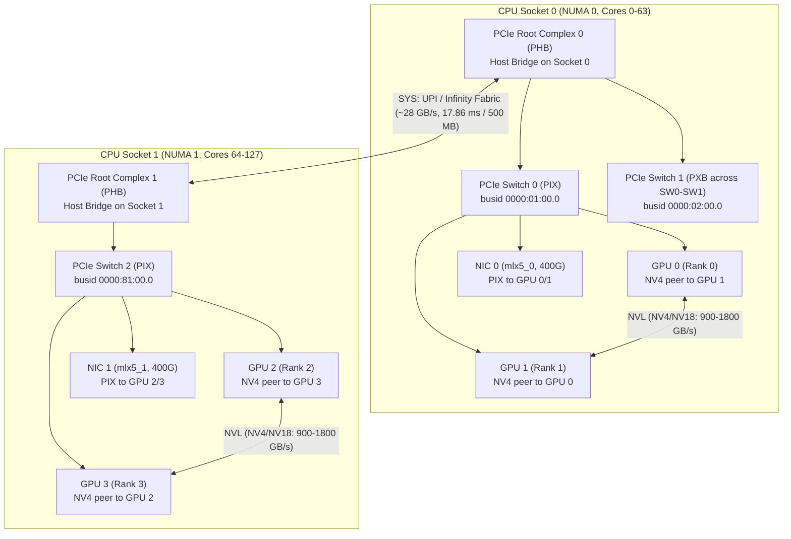
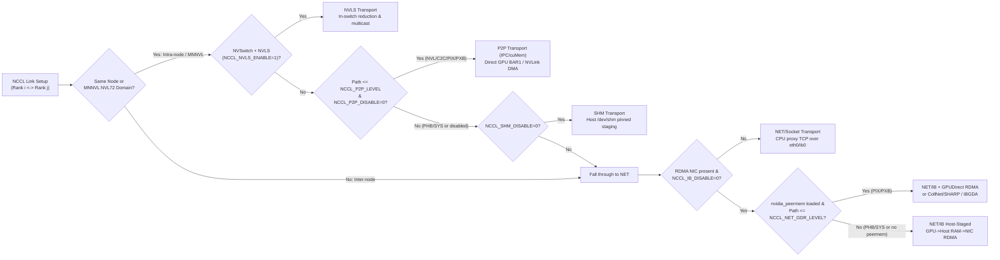

# 12.16 NCCL: topology, channels, transports and environment variables

| | |
|---|---|
| Level | Advanced |
| Priority tier | 1 |
| Lab venue | Nebius GPU |
| Part | Part 12: Complete AI networking |
| Sources to use | ASP 4; V7 ch8; V7 ch9; VL6 ch2; V2 ch10; V13 ch8 |
| Coverage file | `planning/coverage/chapters/12-16.md` |
| Companion code | `code/part12/nccl_topology_channels_env.py` · `code/part12/nccl_topology_channels_env_lab.py` |

## Why this matters for AI infrastructure

An optimal collective algorithm still collapses in production if NCCL maps its logical rings or trees onto the wrong physical links. Training engineers see GPU utilization stall while iteration time doubles or triples without any crash or error message. The cause is almost always a silent transport fallback, a cross-socket path mistake, or an aggressive channel setting that starves compute kernels.

The performance gap between a topology-aligned path and a misconfigured fallback on the exact same server hardware is massive. Moving a gradient slice over NVLink takes less than a millisecond, while routing that same slice across an inter-socket CPU link takes tens of milliseconds. Leaving a debug environment variable enabled or omitting an InfiniBand device mount in a container is equally destructive. Those mistakes force multi-hundred-gigabyte-per-second GPU traffic through host RAM or kernel TCP sockets.

```text
Quantitative penalty of topology and transport mistakes:
- Intra-node NVLink 4.0 (NVL, 900 GB/s on Hopper H100 / H200) for a 500 MB (0.5 GB) slice:
  0.5 GB / 900 GB/s = 0.56 ms
- Cross-socket SYS path (PCIe Gen4 x16 + Intel UPI / AMD Infinity Fabric at ~28 GB/s) for 500 MB (0.5 GB):
  0.5 GB / 28 GB/s = 17.86 ms (~18 ms), a 32.14x (> 30x) latency penalty
- Naive 4-GPU pairing (GPU0+GPU2 over SYS instead of GPU0+GPU1 over NV4):
  SM busy time drops to 60% and step time stretches to 100.0 ms
- Topology-aware hierarchical schedule with compute-communication overlap (ASP Table 4-2):
  Raises SM utilization to 90% and cuts step time by 30.0% down to 70.0 ms
- Inter-node 800 Gb/s (100 GB/s) InfiniBand link for a 400 MB AllReduce:
  NET/IB with GPUDirect RDMA: 4.00 ms (100.0 GB/s)
  CPU-bound Gloo TCP fallback: 200.00 ms (2.0 GB/s, 50x slower)
```

This chapter explains how NCCL discovers hardware topology, scores path costs, and partitions collectives across parallel channels. It also covers how the runtime selects transports and responds to environment variables and Kubernetes NUMA policies.

---

## Prerequisites and outcomes

### Prerequisites

You should complete Chapter 12.15 on NCCL collectives and algorithms first. That chapter covers Ring and Tree step math, wire protocols, and bus bandwidth conversion factors. You also need familiarity with PCIe root complexes, switches, BAR1 peer-to-peer addressing, `nvidia-peermem`, InfiniBand GIDs, and RoCEv2 from earlier chapters in Part 12. Basic knowledge of Linux sysfs, `numactl`, and Kubernetes device plugins will help you follow the cluster configuration sections.

### Outcomes

After completing this chapter, you will be able to trace the three-phase NCCL topology discovery pipeline and read `nvidia-smi topo -m` distance labels. You will know how to author and audit `NCCL_TOPO_DUMP_FILE` and `NCCL_TOPO_FILE` XML overrides for virtualized or multi-root servers. You will calculate channel counts, subring parallelism, Streaming Multiprocessor thread-block occupancy, `NCCL_BUFFSIZE` memory footprints, and zero-copy registration savings. Finally, you will predict exact transport selection across P2P, SHM, NET/IB, NET/Socket, NVLS, and CollNet. You will also apply interface filter grammar and prevent Kubernetes `TopologyAffinityError` pod rejections.

---

## 1. NCCL Topology Discovery, Path Cost Scoring, and XML Graph Overrides

### 1.1 Logical GPU Indices versus Physical Locality

GPU runtimes number accelerators sequentially from zero, but logical device indices do not guarantee physical proximity. Enumeration order can shift across BIOS updates, PCIe bus scans, or motherboard replacements. When a launch script blindly pairs adjacent indices in round-robin order, it can map high-volume collective rings across a slow inter-socket CPU link.

To make deterministic routing decisions, NCCL inspects seven hardware attributes during `ncclCommInitRank`, which PyTorch invokes once inside `torch.distributed.init_process_group`. First, it queries NVML for each GPU UUID and compute capability. Second, it walks sysfs to map the PCIe bridge tree and check whether PCIe Access Control Services is enabled. Third, it queries NVML for direct NVLink, NVSwitch, and NVLink-C2C connections. Fourth, it inspects sysfs to find network adapter locality and link rates. Fifth, it reads CPU socket and NUMA node core bitmasks. Sixth, it checks whether peer-to-peer BAR1 and GPUDirect RDMA transfers are supported. Finally, it exchanges fabric reachability across ranks over the bootstrap TCP store to build rail-aligned rings and trees.

| Hardware Attribute Inspected | Discovery Interface | Key Hardware Values and Capabilities Recorded |
|---|---|---|
| 1. GPU UUID & compute capability | NVML | `sm="80"` for A100, `sm="90"` for H100/H200, `sm="100"` for Blackwell B200/GB200 |
| 2. PCIe BDF address & bridge tree | `/sys/class/pci_bus/`, `/sys/devices/pci*` | PCIe Gen4 `31.5 GB/s` vs Gen5 `64 GB/s` per x16 direction, switch `class="0x060400"`, PCIe ACS state |
| 3. Direct GPU interconnects | NVML (`nvidia-smi nvlink -s`) | Point-to-point bridges (`NV4`), 8-GPU HGX/DGX NVSwitch (`NV12` on A100 `600 GB/s`, `NV18` on H100 `900 GB/s` with `3.6 TB/s` bisection, `NV18` on B200 `1.8 TB/s`), `900 GB/s` NVLink-C2C (`GH200` `608 GB`, `GB200`), 72-GPU NVL72 (`~130 TB/s`) |
| 4. NIC / HCA locality & link rate | `/sys/class/infiniband/`, `/sys/class/net/` | Maps `mlx5_0..mlx5_7` `400 Gb/s` NDR or `800 Gb/s` XDR ports to their nearest PCIe switch |
| 5. CPU socket & NUMA affinity | sysfs NUMA topology | `numaid="0"`, `numaid="1"`, and local CPU core bitmasks (`0-31` or `0-63`) |
| 6. P2P & GPUDirect RDMA viability | NVIDIA driver + `nvidia-peermem` / DMA-BUF | Sets `gdr="1"` when GPU BAR1 physical pages can map directly to `mlx5_core` |
| 7. Inter-node fabric reachability | Bootstrap TCP store | Connects rail-aligned rings and trees across multi-node servers |

### 1.2 The Seven NCCL Topology Path Levels (LOC through SYS)

Without a quantitative distance metric, a collective planner cannot tell whether two devices share a dedicated PCIe switch or sit on opposite CPU sockets. Both `nvidia-smi topo -m` and the internal NCCL graph solver (`ncclTopoGetSystem` and `ncclTopoComputePaths`) solve this problem. They classify every GPU-to-GPU and GPU-to-NIC path into seven ordered distance tiers. NCCL assigns each hop a bandwidth-weighted cost so that graph search always selects lower-cost, higher-bandwidth edges:

$$\text`{Cost}`(\text`{LOC}`) < \text`{Cost}`(\text`{NVL}`) < \text`{Cost}`(\text`{C2C}`) < \text`{Cost}`(\text`{PIX}`) < \text`{Cost}`(\text`{PXB}`) < \text`{Cost}`(\text`{PHB}`) < \text`{Cost}`(\text`{SYS}`)$$



| Path Token (`nvidia-smi` / NCCL) | Rank / Model Cost | Typical Unidirectional BW | Typical Hop Latency | Physical Path Traversal | GPUDirect P2P / RDMA (`GDR`) Viability |
|---|---|---|---|---|---|
| `X` / `LOC` | Rank `0` (Cost `0`) | `~3,000 GB/s` (HBM3) | `~0.1 µs` | Self (loopback on the same GPU device) | Native on-device memory |
| `NV#` (`NV4`, `NV12`, `NV18`) / `NVL` | Rank `1` (Cost `10`) | `600–1,800 GB/s` (bidir) | `~0.5 µs` (`< 1 µs` NVL72) | Direct NVLink bridges or NVSwitch fabric (`A100` `600 GB/s`, `H100` `900 GB/s`, `B200` `1,800 GB/s`) | Ideal direct GPU P2P (`CUDA IPC` / `cuMem` / `NVLS`) |
| `C2C` | Rank `2` (Cost `15`) | `900 GB/s` (bidir) | `~0.6 µs` | Coherent NVLink-C2C chip-to-chip link (`Grace Hopper GH200` / `Grace Blackwell GB200`) | Coherent CPU-GPU memory extension & P2P |
| `PIX` | Rank `3` (Cost `30`) | `~31.5–64 GB/s` (Gen4/5 x16) | `~1.2 µs` | Traverses at most **one** PCIe switch/bridge (`class="0x060400"`, ACS disabled) | **Gold standard** for `GPU <-> NIC` GPUDirect RDMA (`Rail 1..8`) |
| `PXB` | Rank `4` (Cost `50`) | `~28–48 GB/s` | `~1.8 µs` | Traverses **multiple** cascaded PCIe switches without crossing the CPU Host Bridge | Viable for P2P and GPUDirect RDMA (`NCCL_NET_GDR_LEVEL=PXB`) |
| `PHB` | Rank `5` (Cost `80`) | `~16–32 GB/s` | `~3.0 µs` | Traverses the CPU PCIe Host Bridge / Root Complex within a single NUMA socket | Hairpins through CPU Root Complex; GDR disabled by default |
| `SYS` | Rank `6` (Cost `200`) | `~12–28 GB/s` | `~8.0+ µs` | Crosses both PCIe and the inter-socket NUMA link (`Intel UPI` / `AMD Infinity Fabric`) | **Severe bottleneck** (`32.14x` slower than `NVL`); P2P/GDR disabled by default |

Inspecting a real topology matrix makes these seven tiers concrete. Consider the `nvidia-smi topo -m` output from a dual-socket, four-GPU server that has two NV4 pairs and a single high-speed NIC attached to Socket 0:

```text
$ nvidia-smi topo -m
        GPU0    GPU1    GPU2    GPU3    NIC0    CPU Affinity    NUMA Affinity
GPU0     X      NV4     SYS     SYS     PIX     0-31            0
GPU1    NV4      X      SYS     SYS     SYS     0-31            0
GPU2    SYS     SYS      X      NV4     SYS     32-63           1
GPU3    SYS     SYS     NV4      X      SYS     32-63           1
NIC0    PIX     SYS     SYS     SYS      X

Key timing and utilization takeaways from this 4-GPU matrix:
1. GPU0 <-> GPU1 and GPU2 <-> GPU3 are NV4 (NVL at 900 GB/s):
   500 MB (0.5 GB) transfer = 0.5 GB / 900 GB/s = 0.000556 s = 0.56 ms
2. GPU0 <-> GPU2 and GPU1 <-> GPU3 are SYS (PCIe + UPI at ~28 GB/s):
   500 MB (0.5 GB) transfer = 0.5 GB / 28 GB/s = 0.017857 s = 17.86 ms (~18 ms, 32.14x slower)
3. Hierarchical topology-aware routing + overlap in Nsight Systems (ASP Table 4-2):
   Reduces within {GPU0, GPU1} and {GPU2, GPU3} over NVLink, exchanges one shard across SYS,
   and broadcasts back over NVLink. Raises SM busy from 60% to 90% and cuts step time from 100.0 ms to 70.0 ms (30.0% faster).
```

If a two-GPU job is scheduled onto GPU 1 and GPU 2, or a four-GPU job forms a flat cross-socket ring, every step is throttled by the slow SYS link. When NCCL detects two fast NVLink islands separated by a slow SYS bridge, its hierarchical algorithm reduces within each local pair first. Only one leader per pair exchanges a reduced shard across the slower inter-group link. That leader then broadcasts the result back over NVLink. In Nsight Systems, this shows up as separate intra-group and inter-group CUDA kernels that keep compute units busy.

### 1.3 Inspecting and Overriding Topologies with `NCCL_TOPO_DUMP_FILE` and `NCCL_TOPO_FILE`

In virtualized clouds, SR-IOV guests, or complex multi-root OEM HGX servers, hypervisors and broken ACPI tables often expose a flattened or scrambled PCIe tree. When that happens, NCCL misidentifies which NIC sits on the same PCIe switch as a given GPU. It may pair GPU 0 with a remote NIC across the inter-socket UPI link or build rings that hairpin out to a spine switch. That misrouting saturates a bottleneck link and triggers `ProcessGroupNCCL` watchdog timeouts on multi-node InfiniBand runs.

NCCL provides two XML topology environment variables to diagnose and fix broken hardware trees. Setting `NCCL_TOPO_DUMP_FILE` instructs NCCL to write the exact XML hardware graph it constructed at the end of topology discovery. Always dump a working node's XML first rather than writing XML from scratch. The parser requires specific CPU, PCIe, GPU, and NIC attributes. Setting `NCCL_TOPO_FILE` forces NCCL to load your corrected XML graph before computing paths. That override anchors each GPU and its local rail NIC under the same PCIe switch so they score as PIX.

```text
NCCL XML topology environment variables and required schema attributes:
- NCCL_TOPO_DUMP_FILE=/tmp/nccl_topo_detected.xml
  Dumps the auto-discovered XML graph after topology discovery.
- NCCL_TOPO_FILE=/etc/nccl/topology.xml
  Overrides broken sysfs/VM bridge hierarchies on 32-node 400G IB runs.
- Required XML schema attributes:
  <system version="1">
  <cpu numaid="0" arch="x86_64" vendor="GenuineIntel" familyid="6" modelid="143">
  <pci busid="0000:01:00.0" class="0x060400" link_speed="32.0 GT/s PCIe" link_width="16">
  <gpu dev="0" sm="90" rank="0" gdr="1"/>
  <net name="mlx5_0" dev="0" speed="400000" (400G) or "800000" (800G) port="1" gdr="1"/>
```

---

## 2. NCCL Channels, Subrings, SM Thread Blocks, and `NCCL_BUFFSIZE`

### 2.1 How Channels Map to Subrings and GPU Streaming Multiprocessors (SMs)

A single CUDA thread block cannot saturate hundreds of gigabytes per second of NVLink bandwidth or drive eight parallel InfiniBand rails at line rate. If NCCL used only one thread block, most physical links would sit idle while training step times dragged on. To drive all physical links concurrently, NCCL partitions each collective tensor across $C$ independent execution pipelines called **channels**.

Each active channel corresponds to one parallel subring or subtree and launches **one CUDA thread block per GPU** inside `ncclDevKernel`. Every active channel occupies one Streaming Multiprocessor while the collective kernel runs. Overlapping communication with backward-pass computation therefore trades compute SMs for communication SMs. Suppose PyTorch DDP runs an AllReduce on a background CUDA stream while `cuBLAS` matrix multiplications run on the default compute stream. Allocating too many NCCL channels steals SMs from the matrix math and slows down the step.

Conversely, registering user buffers persistently on NVSwitch fabrics allows the switch and copy engines to move data directly from the user tensor without SM-driven staging copies. Calling `ncclCommRegister` on memory allocated with `ncclMemAlloc` enables zero-copy NVLS transfers. That optimization cuts the required channel count by three-quarters and returns those SM thread blocks to model computation.

```text
Channel-to-SM occupancy breakdown on an NVIDIA H100 (132 total SMs):
- 16 active channels (Channel 0..15):
  Launches 16 CUDA thread blocks = 12.12% of 132 SMs, leaving 116 SMs (87.88%) for compute.
- 32 active channels (aggressive NCCL_MAX_NCHANNELS=32):
  Launches 32 CUDA thread blocks = 24.24% of 132 SMs (32 / 132), starving overlapped GEMMs.
- Zero-copy user buffer registration (ncclCommRegister + ncclMemAlloc on NVLS):
  Drops required channels from 16 down to 4 channels (3.03% of 132 SMs), freeing 12 SM blocks.
```

### 2.2 Controlling Channel Count and Channel Buffer Memory (`NCCL_BUFFSIZE`)

When engineers increase channel counts or buffer sizes blindly across multiple process groups, jobs frequently crash with out-of-memory errors. Three environment variables govern channel parallelism and per-channel staging memory. The variables `NCCL_MIN_NCHANNELS` and `NCCL_MAX_NCHANNELS` clamp the minimum and maximum number of channels that NCCL allocates per communicator:

$$C_\{\text`{active}`} = \max\!\left(\text`{NCCL\_MIN\_NCHANNELS}`,\; \min\!\left(\text`{NCCL\_MAX\_NCHANNELS}`,\; C_\{\text`{auto}`}\right)\right)$$

On NVSwitch systems, NCCL automatically tunes $C_\{\text`{auto}`}$ based on topology and message size. You should leave channel bounds at their defaults unless profiling proves either link under-utilization or compute SM starvation during overlapped execution.

The variable `NCCL_BUFFSIZE` sets the size in bytes of the internal FIFO communication buffer allocated in GPU HBM for each peer slot in each channel. For a ring communicator where each channel maintains $P_\{\text`{peers}`} = 2$ peer buffer slots, total channel buffer HBM per communicator is:

$$\text`{Memory}`_\{\text`{channels}`} = C_\{\text`{active}`} \times P_\{\text`{peers}`} \times \text`{NCCL\_BUFFSIZE}`$$

Those two peer slots correspond to the send and receive neighbors on the ring.

| Configuration Scenario | Active Channels ($C_\{\text`{active}`}$) | `NCCL_BUFFSIZE` (Bytes / MiB) | Peer Slots ($P_\{\text`{peers}`}$) | Total Channel HBM per Communicator | H100 (`132` SMs) SM Blocks Used (`%`) |
|---|---|---|---|---|---|
| Default 16-Channel Ring (`4 MiB` start) | `16` | `4,194,304 B` (`4.0 MiB`) | `2` | `134,217,728 B` (**`128.0 MiB`**) | `16` SMs (**`12.12%`**) |
| Clamped 8-Channel Ring (`8 MiB` tuned) | `8` (`MIN=4, MAX=8`) | `8,388,608 B` (`8.0 MiB`) | `2` | `134,217,728 B` (**`128.0 MiB`**) | `8` SMs (**`6.06%`**) |
| High-Channel 32-Channel Ring (`16 MiB` aggressive) | `32` | `16,777,216 B` (`16.0 MiB`) | `2` | `1,073,741,824 B` (**`1,024.0 MiB` / `1.0 GiB`**) | `32` SMs (**`24.24%`**) |
| Zero-Copy `ncclCommRegister` + `NVLS` | `4` (`16 -> 4` saved) | `4,194,304 B` (`4.0 MiB`) | `2` | `33,554,432 B` (**`32.0 MiB`**) | `4` SMs (**`3.03%`**, saves `12` SMs) |

When tuning `NCCL_BUFFSIZE` for large bandwidth-bound AllReduce operations, start at the recommended baseline and double it stepwise while monitoring `torch.cuda.memory_reserved()`. Channel buffers are allocated per communicator. Creating separate tensor, pipeline, data, and expert parallel process groups therefore multiplies this HBM tax across every group.

```text
NCCL_BUFFSIZE tuning rule:
- Recommended starting point: 4 MB / 4 MiB (4,194,304 bytes)
- Stepwise progression: 4 MiB -> 8 MiB (8,388,608 B) -> 16 MiB (16,777,216 B)
- Multiply total channel HBM across all active communicators (TP, PP, DP, EP) to avoid OOM evictions.
```

---

## 3. NCCL Transports: P2P, SHM, NET (IB / RoCE / IBGDA / Socket), NVLS, and CollNet

Once NCCL computes its topology graph and channel rings, it binds every channel link between two ranks to one of six concrete transport engines under `src/transport/`. If a high-speed transport is blocked by a missing kernel module, a BIOS setting, or an environment flag, NCCL silently drops down the fallback ladder rather than failing the job.



| Transport Engine | `NCCL_DEBUG=INFO` Signature | Primary Scope | Data Path & Memory Registration Mechanism | Key Controlling Environment Variables | Fallback Path When Disabled or Blocked |
|---|---|---|---|---|---|
| **`P2P`** (Peer-to-Peer) | `P2P/IPC` or `P2P/CUMEM` | Intra-node (and intra-rack MNNVL on `NVL72`) | Direct GPU-to-GPU loads/stores or copy engine DMA over NVLink/NVSwitch or PCIe BAR1 (`CUDA IPC` handles or `cuMem` fabric handles) | `NCCL_P2P_DISABLE`, `NCCL_P2P_LEVEL`, `NCCL_MNNVL_ENABLE` | `SHM/direct` (host `/dev/shm` staging) |
| **`SHM`** (Shared Memory) | `SHM/direct` | Intra-node | GPU A DMAs over PCIe into pinned host shared memory (`/dev/shm`); GPU B DMAs from `/dev/shm` over PCIe | `NCCL_SHM_DISABLE` | `NET/IB` loopback or `NET/Socket` TCP |
| **`NET/IB`** (GPUDirect RDMA / IBGDA) | `NET/IB : ... [GDRDMA]` | Inter-node (and intra-node PXN) | `mlx5_core` NIC DMAs directly to/from GPU BAR1 pages pinned via `nvidia-peermem` / DMA-BUF (or GPU SMs post WRs directly via IBGDA) | `NCCL_IB_DISABLE`, `NCCL_IB_HCA`, `NCCL_NET_GDR_LEVEL`, `NCCL_IB_GID_INDEX`, `NCCL_IB_TC`, `NCCL_CROSS_NIC` | `NET/IB` host-staged (if GDR fails) or `NET/Socket` (if IB fails) |
| **`NET/Socket`** (POSIX TCP) | `NET/Socket : Using [0]eth0...` | Bootstrap handshake + Inter-node fallback | GPU copies to host RAM; CPU proxy threads send/recv over kernel TCP/IP sockets (`eth0`/`ib0`) | `NCCL_SOCKET_IFNAME`, `NCCL_SOCKET_NTHREADS`, `NCCL_NSOCKS_PERTHREAD` | Communicator init aborts if no reachable interface |
| **`NVLS`** (NVLink SHARP) | `NVLS` / `NVLSTree` | Intra-node HGX/DGX & 72-GPU `NVL72` rack | Switch-resident ALUs on `NVSwitch 3.0/4.0` perform reductions and hardware multicast (`1/(N-1)` endpoint volume) | `NCCL_NVLS_ENABLE`, `NCCL_MNNVL_ENABLE` | `P2P` Ring or Tree over NVLink |
| **`CollNet`** (InfiniBand SHARP) | `CollNet/SHARP` | Multi-node Quantum InfiniBand (`32+` nodes) | Quantum IB switch ASICs aggregate reductions via SHARP Aggregation Manager + NCCL RDMA SHARP plugin (`2x–5x` speedup) | `NCCL_COLLNET_ENABLE`, `NCCL_SHARP_DISABLE` | `NET/IB` hierarchical Tree or Ring |

### 3.1 Deep Dive into the Five Critical Transport Mechanisms

Understanding how each transport moves bytes explains why specific misconfigurations cause severe slowdowns. For intra-node Peer-to-Peer transfers, NCCL enables direct P2P across NVL, C2C, PIX, and PXB links by default. It avoids direct P2P across PHB or SYS because CPU root complexes and inter-socket links frequently suffer packet credit stalls on peer BAR1 reads and writes. You can override the cutoff distance with `NCCL_P2P_LEVEL`. Setting `NCCL_P2P_DISABLE=1` disables all direct GPU peer copies and forces intra-node traffic through host memory. On multi-node Grace Blackwell racks, `NCCL_MNNVL_ENABLE=1` activates Multi-Node NVLink. That setting lets P2P and NVLS span all GPUs across the NVLink Switch backplane without touching network adapters.

When two GPUs on the same host sit on different sockets or PCIe ACS is enabled in BIOS, they cannot establish direct P2P. NCCL then uses the Shared Memory transport to stage buffers through `/dev/shm`. In Docker and Kubernetes containers, the default `/dev/shm` mount is tiny and triggers `NCCL WARN Call to posix_fallocate failed : No space left on device`. You must mount a multi-gigabyte in-memory volume at `/dev/shm` and never leave `NCCL_SHM_DISABLE=1` set in production.

For inter-node traffic, the traditional non-GDR path requires five separate copy steps through host RAM on both the sender and receiver. GPUDirect RDMA eliminates host RAM staging by pinning GPU BAR1 physical pages in the NVIDIA driver. It passes those pages via `nvidia-peermem` or DMA-BUF to `mlx5_core`. The NIC then DMAs straight from sender GPU HBM over the local PCIe switch and into receiver GPU HBM. The variable `NCCL_NET_GDR_LEVEL` sets the maximum topological distance between a GPU and a NIC at which NCCL allows GPUDirect RDMA. If a GPU and NIC are separated by PHB or SYS, NCCL disables GPUDirect RDMA for that link and falls back to host-staged bounce buffers.

On rail-optimized NVSwitch servers, `NCCL_CROSS_NIC` enables PXN, which stands for PCIe across NVLink. Suppose a rank on Node A needs to send to a non-rail-aligned NIC on Node B. PXN routes the packet over fast intra-node NVLink to a proxy GPU on the same node that is PIX-local to the target NIC rail. This avoids cross-socket GPU-to-NIC traffic completely. Finally, even with GPUDirect RDMA on the data plane, a CPU proxy thread traditionally rings the NIC doorbell and polls Completion Queues. With InfiniBand GPUDirect Async, the GPU Streaming Multiprocessors construct RDMA Work Requests and ring the ConnectX NIC doorbell directly over PCIe.

```text
Transport operational specifications and thresholds:
- P2P disable penalty (NCCL_P2P_DISABLE=1, equivalent to NCCL_P2P_LEVEL=LOC):
  Increases intra-node latency from a few us to tens of us; drops bandwidth from 900-1,800 GB/s to tens of GB/s.
- Multi-Node NVLink (NCCL_MNNVL_ENABLE=1 on GB200 / GB300 NVL72):
  Spans 72 GPUs (36 Grace-Blackwell compute trays) via P2P/CUMEM and NVLS at ~130 TB/s aggregate bandwidth and < 1 us latency.
- Container /dev/shm sizing for SHM transport:
  Default Docker/K8s tmpfs is 64 MiB (causes posix_fallocate failure); mount >= 16-64 GiB (--shm-size=16g).
- Traditional 5-step non-GDR path vs GPUDirect RDMA:
  (1) GPU A -> Host RAM A, (2) Host RAM A -> NIC A, (3) NIC A -> NIC B wire, (4) NIC B -> Host RAM B, (5) Host RAM B -> GPU B.
  GPUDirect RDMA eliminates steps 1, 2, 4, and 5 via BAR1 + nvidia-peermem / DMA-BUF over PIX.
- PXN (NCCL_CROSS_NIC=0, 1, or 2; default 2 on NVSwitch):
  Routes GPU i -> proxy GPU j over 900 GB/s NVLink -> PIX-attached NIC j (Rail j).
```

---

## 4. Production NCCL Environment Variables Reference and Filter Grammar

### 4.1 Complete Categorized Environment Variable Matrix

Relying on undocumented defaults in production clusters is dangerous because internal heuristics can shift across minor NCCL releases. An unpinned setting can change your collective algorithm, select a management network interface, or hang indefinitely when a remote rank crashes. You should pin performance-critical and resiliency-critical environment variables explicitly in your job launch manifests.

| Environment Variable | Valid Values / Syntax | Default / Recommended Production Value | Subsystem & Operational Impact |
|---|---|---|---|
| `NCCL_DEBUG` | `VERSION`, `WARN`, `INFO`, `TRACE` | `WARN` in steady-state prod; `INFO` during validation/triage | Controls log verbosity (`TRACE`/`DEBUG` adds latency overhead; never run `TRACE` in prod) |
| `NCCL_DEBUG_SUBSYS` | `INIT`, `COLL`, `P2P`, `SHM`, `NET`, `GRAPH`, `TUNING`, `ENV`, `ALLOC`, `ALL` | `INIT,ENV,GRAPH` (when `NCCL_DEBUG=INFO`) | Filters `NCCL_DEBUG` output to specific subsystems (`INIT,GRAPH,ENV` shows transport & ring setup) |
| `NCCL_TOPO_DUMP_FILE` | File path (e.g., `/tmp/topo.xml`) | Unset (set on 1 node to capture baseline XML) | Dumps NCCL auto-discovered hardware topology graph to an XML file |
| `NCCL_TOPO_FILE` | File path (e.g., `/etc/nccl/topo.xml`) | Unset (set in VMs / complex OEM HGX servers) | Overrides auto-detection with an explicit XML hardware topology graph |
| `NCCL_ALGO` | `Ring`, `Tree`, `CollNetDirect`, `CollNetChain`, `NVLS`, `NVLSTree`, `PAT` | Auto-selected by message size & topology | Forces specific collective algorithms (set before `ncclCommInitRank`) |
| `NCCL_PROTO` | `LL`, `LL128`, `Simple` | Auto-selected (`LL` `<64KB`, `LL128` mid, `Simple` large) | Forces wire framing protocol (`50%`, `93.75%`, or `100%` payload efficiency) |
| `NCCL_MIN_NCHANNELS` / `NCCL_MAX_NCHANNELS` | Integer `1..64` | Auto-tuned by topology (`16–32` on NVSwitch) | Clamps subring channel count (and SM thread blocks consumed per collective) |
| `NCCL_BUFFSIZE` | Bytes (power of 2) | **`4194304` (`4 MiB`)** starting point | Per-channel peer FIFO buffer size in GPU HBM (`C * P * NCCL_BUFFSIZE`) |
| `NCCL_P2P_DISABLE` | `0` or `1` | **`0`** (never leave `1` in production) | Disables intra-node GPU-to-GPU direct P2P, forcing slow `/dev/shm` host staging |
| `NCCL_P2P_LEVEL` | `LOC`, `NVL`, `PIX`, `PXB`, `PHB`, `SYS` | Auto (`PXB` typical cutoff) | Maximum topological distance allowed for direct GPU P2P transfers |
| `NCCL_SHM_DISABLE` | `0` or `1` | **`0`** (never leave `1` in production) | Disables `/dev/shm` shared-memory transport, forcing network loopback fallback |
| `NCCL_MNNVL_ENABLE` | `0` or `1` | **`1` on GB200/GB300 NVL72** (`0` otherwise) | Enables Multi-Node NVLink (MNNVL) across NVLink Switch rack domains |
| `NCCL_IB_DISABLE` | `0` or `1` | **`0`** (never leave `1` on IB/RoCE fabrics) | Disables `NET/IB` RDMA verbs, forcing fallback to `NET/Socket` TCP |
| `NCCL_IB_HCA` | `[=\|^\|^=]mlx5_0[:1],...` | `mlx5` or explicit rail list (`=mlx5_0:1,mlx5_1:1`) | Selects or excludes InfiniBand / RoCEv2 RDMA Host Channel Adapters and ports |
| `NCCL_NET_GDR_LEVEL` | `LOC`, `PIX`, `PXB`, `PHB`, `SYS` | **`PIX`** (or `PXB` on cascaded switches) | Max GPU-to-NIC topological distance allowed for GPUDirect RDMA (`GDRDMA`) |
| `NCCL_CROSS_NIC` | `0` (off), `1` (ring/tree), `2` (PXN auto) | **`2`** on NVSwitch rail-optimized clusters | Controls cross-NIC traffic and PXN (NVLink-assisted NIC rail alignment) |
| `NCCL_IB_GID_INDEX` | Integer (`0..N`) | **`3`** for RoCEv2 IPv4 (verify with `show_gids`) | Selects the InfiniBand/RoCE Global Identifier (GID) table index |
| `NCCL_IB_TC` | Integer (`0..255`, DSCP * 4) | **`106`** (DSCP `26` AF31, or `184` DSCP `46`) | Sets IP/RoCEv2 Traffic Class (`TOS`/`DSCP`) to match lossless switch PFC/ECN queues |
| `NCCL_IB_QPS_PER_CONNECTION` | Integer (`1..16`) | **`4`** (or `2–8` on multi-plane/ECMP fabrics) | Stripes each channel connection across multiple Queue Pairs (QPs) for ECMP/throughput |
| `NCCL_COLLNET_ENABLE` / `NCCL_NVLS_ENABLE` | `0` or `1` | `1` when Quantum SHARP / NVSwitch NVLS active | Enables in-network switch reduction (CollNet) and NVSwitch NVLink SHARP (NVLS) |
| `NCCL_SHARP_DISABLE` | `0` or `1` | `0` (set `1` for A/B testing or switch buffer triage) | Explicitly disables InfiniBand SHARP offload even when CollNet is present |
| `NCCL_SOCKET_IFNAME` | `[=\|^\|^=]ib0,eth0,...` | **`ib0`** (or high-speed bond, e.g., `^docker,lo`) | Selects OS network interface for NCCL bootstrap TCP handshakes and `NET/Socket` |
| `NCCL_SOCKET_NTHREADS` & `NCCL_NSOCKS_PERTHREAD` | Integers with product **`<= 64`** | Product **`<= 64`** (e.g., `2` threads $\times$ `2` sockets = `4`) | Tunes CPU proxy threads and TCP sockets per thread when `NET/Socket` is active |
| `NCCL_IGNORE_CPU_AFFINITY` | `0` or `1` | **`1`** (paired with NUMA-level `numactl`) | Ignores inherited narrow CPU core affinity masks so NCCL spreads threads across the local NUMA node |
| `TORCH_NCCL_ASYNC_ERROR_HANDLING` / `NCCL_ASYNC_ERROR_HANDLING` | `0` or `1` (`1` = abort on error/timeout) | **`1`** | Enables asynchronous watchdog abort on rank crash or collective stall instead of infinite hang |
| `NCCL_PROFILER_PLUGIN` | Shared library name / path | Unset (or Kineto / custom profiler `.so`) | Loads the 5-callback (`init`, `startEvent`, `stopEvent`, `recordEventState`, `finalize`) profiler plugin |

### 4.2 Prefix and Exact Filter Operators for `NCCL_SOCKET_IFNAME` and `NCCL_IB_HCA`

Multi-homed GPU servers carry loopback interfaces, container bridges, management bonds, storage VLANs, and eight or more RDMA rails. If you write a naive filter string without understanding the NCCL operator grammar, NCCL may bind bootstrap traffic to a dead VLAN sub-interface or include a slow management bond in collective rings. Both `NCCL_SOCKET_IFNAME` and `NCCL_IB_HCA` share the same four-mode prefix and exact filter grammar.

In default prefix-include mode, any interface or HCA whose name starts with a listed token is selected. That means an unprefixed `eth0` token is a prefix match that selects both `eth0` and VLAN sub-interface `eth0.100`. Prepending `=` switches to exact-include mode, matching only interfaces whose full name equals one of the tokens. Prepending `^` switches to prefix-exclude mode, dropping any device starting with a listed token and keeping everything else. Finally, prepending `^=` switches to exact-exclude mode, dropping only exact token matches while keeping sub-interfaces and numbered variants.

```text
Filter operator grammar evaluated against host interfaces and RDMA HCAs:
Host IP interfaces: ["lo", "docker0", "eth0", "eth0.100", "eth1", "ib0", "ib1"]
Host RDMA HCAs:     ["mlx5_0:1", "mlx5_1:1", "mlx5_2:1", "mlx5_3:1", "mlx5_bond_0:1"]

1. Default Prefix Include (<token1>,<token2>):
   - NCCL_SOCKET_IFNAME=ib   -> selects ["ib0", "ib1"]
   - NCCL_SOCKET_IFNAME=eth0 -> selects BOTH ["eth0", "eth0.100"] (prefix match trap)
2. Exact Include (=<token1>,<token2>):
   - NCCL_SOCKET_IFNAME==eth0            -> selects ["eth0"] (excludes "eth0.100" and "eth1")
   - NCCL_IB_HCA==mlx5_0:1,mlx5_1:1      -> binds strictly to port 1 of mlx5_0 and mlx5_1
3. Prefix Exclude (^<token1>,<token2>):
   - NCCL_SOCKET_IFNAME=^docker,lo,eth   -> excludes lo, docker0, eth*, leaving ["ib0", "ib1"]
   - NCCL_IB_HCA=^mlx5_bond              -> excludes bond, keeps ["mlx5_0:1", "mlx5_1:1", "mlx5_2:1", "mlx5_3:1"]
4. Exact Exclude (^=<token1>,<token2>):
   - NCCL_SOCKET_IFNAME=^=lo,docker0,eth0 -> excludes exact lo, docker0, eth0; keeps ["eth0.100", "eth1", "ib0", "ib1"]
```

### 4.3 Multi-NIC Socket Tuning and the 64-Socket Limit

When NCCL runs over InfiniBand or RoCEv2 using NET/IB, multi-rail striping across multiple high-speed NICs is controlled by `NCCL_IB_HCA` and `NCCL_IB_QPS_PER_CONNECTION`. On cloud instances without RDMA, NCCL uses the NET/Socket TCP transport instead. A single kernel TCP stream cannot saturate a high-speed Ethernet link or stripe across multiple NICs. Engineers who leave socket settings at their defaults see severe bandwidth under-utilization, while engineers who crank them too high hit the hard socket ceiling.

For NET/Socket, NCCL spawns `NCCL_SOCKET_NTHREADS` CPU proxy threads per interface and opens `NCCL_NSOCKS_PERTHREAD` parallel TCP sockets per thread. Crucially, NCCL enforces a built-in architectural maximum of **64 total TCP sockets per communicator**:

$$\text`{NCCL\_SOCKET\_NTHREADS}` \times \text`{NCCL\_NSOCKS\_PERTHREAD}` \le 64$$

That product is the total socket count per communicator. Exceeding that ceiling wastes CPU cycles on lock contention and exhausts OS file descriptors without opening additional usable collective streams. You should increase these values stepwise only when NET/Socket is actively carrying collective payloads.

```text
Multi-NIC bandwidth aggregation and NET/Socket connection limits:
- Multi-rail 800 Gbps NIC aggregation (NET/IB or multi-NIC striping):
  2 x 800 Gbps NICs = 1.6 Tbps (1,600 Gbps) aggregate
  4 x 800 Gbps NICs = 3.2 Tbps (3,200 Gbps) aggregate
- NET/Socket thread and socket combinations (product <= 64 ceiling):
  NCCL_NSOCKS_PERTHREAD=2 * NCCL_SOCKET_NTHREADS=2  = 4 sockets   (VALID <= 64, dual-NIC baseline)
  NCCL_NSOCKS_PERTHREAD=8 * NCCL_SOCKET_NTHREADS=8  = 64 sockets  (VALID <= 64, exact architectural ceiling)
  NCCL_NSOCKS_PERTHREAD=16 * NCCL_SOCKET_NTHREADS=8 = 128 sockets (INVALID > 64, violates NCCL 64-socket limit)
  Stepwise tuning progression for NET/Socket: 2 -> 4 -> 8
```

---

## 5. CPU/GPU NUMA Affinity, Kubernetes Topology Manager, and Rail-Aligned Multi-Tenancy

### 5.1 `NCCL_IGNORE_CPU_AFFINITY=1` and Dual-Socket NUMA Binding

Even when GPUDirect RDMA moves tensor payloads directly between GPU HBM and ConnectX NICs without touching host RAM, CPU placement still matters. NCCL launches background CPU proxy threads to coordinate bootstrap handshakes, ring RDMA doorbells when IBGDA is not active, poll Completion Queues, and enqueue CUDA kernels. Misplacing those threads across CPU sockets or pinning them to a single core degrades collective latency.

On a dual-socket, eight-GPU server, GPUs 0 through 3 and NICs 0 through 3 attach to CPU Socket 0. GPUs 4 through 7 and NICs 4 through 7 attach to CPU Socket 1. Two CPU affinity failure modes occur in production. First, if Rank 0 on NUMA 0 runs its CPU proxy thread or NIC interrupt handler on NUMA 1, every doorbell and completion event crosses the inter-socket UPI link. Second, when job launchers such as `mpirun`, `srun`, or `taskset` pin a rank process to a single CPU core, all background proxy threads inherit that narrow mask and contend on that one core.

The production fix combines NUMA-level binding with `NCCL_IGNORE_CPU_AFFINITY=1`. Bind each rank process to the full CPU core set of its local NUMA domain using `numactl`. Then export `NCCL_IGNORE_CPU_AFFINITY=1` so NCCL ignores any narrow inherited core mask and spreads its worker threads cleanly across cores within the local NUMA node.

```text
Dual-socket 8-GPU NUMA layout and binding commands:
- Socket 0 (NUMA 0, CPU cores 0-63):  GPUs 0-3 (Ranks 0-3) and NICs 0-3 (Rails 1-4)
  Launch binding: numactl --cpunodebind=0 --membind=0
- Socket 1 (NUMA 1, CPU cores 64-127): GPUs 4-7 (Ranks 4-7) and NICs 4-7 (Rails 5-8)
  Launch binding: numactl --cpunodebind=1 --membind=1
- Export NCCL_IGNORE_CPU_AFFINITY=1 so NCCL worker threads spread across local NUMA cores.
```

### 5.2 Kubernetes Topology Manager and the `TopologyAffinityError` Trap

By default, Kubernetes treats a dual-socket server as a flat bag of resources under `--topology-manager-policy=none`. When a pod requests CPU cores, a GPU, and an SR-IOV NIC, the kubelet can easily assign CPU cores from NUMA 0, a GPU from NUMA 1, and a NIC from NUMA 0. That split placement forces every host-to-device and GPU-to-NIC transfer across the slow inter-socket UPI link.

To prevent cross-NUMA placement, the kubelet Topology Manager collects NUMA hints from the CPU Manager, Memory Manager, and Device Manager. It works alongside the NVIDIA GPU Operator and SR-IOV Network Device Plugin on Guaranteed QoS pods with integer CPU requests. Together, they enforce one of four policies:

| Kubelet Topology Manager Policy | Admission Behavior | Production Suitability for AI Training / Inference |
|---|---|---|
| `none` (Default) | No NUMA alignment; allocates CPUs, GPUs, and NICs across sockets arbitrarily | Unacceptable for multi-GPU or RDMA workloads (`SYS` bottlenecks) |
| `best-effort` | Attempts NUMA alignment, but admits split-NUMA pods if single-NUMA capacity is full | Non-deterministic performance; hides sizing bugs until throughput drops |
| `restricted` | Rejects pods if allocated devices do not align to the minimum possible number of NUMA nodes | Useful for multi-socket pods, but less strict than single-socket isolation |
| `single-numa-node` (AI Standard) | Strictly requires all requested CPUs, memory, GPUs, and SR-IOV VFs to reside on **one** NUMA node | **Production standard**; rejects misaligned pods with `TopologyAffinityError` |

While `single-numa-node` guarantees local PIX and NVL paths, it creates a classic scheduling trap. Engineers often divide total server CPU cores by total GPUs without accounting for OS and daemon reservations. Suppose system daemons consume just two CPU cores on one socket. The final pod requesting a full one-eighth share of the server's CPUs is rejected with `TopologyAffinityError`, leaving an expensive GPU idle.

```text
Production Case Study: Why the 8th pod fails with TopologyAffinityError on a 128-core, 8-GPU server
Server hardware:
- 128 total CPU cores: 64 cores on NUMA 0 (cores 0-63), 64 cores on NUMA 1 (cores 64-127)
- 8 total GPUs:        4 GPUs on NUMA 0 (GPUs 0-3),     4 GPUs on NUMA 1 (GPUs 4-7)
- Kubelet policy:      --topology-manager-policy=single-numa-node

Broken deployment (8 pods requesting 16 CPU cores and 1 GPU each; 8 * 16 = 128 cores):
- NUMA 0: Pods 1-4 consume 4 * 16 = 64 cores (0 cores left) and GPUs 0-3 (0 GPUs left).
- NUMA 1: Linux kernel, kubelet, and monitoring DaemonSets consume 2 CPU cores,
          leaving 64 - 2 = 62 allocatable cores and 4 free GPUs (GPUs 4-7).
- Pods 5-7 take 3 * 16 = 48 cores on NUMA 1, leaving 62 - 48 = 14 free cores and 1 empty GPU.
  (Same result if systemReserved/kubeReserved carves 2 cores per NUMA node up front: 62 - 48 = 14 free cores.)
- Pod 8 requests 16 cores on NUMA 1, where only 14 free cores remain (< 16) -> REJECTED with TopologyAffinityError.

The Fix (do NOT weaken single-numa-node to best-effort):
- Maximum integer CPU request per pod: floor((64 - 2) / 4) = 15 cores/pod.
- Production right-sized request: 12 CPU cores per pod (4 * 12 = 48 <= 62 free cores per NUMA node).
- Result: All 8 pods admit cleanly with 100% PIX/NVL locality.
```

---

## Commands and configurations that matter

### 1. Host Topology, `nvidia-peermem`, PCIe ACS, and Ephemeral Port Audit (`untested here`)

Before launching a distributed job, verify the GPU-to-NIC topology matrix and confirm that `nvidia-peermem` is loaded. You should also check that PCIe ACS is disabled on switch ports and widen the kernel ephemeral port and socket buffer limits.

```bash
# (untested here) 1. Inspect full GPU-to-GPU and GPU-to-NIC topology matrix and NVLink status
nvidia-smi topo -m
nvidia-smi nvlink -s

# (untested here) 2. Verify GPUDirect RDMA kernel module is loaded and check PCIe ACS status
lsmod | grep nvidia_peermem || sudo modprobe nvidia-peermem
sudo lspci -vvv | grep -E "ACSia|ACSCtl"

# (untested here) 3. Verify RoCEv2 GID table index (e.g., index 3 for RoCEv2 IPv4) and widen TCP bootstrap port range
show_gids
sudo sysctl -w net.ipv4.ip_local_port_range="50000 51000"
sudo sysctl -w net.core.rmem_max=134217728 net.core.wmem_max=134217728
```

### 2. Production NCCL Launch Profile with Topology Dump and NUMA Binding (`untested here`)

This launch script pins initialization logging, asynchronous error handling, P2P/SHM/IB enables, and GPUDirect RDMA distance cutoffs. It also sets explicit interface and HCA filters, channel buffer sizing, and topology XML dumping.

```bash
# (untested here) Production multi-node NCCL environment configuration
export NCCL_DEBUG=INFO
export NCCL_DEBUG_SUBSYS=INIT,GRAPH,ENV
export TORCH_NCCL_ASYNC_ERROR_HANDLING=1
export NCCL_ASYNC_ERROR_HANDLING=1

# Ensure P2P, SHM, and IB RDMA are explicitly enabled
export NCCL_P2P_DISABLE=0
export NCCL_SHM_DISABLE=0
export NCCL_IB_DISABLE=0
export NCCL_NET_GDR_LEVEL=PIX
export NCCL_CROSS_NIC=2

# Bind bootstrap to ib0 and select rail HCAs mlx5_0..mlx5_7 (excluding management bonds)
export NCCL_SOCKET_IFNAME==ib0
export NCCL_IB_HCA=^mlx5_bond
export NCCL_IB_GID_INDEX=3
export NCCL_IB_TC=106
export NCCL_IB_QPS_PER_CONNECTION=4

# Channel buffer starting point (4 MiB) and NUMA thread spreading
export NCCL_BUFFSIZE=4194304
export NCCL_IGNORE_CPU_AFFINITY=1
export NCCL_TOPO_DUMP_FILE=/tmp/nccl_topo_detected.xml
# When overriding broken VM/OEM PCIe trees:
# export NCCL_TOPO_FILE=/etc/nccl/topology.xml

# Launch with torchrun across 8 local GPUs
torchrun --nnodes=4 --nproc_per_node=8 --rdzv_backend=c10d --rdzv_endpoint=$MASTER_ADDR:29500 train.py
```

### 3. Schematic `NCCL_TOPO_FILE` (`topology.xml`) Anchoring GPU and NIC under One PCIe Switch (`untested here`)

When a virtual machine or OEM server misreports PCIe bridges, edit the dumped XML so each GPU and its local rail NIC sit under the same PCIe switch node.

```xml
<!-- (untested here) Schematic topology.xml derived from NCCL_TOPO_DUMP_FILE -->
<system version="1">
  <cpu numaid="0" affinity="00000000,00000000,ffffffff,ffffffff" arch="x86_64" vendor="GenuineIntel" familyid="6" modelid="143">
    <pci busid="0000:00:00.0" class="0x060400" link_speed="32.0 GT/s PCIe" link_width="16">
      <!-- Force NCCL to recognize that GPU 0 and mlx5_0 share PCIe switch 0000:01:00.0 (PIX) -->
      <pci busid="0000:01:00.0" class="0x060400" link_speed="32.0 GT/s PCIe" link_width="16">
        <gpu dev="0" sm="90" rank="0" gdr="1"/>
        <nic>
          <net name="mlx5_0" dev="0" speed="400000" port="1" guid="0x08c0eb0300a1b2c0" maxconn="131072" gdr="1"/>
        </nic>
      </pci>
    </pci>
  </cpu>
</system>
```

### 4. Kubernetes NVIDIA Network Operator, Multus, and SR-IOV Multi-Tenant Manifests (`untested here`)

In multi-tenant Kubernetes clusters, these manifests configure the SR-IOV Network Operator to carve out eight RDMA-capable Virtual Functions per physical NIC port with jumbo frames and hardware VLAN isolation.

```yaml
# (untested here) sriov-policy-and-network.yaml: 8 VFs on enp1s0f0 with MTU 9000 and VLAN 100
apiVersion: sriovnetwork.openshift.io/v1
kind: SriovNetworkNodePolicy
metadata:
  name: mlx5-rdma-policy
  namespace: sriov-network-operator
spec:
  resourceName: rdma_vf
  nodeSelector:
    feature.node.kubernetes.io/network-sriov.capable: "true"
  priority: 99
  mtu: 9000
  numVfs: 8
  nicSelector:
    vendor: "15b3"
    pfNames: ["enp1s0f0"]
  deviceType: netdevice
  isRdma: true
---
apiVersion: sriovnetwork.openshift.io/v1
kind: SriovNetwork
metadata:
  name: sriov-rdma-vlan100
  namespace: sriov-network-operator
spec:
  resourceName: rdma_vf
  networkNamespace: tenant-a
  vlan: 100
  ipam: '{"type": "whereabouts", "range": "10.10.100.0/24"}'
```

---

## How it fails

When a collective transport degrades or a topology check fails, the symptoms appear in initialization logs, `dmesg`, or Kubernetes pod events. Use the table below to map each symptom to its root cause and deterministic fix.

| Failure Mode | Observable Symptom (`NCCL_DEBUG=INFO` / `dmesg` / Profiler) | Root Cause | Verification & Remediation |
|---|---|---|---|
| **1. Silent Fallback from `NET/IB` to `NET/Socket` (TCP)** | AllReduce throughput drops from `~100 GB/s` (`4.00 ms` on `400 MB`) to a few `Gb/s` (`~1–2 GB/s`), CPU utilization spikes to `100%`, and logs show `NCCL INFO NET/Socket : Using [0]eth0:10.0.0.5<0>` instead of `NET/IB`. | Container is missing `/dev/infiniband` (`rdma/rdma_shared_device_a` or `sriov` resource not requested), `NCCL_IB_DISABLE=1` was left set, or RoCEv2 GID index (`NCCL_IB_GID_INDEX=3`) / Traffic Class (`NCCL_IB_TC=106`) mismatches host `show_gids`. | Expose `/dev/infiniband` via Network Operator device plugin, set `NCCL_IB_DISABLE=0`, match `NCCL_IB_GID_INDEX` to `show_gids`, and verify `NCCL INFO NET/IB` in logs. |
| **2. Silent Fallback from GPUDirect RDMA to Host-Staged `NET/IB`** | `NET/IB` is selected, but `[GDRDMA]` is absent from `NCCL INFO channel 00 : ... via NET/IB/...`, PCIe host memory bandwidth saturates, and inter-node `busbw` plateaus at `20–30%` of line rate. | `nvidia_peermem` kernel module is not loaded, PCIe ACS is enabled in BIOS (making `nvidia-smi topo -m` show `SYS` instead of `PIX`), or container GID table is desynchronized in `rdma-shared` mode. | Load `modprobe nvidia-peermem`, disable PCIe ACS in BIOS so GPU-NIC is `PIX`, ensure `NCCL_NET_GDR_LEVEL=PIX` (or `PXB`), and confirm `[GDRDMA]` in `NCCL_DEBUG=INFO`. |
| **3. Leftover `NCCL_P2P_DISABLE=1` or `NCCL_SHM_DISABLE=1` in Production** | Intra-node NVLink (`900–1,800 GB/s`) is ignored; NCCL logs `SHM/direct` or `NET/Socket` for same-node ranks, raising latency from `< 2 µs` to `> 20 µs` and cutting bandwidth by `10x–30x` (or crashing with `No space left on device` in `/dev/shm`). | Engineer set `NCCL_P2P_DISABLE=1` or `NCCL_SHM_DISABLE=1` during troubleshooting and forgot to unset it, or container `/dev/shm` is left at Docker's `64 MiB` default. | Explicitly set `NCCL_P2P_DISABLE=0` and `NCCL_SHM_DISABLE=0`, and mount a `>= 16–64 GiB` `emptyDir: {medium: Memory}` at `/dev/shm`. |
| **4. Post-Reboot NVLink Drop to PCIe (`800 GB/s -> 90 GB/s`)** | Job throughput drops from `950 tokens/sec` to `310 tokens/sec` after a node reboot, and `nccl-tests` `all_reduce_perf` drops from `~800 GB/s` to `~90 GB/s` with `NCCL INFO Using PCIe interface`. | `nvidia-fabricmanager` service failed to start after reboot or an NVLink link failed training, causing `nvidia-smi topo -m` to downgrade `NV18`/`NV4` pairs to `PIX`/`SYS`. | Run `nvidia-smi topo -m` and `systemctl status nvidia-fabricmanager`; restart `nvidia-fabricmanager` and inspect `dmesg` for NVLink training errors before scheduling jobs. |
| **5. `ProcessGroupNCCL` Watchdog Timeout on OEM HGX / VM Topologies** | Multi-node job on `32` OEM HGX `400G` IB nodes halts mid-run with `ProcessGroupNCCL` watchdog timeout or `NCCL WARN Watchdog caught network down!`. | Flattened ACPI/VM PCIe tree caused NCCL to route GPU traffic across UPI (`SYS`) or build rings across the Spine switch, saturating a bottleneck link; or a remote rank died (`OOM` kill). | Check the **first rank to fail** and `dmesg -T \| grep -i oom`; dump topology with `NCCL_TOPO_DUMP_FILE`, fix `<pci>` switch grouping, and inject `NCCL_TOPO_FILE=/etc/nccl/topology.xml`. |
| **6. SR-IOV Virtual Functions (VFs) Fail to Create or Pods Stick in `TopologyAffinityError`** | `SriovNetworkNodePolicy` creates `0` VFs in `ip link`, or pods 5–8 hang in `TopologyAffinityError` on a 128-core, 8-GPU node under `single-numa-node`. | For SR-IOV: IOMMU (`intel_iommu=on iommu=pt`) is disabled in GRUB/BIOS. For `TopologyAffinityError`: `16` cores/pod $\times 4 = 64$ leaves `0` headroom for `2` OS cores on `NUMA 1` (`14` free cores $< 16$). | Enable `intel_iommu=on iommu=pt` in GRUB for SR-IOV; reduce pod CPU request from `16` to `12` cores (`4 * 12 = 48 <= 62` free cores per NUMA node). |

---

## Hands-on lab

### Venue and Scope

This lab runs on Nebius GPU or any local Linux or macOS machine using the Python standard library only. The companion scripts are `code/part12/nccl_topology_channels_env.py` and `code/part12/nccl_topology_channels_env_lab.py`. They execute automated self-checks covering topology path cost ordering, NVLink versus SYS transfer math, and XML topology parsing. They also verify channel and buffer memory sizing, transport selection, filter operator grammar, socket limits, and Kubernetes `TopologyAffinityError` resolution.

### Run Command and Verified Output

```bash
python3 -B code/part12/nccl_topology_channels_env_lab.py
```

```text
=== Chapter 12.16 Lab: NCCL Topology, Channels, Transports, and Environment Variables ===
  [PASS] All 7 NCCL topology path levels (LOC, NVL, C2C, PIX, PXB, PHB, SYS) are cataloged
  [PASS] Strict NCCL topology path cost ordering: NVL (10) < C2C (15) < PIX (30) < PXB (50) < PHB (80) < SYS (200)
  [PASS] normalize_topo_label maps NV4, NV12, NV18 to NVL and X to LOC
  [PASS] score_topology_path ranks NV4 (NVL, 900 GB/s) strictly faster than SYS (28 GB/s)
  [INFO] 500 MB transfer: NVLink (900 GB/s)=0.56 ms vs SYS (28 GB/s)=17.86 ms (32.14x slower); Table 4-2 SM busy: 60.0% -> 90.0%, iter time: 100.0 ms -> 70.0 ms
  [PASS] V2 Ch10: 500 MB (0.5 GB) transfer takes 0.56 ms on NVLink (900 GB/s) vs 17.86 ms (~18 ms, 32.14x slower) on SYS (28 GB/s)
  [PASS] ASP Ch4 Table 4-2: Topology-aware + overlapped NCCL raises SM busy from 60% to 90% and cuts iteration time from 100 ms to 70 ms (-30%)
  [INFO] Parsed topology.xml GPU-to-NIC paths: {(0, 'mlx5_0'): 'PIX', (0, 'mlx5_1'): 'SYS', (1, 'mlx5_0'): 'PXB', (1, 'mlx5_1'): 'SYS', (2, 'mlx5_0'): 'SYS', (2, 'mlx5_1'): 'PIX'}
  [PASS] V6 Ch2 & ASP Ch4: topology.xml parser identifies GPU0<->mlx5_0 as PIX (same switch 0000:01:00.0, 400000 Mbps / 800000 Mbps, gdr=1)
  [PASS] topology.xml parser identifies GPU1<->mlx5_0 as PXB (same root 0000:00:00.0, different switch) and GPU0<->mlx5_1 as SYS (cross NUMA 0->1)
  [INFO] Channels & buffers: 16 ch @ 4 MiB = 128.0 MiB (16.0 SM blocks = 12.12% of 132 H100 SMs, leaving 116 SMs / 87.88%); 8 ch = 6.06%; 32 ch @ 16 MiB = 1024.0 MiB (24.24%); zero-copy registered = 4 ch (saved 12 SM blocks)
  [PASS] ASP Ch4: Default NCCL_BUFFSIZE=4,194,304 B (4 MiB) across 16 channels (2 peers/ch) uses 16 SM blocks (12.12% of 132 H100 SMs, leaving 87.88%) and 128 MiB buffer memory
  [PASS] ASP Ch4: NCCL_MIN_NCHANNELS=4 and NCCL_MAX_NCHANNELS=8 clamp 16 detected channels to 8 channels (6.06% of 132 SMs, 128 MiB at 8 MiB NCCL_BUFFSIZE); 32 channels @ 16 MiB uses 24.24% SMs and 1024.0 MiB
  [PASS] ASP Ch4: Persistent zero-copy buffer registration (ncclCommRegister) cuts NVLS channels from 16 to 4, saving 12 SM blocks (3.03% of 132 SMs)
  [PASS] All 6 NCCL transport classes (P2P, SHM, NET_IB, NET_SOCKET, NVLS, COLLNET) are cataloged
  [PASS] Intra-node NV18 selects P2P/IPC by default and NVLS when NVSwitch + NCCL_NVLS_ENABLE=1 are present
  [PASS] ASP Ch4: Multi-Node NVLink (NCCL_MNNVL_ENABLE=1) on GB200/GB300 NVL72 selects MNNVL NVLS/P2P across trays
  [PASS] ASP Ch4: Setting NCCL_P2P_DISABLE=1 (or crossing SYS without NCCL_P2P_LEVEL=SYS) forces fallback to SHM (/dev/shm host staging)
  [PASS] V6 Ch2 & ASP Ch4: Inter-node PIX GPU-NIC with nvidia_peermem loaded enables NET/IB/GDRDMA (GPUDirect RDMA)
  [PASS] V6 Ch2 & ASP Ch4: Missing nvidia_peermem or SYS GPU-NIC path disables GPUDirect RDMA and forces host-staged NET/IB
  [PASS] ASP Ch4: NCCL_COLLNET_ENABLE=1 enables CollNet/SHARP on Quantum IB switches, while NCCL_SHARP_DISABLE=1 forces fallback to NET/IB
  [PASS] V6 Ch2 & ASP Ch4: NCCL_IB_DISABLE=1 (or missing /dev/infiniband) falls back to NET/Socket (TCP)
  [PASS] NCCL_SOCKET_IFNAME prefix match: 'ib' selects ['ib0', 'ib1'] and 'eth0' selects ['eth0', 'eth0.100']
  [PASS] NCCL_SOCKET_IFNAME exact match ('='): '=eth0' selects only ['eth0'] and excludes 'eth0.100'
  [PASS] NCCL_SOCKET_IFNAME exclude prefix ('^'): '^docker,lo,eth' leaves only ['ib0', 'ib1']
  [PASS] NCCL_SOCKET_IFNAME exclude exact ('^='): '^=lo,docker0,eth0' excludes exact 'eth0' but keeps 'eth0.100' and 'eth1'
  [PASS] NCCL_IB_HCA filter: 'mlx5_0,mlx5_1' selects rails 0-1, '=mlx5_0:1' matches exact port, and '^mlx5_bond' excludes bond devices
  [INFO] Socket transport limits: 2x2=4 sockets (2x800G=1.6 Tbps); 8x8=64 sockets (4x800G=3.2 Tbps); 16x8=128 (within_64=False)
  [PASS] ASP Ch4 p.223 & p.299: 2 threads * 2 sockets = 4 connections; 2x 800 Gbps NICs yield 1.6 Tbps and 4x 800 Gbps NICs yield 3.2 Tbps
  [PASS] ASP Ch4 p.299 & p.617-618: NCCL_NSOCKS_PERTHREAD * NCCL_SOCKET_NTHREADS <= 64 passes for 8*8=64 and flags 16*8=128
  [INFO] K8s Topology Manager (single-numa-node, 128 cores, 8 GPUs): 16 cores/pod -> status=TopologyAffinityError, free_cores=[0, 14]; 12 cores/pod -> status=AllPodsRunning (8/8 pods admitted)
  [PASS] V7 Ch8: On a 128-core (2x64), 8-GPU (2x4) server with 2 OS cores used on NUMA 1, requesting 16 cores/pod triggers TopologyAffinityError when 14 cores remain
  [PASS] V7 Ch8 & ASP Ch4: Reducing request to 12 cores/pod schedules all 8 pods within strict single-numa-node bounds with NCCL_IGNORE_CPU_AFFINITY=1
  [PASS] Invalid topology path label raises NCCLTopologyEnvError

Summary: 29 passed, 0 failed
```

---

## Common first mistakes

1. **Assuming an unprefixed interface filter is an exact match:** Without the leading `=` operator, NCCL treats `NCCL_SOCKET_IFNAME` tokens as prefix filters and matches both the base interface and VLAN sub-interfaces. Use `=` for exact inclusion, `^` for prefix exclusion, and `^=` for exact exclusion.
2. **Tuning socket thread variables to speed up InfiniBand RDMA:** The variables `NCCL_NSOCKS_PERTHREAD` and `NCCL_SOCKET_NTHREADS` only affect the NET/Socket TCP transport path and have zero effect when NCCL runs over NET/IB RDMA. Furthermore, setting their product above 64 violates the hard per-communicator socket limit.
3. **Leaving debug tracing or peer-to-peer disable flags in production manifests:** Setting `NCCL_P2P_DISABLE=1` forces all intra-node NVLink traffic through host shared memory, and `NCCL_DEBUG=TRACE` serializes collective launches behind heavy console I/O. Use `NCCL_DEBUG=INFO` with `NCCL_DEBUG_SUBSYS=INIT,GRAPH,ENV` so logging occurs only once during communicator initialization.
4. **Writing topology XML files by hand from scratch:** Hand-written minimal XML snippets often omit required CPU architecture or PCIe link attributes, causing NCCL to reject the file. Always capture a real file first with `NCCL_TOPO_DUMP_FILE` and edit the PCIe switch hierarchy from that baseline.
5. **Re-initializing NCCL communicators inside the training loop:** Calling `init_process_group` and `destroy_process_group` on every step adds 48.0 ms of bootstrap overhead to a 0.5 ms collective. That mistake wastes 98.97% of step time. Creating 32 separate communicators on 32 GPUs can also stall startup for two to three minutes instead of two to three seconds.

---

## Exercises

1. **Exercise 1 — Topology Path Scoring and NVLink vs SYS Step Penalty:** Using the `nvidia-smi topo -m` matrix in Section 1.2 and the parameters below, rank the seven NCCL topology levels from lowest cost to highest cost. Compute the transfer time in milliseconds for a 500 MB tensor over NV4 versus SYS and the slowdown multiplier. Finally, state the SM utilization and iteration time before and after switching to a topology-aware overlapped schedule.
2. **Exercise 2 — XML Topology Graph Analysis:** Using `parse_nccl_topo_xml` on the dual-socket XML hierarchy specified below, determine the exact NCCL path level for each of the four GPU-to-NIC pairs. State which pairs qualify for GPUDirect RDMA when `NCCL_NET_GDR_LEVEL` is set to PIX versus PXB.
3. **Exercise 3 — Channel Count, SM Occupancy, and Buffer Memory Math:** Using `evaluate_channels_and_buffers` on the 132-SM H100 configurations below, calculate the CUDA SM thread blocks consumed for the default 16-channel ring. Also compute the percentage of H100 SMs occupied and the total channel buffer memory in MiB. Repeat the calculation for the clamped 8-channel ring and the zero-copy registered NVLS configuration.
4. **Exercise 4 — Transport Selection Matrix under Environment Overrides:** Using `select_nccl_transport`, state the exact selected transport, log prefix, and GPUDirect RDMA boolean for the five topology and environment scenarios listed below.
5. **Exercise 5 — Interface and HCA Filter Evaluation and the 64-Socket Rule:** Using `evaluate_nccl_filter` and `evaluate_socket_transport_limits`, write the exact list of matched interfaces and HCAs for the filter expressions below. Compute total sockets and validity against the 64-socket ceiling for the three thread-and-socket pairs. Also calculate the aggregate bandwidth in Tbps for two and four 800 Gbps NICs.
6. **Exercise 6 — Kubernetes Single-NUMA-Node `TopologyAffinityError` Resolution:** Using `evaluate_k8s_numa_pod_scheduling` on the 128-core, 8-GPU server below, show why 8 pods requesting 16 CPU cores and 1 GPU each hit `TopologyAffinityError`. State the exact remaining free cores and free GPUs per NUMA node. Then give the maximum integer CPU core request per pod that admits all 8 pods and explain why `NCCL_IGNORE_CPU_AFFINITY=1` is needed.

```text
Exercise Input Parameters and Reference Specifications:
- Ex 1 (Path & Step Math):   GPU0<->GPU1 and GPU2<->GPU3 = NV4 (900 GB/s); GPU0<->GPU2 = SYS (28 GB/s); payload = 500 MB (0.5 GB);
                             unoverlapped SYS schedule = 60% SM busy, 100.0 ms step vs overlapped hierarchical = 90% SM busy, 70.0 ms step.
- Ex 2 (XML Topology Graph): numaid="0" root <pci busid="0000:00:00.0"> has <pci busid="0000:01:00.0"> (GPU 0, mlx5_0 @ 400000 Mbps, gdr="1")
                             and <pci busid="0000:02:00.0"> (GPU 1); numaid="1" has <pci busid="0000:81:00.0"> (GPU 2, mlx5_1).
                             Evaluate pairs: (GPU 0, mlx5_0), (GPU 1, mlx5_0), (GPU 0, mlx5_1), (GPU 2, mlx5_1) at PIX vs PXB.
- Ex 3 (Channels & Buffers): H100 (132 SMs), 2 peer slots/channel:
                             (a) 16 auto channels, NCCL_BUFFSIZE = 4,194,304 B (4 MiB)
                             (b) NCCL_MIN_NCHANNELS=4, NCCL_MAX_NCHANNELS=8, NCCL_BUFFSIZE = 8,388,608 B (8 MiB)
                             (c) Persistent zero-copy registration (ncclCommRegister) on the 16-channel 4 MiB baseline (16 -> 4 channels)
- Ex 4 (Transport Matrix):   (a) Intra-node NV18 with NCCL_P2P_DISABLE=0 vs NCCL_P2P_DISABLE=1
                             (b) Inter-tray GB200 NVL72 with NCCL_MNNVL_ENABLE=1 and NCCL_NVLS_ENABLE=1
                             (c) Inter-node PIX GPU-to-NIC with nvidia_peermem loaded vs unloaded
                             (d) Inter-node PIX on Quantum IB with NCCL_COLLNET_ENABLE=1 and NCCL_SHARP_DISABLE=0 vs 1
                             (e) Inter-node with NCCL_IB_DISABLE=1
- Ex 5 (Filters & Sockets):  Interfaces = ["lo", "docker0", "eth0", "eth0.100", "eth1", "ib0", "ib1"] with "eth0", "=eth0", "^docker,lo,eth", "^=lo,docker0,eth0"
                             HCAs = ["mlx5_0:1", "mlx5_1:1", "mlx5_2:1", "mlx5_3:1", "mlx5_bond_0:1"] with "^mlx5_bond" and "=mlx5_0:1"
                             Socket pairs (nsocks_perthread, socket_nthreads) = (2, 2), (8, 8), (16, 8); NICs = 2x 800 Gbps and 4x 800 Gbps.
- Ex 6 (K8s NUMA Affinity):  128 CPU cores (64 on NUMA 0, 64 on NUMA 1), 8 GPUs (4 per NUMA), single-numa-node policy,
                             2 OS/DaemonSet cores on NUMA 1; compare 8 pods @ 16 cores/pod vs 12 cores/pod (max 15 cores/pod).
```

---

## Interview angles

1. **"How does NCCL decide between P2P, SHM, NET/IB, and NET/Socket, and how do you prove in 60 seconds which one your job is actually using?"**
   Walk through the initialization graph built from the sysfs PCIe tree, NVML NVLink status, and the RDMA device list. Intra-node ranks use NVLS when NVSwitch and `NCCL_NVLS_ENABLE=1` are present. They use P2P when the path cost is at or below `NCCL_P2P_LEVEL` and `NCCL_P2P_DISABLE=0`. Otherwise they fall back to SHM in `/dev/shm`. Inter-node ranks use CollNet/SHARP on Quantum IB or NET/IB with GPUDirect RDMA when `nvidia_peermem` is loaded and GPU-to-NIC distance is within `NCCL_NET_GDR_LEVEL`. If GDR fails they use host-staged NET/IB, and if RDMA verbs fail they fall back to NET/Socket TCP. To prove it in 60 seconds, export `NCCL_DEBUG=INFO` and `NCCL_DEBUG_SUBSYS=INIT,GRAPH,ENV` and inspect the Channel 00 log lines.
2. **"Why does increasing `NCCL_MAX_NCHANNELS` or `NCCL_BUFFSIZE` sometimes make a distributed training step slower or crash with OOM?"**
   Every NCCL channel is backed by one CUDA thread block occupying one SM during collective execution, plus peer FIFO buffers in GPU HBM. On a 132-SM H100, raising channels from 16 to 32 increases SM occupancy from 12.12% to 24.24% and steals SMs from overlapped backward-pass GEMM kernels. Raising `NCCL_BUFFSIZE` to 16 MiB at 32 channels also consumes 1,024 MiB of HBM per communicator across every active process group. Conversely, zero-copy buffer registration via `ncclCommRegister` with NVLS cuts channels from 16 to 4. That leaves 3.03% SM occupancy and saves 12 SM blocks for compute.
3. **"After enabling `--topology-manager-policy=single-numa-node` on 128-core, 8-GPU servers, pods 5–8 fail with `TopologyAffinityError` even though 4 GPUs are idle. Why, and how do you fix it?"**
   The `single-numa-node` policy requires a pod's CPU cores, GPU, and SR-IOV NIC VF to come from the exact same physical NUMA node. Each socket has 64 cores and 4 GPUs. Requesting 16 cores per pod consumes all 64 cores on NUMA 0 across 4 pods. On NUMA 1, OS and kubelet daemons use 2 cores and leave 62 free cores. Three pods take 48 cores and leave only 14 free cores, which is less than the 16 cores required for the eighth pod. Do not downgrade to `best-effort`, which permits 32.14x slower SYS crossings. Instead, reduce the pod CPU request to 12 cores and set `NCCL_IGNORE_CPU_AFFINITY=1`.

---

## Checkpoint questions (20)

<details>
<summary>`&lt;strong>`1. In what exact order does NCCL rank hardware interconnect path costs from fastest to slowest?`&lt;/strong>`</summary>

NCCL ranks path costs from fastest to slowest across seven levels:

```text
LOC (X, self, cost 0) < NVL (NV4/NV12/NV18 NVLink/NVSwitch, cost 10) < C2C (NVLink-C2C, cost 15) < PIX (single PCIe switch, cost 30) < PXB (multiple PCIe switches, cost 50) < PHB (PCIe Host Bridge on same NUMA node, cost 80) < SYS (cross-socket UPI / Infinity Fabric, cost 200)
```
</details>

<details>
<summary>`&lt;strong>`2. How long does a 500 MB (0.5 GB) GPU-to-GPU transfer take over a 900 GB/s NVLink path versus a 28 GB/s SYS path, and what is the slowdown factor?`&lt;/strong>`</summary>

Over NVLink at 900 GB/s, transferring 0.5 GB takes 0.56 ms. Over a cross-socket SYS path at 28 GB/s, transferring 0.5 GB takes 17.86 ms, or roughly 18 ms, which is **32.14x slower** (`> 30x`).
</details>

<details>
<summary>`&lt;strong>`3. What is the difference between PIX, PXB, and PHB in nvidia-smi topo -m and NCCL path scoring?`&lt;/strong>`</summary>

PIX traverses at most a single PCIe switch (`class="0x060400"`). PXB traverses multiple cascaded PCIe switches without reaching the CPU host bridge. PHB traverses the CPU PCIe Host Bridge or Root Complex within a single NUMA socket.
</details>

<details>
<summary>`&lt;strong>`4. How does PCIe Access Control Services (ACS) break GPUDirect P2P and GPUDirect RDMA, and how does it appear in nvidia-smi topo -m?`&lt;/strong>`</summary>

When PCIe ACS is enabled in BIOS, PCIe switches cannot route peer-to-peer transactions directly between downstream ports. They must redirect every packet up to the CPU Root Complex and IOMMU. This causes `nvidia-smi topo -m` to report SYS or PHB instead of PIX, disabling GPUDirect RDMA and collapsing throughput.
</details>

<details>
<summary>`&lt;strong>`5. How do you capture NCCL's auto-detected hardware graph and inject a corrected topology in a virtualized or OEM HGX environment?`&lt;/strong>`</summary>

Set `NCCL_TOPO_DUMP_FILE=/tmp/topo.xml` on a working run to dump the discovered XML schema. Edit the PCIe switch hierarchy so each GPU and its local rail NIC sit under the same PCIe switch as PIX, and inject it at runtime via `NCCL_TOPO_FILE=/etc/nccl/topology.xml`.
</details>

<details>
<summary>`&lt;strong>`6. What is an NCCL channel, and how does the number of active channels affect GPU Streaming Multiprocessor (SM) compute resources?`&lt;/strong>`</summary>

An NCCL channel is an independent parallel subring or subtree pipeline that executes collective communication across hardware links. Each active channel launches **1 CUDA thread block** on 1 GPU SM. For example, 16 channels on a 132-SM H100 occupy 16 SMs or 12.12% of the GPU. That allocation trades compute SMs for communication bandwidth during overlapped execution.
</details>

<details>
<summary>`&lt;strong>`7. How does persistent zero-copy user buffer registration (ncclCommRegister with ncclMemAlloc) change channel and SM usage on NVSwitch systems?`&lt;/strong>`</summary>

By allowing NVLS and NCCL engines to operate directly on registered user tensor memory without SM-staged copies, zero-copy registration cuts the required channel count. It drops the channel count from **16 channels down to 4 channels** (3.03% of 132 H100 SMs) and frees **12 SM thread blocks** per GPU for model computation.
</details>

<details>
<summary>`&lt;strong>`8. What is the recommended starting value for NCCL_BUFFSIZE, and how do you calculate the per-communicator GPU HBM footprint of channel buffers?`&lt;/strong>`</summary>

The default and recommended starting value is **4 MB** (`4 MiB` = `4,194,304` bytes). Total channel buffer memory per communicator is $C_\{\text`{active}`} \times P_\{\text`{peers}`} \times \text`{NCCL\_BUFFSIZE}`$. For 16 channels with 2 peers per channel at 4 MiB, that footprint equals 128.0 MiB.
</details>

<details>
<summary>`&lt;strong>`9. What happens to intra-node collective performance if NCCL_P2P_DISABLE=1 is left enabled in production?`&lt;/strong>`</summary>

Setting `NCCL_P2P_DISABLE=1` disables direct GPU-to-GPU peer transfers over NVLink and PCIe BAR1. All intra-node traffic is forced to fall back to SHM in `/dev/shm`. This increases latency from a few microseconds to tens of microseconds and drops bandwidth from hundreds of GB/s down to tens of GB/s.
</details>

<details>
<summary>`&lt;strong>`10. Why do multi-GPU containers in Docker or Kubernetes sometimes fail with "Call to posix_fallocate failed : No space left on device" during NCCL initialization?`&lt;/strong>`</summary>

When NCCL uses the SHM transport, it allocates shared-memory staging buffers inside `/dev/shm`. Docker and Kubernetes default `/dev/shm` to 64 MiB, which is quickly exhausted. Fix this by passing `--shm-size=16g` in Docker or mounting a 16 to 64 GiB in-memory `emptyDir` volume at `/dev/shm` in Kubernetes.
</details>

<details>
<summary>`&lt;strong>`11. What does NCCL_NET_GDR_LEVEL control, and what happens when the GPU-to-NIC path exceeds that level?`&lt;/strong>`</summary>

The variable `NCCL_NET_GDR_LEVEL` sets the maximum topological distance between a GPU and an RDMA NIC at which NCCL permits GPUDirect RDMA, defaulting to PIX or PXB. If the GPU-to-NIC path is PHB or SYS, NCCL disables GPUDirect RDMA for that link and stages RDMA buffers through host CPU RAM.
</details>

<details>
<summary>`&lt;strong>`12. How does PXN (controlled by NCCL_CROSS_NIC=2) avoid cross-socket SYS traffic on multi-rail NVSwitch servers?`&lt;/strong>`</summary>

Suppose a GPU on NUMA 0 needs to transmit through a NIC rail attached to NUMA 1. PXN routes the payload first over intra-node NVLink or NVSwitch at 900 to 1,800 GB/s to a proxy GPU on NUMA 1 that is PIX-local to the target NIC. That proxy GPU then performs GPUDirect RDMA over its local PCIe switch without ever crossing the CPU UPI link.
</details>

<details>
<summary>`&lt;strong>`13. What is the difference between standard GPUDirect RDMA and InfiniBand GPUDirect Async (IBGDA)?`&lt;/strong>`</summary>

Standard GPUDirect RDMA bypasses host RAM on the data path between the NIC and GPU BAR1. However, it still relies on a CPU proxy thread on the control path to post RDMA Work Requests and poll Completion Queues. With IBGDA, the control path moves onto the GPU as well, allowing GPU SMs to post work descriptors and ring the NIC doorbell directly.
</details>

<details>
<summary>`&lt;strong>`14. Which environment variables control Multi-Node NVLink (MNNVL), NVSwitch SHARP (NVLS), and InfiniBand SHARP (CollNet)?`&lt;/strong>`</summary>

The variable `NCCL_MNNVL_ENABLE=1` enables Multi-Node NVLink across GB200 and GB300 NVL72 rack domains. `NCCL_NVLS_ENABLE=1` controls NVLink SHARP in-switch reduction and multicast on NVSwitch. `NCCL_COLLNET_ENABLE=1` enables InfiniBand CollNet/SHARP switch reduction, and `NCCL_SHARP_DISABLE=1` explicitly disables SHARP for A/B testing or troubleshooting.
</details>

<details>
<summary>`&lt;strong>`15. Given interfaces ["lo", "docker0", "eth0", "eth0.100", "eth1", "ib0"], what is the difference between NCCL_SOCKET_IFNAME=eth0, =eth0, ^docker,lo,eth, and ^=lo,docker0,eth0?`&lt;/strong>`</summary>

```text
- eth0 (prefix include):          matches ["eth0", "eth0.100"]
- =eth0 (exact include):          matches ["eth0"] only
- ^docker,lo,eth (prefix exclude): excludes lo, docker0, and all eth*, leaving ["ib0"]
- ^=lo,docker0,eth0 (exact exclude): excludes exact lo, docker0, and eth0, keeping ["eth0.100", "eth1", "ib0"]
```
</details>

<details>
<summary>`&lt;strong>`16. What is the hard upper limit on NCCL_NSOCKS_PERTHREAD * NCCL_SOCKET_NTHREADS, and which transport do those variables affect?`&lt;/strong>`</summary>

Their product must not exceed **64** ($\text`{NCCL\_SOCKET\_NTHREADS}` \times \text`{NCCL\_NSOCKS\_PERTHREAD}` \le 64$). That ceiling is the built-in per-communicator TCP socket limit in NCCL. They tune **only** the NET/Socket TCP transport and do not tune NET/IB RDMA data paths.
</details>

<details>
<summary>`&lt;strong>`17. Why should you set NCCL_IGNORE_CPU_AFFINITY=1 when launching multi-GPU jobs with taskset, Slurm, or MPI?`&lt;/strong>`</summary>

If a process inherits a narrow CPU affinity mask such as a single core, background NCCL proxy threads are forced onto that single core and contend with one another. Setting `NCCL_IGNORE_CPU_AFFINITY=1` while binding the process at the NUMA domain level lets NCCL spread its worker threads across all CPU cores in the local NUMA node.
</details>

<details>
<summary>`&lt;strong>`18. Why does a routine node reboot sometimes drop 8-GPU AllReduce busbw from ~800 GB/s to ~90 GB/s without crashing the training job?`&lt;/strong>`</summary>

If `nvidia-fabricmanager` fails to start after reboot or an NVLink link fails initialization, NCCL silently falls back from NVLink at 800 to 900 GB/s to PCIe at roughly 90 GB/s across pairs. It logs `NCCL INFO Using PCIe interface` instead of crashing the job.
</details>

<details>
<summary>`&lt;strong>`19. Compare the four Kubernetes kubelet Topology Manager policies: none, best-effort, restricted, and single-numa-node.`&lt;/strong>`</summary>

The `none` policy ignores NUMA locality completely. The `best-effort` policy prefers NUMA alignment but admits split-NUMA pods when local capacity is full. The `restricted` policy rejects pods that cannot align to the minimum theoretical number of NUMA nodes. The `single-numa-node` policy strictly requires all CPUs, memory, GPUs, and SR-IOV NICs to reside on a single NUMA node. Otherwise, the kubelet rejects the pod with `TopologyAffinityError`.
</details>

<details>
<summary>`&lt;strong>`20. How does the NVIDIA Network Operator provide hardware-isolated GPUDirect RDMA in a multi-tenant Kubernetes cluster?`&lt;/strong>`</summary>

The NVIDIA Network Operator deploys the MOFED or DOCA driver, `nvidia-peermem`, Multus CNI, and the SR-IOV Network Operator. Using `SriovNetworkNodePolicy` and `SriovNetwork`, it passes dedicated PCIe Virtual Functions with hardware VLAN tags and NUMA topology hints directly into tenant pods.
</details>

---

## Sources and review notes

The primary book and `nvidia-devops` sources cited in this chapter are cataloged below with their exact file paths and validated technical claims.

```text
Primary Sources Read in Full and Cited:
1. Local TOON-RAG Book Corpus:
   - AI Systems Performance Engineering (ai-systems-performance-engineering), Chapter 4: Tuning Distributed Networking Communication
     (/var/folders/5k/hkmswyf95w5b0y7_xc87ddf80000gn/T/opencode/asp_ch4.txt — required input from planning/gem_books/DEFERRED.md).
     Cited for: Topology Awareness in NCCL (Table 4-2: 60% -> 90% SM busy, 100 ms -> 70 ms iteration time, 18 NVLink 5 links at
     100 GB/s = 1.8 TB/s on B200/GB200, ~130 TB/s on 72-GPU NVL72, 900 GB/s NVLink-C2C on GH200/GB200), NCCL channels and SM thread
     blocks (NCCL_MIN_NCHANNELS, NCCL_MAX_NCHANNELS, 1 CUDA block per channel, persistent ncclCommRegister zero-copy registration
     reducing channels from 16 to 4 and saving 12 SM blocks), NCCL_BUFFSIZE starting at 4 MB (4,194,304 bytes), NCCL_TOPO_FILE and
     NCCL_TOPO_DUMP_FILE, NCCL_MNNVL_ENABLE, NCCL_COLLNET_ENABLE, NCCL_NVLS_ENABLE, NCCL_SHARP_DISABLE, NCCL_P2P_DISABLE,
     NCCL_P2P_LEVEL, NCCL_SHM_DISABLE, NCCL_SOCKET_IFNAME=ib0, NCCL_IB_HCA, NCCL_IB_GID_INDEX,
     NCCL_NSOCKS_PERTHREAD * NCCL_SOCKET_NTHREADS <= 64 socket limit (2 * 2 = 4, 2x 800 Gbps = 1.6 Tbps, 4x 800 Gbps = 3.2 Tbps),
     NCCL_IGNORE_CPU_AFFINITY=1, TORCH_NCCL_ASYNC_ERROR_HANDLING / NCCL_ASYNC_ERROR_HANDLING=1, net.ipv4.ip_local_port_range
     (50000 51000), 48.0 ms repeated communicator init penalty (Table 4-3: 48.5 ms vs 0.5 ms, 98.97% wasted, 32 communicators taking
     2-3 minutes vs 2-3 seconds), Table 4-4 Llama 3 405B 419 interruptions (7 / 1.7% NCCL watchdog timeouts, 35 / 8.4% switch/cable,
     7 / 1.7% NIC), and NCCL_PROFILER_PLUGIN (5 callbacks, 32-bit event activation mask).
   - Distributed AI Systems (distributed-ai-systems), Chapter 2: GPU Hardware, Networking, and Parallelism Strategies
     (/tmp/w/dai-ch2.txt). Cited for: nvidia-smi topo -m (NV18/NV12/NV4 vs PIX/PXB/PHB/SYS), numactl, and PCIe Gen4/Gen5 x16
     (31.5-64 GB/s) vs NVLink (600-1,800 GB/s).

2. nvidia-devops Source Chapters Read in Full and Cited:
   - Volume 07 Chapter 8 (nvidia-zero-to-hero/volume-07/chapter-08-topology-aware-placement.md /
     /var/folders/5k/hkmswyf95w5b0y7_xc87ddf80000gn/T/opencode/v7_ch8.txt): Kubernetes kubelet Topology Manager policies
     (none, best-effort, restricted, single-numa-node), NVIDIA GPU Operator + SR-IOV Network Device Plugin NUMA hint reporting,
     and the 128-core (2x64), 8-GPU (2x4) 16 cores/pod TopologyAffinityError incident (14 free cores left on NUMA 1, fixed by
     requesting 12 cores/pod).
   - Volume 07 Chapter 9 (nvidia-zero-to-hero/volume-07/chapter-09-multi-node-collectives-and-nccl-paths.md /
     /var/folders/5k/hkmswyf95w5b0y7_xc87ddf80000gn/T/opencode/v7_ch9.txt): 32-node OEM HGX 400G InfiniBand ProcessGroupNCCL
     watchdog timeout caused by UPI/spine misrouting, resolved via NCCL_TOPO_FILE and NCCL_DEBUG=INFO.
   - Legacy Volume 06 Chapter 2 (volume-06/02-gpudirect-fabric-operator-masterclass.md / 02-nccl-topology-and-gpudirect-rdma.md /
     /var/folders/5k/hkmswyf95w5b0y7_xc87ddf80000gn/T/opencode/v6_ch2.txt): 5-step traditional host bounce-buffer path vs
     GPUDirect RDMA (BAR1 + nvidia-peermem + mlx5_core), PCIe ACS disablement (lspci -vvv | grep -i acs), 8-NIC Rail 1..8
     architecture across NUMA 0 and NUMA 1, /sys/class/pci_bus/ + NVML topology discovery, NCCL_SOCKET_IFNAME, NCCL_IB_HCA=mlx5,
     NCCL_P2P_DISABLE=0, NCCL_IB_DISABLE=0, NCCL_DEBUG_SUBSYS=INIT,GRAPH,ENV, NCCL_IB_TC=106, NCCL_IB_GID_INDEX=3,
     NCCL_IB_QPS_PER_CONNECTION=4, NCCL_TOPO_DUMP_FILE / NCCL_TOPO_FILE <system version="1"> XML schema (speed="400000", gdr="1"),
     and NVIDIA Network Operator (NicClusterPolicy, Multus macvlan, SriovNetworkNodePolicy numVfs: 8, mtu: 9000, vlan: 100,
     intel_iommu=on iommu=pt).
   - Volume 02 Chapter 10 (GPU Topology, Peer Access, and Data Paths, /var/folders/5k/hkmswyf95w5b0y7_xc87ddf80000gn/T/opencode/v2_topo.txt)
     and Volume 13 Chapter 8 (NCCL Collectives and Communication Paths, /var/folders/5k/hkmswyf95w5b0y7_xc87ddf80000gn/T/opencode/v13_ch8.txt):
     nvidia-smi topo -m 4-GPU NV4 vs SYS matrix, 500 MB (0.5 GB) transfer over NVLink (900 GB/s = 0.56 ms) vs SYS (28 GB/s = 17.86 ms /
     ~18 ms, 32.14x / > 30x slower), and post-reboot nvidia-fabricmanager failure (950 -> 310 tokens/sec, 800 GB/s -> 90 GB/s PCIe fallback).
```

